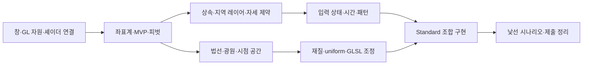

# 코딩 학습 순서

아래 순서는 이번 학습 목표에 맞춰 작성한 선수관계다. 공식 문서가 이 전체 교육 순서를 지정한 것은 아니다.

입문은 S001와 학습1, 기초는 S002/S003와 학습2~4, 중급은 S004/S005와 학습5~6 및 N제다. 먼저 순정 코드의 책임을 작성한 뒤 같은 책임을 Standard API로 대응한다. 연결된 중간고사 자료 및 나중의 기말고사 정리는 이 그래프에 합치지 않는다.
