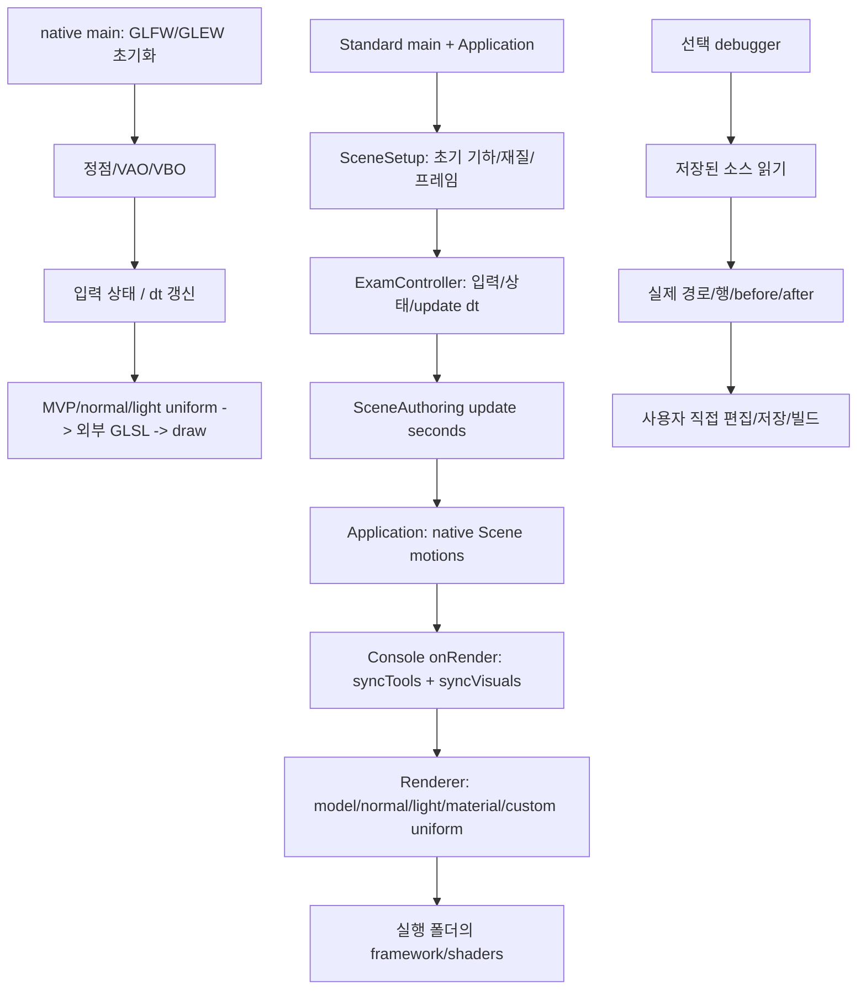

# 전체 코드 수정 전후

기준: `5487f4d0514598dca6c3b567e616b836e8e97773`. 이 코딩테스트 준비 작업을 시작하기 직전 커밋이다. 아래는 승인 범위의 작성 코드 전체 before/after이며 diff 일부가 아니다. 새 파일은 before 없음으로 표시한다. SDK·marked의 배포 사본은 별도 provenance에 경로·해시·원본 대응을 기록한다.

빌드·테스트·검증기·앱·브라우저는 실행하지 않았다. 행 번호 안내와 코드 스냅샷은 저장된 소스 기준이며 실행 성공 증거가 아니다.

## .gitignore

### Before

```text
# Prerequisites
*.d

# Compiled Object files
*.slo
*.lo
*.o
*.obj

# Precompiled Headers
*.gch
*.pch

# Compiled Dynamic libraries
*.so
*.dylib
*.dll

# Fortran module files
*.mod
*.smod

# Compiled Static libraries
*.lai
*.la
*.a
*.lib

# Executables
*.exe
*.out
*.app

# VS File for Copliot, vs set, and else..
*.vs

**/x64/
*.aps
*.vcxproj.user
.vs/

# Local OpenGL dependency locations and downloaded packages
OpenGL.local.props
/opengl_libs/
/opengl_libs.zip

# Vendored framework dependencies are source inputs, including x64 binaries.
!**/framework/dependencies/**/
!**/framework/dependencies/**/*.dll
!**/framework/dependencies/**/*.lib

# Generated MSVC state, NuGet cache, and graphify local state
*.pdb
*.idb
*.ipdb
*.iobj
*.ilk
*.tlog
*.lastbuildstate
*.exe.recipe
*.Build.CppClean.log
*.vcxproj.FileListAbsolute.txt
packages/
**/.graphify_python
**/.graphify_root
**/graphify-out/cache/
**/graphify-out/.graphify_detect.json
**/graphify-out/.graphify_ast.json
**/graphify-out/.graphify_extract.json
**/graphify-out/.graphify_semantic*.json
**/graphify-out/.graphify_analysis.json
**/graphify-out/.graphify_chunk_*.json
**/graphify-out/.graphify_cached.json
**/graphify-out/.graphify_uncached.txt
**/graphify-out/.needs_update

# OBJ model text is source data, not compiler output.
!**/framework/examples/data/*.obj
/dist/
/.obj-work/
```

### After

```text
# Prerequisites
*.d

# Compiled Object files
*.slo
*.lo
*.o
*.obj

# Precompiled Headers
*.gch
*.pch

# Compiled Dynamic libraries
*.so
*.dylib
*.dll

# Fortran module files
*.mod
*.smod

# Compiled Static libraries
*.lai
*.la
*.a
*.lib

# Executables
*.exe
*.out
*.app

# VS File for Copliot, vs set, and else..
*.vs

**/x64/
*.aps
*.vcxproj.user
.vs/

# Local OpenGL dependency locations and downloaded packages
OpenGL.local.props
/opengl_libs/
/opengl_libs.zip

# Vendored framework dependencies are source inputs, including x64 binaries.
!**/framework/dependencies/**/
!**/framework/dependencies/**/*.dll
!**/framework/dependencies/**/*.lib

# Generated MSVC state, NuGet cache, and graphify local state
*.pdb
*.idb
*.ipdb
*.iobj
*.ilk
*.tlog
*.lastbuildstate
*.exe.recipe
*.Build.CppClean.log
*.vcxproj.FileListAbsolute.txt
packages/
**/.graphify_python
**/.graphify_root
**/graphify-out/cache/
**/graphify-out/.graphify_detect.json
**/graphify-out/.graphify_ast.json
**/graphify-out/.graphify_extract.json
**/graphify-out/.graphify_semantic*.json
**/graphify-out/.graphify_analysis.json
**/graphify-out/.graphify_chunk_*.json
**/graphify-out/.graphify_cached.json
**/graphify-out/.graphify_uncached.txt
**/graphify-out/.needs_update

# OBJ model text is source data, not compiler output.
!**/framework/examples/data/*.obj
/dist/
/.obj-work/

# Standalone native learning project: vendored x64 SDK inputs, not build outputs.
!/coding-test-2/native/dependencies/**/*.dll
!/coding-test-2/native/dependencies/**/*.lib
```

## coding-test-2/assets/study.css

### Before

(새 파일: before 없음)

### After

```css
:root{color-scheme:light;--ink:#192d31;--muted:#5c6b6b;--paper:#faf9f5;--line:#d9ded9;--green:#136d59;--soft:#eef4ef}*{box-sizing:border-box}body{margin:0;background:var(--paper);color:var(--ink);font:16px/1.85 "Malgun Gothic",system-ui,sans-serif}header{display:flex;gap:24px;align-items:center;flex-wrap:wrap;padding:18px 32px;border-bottom:1px solid var(--line);background:#fff;position:sticky;top:0;z-index:2}header a{font:700 12px/1.5 Consolas,monospace;letter-spacing:.12em;color:var(--green);text-decoration:none}header strong{font-size:16px}#deadline{margin-left:auto;font:700 17px Consolas,monospace;color:var(--green)}.layout{display:grid;grid-template-columns:290px minmax(0,1fr);max-width:1500px;margin:auto}aside{padding:28px 22px;border-right:1px solid var(--line);height:calc(100vh - 84px);overflow:auto;position:sticky;top:84px}aside label{font-size:13px;font-weight:700}input[type=search],textarea{width:100%;border:1px solid #a9b9b0;border-radius:6px;padding:10px;background:white;color:var(--ink);font:inherit}nav h2{font-size:12px;letter-spacing:.04em;text-transform:uppercase;color:var(--muted);margin-top:24px}nav a{display:block;color:var(--ink);font-size:13px;line-height:1.6;text-decoration:none;padding:7px 8px;border-radius:4px}nav a:hover,nav a.active{background:#dfeee5;color:#0b513f}main{padding:40px clamp(20px,5vw,84px) 100px;min-width:0;max-width:1120px}h1{font-size:30px;line-height:1.4;letter-spacing:-.035em;margin:10px 0 24px}h2{font-size:21px;margin:38px 0 12px}h3{font-size:17px;margin-top:26px}p{margin:14px 0}a{color:#176e60;text-underline-offset:3px}li{padding:3px 0}pre{background:#152c30;color:#edf4ed;border-radius:8px;padding:22px;overflow:auto;position:relative;line-height:1.7}code{font:14px/1.7 Consolas,"Cascadia Code",monospace}p code,li code,td code{background:#e8ede6;padding:2px 5px;border-radius:3px}pre code{background:none;padding:0}pre .copy{display:block;margin:0 0 14px auto;color:#d9f3e8;background:#26464b;border:1px solid #587075}.source-wrap{max-width:100%;overflow:auto}.source{padding-left:65px;background:#152c30;color:#a4b9b7;white-space:pre;line-height:1.6;min-width:max-content}.source li{padding:0 20px 0 12px}.source li code{color:#edf4ed;background:none;display:block;padding:0}.source li::marker{font:12px Consolas,monospace}table{border-collapse:collapse;display:block;overflow:auto;font-size:14px;width:100%}td,th{padding:10px 14px;border:1px solid var(--line);text-align:left;vertical-align:top}th{background:var(--soft)}details{margin:16px 0;border:1px solid #bfd0c4;border-radius:7px;padding:12px 18px;background:#fff}summary{cursor:pointer;font-weight:700;color:var(--green)}details>section{padding-top:10px}button{cursor:pointer;border:1px solid #9db4a7;border-radius:5px;padding:7px 12px;background:white;color:#125741;font:600 13px/1.4 inherit}button:hover{background:#dcece1}.progress,.timer{display:flex;flex-wrap:wrap;gap:16px;align-items:center;border-bottom:1px solid var(--line);padding:12px 0;font-size:13px}.progress label{display:flex;align-items:center;gap:5px}.timer span{flex:1}.muted{font-size:13px;color:var(--muted)}.eyebrow{font:700 13px Consolas,monospace;color:var(--green)}footer{border-top:1px solid var(--line);padding:18px 30px;color:var(--muted);font-size:12px}blockquote{border-left:4px solid #639e83;padding:3px 18px;background:var(--soft)}:focus-visible{outline:3px solid #c19132;outline-offset:3px}@media(max-width:850px){header{position:static;padding:16px}.layout{display:block}aside{position:static;height:auto;max-height:320px;border-right:0;border-bottom:1px solid var(--line)}main{padding:26px 18px 70px}h1{font-size:25px}nav{columns:2}nav>div{break-inside:avoid}}@media print{header,aside,footer,.timer,button,.progress{display:none}.layout{display:block}main{padding:0;max-width:none}pre{white-space:pre-wrap;background:#eee;color:#111}details{break-inside:avoid}.source li code{color:#111}}
```

## coding-test-2/assets/study.js

### Before

(새 파일: before 없음)

### After

```javascript
/* Offline learning navigation. No requests, external services or code execution. */
(() => {
  'use strict';
  const book=JSON.parse(document.getElementById('book-data').textContent);
  const main=document.getElementById('main'), nav=document.getElementById('nav');
  const storageKey='ct2-study-progress-v1'; let progress={}, timer=null;
  try { progress=JSON.parse(localStorage.getItem(storageKey)||'{}'); } catch (_) { progress={}; }
  const docs=new Map(book.docs.map(d=>[d.id,d]));
  const questions=new Map([...book.exercises,...book.scenarios].map(q=>[q.id,q]));
  const sourceMap=new Map(book.sources.map(s=>[s.path,s]));
  const el=(tag,text,cls)=>{const n=document.createElement(tag);if(text!==undefined)n.textContent=text;if(cls)n.className=cls;return n;};
  function markdown(text,parent=main) { const n=el('section'); n.innerHTML=marked.parse(text); parent.append(n);return n; }
  function details(title,text,parent=main) { const d=el('details');d.append(el('summary',title));markdown(text,d);parent.append(d);return d; }
  function save() {try{localStorage.setItem(storageKey,JSON.stringify(progress));}catch(_){const note=el('p','브라우저에서 진도 저장을 허용하지 않습니다. 자료 열람은 가능합니다.','muted');main.append(note);}}
  function progressPanel(id) {
    const panel=el('div',undefined,'progress');
    for(const [key,title] of [['read','읽음'],['code','직접 작성'],['run','사용자 실행 확인']]) {
      const label=el('label'),input=el('input');input.type='checkbox';input.checked=Boolean(progress[id]?.[key]);
      input.addEventListener('change',()=>{progress[id]??={};progress[id][key]=input.checked;save();});
      label.append(input,document.createTextNode(title));panel.append(label);
    } main.append(panel);
  }
  function timerPanel(minutes) {
    const panel=el('div',undefined,'timer'),label=el('span'),start=el('button','연습 시작'),reset=el('button','초기화');
    let remaining=minutes*60,end=0,running=false;
    const show=()=>{label.textContent=`권장 연습 ${Math.floor(remaining/60)}:${String(remaining%60).padStart(2,'0')} · 실제 시험 시간 아님`;};
    const stop=()=>{clearInterval(timer);timer=null;running=false;start.textContent='계속';};
    start.onclick=()=>{if(running){remaining=Math.max(0,Math.ceil((end-Date.now())/1000));stop();show();return;}
      end=Date.now()+remaining*1000;running=true;start.textContent='정지';
      timer=setInterval(()=>{remaining=Math.max(0,Math.ceil((end-Date.now())/1000));show();if(!remaining){stop();label.textContent+=' · 시간 종료: 미완료 조건을 기록하세요.';}},250);
    };
    reset.onclick=()=>{stop();remaining=minutes*60;start.textContent='연습 시작';show();};
    show();panel.append(label,start,reset);main.append(panel);
  }
  function renderQuestion(q) {
    main.append(el('p',`${q.id} / ${q.track==='native'?'순정 OpenGL':'Standard'}`,'eyebrow'),el('h1',q.title));
    progressPanel(q.id);timerPanel(q.minutes);
    markdown('## 문제\n\n'+q.problem);
    details('상태·공간 설계 보기',q.design);
    q.hints.forEach((h,i)=>details(`힌트 ${i+1}`,h));
    details('해설과 수정 코드 펼치기',q.solution);
    markdown('## 사용자 관찰 기준\n\n'+q.observe.map(o=>'- '+o).join('\n'));
    const refs=el('section');refs.append(el('h2','코드·학습 참조'));
    for(const ref of q.refs) {
      const link=el('a',ref);const sourceRef=ref.split(':')[0];const source=sourceMap.has(sourceRef)?sourceRef:sourceMap.has('coding-test-2/'+sourceRef)?'coding-test-2/'+sourceRef:null;
      const id=ref.split(':')[0];
      if(source)link.href='#source:'+source;
      else if(docs.has(id)||questions.has(id))link.href='#'+id;
      else {link.href=ref.startsWith('standard/')||ref.startsWith('framework/')?'../'+ref:ref;}
      const row=el('p');row.append(link);refs.append(row);
    } main.append(refs);
    const area=el('textarea');area.rows=5;area.placeholder='처음 실패한 지점 / 상태·좌표계·uniform의 원인 / 다음에 바꿀 한 가지';area.setAttribute('aria-label','문항 복기 메모');area.value=progress[q.id]?.note||'';
    area.onchange=()=>{progress[q.id]??={};progress[q.id].note=area.value;save();};main.append(el('h2','직접 복기'),area);
  }
  function renderSource(path) {
    const source=sourceMap.get(path);if(!source){main.append(el('p','소스 스냅샷이 없습니다.'));return;}
    main.append(el('h1',path),el('p','생성 시점의 전체 소스입니다. 실제 편집 뒤 행 번호가 달라질 수 있습니다. 코드를 실행하지 않습니다.','muted'));
    const p=el('p');const link=el('a','실제 원본 파일 열기');link.href='../'+path;p.append(link);main.append(p);
    if(source.hooks.length) markdown('## 위치 표식\n\n'+source.hooks.map(h=>'- `'+h+'`').join('\n'));
    const wrap=el('div',undefined,'source-wrap'),button=el('button','전체 코드 복사'),list=el('ol',undefined,'source');
    button.onclick=()=>copy(source.text,button);
    source.text.trimEnd().split(/\r?\n/).forEach(line=>{const li=el('li'),code=el('code',line||' ');li.append(code);list.append(li);});
    wrap.append(button,list);main.append(wrap);
  }
  async function copy(text,button) {
    let ok=false;
    try{if(navigator.clipboard){await navigator.clipboard.writeText(text);ok=true;}}catch(_){}
    if(!ok){const t=el('textarea');t.value=text;t.style.position='fixed';t.style.opacity='0';document.body.append(t);t.select();try{ok=document.execCommand('copy');}catch(_){}t.remove();}
    button.textContent=ok?'복사됨':'직접 선택해 복사하세요';
  }
  function codeButtons() {main.querySelectorAll('pre').forEach(pre=>{const b=el('button','코드 복사');b.className='copy';b.onclick=()=>copy(pre.querySelector('code')?.textContent||pre.textContent,b);pre.prepend(b);});}
  function render() {
    if(timer){clearInterval(timer);timer=null;}main.replaceChildren();
    let id;try{id=decodeURIComponent(location.hash.slice(1))||'README.md';}catch(_){id='README.md';}
    if(questions.has(id))renderQuestion(questions.get(id));
    else if(id.startsWith('source:'))renderSource(id.slice(7));
    else if(id==='sources'){main.append(el('h1','전체 소스 읽기'));book.sources.forEach(s=>{const a=el('a',s.path);a.href='#source:'+s.path;const row=el('p');row.append(a);main.append(row);});}
    else {const d=docs.get(id)||docs.get('README.md');markdown(d.markdown);progressPanel(d.id);}
    codeButtons();nav.querySelectorAll('a').forEach(a=>a.classList.toggle('active',a.hash==='#'+id));window.scrollTo(0,0);
  }
  function navigation(filter='') {
    nav.replaceChildren();
    for(const [title,entries] of [['학습과 구현',book.docs],['순정 N제',book.exercises.filter(q=>q.track==='native')],['Standard N제',book.exercises.filter(q=>q.track==='standard')],['통합 시나리오',book.scenarios]]) {
      const group=el('div');group.append(el('h2',title));let count=0;
      entries.forEach(x=>{if(!(x.id+' '+x.title).toLowerCase().includes(filter.toLowerCase()))return;const a=el('a',(x.id.startsWith('CT2')?x.id+' · ':'')+x.title);a.href='#'+x.id;group.append(a);count++;});if(count)nav.append(group);
    } const a=el('a','전체 코드 · 실제 행 번호');a.href='#sources';nav.append(a);
  }
  main.addEventListener('click',event=>{
    const a=event.target.closest('a');if(!a)return;
    const href=a.getAttribute('href');if(!href||href.startsWith('#')||/^[a-z]+:/i.test(href))return;
    const current=decodeURIComponent(location.hash.slice(1))||'README.md';
    const base=current.includes('/')?current.slice(0,current.lastIndexOf('/')+1):'';
    const normalized=new URL(base+href,'https://offline.invalid/').pathname.slice(1);
    if(docs.has(normalized)||questions.has(normalized)){event.preventDefault();location.hash=normalized;}
    else if(/CT2-[NS]\d\d\.md$/.test(normalized)){const id=normalized.match(/CT2-[NS]\d\d/)[0];if(questions.has(id)){event.preventDefault();location.hash=id;}}
  });
  const now=new Date(),today=Date.UTC(now.getFullYear(),now.getMonth(),now.getDate()),exam=Date.UTC(2026,10,24),days=Math.round((exam-today)/86400000);
  document.getElementById('deadline').textContent=days>0?`D-${days}`:days===0?'시험일':`시험일 +${-days}일`;
  document.getElementById('search').oninput=e=>navigation(e.target.value);
  window.addEventListener('hashchange',render);navigation();render();
})();
```

## coding-test-2/native/Toolchain.props

### Before

(새 파일: before 없음)

### After

```xml
<?xml version="1.0" encoding="utf-8"?>
<Project xmlns="http://schemas.microsoft.com/developer/msbuild/2003">
  <!-- Import after Microsoft.Cpp.Default.props and before Microsoft.Cpp.props. -->
  <PropertyGroup>
    <GraphicsToolsetRoot>$(VCTargetsPath)\Platforms\x64\PlatformToolsets</GraphicsToolsetRoot>
    <PlatformToolset Condition="'$(PlatformToolset)'=='' and '$(DefaultPlatformToolset)'!='' and Exists('$(GraphicsToolsetRoot)\$(DefaultPlatformToolset)\Toolset.props')">$(DefaultPlatformToolset)</PlatformToolset>
    <PlatformToolset Condition="'$(PlatformToolset)'=='' and Exists('$(GraphicsToolsetRoot)\v143\Toolset.props')">v143</PlatformToolset>
    <PlatformToolset Condition="'$(PlatformToolset)'=='' and Exists('$(GraphicsToolsetRoot)\v145\Toolset.props')">v145</PlatformToolset>
  </PropertyGroup>
  <Target Name="ExplainGraphicsToolchain" BeforeTargets="PrepareForBuild">
    <Message Importance="High" Text="Native OpenGL toolchain: VS=$(VisualStudioVersion); Platform=$(Platform); Toolset=$(PlatformToolset); VCTargetsPath=$(VCTargetsPath)" />
    <Error Condition="'$(PlatformToolset)'=='' or !Exists('$(GraphicsToolsetRoot)\$(PlatformToolset)\Toolset.props')" Text="OpenGL toolset unavailable: $(PlatformToolset). Expected $(GraphicsToolsetRoot)\$(PlatformToolset)\Toolset.props. VS 2022: install Desktop development with C++ and MSVC v143, then open the .sln (not .slnx on older VS). For a deliberate toolset override, install that toolset or change Platform Toolset in Project Properties." />
  </Target>
</Project>
```

## coding-test-2/native/main.cpp

### Before

(새 파일: before 없음)

### After

```cpp
#define WIN32_LEAN_AND_MEAN
#define NOMINMAX
#define GLFW_INCLUDE_NONE
#include <GL/glew.h>
#include <GLFW/glfw3.h>
#include <Windows.h>
#include <glm/glm.hpp>
#include <glm/gtc/matrix_transform.hpp>
#include <glm/gtc/type_ptr.hpp>
#include <algorithm>
#include <array>
#include <cmath>
#include <cstddef>
#include <filesystem>
#include <fstream>
#include <iostream>
#include <sstream>
#include <stdexcept>
#include <vector>

// No project Framework.h: context, GPU buffers, GLSL and uniforms are written here.
constexpr double pi = 3.14159265358979323846;
struct Vertex { glm::vec3 position, normal; };
struct Mesh { GLuint vao = 0, vbo = 0; GLsizei count = 0; GLenum mode = GL_TRIANGLES; };
// @debug hook state
struct State {
    double lightDegrees = 56.309932, objectDegrees = 0;
    float radius = 3.605551f, lightHeight = 4, gain = 1;
    int lightDirection = 0, cameraDirection = 0, objectDirection = 0, shape = 0, color = 0, studyView = 0;
    bool lighting = true, paused = false;
    glm::vec3 camera{6, 4, 8}, target{0}, position{0}, scale{2, 1, .5f}, pivot{0};
    std::array<bool, 4> move{};
};
int toggleDirection(int current, int desired) { return current == desired ? 0 : desired; }
std::filesystem::path executableDirectory() {
    std::vector<wchar_t> buffer(32768);
    const DWORD size = GetModuleFileNameW(nullptr, buffer.data(), DWORD(buffer.size()));
    if (!size || size == buffer.size()) throw std::runtime_error("Executable path unavailable.");
    return std::filesystem::path(std::wstring(buffer.data(), size)).parent_path();
}
std::string readText(const std::filesystem::path& path) {
    std::ifstream input(path, std::ios::binary);
    if (!input) throw std::runtime_error("Cannot read shader: " + path.u8string());
    std::ostringstream out; out << input.rdbuf(); auto text = out.str();
    if (text.compare(0, 3, "\xEF\xBB\xBF") == 0) text.erase(0, 3);
    return text;
}
GLuint compile(GLenum kind, const std::filesystem::path& path) {
    const auto source = readText(path); const char* data = source.c_str();
    const auto shader = glCreateShader(kind);
    if (!shader) throw std::runtime_error("glCreateShader failed.");
    glShaderSource(shader, 1, &data, nullptr); glCompileShader(shader);
    GLint ok = 0; glGetShaderiv(shader, GL_COMPILE_STATUS, &ok);
    if (!ok) {
        GLint size = 0; glGetShaderiv(shader, GL_INFO_LOG_LENGTH, &size);
        std::string log(std::size_t(std::max(size, 1)), '\0');
        glGetShaderInfoLog(shader, GLsizei(log.size()), nullptr, log.data()); glDeleteShader(shader);
        throw std::runtime_error(path.u8string() + "\n" + log);
    }
    return shader;
}
GLuint program(const std::filesystem::path& directory) {
    GLuint v = 0, f = 0, p = 0;
    try {
        v = compile(GL_VERTEX_SHADER, directory / "VertexShader.glsl");
        f = compile(GL_FRAGMENT_SHADER, directory / "FragmentShader.glsl");
        p = glCreateProgram(); if (!p) throw std::runtime_error("glCreateProgram failed.");
        glAttachShader(p, v); glAttachShader(p, f); glLinkProgram(p);
        GLint ok = 0; glGetProgramiv(p, GL_LINK_STATUS, &ok);
        if (!ok) {
            GLint size = 0; glGetProgramiv(p, GL_INFO_LOG_LENGTH, &size);
            std::string log(std::size_t(std::max(size, 1)), '\0');
            glGetProgramInfoLog(p, GLsizei(log.size()), nullptr, log.data());
            throw std::runtime_error("GLSL link failed:\n" + log);
        }
        glDeleteShader(v); glDeleteShader(f); return p;
    } catch (...) { if (v) glDeleteShader(v); if (f) glDeleteShader(f); if (p) glDeleteProgram(p); throw; }
}
void triangle(std::vector<Vertex>& vertices, glm::vec3 a, glm::vec3 b, glm::vec3 c) {
    const auto normal = glm::normalize(glm::cross(b - a, c - a));
    for (const auto p : {a, b, c}) vertices.push_back({p, normal});
}
std::vector<Vertex> cube() {
    const glm::vec3 p[] = {{-.5f,-.5f,-.5f},{.5f,-.5f,-.5f},{.5f,.5f,-.5f},{-.5f,.5f,-.5f},
                          {-.5f,-.5f,.5f},{.5f,-.5f,.5f},{.5f,.5f,.5f},{-.5f,.5f,.5f}};
    const int faces[][4] = {{0,3,2,1},{4,5,6,7},{0,4,7,3},{1,2,6,5},{3,7,6,2},{0,1,5,4}};
    std::vector<Vertex> result;
    for (const auto& f : faces) { triangle(result,p[f[0]],p[f[1]],p[f[2]]); triangle(result,p[f[0]],p[f[2]],p[f[3]]); }
    return result;
}
std::vector<Vertex> pyramid() {
    const glm::vec3 a{-.5f,-.5f,-.5f}, b{.5f,-.5f,-.5f}, c{.5f,-.5f,.5f}, d{-.5f,-.5f,.5f}, top{0,.5f,0};
    std::vector<Vertex> result;
    triangle(result,b,a,top); triangle(result,c,b,top); triangle(result,d,c,top); triangle(result,a,d,top);
    triangle(result,a,c,d); triangle(result,a,b,c); return result;
}
std::vector<Vertex> sphere() {
    std::vector<Vertex> result;
    const auto point = [](int y, int x) {
        const double latitude = -pi / 2 + pi * y / 16, longitude = 2 * pi * x / 24;
        return glm::vec3(float(std::cos(latitude)*std::cos(longitude)),float(std::sin(latitude)),float(std::cos(latitude)*std::sin(longitude)));
    };
    const auto append = [&](glm::vec3 a, glm::vec3 b, glm::vec3 c) {
        for (const auto p : {a,b,c}) result.push_back({p*.5f,p});
    };
    for (int y = 0; y < 16; ++y) for (int x = 0; x < 24; ++x) {
        const auto a=point(y,x), b=point(y,x+1), c=point(y+1,x+1), d=point(y+1,x);
        if (y > 0) append(a,c,b);
        if (y < 15) append(a,d,c);
    }
    return result;
}
Mesh upload(const std::vector<Vertex>& vertices, GLenum mode = GL_TRIANGLES) {
    Mesh mesh; mesh.mode=mode; mesh.count=GLsizei(vertices.size());
    glGenVertexArrays(1,&mesh.vao); glGenBuffers(1,&mesh.vbo); glBindVertexArray(mesh.vao);
    glBindBuffer(GL_ARRAY_BUFFER,mesh.vbo); glBufferData(GL_ARRAY_BUFFER,GLsizeiptr(vertices.size()*sizeof(Vertex)),vertices.data(),GL_DYNAMIC_DRAW);
    glVertexAttribPointer(0,3,GL_FLOAT,GL_FALSE,sizeof(Vertex),reinterpret_cast<void*>(offsetof(Vertex,position)));
    glEnableVertexAttribArray(0);
    glVertexAttribPointer(1,3,GL_FLOAT,GL_FALSE,sizeof(Vertex),reinterpret_cast<void*>(offsetof(Vertex,normal)));
    glEnableVertexAttribArray(1); glBindVertexArray(0); return mesh;
}
GLint location(GLuint p, const char* name) {
    const GLint value=glGetUniformLocation(p,name);
    if(value<0) throw std::runtime_error(std::string("Uniform missing or optimized out: ")+name);
    return value;
}
void matrix(GLuint p,const char* name,const glm::mat4& m) { glUniformMatrix4fv(location(p,name),1,GL_FALSE,glm::value_ptr(m)); }
void vector(GLuint p,const char* name,glm::vec3 v) { glUniform3fv(location(p,name),1,glm::value_ptr(v)); }
void scalar(GLuint p,const char* name,float v) { glUniform1f(location(p,name),v); }
void integer(GLuint p,const char* name,int v) { glUniform1i(location(p,name),v); }
void draw(GLuint p,const Mesh& mesh,const glm::mat4& model,glm::vec3 color,bool unlit=false) {
    matrix(p,"model",model);
    const auto normal=glm::transpose(glm::inverse(glm::mat3(model)));
    glUniformMatrix3fv(location(p,"normalMatrix"),1,GL_FALSE,glm::value_ptr(normal));
    vector(p,"objectColor",color); integer(p,"unlit",unlit ? 1 : 0);
    glBindVertexArray(mesh.vao); glDrawArrays(mesh.mode,0,mesh.count);
}

// @debug hook input
void key(GLFWwindow* window,int key,int,int action,int mods) {
    auto& state=*static_cast<State*>(glfwGetWindowUserPointer(window));
    const int keys[]={GLFW_KEY_W,GLFW_KEY_A,GLFW_KEY_S,GLFW_KEY_D};
    for(std::size_t i=0;i<state.move.size();++i) if(key==keys[i]) state.move[i]=action!=GLFW_RELEASE;
    if(action!=GLFW_PRESS) return;
    const int direction=mods&GLFW_MOD_SHIFT ? -1 : 1;
    if(key==GLFW_KEY_ESCAPE || key==GLFW_KEY_Q) glfwSetWindowShouldClose(window,GLFW_TRUE);
    if(key==GLFW_KEY_M) state.lighting=!state.lighting;
    if(key==GLFW_KEY_C) state.color=(state.color+1)%3;
    if(key==GLFW_KEY_N) state.shape=(state.shape+1)%3;
    if(key==GLFW_KEY_Y) state.lightDirection=toggleDirection(state.lightDirection,direction);
    if(key==GLFW_KEY_R) state.cameraDirection=toggleDirection(state.cameraDirection,direction);
    if(key==GLFW_KEY_P) state.objectDirection=state.objectDirection ? 0 : 1;
    if(key==GLFW_KEY_Z) state.radius=std::max(.25f,state.radius+(mods&GLFW_MOD_SHIFT ? .25f : -.25f));
    if(key==GLFW_KEY_F2) state.studyView=(state.studyView+1)%4;
    if(key==GLFW_KEY_G) state.gain=state.gain==1 ? 1.5f : 1;
    if(key==GLFW_KEY_SPACE) state.paused=!state.paused;
    if(key==GLFW_KEY_HOME) state=State{};
}
// @debug hook update
void update(State& state,float dt) {
    if(state.paused) return;
    state.lightDegrees=std::remainder(state.lightDegrees+state.lightDirection*45*dt,360.0);
    state.objectDegrees=std::remainder(state.objectDegrees+state.objectDirection*35*dt,360.0);
    auto move=glm::vec3(int(state.move[3])-int(state.move[1]),0,int(state.move[2])-int(state.move[0]));
    if(glm::length(move)>0) state.camera+=glm::normalize(move)*3.f*dt;
    const auto orbit=glm::rotate(glm::mat4(1),glm::radians(state.cameraDirection*35.f*dt),glm::vec3(0,1,0));
    state.camera=state.target+glm::vec3(orbit*glm::vec4(state.camera-state.target,0));
}
int main() {
    SetConsoleOutputCP(CP_UTF8);
    GLFWwindow* window=nullptr; bool initialized=false, gpu=false; GLuint shader=0;
    std::vector<Mesh> meshes; int result=0;
    try {
        if(!glfwInit()) throw std::runtime_error("glfwInit failed."); initialized=true;
        glfwWindowHint(GLFW_CONTEXT_VERSION_MAJOR,3); glfwWindowHint(GLFW_CONTEXT_VERSION_MINOR,3);
        glfwWindowHint(GLFW_OPENGL_PROFILE,GLFW_OPENGL_CORE_PROFILE);
        window=glfwCreateWindow(1100,760,"Native OpenGL - Coding Test 2",nullptr,nullptr);
        if(!window) throw std::runtime_error("OpenGL 3.3 core window creation failed.");
        glfwMakeContextCurrent(window); glewExperimental=GL_TRUE;
        if(glewInit()!=GLEW_OK) throw std::runtime_error("glewInit failed."); gpu=true;
        while(glGetError()!=GL_NO_ERROR) {} // GLEW core-context initialization can leave GL_INVALID_ENUM.
        glfwSwapInterval(1); glEnable(GL_DEPTH_TEST);
        State state; glfwSetWindowUserPointer(window,&state); glfwSetKeyCallback(window,key);
        glfwSetWindowFocusCallback(window,[](GLFWwindow* w,int focused) {
            if(!focused) static_cast<State*>(glfwGetWindowUserPointer(w))->move.fill(false);
        });
        // @debug hook shader
        shader=program(executableDirectory()/"shaders");
        meshes.push_back(upload(cube())); meshes.push_back(upload(pyramid())); meshes.push_back(upload(sphere()));
        std::vector<Vertex> circle(64);
        meshes.push_back(upload(circle,GL_LINE_LOOP));
        float previousRadius=-1,previousHeight=0;
        double previous=glfwGetTime();
        std::cout<<"Native: n box/pyramid/sphere | m light | c color | y/Y light orbit | z/Z radius\n"
                    "w/a/s/d camera XZ | r/R camera orbit | p object spin | F2 shader view | g gain\n"
                    "Space pause | Home reset | q/Esc quit. Edit main.cpp and shaders directly.\n";
        while(!glfwWindowShouldClose(window)) {
            glfwPollEvents(); const double now=glfwGetTime();
            const float dt=float(std::clamp(now-previous,0.0,.05)); previous=now;
            update(state,dt);
            int width=0,height=0; glfwGetFramebufferSize(window,&width,&height);
            if(width<=0 || height<=0) { glfwWaitEventsTimeout(.05); continue; }
            glViewport(0,0,width,height); glClearColor(.08f,.10f,.14f,1); glClear(GL_COLOR_BUFFER_BIT|GL_DEPTH_BUFFER_BIT);
            glUseProgram(shader);
            const auto view=glm::lookAt(state.camera,state.target,glm::vec3(0,1,0));
            const auto projection=glm::perspective(glm::radians(45.f),float(width)/height,.1f,100.f);
            matrix(shader,"view",view); matrix(shader,"projection",projection);
            const auto point=[&](double degrees) { const double a=degrees*pi/180;
                return glm::vec3(state.radius*float(std::cos(a)),state.lightHeight,state.radius*float(std::sin(a))); };
            const glm::vec3 colors[]={{1,1,1},{1,.3f,.2f},{.2f,.5f,1}};
            // @debug hook uniform
            vector(shader,"lightPosition",point(state.lightDegrees)); vector(shader,"lightColor",colors[state.color]);
            vector(shader,"viewPosition",state.camera); integer(shader,"lighting",state.lighting ? 1 : 0);
            integer(shader,"studyView",state.studyView); scalar(shader,"Ka",.25f); scalar(shader,"Kd",1);
            scalar(shader,"Ks",.8f); scalar(shader,"shininess",64); scalar(shader,"attenuation",.02f); scalar(shader,"gain",state.gain);
            // Model-local pivot: world = T(position) * R * S * T(-pivot).
            auto model=glm::rotate(glm::translate(glm::mat4(1),state.position),glm::radians(float(state.objectDegrees)),glm::vec3(0,1,0));
            model=glm::scale(model,state.scale)*glm::translate(glm::mat4(1),-state.pivot);
            draw(shader,meshes[std::size_t(state.shape)],model,{.3f,.7f,.9f});
            draw(shader,meshes[2],glm::translate(glm::mat4(1),glm::vec3(-2,0,0)),{.9f,.4f,.2f});
            draw(shader,meshes[2],glm::translate(glm::mat4(1),glm::vec3(2.5f,0,0)),{.3f,.9f,.4f});
            draw(shader,meshes[0],glm::scale(glm::translate(glm::mat4(1),glm::vec3(0,-1.2f,0)),glm::vec3(10,.2f,10)),{.25f,.3f,.3f});
            draw(shader,meshes[0],glm::scale(glm::translate(glm::mat4(1),point(state.lightDegrees)),glm::vec3(.15f)),colors[state.color],true);
            if(previousRadius!=state.radius || previousHeight!=state.lightHeight) {
                for(std::size_t i=0;i<circle.size();++i) circle[i]={point(360.0*i/circle.size()),{0,1,0}};
                glBindBuffer(GL_ARRAY_BUFFER,meshes[3].vbo);
                glBufferSubData(GL_ARRAY_BUFFER,0,GLsizeiptr(circle.size()*sizeof(Vertex)),circle.data());
                previousRadius=state.radius; previousHeight=state.lightHeight;
            }
            draw(shader,meshes[3],glm::mat4(1),{.35f,.4f,.45f},true);
            glfwSwapBuffers(window);
        }
    } catch(const std::exception& error) { std::cerr<<error.what()<<'\n'; result=1; }
    if(gpu) {
        for(const auto& mesh:meshes) { glDeleteBuffers(1,&mesh.vbo); glDeleteVertexArrays(1,&mesh.vao); }
        if(shader) glDeleteProgram(shader);
    }
    if(window) glfwDestroyWindow(window);
    if(initialized) glfwTerminate();
    return result;
}
```

## coding-test-2/native/native.sln

### Before

(새 파일: before 없음)

### After

```text
Microsoft Visual Studio Solution File, Format Version 12.00
# Visual Studio Version 17
VisualStudioVersion = 17.0.31903.59
MinimumVisualStudioVersion = 10.0.40219.1
Project("{BC8A1FFA-BEE3-4634-8014-F334798102B3}") = "native", "native.vcxproj", "{7DF5AC70-6E06-4F77-9C40-67AA242E51A4}"
EndProject
Global
	GlobalSection(SolutionConfigurationPlatforms) = preSolution
		Debug|x64 = Debug|x64
		Release|x64 = Release|x64
	EndGlobalSection
	GlobalSection(ProjectConfigurationPlatforms) = postSolution
		{7DF5AC70-6E06-4F77-9C40-67AA242E51A4}.Debug|x64.ActiveCfg = Debug|x64
		{7DF5AC70-6E06-4F77-9C40-67AA242E51A4}.Debug|x64.Build.0 = Debug|x64
		{7DF5AC70-6E06-4F77-9C40-67AA242E51A4}.Release|x64.ActiveCfg = Release|x64
		{7DF5AC70-6E06-4F77-9C40-67AA242E51A4}.Release|x64.Build.0 = Release|x64
	EndGlobalSection
EndGlobal
```

## coding-test-2/native/native.vcxproj

### Before

(새 파일: before 없음)

### After

```xml
<?xml version="1.0" encoding="utf-8"?>
<Project DefaultTargets="Build" xmlns="http://schemas.microsoft.com/developer/msbuild/2003">
  <ItemGroup Label="ProjectConfigurations">
    <ProjectConfiguration Include="Debug|x64"><Configuration>Debug</Configuration><Platform>x64</Platform></ProjectConfiguration>
    <ProjectConfiguration Include="Release|x64"><Configuration>Release</Configuration><Platform>x64</Platform></ProjectConfiguration>
  </ItemGroup>
  <PropertyGroup Label="Globals"><ProjectGuid>{7DF5AC70-6E06-4F77-9C40-67AA242E51A4}</ProjectGuid><Keyword>Win32Proj</Keyword><ProjectName>native</ProjectName><WindowsTargetPlatformVersion>10.0</WindowsTargetPlatformVersion></PropertyGroup>
  <Import Project="$(VCTargetsPath)\Microsoft.Cpp.Default.props" />
  <Import Project="Toolchain.props" />
  <PropertyGroup Label="Configuration">
    <ConfigurationType>Application</ConfigurationType><CharacterSet>Unicode</CharacterSet>
    <UseDebugLibraries Condition="'$(Configuration)'=='Debug'">true</UseDebugLibraries>
    <UseDebugLibraries Condition="'$(Configuration)'=='Release'">false</UseDebugLibraries>
  </PropertyGroup>
  <Import Project="$(VCTargetsPath)\Microsoft.Cpp.props" />
  <PropertyGroup><OutDir>$(ProjectDir)x64\$(Configuration)\</OutDir><IntDir>$(ProjectDir)x64\$(Configuration)\obj\</IntDir></PropertyGroup>
  <ItemDefinitionGroup>
    <ClCompile><LanguageStandard>stdcpp17</LanguageStandard><WarningLevel>Level4</WarningLevel><AdditionalOptions>/utf-8 /FC %(AdditionalOptions)</AdditionalOptions><RuntimeLibrary Condition="'$(Configuration)'=='Debug'">MultiThreadedDebug</RuntimeLibrary><RuntimeLibrary Condition="'$(Configuration)'=='Release'">MultiThreaded</RuntimeLibrary><AdditionalIncludeDirectories>$(ProjectDir)dependencies\glew\include;$(ProjectDir)dependencies\glfw\include;$(ProjectDir)dependencies\glm;%(AdditionalIncludeDirectories)</AdditionalIncludeDirectories></ClCompile>
    <Link><SubSystem>Console</SubSystem><GenerateDebugInformation>true</GenerateDebugInformation><AdditionalDependencies>$(ProjectDir)dependencies\glew\lib\glew32.lib;$(ProjectDir)dependencies\glfw\lib\glfw3dll.lib;opengl32.lib;%(AdditionalDependencies)</AdditionalDependencies></Link>
  </ItemDefinitionGroup>
  <ItemGroup><ClCompile Include="main.cpp" /><None Include="shaders\VertexShader.glsl" /><None Include="shaders\FragmentShader.glsl" /></ItemGroup>
  <Import Project="$(VCTargetsPath)\Microsoft.Cpp.targets" />
  <Target Name="DeployNativeRuntime" AfterTargets="Build">
    <Copy SourceFiles="$(ProjectDir)dependencies\glew\bin\glew32.dll;$(ProjectDir)dependencies\glfw\bin\glfw3.dll;$(ProjectDir)dependencies\glfw\bin\vcruntime140.dll" DestinationFolder="$(TargetDir)" SkipUnchangedFiles="true" />
    <Copy SourceFiles="$(ProjectDir)shaders\VertexShader.glsl;$(ProjectDir)shaders\FragmentShader.glsl" DestinationFolder="$(TargetDir)shaders\" SkipUnchangedFiles="true" />
    <Copy SourceFiles="$(ProjectDir)dependencies\glew\LICENSE.txt;$(ProjectDir)dependencies\glfw\LICENSE.md;$(ProjectDir)dependencies\glfw\LICENSE-Microsoft-VC-Runtime.md" DestinationFolder="$(TargetDir)licenses\" SkipUnchangedFiles="true" />
  </Target>
</Project>
```

## coding-test-2/native/shaders/FragmentShader.glsl

### Before

(새 파일: before 없음)

### After

```glsl
#version 330 core
in vec3 worldPosition;
in vec3 worldNormal;
out vec4 fragmentColor;
uniform vec3 objectColor, lightPosition, lightColor, viewPosition;
uniform float Ka, Kd, Ks, shininess, attenuation, gain;
uniform bool lighting, unlit;
uniform int studyView;
void main() {
    if (!lighting || unlit) { fragmentColor = vec4(objectColor, 1.0); return; }
    vec3 N = normalize(worldNormal);
    vec3 delta = lightPosition - worldPosition;
    float distance2 = dot(delta, delta);
    vec3 L = delta / sqrt(max(distance2, 1e-12));
    vec3 V = normalize(viewPosition - worldPosition);
    vec3 ambient = Ka * vec3(0.2);
    vec3 diffuse = Kd * max(dot(N, L), 0.0) * lightColor;
    float facing = dot(N, L) > 0.0 ? 1.0 : 0.0;
    vec3 specular = facing * Ks * pow(max(dot(V, reflect(-L, N)), 0.0), shininess) * lightColor;
    vec3 result = objectColor * (ambient + (diffuse + specular) / (1.0 + attenuation * distance2));
    if (studyView == 1) result = N * 0.5 + 0.5;
    if (studyView == 2) result = objectColor * diffuse / (1.0 + attenuation * distance2);
    if (studyView == 3) result = objectColor * specular / (1.0 + attenuation * distance2);
    fragmentColor = vec4(result * gain, 1.0);
}
```

## coding-test-2/native/shaders/VertexShader.glsl

### Before

(새 파일: before 없음)

### After

```glsl
#version 330 core
layout(location=0) in vec3 position;
layout(location=1) in vec3 normal;
uniform mat4 model, view, projection;
uniform mat3 normalMatrix;
out vec3 worldPosition;
out vec3 worldNormal;
void main() {
    gl_Position = projection * view * model * vec4(position, 1.0);
    worldPosition = (model * vec4(position, 1.0)).xyz;
    worldNormal = normalMatrix * normal;
}
```

## framework/detail/SceneAuthoring.cpp

### Before

```cpp
#include "../include/SceneAuthoring.h"
#include <stdexcept>

namespace graphics {
namespace {
void requireAuthoring(bool ok, const char* message) {
    if (!ok) throw std::runtime_error(message);
}
bool finite(const glm::vec3& value) {
    return std::isfinite(value.x) && std::isfinite(value.y) && std::isfinite(value.z);
}
bool nonsingular(const glm::mat4& matrix) {
    const auto determinant = glm::determinant(glm::mat3(matrix));
    return TransformSystem::validAffine(matrix) && std::isfinite(determinant) && std::abs(determinant) > 1e-18f;
}
glm::mat4 rotation(const glm::vec3& degrees) {
    requireAuthoring(finite(degrees), "SceneAuthoring: rotation must be finite.");
    glm::mat4 result(1);
    result = glm::rotate(result, glm::radians(degrees.z), glm::vec3(0, 0, 1));
    result = glm::rotate(result, glm::radians(degrees.y), glm::vec3(0, 1, 0));
    return glm::rotate(result, glm::radians(degrees.x), glm::vec3(1, 0, 0));
}
glm::mat4 layerMatrix(const LayerSetup& setup, double seconds) {
    requireAuthoring(finite(setup.translation) && finite(setup.scale) && finite(setup.pivot) &&
        finite(setup.spinAxis) && std::isfinite(setup.spinDegreesPerSecond), "SceneAuthoring: invalid layer values.");
    glm::mat4 spin(1);
    if (setup.spinDegreesPerSecond != 0) {
        requireAuthoring(glm::length(setup.spinAxis) > 1e-6f, "SceneAuthoring: spin axis is zero.");
        const double angle = setup.spinDegreesPerSecond * seconds;
        requireAuthoring(std::isfinite(angle), "SceneAuthoring: spin time overflow.");
        spin = glm::rotate(glm::mat4(1), float(glm::radians(std::remainder(angle, 360.0))), glm::normalize(setup.spinAxis));
    }
    const auto result = glm::translate(glm::mat4(1), setup.translation + setup.pivot) *
        rotation(setup.rotationDegrees) * spin * glm::scale(glm::mat4(1), setup.scale) *
        glm::translate(glm::mat4(1), -setup.pivot);
    requireAuthoring(nonsingular(result),
        "SceneAuthoring: layer scale must be invertible.");
    return result;
}
bool validColor(GlColor color) {
    return std::isfinite(color.red) && std::isfinite(color.green) && std::isfinite(color.blue) &&
        color.red >= 0 && color.green >= 0 && color.blue >= 0;
}
}

void SceneAuthoring::clear() {
    app_.getScene().clear(); objects_.clear(); layers_.clear(); lights_.clear();
    camera_.reset(); cameraParent_.clear(); app_.getRenderOptions().pointLights.clear();
}
EntityId SceneAuthoring::object(const std::string& name) const {
    const auto found = objects_.find(name);
    if (found == objects_.end()) throw std::runtime_error("SceneAuthoring: missing object: " + name);
    return found->second;
}
std::string SceneAuthoring::name(EntityId id) const {
    for (const auto& item : objects_) if (item.second == id) return item.first;
    return {};
}
EntityId SceneAuthoring::addObject(const std::string& name, const ObjectSetup& setup, const std::string& parent) {
    requireAuthoring(!name.empty() && !objects_.count(name), "SceneAuthoring: duplicate/empty object name.");
    requireAuthoring(setup.shape == GLShape::Cube || setup.shape == GLShape::Tetra || setup.shape == GLShape::Pyramid,
        "SceneAuthoring: use native Scene APIs for other model types.");
    requireAuthoring(finite(setup.size) && glm::all(glm::greaterThan(setup.size, glm::vec3(0))) &&
        finite(setup.position) && finite(setup.pivot) && finite(setup.scale), "SceneAuthoring: invalid object values.");
    const auto parentId = parent.empty() ? std::optional<EntityId>{} : std::optional<EntityId>{object(parent)};
    Transform3D pose;
    pose.basis = setup.position; pose.rotation = glm::mat3(rotation(setup.rotationDegrees));
    pose.scale = setup.scale; pose.localBasis = setup.pivot;
    const auto world = DiagramSystem::modelMatrix(pose);
    requireAuthoring(nonsingular(world),
        "SceneAuthoring: object scale must be invertible.");
    auto model = DiagramSystem::makePolyhedron(setup.shape, setup.size);
    for (auto& face : model.faces) face.material = setup.material;
    auto saved = app_.getScene();
    try {
        const auto id = app_.getScene().push_entity(model);
        requireAuthoring(id.has_value(), "SceneAuthoring: object creation failed.");
        requireAuthoring(app_.getScene().setParent(*id, parentId) && app_.getScene().setWorldPlacement(*id, world),
            "SceneAuthoring: parent/world placement failed.");
        objects_.emplace(name, *id);
        return *id;
    } catch (...) { app_.getScene() = std::move(saved); throw; }
}
void SceneAuthoring::addLayer(const std::string& objectName, const std::string& name, const LayerSetup& setup) {
    const auto id = object(objectName);
    requireAuthoring(!name.empty(), "SceneAuthoring: empty layer name.");
    std::size_t count = 0;
    for (const auto& layer : layers_) if (layer.object == objectName) {
        requireAuthoring(layer.name != name, "SceneAuthoring: duplicate object-local layer name."); ++count;
    }
    requireAuthoring(count < 128, "SceneAuthoring: at most 128 layers per object.");
    std::vector<glm::mat4> initial;
    for (const auto& layer : layers_) if (layer.object == objectName) initial.push_back(layerMatrix(layer.setup, 0));
    initial.push_back(layerMatrix(setup, 0));
    // Materialize initial layers before a later child computes its world-authored attachment.
    requireAuthoring(app_.getScene().setLocalLayers(id, initial), "SceneAuthoring: invalid initial local layers.");
    layers_.push_back({objectName, name, setup});
}
void SceneAuthoring::addLight(const std::string& name, const PointLight& light, const std::string& parent) {
    requireAuthoring(!name.empty() && lights_.size() < 8, "SceneAuthoring: empty name or more than eight point lights.");
    for (const auto& item : lights_) requireAuthoring(item.name != name, "SceneAuthoring: duplicate light name.");
    if (!parent.empty()) object(parent);
    requireAuthoring(finite(light.position) && validColor(light.color) && std::isfinite(light.intensity) &&
        light.intensity >= 0 && std::isfinite(light.attenuation) && light.attenuation >= 0, "SceneAuthoring: invalid point light.");
    lights_.push_back({name, parent, light});
}
void SceneAuthoring::setCamera(const Camera& camera, const std::string& parent) {
    if (!parent.empty()) object(parent);
    requireAuthoring(CameraSystem::validCamera(camera), "SceneAuthoring: invalid camera.");
    camera_ = camera; cameraParent_ = parent;
}
void SceneAuthoring::update(double seconds) {
    requireAuthoring(std::isfinite(seconds) && seconds >= 0, "SceneAuthoring: time must be finite and nonnegative.");
    std::map<EntityId, std::vector<glm::mat4>> matrices;
    for (const auto& layer : layers_) matrices[object(layer.object)].push_back(layerMatrix(layer.setup, seconds));
    for (const auto& item : matrices)
        requireAuthoring(app_.getScene().setLocalLayers(item.first, item.second), "SceneAuthoring: invalid composed local layers.");
    std::vector<PointLight> lights;
    for (const auto& item : lights_) {
        auto light = item.value;
        if (!item.parent.empty()) {
            const auto frame = app_.getScene().worldMatrix(object(item.parent));
            requireAuthoring(frame.has_value(), "SceneAuthoring: invalid light frame.");
            light.position = glm::vec3(*frame * glm::vec4(light.position, 1));
        }
        requireAuthoring(finite(light.position), "SceneAuthoring: light position overflow.");
        lights.push_back(light);
    }
    app_.getRenderOptions().pointLights = std::move(lights);
    if (camera_) {
        if (cameraParent_.empty()) app_.getCamera() = *camera_;
        else {
            const auto frame = app_.getScene().worldMatrix(object(cameraParent_));
            requireAuthoring(frame.has_value(), "SceneAuthoring: invalid camera frame.");
            const auto camera = CameraSystem::attached(*camera_, *frame);
            requireAuthoring(camera.has_value(), "SceneAuthoring: degenerate camera frame.");
            app_.getCamera() = *camera;
        }
    }
}
} // namespace graphics
```

### After

```cpp
#include "../include/SceneAuthoring.h"
#include <stdexcept>

namespace graphics {
namespace {
void requireAuthoring(bool ok, const char* message) {
    if (!ok) throw std::runtime_error(message);
}
bool finite(const glm::vec3& value) {
    return std::isfinite(value.x) && std::isfinite(value.y) && std::isfinite(value.z);
}
bool nonsingular(const glm::mat4& matrix) {
    const auto determinant = glm::determinant(glm::mat3(matrix));
    return TransformSystem::validAffine(matrix) && std::isfinite(determinant) && std::abs(determinant) > 1e-18f;
}
glm::mat4 rotation(const glm::vec3& degrees) {
    requireAuthoring(finite(degrees), "SceneAuthoring: rotation must be finite.");
    glm::mat4 result(1);
    result = glm::rotate(result, glm::radians(degrees.z), glm::vec3(0, 0, 1));
    result = glm::rotate(result, glm::radians(degrees.y), glm::vec3(0, 1, 0));
    return glm::rotate(result, glm::radians(degrees.x), glm::vec3(1, 0, 0));
}
glm::mat4 layerMatrix(const LayerSetup& setup, double seconds) {
    requireAuthoring(finite(setup.translation) && finite(setup.scale) && finite(setup.pivot) &&
        finite(setup.spinAxis) && std::isfinite(setup.spinDegreesPerSecond), "SceneAuthoring: invalid layer values.");
    glm::mat4 spin(1);
    if (setup.spinDegreesPerSecond != 0) {
        requireAuthoring(glm::length(setup.spinAxis) > 1e-6f, "SceneAuthoring: spin axis is zero.");
        const double angle = setup.spinDegreesPerSecond * seconds;
        requireAuthoring(std::isfinite(angle), "SceneAuthoring: spin time overflow.");
        spin = glm::rotate(glm::mat4(1), float(glm::radians(std::remainder(angle, 360.0))), glm::normalize(setup.spinAxis));
    }
    const auto result = glm::translate(glm::mat4(1), setup.translation + setup.pivot) *
        rotation(setup.rotationDegrees) * spin * glm::scale(glm::mat4(1), setup.scale) *
        glm::translate(glm::mat4(1), -setup.pivot);
    requireAuthoring(nonsingular(result),
        "SceneAuthoring: layer scale must be invertible.");
    return result;
}
bool validColor(GlColor color) {
    return std::isfinite(color.red) && std::isfinite(color.green) && std::isfinite(color.blue) &&
        color.red >= 0 && color.green >= 0 && color.blue >= 0;
}
void validateLight(const PointLight& light) {
    requireAuthoring(finite(light.position) && validColor(light.color) && std::isfinite(light.intensity) &&
        light.intensity >= 0 && std::isfinite(light.attenuation) && light.attenuation >= 0, "SceneAuthoring: invalid point light.");
}
}

void SceneAuthoring::clear() {
    app_.getScene().clear(); objects_.clear(); layers_.clear(); lights_.clear();
    camera_.reset(); cameraParent_.clear(); app_.getRenderOptions().pointLights.clear();
}
EntityId SceneAuthoring::object(const std::string& name) const {
    const auto found = objects_.find(name);
    if (found == objects_.end()) throw std::runtime_error("SceneAuthoring: missing object: " + name);
    return found->second;
}
std::string SceneAuthoring::name(EntityId id) const {
    for (const auto& item : objects_) if (item.second == id) return item.first;
    return {};
}
EntityId SceneAuthoring::addObject(const std::string& name, const ObjectSetup& setup, const std::string& parent) {
    requireAuthoring(setup.shape == GLShape::Cube || setup.shape == GLShape::Tetra || setup.shape == GLShape::Pyramid,
        "SceneAuthoring: use addModel for other geometry.");
    requireAuthoring(finite(setup.size) && glm::all(glm::greaterThan(setup.size, glm::vec3(0))) &&
        finite(setup.position) && finite(setup.pivot) && finite(setup.scale), "SceneAuthoring: invalid object values.");
    Transform3D pose;
    pose.basis = setup.position; pose.rotation = glm::mat3(rotation(setup.rotationDegrees));
    pose.scale = setup.scale; pose.localBasis = setup.pivot;
    auto model = DiagramSystem::makePolyhedron(setup.shape, setup.size);
    for (auto& face : model.faces) face.material = setup.material;
    return addModel(name, model, pose, parent);
}
EntityId SceneAuthoring::addModel(const std::string& name, const Model& model, const Transform3D& worldPose,
                                 const std::string& parent) {
    requireAuthoring(!name.empty() && !objects_.count(name), "SceneAuthoring: duplicate/empty object name.");
    const auto parentId = parent.empty() ? std::optional<EntityId>{} : std::optional<EntityId>{object(parent)};
    const auto world = DiagramSystem::modelMatrix(worldPose);
    requireAuthoring(nonsingular(world), "SceneAuthoring: object pose must be finite and invertible.");
    auto saved = app_.getScene();
    try {
        const auto id = app_.getScene().push_entity(model);
        requireAuthoring(id.has_value(), "SceneAuthoring: object creation failed.");
        requireAuthoring(app_.getScene().setParent(*id, parentId) && app_.getScene().setWorldPlacement(*id, world),
            "SceneAuthoring: parent/world placement failed.");
        objects_.emplace(name, *id);
        return *id;
    } catch (...) { app_.getScene() = std::move(saved); throw; }
}
void SceneAuthoring::addLayer(const std::string& objectName, const std::string& name, const LayerSetup& setup) {
    const auto id = object(objectName);
    requireAuthoring(!name.empty(), "SceneAuthoring: empty layer name.");
    std::size_t count = 0;
    for (const auto& layer : layers_) if (layer.object == objectName) {
        requireAuthoring(layer.name != name, "SceneAuthoring: duplicate object-local layer name."); ++count;
    }
    requireAuthoring(count < 128, "SceneAuthoring: at most 128 layers per object.");
    std::vector<glm::mat4> initial;
    for (const auto& layer : layers_) if (layer.object == objectName) initial.push_back(layerMatrix(layer.setup, 0));
    initial.push_back(layerMatrix(setup, 0));
    // Materialize initial layers before a later child computes its world-authored attachment.
    requireAuthoring(app_.getScene().setLocalLayers(id, initial), "SceneAuthoring: invalid initial local layers.");
    layers_.push_back({objectName, name, setup});
}
void SceneAuthoring::setLayer(const std::string& objectName, const std::string& name, const LayerSetup& setup) {
    object(objectName);
    layerMatrix(setup, 0);
    for (auto& layer : layers_) if (layer.object == objectName && layer.name == name) {
        layer.setup = setup;
        return;
    }
    throw std::runtime_error("SceneAuthoring: missing layer: " + objectName + "/" + name);
}
void SceneAuthoring::addLight(const std::string& name, const PointLight& light, const std::string& parent) {
    requireAuthoring(!name.empty() && lights_.size() < 8, "SceneAuthoring: empty name or more than eight point lights.");
    for (const auto& item : lights_) requireAuthoring(item.name != name, "SceneAuthoring: duplicate light name.");
    if (!parent.empty()) object(parent);
    validateLight(light);
    lights_.push_back({name, parent, light});
}
PointLight SceneAuthoring::light(const std::string& name) const {
    for (const auto& item : lights_) if (item.name == name) return item.value;
    throw std::runtime_error("SceneAuthoring: missing light: " + name);
}
std::string SceneAuthoring::lightParent(const std::string& name) const {
    for (const auto& item : lights_) if (item.name == name) return item.parent;
    throw std::runtime_error("SceneAuthoring: missing light: " + name);
}
void SceneAuthoring::setLight(const std::string& name, const PointLight& light, const std::string& parent) {
    validateLight(light);
    if (!parent.empty()) object(parent);
    for (auto& item : lights_) if (item.name == name) {
        item = {name, parent, light};
        return;
    }
    throw std::runtime_error("SceneAuthoring: missing light: " + name);
}
void SceneAuthoring::setCamera(const Camera& camera, const std::string& parent) {
    if (!parent.empty()) object(parent);
    requireAuthoring(CameraSystem::validCamera(camera), "SceneAuthoring: invalid camera.");
    camera_ = camera; cameraParent_ = parent;
}
void SceneAuthoring::update(double seconds) {
    requireAuthoring(std::isfinite(seconds) && seconds >= 0, "SceneAuthoring: time must be finite and nonnegative.");
    std::map<EntityId, std::vector<glm::mat4>> matrices;
    for (const auto& layer : layers_) matrices[object(layer.object)].push_back(layerMatrix(layer.setup, seconds));
    for (const auto& item : matrices)
        requireAuthoring(app_.getScene().setLocalLayers(item.first, item.second), "SceneAuthoring: invalid composed local layers.");
    syncTools();
}
void SceneAuthoring::syncTools() {
    std::vector<PointLight> lights;
    for (const auto& item : lights_) {
        auto light = item.value;
        if (!item.parent.empty()) {
            const auto frame = app_.getScene().worldMatrix(object(item.parent));
            requireAuthoring(frame.has_value(), "SceneAuthoring: invalid light frame.");
            light.position = glm::vec3(*frame * glm::vec4(light.position, 1));
        }
        requireAuthoring(finite(light.position), "SceneAuthoring: light position overflow.");
        lights.push_back(light);
    }
    app_.getRenderOptions().pointLights = std::move(lights);
    if (camera_) {
        if (cameraParent_.empty()) app_.getCamera() = *camera_;
        else {
            const auto frame = app_.getScene().worldMatrix(object(cameraParent_));
            requireAuthoring(frame.has_value(), "SceneAuthoring: invalid camera frame.");
            const auto camera = CameraSystem::attached(*camera_, *frame);
            requireAuthoring(camera.has_value(), "SceneAuthoring: degenerate camera frame.");
            app_.getCamera() = *camera;
        }
    }
}
} // namespace graphics
```

## framework/detail/Shaders.h

### Before

```cpp
#pragma once

namespace graphics::detail {
inline constexpr char vertexShader[] = R"GLSL(#version 330 core
layout(location=0) in vec3 vPos;
layout(location=1) in vec3 vColor;
layout(location=2) in vec2 vTexCoord;
layout(location=3) in vec3 vNormal;
uniform mat4 uMVP;
uniform mat4 uModel;
uniform mat3 uNormalMatrix;
out vec3 outColor;
out vec2 TexCoord;
out vec3 Normal;
out vec3 WorldPosition;
void main() {
    gl_Position = uMVP * vec4(vPos, 1.0);
    outColor = vColor;
    TexCoord = vTexCoord;
    Normal = uNormalMatrix * vNormal;
    WorldPosition = (uModel * vec4(vPos, 1.0)).xyz;
}
)GLSL";
inline constexpr char fragmentShader[] = R"GLSL(#version 330 core
in vec3 outColor;
in vec2 TexCoord;
in vec3 Normal;
in vec3 WorldPosition;
uniform sampler2D uTexture;
uniform bool uHasTexture;
uniform bool uLighting;
uniform vec3 uLightDirection;
uniform vec3 uLightColor;
uniform float uDirectionalIntensity;
uniform vec3 uViewPosition;
uniform vec3 uAmbientColor;
uniform float uMaterialAmbient;
uniform float uMaterialDiffuse;
uniform float uMaterialSpecular;
uniform float uShininess;
struct PointLight { vec3 position; vec3 color; float intensity; float attenuation; };
uniform int uPointLightCount;
uniform PointLight uPointLights[8];
uniform bool uOverrideColor;
uniform vec3 uOutlineColor;
uniform vec3 uTint;
out vec4 FragColor;
float highlight(vec3 n, vec3 lightDirection, vec3 viewDirection) {
    if (dot(n, lightDirection) <= 0.0) return 0.0;
    return uMaterialSpecular * pow(max(dot(viewDirection, reflect(-lightDirection, n)), 0.0), uShininess);
}
void main() {
    if (uOverrideColor) { FragColor = vec4(uOutlineColor, 1.0); return; }
    vec4 color = vec4(outColor * uTint, 1.0);
    if (uHasTexture) color *= texture(uTexture, TexCoord);
    if (uLighting && length(Normal) > 0.0) {
        vec3 n = normalize(Normal);
        vec3 viewDelta = uViewPosition - WorldPosition;
        vec3 viewDirection = viewDelta / sqrt(max(dot(viewDelta, viewDelta), 1e-12));
        vec3 sunDirection = normalize(uLightDirection);
        vec3 illumination = uMaterialAmbient * uAmbientColor
            + (uMaterialAmbient + 0.75 * uMaterialDiffuse * max(dot(n, sunDirection), 0.0)
               + highlight(n, sunDirection, viewDirection)) * uLightColor * uDirectionalIntensity;
        for (int i = 0; i < uPointLightCount; ++i) {
            vec3 delta = uPointLights[i].position - WorldPosition;
            float distanceSquared = dot(delta, delta);
            vec3 direction = delta / sqrt(max(distanceSquared, 1e-12));
            illumination += uPointLights[i].color * uPointLights[i].intensity
                * (uMaterialDiffuse * max(dot(n, direction), 0.0) + highlight(n, direction, viewDirection))
                / (1.0 + uPointLights[i].attenuation * distanceSquared);
        }
        color.rgb *= illumination;
    }
    FragColor = color;
}
)GLSL";
}
```

### After

```cpp
#pragma once

namespace graphics::detail {
inline constexpr char vertexShader[] = R"GLSL(#version 330 core
layout(location=0) in vec3 vPos;
layout(location=1) in vec3 vColor;
layout(location=2) in vec2 vTexCoord;
layout(location=3) in vec3 vNormal;
uniform mat4 uMVP;
uniform mat4 uModel;
uniform mat3 uNormalMatrix;
out vec3 outColor;
out vec2 TexCoord;
out vec3 Normal;
out vec3 WorldPosition;
void main() {
    // @debug hook vertex
    gl_Position = uMVP * vec4(vPos, 1.0);
    outColor = vColor;
    TexCoord = vTexCoord;
    // @debug hook normal
    Normal = uNormalMatrix * vNormal;
    WorldPosition = (uModel * vec4(vPos, 1.0)).xyz;
}
)GLSL";
inline constexpr char fragmentShader[] = R"GLSL(#version 330 core
in vec3 outColor;
in vec2 TexCoord;
in vec3 Normal;
in vec3 WorldPosition;
uniform sampler2D uTexture;
uniform bool uHasTexture;
uniform bool uLighting;
uniform vec3 uLightDirection;
uniform vec3 uLightColor;
uniform float uDirectionalIntensity;
uniform vec3 uViewPosition;
uniform vec3 uAmbientColor;
uniform float uMaterialAmbient;
uniform float uMaterialDiffuse;
uniform float uMaterialSpecular;
uniform float uShininess;
struct PointLight { vec3 position; vec3 color; float intensity; float attenuation; };
uniform int uPointLightCount;
uniform PointLight uPointLights[8];
uniform bool uOverrideColor;
uniform vec3 uOutlineColor;
uniform vec3 uTint;
// @debug hook shader-view
uniform int uStudyView; // 0 composed, 1 normals, 2 diffuse, 3 specular. Default uniform value is zero.
out vec4 FragColor;
// @debug hook specular
float highlight(vec3 n, vec3 lightDirection, vec3 viewDirection) {
    if (dot(n, lightDirection) <= 0.0) return 0.0;
    return uMaterialSpecular * pow(max(dot(viewDirection, reflect(-lightDirection, n)), 0.0), uShininess);
}
void main() {
    if (uOverrideColor) { FragColor = vec4(uOutlineColor, 1.0); return; }
    vec4 color = vec4(outColor * uTint, 1.0);
    if (uHasTexture) color *= texture(uTexture, TexCoord);
    // @debug hook lighting
    if (uLighting && length(Normal) > 0.0) {
        vec3 n = normalize(Normal);
        vec3 viewDelta = uViewPosition - WorldPosition;
        vec3 viewDirection = viewDelta / sqrt(max(dot(viewDelta, viewDelta), 1e-12));
        vec3 sunDirection = normalize(uLightDirection);
        // @debug hook ambient
        vec3 ambient = uMaterialAmbient * uAmbientColor
            + uMaterialAmbient * uLightColor * uDirectionalIntensity;
        // @debug hook diffuse
        vec3 diffuse = 0.75 * uMaterialDiffuse * max(dot(n, sunDirection), 0.0)
            * uLightColor * uDirectionalIntensity;
        vec3 specular = highlight(n, sunDirection, viewDirection) * uLightColor * uDirectionalIntensity;
        for (int i = 0; i < uPointLightCount; ++i) {
            vec3 delta = uPointLights[i].position - WorldPosition;
            float distanceSquared = dot(delta, delta);
            vec3 direction = delta / sqrt(max(distanceSquared, 1e-12));
            vec3 energy = uPointLights[i].color * uPointLights[i].intensity
                / (1.0 + uPointLights[i].attenuation * distanceSquared);
            diffuse += energy * uMaterialDiffuse * max(dot(n, direction), 0.0);
            specular += energy * highlight(n, direction, viewDirection);
        }
        if (uStudyView == 1) color.rgb = n * 0.5 + 0.5;
        else if (uStudyView == 2) color.rgb *= diffuse;
        else if (uStudyView == 3) color.rgb *= specular;
        else color.rgb *= ambient + diffuse + specular;
    }
    FragColor = color;
}
)GLSL";
}
```

## framework/include/SceneAuthoring.h

### Before

```cpp
#pragma once
#include "Application.h"

namespace graphics {
// Direct C++ authoring data. No command parser or assembly file is required.
struct ObjectSetup {
    GLShape shape = GLShape::Cube;
    glm::vec3 size{1}, position{0}, rotationDegrees{0}, scale{1}, pivot{0};
    Material material;
};

struct LayerSetup {
    glm::vec3 translation{0}, rotationDegrees{0}, scale{1}, pivot{0};
    glm::vec3 spinAxis{0, 1, 0};
    double spinDegreesPerSecond = 0;
};

class SceneAuthoring {
    struct Layer { std::string object, name; LayerSetup setup; };
    struct Light { std::string name, parent; PointLight value; };
    Application& app_;
    std::map<std::string, EntityId> objects_;
    std::vector<Layer> layers_;
    std::vector<Light> lights_;
    std::optional<Camera> camera_;
    std::string cameraParent_;
public:
    explicit SceneAuthoring(Application& app) : app_(app) {}
    /// [API] Clear Scene and authored handles together; call before rebuilding the scene.
    void clear();
    /// [API] Create a cube/tetrahedron/pyramid at a world-authored pose; parent must already exist.
    EntityId addObject(const std::string& name, const ObjectSetup& setup, const std::string& parent = "");
    /// [API] Append an object-local layer. Later layers inherit all earlier layers.
    void addLayer(const std::string& object, const std::string& name, const LayerSetup& setup);
    /// [API] Register a point light, optionally expressed in a named object's local frame.
    void addLight(const std::string& name, const PointLight& light, const std::string& parent = "");
    /// [API] Select one camera, optionally expressed in a named object's local frame.
    void setCamera(const Camera& camera, const std::string& parent = "");
    /// [API] Evaluate local layers, attached lights and camera at absolute seconds; throws on invalid input.
    void update(double seconds);
    /// [API] Resolve a source-authored object name; throws if the name is absent.
    EntityId object(const std::string& name) const;
    /// [API] Resolve a picked object ID to its source-authored name, or return an empty string.
    std::string name(EntityId id) const;
};
} // namespace graphics
```

### After

```cpp
#pragma once
#include "Application.h"

namespace graphics {
// Direct C++ authoring data. No command parser or assembly file is required.
struct ObjectSetup {
    GLShape shape = GLShape::Cube;
    glm::vec3 size{1}, position{0}, rotationDegrees{0}, scale{1}, pivot{0};
    Material material;
};

struct LayerSetup {
    glm::vec3 translation{0}, rotationDegrees{0}, scale{1}, pivot{0};
    glm::vec3 spinAxis{0, 1, 0};
    double spinDegreesPerSecond = 0;
};

class SceneAuthoring {
    struct Layer { std::string object, name; LayerSetup setup; };
    struct Light { std::string name, parent; PointLight value; };
    Application& app_;
    std::map<std::string, EntityId> objects_;
    std::vector<Layer> layers_;
    std::vector<Light> lights_;
    std::optional<Camera> camera_;
    std::string cameraParent_;
public:
    explicit SceneAuthoring(Application& app) : app_(app) {}
    /// [API] Clear Scene and authored handles together; call before rebuilding the scene.
    void clear();
    /// [API] Create a cube/tetrahedron/pyramid at a world-authored pose; parent must already exist.
    EntityId addObject(const std::string& name, const ObjectSetup& setup, const std::string& parent = "");
    /// [API] Register prepared geometry, retaining materials and a world-authored pose.
    EntityId addModel(const std::string& name, const Model& model, const Transform3D& worldPose = Transform3D{},
                      const std::string& parent = "");
    /// [API] Append an object-local layer. Later layers inherit all earlier layers.
    void addLayer(const std::string& object, const std::string& name, const LayerSetup& setup);
    /// [API] Replace an existing layer; evaluate at the next update without resetting time.
    void setLayer(const std::string& object, const std::string& name, const LayerSetup& setup);
    /// [API] Register a point light, optionally expressed in a named object's local frame.
    void addLight(const std::string& name, const PointLight& light, const std::string& parent = "");
    /// [API] Read the named light's authored value (local when parented) and its frame name.
    PointLight light(const std::string& name) const;
    std::string lightParent(const std::string& name) const;
    /// [API] Replace a named light's value and parent; output is rebuilt by syncTools.
    void setLight(const std::string& name, const PointLight& light, const std::string& parent = "");
    /// [API] Select one camera, optionally expressed in a named object's local frame.
    void setCamera(const Camera& camera, const std::string& parent = "");
    /// [API] Evaluate local layers, attached lights and camera at absolute seconds; throws on invalid input.
    void update(double seconds);
    /// [API] Synchronize attached lights/camera after all Scene motions; does not advance time.
    void syncTools();
    /// [API] Resolve a source-authored object name; throws if the name is absent.
    EntityId object(const std::string& name) const;
    /// [API] Resolve a picked object ID to its source-authored name, or return an empty string.
    std::string name(EntityId id) const;
};
} // namespace graphics
```

## framework/shaders/FragmentShader.glsl

### Before

```glsl
#version 330 core
in vec3 outColor;
in vec2 TexCoord;
in vec3 Normal;
in vec3 WorldPosition;
uniform sampler2D uTexture;
uniform bool uHasTexture;
uniform bool uLighting;
uniform vec3 uLightDirection;
uniform vec3 uLightColor;
uniform float uDirectionalIntensity;
uniform vec3 uViewPosition;
uniform vec3 uAmbientColor;
uniform float uMaterialAmbient;
uniform float uMaterialDiffuse;
uniform float uMaterialSpecular;
uniform float uShininess;
struct PointLight { vec3 position; vec3 color; float intensity; float attenuation; };
uniform int uPointLightCount;
uniform PointLight uPointLights[8];
uniform bool uOverrideColor;
uniform vec3 uOutlineColor;
uniform vec3 uTint;
out vec4 FragColor;
float highlight(vec3 n, vec3 lightDirection, vec3 viewDirection) {
    if (dot(n, lightDirection) <= 0.0) return 0.0;
    return uMaterialSpecular * pow(max(dot(viewDirection, reflect(-lightDirection, n)), 0.0), uShininess);
}
void main() {
    if (uOverrideColor) { FragColor = vec4(uOutlineColor, 1.0); return; }
    vec4 color = vec4(outColor * uTint, 1.0);
    if (uHasTexture) color *= texture(uTexture, TexCoord);
    if (uLighting && length(Normal) > 0.0) {
        vec3 n = normalize(Normal);
        vec3 viewDelta = uViewPosition - WorldPosition;
        vec3 viewDirection = viewDelta / sqrt(max(dot(viewDelta, viewDelta), 1e-12));
        vec3 sunDirection = normalize(uLightDirection);
        vec3 illumination = uMaterialAmbient * uAmbientColor
            + (uMaterialAmbient + 0.75 * uMaterialDiffuse * max(dot(n, sunDirection), 0.0)
               + highlight(n, sunDirection, viewDirection)) * uLightColor * uDirectionalIntensity;
        for (int i = 0; i < uPointLightCount; ++i) {
            vec3 delta = uPointLights[i].position - WorldPosition;
            float distanceSquared = dot(delta, delta);
            vec3 direction = delta / sqrt(max(distanceSquared, 1e-12));
            illumination += uPointLights[i].color * uPointLights[i].intensity
                * (uMaterialDiffuse * max(dot(n, direction), 0.0) + highlight(n, direction, viewDirection))
                / (1.0 + uPointLights[i].attenuation * distanceSquared);
        }
        color.rgb *= illumination;
    }
    FragColor = color;
}
```

### After

```glsl
#version 330 core
in vec3 outColor;
in vec2 TexCoord;
in vec3 Normal;
in vec3 WorldPosition;
uniform sampler2D uTexture;
uniform bool uHasTexture;
uniform bool uLighting;
uniform vec3 uLightDirection;
uniform vec3 uLightColor;
uniform float uDirectionalIntensity;
uniform vec3 uViewPosition;
uniform vec3 uAmbientColor;
uniform float uMaterialAmbient;
uniform float uMaterialDiffuse;
uniform float uMaterialSpecular;
uniform float uShininess;
struct PointLight { vec3 position; vec3 color; float intensity; float attenuation; };
uniform int uPointLightCount;
uniform PointLight uPointLights[8];
uniform bool uOverrideColor;
uniform vec3 uOutlineColor;
uniform vec3 uTint;
// @debug hook shader-view
uniform int uStudyView; // 0 composed, 1 normals, 2 diffuse, 3 specular. Default uniform value is zero.
out vec4 FragColor;
// @debug hook specular
float highlight(vec3 n, vec3 lightDirection, vec3 viewDirection) {
    if (dot(n, lightDirection) <= 0.0) return 0.0;
    return uMaterialSpecular * pow(max(dot(viewDirection, reflect(-lightDirection, n)), 0.0), uShininess);
}
void main() {
    if (uOverrideColor) { FragColor = vec4(uOutlineColor, 1.0); return; }
    vec4 color = vec4(outColor * uTint, 1.0);
    if (uHasTexture) color *= texture(uTexture, TexCoord);
    // @debug hook lighting
    if (uLighting && length(Normal) > 0.0) {
        vec3 n = normalize(Normal);
        vec3 viewDelta = uViewPosition - WorldPosition;
        vec3 viewDirection = viewDelta / sqrt(max(dot(viewDelta, viewDelta), 1e-12));
        vec3 sunDirection = normalize(uLightDirection);
        // @debug hook ambient
        vec3 ambient = uMaterialAmbient * uAmbientColor
            + uMaterialAmbient * uLightColor * uDirectionalIntensity;
        // @debug hook diffuse
        vec3 diffuse = 0.75 * uMaterialDiffuse * max(dot(n, sunDirection), 0.0)
            * uLightColor * uDirectionalIntensity;
        vec3 specular = highlight(n, sunDirection, viewDirection) * uLightColor * uDirectionalIntensity;
        for (int i = 0; i < uPointLightCount; ++i) {
            vec3 delta = uPointLights[i].position - WorldPosition;
            float distanceSquared = dot(delta, delta);
            vec3 direction = delta / sqrt(max(distanceSquared, 1e-12));
            vec3 energy = uPointLights[i].color * uPointLights[i].intensity
                / (1.0 + uPointLights[i].attenuation * distanceSquared);
            diffuse += energy * uMaterialDiffuse * max(dot(n, direction), 0.0);
            specular += energy * highlight(n, direction, viewDirection);
        }
        if (uStudyView == 1) color.rgb = n * 0.5 + 0.5;
        else if (uStudyView == 2) color.rgb *= diffuse;
        else if (uStudyView == 3) color.rgb *= specular;
        else color.rgb *= ambient + diffuse + specular;
    }
    FragColor = color;
}
```

## framework/shaders/VertexShader.glsl

### Before

```glsl
#version 330 core
layout(location=0) in vec3 vPos;
layout(location=1) in vec3 vColor;
layout(location=2) in vec2 vTexCoord;
layout(location=3) in vec3 vNormal;
uniform mat4 uMVP;
uniform mat4 uModel;
uniform mat3 uNormalMatrix;
out vec3 outColor;
out vec2 TexCoord;
out vec3 Normal;
out vec3 WorldPosition;
void main() {
    gl_Position = uMVP * vec4(vPos, 1.0);
    outColor = vColor;
    TexCoord = vTexCoord;
    Normal = uNormalMatrix * vNormal;
    WorldPosition = (uModel * vec4(vPos, 1.0)).xyz;
}
```

### After

```glsl
#version 330 core
layout(location=0) in vec3 vPos;
layout(location=1) in vec3 vColor;
layout(location=2) in vec2 vTexCoord;
layout(location=3) in vec3 vNormal;
uniform mat4 uMVP;
uniform mat4 uModel;
uniform mat3 uNormalMatrix;
out vec3 outColor;
out vec2 TexCoord;
out vec3 Normal;
out vec3 WorldPosition;
void main() {
    // @debug hook vertex
    gl_Position = uMVP * vec4(vPos, 1.0);
    outColor = vColor;
    TexCoord = vTexCoord;
    // @debug hook normal
    Normal = uNormalMatrix * vNormal;
    WorldPosition = (uModel * vec4(vPos, 1.0)).xyz;
}
```

## standard/Console.cpp

### Before

```cpp
#include "Console.h"
#include "SceneSetup.h"
#include <iostream>

bool Console::initScene() {
    scene_.clear();
    configureScene(scene_, app_.getRenderOptions());
    scene_.update(0);
    std::cout << "Standard: SceneSetup.cpp를 직접 편집하세요.\n"
                 "별도 debugger 프로젝트가 현재 소스의 경로/행/수정 전후 코드를 안내합니다.\n"
                 "클릭: 객체 이름 확인 | Space: 시간 정지 | Home: 시간 초기화 | Esc: 종료\n";
    return true;
}
void Console::onKey(int key, int action, int) {
    if (action != GLFW_PRESS) return;
    if (key == GLFW_KEY_ESCAPE) app_.requestClose();
    if (key == GLFW_KEY_SPACE) paused_ = !paused_;
    if (key == GLFW_KEY_HOME) { seconds_ = 0; scene_.update(0); }
}
void Console::onMouse(const graphics::MouseEvent& event) {
    if (event.button != GLFW_MOUSE_BUTTON_LEFT || event.action != GLFW_PRESS) return;
    const auto hit = app_.pickAt(event.windowX, event.windowY);
    if (!hit) { std::cout << "선택: 없음\n"; return; }
    const auto name = scene_.name(hit->entityId);
    if (!name.empty()) std::cout << "선택: " << name << " | debugger 명령: show object " << name << '\n';
}
void Console::onUpdate(float dt) {
    if (!paused_) seconds_ += dt;
    scene_.update(seconds_);
}
bool Console::onRender() { return app_.renderScene(); }
```

### After

```cpp
#include "Console.h"
#include "SceneSetup.h"
#include <iostream>

bool Console::initScene() {
    scene_.clear();
    configureScene(scene_, app_.getRenderOptions());
    scene_.update(0);
    if (enableExamController_) controller_.initialize();
    return true;
}
void Console::onKey(int key, int action, int mods) {
    if (action == GLFW_PRESS && key == GLFW_KEY_ESCAPE) app_.requestClose();
    if (action == GLFW_PRESS && key == GLFW_KEY_SPACE) paused_ = !paused_;
    if (action == GLFW_PRESS && key == GLFW_KEY_HOME) { seconds_ = 0; if (enableExamController_) controller_.reset(); scene_.update(0); }
    if (enableExamController_) controller_.onKey(key, action, mods);
}
void Console::onFocus(bool focused) { if (enableExamController_) controller_.onFocus(focused); }
void Console::onMouse(const graphics::MouseEvent& event) {
    if (event.button != GLFW_MOUSE_BUTTON_LEFT || event.action != GLFW_PRESS) return;
    const auto hit = app_.pickAt(event.windowX, event.windowY);
    if (!hit) { std::cout << "선택: 없음\n"; return; }
    const auto name = scene_.name(hit->entityId);
    if (!name.empty()) std::cout << "선택: " << name << " | debugger 명령: show object " << name << '\n';
}
void Console::onUpdate(float dt) {
    const float step = paused_ ? 0.f : dt;
    seconds_ += step;
    if (enableExamController_) controller_.update(step);
    scene_.update(seconds_);
}
bool Console::onRender() {
    scene_.syncTools(); // Application has already advanced native Scene motions.
    if (enableExamController_) controller_.syncVisuals();
    return app_.renderScene();
}
```

## standard/Console.h

### Before

```cpp
#pragma once
#include "framework/Framework.h"

class Console {
    graphics::Application& app_;
    graphics::SceneAuthoring scene_;
    double seconds_ = 0;
    bool paused_ = false;
public:
    explicit Console(graphics::Application& app) : app_(app), scene_(app) {}
    bool initScene();
    void onKey(int key, int action, int mods = 0);
    void onMouse(const graphics::MouseEvent& event);
    void onUpdate(float dt);
    bool onRender();
};
```

### After

```cpp
#pragma once
#include "framework/Framework.h"
#include "ExamController.h"
class Console {
    graphics::Application& app_;
    graphics::SceneAuthoring scene_;
    ExamController controller_;
    double seconds_ = 0;
    bool paused_ = false;
    bool enableExamController_ = true;
public:
    explicit Console(graphics::Application& app, bool enableExamController = true)
        : app_(app), scene_(app), controller_(app, scene_), enableExamController_(enableExamController) {}
    bool initScene();
    void onKey(int key, int action, int mods = 0);
    void onMouse(const graphics::MouseEvent& event);
    void onFocus(bool focused);
    void onUpdate(float dt);
    bool onRender();
    bool bindUniforms(const graphics::DrawUniformContext& context) const { return enableExamController_ ? controller_.bindUniforms(context) : context.setUniform("uStudyView", 0); }
};
```

## standard/ExamController.cpp

### Before

(새 파일: before 없음)

### After

```cpp
#include "ExamController.h"
#include <algorithm>
#include <cmath>
#include <iostream>
#include <stdexcept>

namespace {
constexpr double pi = 3.14159265358979323846;
void require(bool result, const char* message) { if (!result) throw std::runtime_error(message); }
int toggleDirection(int current, int desired) { return current == desired ? 0 : desired; }
}
glm::vec3 ExamController::orbitPoint(double degrees) const {
    const double radians = degrees * pi / 180;
    return state_.orbitCenter + glm::vec3(state_.radius * float(std::cos(radians)), state_.height,
                                         state_.radius * float(std::sin(radians)));
}
void ExamController::initialize() {
    // @debug hook initialize
    state_ = State{};
    state_.light = scene_.light("key");
    lightParent_ = scene_.lightParent("key");
    state_.camera = app_.getCamera();
    state_.lighting = app_.getRenderOptions().lighting;
    state_.radius = glm::length(glm::vec2(state_.light.position.x, state_.light.position.z));
    state_.height = state_.light.position.y;
    state_.lightDegrees = std::atan2(state_.light.position.z, state_.light.position.x) * 180 / pi;
    initial_ = state_;
    auto sphere = graphics::DiagramSystem::makeSphere(.55f, 24, 16);
    for (auto& mesh : sphere.meshes()) {
        mesh.material.color = {.35f, .7f, .9f};
        mesh.material.specularStrength = .8f;
        mesh.material.shininess = 64;
    }
    graphics::Transform3D pose;
    pose.basis = {2.5f, 1.f, 0.f}; pose.scale = {1.5f, .8f, 1.f};
    scene_.addModel("studySphere", sphere, pose);
    scene_.addLayer("studySphere", "studySpin", graphics::LayerSetup{});
    auto marker = graphics::DiagramSystem::makeSphere(.10f, 12, 8);
    for (auto& mesh : marker.meshes()) { mesh.material.unlit = true; mesh.material.color = {1, 1, 1}; }
    marker_ = scene_.addModel("lightMarker", marker);
    ring_.clear(); ringRadius_ = -1; move_.fill(false);
    update(0);
    scene_.update(0);
    syncVisuals();
    help();
}
void ExamController::reset() { state_ = initial_; move_.fill(false); update(0); }
void ExamController::help() const {
    std::cout << "코딩 작업공간: m 조명 | c 광원 색 3종 | y/Y 광원 +/- 공전 토글 | z/Z 반경 감소/증가\n"
                 "w/a/s/d 시점 월드 XZ 이동 | r/R 카메라 +/- 공전 토글 | p 구의 지역 자전 토글\n"
                 "F2 셰이더 출력(합성/법선/확산/정반사) | Home 초기화 | Space 시간 정지 | q/Esc 종료\n"
                 "수정 위치: SceneSetup.cpp / ExamController.h,cpp / framework/shaders/*.glsl\n";
}
void ExamController::onKey(int key, int action, int mods) {
    // @debug hook input
    const int moveKeys[] = {GLFW_KEY_W, GLFW_KEY_A, GLFW_KEY_S, GLFW_KEY_D};
    for (std::size_t i = 0; i < move_.size(); ++i) if (key == moveKeys[i]) move_[i] = action != GLFW_RELEASE;
    if (action != GLFW_PRESS) return;
    const int direction = mods & GLFW_MOD_SHIFT ? -1 : 1;
    if (key == GLFW_KEY_M) state_.lighting = !state_.lighting;
    if (key == GLFW_KEY_C) {
        const graphics::GlColor colors[] = {{1, 1, 1}, {1, .3f, .2f}, {.2f, .5f, 1}};
        state_.color = (state_.color + 1) % 3;
        state_.light.color = colors[state_.color];
    }
    if (key == GLFW_KEY_Y) state_.lightDirection = toggleDirection(state_.lightDirection, direction);
    if (key == GLFW_KEY_R) state_.cameraDirection = toggleDirection(state_.cameraDirection, direction);
    if (key == GLFW_KEY_P) state_.spinDirection = state_.spinDirection ? 0 : 1;
    if (key == GLFW_KEY_Z) state_.radius = std::max(.25f, state_.radius + (mods & GLFW_MOD_SHIFT ? .25f : -.25f));
    if (key == GLFW_KEY_F2) state_.shaderView = (state_.shaderView + 1) % 4;
    if (key == GLFW_KEY_F1) help();
    if (key == GLFW_KEY_Q) app_.requestClose();
}
void ExamController::onFocus(bool focused) { if (!focused) move_.fill(false); }
void ExamController::update(float dt) {
    // @debug hook update
    require(std::isfinite(dt) && dt >= 0, "ExamController: invalid frame delta.");
    state_.lightDegrees = std::remainder(state_.lightDegrees + state_.lightDirection * 45.0 * dt, 360.0);
    state_.spinDegrees = std::remainder(state_.spinDegrees + state_.spinDirection * 35.0 * dt, 360.0);
    auto movement = glm::vec3(int(move_[3]) - int(move_[1]), 0, int(move_[2]) - int(move_[0]));
    if (glm::length(movement) > 0) state_.camera.position += glm::normalize(movement) * state_.moveSpeed * dt;
    const auto orbit = glm::rotate(glm::mat4(1), glm::radians(float(state_.cameraDirection) * 35.f * dt), glm::vec3(0, 1, 0));
    state_.camera.position = state_.camera.target + glm::vec3(orbit * glm::vec4(state_.camera.position - state_.camera.target, 0));
    graphics::LayerSetup spin;
    spin.rotationDegrees.y = float(state_.spinDegrees);
    scene_.setLayer("studySphere", "studySpin", spin);
    state_.light.position = orbitPoint(state_.lightDegrees);
    scene_.setLight("key", state_.light, lightParent_);
    // Camera motion here is explicitly world-authored; another controller must not write it simultaneously.
    scene_.setCamera(state_.camera);
    app_.getRenderOptions().lighting = state_.lighting;
}
void ExamController::syncVisuals() {
    // @debug hook final-sync
    auto& scene = app_.getScene();
    glm::mat4 frame(1);
    if (!lightParent_.empty()) {
        const auto world = scene.worldMatrix(scene_.object(lightParent_));
        require(world.has_value(), "ExamController: light parent frame unavailable."); frame = *world;
    }
    const auto worldPoint = [&](double angle) { return glm::vec3(frame * glm::vec4(orbitPoint(angle), 1)); };
    require(scene.setWorldPlacement(marker_, glm::translate(glm::mat4(1), worldPoint(state_.lightDegrees))), "Light marker placement failed.");
    require(scene.setTint(marker_, state_.light.color), "Light marker color failed.");
    const bool guideDirty = ring_.empty() || ringFrame_ != frame || ringCenter_ != state_.orbitCenter ||
        ringRadius_ != state_.radius || ringHeight_ != state_.height;
    if (!guideDirty) return;
    constexpr std::size_t segments = 64;
    if (ring_.empty() && state_.radius > 0) {
        for (std::size_t i = 0; i < segments; ++i) {
            const auto line = scene.addLine(worldPoint(360.0 * i / segments), worldPoint(360.0 * (i + 1) / segments), {.35f, .4f, .45f});
            require(line.has_value(), "Orbit guide creation failed."); ring_.push_back(*line);
        }
    }
    for (std::size_t i = 0; i < ring_.size(); ++i) {
        const auto a = worldPoint(360.0 * i / segments), b = worldPoint(360.0 * (i + 1) / segments);
        require(scene.setVector(ring_[i], a, b - a), "Orbit guide update failed.");
    }
    ringFrame_ = frame; ringCenter_ = state_.orbitCenter; ringRadius_ = state_.radius; ringHeight_ = state_.height;
}
bool ExamController::bindUniforms(const graphics::DrawUniformContext& context) const {
    // @debug hook uniform
    return context.setUniform("uStudyView", state_.shaderView);
}
```

## standard/ExamController.h

### Before

(새 파일: before 없음)

### After

```cpp
#pragma once
#include "framework/Framework.h"
#include <array>

class ExamController {
    graphics::Application& app_;
    graphics::SceneAuthoring& scene_;
    // @debug hook state
    struct State {
        graphics::PointLight light;
        graphics::Camera camera;
        glm::vec3 orbitCenter{0};
        double lightDegrees = 0, spinDegrees = 0;
        float radius = 1, height = 4, moveSpeed = 3;
        int lightDirection = 0, cameraDirection = 0, spinDirection = 0;
        int color = 0, shaderView = 0;
        bool lighting = true;
    } state_, initial_;
    std::string lightParent_;
    graphics::EntityId marker_ = 0;
    std::vector<graphics::LineId> ring_;
    glm::mat4 ringFrame_{1};
    glm::vec3 ringCenter_{0};
    float ringRadius_ = -1, ringHeight_ = 0;
    std::array<bool, 4> move_{};
    glm::vec3 orbitPoint(double degrees) const;
public:
    ExamController(graphics::Application& app, graphics::SceneAuthoring& scene) : app_(app), scene_(scene) {}
    void initialize();
    void reset();
    void onKey(int key, int action, int mods);
    void onFocus(bool focused);
    void update(float dt);
    void syncVisuals();
    bool bindUniforms(const graphics::DrawUniformContext& context) const;
    void help() const;
};
```

## standard/debugger/Commands.cpp

### Before

```cpp
#include "SourceIndex.h"
#include <algorithm>
#include <cmath>
#include <iomanip>
#include <limits>
#include <regex>
#include <sstream>
#include <stdexcept>

namespace source_debugger {
namespace {
using Words = std::vector<std::string>;
void require(bool ok, const std::string& message) { if (!ok) throw std::runtime_error(message); }
Words words(const std::string& line) {
    Words result; std::string current; bool quoted = false, started = false;
    require(line.size() <= 16384, "명령은 16384바이트 이하로 입력하세요.");
    for (std::size_t i = 0; i < line.size(); ++i) {
        const char c = line[i];
        if (c == '"') { quoted = !quoted; started = true; }
        else if (quoted && c == '\\' && i + 1 < line.size() && line[i + 1] == '"') { current += '"'; ++i; }
        else if (!quoted && (c == ' ' || c == '\t')) {
            if (started) { result.push_back(current); current.clear(); started = false; }
        } else { current += c; started = true; }
    }
    require(!quoted, "큰따옴표를 닫으세요.");
    if (started) result.push_back(current);
    return result;
}
std::size_t index(const std::string& text) {
    require(!text.empty() && text.find_first_not_of("0123456789") == std::string::npos, "행 번호는 양의 정수입니다.");
    std::size_t used = 0; const auto n = std::stoull(text, &used);
    require(used == text.size() && n > 0 && n <= std::numeric_limits<std::size_t>::max(), "유효하지 않은 행 번호입니다.");
    return static_cast<std::size_t>(n);
}
bool identifier(const std::string& name) {
    return std::regex_match(name, std::regex("[A-Za-z_][A-Za-z_0-9]{0,63}"));
}
std::string number(const std::string& text, double low, double high, bool nonzero = false) {
    std::size_t used = 0; const double value = std::stod(text, &used);
    require(used == text.size() && std::isfinite(value) && value >= low && value <= high && (!nonzero || value != 0),
        "값 범위 또는 유한성 조건을 확인하세요.");
    const auto converted = static_cast<float>(value);
    require(std::isfinite(converted) && (!nonzero || converted != 0), "float 변환 후 값이 유효하지 않습니다.");
    std::ostringstream out; out << std::setprecision(9) << converted;
    auto result = out.str(); if (result.find_first_of(".eE") == std::string::npos) result += '.';
    return result + 'f';
}
struct Field { std::string member, meaning; int count; double low, high; bool nonzero = false; };
Field field(const std::string& kind, const std::string& property) {
    const double max = std::numeric_limits<float>::max();
    if (kind == "object") {
        if (property == "position") return {property, "객체 월드 배치 XYZ", 3, -max, max};
        if (property == "rotation") return {"rotationDegrees", "월드 기준 Euler XYZ(도), 행렬 순서 Rz Ry Rx", 3, -max, max};
        if (property == "size") return {property, "배율 적용 전 모델 크기 XYZ, 각 값 > 0", 3, 0, max, true};
        if (property == "scale") return {property, "객체 축별 배율 XYZ, 0 제외", 3, -max, max, true};
        if (property == "pivot") return {property, "모델 지역 피벗 XYZ; 위치를 자동 보존하지 않음", 3, -max, max};
        if (property == "color") return {"material.color", "물체 RGB 0~1", 3, 0, 1};
        if (property == "ambient") return {"material.ambientStrength", "주변광 재질 계수 Ka", 1, 0, 1};
        if (property == "diffuse") return {"material.diffuseStrength", "확산광 재질 계수 Kd", 1, 0, 1};
        if (property == "specular") return {"material.specularStrength", "정반사 재질 계수 Ks", 1, 0, 1};
        if (property == "shininess") return {"material.shininess", "정반사 지수, 양수", 1, 0, max, true};
        if (property == "unlit") return {"material.unlit", "재질 조명 계산 생략 on/off", 0, 0, 0};
        if (property == "shape") return {property, "형상 box/tetra/pyramid", -1, 0, 0};
    }
    if (kind == "layer") {
        if (property == "translation" || property == "pivot") return {property, "선행 레이어 기준 지역 XYZ", 3, -max, max};
        if (property == "rotation") return {"rotationDegrees", "지역 Euler XYZ(도), 행렬 순서 Rz Ry Rx", 3, -max, max};
        if (property == "scale") return {property, "지역 축별 배율 XYZ, 0 제외", 3, -max, max, true};
        if (property == "axis") return {"spinAxis", "지역 회전축 XYZ, 영벡터 제외", 3, -max, max};
        if (property == "spin") return {"spinDegreesPerSecond", "초당 회전각(도/초), 0은 정지", 1, -max, max};
    }
    if (kind == "light") {
        if (property == "position") return {property, "광원 XYZ; parent가 있으면 부모 지역 좌표", 3, -max, max};
        if (property == "color") return {property, "광원 RGB 0~1", 3, 0, 1};
        if (property == "intensity" || property == "attenuation") return {property, "광원 강도 / 거리 제곱 감쇠 계수, 0 이상", 1, 0, max};
    }
    if (kind == "camera") {
        if (property == "position" || property == "target" || property == "up") return {property, "카메라 XYZ; parent가 있으면 부모 지역 좌표", 3, -max, max};
        if (property == "fov") return {"fieldOfViewDegrees", "수직 화각(도), 0 < FOV < 180", 1, 0.001, 179.999};
        if (property == "near") return {"nearPlane", "근평면 거리, far보다 작은 양수", 1, 0, max, true};
        if (property == "far") return {"farPlane", "원평면 거리, near보다 큰 양수", 1, 0, max, true};
        if (property == "extent") return {"orthographicHalfExtent", "직교 투영 짧은 화면 축의 반길이", 1, 0, max, true};
        if (property == "ortho") return {"orthographic", "직교 투영 on / 원근 투영 off", 0, 0, 0};
    }
    if (kind == "render") {
        if (property == "lighting" || property == "textures") return {property, "조명 / 텍스처 사용 on/off", 0, 0, 0};
        if (property == "ambient") return {"ambientColor", "독립 주변광 RGB", 3, 0, 1};
        if (property == "sun-direction") return {"lightDirection", "표면에서 방향광을 향하는 월드 방향 XYZ", 3, -max, max};
        if (property == "sun-color") return {"lightColor", "방향광 RGB", 3, 0, 1};
        if (property == "sun-intensity") return {"directionalIntensity", "방향광 강도, 0이면 끄기", 1, 0, max};
        if (property == "background") return {property, "배경 RGBA 0~1", 4, 0, 1};
    }
    throw std::runtime_error("지원하지 않는 속성입니다. help에서 명령 목록을 확인하세요.");
}
std::string escaped(const std::string& value) {
    std::string result; for (const auto c : value) { if (c == '.') result += '\\'; result += c; } return result;
}
void set(SourceIndex& sources, const Words& a, std::ostream& out) {
    require(a.size() >= 4, "<object/layer/light/camera/render> 이름 속성 값...");
    const auto& block = sources.block(a[0], a[1]); const auto& file = sources.files[block.file];
    const auto spec = field(a[0], a[2]);
    require(a.size() == std::size_t(3 + (spec.count <= 0 ? 1 : spec.count)), "속성의 인수 개수가 맞지 않습니다.");
    std::string value;
    if (spec.count == 0) {
        require(a[3] == "on" || a[3] == "off", "on 또는 off를 입력하세요."); value = a[3] == "on" ? "true" : "false";
    } else if (spec.count == -1) {
        require(a[3] == "box" || a[3] == "tetra" || a[3] == "pyramid", "box/tetra/pyramid만 지원합니다.");
        value = "graphics::GLShape::" + std::string(a[3] == "box" ? "Cube" : a[3] == "tetra" ? "Tetra" : "Pyramid");
    } else {
        if (spec.count > 1) value = "{";
        bool any = false;
        for (int i = 0; i < spec.count; ++i) {
            if (i) value += ", "; value += number(a[std::size_t(i) + 3], spec.low, spec.high, spec.nonzero);
            any = any || std::stod(a[std::size_t(i) + 3]) != 0;
        }
        if (a[2] == "axis" || a[2] == "sun-direction" || (a[0] == "camera" && a[2] == "up")) require(any, "방향 벡터는 0이 될 수 없습니다.");
        if (spec.count > 1) value += '}';
    }
    const std::regex assignment("^(\\s*)([A-Za-z_][A-Za-z_0-9]*)\\." + escaped(spec.member) + "\\s*=[^;]*;\\s*(?://.*)?$");
    std::size_t line = 0; std::string replacement; bool found = false;
    for (auto i = block.first + 1; i < block.last; ++i) {
        std::smatch match;
        if (!std::regex_match(file.lines[i], match, assignment)) continue;
        require(!found, "같은 속성의 대입이 여러 번 있습니다. code/replace로 직접 범위를 지정하세요.");
        found = true; line = i;
        replacement = match[1].str() + match[2].str() + '.' + spec.member + " = " + value + ';';
    }
    require(found, "단일 행 속성 대입을 찾지 못했습니다. show/find 후 insert/replace로 수정안을 작성하세요.");
    std::string meaning = a[0] + ' ' + a[1] + " / " + a[2] + " — " + spec.meaning;
    if (a[0] == "camera") meaning += "; 위치/시선/up/near/far의 상호 유효성은 사용자 빌드·실행에서 확인";
    proposal(file, line + 1, line + 1, {replacement}, meaning, out);
}
Words splitCode(std::string text) {
    std::string decoded;
    for (std::size_t i = 0; i < text.size(); ++i) {
        if (text[i] == '\\' && i + 1 < text.size() && text[i + 1] == 'n') { decoded += '\n'; ++i; }
        else decoded += text[i];
    }
    Words lines; std::istringstream input(decoded); std::string line;
    while (std::getline(input, line)) lines.push_back(line);
    return lines;
}
void add(SourceIndex& sources, const Words& a, std::ostream& out) {
    require(a.size() >= 3 && identifier(a[2]), "add object/layer/light/camera 이름 ...; 이름은 ASCII 식별자입니다.");
    const auto& kind = a[1]; const auto& name = a[2];
    for (const auto& block : sources.blocks) require(block.kind != kind || block.name != name, "같은 구획이 이미 있습니다.");
    const auto var = "cfg_" + kind + '_' + name;
    Words code{"    // @debug begin " + kind + ' ' + name};
    auto line = [&](const std::string& member, const std::string& value) { code.push_back("    " + var + '.' + member + " = " + value + ';'); };
    std::string call;
    if (kind == "object") {
        require(a.size() == 4 || a.size() == 5, "add object 이름 box/tetra/pyramid [부모]");
        require(a[3] == "box" || a[3] == "tetra" || a[3] == "pyramid", "box/tetra/pyramid만 지원합니다.");
        code.push_back("    graphics::ObjectSetup " + var + ';');
        line("shape", "graphics::GLShape::" + std::string(a[3] == "box" ? "Cube" : a[3] == "tetra" ? "Tetra" : "Pyramid"));
        line("size", "{1.f, 1.f, 1.f}"); line("position", "{0.f, 0.f, 0.f}"); line("rotationDegrees", "{0.f, 0.f, 0.f}");
        line("scale", "{1.f, 1.f, 1.f}"); line("pivot", "{0.f, 0.f, 0.f}");
        line("material.color", "{1.f, 1.f, 1.f}"); line("material.ambientStrength", "0.25f");
        line("material.diffuseStrength", "1.f"); line("material.specularStrength", "0.4f");
        line("material.shininess", "32.f"); line("material.unlit", "false");
        call = "scene.addObject(\"" + name + "\", " + var;
    } else if (kind == "layer") {
        require(a.size() == 4, "add layer 레이어이름 객체이름"); sources.block("object", a[3]);
        code.push_back("    graphics::LayerSetup " + var + ';');
        line("translation", "{0.f, 0.f, 0.f}"); line("rotationDegrees", "{0.f, 0.f, 0.f}");
        line("scale", "{1.f, 1.f, 1.f}"); line("pivot", "{0.f, 0.f, 0.f}");
        line("spinAxis", "{0.f, 1.f, 0.f}"); line("spinDegreesPerSecond", "0.f");
        call = "scene.addLayer(\"" + a[3] + "\", \"" + name + "\", " + var;
    } else if (kind == "light") {
        require(a.size() == 3 || a.size() == 4, "add light 이름 [부모]");
        code.push_back("    graphics::PointLight " + var + ';');
        line("position", "{2.f, 4.f, 3.f}"); line("color", "{1.f, 1.f, 1.f}");
        line("intensity", "1.f"); line("attenuation", "0.02f");
        call = "scene.addLight(\"" + name + "\", " + var;
    } else if (kind == "camera") {
        require(a.size() == 3 || a.size() == 4, "add camera 이름 [부모]");
        for (const auto& block : sources.blocks) require(block.kind != "camera", "카메라는 한 개의 활성 구획을 사용합니다. 기존 camera를 수정하세요.");
        code.push_back("    graphics::Camera " + var + ';');
        line("position", "{6.f, 4.f, 8.f}"); line("target", "{0.f, 0.f, 0.f}"); line("up", "{0.f, 1.f, 0.f}");
        line("fieldOfViewDegrees", "45.f"); line("nearPlane", "0.1f"); line("farPlane", "100.f");
        line("orthographic", "false"); line("orthographicHalfExtent", "4.f");
        call = "scene.setCamera(" + var;
    } else throw std::runtime_error("add는 object/layer/light/camera를 지원합니다.");
    const bool parent = (kind == "object" && a.size() == 5) || ((kind == "light" || kind == "camera") && a.size() == 4);
    if (parent) { sources.block("object", a.back()); call += ", \"" + a.back() + "\""; }
    code.push_back("    " + call + ");"); code.push_back("    // @debug end " + kind + ' ' + name); code.push_back("");
    const SourceFile* file = nullptr; std::size_t at = 0;
    const std::regex insertion(R"(^\s*//\s*@debug\s+insert\s*$)");
    for (const auto& candidate : sources.files) for (std::size_t i = 0; i < candidate.lines.size(); ++i)
        if (std::regex_match(candidate.lines[i], insertion)) { require(!file, "삽입 지점이 여러 개입니다. project 범위를 좁히세요."); file = &candidate; at = i; }
    require(file != nullptr, "@debug insert 지점이 없습니다. configureScene 작성 함수의 닫는 괄호 앞에 추가하세요.");
    proposal(*file, at + 1, at, code, "configureScene(scene, options) 안에 새 " + kind + " 등록; 부모는 먼저 등록해야 함", out);
    if (kind == "light") out << "조명 사용: render main lighting on. 기본 셰이더 점광원은 최대 8개입니다.\n";
}
void parent(SourceIndex& sources, const Words& a, std::ostream& out) {
    require(a.size() == 4, "object/light/camera 이름 parent 부모이름/none");
    const auto& block = sources.block(a[0], a[1]); const auto& file = sources.files[block.file];
    require(a[0] == "object" || a[0] == "light" || a[0] == "camera", "parent는 object/light/camera에만 적용합니다.");
    if (a[3] != "none") {
        const auto& owner = sources.block("object", a[3]);
        require(a[0] != "object" || a[1] != a[3], "자기 자신을 부모로 지정할 수 없습니다.");
        require(owner.file == block.file && owner.last < block.first, "같은 작성 함수에서 부모 객체를 먼저 등록하세요.");
    }
    const std::string method = a[0] == "object" ? "addObject" : a[0] == "light" ? "addLight" : "setCamera";
    const std::string args = a[0] == "camera" ? "" : "\"" + a[1] + "\",\\s*";
    const std::regex call("^(\\s*)([A-Za-z_][A-Za-z_0-9]*)\\." + method + "\\(" + args + "([A-Za-z_][A-Za-z_0-9]*)(?:,\\s*\"[^\"]*\")?\\);\\s*$");
    bool found = false; std::size_t at = 0; std::string after;
    for (auto i = block.first + 1; i < block.last; ++i) {
        std::smatch match; if (!std::regex_match(file.lines[i], match, call)) continue;
        require(!found, "등록 호출이 여러 개입니다. replace로 직접 범위를 지정하세요."); found = true; at = i;
        after = match[1].str() + match[2].str() + '.' + method + '(';
        if (a[0] != "camera") after += '"' + a[1] + "\", ";
        after += match[3].str(); if (a[3] != "none") after += ", \"" + a[3] + '"'; after += ");";
    }
    require(found, "단일 행 등록 호출을 찾지 못했습니다. show/find를 사용하세요.");
    proposal(file, at + 1, at + 1, {after}, a[0] == "object" ? "객체 배치는 월드 좌표로 지정하고 이후 부모 변환을 상속" : "광원/카메라의 좌표를 부모 지역 좌표로 해석", out);
}
}

void help(std::ostream& out) {
    out << R"(project "폴더 또는 .vcxproj" [대상 지정] - 개인 절대 경로를 코드에 넣지 않음
list [현재 소스 구획 목록] - 매 명령에서 디스크 파일을 다시 읽음
show 종류 이름 [구획 전체 코드] - 종류 object/layer/light/camera/render
object 이름 position/rotation/scale/size/pivot X Y Z [수정안] - 월드 배치 / 모델 크기·피벗
object 이름 color R G B [수정안] - 재질 RGB 0~1
object 이름 ambient/diffuse/specular/shininess 값 [수정안] - Ka/Kd/Ks/정반사 지수
object 이름 unlit on/off [수정안] - 조명 계산 생략
object 이름 shape box/tetra/pyramid [수정안] - 기본 형상
layer 이름 translation/rotation/scale/pivot/axis X Y Z [수정안] - 선행 레이어 기준 지역 변환
layer 이름 spin 도/초 [수정안] - 시간에 따른 지역 회전
light 이름 position X Y Z / color R G B [수정안] - 부모가 있으면 지역 위치
light 이름 intensity/attenuation 값 [수정안] - 강도/거리 제곱 감쇠
camera 이름 position/target/up X Y Z [수정안] - 시점/주목점/up
camera 이름 fov/near/far/extent 값 / ortho on/off [수정안] - 투영 설정
render main lighting/textures on/off [수정안] - 렌더 옵션
render main ambient/sun-color R G B / sun-direction X Y Z / sun-intensity 값 [수정안]
render main background R G B A [수정안] - 배경색
object/light/camera 이름 parent 부모이름/none [등록 코드 수정안] - 부모는 먼저 등록
add object 이름 box/tetra/pyramid [부모] [전체 삽입 코드]
add layer 이름 객체 [전체 삽입 코드] - 이후 레이어가 앞 레이어를 상속
add light 이름 [부모] / add camera 이름 [부모] [전체 삽입 코드]
find "문자열" [실제 파일·행·코드] - 일반 C++/GLSL/props에도 사용
code "파일" 시작행 끝행 [현재 코드] - 프로젝트 내부의 색인된 파일
replace "파일" 시작행 끝행 "코드" [정확한 before/after] - 코드 안의 \n은 줄바꿈
insert "파일" 앞행 "코드" [삽입안] - 마지막 행+1도 가능
help / quit [도움말/종료]
소스 저장·컴파일·실행은 사용자가 수행합니다. 함수의 동적 실행이나 임의 C++ 의미 분석은 하지 않습니다.
)";
}
bool command(SourceIndex& sources, const std::string& line, std::ostream& out) {
    const auto a = words(line); if (a.empty()) return true;
    if (a[0] == "quit") { require(a.size() == 1, "quit"); return false; }
    if (a[0] == "help") { require(a.size() == 1, "help"); help(out); return true; }
    if (a[0] == "project") { require(a.size() == 2, "project \"폴더 또는 .vcxproj\""); sources.project(fs::u8path(a[1])); }
    sources.refresh();
    if (a[0] == "project") { out << "대상: " << sources.root().u8string() << " | 소스 " << sources.files.size() << "개\n"; return true; }
    if (a[0] == "list") {
        require(a.size() == 1, "list");
        for (const auto& b : sources.blocks) out << b.kind << ' ' << b.name << " | " << sources.files[b.file].path.u8string() << ':' << b.first + 1 << '-' << b.last + 1 << '\n';
        if (sources.blocks.empty()) out << "@debug 구획이 없습니다. find/code/replace/insert로 일반 소스에 사용할 수 있습니다.\n";
    } else if (a[0] == "show") {
        require(a.size() == 3, "show 종류 이름"); const auto& b = sources.block(a[1], a[2]); sources.print(sources.files[b.file], b.first + 1, b.last + 1, out);
    } else if (a[0] == "find") {
        require(a.size() == 2 && !a[1].empty(), "find \"문자열\""); std::size_t count = 0;
        for (const auto& f : sources.files) for (std::size_t i = 0; i < f.lines.size(); ++i)
            if (f.lines[i].find(a[1]) != std::string::npos) { out << f.path.u8string() << ':' << i + 1 << " | " << f.lines[i] << '\n'; ++count; }
        out << "검색 결과 " << count << "개.\n";
    } else if (a[0] == "code") {
        require(a.size() == 4, "code 파일 시작행 끝행"); sources.print(sources.file(fs::u8path(a[1])), index(a[2]), index(a[3]), out);
    } else if (a[0] == "replace" || a[0] == "insert") {
        const bool replace = a[0] == "replace"; require(a.size() == (replace ? 5u : 4u), "replace 파일 시작행 끝행 코드 / insert 파일 앞행 코드");
        const auto first = index(a[2]); const auto last = replace ? index(a[3]) : first - 1;
        require(!replace || first <= last, "시작행은 끝행 이하여야 합니다.");
        proposal(sources.file(fs::u8path(a[1])), first, last, splitCode(a.back()), "일반 소스 편집 제안; 문법·의미는 사용자 확인", out);
    } else if (a[0] == "add") add(sources, a, out);
    else if (a.size() >= 3 && a[2] == "parent") parent(sources, a, out);
    else if (a[0] == "object" || a[0] == "layer" || a[0] == "light" || a[0] == "camera" || a[0] == "render") set(sources, a, out);
    else throw std::runtime_error("지원하지 않는 명령입니다. help를 입력하세요.");
    return true;
}
} // namespace source_debugger
```

### After

```cpp
#include "SourceIndex.h"
#include <algorithm>
#include <cmath>
#include <iomanip>
#include <limits>
#include <map>
#include <regex>
#include <sstream>
#include <stdexcept>

namespace source_debugger {
namespace {
using Words = std::vector<std::string>;
void require(bool ok, const std::string& message) { if (!ok) throw std::runtime_error(message); }
Words words(const std::string& line) {
    Words result; std::string current; bool quoted = false, started = false;
    require(line.size() <= 16384, "명령은 16384바이트 이하로 입력하세요.");
    for (std::size_t i = 0; i < line.size(); ++i) {
        const char c = line[i];
        if (c == '"') { quoted = !quoted; started = true; }
        else if (quoted && c == '\\' && i + 1 < line.size() && line[i + 1] == '"') { current += '"'; ++i; }
        else if (!quoted && (c == ' ' || c == '\t')) {
            if (started) { result.push_back(current); current.clear(); started = false; }
        } else { current += c; started = true; }
    }
    require(!quoted, "큰따옴표를 닫으세요.");
    if (started) result.push_back(current);
    return result;
}
std::size_t index(const std::string& text) {
    require(!text.empty() && text.find_first_not_of("0123456789") == std::string::npos, "행 번호는 양의 정수입니다.");
    std::size_t used = 0; const auto n = std::stoull(text, &used);
    require(used == text.size() && n > 0 && n <= std::numeric_limits<std::size_t>::max(), "유효하지 않은 행 번호입니다.");
    return static_cast<std::size_t>(n);
}
bool identifier(const std::string& name) {
    return std::regex_match(name, std::regex("[A-Za-z_][A-Za-z_0-9]{0,63}"));
}
std::string number(const std::string& text, double low, double high, bool nonzero = false) {
    std::size_t used = 0; const double value = std::stod(text, &used);
    require(used == text.size() && std::isfinite(value) && value >= low && value <= high && (!nonzero || value != 0),
        "값 범위 또는 유한성 조건을 확인하세요.");
    const auto converted = static_cast<float>(value);
    require(std::isfinite(converted) && (!nonzero || converted != 0), "float 변환 후 값이 유효하지 않습니다.");
    std::ostringstream out; out << std::setprecision(9) << converted;
    auto result = out.str(); if (result.find_first_of(".eE") == std::string::npos) result += '.';
    return result + 'f';
}
struct Field { std::string member, meaning; int count; double low, high; bool nonzero = false; };
Field field(const std::string& kind, const std::string& property) {
    const double max = std::numeric_limits<float>::max();
    if (kind == "object") {
        if (property == "position") return {property, "객체 월드 배치 XYZ", 3, -max, max};
        if (property == "rotation") return {"rotationDegrees", "월드 기준 Euler XYZ(도), 행렬 순서 Rz Ry Rx", 3, -max, max};
        if (property == "size") return {property, "배율 적용 전 모델 크기 XYZ, 각 값 > 0", 3, 0, max, true};
        if (property == "scale") return {property, "객체 축별 배율 XYZ, 0 제외", 3, -max, max, true};
        if (property == "pivot") return {property, "모델 지역 피벗 XYZ; 위치를 자동 보존하지 않음", 3, -max, max};
        if (property == "color") return {"material.color", "물체 RGB 0~1", 3, 0, 1};
        if (property == "ambient") return {"material.ambientStrength", "주변광 재질 계수 Ka", 1, 0, 1};
        if (property == "diffuse") return {"material.diffuseStrength", "확산광 재질 계수 Kd", 1, 0, 1};
        if (property == "specular") return {"material.specularStrength", "정반사 재질 계수 Ks", 1, 0, 1};
        if (property == "shininess") return {"material.shininess", "정반사 지수, 양수", 1, 0, max, true};
        if (property == "unlit") return {"material.unlit", "재질 조명 계산 생략 on/off", 0, 0, 0};
        if (property == "shape") return {property, "형상 box/tetra/pyramid", -1, 0, 0};
    }
    if (kind == "layer") {
        if (property == "translation" || property == "pivot") return {property, "선행 레이어 기준 지역 XYZ", 3, -max, max};
        if (property == "rotation") return {"rotationDegrees", "지역 Euler XYZ(도), 행렬 순서 Rz Ry Rx", 3, -max, max};
        if (property == "scale") return {property, "지역 축별 배율 XYZ, 0 제외", 3, -max, max, true};
        if (property == "axis") return {"spinAxis", "지역 회전축 XYZ, 영벡터 제외", 3, -max, max};
        if (property == "spin") return {"spinDegreesPerSecond", "초당 회전각(도/초), 0은 정지", 1, -max, max};
    }
    if (kind == "light") {
        if (property == "position") return {property, "광원 XYZ; parent가 있으면 부모 지역 좌표", 3, -max, max};
        if (property == "color") return {property, "광원 RGB 0~1", 3, 0, 1};
        if (property == "intensity" || property == "attenuation") return {property, "광원 강도 / 거리 제곱 감쇠 계수, 0 이상", 1, 0, max};
    }
    if (kind == "camera") {
        if (property == "position" || property == "target" || property == "up") return {property, "카메라 XYZ; parent가 있으면 부모 지역 좌표", 3, -max, max};
        if (property == "fov") return {"fieldOfViewDegrees", "수직 화각(도), 0 < FOV < 180", 1, 0.001, 179.999};
        if (property == "near") return {"nearPlane", "근평면 거리, far보다 작은 양수", 1, 0, max, true};
        if (property == "far") return {"farPlane", "원평면 거리, near보다 큰 양수", 1, 0, max, true};
        if (property == "extent") return {"orthographicHalfExtent", "직교 투영 짧은 화면 축의 반길이", 1, 0, max, true};
        if (property == "ortho") return {"orthographic", "직교 투영 on / 원근 투영 off", 0, 0, 0};
    }
    if (kind == "render") {
        if (property == "lighting" || property == "textures") return {property, "조명 / 텍스처 사용 on/off", 0, 0, 0};
        if (property == "ambient") return {"ambientColor", "독립 주변광 RGB", 3, 0, 1};
        if (property == "sun-direction") return {"lightDirection", "표면에서 방향광을 향하는 월드 방향 XYZ", 3, -max, max};
        if (property == "sun-color") return {"lightColor", "방향광 RGB", 3, 0, 1};
        if (property == "sun-intensity") return {"directionalIntensity", "방향광 강도, 0이면 끄기", 1, 0, max};
        if (property == "background") return {property, "배경 RGBA 0~1", 4, 0, 1};
    }
    throw std::runtime_error("지원하지 않는 속성입니다. help에서 명령 목록을 확인하세요.");
}
std::string escaped(const std::string& value) {
    std::string result; for (const auto c : value) { if (c == '.') result += '\\'; result += c; } return result;
}
void set(SourceIndex& sources, const Words& a, std::ostream& out) {
    require(a.size() >= 4, "<object/layer/light/camera/render> 이름 속성 값...");
    const auto& block = sources.block(a[0], a[1]); const auto& file = sources.files[block.file];
    const auto spec = field(a[0], a[2]);
    require(a.size() == std::size_t(3 + (spec.count <= 0 ? 1 : spec.count)), "속성의 인수 개수가 맞지 않습니다.");
    std::string value;
    if (spec.count == 0) {
        require(a[3] == "on" || a[3] == "off", "on 또는 off를 입력하세요."); value = a[3] == "on" ? "true" : "false";
    } else if (spec.count == -1) {
        require(a[3] == "box" || a[3] == "tetra" || a[3] == "pyramid", "box/tetra/pyramid만 지원합니다.");
        value = "graphics::GLShape::" + std::string(a[3] == "box" ? "Cube" : a[3] == "tetra" ? "Tetra" : "Pyramid");
    } else {
        if (spec.count > 1) value = "{";
        bool any = false;
        for (int i = 0; i < spec.count; ++i) {
            if (i) value += ", "; value += number(a[std::size_t(i) + 3], spec.low, spec.high, spec.nonzero);
            any = any || std::stod(a[std::size_t(i) + 3]) != 0;
        }
        if (a[2] == "axis" || a[2] == "sun-direction" || (a[0] == "camera" && a[2] == "up")) require(any, "방향 벡터는 0이 될 수 없습니다.");
        if (spec.count > 1) value += '}';
    }
    const std::regex assignment("^(\\s*)([A-Za-z_][A-Za-z_0-9]*)\\." + escaped(spec.member) + "\\s*=[^;]*;\\s*(?://.*)?$");
    std::size_t line = 0; std::string replacement; bool found = false;
    for (auto i = block.first + 1; i < block.last; ++i) {
        std::smatch match;
        if (!std::regex_match(file.lines[i], match, assignment)) continue;
        require(!found, "같은 속성의 대입이 여러 번 있습니다. code/replace로 직접 범위를 지정하세요.");
        found = true; line = i;
        replacement = match[1].str() + match[2].str() + '.' + spec.member + " = " + value + ';';
    }
    require(found, "단일 행 속성 대입을 찾지 못했습니다. show/find 후 insert/replace로 수정안을 작성하세요.");
    std::string meaning = a[0] + ' ' + a[1] + " / " + a[2] + " — " + spec.meaning;
    if (a[0] == "camera") meaning += "; 위치/시선/up/near/far의 상호 유효성은 사용자 빌드·실행에서 확인";
    proposal(file, line + 1, line + 1, {replacement}, meaning, out);
}
Words splitCode(std::string text) {
    std::string decoded;
    for (std::size_t i = 0; i < text.size(); ++i) {
        if (text[i] == '\\' && i + 1 < text.size() && text[i + 1] == 'n') { decoded += '\n'; ++i; }
        else decoded += text[i];
    }
    Words lines; std::istringstream input(decoded); std::string line;
    while (std::getline(input, line)) lines.push_back(line);
    return lines;
}
void add(SourceIndex& sources, const Words& a, std::ostream& out) {
    require(a.size() >= 3 && identifier(a[2]), "add object/layer/light/camera 이름 ...; 이름은 ASCII 식별자입니다.");
    const auto& kind = a[1]; const auto& name = a[2];
    for (const auto& block : sources.blocks) require(block.kind != kind || block.name != name, "같은 구획이 이미 있습니다.");
    const auto var = "cfg_" + kind + '_' + name;
    Words code{"    // @debug begin " + kind + ' ' + name};
    auto line = [&](const std::string& member, const std::string& value) { code.push_back("    " + var + '.' + member + " = " + value + ';'); };
    std::string call;
    if (kind == "object") {
        require(a.size() == 4 || a.size() == 5, "add object 이름 box/tetra/pyramid [부모]");
        require(a[3] == "box" || a[3] == "tetra" || a[3] == "pyramid", "box/tetra/pyramid만 지원합니다.");
        code.push_back("    graphics::ObjectSetup " + var + ';');
        line("shape", "graphics::GLShape::" + std::string(a[3] == "box" ? "Cube" : a[3] == "tetra" ? "Tetra" : "Pyramid"));
        line("size", "{1.f, 1.f, 1.f}"); line("position", "{0.f, 0.f, 0.f}"); line("rotationDegrees", "{0.f, 0.f, 0.f}");
        line("scale", "{1.f, 1.f, 1.f}"); line("pivot", "{0.f, 0.f, 0.f}");
        line("material.color", "{1.f, 1.f, 1.f}"); line("material.ambientStrength", "0.25f");
        line("material.diffuseStrength", "1.f"); line("material.specularStrength", "0.4f");
        line("material.shininess", "32.f"); line("material.unlit", "false");
        call = "scene.addObject(\"" + name + "\", " + var;
    } else if (kind == "layer") {
        require(a.size() == 4, "add layer 레이어이름 객체이름"); sources.block("object", a[3]);
        code.push_back("    graphics::LayerSetup " + var + ';');
        line("translation", "{0.f, 0.f, 0.f}"); line("rotationDegrees", "{0.f, 0.f, 0.f}");
        line("scale", "{1.f, 1.f, 1.f}"); line("pivot", "{0.f, 0.f, 0.f}");
        line("spinAxis", "{0.f, 1.f, 0.f}"); line("spinDegreesPerSecond", "0.f");
        call = "scene.addLayer(\"" + a[3] + "\", \"" + name + "\", " + var;
    } else if (kind == "light") {
        require(a.size() == 3 || a.size() == 4, "add light 이름 [부모]");
        code.push_back("    graphics::PointLight " + var + ';');
        line("position", "{2.f, 4.f, 3.f}"); line("color", "{1.f, 1.f, 1.f}");
        line("intensity", "1.f"); line("attenuation", "0.02f");
        call = "scene.addLight(\"" + name + "\", " + var;
    } else if (kind == "camera") {
        require(a.size() == 3 || a.size() == 4, "add camera 이름 [부모]");
        for (const auto& block : sources.blocks) require(block.kind != "camera", "카메라는 한 개의 활성 구획을 사용합니다. 기존 camera를 수정하세요.");
        code.push_back("    graphics::Camera " + var + ';');
        line("position", "{6.f, 4.f, 8.f}"); line("target", "{0.f, 0.f, 0.f}"); line("up", "{0.f, 1.f, 0.f}");
        line("fieldOfViewDegrees", "45.f"); line("nearPlane", "0.1f"); line("farPlane", "100.f");
        line("orthographic", "false"); line("orthographicHalfExtent", "4.f");
        call = "scene.setCamera(" + var;
    } else throw std::runtime_error("add는 object/layer/light/camera를 지원합니다.");
    const bool parent = (kind == "object" && a.size() == 5) || ((kind == "light" || kind == "camera") && a.size() == 4);
    if (parent) { sources.block("object", a.back()); call += ", \"" + a.back() + "\""; }
    code.push_back("    " + call + ");"); code.push_back("    // @debug end " + kind + ' ' + name); code.push_back("");
    const SourceFile* file = nullptr; std::size_t at = 0;
    const std::regex insertion(R"(^\s*//\s*@debug\s+insert\s*$)");
    for (const auto& candidate : sources.files) for (std::size_t i = 0; i < candidate.lines.size(); ++i)
        if (std::regex_match(candidate.lines[i], insertion)) { require(!file, "삽입 지점이 여러 개입니다. project 범위를 좁히세요."); file = &candidate; at = i; }
    require(file != nullptr, "@debug insert 지점이 없습니다. configureScene 작성 함수의 닫는 괄호 앞에 추가하세요.");
    proposal(*file, at + 1, at, code, "configureScene(scene, options) 안에 새 " + kind + " 등록; 부모는 먼저 등록해야 함", out);
    if (kind == "light") out << "조명 사용: render main lighting on. 기본 셰이더 점광원은 최대 8개입니다.\n";
}
void parent(SourceIndex& sources, const Words& a, std::ostream& out) {
    require(a.size() == 4, "object/light/camera 이름 parent 부모이름/none");
    const auto& block = sources.block(a[0], a[1]); const auto& file = sources.files[block.file];
    require(a[0] == "object" || a[0] == "light" || a[0] == "camera", "parent는 object/light/camera에만 적용합니다.");
    if (a[3] != "none") {
        const auto& owner = sources.block("object", a[3]);
        require(a[0] != "object" || a[1] != a[3], "자기 자신을 부모로 지정할 수 없습니다.");
        require(owner.file == block.file && owner.last < block.first, "같은 작성 함수에서 부모 객체를 먼저 등록하세요.");
    }
    const std::string method = a[0] == "object" ? "addObject" : a[0] == "light" ? "addLight" : "setCamera";
    const std::string args = a[0] == "camera" ? "" : "\"" + a[1] + "\",\\s*";
    const std::regex call("^(\\s*)([A-Za-z_][A-Za-z_0-9]*)\\." + method + "\\(" + args + "([A-Za-z_][A-Za-z_0-9]*)(?:,\\s*\"[^\"]*\")?\\);\\s*$");
    bool found = false; std::size_t at = 0; std::string after;
    for (auto i = block.first + 1; i < block.last; ++i) {
        std::smatch match; if (!std::regex_match(file.lines[i], match, call)) continue;
        require(!found, "등록 호출이 여러 개입니다. replace로 직접 범위를 지정하세요."); found = true; at = i;
        after = match[1].str() + match[2].str() + '.' + method + '(';
        if (a[0] != "camera") after += '"' + a[1] + "\", ";
        after += match[3].str(); if (a[3] != "none") after += ", \"" + a[3] + '"'; after += ");";
    }
    require(found, "단일 행 등록 호출을 찾지 못했습니다. show/find를 사용하세요.");
    proposal(file, at + 1, at + 1, {after}, a[0] == "object" ? "객체 배치는 월드 좌표로 지정하고 이후 부모 변환을 상속" : "광원/카메라의 좌표를 부모 지역 좌표로 해석", out);
}
}

void help(std::ostream& out) {
    out << R"(project "폴더 또는 .vcxproj" [대상 지정] - 개인 절대 경로를 코드에 넣지 않음
list [현재 소스 구획 목록] - 매 명령에서 디스크 파일을 다시 읽음
show 종류 이름 [구획 전체 코드] - 종류 object/layer/light/camera/render
object 이름 position/rotation/scale/size/pivot X Y Z [수정안] - 월드 배치 / 모델 크기·피벗
object 이름 color R G B [수정안] - 재질 RGB 0~1
object 이름 ambient/diffuse/specular/shininess 값 [수정안] - Ka/Kd/Ks/정반사 지수
object 이름 unlit on/off [수정안] - 조명 계산 생략
object 이름 shape box/tetra/pyramid [수정안] - 기본 형상
layer 이름 translation/rotation/scale/pivot/axis X Y Z [수정안] - 선행 레이어 기준 지역 변환
layer 이름 spin 도/초 [수정안] - 시간에 따른 지역 회전
light 이름 position X Y Z / color R G B [수정안] - 부모가 있으면 지역 위치
light 이름 intensity/attenuation 값 [수정안] - 강도/거리 제곱 감쇠
camera 이름 position/target/up X Y Z [수정안] - 시점/주목점/up
camera 이름 fov/near/far/extent 값 / ortho on/off [수정안] - 투영 설정
render main lighting/textures on/off [수정안] - 렌더 옵션
render main ambient/sun-color R G B / sun-direction X Y Z / sun-intensity 값 [수정안]
render main background R G B A [수정안] - 배경색
object/light/camera 이름 parent 부모이름/none [등록 코드 수정안] - 부모는 먼저 등록
add object 이름 box/tetra/pyramid [부모] [전체 삽입 코드]
add layer 이름 객체 [전체 삽입 코드] - 이후 레이어가 앞 레이어를 상속
add light 이름 [부모] / add camera 이름 [부모] [전체 삽입 코드]
where state/input/update/shader/uniform [작성 지점] - 실제 @debug hook 경로·행·주변 코드
find "문자열" [실제 파일·행·코드] - 일반 C++/GLSL/props에도 사용
code "파일" 시작행 끝행 [현재 코드] - 프로젝트 내부의 색인된 파일
replace "파일" 시작행 끝행 "코드" [정확한 before/after] - 코드 안의 \n은 줄바꿈
insert "파일" 앞행 "코드" [삽입안] - 마지막 행+1도 가능
help / quit [도움말/종료]
소스 저장·컴파일·실행은 사용자가 수행합니다. 함수의 동적 실행이나 임의 C++ 의미 분석은 하지 않습니다.
)";
}
bool command(SourceIndex& sources, const std::string& line, std::ostream& out) {
    const auto a = words(line); if (a.empty()) return true;
    if (a[0] == "quit") { require(a.size() == 1, "quit"); return false; }
    if (a[0] == "help") { require(a.size() == 1, "help"); help(out); return true; }
    if (a[0] == "project") { require(a.size() == 2, "project \"폴더 또는 .vcxproj\""); sources.project(fs::u8path(a[1])); }
    sources.refresh();
    if (a[0] == "project") { out << "대상: " << sources.root().u8string() << " | 소스 " << sources.files.size() << "개\n"; return true; }
    if (a[0] == "where") {
        require(a.size() == 2, "where state/input/update/shader/uniform 또는 구체적인 hook 이름");
        const std::map<std::string, Words> groups = {
            {"state", {"state"}}, {"input", {"input"}}, {"update", {"update", "final-sync"}},
            {"shader", {"shader", "vertex", "normal", "lighting", "shader-view"}}, {"uniform", {"uniform", "shader-view"}}
        };
        const Words tags = groups.count(a[1]) ? groups.at(a[1]) : Words{a[1]};
        require(identifier(a[1]) || a[1] == "final-sync" || a[1] == "shader-view", "유효한 hook 이름을 입력하세요.");
        const std::regex hook(R"(^\s*//\s*@debug\s+hook\s+([A-Za-z_][A-Za-z_0-9-]*)\s*$)");
        std::size_t count = 0;
        for (const auto& f : sources.files) for (std::size_t i = 0; i < f.lines.size(); ++i) {
            std::smatch match;
            if (!std::regex_match(f.lines[i], match, hook) || std::find(tags.begin(), tags.end(), match[1].str()) == tags.end()) continue;
            const auto label = f.path.filename() == "Shaders.h" ? "내장 셰이더 대체 소스" : f.path.extension() == ".glsl" ? "외부 GLSL" : "C++ 작성 지점";
            out << '[' << label << "] " << match[1].str() << '\n';
            sources.print(f, i + 1, std::min(f.lines.size(), i + 4), out); ++count;
        }
        out << "작성 지점 " << count << "개. 셰이더 선택은 main의 shaderDirectory 설정을 먼저 확인하세요.\n";
    } else if (a[0] == "list") {
        require(a.size() == 1, "list");
        for (const auto& b : sources.blocks) out << b.kind << ' ' << b.name << " | " << sources.files[b.file].path.u8string() << ':' << b.first + 1 << '-' << b.last + 1 << '\n';
        if (sources.blocks.empty()) out << "@debug 구획이 없습니다. find/code/replace/insert로 일반 소스에 사용할 수 있습니다.\n";
    } else if (a[0] == "show") {
        require(a.size() == 3, "show 종류 이름"); const auto& b = sources.block(a[1], a[2]); sources.print(sources.files[b.file], b.first + 1, b.last + 1, out);
    } else if (a[0] == "find") {
        require(a.size() == 2 && !a[1].empty(), "find \"문자열\""); std::size_t count = 0;
        for (const auto& f : sources.files) for (std::size_t i = 0; i < f.lines.size(); ++i)
            if (f.lines[i].find(a[1]) != std::string::npos) { out << f.path.u8string() << ':' << i + 1 << " | " << f.lines[i] << '\n'; ++count; }
        out << "검색 결과 " << count << "개.\n";
    } else if (a[0] == "code") {
        require(a.size() == 4, "code 파일 시작행 끝행"); sources.print(sources.file(fs::u8path(a[1])), index(a[2]), index(a[3]), out);
    } else if (a[0] == "replace" || a[0] == "insert") {
        const bool replace = a[0] == "replace"; require(a.size() == (replace ? 5u : 4u), "replace 파일 시작행 끝행 코드 / insert 파일 앞행 코드");
        const auto first = index(a[2]); const auto last = replace ? index(a[3]) : first - 1;
        require(!replace || first <= last, "시작행은 끝행 이하여야 합니다.");
        proposal(sources.file(fs::u8path(a[1])), first, last, splitCode(a.back()), "일반 소스 편집 제안; 문법·의미는 사용자 확인", out);
    } else if (a[0] == "add") add(sources, a, out);
    else if (a.size() >= 3 && a[2] == "parent") parent(sources, a, out);
    else if (a[0] == "object" || a[0] == "layer" || a[0] == "light" || a[0] == "camera" || a[0] == "render") set(sources, a, out);
    else throw std::runtime_error("지원하지 않는 명령입니다. help를 입력하세요.");
    return true;
}
} // namespace source_debugger
```

## standard/docs/viewer/documents.js

### Before

````javascript
window.STANDARD_DOCUMENTS = [{"path": "debugger/README.md", "title": "Source debugger: 실제 C++ 소스 편집 안내", "markdown": "# Source debugger: 실제 C++ 소스 편집 안내\n\n원하는 변화를 명령으로 입력하면 현재 디스크 소스의 절대 경로, 1부터 시작하는 행 번호, 수정 전 코드, 복사할 수정 후 코드를 출력한다. 사용자가 코드를 직접 편집하고 빌드한다. 프로그램은 대상 파일을 쓰지 않는다.\n\n## 시작\n\n저장소 기준 `standard/debugger/debugger.sln`에서 debugger를 빌드한다. `standard/standard.sln`은 Standard만 참조한다. 루트 `OpenGL-26-2.sln`은 debugger도 표시하는 편의 솔루션이며 기본 전체 빌드는 Standard만 대상으로 한다. 이 편의 솔루션에서는 debugger 프로젝트를 선택해 별도로 빌드한다. debugger의 단독 솔루션에서는 debugger를 빌드한다. Standard와 framework는 debugger의 소스·헤더·라이브러리·실행 파일을 참조하지 않는다. debugger도 OpenGL·GLFW·GLEW·Standard 실행 파일에 의존하지 않는 Windows C++17 콘솔 프로그램이다.\n\n사용자가 Debug/x64로 debugger를 빌드한 뒤 실행할 경로는 다음과 같다.\n\n```powershell\n$glStandard = 'C:/Work/OpenGL-26-2/standard'\n& \"$glStandard/debugger/x64/Debug/debugger.exe\" \"$glStandard\"\n```\n\n이 경로는 자기 복사 위치로 바꾼다. Standard 실행 파일은 `standard/x64/Debug/standard.exe`이며 debugger 실행 파일과 별개다.\n\n실행 시 프로젝트 폴더 또는 `.vcxproj` 경로를 인수 하나로 전달하거나 아래처럼 입력한다. 예제 경로는 자기 복사 위치로 바꾼다.\n\n```text\nproject \"C:/Work/OpenGL-26-2/standard/standard.vcxproj\"\nlist\nshow object panel\nobject panel position 2 1 0\nobject panel scale 2 1 0.5\nlayer hinge pivot -1 0 0\nlayer hinge spin 30\nlight key position 2 4 1\nobject panel specular 0.8\ncamera main fov 55\nrender main ambient 0.2 0.2 0.2\n```\n\n위 명령은 수정 제안만 출력한다. `.assembly`를 만들거나 장면을 실시간 변경하지 않는다. 파일을 저장한 다음 같은 명령을 다시 입력하면 **변경한 소스의 행과 기존 값**을 다시 읽는다. IDE의 저장하지 않은 버퍼는 읽을 수 없다. 변경 감시는 명령을 처리하는 시점에 수행하며, 창을 띄워 계속 감시하는 기능은 아니다.\n\n## 출력 계약\n\n`[수정 제안] 실제 절대 경로:현재 행`, `[위치·의미] 구획/속성/좌표계/단위`, `[before] 디스크에서 읽은 코드와 행 번호`, `[after] 복사 가능한 C++ 코드`, `[주변 코드]`를 출력한다. 신규 코드에서는 실제 삽입 지점과 전체 등록 코드를 보여주고 before는 없다고 표시한다. 행 번호 예시를 고정 값으로 제공하지 않는다.\n\n## 명령과 인수\n\n| 명령 | 결과와 인수 의미 |\n|---|---|\n| `object 이름 position/rotation/size/scale/pivot X Y Z` | 객체의 월드 배치, Euler XYZ(도), 모델 크기, 비균등 배율, 모델 지역 피벗 대입문 제안 |\n| `object 이름 color R G B` | 재질 RGB, 각 값 0~1 |\n| `object 이름 ambient/diffuse/specular/shininess 값` | Ka/Kd/Ks 또는 정반사 지수 |\n| `object 이름 unlit on/off` | 재질 조명 계산 생략 |\n| `object 이름 shape box/tetra/pyramid` | 기본 형상 변경 |\n| `layer 이름 translation/rotation/scale/pivot/axis X Y Z` | 선행 레이어 기준 지역 변환 또는 회전축 |\n| `layer 이름 spin 도/초` | 절대 시간에서 평가하는 지역 회전 속도 |\n| `light 이름 position X Y Z`, `light 이름 color R G B` | 점광원 위치/색. parent가 있으면 위치는 부모 지역 좌표 |\n| `light 이름 intensity/attenuation 값` | 강도/거리 제곱 감쇠 계수, 0 이상 |\n| `camera 이름 position/target/up X Y Z` | 시점/주목점/up. parent가 있으면 부모 지역 좌표 |\n| `camera 이름 fov/near/far/extent 값` | 수직 화각/클립 거리/직교 투영 짧은 축 반길이 |\n| `camera 이름 ortho on/off` | 직교 투영 또는 원근 투영 |\n| `render main lighting/textures on/off` | 렌더 기능 사용 |\n| `render main ambient/sun-color R G B` | 독립 주변광/방향광 색 |\n| `render main sun-direction X Y Z`, `render main sun-intensity 값` | 표면에서 광원을 향하는 방향/방향광 강도 |\n| `render main background R G B A` | 배경 RGBA |\n| `object/light/camera 이름 parent 부모/none` | 등록 호출의 부모 인수 변경. 같은 파일의 앞 구획에 부모가 있어야 함 |\n| `add object 이름 box/tetra/pyramid [부모]` | 객체 선언·모든 편집 속성·등록 호출의 전체 삽입안 |\n| `add layer 이름 객체` | 지역 레이어 선언·속성·등록 호출 삽입안 |\n| `add light 이름 [부모]`, `add camera 이름 [부모]` | 점광원 또는 활성 카메라 삽입안 |\n| `find \"문자열\"` | 현재 소스에서 실제 파일·행·해당 줄 검색 |\n| `code \"파일\" 시작행 끝행` | 실제 소스 행 범위 표시 |\n| `replace \"파일\" 시작행 끝행 \"코드\"` | 임의 C++/GLSL/프로젝트 파일의 정확한 수정 전후 제안 |\n| `insert \"파일\" 앞행 \"코드\"` | 해당 행 앞의 삽입안. 마지막 행+1은 파일 끝 |\n| `help`, `quit` | 도움말, 종료 |\n\n`replace/insert`의 코드 인수에서 `\\n`은 줄바꿈으로 해석한다. 코드 안의 큰따옴표는 `\\\"`로 입력한다. Windows 폴더 경로는 따옴표로 감싸고 닫는 따옴표 앞의 불필요한 끝 역슬래시는 생략한다.\n\n프레임워크 자체를 수정할 위치도 찾을 수 있다.\n\n```text\nproject \"C:/Work/OpenGL-26-2/framework\"\nfind \"SceneAuthoring::update\"\nfind \"uMaterialSpecular\"\n```\n\n검색 결과에서 현재 행을 확인하고 `code` 또는 `replace`로 범위를 지정한다. `find` 결과에는 헤더 선언·사용부 등 여러 후보가 나올 수 있으며, 첫 결과를 자동 정답으로 선택하지 않는다.\n\n## 구획 표시와 지원 경계\n\n```cpp\n// @debug begin light key\ngraphics::PointLight cfg_key;\ncfg_key.position = {2.f, 4.f, 3.f};\ncfg_key.color = {1.f, 1.f, 1.f};\ncfg_key.intensity = 1.f;\ncfg_key.attenuation = 0.02f;\nscene.addLight(\"key\", cfg_key);\n// @debug end light key\n```\n\n이 표시는 C++ 주석이다. 실행·빌드에는 필요하지 않으며 디버거의 위치 기준으로만 사용한다. 종류+이름 구획은 선택한 프로젝트 안에서 유일해야 한다. 구획 이름은 ASCII 식별자를 쓴다. 속성 대입은 한 줄에 한 문장으로 작성한다. 프로그램은 현재 변수 이름을 대입문에서 읽는다. 구획이 중복되거나 대입이 여러 개면 추정하지 않고 거절한다. 구획이 없는 일반 실습은 `find/code/replace/insert`를 사용할 수 있다.\n\n새 코드 삽입에는 `configureScene(graphics::SceneAuthoring& scene, graphics::RenderOptions& options)` 안의 독립된 `// @debug insert` 한 줄을 사용한다. 부모와 대상 객체를 먼저 등록한다. 새 코드를 수동으로 반영한 뒤 다음 명령을 입력해야 새 구획을 찾을 수 있다.\n\n색인은 선택한 폴더의 `.cpp/.h/.hpp/.glsl/.props/.vcxproj` 텍스트를 읽는다. `.vcxproj` 입력은 해당 파일의 상위 폴더를 선택한다. MSBuild의 조건·매크로·실제 컴파일 목록을 평가하는 기능은 아니다. `dependencies`, `docs`, 하위 `debugger`, `old_standard`, 빌드/IDE/그래프 폴더와 링크·재분석 지점은 순회하지 않는다. 따라서 Standard를 대상으로 찾을 때 편집 도구 자체의 구현은 섞이지 않는다. debugger 폴더 자체를 project 대상으로 지정하면 그 안의 소스는 읽을 수 있다. 파일은 UTF-8(BOM 허용), 개별 8 MiB 이하여야 한다. 다른 인코딩이나 읽기 오류는 경로와 함께 거절한다.\n\n이 프로그램은 지원 문법과 실제 텍스트를 연결하는 편집 보조 도구다. 자연어 해석기, C++ AST 분석기, 중단점/메모리 디버거 또는 컴파일러는 아니다. 임의 함수·매크로·여러 줄 초기화의 의미는 추론하지 않는다. 카메라 시선·near/far 등 속성 사이의 관계, 부모 실행 순서, 모델별 조건은 사용자가 소스와 실행으로 확인한다. 숫자의 기본 범위 검사만으로 컴파일·화면 성공을 보장하지 않는다.\n"}, {"path": "docs/DIRECT_CPP_WORKFLOW.md", "title": "C++ 직접 작성과 실행 흐름", "markdown": "# C++ 직접 작성과 실행 흐름\n\n작업의 원본은 `SceneSetup.cpp`이다. 명령·레시피가 C++ 원본을 대신하지 않는다.\n\n## 입력 → 상태/변환 → 출력\n\n1. 사용자가 `ObjectSetup`, `LayerSetup`, `PointLight`, `Camera`, `RenderOptions` 값을 직접 편집한다.\n2. `main`은 Application 콜백을 한 번 등록한다. `run` 초기화 후 `Console::initScene`이 `configureScene`을 호출한다.\n3. `SceneAuthoring::addObject`는 월드 배치를 부모 기준 attachment에 저장한다. 비균등 배율 결과를 SRT로 다시 분해하지 않는다.\n4. `Console::onUpdate`가 절대 시간을 누적하고 `SceneAuthoring::update`가 지역 레이어와 부모를 따르는 광원·카메라를 평가한다. Application의 기존 Scene 모션 갱신은 그 뒤 한 번 실행된다.\n5. `Console::onRender` → `Application::renderScene` → Renderer가 모델·정규행렬·광원·재질을 GPU에 전달한다. Scene의 월드/면 행렬은 렌더와 피킹이 함께 사용한다.\n6. 종료 시 Application이 GPU·창·GLFW 수명을 정리한다. debugger는 이 실행 흐름에 참여하지 않는다.\n\n## 편집 위치\n\n| 바꿀 내용 | 작성 위치 / API |\n|---|---|\n| 객체 생성·위치·회전·비균등 배율·모델 피벗·재질 | `SceneSetup.cpp` object 구획 / `ObjectSetup`, `addObject` |\n| 부모 연결 | `scene.addObject(\"자식\", 설정, \"부모\")`, 부모를 먼저 등록 |\n| 지역 레이어와 지속 회전 | layer 구획 / `LayerSetup`, `addLayer` |\n| 독립 주변광·방향광·배경 | render 구획 / `RenderOptions` |\n| 점광원·부모 부착 | light 구획 / `PointLight`, `addLight` |\n| 투영·시점·부모 부착 | camera 구획 / `Camera`, `setCamera` |\n| 특정 기믹의 상태·힘·입력 법칙 | 독립 컨트롤러 또는 `Console.cpp` 콜백에서 기존 공통 API 호출 |\n\n새 사물마다 프레임워크 enum이나 명령 파서를 늘리지 않는다. 기본 형상 도우미는 box/tetra/pyramid를 지원한다. 구·원뿔·모델·면·경로·힘 등은 기존 Scene/PatternSystem/Motion/Dynamics API로 직접 연결할 수 있다. 이들 모두를 디버거의 구조화 명령으로 변환한다고 주장하지 않는다. 그런 소스는 `find/code/replace/insert`로 위치와 코드를 안내받는다.\n\n`SceneAuthoring::update`가 자신에게 등록한 객체의 지역 레이어, 점광원 목록, 등록 카메라를 관리한다. 같은 상태에 별도 컨트롤러를 동시에 쓰면 덮어쓸 수 있다. 네이티브 모션은 별도 객체에 연결하거나 해당 상태의 소유자를 명확히 정한다. `clear` 후 이전 EntityId는 재사용하지 않는다.\n\n각 프레임의 잘못된 입력은 예외로 Application 종료 경로에 전달한다. `addObject` 생성 실패는 생성 전 Scene으로 복원한다. 다른 등록 함수는 값을 확인한 뒤 목록에 추가한다. `update`는 여러 객체에 대한 트랜잭션이 아니며 중간 실패 시 계속 진행하지 않는다.\n\n## 배포 경계\n\nStandard는 자체 framework·셰이더·헤더·라이브러리·실행 DLL을 가진다. 선택 도구는 `standard/debugger`에 있으며 자체 소스와 Toolchain.props만 사용한다. Standard의 vcxproj와 framework의 헤더/props/런타임은 debugger를 참조하지 않는다. Standard를 직접 빌드·실행할 때 debugger가 필요하지 않다. debugger도 Standard나 framework를 링크하지 않고 실행 인수로 선택한 디스크 소스를 읽는다.\n\nstandard.sln은 Standard만 참조한다. 저장소 루트의 편의 솔루션은 두 프로젝트를 표시하지만 ProjectReference/ProjectDependencies를 추가하지 않으며 debugger의 Build.0 기본 선택도 제외한다. 도구를 빌드하려면 그 프로젝트를 선택하거나 내부 단독 솔루션을 사용한다. standard 폴더 전체를 복사하면 내부 두 프로젝트와 framework 사본이 함께 이동하며 상위 저장소에 실행/빌드 의존성을 두지 않는다. debugger 폴더를 뺀 복사본도 standard.sln/standard.vcxproj와 framework 소스를 그대로 사용한다. debugger 폴더 자체도 별도로 복사할 수 있다. 폴더 분리 후 실제 빌드·실행 확인은 사용자가 수행한다.\n"}, {"path": "docs/EXAMPLES.md", "title": "C++ 변환·조명·카메라 예제", "markdown": "# C++ 변환·조명·카메라 예제\n\n원문은 `examples/SourceExamples.h`다. 외부 assembly 파일이나 명령 문자열을 실행하지 않는 C++ 함수 두 개를 제공한다. 현재 Standard의 기본 장면 대신 확인하려면 `SceneSetup.cpp`에서 이 헤더를 include하고 configureScene 본문을 아래 호출 중 하나로 직접 바꾼 뒤 사용자가 재빌드한다.\n\n```cpp\n#include \"examples/SourceExamples.h\"\n// configureScene 본문에서 하나를 선택한다.\nsource_examples::rotatingDisplay(scene, options);\n// 또는 source_examples::attachedLightAndCamera(scene, options);\n```\n\n`rotatingDisplay`는 회전 지지대와 표시판이다. 객체 부모 상속, 비균등 배율, 왼쪽 끝 피벗 회전, 후행 지역 이동을 조합한다. `attachedLightAndCamera`는 회전하는 운반대에 광원과 카메라를 붙여 고정 조형물을 관찰한다. 원래 실습의 사물 이름만 바꾼 재출제 예측이 아니라 연산·시간·기준 프레임을 조합하는 예다.\n\n둘 다 시간0 등록 후 `SceneAuthoring::update(seconds)`로 갱신한다. 부모의 등록된 지역 레이어는 0초에서 먼저 반영되어 나중에 등록하는 자식이 지정 월드 배치에서 시작한다. 등록 함수는 장면 초기화 단계에서 사용한다. 런타임에서 레이어를 추가하면 기존 지역 레이어가 우선 0초로 초기화되므로 다음 update까지의 중간 상태를 별도 동작으로 사용하지 않는다.\n\n이 헤더는 참조 함수이며 독립 main을 추가하지 않는다. 구획 주석을 쓰는 기본 SceneSetup.cpp는 구조화 debugger 명령 대상이다. 예제 함수로 교체한 뒤에는 find/code/replace/insert를 사용하거나 편집할 코드에 유일한 @debug 구획을 직접 추가한다. 예제의 실행 결과는 아직 확인하지 않았다.\n\n프레임워크 자체의 별도 main 예제는 `framework/examples/source_authoring.cpp`다. 이를 별도 프로젝트의 진입점으로 선택하고 그 폴더의 Framework.props를 import한다. Standard의 main과 동시에 컴파일하지 않는다.\n\n## 전체 예제 코드\n\n```cpp\n#pragma once\n#include \"../framework/Framework.h\"\n\n// Native C++ references. Call one function from configureScene after scene.clear().\nnamespace source_examples {\ninline void rotatingDisplay(graphics::SceneAuthoring& scene, graphics::RenderOptions& options) {\n    graphics::ObjectSetup support;\n    support.size = {0.4f, 3.f, 0.4f};\n    support.position = {1.f, 0.f, 0.f};\n    support.material.color = {0.2f, 0.4f, 0.7f};\n    scene.addObject(\"support\", support);\n\n    graphics::ObjectSetup display;\n    display.size = {2.f, 1.f, 0.2f};\n    display.position = {2.f, 1.f, 0.f}; // World-authored, even with a parent.\n    display.scale = {1.5f, 1.f, 0.5f};\n    display.material.color = {0.9f, 0.6f, 0.2f};\n    scene.addObject(\"display\", display, \"support\");\n\n    graphics::LayerSetup parentTurn;\n    parentTurn.spinDegreesPerSecond = 20;\n    scene.addLayer(\"support\", \"turn\", parentTurn);\n    graphics::LayerSetup hinge;\n    hinge.pivot = {-1.f, 0.f, 0.f};\n    hinge.spinAxis = {0.f, 0.f, 1.f};\n    hinge.spinDegreesPerSecond = 45;\n    scene.addLayer(\"display\", \"hinge\", hinge);\n    graphics::LayerSetup shift;\n    shift.translation = {0.5f, 0.f, 0.f};\n    scene.addLayer(\"display\", \"shift\", shift);\n\n    options.lighting = true;\n    options.ambientColor = {0.2f, 0.2f, 0.2f};\n    options.directionalIntensity = 0;\n    graphics::PointLight key;\n    key.position = {3.f, 5.f, 6.f};\n    key.intensity = 2;\n    scene.addLight(\"key\", key);\n    graphics::Camera camera;\n    camera.position = {8.f, 5.f, 10.f};\n    camera.target = {1.f, 0.f, 0.f};\n    scene.setCamera(camera);\n}\n\ninline void attachedLightAndCamera(graphics::SceneAuthoring& scene, graphics::RenderOptions& options) {\n    graphics::ObjectSetup carrier;\n    carrier.position = {0.f, 0.f, 0.f};\n    carrier.size = {1.f, 0.2f, 1.f};\n    scene.addObject(\"carrier\", carrier);\n    graphics::LayerSetup turn;\n    turn.spinDegreesPerSecond = 25;\n    scene.addLayer(\"carrier\", \"orbit\", turn);\n\n    graphics::ObjectSetup sculpture;\n    sculpture.shape = graphics::GLShape::Pyramid;\n    sculpture.position = {0.f, 0.8f, 0.f};\n    sculpture.material.color = {0.5f, 0.7f, 0.9f};\n    sculpture.material.specularStrength = 0.8f;\n    sculpture.material.shininess = 128;\n    scene.addObject(\"sculpture\", sculpture);\n\n    options.lighting = true;\n    options.ambientColor = {0.1f, 0.1f, 0.1f};\n    options.directionalIntensity = 0;\n    graphics::PointLight lamp;\n    lamp.position = {3.f, 3.f, 0.f}; // Carrier-local position.\n    lamp.color = {1.f, 0.8f, 0.5f};\n    lamp.intensity = 2;\n    scene.addLight(\"lamp\", lamp, \"carrier\");\n    graphics::Camera camera;\n    camera.position = {6.f, 4.f, 0.f}; // Position, target and up are carrier-local.\n    camera.target = {0.f, 0.8f, 0.f};\n    scene.setCamera(camera, \"carrier\");\n}\n} // namespace source_examples\n```\n"}, {"path": "docs/LIGHTING_AND_MATERIALS.md", "title": "조명·재질·텍스처를 코드에서 편집하기", "markdown": "# 조명·재질·텍스처를 코드에서 편집하기\n\n추가 개념의 참고 저장소는 [Jun1188/ComputerGraphics](https://github.com/Jun1188/ComputerGraphics/tree/f42b28ab2cba2fb57f37bb67bb3738e27889765a)다. 이번 대응은 확인한 커밋 `f42b28a`를 기준으로 기록한다. 향후 기능은 해당 주제의 실제 소스를 다시 확인한 뒤 추가한다.\n\n## 확인한 원본과 대응\n\n| 참고 소스 | 확인한 개념 | 현재 C++ 작성 위치 |\n|---|---|---|\n| [조명 fragment.glsl](https://github.com/Jun1188/ComputerGraphics/tree/f42b28ab2cba2fb57f37bb67bb3738e27889765a/컴그_조명까지/컴그17/fragment.glsl) | 주변광·확산광·reflect 기반 정반사, 광원/시점/물체 색, shininess | RenderOptions, PointLight, ObjectSetup.material |\n| [조명 ComputerGraphics17.cpp](https://github.com/Jun1188/ComputerGraphics/tree/f42b28ab2cba2fb57f37bb67bb3738e27889765a/컴그_조명까지/컴그17/ComputerGraphics17.cpp) | CPU에서 광원 위치·색 uniform 전달 | Renderer의 기존 uniform 전달, SceneSetup.cpp의 light 구획 |\n| [텍스처 vertex.glsl](https://github.com/Jun1188/ComputerGraphics/tree/f42b28ab2cba2fb57f37bb67bb3738e27889765a/컴그_29번_텍스처매핑/컴그17/vertex.glsl) | 모델 역전치 법선 변환과 UV 전달 | 기존 uNormalMatrix, TexCoord 계약 |\n| [텍스처 fragment.glsl](https://github.com/Jun1188/ComputerGraphics/tree/f42b28ab2cba2fb57f37bb67bb3738e27889765a/컴그_29번_텍스처매핑/컴그17/fragment.glsl) | 텍스처 샘플과 조명 결과 결합 | Material.texture/useTexture와 RenderOptions.textures |\n\n원본을 그대로 복제하지 않는다. 확인한 조명 버전은 vertex의 FragPos가 vec3인데 fragment에서는 vec4이며, 그 vertex는 법선을 모델 공간 그대로 전달한다. 텍스처 버전은 FragPos가 vec3으로 일치하고 역전치 법선 변환을 사용한다. 현재 프레임워크는 기존 CPU 정규행렬 전달을 유지한다. 두 원본의 정상 실행 여부는 확인하지 않았다.\n\n## 직접 편집할 값\n\n- `render main`: lighting, 독립 ambientColor, 방향광 lightDirection/lightColor/directionalIntensity, 배경. 기본 예제는 방향광 강도 0으로 점광원의 효과를 구분한다.\n- `light key`: position, color, intensity, attenuation. 기본 셰이더는 점광원 최대 8개이며 감쇠는 `1 / (1 + attenuation × distance²)`다.\n- `object panel`: material.color, ambientStrength, diffuseStrength, specularStrength, shininess, unlit. unlit는 조명을 생략한다.\n- `camera main`: position이 시점 벡터와 정반사 방향 계산에 반영된다. FOV·near/far·직교 투영은 별도다.\n\n현재 셰이더는 ambientColor와 재질 Ka를 곱한 독립 주변광에 기존 방향광의 주변광·확산·정반사 항을 더한다. 방향광에는 기존 0.75 확산 계수가 있고 점광원에는 거리 감쇠를 적용한다. 이 기존 식을 참고 저장소의 수치와 완전히 동일하다고 설명하지 않는다. 정확한 식은 `framework/detail/Shaders.h`와 `framework/shaders/FragmentShader.glsl`을 따른다.\n\n## 텍스처의 직접 코드 경로\n\n파일 로딩은 Application의 AssetLoader와 기존 모델 API를 사용한다. 디버거의 `render main textures on`만으로 이미지나 UV가 생성되지 않는다. Material.texture에 유효한 TextureImage를 연결하고 useTexture를 켜며, 메시 UV와 RenderOptions.textures를 함께 설정해야 한다. 현재 구조화 명령은 이미지 로딩 코드 전체를 생성하지 않는다. `find/code/replace/insert`와 기존 모델 예제를 이용한다.\n\n그림자·스포트라이트·PBR·접촉/강체 솔버는 이번에 구현한 기능이 아니다. 앞으로 추가할 때 실제 참고 파일, CPU 상태, 셰이더 입력, 직접 편집 위치, 사용자 관찰 절차를 함께 문서화한다.\n"}, {"path": "docs/MODULE_LAYOUT.md", "title": "Standard·framework·debugger 모듈 경계", "markdown": "# Standard·framework·debugger 모듈 경계\n\n```text\nstandard/\n  standard.sln             # Standard만 참조\n  standard.vcxproj         # main/Console/SceneSetup + 자기 framework\n  SceneSetup.cpp           # 사용자가 직접 편집하는 C++ 원본\n  framework/               # 독립 배포 사본, debugger 참조 없음\n  debugger/\n    debugger.sln           # 도구만 빌드하는 단독 솔루션\n    debugger.vcxproj       # 자기 C++ 소스 + Windows/표준 라이브러리\n    Toolchain.props        # 도구 내부 설정\n    x64/Debug/debugger.exe # 사용자가 빌드한 뒤 생기는 실행 파일\n```\n\n| 모듈 | 실제 빌드 입력 | 다른 모듈과의 관계 |\n|---|---|---|\n| Standard | main.cpp, Console.cpp, SceneSetup.cpp, framework/Framework.props | framework API 사용. debugger 소스·프로젝트·실행 파일 참조 없음 |\n| framework 원본/배포 사본 | 자기 헤더·detail 소스·셰이더·SDK·런타임 DLL | debugger를 include/import/link/실행하지 않음 |\n| debugger | 자기 main.cpp, Commands.cpp, SourceIndex.cpp, SourceIndex.h, Toolchain.props | Standard/framework를 링크하지 않음. 사용자가 고른 소스 파일만 읽음 |\n\n저장소 루트 OpenGL-26-2.sln은 두 프로젝트를 함께 보여주는 편의 파일이다. debugger의 기본 Build.0 선택을 두지 않는다. Standard만 빌드할 때는 standard.sln을 사용하고, 도구는 내부 debugger.sln이나 루트 솔루션의 debugger 프로젝트를 명시적으로 선택한다. 프로젝트 사이의 ProjectReference/ProjectDependencies를 추가하지 않는다.\n\ndebugger의 출력은 C++ 편집 제안이며 실행 중인 Standard에 호출하는 API가 아니다. @debug 표시는 위치 검색용 주석이라서 Standard/framework 실행 의존성이 아니다. Standard를 대상으로 색인할 때 내부 debugger 폴더는 순회하지 않는다. 도구 자체를 편집하려면 debugger 폴더를 project 대상으로 명시한다.\n\nstandard 전체 폴더 또는 debugger 폴더만 별도 위치로 복사할 수 있다. debugger를 뺀 Standard 복사본도 standard.sln/standard.vcxproj와 framework의 참조를 그대로 사용한다. 폴더 분리 후 빌드·실행 확인은 사용자가 수행한다. 이번 작업에서는 소스 참조와 프로젝트 구성을 읽었고 빌드·테스트·앱은 실행하지 않았다.\n"}, {"path": "docs/SOURCE_DEBUGGER.md", "title": "Source debugger: 실제 C++ 소스 편집 안내", "markdown": "# Source debugger: 실제 C++ 소스 편집 안내\n\n원하는 변화를 명령으로 입력하면 현재 디스크 소스의 절대 경로, 1부터 시작하는 행 번호, 수정 전 코드, 복사할 수정 후 코드를 출력한다. 사용자가 코드를 직접 편집하고 빌드한다. 프로그램은 대상 파일을 쓰지 않는다.\n\n## 시작\n\n저장소 기준 `standard/debugger/debugger.sln`에서 debugger를 빌드한다. `standard/standard.sln`은 Standard만 참조한다. 루트 `OpenGL-26-2.sln`은 debugger도 표시하는 편의 솔루션이며 기본 전체 빌드는 Standard만 대상으로 한다. 이 편의 솔루션에서는 debugger 프로젝트를 선택해 별도로 빌드한다. debugger의 단독 솔루션에서는 debugger를 빌드한다. Standard와 framework는 debugger의 소스·헤더·라이브러리·실행 파일을 참조하지 않는다. debugger도 OpenGL·GLFW·GLEW·Standard 실행 파일에 의존하지 않는 Windows C++17 콘솔 프로그램이다.\n\n사용자가 Debug/x64로 debugger를 빌드한 뒤 실행할 경로는 다음과 같다.\n\n```powershell\n$glStandard = 'C:/Work/OpenGL-26-2/standard'\n& \"$glStandard/debugger/x64/Debug/debugger.exe\" \"$glStandard\"\n```\n\n이 경로는 자기 복사 위치로 바꾼다. Standard 실행 파일은 `standard/x64/Debug/standard.exe`이며 debugger 실행 파일과 별개다.\n\n실행 시 프로젝트 폴더 또는 `.vcxproj` 경로를 인수 하나로 전달하거나 아래처럼 입력한다. 예제 경로는 자기 복사 위치로 바꾼다.\n\n```text\nproject \"C:/Work/OpenGL-26-2/standard/standard.vcxproj\"\nlist\nshow object panel\nobject panel position 2 1 0\nobject panel scale 2 1 0.5\nlayer hinge pivot -1 0 0\nlayer hinge spin 30\nlight key position 2 4 1\nobject panel specular 0.8\ncamera main fov 55\nrender main ambient 0.2 0.2 0.2\n```\n\n위 명령은 수정 제안만 출력한다. `.assembly`를 만들거나 장면을 실시간 변경하지 않는다. 파일을 저장한 다음 같은 명령을 다시 입력하면 **변경한 소스의 행과 기존 값**을 다시 읽는다. IDE의 저장하지 않은 버퍼는 읽을 수 없다. 변경 감시는 명령을 처리하는 시점에 수행하며, 창을 띄워 계속 감시하는 기능은 아니다.\n\n## 출력 계약\n\n`[수정 제안] 실제 절대 경로:현재 행`, `[위치·의미] 구획/속성/좌표계/단위`, `[before] 디스크에서 읽은 코드와 행 번호`, `[after] 복사 가능한 C++ 코드`, `[주변 코드]`를 출력한다. 신규 코드에서는 실제 삽입 지점과 전체 등록 코드를 보여주고 before는 없다고 표시한다. 행 번호 예시를 고정 값으로 제공하지 않는다.\n\n## 명령과 인수\n\n| 명령 | 결과와 인수 의미 |\n|---|---|\n| `object 이름 position/rotation/size/scale/pivot X Y Z` | 객체의 월드 배치, Euler XYZ(도), 모델 크기, 비균등 배율, 모델 지역 피벗 대입문 제안 |\n| `object 이름 color R G B` | 재질 RGB, 각 값 0~1 |\n| `object 이름 ambient/diffuse/specular/shininess 값` | Ka/Kd/Ks 또는 정반사 지수 |\n| `object 이름 unlit on/off` | 재질 조명 계산 생략 |\n| `object 이름 shape box/tetra/pyramid` | 기본 형상 변경 |\n| `layer 이름 translation/rotation/scale/pivot/axis X Y Z` | 선행 레이어 기준 지역 변환 또는 회전축 |\n| `layer 이름 spin 도/초` | 절대 시간에서 평가하는 지역 회전 속도 |\n| `light 이름 position X Y Z`, `light 이름 color R G B` | 점광원 위치/색. parent가 있으면 위치는 부모 지역 좌표 |\n| `light 이름 intensity/attenuation 값` | 강도/거리 제곱 감쇠 계수, 0 이상 |\n| `camera 이름 position/target/up X Y Z` | 시점/주목점/up. parent가 있으면 부모 지역 좌표 |\n| `camera 이름 fov/near/far/extent 값` | 수직 화각/클립 거리/직교 투영 짧은 축 반길이 |\n| `camera 이름 ortho on/off` | 직교 투영 또는 원근 투영 |\n| `render main lighting/textures on/off` | 렌더 기능 사용 |\n| `render main ambient/sun-color R G B` | 독립 주변광/방향광 색 |\n| `render main sun-direction X Y Z`, `render main sun-intensity 값` | 표면에서 광원을 향하는 방향/방향광 강도 |\n| `render main background R G B A` | 배경 RGBA |\n| `object/light/camera 이름 parent 부모/none` | 등록 호출의 부모 인수 변경. 같은 파일의 앞 구획에 부모가 있어야 함 |\n| `add object 이름 box/tetra/pyramid [부모]` | 객체 선언·모든 편집 속성·등록 호출의 전체 삽입안 |\n| `add layer 이름 객체` | 지역 레이어 선언·속성·등록 호출 삽입안 |\n| `add light 이름 [부모]`, `add camera 이름 [부모]` | 점광원 또는 활성 카메라 삽입안 |\n| `find \"문자열\"` | 현재 소스에서 실제 파일·행·해당 줄 검색 |\n| `code \"파일\" 시작행 끝행` | 실제 소스 행 범위 표시 |\n| `replace \"파일\" 시작행 끝행 \"코드\"` | 임의 C++/GLSL/프로젝트 파일의 정확한 수정 전후 제안 |\n| `insert \"파일\" 앞행 \"코드\"` | 해당 행 앞의 삽입안. 마지막 행+1은 파일 끝 |\n| `help`, `quit` | 도움말, 종료 |\n\n`replace/insert`의 코드 인수에서 `\\n`은 줄바꿈으로 해석한다. 코드 안의 큰따옴표는 `\\\"`로 입력한다. Windows 폴더 경로는 따옴표로 감싸고 닫는 따옴표 앞의 불필요한 끝 역슬래시는 생략한다.\n\n프레임워크 자체를 수정할 위치도 찾을 수 있다.\n\n```text\nproject \"C:/Work/OpenGL-26-2/framework\"\nfind \"SceneAuthoring::update\"\nfind \"uMaterialSpecular\"\n```\n\n검색 결과에서 현재 행을 확인하고 `code` 또는 `replace`로 범위를 지정한다. `find` 결과에는 헤더 선언·사용부 등 여러 후보가 나올 수 있으며, 첫 결과를 자동 정답으로 선택하지 않는다.\n\n## 구획 표시와 지원 경계\n\n```cpp\n// @debug begin light key\ngraphics::PointLight cfg_key;\ncfg_key.position = {2.f, 4.f, 3.f};\ncfg_key.color = {1.f, 1.f, 1.f};\ncfg_key.intensity = 1.f;\ncfg_key.attenuation = 0.02f;\nscene.addLight(\"key\", cfg_key);\n// @debug end light key\n```\n\n이 표시는 C++ 주석이다. 실행·빌드에는 필요하지 않으며 디버거의 위치 기준으로만 사용한다. 종류+이름 구획은 선택한 프로젝트 안에서 유일해야 한다. 구획 이름은 ASCII 식별자를 쓴다. 속성 대입은 한 줄에 한 문장으로 작성한다. 프로그램은 현재 변수 이름을 대입문에서 읽는다. 구획이 중복되거나 대입이 여러 개면 추정하지 않고 거절한다. 구획이 없는 일반 실습은 `find/code/replace/insert`를 사용할 수 있다.\n\n새 코드 삽입에는 `configureScene(graphics::SceneAuthoring& scene, graphics::RenderOptions& options)` 안의 독립된 `// @debug insert` 한 줄을 사용한다. 부모와 대상 객체를 먼저 등록한다. 새 코드를 수동으로 반영한 뒤 다음 명령을 입력해야 새 구획을 찾을 수 있다.\n\n색인은 선택한 폴더의 `.cpp/.h/.hpp/.glsl/.props/.vcxproj` 텍스트를 읽는다. `.vcxproj` 입력은 해당 파일의 상위 폴더를 선택한다. MSBuild의 조건·매크로·실제 컴파일 목록을 평가하는 기능은 아니다. `dependencies`, `docs`, 하위 `debugger`, `old_standard`, 빌드/IDE/그래프 폴더와 링크·재분석 지점은 순회하지 않는다. 따라서 Standard를 대상으로 찾을 때 편집 도구 자체의 구현은 섞이지 않는다. debugger 폴더 자체를 project 대상으로 지정하면 그 안의 소스는 읽을 수 있다. 파일은 UTF-8(BOM 허용), 개별 8 MiB 이하여야 한다. 다른 인코딩이나 읽기 오류는 경로와 함께 거절한다.\n\n이 프로그램은 지원 문법과 실제 텍스트를 연결하는 편집 보조 도구다. 자연어 해석기, C++ AST 분석기, 중단점/메모리 디버거 또는 컴파일러는 아니다. 임의 함수·매크로·여러 줄 초기화의 의미는 추론하지 않는다. 카메라 시선·near/far 등 속성 사이의 관계, 부모 실행 순서, 모델별 조건은 사용자가 소스와 실행으로 확인한다. 숫자의 기본 범위 검사만으로 컴파일·화면 성공을 보장하지 않는다.\n"}, {"path": "docs/TRANSFORM_REFERENCE.md", "title": "객체 월드 배치와 지역 레이어", "markdown": "# 객체 월드 배치와 지역 레이어\n\n`ObjectSetup`은 `size`로 모델을 만든 뒤 다음 월드 배치를 지정한다.\n\n```text\nD = T(position) × Rz × Ry × Rx × S(scale) × T(-pivot)\nattachment = inverse(parentWorld) × D\nW = parentWorld × attachment × L1 × L2 × ...\n```\n\n기본 SRT는 단위행렬이며 attachment에 배치가 들어간다. 부모는 자식 등록 전에 존재해야 한다. 연결 순간에는 지정한 월드 배치를 유지하고 이후 부모 움직임을 상속한다. `size`는 모델 형상 크기, `scale`은 변환 배율이므로 지역 레이어의 이동에도 scale의 영향이 남는다.\n\n각 `LayerSetup`의 행렬은 다음과 같다.\n\n```text\nL = T(translation + pivot) × Rz × Ry × Rx × Rspin(seconds) × S(scale) × T(-pivot)\n```\n\ntranslation과 pivot은 선행 레이어의 지역 좌표다. spin은 초당 도 단위이며 `spinAxis`를 정규화한다. 회전 순서를 명시하고 절대 시간에서 계산하므로 프레임별 각도 누적을 사용하지 않는다. 객체 pivot은 `T(-pivot)`으로 모델 원점을 재지정한다. 지역 레이어 pivot은 `T(pivot)...T(-pivot)`으로 해당 점 주위 변환을 수행한다. 피벗 숫자만 수정할 때 기존 화면 배치를 자동 보존하지 않는다.\n\n비균등 배율과 회전을 계층으로 합성한 전단을 행렬 그대로 유지한다. 0 배율, 유한하지 않은 값, 특이 변환은 거절한다. `addLayer` 등록 순서가 의존 순서다. 특정 사물·시험 문제에 고정된 그룹이 아니다.\n\n부모가 있는 점광원의 position과 카메라 position/target/up은 부모 지역 좌표다. 점광원은 점을 월드로 변환한다. 카메라는 `CameraSystem::attached`로 시선/up을 직교화한다. 광원 색·강도·거리 감쇠는 형상 배율과 별개다.\n"}, {"path": "docs/WORKSPACE_TUTORIAL.md", "title": "두 물체를 C++ 코드로 작성하기", "markdown": "# 두 물체를 C++ 코드로 작성하기\n\n디버거 명령으로 수정안을 받고 사용자가 소스를 편집하는 순서다. 아래 명령 자체는 Standard 장면을 변경하지 않는다.\n\n## 1. 부모와 자식의 월드 배치\n\n기본 `SceneSetup.cpp`는 base를 `(0,0,0)`, panel을 `(0,1,0)`에 생성하고 panel을 base에 연결한다. 두 값은 등록 순간의 월드 기준 배치다.\n\n```text\nshow object base\nshow object panel\nobject panel position 3 1 0\n```\n\n출력한 실제 파일·행의 after를 직접 반영하고 저장한다. panel 등록 시 base의 현재 월드 행렬 역행렬로 attachment를 계산한다. 초기 base 위치를 바꾸어 재빌드해도 panel은 자신이 지정한 월드 배치에서 시작한다. 이후 실행 중 base가 변하면 panel은 그 변화를 상속한다.\n\n## 2. 비균등 배율과 피벗\n\n```text\nobject panel scale 2 1 0.5\nlayer hinge pivot -1 0 0\nlayer hinge rotation 0 90 0\n```\n\n각 명령의 before가 현재 소스와 같은지 확인한 뒤 수동으로 반영한다. panel의 형상 크기는 기본 `(2,1,0.2)`다. object scale과 hinge 지역 회전은 서로 다른 행렬이다. 비균등 배율 뒤의 지역 회전은 전단을 포함할 수 있다. 객체 자체의 단순 월드 Y 회전을 원하면 layer 회전 대신 object rotation을 편집한다.\n\n## 3. 시간 회전과 지역 이동 레이어\n\n```text\nlayer hinge rotation 0 0 0\nlayer hinge spin 30\nadd layer shift panel\n```\n\nshift 전체 코드를 실제 삽입 지점에 반영한 뒤 다음 명령을 입력한다.\n\n```text\nlayer shift translation 1 0 0\n```\n\n힌지 회전을 shift가 상속하므로 이동 방향은 회전한다. shift를 먼저 적용하려면 C++의 두 `scene.addLayer` 호출 순서를 바꾼다. 피벗·배율·이동의 순서를 눈으로 예측하고 사용자가 빌드 후 관찰한다. Space는 시간 정지, Home은 0초 복귀다.\n\n## 4. 조명과 카메라\n\n```text\nlight key position 2 4 1\nlight key intensity 2\nobject panel specular 0.8\nobject panel shininess 128\ncamera main position 8 5 10\ncamera main target 0 1 0\n```\n\n부모에 광원을 붙이려면 `light key parent base`의 수정안을 반영한다. 이후 position은 부모 지역 좌표다. 재빌드 후 광원 방향, 표면 법선, 카메라 위치가 정반사에 주는 영향을 각각 관찰한다. 이 문서의 화면 결과는 에이전트가 실행해 확인하지 않았다.\n\n회상 질문: 같은 지역 X 이동 1이 object scale과 앞 레이어의 회전 뒤에서 어떤 월드 방향·거리로 나타나는가?\n"}, {"path": "DOCUMENT_INDEX.md", "title": "standard 문서 목차", "markdown": "[브라우저 목차](index.html) · [C++ 예제](docs/EXAMPLES.md) · [README](README.md)\n\n# standard 문서 목차\n\n분류와 순서는 docs/DOCUMENT_CATALOG.json에서 정한다. 이 파일과 index.html은 `python tools/Update-StandardDocs.py`가 함께 다시 만든다.\n\n## C++ 직접 작성과 편집 안내\n\n수동 소스 편집 → 사용자 빌드·실행\n\n- [Standard 시작](README.md)\n- [작성 위치와 실행 흐름](docs/DIRECT_CPP_WORKFLOW.md)\n- [debugger 명령과 실제 소스 위치](docs/SOURCE_DEBUGGER.md)\n- [두 물체 C++ 튜토리얼](docs/WORKSPACE_TUTORIAL.md)\n- [월드 배치·지역 레이어](docs/TRANSFORM_REFERENCE.md)\n- [C++ 예제 전체 코드](docs/EXAMPLES.md)\n- [조명·재질·참고 소스](docs/LIGHTING_AND_MATERIALS.md)\n- [공통 작성 API](framework/docs/SOURCE_AUTHORING.md)\n- [사용자 확인 절차](USER_CHECKS.md)\n\n## 공통 API·기존 참고 자료\n\n현재 작성 흐름은 시작하기 문서를 우선한다. 과거 명령 예제는 old_standard용이다.\n\n- [standard 문서 목차](DOCUMENT_INDEX.md)\n- [그네·사람형·계층 SRT 빠른 참조](framework/docs/ANIMATION_API.md)\n- [공개 API 한글 목록](framework/docs/API_KO.md)\n- [공통 구현과 전체 API 사례 코드](framework/docs/API_REFERENCE.html)\n- [응용 API 읽는 순서](framework/docs/APPLICATION_API.md)\n- [응용패턴·그네 통합 설명](framework/docs/APPLICATION_PATTERNS.md)\n- [시험 현장 구현 순서: 육면체·렌더링·계층 변환](framework/docs/EXAM_IMPLEMENTATION_ORDER.html)\n- [육면체와 면의 변환: 독립·계층과 회전 종류](framework/docs/FACE_TRANSFORMS.md)\n- [GLEW API 명세 | OpenGL-26-2](framework/docs/GLEW_API_REFERENCE.html)\n- [GLFW API 명세 | OpenGL-26-2](framework/docs/GLFW_API_REFERENCE.html)\n- [GLM API 명세 | OpenGL-26-2](framework/docs/GLM_API_REFERENCE.html)\n- [응용패턴 통합: 흐름도와 실제 코드](framework/docs/IMPLEMENTATION_PATTERNS.html)\n- [조명·재질·부착 카메라 계약](framework/docs/LIGHTING_MATERIALS.md)\n- [의미 단위 동작과 육면체 모드](framework/docs/MODE_ACTIONS.md)\n- [현재 배포본: 2026-11-02](framework/docs/OBJ_LOADING.md)\n- [응용 패턴은 의미 단위 API의 조립이다](framework/docs/PATTERN_COMPOSITION.md)\n- [정점 입력과 셰이더 연결 편집](framework/docs/RENDER_CONFIGURATION.md)\n- [사용자 빌드·실행 확인](framework/docs/USER_CHECKS.md)\n- [객체 부착·지역 레이어·힘 API](framework/docs/WORKSPACE_API.md)\n- [Modern OpenGL C++ framework](framework/README.md)\n- [standard 전체 폴더 용량](SIZE_REPORT.md)\n"}, {"path": "framework/docs/ANIMATION_API.md", "title": "그네·사람형·계층 SRT 빠른 참조", "markdown": "# 그네·사람형·계층 SRT 빠른 참조\n\n## 편집 가능한 API와 패턴 조립 (2026-11-03)\n\n[의미 동작·육면체 모드](MODE_ACTIONS.md) · [정점 입력·셰이더 연결과 내부 수정 순서](RENDER_CONFIGURATION.md) · [패턴 조립·API 압축 기준](PATTERN_COMPOSITION.md)\n\nsample/seek는 동작을 실행하지 않는다. 자동 모션 갱신은 활성 모션의 동작을 실행한다. 기존 공전+자전·경로+자전 전용 함수는 createMotion 단계 목록으로 대체했다. 모델 교환은 조립 문서를 따른다.\n\n\u003c!-- doc-flowcharts:start -->\n\n\n\n\n\n\u003c!-- doc-flowcharts:end -->\n\n[통합 응용패턴과 실제 코드](IMPLEMENTATION_PATTERNS.html#pattern-swing) · [공통 구현·전체 API](API_REFERENCE.html)\n\n사람은 seat의 자식이며 엉덩이 -90°, 무릎 +90°의 앉은 자세다. 허벅지 아래쪽을 좌석 윗면에 맞춘다. frame의 고정 지지대는 hinge의 진자 회전에 포함하지 않는다. torso는 독립 상체 트랙을 가진다.\n\n계층은 frame → hinge → seat → person.root → pelvis → torso/hips다. 목·양어깨·팔꿈치·손·양엉덩이·무릎·발은 각각 편집 가능한 ID다. 머리·코와 팔다리 메시 ID는 관절 ID와 구분한다.\n\nJointAnimation.rest는 초기 자세다. poseHierarchy는 sample.parent × rest × sample.local을 매 프레임 계산한다. 샘플은 강체 변환만, rest는 양수 균일 배율·이동·회전·피벗을 허용한다. 비균일 배율·shear는 거부한다. World 기여는 이 API에서 관절 부모 공간이다.\n\n| 입력 | 실제 동작 |\n|---|---|\n| 0 / 7 / 8 / 9 | Motion / 격자·거리 / 회전 방 / 그네·사람형·선형보간 |\n| 1~6 (Motion) | 타원·사각형·다각형·사용자 3D 경로·원·왕복 꺾은선 |\n| Space | 현재 모드의 시간 정지·재개 |\n| S / G / M / I (Motion) | 자전 기여 / 전체 공전 기여 / 반사 종류 / 레이어 삽입·삭제 |\n| V / D / F | 3뷰 / 단계 로그 / 방 모드 바닥 개방 |\n| Tab / Backspace (9번) | 다음 / 이전 관절·프레임 선택 |\n| X / Y / Z (9번) | 편집 축 선택 |\n| ← / → (9번) | 선택 관절 로컬 회전 -5° / +5° |\n| ↑ / ↓ (9번) | 부모 좌표 basis 이동 +.05 / -.05 |\n| PageUp / PageDown (9번) | 모델 좌표 localBasis 피벗 +.05 / -.05 |\n| + 또는 = / - (9번) | 양수 균일 배율 확대 / 축소 (.1~3) |\n| R (9번) | 선택 관절의 초기 기준 SRT·피벗 복원 |\n| 9 재입력 | 장면·트랙·모든 편집값 전체 재생성 |\n| 왼쪽 클릭 / H / Esc | 객체·면 선택 / 도움말 / 종료 |\n\n```cpp\nstruct SwingExample {\n    graphics::AnimationClock clock;\n    std::vector\u003cgraphics::JointAnimation> animation;\n    bool initialize(graphics::Scene& scene) {\n        graphics::HumanoidConfig personConfig;\n        personConfig.grid.frame=glm::translate(glm::mat4(1),glm::vec3(-2,0,0));\n        auto person=graphics::AnimationSystem::addHumanoid(scene,personConfig); if(!person) return false;\n        auto pose=graphics::HumanoidPose::seated();\n        if(!graphics::AnimationSystem::poseHumanoid(scene,*person,pose)) return false;\n        graphics::SwingConfig config;config.pivot={1,3,0};config.pendulum.periodSeconds=3;\n        auto swing=graphics::AnimationSystem::addSwingWithRider(scene,config); if(!swing) return false;\n        animation=swing->animation;\n        graphics::PendulumMotion elbow;elbow.amplitudeDegrees=10;\n        graphics::Motion motion;if(!motion.append(graphics::Motion::pendulum(elbow))) return false;\n        auto track=graphics::AnimationSystem::createJointAnimation(scene,swing->person.elbows[0],motion);\n        if(!track) return false;\n        animation.push_back(*track);clock.reset();return true;\n    }\n    bool update(graphics::Scene& scene,float dt) {\n        return clock.advance(dt)&&graphics::AnimationSystem::poseHierarchy(scene,animation,clock.seconds);\n    }\n};\n```\n\ninitialize는 initHandler에서, update는 updateHandler에서 호출한다. 샘플은 강체 회전·이동이며 기준 rest는 양수 균일 배율과 피벗 편집을 허용한다. 비균일 배율·shear는 거부한다. standard 9번은 35개 관절/프레임을 선택해 rest를 편집하고, 매 프레임 같은 rest에서 계산하므로 입력이 덮어써지지 않는다. 전체 연결 코드는 아래에 있다.\n\nScene::clear 후 rig와 트랙을 다시 만든다. parent 변경은 월드 자세를 자동 보존하지 않는다.\n"}, {"path": "framework/docs/API_KO.md", "title": "공개 API 한글 목록", "markdown": "# 공개 API 한글 목록\n\n현재 헤더 선언에서 생성했다. 빌드·테스트·브라우저 확인은 사용자가 수행한다.\n\n### SceneActions::transform\n\n```cpp\nstatic MotionAction transform(Scene& scene, EntityId id, Transform3D value);\n```\n\n지정 값과 대상 ID를 기존 API에 전달하는 transform 의미 동작을 만든다. 참조 대상은 실행 동안 유효해야 한다.\n\n반환·실패: 반환형과 위 기능 설명을 따른다. 이 호출만으로 Scene 표시나 시간 진행이 자동 발생한다고 가정하지 않는다.\n\n[선언 8행](../include/Actions.h)\n\n### SceneActions::position\n\n```cpp\nstatic MotionAction position(Scene& scene, EntityId id, glm::vec3 value);\n```\n\n지정 값과 대상 ID를 기존 API에 전달하는 position 의미 동작을 만든다. 참조 대상은 실행 동안 유효해야 한다.\n\n반환·실패: 반환형과 위 기능 설명을 따른다. 이 호출만으로 Scene 표시나 시간 진행이 자동 발생한다고 가정하지 않는다.\n\n[선언 15행](../include/Actions.h)\n\n### SceneActions::scale\n\n```cpp\nstatic MotionAction scale(Scene& scene, EntityId id, glm::vec3 value);\n```\n\n지정 값과 대상 ID를 기존 API에 전달하는 scale 의미 동작을 만든다. 참조 대상은 실행 동안 유효해야 한다.\n\n반환·실패: 반환형과 위 기능 설명을 따른다. 이 호출만으로 Scene 표시나 시간 진행이 자동 발생한다고 가정하지 않는다.\n\n[선언 22행](../include/Actions.h)\n\n### SceneActions::rotation\n\n```cpp\nstatic MotionAction rotation(Scene& scene, EntityId id, glm::mat3 value);\n```\n\n지정 값과 대상 ID를 기존 API에 전달하는 rotation 의미 동작을 만든다. 참조 대상은 실행 동안 유효해야 한다.\n\n반환·실패: 반환형과 위 기능 설명을 따른다. 이 호출만으로 Scene 표시나 시간 진행이 자동 발생한다고 가정하지 않는다.\n\n[선언 34행](../include/Actions.h)\n\n### SceneActions::tint\n\n```cpp\nstatic MotionAction tint(Scene& scene, EntityId id, GlColor value);\n```\n\n지정 값과 대상 ID를 기존 API에 전달하는 tint 의미 동작을 만든다. 참조 대상은 실행 동안 유효해야 한다.\n\n반환·실패: 반환형과 위 기능 설명을 따른다. 이 호출만으로 Scene 표시나 시간 진행이 자동 발생한다고 가정하지 않는다.\n\n[선언 46행](../include/Actions.h)\n\n### SceneActions::pivot\n\n```cpp\nstatic MotionAction pivot(Scene& scene, EntityId id, glm::vec3 value);\n```\n\n지정 값과 대상 ID를 기존 API에 전달하는 pivot 의미 동작을 만든다. 참조 대상은 실행 동안 유효해야 한다.\n\n반환·실패: 반환형과 위 기능 설명을 따른다. 이 호출만으로 Scene 표시나 시간 진행이 자동 발생한다고 가정하지 않는다.\n\n[선언 53행](../include/Actions.h)\n\n### SceneActions::visible\n\n```cpp\nstatic MotionAction visible(Scene& scene, EntityId id, bool value);\n```\n\n지정 값과 대상 ID를 기존 API에 전달하는 visible 의미 동작을 만든다. 참조 대상은 실행 동안 유효해야 한다.\n\n반환·실패: 반환형과 위 기능 설명을 따른다. 이 호출만으로 Scene 표시나 시간 진행이 자동 발생한다고 가정하지 않는다.\n\n[선언 60행](../include/Actions.h)\n\n### SceneActions::faceVisible\n\n```cpp\nstatic MotionAction faceVisible(Scene& scene, EntityId id, std::size_t face, bool value);\n```\n\n지정 값과 대상 ID를 기존 API에 전달하는 faceVisible 의미 동작을 만든다. 참조 대상은 실행 동안 유효해야 한다.\n\n반환·실패: 반환형과 위 기능 설명을 따른다. 이 호출만으로 Scene 표시나 시간 진행이 자동 발생한다고 가정하지 않는다.\n\n[선언 67행](../include/Actions.h)\n\n### SceneActions::faceRotation\n\n```cpp\nstatic MotionAction faceRotation(Scene& scene, EntityId id, std::size_t face, FaceRotationConfig config);\n```\n\n지정 값과 대상 ID를 기존 API에 전달하는 faceRotation 의미 동작을 만든다. 참조 대상은 실행 동안 유효해야 한다.\n\n반환·실패: 반환형과 위 기능 설명을 따른다. 이 호출만으로 Scene 표시나 시간 진행이 자동 발생한다고 가정하지 않는다.\n\n[선언 74행](../include/Actions.h)\n\n### SceneActions::faceMode\n\n```cpp\nstatic MotionAction faceMode(Scene& scene, EntityId id, std::size_t face, FaceTransformMode mode, bool preserveWorld = true);\n```\n\n지정 값과 대상 ID를 기존 API에 전달하는 faceMode 의미 동작을 만든다. 참조 대상은 실행 동안 유효해야 한다.\n\n반환·실패: 반환형과 위 기능 설명을 따른다. 이 호출만으로 Scene 표시나 시간 진행이 자동 발생한다고 가정하지 않는다.\n\n[선언 81행](../include/Actions.h)\n\n### SceneActions::layer\n\n```cpp\nstatic MotionAction layer(Scene& scene, EntityId id, std::optional\u003cLayerId> value);\n```\n\n지정 값과 대상 ID를 기존 API에 전달하는 layer 의미 동작을 만든다. 참조 대상은 실행 동안 유효해야 한다.\n\n반환·실패: 반환형과 위 기능 설명을 따른다. 이 호출만으로 Scene 표시나 시간 진행이 자동 발생한다고 가정하지 않는다.\n\n[선언 89행](../include/Actions.h)\n\n### SceneActions::motion\n\n```cpp\nstatic MotionAction motion(Scene& scene, LayerId layer, std::optional\u003cMotionId> value);\n```\n\n지정 값과 대상 ID를 기존 API에 전달하는 motion 의미 동작을 만든다. 참조 대상은 실행 동안 유효해야 한다.\n\n반환·실패: 반환형과 위 기능 설명을 따른다. 이 호출만으로 Scene 표시나 시간 진행이 자동 발생한다고 가정하지 않는다.\n\n[선언 96행](../include/Actions.h)\n\n### SceneActions::parent\n\n```cpp\nstatic MotionAction parent(Scene& scene, EntityId id, std::optional\u003cEntityId> value);\n```\n\n지정 값과 대상 ID를 기존 API에 전달하는 parent 의미 동작을 만든다. 참조 대상은 실행 동안 유효해야 한다.\n\n반환·실패: 반환형과 위 기능 설명을 따른다. 이 호출만으로 Scene 표시나 시간 진행이 자동 발생한다고 가정하지 않는다.\n\n[선언 103행](../include/Actions.h)\n\n### SceneActions::camera\n\n```cpp\nstatic MotionAction camera(Camera& camera, Camera value);\n```\n\n지정 값과 대상 ID를 기존 API에 전달하는 camera 의미 동작을 만든다. 참조 대상은 실행 동안 유효해야 한다.\n\n반환·실패: 반환형과 위 기능 설명을 따른다. 이 호출만으로 Scene 표시나 시간 진행이 자동 발생한다고 가정하지 않는다.\n\n[선언 110행](../include/Actions.h)\n\n### HumanoidPose::seated\n\n```cpp\nstatic HumanoidPose seated();\n```\n\n허벅지를 앞으로 뻗고 무릎을 굽힌 앉은 자세를 반환한다. 회전 단위는 도다.\n\n반환·실패: 반환형과 위 기능 설명을 따른다. 이 호출만으로 Scene 표시나 시간 진행이 자동 발생한다고 가정하지 않는다.\n\n[선언 34행](../include/Animation.h)\n\n### AnimationSystem::createJointAnimation\n\n```cpp\nstatic std::optional\u003cJointAnimation> createJointAnimation(const Scene& scene, EntityId joint, const Motion& motion);\n```\n\n관절의 현재 SRT와 강체 모션을 보관한다. 기준 배율은 양수 균일 배율만 허용한다.\n\n반환·실패: 값이 있으면 사용한다. 빈 optional은 실패 또는 선택/교차 결과 없음이다. 정상적인 빈 결과도 있으므로 호출부 조건을 확인한다.\n\n[선언 55행](../include/Animation.h)\n\n### AnimationSystem::poseHierarchy\n\n```cpp\nstatic bool poseHierarchy(Scene& scene, const std::vector\u003cJointAnimation>& animation, double seconds);\n```\n\n기준 SRT·피벗과 강체 모션을 합성해 모두 유효할 때 반영한다. 부모 계층과 균일 배율을 유지한다.\n\n반환·실패: true/false로 결과를 판단한다. valid/contains/overlaps 등 판정 함수의 false는 오류와 구분한다.\n\n[선언 59행](../include/Animation.h)\n\n### AnimationSystem::addHumanoid\n\n```cpp\nstatic std::optional\u003cHumanoidRig> addHumanoid(Scene& scene, const HumanoidConfig& config = HumanoidConfig{}, std::optional\u003cEntityId> parent = std::nullopt);\n```\n\n실습 23 비율의 사람형을 만든다. 부모가 있으면 grid.frame은 부모 로컬 변환이다. 실패 시 Scene을 보존한다.\n\n반환·실패: 값이 있으면 사용한다. 빈 optional은 실패 또는 선택/교차 결과 없음이다. 정상적인 빈 결과도 있으므로 호출부 조건을 확인한다.\n\n[선언 63행](../include/Animation.h)\n\n### AnimationSystem::poseHumanoid\n\n```cpp\nstatic bool poseHumanoid(Scene& scene, const HumanoidRig& rig, const HumanoidPose& pose);\n```\n\n관절 위치를 유지하며 XYZ 순서의 로컬 Euler 회전을 적용한다. 오류가 있으면 전체 자세를 보존한다.\n\n반환·실패: true/false로 결과를 판단한다. valid/contains/overlaps 등 판정 함수의 false는 오류와 구분한다.\n\n[선언 68행](../include/Animation.h)\n\n### AnimationSystem::addSwingWithRider\n\n```cpp\nstatic std::optional\u003cSwingRig> addSwingWithRider(Scene& scene, const SwingConfig& config = SwingConfig{}, std::optional\u003cEntityId> parent = std::nullopt);\n```\n\n고정 프레임→진자 관절→좌석→앉은 사람 계층과 진자·상체 모션을 만든다. 실패 시 Scene을 보존한다.\n\n반환·실패: 값이 있으면 사용한다. 빈 optional은 실패 또는 선택/교차 결과 없음이다. 정상적인 빈 결과도 있으므로 호출부 조건을 확인한다.\n\n[선언 72행](../include/Animation.h)\n\n### Application::Application\n\n```cpp\nApplication() = default;\n```\n\n초기 창 포인터와 콜백·CPU 장면 상태를 준비한다. 실제 창은 run에서 생성한다.\n\n반환·실패: 반환형과 위 기능 설명을 따른다. 이 호출만으로 Scene 표시나 시간 진행이 자동 발생한다고 가정하지 않는다.\n\n[선언 88행](../include/Application.h)\n\n### Application::~Application\n\n```cpp\n~Application();\n```\n\n실행 자원을 정리한다. GPU 해제는 창의 컨텍스트가 유효한 동안 수행한다.\n\n반환·실패: 반환형과 위 기능 설명을 따른다. 이 호출만으로 Scene 표시나 시간 진행이 자동 발생한다고 가정하지 않는다.\n\n[선언 92행](../include/Application.h)\n\n### Application::Application\n\n```cpp\nApplication(const Application&) = delete;\n```\n\n이 자원 소유 타입의 복사 생성/대입을 금지한다. 창·GPU 핸들을 중복 소유하지 않게 한다.\n\n반환·실패: 호출 불가(복사 금지 선언).\n\n[선언 96행](../include/Application.h)\n\n### Application::operator=\n\n```cpp\nApplication& operator=(const Application&) = delete;\n```\n\n이 자원 소유 타입의 복사 생성/대입을 금지한다. 창·GPU 핸들을 중복 소유하지 않게 한다.\n\n반환·실패: 호출 불가(복사 금지 선언).\n\n[선언 100행](../include/Application.h)\n\n### Application::setInitHandler\n\n```cpp\nvoid setInitHandler(std::function\u003cbool(Application&)> handler);\n```\n\n장면 초기화 콜백을 등록한다. run의 창·렌더러 초기화 후 한 번 호출하며 false면 실행을 종료한다.\n\n반환·실패: 반환형과 위 기능 설명을 따른다. 이 호출만으로 Scene 표시나 시간 진행이 자동 발생한다고 가정하지 않는다.\n\n[선언 104행](../include/Application.h)\n\n### Application::setUpdateHandler\n\n```cpp\nvoid setUpdateHandler(std::function\u003cvoid(Application&, float)> handler);\n```\n\n매 프레임 dt(초)를 받는 갱신 콜백을 등록한다. 렌더 패스마다 중복 갱신하지 않는다.\n\n반환·실패: 반환형과 위 기능 설명을 따른다. 이 호출만으로 Scene 표시나 시간 진행이 자동 발생한다고 가정하지 않는다.\n\n[선언 108행](../include/Application.h)\n\n### Application::setKeyHandler\n\n```cpp\nvoid setKeyHandler(std::function\u003cvoid(Application&, int key, int action)> handler);\n```\n\n키와 action을 받는 콜백을 등록한다. 수정키 콜백이 있으면 그 콜백을 우선한다.\n\n반환·실패: 반환형과 위 기능 설명을 따른다. 이 호출만으로 Scene 표시나 시간 진행이 자동 발생한다고 가정하지 않는다.\n\n[선언 112행](../include/Application.h)\n\n### Application::setModifiedKeyHandler\n\n```cpp\nvoid setModifiedKeyHandler(std::function\u003cvoid(Application&, int key, int action, int mods)> handler);\n```\n\n키·action·mods를 받는 콜백을 등록하여 Shift 등 수정키를 처리한다.\n\n반환·실패: 반환형과 위 기능 설명을 따른다. 이 호출만으로 Scene 표시나 시간 진행이 자동 발생한다고 가정하지 않는다.\n\n[선언 117행](../include/Application.h)\n\n### Application::setFocusHandler\n\n```cpp\nvoid setFocusHandler(std::function\u003cvoid(Application&, bool focused)> handler);\n```\n\n창 포커스 변경 콜백을 등록한다. 지속 입력 상태 해제 등에 사용한다.\n\n반환·실패: 반환형과 위 기능 설명을 따른다. 이 호출만으로 Scene 표시나 시간 진행이 자동 발생한다고 가정하지 않는다.\n\n[선언 121행](../include/Application.h)\n\n### Application::setRenderHandler\n\n```cpp\nvoid setRenderHandler(std::function\u003cbool(Application&)> handler);\n```\n\n사용자 렌더 콜백을 등록한다. 등록하면 기본 renderScene 대신 호출한다.\n\n반환·실패: 반환형과 위 기능 설명을 따른다. 이 호출만으로 Scene 표시나 시간 진행이 자동 발생한다고 가정하지 않는다.\n\n[선언 126행](../include/Application.h)\n\n### Application::setMouseHandler\n\n```cpp\nvoid setMouseHandler(std::function\u003cvoid(Application&, const MouseEvent&)> handler);\n```\n\n마우스 버튼과 창/프레임버퍼 좌표를 받는 콜백을 등록한다.\n\n반환·실패: 반환형과 위 기능 설명을 따른다. 이 호출만으로 Scene 표시나 시간 진행이 자동 발생한다고 가정하지 않는다.\n\n[선언 130행](../include/Application.h)\n\n### Application::setCursorHandler\n\n```cpp\nvoid setCursorHandler(std::function\u003cvoid(Application&, double x, double y)> handler);\n```\n\n창 좌표의 커서 이동 콜백을 등록한다. 드래그에는 이전 좌표와의 차이를 사용한다.\n\n반환·실패: 반환형과 위 기능 설명을 따른다. 이 호출만으로 Scene 표시나 시간 진행이 자동 발생한다고 가정하지 않는다.\n\n[선언 134행](../include/Application.h)\n\n### Application::pickAt\n\n```cpp\nstd::optional\u003cPickResult> pickAt(double windowX, double windowY) const;\n```\n\n창 좌표를 framebuffer 좌표로 보정하고 기본 카메라의 전체 viewport로 ray picking을 수행한다.\n\n반환·실패: 값이 있으면 사용한다. 빈 optional은 실패 또는 선택/교차 결과 없음이다. 정상적인 빈 결과도 있으므로 호출부 조건을 확인한다.\n\n[선언 138행](../include/Application.h)\n\n### Application::pickAtCursor\n\n```cpp\nstd::optional\u003cPickResult> pickAtCursor() const;\n```\n\n현재 커서 위치를 읽어 기본 카메라의 장면 피킹 결과를 반환한다.\n\n반환·실패: 값이 있으면 사용한다. 빈 optional은 실패 또는 선택/교차 결과 없음이다. 정상적인 빈 결과도 있으므로 호출부 조건을 확인한다.\n\n[선언 142행](../include/Application.h)\n\n### Application::getAssets\n\n```cpp\nAssetLoader& getAssets();\n```\n\n실행 중 사용하는 AssetLoader 참조를 반환한다. run 콜백 밖에서는 예외를 발생시킨다.\n\n반환·실패: 비소유 참조다. 반환한 Scene/배열/상태의 수명 동안만 사용한다.\n\n[선언 146행](../include/Application.h)\n\n### Application::run\n\n```cpp\nint run(const ApplicationConfig& config = ApplicationConfig{});\n```\n\n초기화 → 이벤트 → 사용자 update → Scene 모션 → 렌더 → swap을 소유하고 정상/예외 종료에서 정리한다.\n\n반환·실패: 반환형과 위 기능 설명을 따른다. 이 호출만으로 Scene 표시나 시간 진행이 자동 발생한다고 가정하지 않는다.\n\n[선언 150행](../include/Application.h)\n\n### Application::configureRenderer\n\n```cpp\nbool configureRenderer(const RenderConfig& config, const std::filesystem::path& vertexPath = {}, const std::filesystem::path& fragmentPath = {});\n```\n\n현재 컨텍스트에서 셰이더·정점 입력을 재생성한다. 실패하면 종료를 요청한다.\n\n반환·실패: true/false로 결과를 판단한다. valid/contains/overlaps 등 판정 함수의 false는 오류와 구분한다.\n\n[선언 154행](../include/Application.h)\n\n### Application::requestClose\n\n```cpp\nvoid requestClose();\n```\n\n창 닫기 플래그를 설정하여 이벤트 루프의 정상 종료를 요청한다.\n\n반환·실패: 반환형과 위 기능 설명을 따른다. 이 호출만으로 Scene 표시나 시간 진행이 자동 발생한다고 가정하지 않는다.\n\n[선언 159행](../include/Application.h)\n\n### Application::renderScene\n\n```cpp\nbool renderScene();\n```\n\n기본 카메라와 현재 프레임버퍼 크기로 Scene을 한 번 렌더링한다.\n\n반환·실패: true/false로 결과를 판단한다. valid/contains/overlaps 등 판정 함수의 false는 오류와 구분한다.\n\n[선언 163행](../include/Application.h)\n\n### Application::renderViews\n\n```cpp\nbool renderViews(const std::vector\u003cRenderPass>& passes);\n```\n\n현재 창의 한 컨텍스트에서 여러 카메라 패스를 렌더링한다. 시간은 진행시키지 않는다.\n\n반환·실패: true/false로 결과를 판단한다. valid/contains/overlaps 등 판정 함수의 false는 오류와 구분한다.\n\n[선언 167행](../include/Application.h)\n\n### Application::getFramebufferSize\n\n```cpp\nstd::array\u003cint, 2> getFramebufferSize() const;\n```\n\n현재 창의 실제 픽셀 크기를 반환한다. DPI 배율이 있으면 창 좌표 크기와 다를 수 있다.\n\n반환·실패: 반환형과 위 기능 설명을 따른다. 이 호출만으로 Scene 표시나 시간 진행이 자동 발생한다고 가정하지 않는다.\n\n[선언 171행](../include/Application.h)\n\n### Application::getRenderOptions\n\n```cpp\nRenderOptions& getRenderOptions();\n```\n\n애플리케이션의 렌더 옵션을 수정할 수 있는 참조를 반환한다.\n\n반환·실패: 비소유 참조다. 반환한 Scene/배열/상태의 수명 동안만 사용한다.\n\n[선언 175행](../include/Application.h)\n\n### Application::getScene\n\n```cpp\nScene& getScene();\n```\n\n애플리케이션이 소유한 CPU Scene의 수정 가능한 참조를 반환한다.\n\n반환·실패: 비소유 참조다. 반환한 Scene/배열/상태의 수명 동안만 사용한다.\n\n[선언 181행](../include/Application.h)\n\n### Application::getCamera\n\n```cpp\nCamera& getCamera();\n```\n\n기본 카메라의 수정 가능한 참조를 반환한다.\n\n반환·실패: 비소유 참조다. 반환한 Scene/배열/상태의 수명 동안만 사용한다.\n\n[선언 187행](../include/Application.h)\n\n### Application::getWindow\n\n```cpp\nGLFWwindow* getWindow() const;\n```\n\nGLFW 창의 비소유 포인터를 반환한다. 창 수명 밖에서는 사용할 수 없다.\n\n반환·실패: 비소유 포인터다. nullptr과 원본 객체 수명·컨테이너 변경을 확인한다.\n\n[선언 193행](../include/Application.h)\n\n### CuboidMode::setConfig\n\n```cpp\nbool setConfig(const CuboidModeConfig& config);\n```\n\n초기 설정만 교체한다. 현재 Scene은 apply를 호출할 때 갱신된다.\n\n반환·실패: true/false로 결과를 판단한다. valid/contains/overlaps 등 판정 함수의 false는 오류와 구분한다.\n\n[선언 58행](../include/CuboidMode.h)\n\n### CuboidMode::getConfig\n\n```cpp\nconst CuboidModeConfig& getConfig() const;\n```\n\n초기 설정의 읽기 전용 참조를 반환한다.\n\n반환·실패: 비소유 참조다. 반환한 Scene/배열/상태의 수명 동안만 사용한다.\n\n[선언 61행](../include/CuboidMode.h)\n\n### CuboidMode::setCuboid\n\n```cpp\nbool setCuboid(const CuboidConfig& config);\n```\n\n같은 이름의 육면체 초기 설정을 교체하거나 새로 등록한다.\n\n반환·실패: true/false로 결과를 판단한다. valid/contains/overlaps 등 판정 함수의 false는 오류와 구분한다.\n\n[선언 67행](../include/CuboidMode.h)\n\n### CuboidMode::bindKey\n\n```cpp\nbool bindKey(const CuboidKeyBinding& binding);\n```\n\n같은 key/action/mods 바인딩을 교체하거나 추가한다.\n\n반환·실패: true/false로 결과를 판단한다. valid/contains/overlaps 등 판정 함수의 false는 오류와 구분한다.\n\n[선언 71행](../include/CuboidMode.h)\n\n### CuboidMode::unbindKey\n\n```cpp\nbool unbindKey(int key, int action = GLFW_PRESS, int mods = 0);\n```\n\n같은 key/action/mods 바인딩을 해제한다.\n\n반환·실패: true/false로 결과를 판단한다. valid/contains/overlaps 등 판정 함수의 false는 오류와 구분한다.\n\n[선언 74행](../include/CuboidMode.h)\n\n### CuboidMode::getBindings\n\n```cpp\nconst std::vector\u003cCuboidKeyBinding>& getBindings() const;\n```\n\n키 바인딩 목록의 읽기 전용 참조를 반환한다.\n\n반환·실패: 비소유 참조다. 반환한 Scene/배열/상태의 수명 동안만 사용한다.\n\n[선언 77행](../include/CuboidMode.h)\n\n### CuboidMode::setSetupHandler\n\n```cpp\nvoid setSetupHandler(CuboidHandler handler);\n```\n\n새 장면 구성 후 실행할 설정 핸들러를 교체한다.\n\n반환·실패: 반환형과 위 기능 설명을 따른다. 이 호출만으로 Scene 표시나 시간 진행이 자동 발생한다고 가정하지 않는다.\n\n[선언 82행](../include/CuboidMode.h)\n\n### CuboidMode::setUpdateHandler\n\n```cpp\nvoid setUpdateHandler(std::function\u003cbool(Application&, CuboidMode&, float)> handler);\n```\n\n프레임별 응용 갱신 핸들러를 교체한다.\n\n반환·실패: 반환형과 위 기능 설명을 따른다. 이 호출만으로 Scene 표시나 시간 진행이 자동 발생한다고 가정하지 않는다.\n\n[선언 87행](../include/CuboidMode.h)\n\n### CuboidMode::apply\n\n```cpp\nbool apply(Application& app);\n```\n\n별도 CPU Scene에 육면체와 모션을 구성하고 성공하면 장면 전체를 교체한다.\n\n반환·실패: true/false로 결과를 판단한다. valid/contains/overlaps 등 판정 함수의 false는 오류와 구분한다.\n\n[선언 93행](../include/CuboidMode.h)\n\n### CuboidMode::update\n\n```cpp\nbool update(Application& app, float dt);\n```\n\n등록된 모드 프레임 핸들러를 호출한다.\n\n반환·실패: true/false로 결과를 판단한다. valid/contains/overlaps 등 판정 함수의 false는 오류와 구분한다.\n\n[선언 96행](../include/CuboidMode.h)\n\n### CuboidMode::dispatch\n\n```cpp\nbool dispatch(Application& app, int key, int action, int mods);\n```\n\n일치하는 키 바인딩을 실행한다. 없는 키는 정상 처리한다.\n\n반환·실패: true/false로 결과를 판단한다. valid/contains/overlaps 등 판정 함수의 false는 오류와 구분한다.\n\n[선언 99행](../include/CuboidMode.h)\n\n### CuboidMode::entity\n\n```cpp\nstd::optional\u003cEntityId> entity(const std::string& name) const;\n```\n\n이름에 대응하는 마지막 생성 엔티티 ID를 조회한다.\n\n반환·실패: 값이 있으면 사용한다. 빈 optional은 실패 또는 선택/교차 결과 없음이다. 정상적인 빈 결과도 있으므로 호출부 조건을 확인한다.\n\n[선언 102행](../include/CuboidMode.h)\n\n### CuboidMode::layer\n\n```cpp\nstd::optional\u003cLayerId> layer(const std::string& name) const;\n```\n\n이름에 대응하는 초기 생성 레이어 ID를 조회한다.\n\n반환·실패: 값이 있으면 사용한다. 빈 optional은 실패 또는 선택/교차 결과 없음이다. 정상적인 빈 결과도 있으므로 호출부 조건을 확인한다.\n\n[선언 105행](../include/CuboidMode.h)\n\n### CuboidMode::motion\n\n```cpp\nstd::optional\u003cMotionId> motion(const std::string& name) const;\n```\n\n이름에 대응하는 초기 생성 모션 ID를 조회한다.\n\n반환·실패: 값이 있으면 사용한다. 빈 optional은 실패 또는 선택/교차 결과 없음이다. 정상적인 빈 결과도 있으므로 호출부 조건을 확인한다.\n\n[선언 108행](../include/CuboidMode.h)\n\n### CuboidMode::action\n\n```cpp\nstatic CuboidHandler action(std::string name, CuboidCommand command);\n```\n\n실행 시 이름을 해석하므로 초기 설정 재적용 뒤에도 같은 바인딩을 사용한다.\n\n반환·실패: 반환형과 위 기능 설명을 따른다. 이 호출만으로 Scene 표시나 시간 진행이 자동 발생한다고 가정하지 않는다.\n\n[선언 112행](../include/CuboidMode.h)\n\n### bindCuboidMode\n\n```cpp\nbool bindCuboidMode(Application& app, std::shared_ptr\u003cCuboidMode> mode);\n```\n\n육면체 모드의 init/update/수정키 콜백을 설치한다. 기존 해당 핸들러를 교체한다.\n\n반환·실패: true/false로 결과를 판단한다. valid/contains/overlaps 등 판정 함수의 false는 오류와 구분한다.\n\n[선언 115행](../include/CuboidMode.h)\n\n### Diagnostics::context\n\n```cpp\nstatic Diagnostic& context();\n```\n\n진단에 첨부할 현재 파일·줄·호출 경로 문맥의 참조를 반환한다.\n\n반환·실패: 비소유 참조다. 반환한 Scene/배열/상태의 수명 동안만 사용한다.\n\n[선언 40행](../include/Diagnostics.h)\n\n### Diagnostics::locate\n\n```cpp\nstatic void locate(const char* file, int line, const char* operation);\n```\n\n다음 진단에 사용할 소스 파일·줄 번호·호출 경로를 설정한다.\n\n반환·실패: 반환형과 위 기능 설명을 따른다. 이 호출만으로 Scene 표시나 시간 진행이 자동 발생한다고 가정하지 않는다.\n\n[선언 48행](../include/Diagnostics.h)\n\n### Diagnostics::failAt\n\n```cpp\nstatic bool failAt(const char* file, int line, PipelineStage stage, const char* api, const std::string& cause, const std::string& action = \"소스 위치와 해당 API의 입력 조건을 확인하세요.\", std::optional\u003cstd::uint64_t> object = std::nullopt);\n```\n\n주어진 소스 위치와 API 오류를 기록·출력하고 이전 진단 문맥을 복원한 뒤 false를 반환한다.\n\n반환·실패: true/false로 결과를 판단한다. valid/contains/overlaps 등 판정 함수의 false는 오류와 구분한다.\n\n[선언 56행](../include/Diagnostics.h)\n\n### Diagnostics::stageName\n\n```cpp\nstatic const char* stageName(PipelineStage stage);\n```\n\n파이프라인 단계 열거값에 대응하는 로그용 문자열을 반환한다.\n\n반환·실패: 비소유 포인터다. nullptr과 원본 객체 수명·컨테이너 변경을 확인한다.\n\n[선언 75행](../include/Diagnostics.h)\n\n### Diagnostics::configure\n\n```cpp\nstatic void configure(DiagnosticOptions value);\n```\n\n오류 출력과 단계 추적 출력의 사용 여부를 설정한다.\n\n반환·실패: 반환형과 위 기능 설명을 따른다. 이 호출만으로 Scene 표시나 시간 진행이 자동 발생한다고 가정하지 않는다.\n\n[선언 104행](../include/Diagnostics.h)\n\n### Diagnostics::lastError\n\n```cpp\nstatic const std::optional\u003cDiagnostic>& lastError();\n```\n\n마지막으로 기록한 오류의 optional 참조를 반환한다.\n\n반환·실패: 값이 있으면 사용한다. 빈 optional은 실패 또는 선택/교차 결과 없음이다. 정상적인 빈 결과도 있으므로 호출부 조건을 확인한다.\n\n[선언 110행](../include/Diagnostics.h)\n\n### Diagnostics::clear\n\n```cpp\nstatic void clear();\n```\n\n마지막 오류 기록을 지운다. 진단 설정과 현재 위치 문맥은 유지한다.\n\n반환·실패: 반환형과 위 기능 설명을 따른다. 이 호출만으로 Scene 표시나 시간 진행이 자동 발생한다고 가정하지 않는다.\n\n[선언 116행](../include/Diagnostics.h)\n\n### Diagnostics::trace\n\n```cpp\nstatic void trace(PipelineStage stage, const char* api);\n```\n\n추적 옵션이 켜져 있으면 해당 단계·API의 시작을 콘솔에 출력한다.\n\n반환·실패: 반환형과 위 기능 설명을 따른다. 이 호출만으로 Scene 표시나 시간 진행이 자동 발생한다고 가정하지 않는다.\n\n[선언 122행](../include/Diagnostics.h)\n\n### Diagnostics::fail\n\n```cpp\nstatic bool fail( PipelineStage stage, const char* api, const std::string& cause, const std::string& action = \"framework/docs/API_KO.md에서 해당 API의 입력 조건과 반환값을 확인하세요.\", std::optional\u003cstd::uint64_t> object = std::nullopt);\n```\n\n현재 진단 문맥에서 원인·조치·객체 ID를 저장하고 출력한 뒤 false를 반환한다.\n\n반환·실패: true/false로 결과를 판단한다. valid/contains/overlaps 등 판정 함수의 false는 오류와 구분한다.\n\n[선언 129행](../include/Diagnostics.h)\n\n### DynamicsSystem::validFrame\n\n```cpp\nstatic bool validFrame(const ReferenceFrame& frame);\n```\n\n기준 프레임의 정규직교 회전과 유한한 가속도·각속도·각가속도를 확인한다.\n\n반환·실패: true/false로 결과를 판단한다. valid/contains/overlaps 등 판정 함수의 false는 오류와 구분한다.\n\n[선언 19행](../include/Dynamics.h)\n\n### DynamicsSystem::effectiveAcceleration\n\n```cpp\nstatic std::optional\u003cglm::vec3> effectiveAcceleration(const ReferenceFrame& frame, glm::vec3 localPosition, glm::vec3 localVelocity, glm::vec3 gravityWorld = {0,-9.8f,0});\n```\n\n월드 중력과 이동·회전 프레임의 관성항을 합성해 지역 가속도를 계산한다.\n\n반환·실패: 값이 있으면 사용한다. 빈 optional은 실패 또는 선택/교차 결과 없음이다. 정상적인 빈 결과도 있으므로 호출부 조건을 확인한다.\n\n[선언 21행](../include/Dynamics.h)\n\n### DynamicsSystem::step\n\n```cpp\nstatic bool step(ParticleState& particle, const ReferenceFrame& frame, float dt, glm::vec3 gravityWorld = {0,-9.8f,0}, const ForceFunction& force = {}, double startTime = 0);\n```\n\n지역 힘 콜백을 질량으로 나누고 점질량을 적분한다. 비유한 결과는 상태에 반영하지 않는다.\n\n반환·실패: true/false로 결과를 판단한다. valid/contains/overlaps 등 판정 함수의 false는 오류와 구분한다.\n\n[선언 24행](../include/Dynamics.h)\n\n### DynamicsSystem::holdingForce\n\n```cpp\nstatic std::optional\u003cglm::vec3> holdingForce(const ReferenceFrame& frame, glm::vec3 localPosition, float mass, glm::vec3 gravityWorld = {0,-9.8f,0});\n```\n\n질점을 기준 프레임의 해당 위치에 정지 구속하는 데 필요한 지역 힘을 계산한다.\n\n반환·실패: 값이 있으면 사용한다. 빈 optional은 실패 또는 선택/교차 결과 없음이다. 정상적인 빈 결과도 있으므로 호출부 조건을 확인한다.\n\n[선언 27행](../include/Dynamics.h)\n\n### DynamicsSystem::normalLoad\n\n```cpp\nstatic std::optional\u003cfloat> normalLoad(const ReferenceFrame& frame, glm::vec3 localPosition, float mass, glm::vec3 normal = {0,1,0}, glm::vec3 gravityWorld = {0,-9.8f,0});\n```\n\n정지 구속력을 주어진 법선에 투영한 압축력을 반환한다. 실제 접촉 충돌 계산은 아니다.\n\n반환·실패: 값이 있으면 사용한다. 빈 optional은 실패 또는 선택/교차 결과 없음이다. 정상적인 빈 결과도 있으므로 호출부 조건을 확인한다.\n\n[선언 30행](../include/Dynamics.h)\n\n### DynamicsSystem::spring\n\n```cpp\nstatic ForceFunction spring(glm::vec3 anchor, float stiffness, float damping);\n```\n\n앵커·강성·감쇠로 영자연길이 선형 스프링의 지역 힘 콜백을 만든다.\n\n반환·실패: 반환형과 위 기능 설명을 따른다. 이 호출만으로 Scene 표시나 시간 진행이 자동 발생한다고 가정하지 않는다.\n\n[선언 33행](../include/Dynamics.h)\n\n### transformTexcoords\n\n```cpp\ninline bool transformTexcoords(Mesh& mesh, const glm::vec2& scale, const glm::vec2& offset, float rotationDegrees = 0);\n```\n\n메시 UV에 배율→회전→이동을 적용한다. 회전 입력 단위는 도다.\n\n반환·실패: true/false로 결과를 판단한다. valid/contains/overlaps 등 판정 함수의 false는 오류와 구분한다.\n\n[선언 20행](../include/Geometry.h)\n\n### generateTexcoords\n\n```cpp\ninline bool generateTexcoords(Mesh& mesh, const UVOptions& options = UVOptions{});\n```\n\n평면·박스·원통·구 투영 옵션으로 메시 UV를 생성한다.\n\n반환·실패: true/false로 결과를 판단한다. valid/contains/overlaps 등 판정 함수의 false는 오류와 구분한다.\n\n[선언 45행](../include/Geometry.h)\n\n### recalculateNormals\n\n```cpp\ninline void recalculateNormals(Mesh& mesh);\n```\n\n메시의 삼각형 기하로 정점 법선을 다시 계산한다.\n\n반환·실패: 반환형과 위 기능 설명을 따른다. 이 호출만으로 Scene 표시나 시간 진행이 자동 발생한다고 가정하지 않는다.\n\n[선언 181행](../include/Geometry.h)\n\n### meshOutline\n\n```cpp\ninline std::vector\u003cstd::uint32_t> meshOutline(const Mesh& mesh, OutlineMode mode = OutlineMode::FeatureEdges);\n```\n\n메시의 윤곽 모드에 따라 선으로 그릴 정점 인덱스 쌍 목록을 계산한다.\n\n반환·실패: 반환형과 위 기능 설명을 따른다. 이 호출만으로 Scene 표시나 시간 진행이 자동 발생한다고 가정하지 않는다.\n\n[선언 206행](../include/Geometry.h)\n\n### Scene::Scene\n\n```cpp\nScene();\n```\n\n빈 CPU 장면과 ID·형상 변경 상태를 초기화한다.\n\n반환·실패: 반환형과 위 기능 설명을 따른다. 이 호출만으로 Scene 표시나 시간 진행이 자동 발생한다고 가정하지 않는다.\n\n[선언 38행](../include/Graphics.h)\n\n### Scene::addGroup\n\n```cpp\nstd::optional\u003cEntityId> addGroup(const Transform3D& transform = Transform3D{});\n```\n\n메시 없는 변환 전용 엔티티를 생성하여 부모·관절 노드로 사용한다.\n\n반환·실패: 값이 있으면 사용한다. 빈 optional은 실패 또는 선택/교차 결과 없음이다. 정상적인 빈 결과도 있으므로 호출부 조건을 확인한다.\n\n[선언 42행](../include/Graphics.h)\n\n### Scene::addSphere\n\n```cpp\nstd::optional\u003cEntityId> addSphere(float radius, const glm::vec3& position, unsigned slices = 32, unsigned stacks = 16);\n```\n\n반지름과 분할 수로 구 모델을 생성하고 지정 위치에 등록한다.\n\n반환·실패: 값이 있으면 사용한다. 빈 optional은 실패 또는 선택/교차 결과 없음이다. 정상적인 빈 결과도 있으므로 호출부 조건을 확인한다.\n\n[선언 46행](../include/Graphics.h)\n\n### Scene::addCone\n\n```cpp\nstd::optional\u003cEntityId> addCone(float radius, float height, const glm::vec3& position, unsigned slices = 32);\n```\n\n반지름·높이·분할 수로 원뿔을 생성하고 지정 위치에 등록한다.\n\n반환·실패: 값이 있으면 사용한다. 빈 optional은 실패 또는 선택/교차 결과 없음이다. 정상적인 빈 결과도 있으므로 호출부 조건을 확인한다.\n\n[선언 51행](../include/Graphics.h)\n\n### Scene::setTint\n\n```cpp\nbool setTint(EntityId id, GlColor color);\n```\n\n엔티티 전체에 곱할 색상 계수를 설정한다. 정점 자체의 색 배열과 구분한다.\n\n반환·실패: true/false로 결과를 판단한다. valid/contains/overlaps 등 판정 함수의 false는 오류와 구분한다.\n\n[선언 55행](../include/Graphics.h)\n\n### Scene::push_entity\n\n```cpp\nstd::optional\u003cEntityId> push_entity(const Polyhedron& polyhedron, const Transform3D& transform = Transform3D{});\n```\n\n주어진 다면체와 변환을 Scene에 등록하고 새 EntityId를 반환한다.\n\n반환·실패: 값이 있으면 사용한다. 빈 optional은 실패 또는 선택/교차 결과 없음이다. 정상적인 빈 결과도 있으므로 호출부 조건을 확인한다.\n\n[선언 59행](../include/Graphics.h)\n\n### Scene::addCuboid\n\n```cpp\nstd::optional\u003cEntityId> addCuboid(const glm::vec3& sideLengths, const glm::vec3& worldPosition);\n```\n\n중심 기준 직육면체를 변 길이와 위치로 생성하여 Scene에 등록한다.\n\n반환·실패: 값이 있으면 사용한다. 빈 optional은 실패 또는 선택/교차 결과 없음이다. 정상적인 빈 결과도 있으므로 호출부 조건을 확인한다.\n\n[선언 63행](../include/Graphics.h)\n\n### Scene::addRightTetrahedron\n\n```cpp\nstd::optional\u003cEntityId> addRightTetrahedron(const glm::vec3& edgeLengths, const glm::vec3& worldPosition);\n```\n\n세 축의 모서리 길이로 직각 사면체를 생성하여 Scene에 등록한다.\n\n반환·실패: 값이 있으면 사용한다. 빈 optional은 실패 또는 선택/교차 결과 없음이다. 정상적인 빈 결과도 있으므로 호출부 조건을 확인한다.\n\n[선언 67행](../include/Graphics.h)\n\n### Scene::addPyramid\n\n```cpp\nstd::optional\u003cEntityId> addPyramid(const glm::vec3& sideLengths, const glm::vec3& worldPosition);\n```\n\n가로·높이·깊이에 맞는 피라미드를 생성하여 Scene에 등록한다.\n\n반환·실패: 값이 있으면 사용한다. 빈 optional은 실패 또는 선택/교차 결과 없음이다. 정상적인 빈 결과도 있으므로 호출부 조건을 확인한다.\n\n[선언 71행](../include/Graphics.h)\n\n### Scene::setFaceVisible\n\n```cpp\nbool setFaceVisible(EntityId id, std::size_t faceIndex, bool visible);\n```\n\n해당 엔티티의 한 면을 표시하거나 숨긴다. 컬링 조건과 별개의 가시성 상태다.\n\n반환·실패: true/false로 결과를 판단한다. valid/contains/overlaps 등 판정 함수의 false는 오류와 구분한다.\n\n[선언 75행](../include/Graphics.h)\n\n### Scene::setFaceFrame\n\n```cpp\nbool setFaceFrame(EntityId id, std::size_t faceIndex, const glm::mat4& matrix);\n```\n\n형상 재업로드 없이 면 앞쪽의 부모 프레임을 설정한다. 렌더·피킹·법선 변환에 함께 반영한다.\n\n반환·실패: true/false로 결과를 판단한다. valid/contains/overlaps 등 판정 함수의 false는 오류와 구분한다.\n\n[선언 78행](../include/Graphics.h)\n\n### Scene::setFaceCullMode\n\n```cpp\nbool setFaceCullMode(EntityId id, std::size_t faceIndex, CullMode mode);\n```\n\n해당 면의 앞면/뒷면 제거 정책을 설정한다. 조명 법선과 삼각형 winding을 구분한다.\n\n반환·실패: true/false로 결과를 판단한다. valid/contains/overlaps 등 판정 함수의 false는 오류와 구분한다.\n\n[선언 82행](../include/Graphics.h)\n\n### Scene::setFaceLocalMatrix\n\n```cpp\nbool setFaceLocalMatrix(EntityId id, std::size_t faceIndex, const glm::mat4& matrix, FaceAnimationSpace space = FaceAnimationSpace::Local);\n```\n\n해당 면에 적용할 추가 로컬 애니메이션 행렬을 설정한다.\n\n반환·실패: true/false로 결과를 판단한다. valid/contains/overlaps 등 판정 함수의 false는 오류와 구분한다.\n\n[선언 86행](../include/Graphics.h)\n\n### Scene::setFaceVertexColors\n\n```cpp\nbool setFaceVertexColors(EntityId id, std::size_t faceIndex, const std::vector\u003cGlColor>& colors);\n```\n\n면의 정점별 색 배열을 교체한다. 정점 수와 색 배열 길이를 맞춰야 한다.\n\n반환·실패: true/false로 결과를 판단한다. valid/contains/overlaps 등 판정 함수의 false는 오류와 구분한다.\n\n[선언 91행](../include/Graphics.h)\n\n### Scene::setPosition\n\n```cpp\nbool setPosition(EntityId id, const glm::vec3& worldPosition);\n```\n\nbasis를 바꾸고 setTransform으로 유효성을 확인한다. 부모가 있으면 worldPosition이라는 매개변수 이름과 달리 부모 좌표다.\n\n반환·실패: true/false로 결과를 판단한다. valid/contains/overlaps 등 판정 함수의 false는 오류와 구분한다.\n\n[선언 95행](../include/Graphics.h)\n\n### Scene::setSideLengths\n\n```cpp\nbool setSideLengths(EntityId id, const glm::vec3& sideLengths);\n```\n\n기존 모델의 bounds와 새 크기 비율로 정점·면 피벗을 재계산한다. 모델 수정이므로 geometry revision이 바뀐다.\n\n반환·실패: true/false로 결과를 판단한다. valid/contains/overlaps 등 판정 함수의 false는 오류와 구분한다.\n\n[선언 99행](../include/Graphics.h)\n\n### Scene::setTransform\n\n```cpp\nbool setTransform(EntityId id, const Transform3D& transform);\n```\n\n기존 엔티티의 최종 SRT를 바꾼다. 형상 정점 재생성과 GPU 재업로드는 별개의 작업이다.\n\n반환·실패: true/false로 결과를 판단한다. valid/contains/overlaps 등 판정 함수의 false는 오류와 구분한다.\n\n[선언 103행](../include/Graphics.h)\n\n### Scene::setParent\n\n```cpp\nbool setParent(EntityId id, std::optional\u003cEntityId> parent);\n```\n\n부모 ID가 존재하고 순환이 없는지 확인한 뒤 계층 관계를 바꾼다. 월드 자세 보존 reparent 기능은 아니다.\n\n반환·실패: true/false로 결과를 판단한다. valid/contains/overlaps 등 판정 함수의 false는 오류와 구분한다.\n\n[선언 107행](../include/Graphics.h)\n\n### Scene::placementMatrix\n\n```cpp\nstd::optional\u003cglm::mat4> placementMatrix(EntityId id) const;\n```\n\nFull affine placement before this object's local layers; parent's final layers are inherited.\n\n반환·실패: 값이 있으면 사용한다. 빈 optional은 실패 또는 선택/교차 결과 없음이다. 정상적인 빈 결과도 있으므로 호출부 조건을 확인한다.\n\n[선언 110행](../include/Graphics.h)\n\n### Scene::setWorldPlacement\n\n```cpp\nbool setWorldPlacement(EntityId id, const glm::mat4& world);\n```\n\nSets world-authored placement without decomposing a potentially sheared matrix.\n\n반환·실패: true/false로 결과를 판단한다. valid/contains/overlaps 등 판정 함수의 false는 오류와 구분한다.\n\n[선언 112행](../include/Graphics.h)\n\n### Scene::setParentPreserveWorld\n\n```cpp\nbool setParentPreserveWorld(EntityId id, std::optional\u003cEntityId> parent);\n```\n\nChanges parent while preserving placement and this object's local layer list.\n\n반환·실패: true/false로 결과를 판단한다. valid/contains/overlaps 등 판정 함수의 false는 오류와 구분한다.\n\n[선언 114행](../include/Graphics.h)\n\n### Scene::setAttachment\n\n```cpp\nbool setAttachment(EntityId id, const glm::mat4& matrix);\n```\n\nSets the parent-relative affine attachment, before base SRT.\n\n반환·실패: true/false로 결과를 판단한다. valid/contains/overlaps 등 판정 함수의 false는 오류와 구분한다.\n\n[선언 116행](../include/Graphics.h)\n\n### Scene::setLocalLayers\n\n```cpp\nbool setLocalLayers(EntityId id, const std::vector\u003cglm::mat4>& layers);\n```\n\nReplaces ordered local layers atomically. Each layer inherits all preceding layers.\n\n반환·실패: true/false로 결과를 판단한다. valid/contains/overlaps 등 판정 함수의 false는 오류와 구분한다.\n\n[선언 118행](../include/Graphics.h)\n\n### Scene::worldMatrix\n\n```cpp\nstd::optional\u003cglm::mat4> worldMatrix(EntityId id) const;\n```\n\n부모 체인과 모션 레이어를 합성한다. parent/prefix/local/suffix 순서를 실제 소스와 함께 읽는다.\n\n반환·실패: 값이 있으면 사용한다. 빈 optional은 실패 또는 선택/교차 결과 없음이다. 정상적인 빈 결과도 있으므로 호출부 조건을 확인한다.\n\n[선언 123행](../include/Graphics.h)\n\n### Scene::faceWorldMatrix\n\n```cpp\nstd::optional\u003cglm::mat4> faceWorldMatrix(EntityId id, std::size_t faceIndex) const;\n```\n\n엔티티의 월드 행렬 뒤에 face SRT와 localAnimationMatrix를 합성한다.\n\n반환·실패: 값이 있으면 사용한다. 빈 optional은 실패 또는 선택/교차 결과 없음이다. 정상적인 빈 결과도 있으므로 호출부 조건을 확인한다.\n\n[선언 127행](../include/Graphics.h)\n\n### Scene::lineWorldMatrix\n\n```cpp\nstd::optional\u003cglm::mat4> lineWorldMatrix(LineId id) const;\n```\n\n선의 owner 엔티티를 따라 로컬 끝점을 월드로 옮길 행렬을 반환한다.\n\n반환·실패: 값이 있으면 사용한다. 빈 optional은 실패 또는 선택/교차 결과 없음이다. 정상적인 빈 결과도 있으므로 호출부 조건을 확인한다.\n\n[선언 131행](../include/Graphics.h)\n\n### Scene::getMotions\n\n```cpp\nMotionSystem& getMotions();\n```\n\nScene이 소유한 MotionSystem의 참조를 반환한다. const 오버로드는 읽기 전용이다.\n\n반환·실패: 비소유 참조다. 반환한 Scene/배열/상태의 수명 동안만 사용한다.\n\n[선언 135행](../include/Graphics.h)\n\n### Scene::getMotions\n\n```cpp\nconst MotionSystem& getMotions() const;\n```\n\nScene이 소유한 MotionSystem의 참조를 반환한다. const 오버로드는 읽기 전용이다.\n\n반환·실패: 비소유 참조다. 반환한 Scene/배열/상태의 수명 동안만 사용한다.\n\n[선언 141행](../include/Graphics.h)\n\n### Scene::bindEntity\n\n```cpp\nbool bindEntity(EntityId id, LayerId layer);\n```\n\n엔티티를 기존 모션 레이어에 연결하여 월드 행렬 합성에 반영한다.\n\n반환·실패: true/false로 결과를 판단한다. valid/contains/overlaps 등 판정 함수의 false는 오류와 구분한다.\n\n[선언 147행](../include/Graphics.h)\n\n### Scene::unbindEntity\n\n```cpp\nbool unbindEntity(EntityId id);\n```\n\n엔티티와 모션 레이어의 연결을 해제한다.\n\n반환·실패: true/false로 결과를 판단한다. valid/contains/overlaps 등 판정 함수의 false는 오류와 구분한다.\n\n[선언 151행](../include/Graphics.h)\n\n### Scene::getEntityLayer\n\n```cpp\nstd::optional\u003cLayerId> getEntityLayer(EntityId id) const;\n```\n\n엔티티에 연결된 레이어 ID를 반환한다. 연결이 없으면 빈 optional이다.\n\n반환·실패: 값이 있으면 사용한다. 빈 optional은 실패 또는 선택/교차 결과 없음이다. 정상적인 빈 결과도 있으므로 호출부 조건을 확인한다.\n\n[선언 155행](../include/Graphics.h)\n\n### Scene::updateMotions\n\n```cpp\nbool updateMotions(double deltaSeconds);\n```\n\nScene의 모션 시스템에 dt(초)를 전달한다. Application 루프에서는 자동 호출된다.\n\n반환·실패: true/false로 결과를 판단한다. valid/contains/overlaps 등 판정 함수의 false는 오류와 구분한다.\n\n[선언 159행](../include/Graphics.h)\n\n### Scene::setFaceTransform\n\n```cpp\nbool setFaceTransform(EntityId id, std::size_t faceIndex, const Transform3D& transform, bool independence);\n```\n\n면 변환과 독립 변환 여부를 함께 설정한다. 부모 모델 변환과의 합성 정책을 바꾼다.\n\n반환·실패: true/false로 결과를 판단한다. valid/contains/overlaps 등 판정 함수의 false는 오류와 구분한다.\n\n[선언 165행](../include/Graphics.h)\n\n### Scene::setFaceTransformMode\n\n```cpp\nbool setFaceTransformMode(EntityId id, std::size_t faceIndex, FaceTransformMode mode, bool preserveWorld = true);\n```\n\n면이 모델·계층을 따르거나 월드에 독립하도록 설정한다. 기본값은 전환 시 현재 자세 유지다.\n\n반환·실패: true/false로 결과를 판단한다. valid/contains/overlaps 등 판정 함수의 false는 오류와 구분한다.\n\n[선언 169행](../include/Graphics.h)\n\n### Scene::addModel\n\n```cpp\nstd::optional\u003cEntityId> addModel(const Model& model, const Transform3D& transform = Transform3D{}, PivotMode pivot = PivotMode::BottomCenter, const glm::vec3& customPivot = glm::vec3(0));\n```\n\nCPU 모델을 Scene에 등록한다. 피벗 모드와 사용자 기준점으로 localBasis를 결정한다.\n\n반환·실패: 값이 있으면 사용한다. 빈 optional은 실패 또는 선택/교차 결과 없음이다. 정상적인 빈 결과도 있으므로 호출부 조건을 확인한다.\n\n[선언 173행](../include/Graphics.h)\n\n### Scene::setModel\n\n```cpp\nbool setModel(EntityId id, const Model& model);\n```\n\n기존 엔티티의 모델을 교체한다. 형상 revision을 갱신한다.\n\n반환·실패: true/false로 결과를 판단한다. valid/contains/overlaps 등 판정 함수의 false는 오류와 구분한다.\n\n[선언 179행](../include/Graphics.h)\n\n### Scene::setMesh\n\n```cpp\nbool setMesh(EntityId id, std::size_t meshIndex, const Mesh& mesh);\n```\n\n기존 모델의 지정 메시를 교체한다. 정점·인덱스 등 메시 유효성을 검사한다.\n\n반환·실패: true/false로 결과를 판단한다. valid/contains/overlaps 등 판정 함수의 false는 오류와 구분한다.\n\n[선언 183행](../include/Graphics.h)\n\n### Scene::getMesh\n\n```cpp\nconst Mesh* getMesh(EntityId id, std::size_t meshIndex) const;\n```\n\n지정 메시의 읽기 전용 비소유 포인터를 반환한다. 잘못된 ID/인덱스면 nullptr이다.\n\n반환·실패: 비소유 포인터다. nullptr과 원본 객체 수명·컨테이너 변경을 확인한다.\n\n[선언 187행](../include/Graphics.h)\n\n### Scene::setMeshVertices\n\n```cpp\nbool setMeshVertices(EntityId id, std::size_t meshIndex, const std::vector\u003cVertex>& vertices, const std::vector\u003cstd::uint32_t>& triangles);\n```\n\n메시의 정점과 삼각형 인덱스를 함께 교체한다.\n\n반환·실패: true/false로 결과를 판단한다. valid/contains/overlaps 등 판정 함수의 false는 오류와 구분한다.\n\n[선언 191행](../include/Graphics.h)\n\n### Scene::setVertexPosition\n\n```cpp\nbool setVertexPosition(EntityId id, std::size_t meshIndex, std::size_t vertexIndex, const glm::vec3& position);\n```\n\n메시의 지정 정점 위치를 수정하고 형상 변경을 알린다.\n\n반환·실패: true/false로 결과를 판단한다. valid/contains/overlaps 등 판정 함수의 false는 오류와 구분한다.\n\n[선언 196행](../include/Graphics.h)\n\n### Scene::setTriangleIndices\n\n```cpp\nbool setTriangleIndices(EntityId id, std::size_t meshIndex, const std::vector\u003cstd::uint32_t>& indices);\n```\n\n메시의 삼각형 인덱스 배열을 교체한다. 범위와 세 개 단위 구성을 검사한다.\n\n반환·실패: true/false로 결과를 판단한다. valid/contains/overlaps 등 판정 함수의 false는 오류와 구분한다.\n\n[선언 200행](../include/Graphics.h)\n\n### Scene::generateTexcoords\n\n```cpp\nbool generateTexcoords(EntityId id, std::size_t meshIndex, const UVOptions& options = UVOptions{});\n```\n\n평면·박스·원통·구 투영 옵션으로 메시 UV를 생성한다.\n\n반환·실패: true/false로 결과를 판단한다. valid/contains/overlaps 등 판정 함수의 false는 오류와 구분한다.\n\n[선언 204행](../include/Graphics.h)\n\n### Scene::transformTexcoords\n\n```cpp\nbool transformTexcoords(EntityId id, std::size_t meshIndex, const glm::vec2& scale, const glm::vec2& offset, float rotationDegrees = 0);\n```\n\n메시 UV에 배율→회전→이동을 적용한다. 회전 입력 단위는 도다.\n\n반환·실패: true/false로 결과를 판단한다. valid/contains/overlaps 등 판정 함수의 false는 오류와 구분한다.\n\n[선언 208행](../include/Graphics.h)\n\n### Scene::setTexcoords\n\n```cpp\nbool setTexcoords(EntityId id, std::size_t meshIndex, const std::vector\u003cglm::vec2>& uvs);\n```\n\n메시의 정점별 UV 배열을 교체한다.\n\n반환·실패: true/false로 결과를 판단한다. valid/contains/overlaps 등 판정 함수의 false는 오류와 구분한다.\n\n[선언 213행](../include/Graphics.h)\n\n### Scene::setVertexNormals\n\n```cpp\nbool setVertexNormals(EntityId id, std::size_t meshIndex, const std::vector\u003cglm::vec3>& normals);\n```\n\n메시의 정점별 조명 법선 배열을 교체한다. 컬링 winding은 바뀌지 않는다.\n\n반환·실패: true/false로 결과를 판단한다. valid/contains/overlaps 등 판정 함수의 false는 오류와 구분한다.\n\n[선언 217행](../include/Graphics.h)\n\n### Scene::setMaterial\n\n```cpp\nbool setMaterial(EntityId id, std::size_t meshIndex, const Material& material);\n```\n\n메시의 색상·텍스처 등 재질 데이터를 교체한다.\n\n반환·실패: true/false로 결과를 판단한다. valid/contains/overlaps 등 판정 함수의 false는 오류와 구분한다.\n\n[선언 221행](../include/Graphics.h)\n\n### Scene::setOutline\n\n```cpp\nbool setOutline(EntityId id, std::size_t meshIndex, OutlineMode mode, const std::vector\u003cstd::uint32_t>& explicitEdges = std::vector\u003cstd::uint32_t>{});\n```\n\n윤곽선 생성 방식과 선택적 명시 인덱스를 설정한다.\n\n반환·실패: true/false로 결과를 판단한다. valid/contains/overlaps 등 판정 함수의 false는 오류와 구분한다.\n\n[선언 225행](../include/Graphics.h)\n\n### Scene::setLocalBasis\n\n```cpp\nbool setLocalBasis(EntityId id, PivotMode mode, const glm::vec3& customPivot = glm::vec3(0));\n```\n\n피벗 정책과 로컬 기준점을 설정한다. 위치 이동과 메시 자체 크기 변경을 구분한다.\n\n반환·실패: true/false로 결과를 판단한다. valid/contains/overlaps 등 판정 함수의 false는 오류와 구분한다.\n\n[선언 230행](../include/Graphics.h)\n\n### Scene::setVisible\n\n```cpp\nbool setVisible(EntityId id, bool visible);\n```\n\n엔티티의 표시 여부를 바꾼다. 엔티티나 충돌 데이터를 삭제하지 않는다.\n\n반환·실패: true/false로 결과를 판단한다. valid/contains/overlaps 등 판정 함수의 false는 오류와 구분한다.\n\n[선언 234행](../include/Graphics.h)\n\n### Scene::splitFace\n\n```cpp\nbool splitFace(EntityId id, std::size_t faceIndex);\n```\n\n지정 면을 독립 변환 가능한 면으로 분리한다.\n\n반환·실패: true/false로 결과를 판단한다. valid/contains/overlaps 등 판정 함수의 false는 오류와 구분한다.\n\n[선언 238행](../include/Graphics.h)\n\n### Scene::setFaceSRT\n\n```cpp\nbool setFaceSRT(EntityId id, std::size_t faceIndex, const Transform3D& transform);\n```\n\n면의 크기·회전·이동 변환을 설정한다.\n\n반환·실패: true/false로 결과를 판단한다. valid/contains/overlaps 등 판정 함수의 false는 오류와 구분한다.\n\n[선언 242행](../include/Graphics.h)\n\n### Scene::addLine\n\n```cpp\nstd::optional\u003cLineId> addLine(const glm::vec3& start, const glm::vec3& end, GlColor color, std::optional\u003cEntityId> owner = std::nullopt);\n```\n\n두 끝점의 선을 추가한다. owner가 있으면 해당 엔티티 변환을 따른다.\n\n반환·실패: 값이 있으면 사용한다. 빈 optional은 실패 또는 선택/교차 결과 없음이다. 정상적인 빈 결과도 있으므로 호출부 조건을 확인한다.\n\n[선언 246행](../include/Graphics.h)\n\n### Scene::addVector\n\n```cpp\nstd::optional\u003cLineId> addVector(const glm::vec3& origin, const glm::vec3& vector, GlColor color, std::optional\u003cEntityId> owner = std::nullopt);\n```\n\n시작점과 방향/길이 벡터를 선의 두 끝점으로 변환하여 추가한다.\n\n반환·실패: 값이 있으면 사용한다. 빈 optional은 실패 또는 선택/교차 결과 없음이다. 정상적인 빈 결과도 있으므로 호출부 조건을 확인한다.\n\n[선언 251행](../include/Graphics.h)\n\n### Scene::addBasis\n\n```cpp\nstd::optional\u003cstd::array\u003cLineId, 3>> addBasis(const glm::vec3& origin, const glm::mat3& basisVectors = glm::mat3(1.0f), const glm::vec3& axisLengths = glm::vec3(1.0f), std::optional\u003cEntityId> owner = std::nullopt);\n```\n\n기저 행렬의 열 벡터로 X/Y/Z 선 세 개를 추가하고 LineId 묶음을 반환한다.\n\n반환·실패: 값이 있으면 사용한다. 빈 optional은 실패 또는 선택/교차 결과 없음이다. 정상적인 빈 결과도 있으므로 호출부 조건을 확인한다.\n\n[선언 257행](../include/Graphics.h)\n\n### Scene::setVector\n\n```cpp\nbool setVector(LineId id, const glm::vec3& origin, const glm::vec3& vector);\n```\n\n기존 선을 시작점과 방향/길이 벡터로 갱신한다.\n\n반환·실패: true/false로 결과를 판단한다. valid/contains/overlaps 등 판정 함수의 false는 오류와 구분한다.\n\n[선언 264행](../include/Graphics.h)\n\n### Scene::clear\n\n```cpp\nvoid clear();\n```\n\nScene의 모델·선·연결·모션을 초기화한다. 엔티티 ID는 재사용되므로 저장한 ID를 갱신한다.\n\n반환·실패: 반환형과 위 기능 설명을 따른다. 이 호출만으로 Scene 표시나 시간 진행이 자동 발생한다고 가정하지 않는다.\n\n[선언 268행](../include/Graphics.h)\n\n### Scene::getIds\n\n```cpp\nconst std::vector\u003cEntityId>& getIds() const;\n```\n\n현재 Scene의 엔티티 ID 배열을 읽기 전용 참조로 반환한다.\n\n반환·실패: 비소유 참조다. 반환한 Scene/배열/상태의 수명 동안만 사용한다.\n\n[선언 272행](../include/Graphics.h)\n\n### Scene::getComponent\n\n```cpp\nconst Component_Poly* getComponent(EntityId id) const;\n```\n\n엔티티 컴포넌트의 비소유 포인터를 반환한다. 유효하지 않은 ID면 nullptr이다.\n\n반환·실패: 비소유 포인터다. nullptr과 원본 객체 수명·컨테이너 변경을 확인한다.\n\n[선언 278행](../include/Graphics.h)\n\n### Scene::getCubeFaceIds\n\n```cpp\nconst std::vector\u003cFaceId>& getCubeFaceIds() const;\n```\n\n직육면체 면 ID 목록을 읽기 전용 참조로 반환한다.\n\n반환·실패: 비소유 참조다. 반환한 Scene/배열/상태의 수명 동안만 사용한다.\n\n[선언 282행](../include/Graphics.h)\n\n### Scene::getTetraFaceIds\n\n```cpp\nconst std::vector\u003cFaceId>& getTetraFaceIds() const;\n```\n\n사면체 면 ID 목록을 읽기 전용 참조로 반환한다.\n\n반환·실패: 비소유 참조다. 반환한 Scene/배열/상태의 수명 동안만 사용한다.\n\n[선언 288행](../include/Graphics.h)\n\n### Scene::getPyramidFaceIds\n\n```cpp\nconst std::vector\u003cFaceId>& getPyramidFaceIds() const;\n```\n\n피라미드 면 ID 목록을 읽기 전용 참조로 반환한다.\n\n반환·실패: 비소유 참조다. 반환한 Scene/배열/상태의 수명 동안만 사용한다.\n\n[선언 294행](../include/Graphics.h)\n\n### Scene::getLines\n\n```cpp\nconst std::vector\u003cLine3D>& getLines() const;\n```\n\nScene의 선 데이터 배열을 읽기 전용 참조로 반환한다.\n\n반환·실패: 비소유 참조다. 반환한 Scene/배열/상태의 수명 동안만 사용한다.\n\n[선언 300행](../include/Graphics.h)\n\n### Scene::getGeometryRevision\n\n```cpp\nstd::uint64_t getGeometryRevision() const;\n```\n\n렌더러가 GPU 재업로드 필요성을 비교하는 형상 변경 번호를 반환한다.\n\n반환·실패: 반환형과 위 기능 설명을 따른다. 이 호출만으로 Scene 표시나 시간 진행이 자동 발생한다고 가정하지 않는다.\n\n[선언 306행](../include/Graphics.h)\n\n### DiagramSystem::makePolyhedron\n\n```cpp\nstatic Polyhedron makePolyhedron(GLShape shape, const glm::vec3& sideLengths = glm::vec3(1.0f));\n```\n\n형상 종류와 변 길이로 CPU 다면체를 만든다. Scene 등록은 별도로 수행한다.\n\n반환·실패: 반환형과 위 기능 설명을 따른다. 이 호출만으로 Scene 표시나 시간 진행이 자동 발생한다고 가정하지 않는다.\n\n[선언 314행](../include/Graphics.h)\n\n### DiagramSystem::makeSphere\n\n```cpp\nstatic Model makeSphere(float radius, unsigned slices = 32, unsigned stacks = 16);\n```\n\n반지름·분할 수로 CPU 구 메시 모델을 생성한다.\n\n반환·실패: 반환형과 위 기능 설명을 따른다. 이 호출만으로 Scene 표시나 시간 진행이 자동 발생한다고 가정하지 않는다.\n\n[선언 318행](../include/Graphics.h)\n\n### DiagramSystem::makeCone\n\n```cpp\nstatic Model makeCone(float radius, float height, unsigned slices = 32);\n```\n\n반지름·높이·분할 수로 CPU 원뿔 모델을 생성한다.\n\n반환·실패: 반환형과 위 기능 설명을 따른다. 이 호출만으로 Scene 표시나 시간 진행이 자동 발생한다고 가정하지 않는다.\n\n[선언 322행](../include/Graphics.h)\n\n### DiagramSystem::validPolyhedron\n\n```cpp\nstatic bool validPolyhedron(const Polyhedron& polyhedron);\n```\n\n다면체의 면·정점·인덱스 등 렌더 입력 조건을 검사한다.\n\n반환·실패: true/false로 결과를 판단한다. valid/contains/overlaps 등 판정 함수의 false는 오류와 구분한다.\n\n[선언 326행](../include/Graphics.h)\n\n### DiagramSystem::validTransform\n\n```cpp\nstatic bool validTransform(const Transform3D& transform);\n```\n\n변환의 유한성·회전 기저·배율 등 허용 조건을 검사한다.\n\n반환·실패: true/false로 결과를 판단한다. valid/contains/overlaps 등 판정 함수의 false는 오류와 구분한다.\n\n[선언 330행](../include/Graphics.h)\n\n### DiagramSystem::modelMatrix\n\n```cpp\nstatic glm::mat4 modelMatrix(const Transform3D& transform);\n```\n\nT(basis)·R·S·T(-localBasis) 순서로 로컬 모델 행렬을 계산한다.\n\n반환·실패: 반환형과 위 기능 설명을 따른다. 이 호출만으로 Scene 표시나 시간 진행이 자동 발생한다고 가정하지 않는다.\n\n[선언 334행](../include/Graphics.h)\n\n### DiagramSystem::faceModelMatrix\n\n```cpp\nstatic glm::mat4 faceModelMatrix(const Component_Poly& component, const PlaneFigure& face);\n```\n\n컴포넌트와 면의 변환·독립성 정책에 따라 면 모델 행렬을 계산한다.\n\n반환·실패: 반환형과 위 기능 설명을 따른다. 이 호출만으로 Scene 표시나 시간 진행이 자동 발생한다고 가정하지 않는다.\n\n[선언 338행](../include/Graphics.h)\n\n### CameraSystem::validCamera\n\n```cpp\nstatic bool validCamera(const Camera& camera);\n```\n\n시점·주목점·up·투영/클립 범위가 유효한 카메라인지 검사한다.\n\n반환·실패: true/false로 결과를 판단한다. valid/contains/overlaps 등 판정 함수의 false는 오류와 구분한다.\n\n[선언 355행](../include/Graphics.h)\n\n### CameraSystem::viewMatrix\n\n```cpp\nstatic glm::mat4 viewMatrix(const Camera& camera);\n```\n\n카메라 시점·주목점·up으로 월드→뷰 행렬을 계산한다.\n\n반환·실패: 반환형과 위 기능 설명을 따른다. 이 호출만으로 Scene 표시나 시간 진행이 자동 발생한다고 가정하지 않는다.\n\n[선언 359행](../include/Graphics.h)\n\n### CameraSystem::projectionMatrix\n\n```cpp\nstatic glm::mat4 projectionMatrix(const Camera& camera, float aspect);\n```\n\n카메라의 원근/직각 모드와 주어진 aspect로 투영 행렬을 계산한다.\n\n반환·실패: 반환형과 위 기능 설명을 따른다. 이 호출만으로 Scene 표시나 시간 진행이 자동 발생한다고 가정하지 않는다.\n\n[선언 363행](../include/Graphics.h)\n\n### readTextFile\n\n```cpp\nstd::string readTextFile(const std::filesystem::path& path);\n```\n\n지정 경로의 파일을 문자열로 읽는다. 읽기에 실패하면 예외를 전달한다.\n\n반환·실패: 반환형과 위 기능 설명을 따른다. 이 호출만으로 Scene 표시나 시간 진행이 자동 발생한다고 가정하지 않는다.\n\n[선언 367행](../include/Graphics.h)\n\n### Renderer::Renderer\n\n```cpp\nRenderer() = default;\n```\n\nGPU 핸들을 0과 미업로드 상태로 준비한다. 실제 GL 생성은 initialize에서 수행한다.\n\n반환·실패: 반환형과 위 기능 설명을 따른다. 이 호출만으로 Scene 표시나 시간 진행이 자동 발생한다고 가정하지 않는다.\n\n[선언 439행](../include/Graphics.h)\n\n### Renderer::Renderer\n\n```cpp\nRenderer(const Renderer&) = delete;\n```\n\n이 자원 소유 타입의 복사 생성/대입을 금지한다. 창·GPU 핸들을 중복 소유하지 않게 한다.\n\n반환·실패: 호출 불가(복사 금지 선언).\n\n[선언 443행](../include/Graphics.h)\n\n### Renderer::operator=\n\n```cpp\nRenderer& operator=(const Renderer&) = delete;\n```\n\n이 자원 소유 타입의 복사 생성/대입을 금지한다. 창·GPU 핸들을 중복 소유하지 않게 한다.\n\n반환·실패: 호출 불가(복사 금지 선언).\n\n[선언 447행](../include/Graphics.h)\n\n### Renderer::initialize\n\n```cpp\nbool initialize(const std::filesystem::path& vertexPath = std::filesystem::path{}, const std::filesystem::path& fragmentPath = std::filesystem::path{}, const RenderConfig& config = RenderConfig{});\n```\n\n현재 OpenGL 3.3 컨텍스트에서 셰이더·프로그램·버퍼를 생성한다. 빈 경로면 내장 GLSL을 사용한다.\n\n반환·실패: true/false로 결과를 판단한다. valid/contains/overlaps 등 판정 함수의 false는 오류와 구분한다.\n\n[선언 452행](../include/Graphics.h)\n\n### Renderer::render\n\n```cpp\nbool render(const Scene& scene, const Camera& camera, int width, int height, const RenderOptions& options = RenderOptions{});\n```\n\nScene을 카메라와 전체 화면 크기로 렌더링한다. 유효한 현재 GL 컨텍스트가 필요하다.\n\n반환·실패: true/false로 결과를 판단한다. valid/contains/overlaps 등 판정 함수의 false는 오류와 구분한다.\n\n[선언 458행](../include/Graphics.h)\n\n### Renderer::renderPass\n\n```cpp\nbool renderPass(const Scene& scene, const RenderPass& pass, int framebufferWidth, int framebufferHeight);\n```\n\nviewport·scissor·깊이·컬링·clear를 설정하고 pass 크기로 aspect를 계산해 draw로 전달한다.\n\n반환·실패: true/false로 결과를 판단한다. valid/contains/overlaps 등 판정 함수의 false는 오류와 구분한다.\n\n[선언 463행](../include/Graphics.h)\n\n### Renderer::renderViews\n\n```cpp\nbool renderViews(const Scene& scene, const std::vector\u003cRenderPass>& passes, int width, int height);\n```\n\n프레임 전체를 초기화한 뒤 여러 pass를 순서대로 그린다. 한 Scene과 한 WGL 컨텍스트를 공유한다.\n\n반환·실패: true/false로 결과를 판단한다. valid/contains/overlaps 등 판정 함수의 false는 오류와 구분한다.\n\n[선언 467행](../include/Graphics.h)\n\n### Renderer::destroy\n\n```cpp\nvoid destroy();\n```\n\nGPU 핸들을 삭제하고 캐시를 비운다. 컨텍스트가 유효해야 한다.\n\n반환·실패: 반환형과 위 기능 설명을 따른다. 이 호출만으로 Scene 표시나 시간 진행이 자동 발생한다고 가정하지 않는다.\n\n[선언 471행](../include/Graphics.h)\n\n### Renderer::abandon\n\n```cpp\nvoid abandon();\n```\n\n컨텍스트 실패 후 GL 삭제 호출을 피하고 CPU 핸들/캐시를 비운다. 창 파괴가 컨텍스트 자원을 회수한다.\n\n반환·실패: 반환형과 위 기능 설명을 따른다. 이 호출만으로 Scene 표시나 시간 진행이 자동 발생한다고 가정하지 않는다.\n\n[선언 475행](../include/Graphics.h)\n\n### GridLayout::valid\n\n```cpp\nbool valid() const;\n```\n\norigin·extent·셀 개수와 frame의 유한성·양수 크기·가역성을 검사한다.\n\n반환·실패: true/false로 결과를 판단한다. valid/contains/overlaps 등 판정 함수의 false는 오류와 구분한다.\n\n[선언 13행](../include/GridLayout.h)\n\n### GridLayout::position\n\n```cpp\nstd::optional\u003cglm::vec3> position(const glm::vec3& ratio) const;\n```\n\n[0,1] 비율을 origin+extent*ratio로 바꾼 뒤 frame으로 월드 위치를 계산한다.\n\n반환·실패: 값이 있으면 사용한다. 빈 optional은 실패 또는 선택/교차 결과 없음이다. 정상적인 빈 결과도 있으므로 호출부 조건을 확인한다.\n\n[선언 23행](../include/GridLayout.h)\n\n### GridLayout::cellCenter\n\n```cpp\nstd::optional\u003cglm::vec3> cellCenter(const glm::ivec3& index) const;\n```\n\n0부터 시작하는 셀 인덱스를 해당 셀 중심의 월드 위치로 변환한다.\n\n반환·실패: 값이 있으면 사용한다. 빈 optional은 실패 또는 선택/교차 결과 없음이다. 정상적인 빈 결과도 있으므로 호출부 조건을 확인한다.\n\n[선언 46행](../include/GridLayout.h)\n\n### GridLayout::relativeSize\n\n```cpp\nstd::optional\u003cglm::vec3> relativeSize(const glm::vec3& ratio) const;\n```\n\n양수 비율과 extent를 곱해 그리드 로컬 크기를 반환한다. frame 회전/배율은 적용하지 않는다.\n\n반환·실패: 값이 있으면 사용한다. 빈 optional은 실패 또는 선택/교차 결과 없음이다. 정상적인 빈 결과도 있으므로 호출부 조건을 확인한다.\n\n[선언 60행](../include/GridLayout.h)\n\n### GridLayout::positionInParent\n\n```cpp\nstd::optional\u003cglm::vec3> positionInParent(const glm::vec3& ratio, const glm::mat4& parentWorld) const;\n```\n\n비율 위치를 월드로 계산한 뒤 parentWorld의 역행렬로 부모 로컬 위치를 반환한다.\n\n반환·실패: 값이 있으면 사용한다. 빈 optional은 실패 또는 선택/교차 결과 없음이다. 정상적인 빈 결과도 있으므로 호출부 조건을 확인한다.\n\n[선언 83행](../include/GridLayout.h)\n\n### GridLayout::cellAt\n\n```cpp\nstd::optional\u003cglm::ivec3> cellAt(const glm::vec3& world) const;\n```\n\n월드 점을 frame 역변환으로 그리드 셀 인덱스에 대응시킨다. 그리드 밖이면 빈 결과다.\n\n반환·실패: 값이 있으면 사용한다. 빈 optional은 실패 또는 선택/교차 결과 없음이다. 정상적인 빈 결과도 있으므로 호출부 조건을 확인한다.\n\n[선언 109행](../include/GridLayout.h)\n\n### TextureImage::valid\n\n```cpp\nbool valid() const;\n```\n\n이미지 너비·높이와 RGBA 바이트 수가 맞는지 검사한다.\n\n반환·실패: true/false로 결과를 판단한다. valid/contains/overlaps 등 판정 함수의 false는 오류와 구분한다.\n\n[선언 54행](../include/Model.h)\n\n### PlaneFigure::fromVertices\n\n```cpp\nstatic PlaneFigure fromVertices(const std::vector\u003cVertex>& vertices, const std::vector\u003cstd::uint32_t>& triangles);\n```\n\n정점 목록에서 하나의 면 데이터를 만든다. 모델/Scene 등록은 수행하지 않는다.\n\n반환·실패: 반환형과 위 기능 설명을 따른다. 이 호출만으로 Scene 표시나 시간 진행이 자동 발생한다고 가정하지 않는다.\n\n[선언 99행](../include/Model.h)\n\n### Polyhedron::meshes\n\n```cpp\nstd::vector\u003cMesh>& meshes();\n```\n\n모델이 보관한 면/메시 배열의 참조를 반환한다. const 오버로드는 읽기 전용이다.\n\n반환·실패: 비소유 참조다. 반환한 Scene/배열/상태의 수명 동안만 사용한다.\n\n[선언 124행](../include/Model.h)\n\n### Polyhedron::meshes\n\n```cpp\nconst std::vector\u003cMesh>& meshes() const;\n```\n\n모델이 보관한 면/메시 배열의 참조를 반환한다. const 오버로드는 읽기 전용이다.\n\n반환·실패: 비소유 참조다. 반환한 Scene/배열/상태의 수명 동안만 사용한다.\n\n[선언 130행](../include/Model.h)\n\n### ModelResult::operator bool\n\n```cpp\nexplicit operator bool() const;\n```\n\n모델 또는 이미지 결과가 있는지 성공 여부로 변환한다. 실패 시 error 문자열을 확인한다.\n\n반환·실패: true/false로 결과를 판단한다. valid/contains/overlaps 등 판정 함수의 false는 오류와 구분한다.\n\n[선언 32행](../include/ModelLoader.h)\n\n### TextureResult::operator bool\n\n```cpp\nexplicit operator bool() const;\n```\n\n모델 또는 이미지 결과가 있는지 성공 여부로 변환한다. 실패 시 error 문자열을 확인한다.\n\n반환·실패: true/false로 결과를 판단한다. valid/contains/overlaps 등 판정 함수의 false는 오류와 구분한다.\n\n[선언 43행](../include/ModelLoader.h)\n\n### AssetLoader::AssetLoader\n\n```cpp\nexplicit AssetLoader(std::filesystem::path projectRoot = detail::executableDirectory(), FeatureOptions features = FeatureOptions{}) : projectRoot_(std::filesystem::absolute(projectRoot)), features_(features);\n```\n\n프로젝트 루트와 기능 옵션을 보관하고 상대경로 자산 로딩을 준비한다.\n\n반환·실패: 반환형과 위 기능 설명을 따른다. 이 호출만으로 Scene 표시나 시간 진행이 자동 발생한다고 가정하지 않는다.\n\n[선언 121행](../include/ModelLoader.h)\n\n### AssetLoader::features\n\n```cpp\nconst FeatureOptions& features() const;\n```\n\n로더의 텍스처 등 기능 사용 옵션을 읽기 전용 참조로 반환한다.\n\n반환·실패: 비소유 참조다. 반환한 Scene/배열/상태의 수명 동안만 사용한다.\n\n[선언 128행](../include/ModelLoader.h)\n\n### AssetLoader::loadTexture\n\n```cpp\nTextureResult loadTexture(const std::filesystem::path& relative, bool flipRows = true) const;\n```\n\n프로젝트 상대경로의 이미지를 읽어 TextureResult로 반환한다. 실패 원인은 error에 담는다.\n\n반환·실패: 반환형과 위 기능 설명을 따른다. 이 호출만으로 Scene 표시나 시간 진행이 자동 발생한다고 가정하지 않는다.\n\n[선언 134행](../include/ModelLoader.h)\n\n### AssetLoader::loadObj\n\n```cpp\nModelResult loadObj(const std::filesystem::path& relative, const LoadOptions& options = LoadOptions{}) const;\n```\n\n프로젝트 상대경로의 OBJ를 직접 파싱하여 모델·피벗·경고·오류 결과를 반환한다.\n\n반환·실패: 반환형과 위 기능 설명을 따른다. 이 호출만으로 Scene 표시나 시간 진행이 자동 발생한다고 가정하지 않는다.\n\n[선언 144행](../include/ModelLoader.h)\n\n### AssetLoader::loadPrimitive\n\n```cpp\nModelResult loadPrimitive(const std::filesystem::path& relative, const LoadOptions& options = LoadOptions{}) const;\n```\n\n기본 도형 OBJ를 읽는 호환 진입점이다. OBJ 로더로 처리를 위임한다.\n\n반환·실패: 반환형과 위 기능 설명을 따른다. 이 호출만으로 Scene 표시나 시간 진행이 자동 발생한다고 가정하지 않는다.\n\n[선언 148행](../include/ModelLoader.h)\n\n### AssetLoader::loadModel\n\n```cpp\nModelResult loadModel(const std::filesystem::path& relative, const LoadOptions& options = LoadOptions{}) const;\n```\n\n모델 로딩 호환 진입점이다. 현재 구현은 loadObj로 위임하며 다른 형식 변환은 하지 않는다.\n\n반환·실패: 반환형과 위 기능 설명을 따른다. 이 호출만으로 Scene 표시나 시간 진행이 자동 발생한다고 가정하지 않는다.\n\n[선언 152행](../include/ModelLoader.h)\n\n### Motion::append\n\n```cpp\nbool append(const MotionStep& step);\n```\n\n모션 단계 배열의 끝에 유효한 단계를 추가한다. 자동 순차 배치는 then을 사용한다.\n\n반환·실패: true/false로 결과를 판단한다. valid/contains/overlaps 등 판정 함수의 false는 오류와 구분한다.\n\n[선언 75행](../include/Motion.h)\n\n### Motion::insert\n\n```cpp\nbool insert(std::size_t index, const MotionStep& step);\n```\n\n주어진 인덱스에 모션 단계를 삽입한다.\n\n반환·실패: true/false로 결과를 판단한다. valid/contains/overlaps 등 판정 함수의 false는 오류와 구분한다.\n\n[선언 79행](../include/Motion.h)\n\n### Motion::insertAction\n\n```cpp\nbool insertAction(std::size_t index, MotionAction action, double startSeconds = 0, std::optional\u003cdouble> durationSeconds = std::nullopt);\n```\n\n변환 사이의 인덱스에 의미 동작 또는 람다·함수 포인터를 삽입한다.\n\n반환·실패: true/false로 결과를 판단한다. valid/contains/overlaps 등 판정 함수의 false는 오류와 구분한다.\n\n[선언 83행](../include/Motion.h)\n\n### Motion::replace\n\n```cpp\nbool replace(std::size_t index, const MotionStep& step);\n```\n\n주어진 인덱스의 모션 단계를 새 단계로 교체한다.\n\n반환·실패: true/false로 결과를 판단한다. valid/contains/overlaps 등 판정 함수의 false는 오류와 구분한다.\n\n[선언 88행](../include/Motion.h)\n\n### Motion::erase\n\n```cpp\nbool erase(std::size_t index);\n```\n\n주어진 인덱스의 모션 단계를 삭제한다.\n\n반환·실패: true/false로 결과를 판단한다. valid/contains/overlaps 등 판정 함수의 false는 오류와 구분한다.\n\n[선언 92행](../include/Motion.h)\n\n### Motion::then\n\n```cpp\nbool then(MotionStep step);\n```\n\n모든 앞 단계의 유한 종료 시각을 구한 뒤 새 단계의 시작을 그 뒤로 이동해 순차 실행을 만든다.\n\n반환·실패: true/false로 결과를 판단한다. valid/contains/overlaps 등 판정 함수의 false는 오류와 구분한다.\n\n[선언 96행](../include/Motion.h)\n\n### Motion::getSteps\n\n```cpp\nconst std::vector\u003cMotionStep>& getSteps() const;\n```\n\n등록된 모션 단계 배열을 읽기 전용 참조로 반환한다.\n\n반환·실패: 비소유 참조다. 반환한 Scene/배열/상태의 수명 동안만 사용한다.\n\n[선언 100행](../include/Motion.h)\n\n### Motion::sample\n\n```cpp\nstd::optional\u003cMotionSample> sample(double seconds) const;\n```\n\n절대 시간(초)에서 활성 단계의 월드/로컬 행렬을 합성한다. 의미 동작은 실행하지 않는다.\n\n반환·실패: 값이 있으면 사용한다. 빈 optional은 실패 또는 선택/교차 결과 없음이다. 정상적인 빈 결과도 있으므로 호출부 조건을 확인한다.\n\n[선언 106행](../include/Motion.h)\n\n### Motion::execute\n\n```cpp\nstd::optional\u003cMotionSample> execute(double seconds) const;\n```\n\n변환을 평가하며 동작을 순서대로 실행한다. 실패한 외부 부수 효과는 복구하지 않는다.\n\n반환·실패: 값이 있으면 사용한다. 빈 optional은 실패 또는 선택/교차 결과 없음이다. 정상적인 빈 결과도 있으므로 호출부 조건을 확인한다.\n\n[선언 110행](../include/Motion.h)\n\n### Motion::action\n\n```cpp\nstatic MotionStep action(MotionAction action, double startSeconds = 0, std::optional\u003cdouble> durationSeconds = std::nullopt);\n```\n\n기존 append/insert/then/replace와 조립하는 비변환 동작 단계를 만든다.\n\n반환·실패: 반환형과 위 기능 설명을 따른다. 이 호출만으로 Scene 표시나 시간 진행이 자동 발생한다고 가정하지 않는다.\n\n[선언 114행](../include/Motion.h)\n\n### Motion::fixed\n\n```cpp\nstatic MotionStep fixed(const glm::mat4& matrix, TransformSpace space = TransformSpace::World);\n```\n\n고정 행렬을 반환하는 모션 단계를 만든다. 합성 공간을 함께 지정한다.\n\n반환·실패: 반환형과 위 기능 설명을 따른다. 이 호출만으로 Scene 표시나 시간 진행이 자동 발생한다고 가정하지 않는다.\n\n[선언 119행](../include/Motion.h)\n\n### Motion::rotation\n\n```cpp\nstatic MotionStep rotation(const RotationMotion& config);\n```\n\n축·초당 각속도·초기 각도·합성 공간으로 회전 모션 단계를 만든다.\n\n반환·실패: 반환형과 위 기능 설명을 따른다. 이 호출만으로 Scene 표시나 시간 진행이 자동 발생한다고 가정하지 않는다.\n\n[선언 123행](../include/Motion.h)\n\n### Motion::followPath\n\n```cpp\nstatic MotionStep followPath(const PathMotion& config);\n```\n\n경로·보간·재생 설정으로 시간에 따른 위치 이동 모션 단계를 만든다.\n\n반환·실패: 반환형과 위 기능 설명을 따른다. 이 호출만으로 Scene 표시나 시간 진행이 자동 발생한다고 가정하지 않는다.\n\n[선언 127행](../include/Motion.h)\n\n### Motion::linear\n\n```cpp\nstatic MotionStep linear(const LinearMotion& config);\n```\n\n시작·끝 위치를 지정 시간 동안 선형보간한다. Once·Loop·PingPong을 지원한다.\n\n반환·실패: 반환형과 위 기능 설명을 따른다. 이 호출만으로 Scene 표시나 시간 진행이 자동 발생한다고 가정하지 않는다.\n\n[선언 131행](../include/Motion.h)\n\n### Motion::pendulum\n\n```cpp\nstatic MotionStep pendulum(const PendulumMotion& config);\n```\n\n지정 축에서 offset + amplitude*sin(위상)의 도 단위 회전을 반복한다. 물리 적분은 아니다.\n\n반환·실패: 반환형과 위 기능 설명을 따른다. 이 호출만으로 Scene 표시나 시간 진행이 자동 발생한다고 가정하지 않는다.\n\n[선언 135행](../include/Motion.h)\n\n### MotionSystem::rootLayer\n\n```cpp\nstatic constexpr LayerId rootLayer();\n```\n\n삭제할 수 없는 루트 레이어의 ID 0을 반환한다.\n\n반환·실패: 반환형과 위 기능 설명을 따른다. 이 호출만으로 Scene 표시나 시간 진행이 자동 발생한다고 가정하지 않는다.\n\n[선언 171행](../include/Motion.h)\n\n### MotionSystem::createMotion\n\n```cpp\nstd::optional\u003cMotionId> createMotion(const Motion& motion);\n```\n\n모션을 시스템에 등록하고 새 MotionId를 반환한다.\n\n반환·실패: 값이 있으면 사용한다. 빈 optional은 실패 또는 선택/교차 결과 없음이다. 정상적인 빈 결과도 있으므로 호출부 조건을 확인한다.\n\n[선언 177행](../include/Motion.h)\n\n### MotionSystem::createMotion\n\n```cpp\nstd::optional\u003cMotionId> createMotion(std::initializer_list\u003cMotionStep> steps);\n```\n\n의미 단계 목록을 검사·조립하여 하나의 모션으로 등록한다.\n\n반환·실패: 값이 있으면 사용한다. 빈 optional은 실패 또는 선택/교차 결과 없음이다. 정상적인 빈 결과도 있으므로 호출부 조건을 확인한다.\n\n[선언 181행](../include/Motion.h)\n\n### MotionSystem::setMotion\n\n```cpp\nbool setMotion(MotionId id, const Motion& motion);\n```\n\n기존 MotionId의 모션 데이터를 교체하고 현재 시각의 샘플을 갱신한다.\n\n반환·실패: true/false로 결과를 판단한다. valid/contains/overlaps 등 판정 함수의 false는 오류와 구분한다.\n\n[선언 185행](../include/Motion.h)\n\n### MotionSystem::getMotion\n\n```cpp\nconst MotionState* getMotion(MotionId id) const;\n```\n\n모션 상태의 읽기 전용 비소유 포인터를 반환한다. 없는 ID면 nullptr이다.\n\n반환·실패: 비소유 포인터다. nullptr과 원본 객체 수명·컨테이너 변경을 확인한다.\n\n[선언 189행](../include/Motion.h)\n\n### MotionSystem::setMotionPlaying\n\n```cpp\nbool setMotionPlaying(MotionId id, bool playing);\n```\n\n모션의 시간 진행을 정지하거나 재개한다. 모션 기여 자체의 사용 여부와 구분한다.\n\n반환·실패: true/false로 결과를 판단한다. valid/contains/overlaps 등 판정 함수의 false는 오류와 구분한다.\n\n[선언 193행](../include/Motion.h)\n\n### MotionSystem::setMotionEnabled\n\n```cpp\nbool setMotionEnabled(MotionId id, bool enabled);\n```\n\n모션 샘플의 기여 여부를 설정한다. playing과 별도 상태다.\n\n반환·실패: true/false로 결과를 판단한다. valid/contains/overlaps 등 판정 함수의 false는 오류와 구분한다.\n\n[선언 197행](../include/Motion.h)\n\n### MotionSystem::seekMotion\n\n```cpp\nbool seekMotion(MotionId id, double seconds);\n```\n\n지정 시각을 샘플링하고 유효할 때 모션의 시간과 샘플을 함께 바꾼다.\n\n반환·실패: true/false로 결과를 판단한다. valid/contains/overlaps 등 판정 함수의 false는 오류와 구분한다.\n\n[선언 201행](../include/Motion.h)\n\n### MotionSystem::removeMotion\n\n```cpp\nbool removeMotion(MotionId id);\n```\n\n모션을 제거하고 연결된 레이어의 해당 모션 연결을 해제한다.\n\n반환·실패: true/false로 결과를 판단한다. valid/contains/overlaps 등 판정 함수의 false는 오류와 구분한다.\n\n[선언 205행](../include/Motion.h)\n\n### MotionSystem::update\n\n```cpp\nbool update(double deltaSeconds);\n```\n\n모든 샘플 성공 후 시간·샘플을 확정하고 활성 모션의 동작을 실행한다. 동작 실패는 외부 상태를 복구하지 않는다.\n\n반환·실패: true/false로 결과를 판단한다. valid/contains/overlaps 등 판정 함수의 false는 오류와 구분한다.\n\n[선언 209행](../include/Motion.h)\n\n### MotionSystem::clear\n\n```cpp\nvoid clear();\n```\n\n모션과 레이어를 비우고 루트 레이어를 복구한다. 다음 ID 카운터는 되돌리지 않는다.\n\n반환·실패: 반환형과 위 기능 설명을 따른다. 이 호출만으로 Scene 표시나 시간 진행이 자동 발생한다고 가정하지 않는다.\n\n[선언 213행](../include/Motion.h)\n\n### MotionSystem::pushLayer\n\n```cpp\nstd::optional\u003cLayerId> pushLayer(LayerId parent, const LayerConfig& config = LayerConfig{});\n```\n\n유효한 부모 아래 새 자식 레이어를 추가한다. 복사한 임시 맵에 반영한 뒤 swap하여 상태를 확정한다.\n\n반환·실패: 값이 있으면 사용한다. 빈 optional은 실패 또는 선택/교차 결과 없음이다. 정상적인 빈 결과도 있으므로 호출부 조건을 확인한다.\n\n[선언 217행](../include/Motion.h)\n\n### MotionSystem::insertLayer\n\n```cpp\nstd::optional\u003cLayerId> insertLayer(LayerId child, const LayerConfig& config = LayerConfig{});\n```\n\n기존 child와 그 parent 사이에 새 레이어를 끼운다. root 위 삽입은 허용하지 않는다.\n\n반환·실패: 값이 있으면 사용한다. 빈 optional은 실패 또는 선택/교차 결과 없음이다. 정상적인 빈 결과도 있으므로 호출부 조건을 확인한다.\n\n[선언 221행](../include/Motion.h)\n\n### MotionSystem::popLayer\n\n```cpp\nstd::optional\u003cLayerId> popLayer(LayerId top);\n```\n\n자식이 없는 비root leaf만 제거하고 그 부모 ID를 반환한다.\n\n반환·실패: 값이 있으면 사용한다. 빈 optional은 실패 또는 선택/교차 결과 없음이다. 정상적인 빈 결과도 있으므로 호출부 조건을 확인한다.\n\n[선언 225행](../include/Motion.h)\n\n### MotionSystem::removeLayer\n\n```cpp\nbool removeLayer(LayerId id);\n```\n\nroot 이외 레이어를 제거하며 자식들을 부모의 해당 위치로 승격한다. 월드 자세 보존을 자동 약속하지 않는다.\n\n반환·실패: true/false로 결과를 판단한다. valid/contains/overlaps 등 판정 함수의 false는 오류와 구분한다.\n\n[선언 229행](../include/Motion.h)\n\n### MotionSystem::reparentLayer\n\n```cpp\nbool reparentLayer(LayerId id, LayerId parent);\n```\n\n레이어의 부모를 바꾸며 자신의 자손으로 연결되는 순환을 거부한다.\n\n반환·실패: true/false로 결과를 판단한다. valid/contains/overlaps 등 판정 함수의 false는 오류와 구분한다.\n\n[선언 233행](../include/Motion.h)\n\n### MotionSystem::setLayer\n\n```cpp\nbool setLayer(LayerId id, const LayerConfig& config);\n```\n\n기존 레이어의 고정 변환·합성 공간·모션 연결·활성 상태를 바꾼다.\n\n반환·실패: true/false로 결과를 판단한다. valid/contains/overlaps 등 판정 함수의 false는 오류와 구분한다.\n\n[선언 237행](../include/Motion.h)\n\n### MotionSystem::getLayer\n\n```cpp\nconst LayerState* getLayer(LayerId id) const;\n```\n\n레이어 상태의 읽기 전용 비소유 포인터를 반환한다. 없는 ID면 nullptr이다.\n\n반환·실패: 비소유 포인터다. nullptr과 원본 객체 수명·컨테이너 변경을 확인한다.\n\n[선언 241행](../include/Motion.h)\n\n### MotionSystem::bindMotion\n\n```cpp\nbool bindMotion(LayerId layer, std::optional\u003cMotionId> motion);\n```\n\n기존 레이어에 모션 ID를 연결하거나 해제한다. 모션과 레이어가 존재하는지 검사한다.\n\n반환·실패: true/false로 결과를 판단한다. valid/contains/overlaps 등 판정 함수의 false는 오류와 구분한다.\n\n[선언 245행](../include/Motion.h)\n\n### MotionSystem::layerMatrices\n\n```cpp\nstd::optional\u003cMotionSample> layerMatrices(LayerId leaf) const;\n```\n\nleaf까지의 계층을 따라 transform과 motion 샘플을 World/Local 공간에 맞게 parent/local 행렬로 합성한다.\n\n반환·실패: 값이 있으면 사용한다. 빈 optional은 실패 또는 선택/교차 결과 없음이다. 정상적인 빈 결과도 있으므로 호출부 조건을 확인한다.\n\n[선언 249행](../include/Motion.h)\n\n### MotionSystem::createSpin\n\n```cpp\nstd::optional\u003cMotionId> createSpin(RotationMotion config);\n```\n\n로컬 공간 회전 모션을 등록하여 자전에 사용한다.\n\n반환·실패: 값이 있으면 사용한다. 빈 optional은 실패 또는 선택/교차 결과 없음이다. 정상적인 빈 결과도 있으므로 호출부 조건을 확인한다.\n\n[선언 253행](../include/Motion.h)\n\n### MotionSystem::createOrbit\n\n```cpp\nstd::optional\u003cMotionId> createOrbit(RotationMotion config);\n```\n\n월드 공간 회전 모션을 등록하여 축 주위 공전에 사용한다.\n\n반환·실패: 값이 있으면 사용한다. 빈 optional은 실패 또는 선택/교차 결과 없음이다. 정상적인 빈 결과도 있으므로 호출부 조건을 확인한다.\n\n[선언 257행](../include/Motion.h)\n\n### Bounds3::valid\n\n```cpp\nbool valid() const;\n```\n\n해당 데이터가 계산에 필요한 유효 범위와 유한성 조건을 만족하는지 반환한다.\n\n반환·실패: true/false로 결과를 판단한다. valid/contains/overlaps 등 판정 함수의 false는 오류와 구분한다.\n\n[선언 12행](../include/Patterns.h)\n\n### Bounds3::contains\n\n```cpp\nbool contains(const glm::vec3& point, const glm::vec3& margin = glm::vec3(0)) const;\n```\n\n점이 margin만큼 안쪽으로 줄인 Bounds3 안에 있는지 검사한다.\n\n반환·실패: true/false로 결과를 판단한다. valid/contains/overlaps 등 판정 함수의 false는 오류와 구분한다.\n\n[선언 16행](../include/Patterns.h)\n\n### Bounds3::overlaps\n\n```cpp\nbool overlaps(const Bounds3& other) const;\n```\n\n두 축 정렬 경계 상자가 겹치는지 검사한다.\n\n반환·실패: true/false로 결과를 판단한다. valid/contains/overlaps 등 판정 함수의 false는 오류와 구분한다.\n\n[선언 20행](../include/Patterns.h)\n\n### DistancePath::setPoints\n\n```cpp\nbool setPoints(const std::vector\u003cglm::vec3>& points, bool closed = false);\n```\n\n연속 점들의 누적 거리 경로를 구성한다. closed면 마지막에서 처음으로 연결한다.\n\n반환·실패: true/false로 결과를 판단한다. valid/contains/overlaps 등 판정 함수의 false는 오류와 구분한다.\n\n[선언 34행](../include/Patterns.h)\n\n### DistancePath::length\n\n```cpp\ndouble length() const;\n```\n\n경로 전체 누적 길이를 반환한다. 경로가 비어 있으면 0이다.\n\n반환·실패: 반환형과 위 기능 설명을 따른다. 이 호출만으로 Scene 표시나 시간 진행이 자동 발생한다고 가정하지 않는다.\n\n[선언 38행](../include/Patterns.h)\n\n### DistancePath::sample\n\n```cpp\nstd::optional\u003cPathPose> sample(double distance, Playback playback = Playback::Loop) const;\n```\n\n누적 거리와 Once/Loop/PingPong 정책에서 위치·접선·yaw를 샘플링한다.\n\n반환·실패: 값이 있으면 사용한다. 빈 optional은 실패 또는 선택/교차 결과 없음이다. 정상적인 빈 결과도 있으므로 호출부 조건을 확인한다.\n\n[선언 44행](../include/Patterns.h)\n\n### AnimationClock::advance\n\n```cpp\nbool advance(double dt);\n```\n\nplaying일 때만 누적 시간을 늘린다. dt와 누적 값의 유한성·범위를 검사한다.\n\n반환·실패: true/false로 결과를 판단한다. valid/contains/overlaps 등 판정 함수의 false는 오류와 구분한다.\n\n[선언 53행](../include/Patterns.h)\n\n### AnimationClock::reset\n\n```cpp\nvoid reset();\n```\n\n누적 시간을 0으로 되돌리고 재생 상태를 켠다.\n\n반환·실패: 반환형과 위 기능 설명을 따른다. 이 호출만으로 Scene 표시나 시간 진행이 자동 발생한다고 가정하지 않는다.\n\n[선언 57행](../include/Patterns.h)\n\n### RoomBody::position\n\n```cpp\nglm::vec3 position(const glm::mat4& roomWorld) const;\n```\n\n이탈 전에는 roomWorld로 로컬 중심을 월드로 변환하고 이탈 후에는 worldPosition을 반환한다.\n\n반환·실패: 반환형과 위 기능 설명을 따른다. 이 호출만으로 Scene 표시나 시간 진행이 자동 발생한다고 가정하지 않는다.\n\n[선언 70행](../include/Patterns.h)\n\n### CollisionSystem::stepRoomBody\n\n```cpp\nstatic bool stepRoomBody(RoomBody& body, const Bounds3& room, const glm::mat4& roomWorld, float dt, bool floorOpen, bool elastic, const glm::vec3& gravity = glm::vec3(0, -9.8f, 0), const glm::vec3& angularVelocity = glm::vec3(0));\n```\n\n방 내부에서는 로컬 반사/중력을 계산하고 released 뒤에는 월드 중력으로 적분한다.\n\n반환·실패: true/false로 결과를 판단한다. valid/contains/overlaps 등 판정 함수의 false는 오류와 구분한다.\n\n[선언 91행](../include/Patterns.h)\n\n### CollisionSystem::jump\n\n```cpp\nstatic bool jump(CharacterBody& body, float speed);\n```\n\n접지 상태에서만 위쪽 속도를 설정한다. 공중 입력 거절은 정상적인 false다.\n\n반환·실패: true/false로 결과를 판단한다. valid/contains/overlaps 등 판정 함수의 false는 오류와 구분한다.\n\n[선언 97행](../include/Patterns.h)\n\n### CollisionSystem::stepCharacter\n\n```cpp\nstatic std::optional\u003cCharacterStep> stepCharacter(CharacterBody& body, const Bounds3& stage, const std::vector\u003cBounds3>& obstacles, float dt, float gravity = 9.8f);\n```\n\n수평 이동·장애물/경계 반전·중력·윗면 착지·지지면 이탈을 하위 단계로 계산한다.\n\n반환·실패: 값이 있으면 사용한다. 빈 optional은 실패 또는 선택/교차 결과 없음이다. 정상적인 빈 결과도 있으므로 호출부 조건을 확인한다.\n\n[선언 101행](../include/Patterns.h)\n\n### CollisionSystem::randomFreeBox\n\n```cpp\nstatic std::optional\u003cBounds3> randomFreeBox(const Bounds3& area, const glm::vec3& size, const std::vector\u003cBounds3>& occupied, std::mt19937& random, unsigned attempts = 128);\n```\n\n제한 횟수 안에서 occupied와 겹치지 않는 배치를 찾는다. 난수 엔진의 시드·수명은 호출자가 관리한다.\n\n반환·실패: 값이 있으면 사용한다. 빈 optional은 실패 또는 선택/교차 결과 없음이다. 정상적인 빈 결과도 있으므로 호출부 조건을 확인한다.\n\n[선언 107행](../include/Patterns.h)\n\n### PatternSystem::conveyorCornerPose\n\n```cpp\nstatic std::optional\u003cPathPose> conveyorCornerPose(double distance, const glm::vec3& start, const glm::vec3& pivot, float radius, float endZ);\n```\n\n직선 → 안쪽 코너 중심 원호 → 직선의 거리에서 위치·접선·yaw를 계산한다. 끝에서 처음으로 순환한다.\n\n반환·실패: 값이 있으면 사용한다. 빈 optional은 실패 또는 선택/교차 결과 없음이다. 정상적인 빈 결과도 있으므로 호출부 조건을 확인한다.\n\n[선언 128행](../include/Patterns.h)\n\n### PatternSystem::addBox\n\n```cpp\nstatic std::optional\u003cEntityId> addBox(Scene& scene, const glm::vec3& size, const glm::vec3& position, GlColor color, std::optional\u003cEntityId> parent = std::nullopt);\n```\n\n양수 크기의 중심 기준 모델을 만들고 부모 로컬 위치·색·부모 관계를 설정한다.\n\n반환·실패: 값이 있으면 사용한다. 빈 optional은 실패 또는 선택/교차 결과 없음이다. 정상적인 빈 결과도 있으므로 호출부 조건을 확인한다.\n\n[선언 133행](../include/Patterns.h)\n\n### PatternSystem::addPolygon\n\n```cpp\nstatic std::optional\u003cEntityId> addPolygon(Scene& scene, const std::vector\u003cglm::vec3>& points, GlColor color, std::optional\u003cEntityId> parent = std::nullopt);\n```\n\n점 목록으로 단일 다각형 면을 만들고 색·부모 관계와 함께 Scene에 등록한다. 오목 다각형의 자동 분할을 가정하지 않는다.\n\n반환·실패: 값이 있으면 사용한다. 빈 optional은 실패 또는 선택/교차 결과 없음이다. 정상적인 빈 결과도 있으므로 호출부 조건을 확인한다.\n\n[선언 138행](../include/Patterns.h)\n\n### PatternSystem::addRoom\n\n```cpp\nstatic std::optional\u003cEntityId> addRoom(Scene& scene, const Bounds3& bounds, bool frontOpen = true);\n```\n\n여섯 면의 방을 만들고 바깥 winding에 Front cull, 안쪽 조명 법선을 적용한다. face 0..3은 옆벽, 4 천장, 5 바닥이다.\n\n반환·실패: 값이 있으면 사용한다. 빈 optional은 실패 또는 선택/교차 결과 없음이다. 정상적인 빈 결과도 있으므로 호출부 조건을 확인한다.\n\n[선언 143행](../include/Patterns.h)\n\n### PatternSystem::addJoint\n\n```cpp\nstatic std::optional\u003cEntityId> addJoint(Scene& scene, EntityId parent, const glm::vec3& anchor);\n```\n\n부모에 부착된 transform-only 그룹을 만든다. 표시 메시 크기와 회전 연결 위치를 분리한다.\n\n반환·실패: 값이 있으면 사용한다. 빈 optional은 실패 또는 선택/교차 결과 없음이다. 정상적인 빈 결과도 있으므로 호출부 조건을 확인한다.\n\n[선언 147행](../include/Patterns.h)\n\n### PatternSystem::rotateJoint\n\n```cpp\nstatic bool rotateJoint(Scene& scene, EntityId joint, const glm::vec3& axis, float degrees);\n```\n\n연결 위치와 크기를 유지하면서 회전 기저를 변경한다.\n\n반환·실패: true/false로 결과를 판단한다. valid/contains/overlaps 등 판정 함수의 false는 오류와 구분한다.\n\n[선언 151행](../include/Patterns.h)\n\n### PatternSystem::follow\n\n```cpp\nstatic bool follow(Scene& scene, EntityId entity, const DistancePath& path, double distance, const glm::vec3& offset = glm::vec3(0), bool orient = true);\n```\n\nDistancePath 샘플을 엔티티 위치와 +Z 기준 Y 회전에 반영한다.\n\n반환·실패: true/false로 결과를 판단한다. valid/contains/overlaps 등 판정 함수의 false는 오류와 구분한다.\n\n[선언 155행](../include/Patterns.h)\n\n### PatternSystem::addNumber\n\n```cpp\nstatic bool addNumber(Scene& scene, unsigned digit, const glm::vec3& position, float height, GlColor color, std::optional\u003cEntityId> parent = std::nullopt);\n```\n\n0~9를 선분으로 구성한다. 부모 로컬 XY 평면의 표시이며 일반 폰트/텍스트 렌더러는 아니다.\n\n반환·실패: true/false로 결과를 판단한다. valid/contains/overlaps 등 판정 함수의 false는 오류와 구분한다.\n\n[선언 160행](../include/Patterns.h)\n\n### PatternSystem::foldFace\n\n```cpp\nstatic bool foldFace(Scene& scene, EntityId entity, std::size_t face, const AxisLine& hinge, float degrees);\n```\n\n지정 회전축을 중심으로 면 로컬 애니메이션 행렬을 계산한다.\n\n반환·실패: true/false로 결과를 판단한다. valid/contains/overlaps 등 판정 함수의 false는 오류와 구분한다.\n\n[선언 165행](../include/Patterns.h)\n\n### PatternSystem::rotateFace\n\n```cpp\nstatic bool rotateFace(Scene& scene, EntityId entity, std::size_t face, const FaceRotationConfig& config);\n```\n\n원래 모서리 힌지·면 중심 자전·원본 모델 중심 공전을 구분하여 면 회전 행렬을 설정한다.\n\n반환·실패: true/false로 결과를 판단한다. valid/contains/overlaps 등 판정 함수의 false는 오류와 구분한다.\n\n[선언 169행](../include/Patterns.h)\n\n### PatternSystem::openFace\n\n```cpp\nstatic bool openFace(Scene& scene, EntityId entity, std::size_t face, float progress, const glm::vec3& displacement, const glm::vec3& topPivot, bool scaleOpen);\n```\n\n진행률 [0,1]로 이동 또는 상단 피벗 Y축 축소를 적용한다. 완전 개방은 숨기고 0 배율 특이행렬을 피한다.\n\n반환·실패: true/false로 결과를 판단한다. valid/contains/overlaps 등 판정 함수의 false는 오류와 구분한다.\n\n[선언 173행](../include/Patterns.h)\n\n### PatternSystem::cameraFacingWall\n\n```cpp\nstatic std::optional\u003cstd::size_t> cameraFacingWall(const Scene& scene, EntityId room, const Camera& camera);\n```\n\n시선 target-position과 옆벽의 월드 바깥 법선 내적이 가장 큰 양수인 면을 선택한다. 외부 카메라에서 보이는 맞은편 내부 벽이며 수직 시선에는 선택이 없을 수 있다.\n\n반환·실패: 값이 있으면 사용한다. 빈 optional은 실패 또는 선택/교차 결과 없음이다. 정상적인 빈 결과도 있으므로 호출부 조건을 확인한다.\n\n[선언 178행](../include/Patterns.h)\n\n### PatternSystem::openRoomWall\n\n```cpp\nstatic bool openRoomWall(Scene& scene, EntityId room, std::size_t face, float progress);\n```\n\n선택 옆벽의 원래 중심을 기준으로 모든 축을 균등 축소/복원하며 완전 개방 시 숨긴다.\n\n반환·실패: true/false로 결과를 판단한다. valid/contains/overlaps 등 판정 함수의 false는 오류와 구분한다.\n\n[선언 182행](../include/Patterns.h)\n\n### PatternSystem::snakeCells\n\n```cpp\nstatic std::vector\u003cglm::ivec3> snakeCells(const glm::ivec3& cells);\n```\n\n셀 격자를 지그재그 순서로 방문하는 정수 인덱스 목록을 만든다.\n\n반환·실패: 반환형과 위 기능 설명을 따른다. 이 호출만으로 Scene 표시나 시간 진행이 자동 발생한다고 가정하지 않는다.\n\n[선언 186행](../include/Patterns.h)\n\n### PatternSystem::aligned\n\n```cpp\nstatic bool aligned(float first, float second, float tolerance);\n```\n\n두 값의 차이가 허용 오차 이하인지 검사한다.\n\n반환·실패: true/false로 결과를 판단한다. valid/contains/overlaps 등 판정 함수의 false는 오류와 구분한다.\n\n[선언 190행](../include/Patterns.h)\n\n### PatternSystem::snap\n\n```cpp\nstatic glm::vec3 snap(const glm::vec3& point, float spacing);\n```\n\n좌표를 양수 간격으로 반올림한다. 실패 시 입력 점을 그대로 유지한다.\n\n반환·실패: 반환형과 위 기능 설명을 따른다. 이 호출만으로 Scene 표시나 시간 진행이 자동 발생한다고 가정하지 않는다.\n\n[선언 194행](../include/Patterns.h)\n\n### PatternSystem::screenOnPlane\n\n```cpp\nstatic std::optional\u003cglm::vec3> screenOnPlane(const Camera& camera, double x, double y, const PickViewport& viewport, const glm::vec3& planePoint, const glm::vec3& normal);\n```\n\n화면 픽셀을 ray로 바꾸어 평면 교차 위치를 얻는다. 평행/뒤쪽 교차는 빈 결과다.\n\n반환·실패: 값이 있으면 사용한다. 빈 optional은 실패 또는 선택/교차 결과 없음이다. 정상적인 빈 결과도 있으므로 호출부 조건을 확인한다.\n\n[선언 198행](../include/Patterns.h)\n\n### PatternSystem::moveCamera\n\n```cpp\nstatic bool moveCamera(Camera& camera, const glm::vec3& offset);\n```\n\n시점과 주목점을 동일하게 이동해 시선 방향을 보존한다.\n\n반환·실패: true/false로 결과를 판단한다. valid/contains/overlaps 등 판정 함수의 false는 오류와 구분한다.\n\n[선언 204행](../include/Patterns.h)\n\n### PatternSystem::yawCamera\n\n```cpp\nstatic bool yawCamera(Camera& camera, float degrees);\n```\n\n시점은 고정하고 카메라 로컬 up축을 기준으로 시선을 회전한다.\n\n반환·실패: true/false로 결과를 판단한다. valid/contains/overlaps 등 판정 함수의 false는 오류와 구분한다.\n\n[선언 208행](../include/Patterns.h)\n\n### PatternSystem::orbitCamera\n\n```cpp\nstatic bool orbitCamera(Camera& camera, const AxisLine& axis, float degrees);\n```\n\n월드 축에 대해 시점·주목점·up을 함께 변환한다. 축을 target에 두면 target은 고정된다.\n\n반환·실패: true/false로 결과를 판단한다. valid/contains/overlaps 등 판정 함수의 false는 오류와 구분한다.\n\n[선언 212행](../include/Patterns.h)\n\n### PatternSystem::zoomCamera\n\n```cpp\nstatic bool zoomCamera(Camera& camera, float factor);\n```\n\n원근은 target까지 거리, 직각은 orthographicHalfExtent를 배율로 바꾼다.\n\n반환·실패: true/false로 결과를 판단한다. valid/contains/overlaps 등 판정 함수의 false는 오류와 구분한다.\n\n[선언 216행](../include/Patterns.h)\n\n### PatternSystem::threeViews\n\n```cpp\nstatic std::vector\u003cRenderPass> threeViews(const Camera& perspective, int width, int height, const RenderOptions& options = RenderOptions{});\n```\n\n원근·XZ 평면도·XY 정면도 카메라와 픽셀 영역을 구성한다. 상단 뷰의 up은 -Z다.\n\n반환·실패: 반환형과 위 기능 설명을 따른다. 이 호출만으로 Scene 표시나 시간 진행이 자동 발생한다고 가정하지 않는다.\n\n[선언 220행](../include/Patterns.h)\n\n### PatternSystem::addWalkingRig\n\n```cpp\nstatic std::optional\u003cJointRig> addWalkingRig(Scene& scene, const GridLayout& bodyGrid);\n```\n\n그리드 비율로 머리·코·몸통·어깨·엉덩이·팔·다리 계층을 조립하고 ID 묶음을 반환한다.\n\n반환·실패: 값이 있으면 사용한다. 빈 optional은 실패 또는 선택/교차 결과 없음이다. 정상적인 빈 결과도 있으므로 호출부 조건을 확인한다.\n\n[선언 225행](../include/Patterns.h)\n\n### PatternSystem::poseWalkingRig\n\n```cpp\nstatic bool poseWalkingRig(Scene& scene, const JointRig& rig, const glm::vec3& feet, float yawDegrees, double walkDistance, float speed);\n```\n\n루트 이동/yaw와 실제 이동 거리 기반 팔다리 반대 위상을 적용한다. 속도는 보행 진폭에 반영한다.\n\n반환·실패: true/false로 결과를 판단한다. valid/contains/overlaps 등 판정 함수의 false는 오류와 구분한다.\n\n[선언 229행](../include/Patterns.h)\n\n### screenRay\n\n```cpp\ninline std::optional\u003cRay> screenRay(const Camera& camera, double x, double y, const PickViewport& viewport);\n```\n\n왼쪽 위 기준 프레임버퍼 픽셀을 카메라 ray로 역투영한다. 영역 밖/잘못된 투영이면 빈 결과다.\n\n반환·실패: 값이 있으면 사용한다. 빈 optional은 실패 또는 선택/교차 결과 없음이다. 정상적인 빈 결과도 있으므로 호출부 조건을 확인한다.\n\n[선언 25행](../include/Picking.h)\n\n### pick\n\n```cpp\ninline std::optional\u003cPickResult> pick(const Scene& scene, const Ray& input, CullMode inheritedCull = CullMode::None);\n```\n\nray 또는 화면 좌표로 보이는 삼각형의 최근접 교차를 찾아 객체·면·위치·UV를 반환한다.\n\n반환·실패: 값이 있으면 사용한다. 빈 optional은 실패 또는 선택/교차 결과 없음이다. 정상적인 빈 결과도 있으므로 호출부 조건을 확인한다.\n\n[선언 61행](../include/Picking.h)\n\n### pick\n\n```cpp\ninline std::optional\u003cPickResult> pick(const Scene& scene, const Camera& camera, double x, double y, const PickViewport& viewport, CullMode inheritedCull = CullMode::None);\n```\n\nray 또는 화면 좌표로 보이는 삼각형의 최근접 교차를 찾아 객체·면·위치·UV를 반환한다.\n\n반환·실패: 값이 있으면 사용한다. 빈 optional은 실패 또는 선택/교차 결과 없음이다. 정상적인 빈 결과도 있으므로 호출부 조건을 확인한다.\n\n[선언 165행](../include/Picking.h)\n\n### DrawUniformContext::setUniform\n\n```cpp\nbool setUniform(const std::string& name, float value) const;\n```\n\n현재 program의 추가 float uniform을 설정한다. 없는 이름이나 비유한 값은 거부한다.\n\n반환·실패: true/false로 결과를 판단한다. valid/contains/overlaps 등 판정 함수의 false는 오류와 구분한다.\n\n[선언 52행](../include/RenderConfig.h)\n\n### DrawUniformContext::setUniform\n\n```cpp\nbool setUniform(const std::string& name, int value) const;\n```\n\n현재 program의 추가 int/bool/sampler uniform을 설정한다.\n\n반환·실패: true/false로 결과를 판단한다. valid/contains/overlaps 등 판정 함수의 false는 오류와 구분한다.\n\n[선언 62행](../include/RenderConfig.h)\n\n### DrawUniformContext::setUniform\n\n```cpp\nbool setUniform(const std::string& name, const glm::vec3& value) const;\n```\n\n현재 program의 추가 vec3 uniform을 설정한다.\n\n반환·실패: true/false로 결과를 판단한다. valid/contains/overlaps 등 판정 함수의 false는 오류와 구분한다.\n\n[선언 72행](../include/RenderConfig.h)\n\n### DrawUniformContext::setUniform\n\n```cpp\nbool setUniform(const std::string& name, const glm::mat4& value) const;\n```\n\n현재 program의 추가 mat4 uniform을 설정한다.\n\n반환·실패: true/false로 결과를 판단한다. valid/contains/overlaps 등 판정 함수의 false는 오류와 구분한다.\n\n[선언 82행](../include/RenderConfig.h)\n\n### TransformSystem::validAffine\n\n```cpp\nstatic bool validAffine(const glm::mat4& matrix);\n```\n\n행렬 원소가 유한하고 마지막 행이 아핀 변환 형식인지 검사한다.\n\n반환·실패: true/false로 결과를 판단한다. valid/contains/overlaps 등 판정 함수의 false는 오류와 구분한다.\n\n[선언 19행](../include/Transform.h)\n\n### TransformSystem::translation\n\n```cpp\nstatic std::optional\u003cglm::mat4> translation(const glm::vec3& offset);\n```\n\n이동 벡터로 아핀 이동 행렬을 만든다. 유효하지 않으면 빈 optional이다.\n\n반환·실패: 값이 있으면 사용한다. 빈 optional은 실패 또는 선택/교차 결과 없음이다. 정상적인 빈 결과도 있으므로 호출부 조건을 확인한다.\n\n[선언 23행](../include/Transform.h)\n\n### TransformSystem::scaling\n\n```cpp\nstatic std::optional\u003cglm::mat4> scaling(const glm::vec3& factors, const glm::vec3& center = glm::vec3(0));\n```\n\n중심점 주위의 축별 배율 행렬 T(C)·S·T(-C)를 만든다.\n\n반환·실패: 값이 있으면 사용한다. 빈 optional은 실패 또는 선택/교차 결과 없음이다. 정상적인 빈 결과도 있으므로 호출부 조건을 확인한다.\n\n[선언 27행](../include/Transform.h)\n\n### TransformSystem::rotation\n\n```cpp\nstatic std::optional\u003cglm::mat4> rotation(const AxisLine& axis, double degrees);\n```\n\n직선 위 점·축 방향과 도 단위 각도로 축 주위 회전 행렬을 만든다.\n\n반환·실패: 값이 있으면 사용한다. 빈 optional은 실패 또는 선택/교차 결과 없음이다. 정상적인 빈 결과도 있으므로 호출부 조건을 확인한다.\n\n[선언 31행](../include/Transform.h)\n\n### TransformSystem::reflectPoint\n\n```cpp\nstatic std::optional\u003cglm::mat4> reflectPoint(const glm::vec3& center);\n```\n\n주어진 점을 중심으로 세 축을 반전하는 점 반사 행렬을 만든다.\n\n반환·실패: 값이 있으면 사용한다. 빈 optional은 실패 또는 선택/교차 결과 없음이다. 정상적인 빈 결과도 있으므로 호출부 조건을 확인한다.\n\n[선언 35행](../include/Transform.h)\n\n### TransformSystem::reflectLine\n\n```cpp\nstatic std::optional\u003cglm::mat4> reflectLine(const AxisLine& line);\n```\n\n주어진 직선을 기준으로 선 반사 행렬을 만든다.\n\n반환·실패: 값이 있으면 사용한다. 빈 optional은 실패 또는 선택/교차 결과 없음이다. 정상적인 빈 결과도 있으므로 호출부 조건을 확인한다.\n\n[선언 39행](../include/Transform.h)\n\n### TransformSystem::reflectPlane\n\n```cpp\nstatic std::optional\u003cglm::mat4> reflectPlane(const glm::vec3& point, const glm::vec3& normal);\n```\n\n평면의 점과 법선으로 평면 반사 행렬을 만든다.\n\n반환·실패: 값이 있으면 사용한다. 빈 optional은 실패 또는 선택/교차 결과 없음이다. 정상적인 빈 결과도 있으므로 호출부 조건을 확인한다.\n\n[선언 43행](../include/Transform.h)\n\n### PathSystem::ellipse\n\n```cpp\nstatic PathFunction ellipse(const glm::vec3& center, const glm::vec3& axisU, const glm::vec3& axisV);\n```\n\n중심과 두 반축 벡터로 매개변수 타원 경로 함수를 만든다.\n\n반환·실패: 반환형과 위 기능 설명을 따른다. 이 호출만으로 Scene 표시나 시간 진행이 자동 발생한다고 가정하지 않는다.\n\n[선언 50행](../include/Transform.h)\n\n### PathSystem::circle\n\n```cpp\nstatic PathFunction circle(const glm::vec3& center, float radius, const glm::vec3& normal = glm::vec3(0, 1, 0));\n```\n\n중심·반지름·평면 법선으로 원 경로 함수를 만든다.\n\n반환·실패: 반환형과 위 기능 설명을 따른다. 이 호출만으로 Scene 표시나 시간 진행이 자동 발생한다고 가정하지 않는다.\n\n[선언 54행](../include/Transform.h)\n\n### PathSystem::polyline\n\n```cpp\nstatic PathFunction polyline(std::vector\u003cglm::vec3> points, bool closed = false);\n```\n\n점 목록을 따라가는 꺾은선 경로 함수를 만든다. closed로 순환 여부를 정한다.\n\n반환·실패: 반환형과 위 기능 설명을 따른다. 이 호출만으로 Scene 표시나 시간 진행이 자동 발생한다고 가정하지 않는다.\n\n[선언 58행](../include/Transform.h)\n\n### PathSystem::polygon\n\n```cpp\nstatic PathFunction polygon(std::vector\u003cglm::vec3> points);\n```\n\n마지막 점과 첫 점이 연결되는 닫힌 꺾은선 경로 함수를 만든다.\n\n반환·실패: 반환형과 위 기능 설명을 따른다. 이 호출만으로 Scene 표시나 시간 진행이 자동 발생한다고 가정하지 않는다.\n\n[선언 62행](../include/Transform.h)\n\n### PathSystem::rectangle\n\n```cpp\nstatic PathFunction rectangle(const glm::vec3& center, const glm::vec3& halfU, const glm::vec3& halfV);\n```\n\n중심과 두 반변 벡터로 직사각형 테두리 경로 함수를 만든다.\n\n반환·실패: 반환형과 위 기능 설명을 따른다. 이 호출만으로 Scene 표시나 시간 진행이 자동 발생한다고 가정하지 않는다.\n\n[선언 66행](../include/Transform.h)\n\n### PathSystem::linear\n\n```cpp\nstatic double linear(double progress);\n```\n\n입력 진행률을 선형 보간 진행률로 반환한다.\n\n반환·실패: 반환형과 위 기능 설명을 따른다. 이 호출만으로 Scene 표시나 시간 진행이 자동 발생한다고 가정하지 않는다.\n\n[선언 70행](../include/Transform.h)\n\n### PathSystem::smoothStep\n\n```cpp\nstatic double smoothStep(double progress);\n```\n\n진행률에 3t²-2t³ 완화 곡선을 적용한다.\n\n반환·실패: 반환형과 위 기능 설명을 따른다. 이 호출만으로 Scene 표시나 시간 진행이 자동 발생한다고 가정하지 않는다.\n\n[선언 74행](../include/Transform.h)\n\n"}, {"path": "framework/docs/API_REFERENCE.html", "title": "공통 구현과 전체 API 사례 코드", "markdown": null}, {"path": "framework/docs/APPLICATION_API.md", "title": "응용 API 읽는 순서", "markdown": "# 응용 API 읽는 순서\n\n## 편집 가능한 API와 패턴 조립 (2026-11-03)\n\n[의미 동작·육면체 모드](MODE_ACTIONS.md) · [정점 입력·셰이더 연결과 내부 수정 순서](RENDER_CONFIGURATION.md) · [패턴 조립·API 압축 기준](PATTERN_COMPOSITION.md)\n\nsample/seek는 동작을 실행하지 않는다. 자동 모션 갱신은 활성 모션의 동작을 실행한다. 기존 공전+자전·경로+자전 전용 함수는 createMotion 단계 목록으로 대체했다. 모델 교환은 조립 문서를 따른다.\n\n1. [전체 API와 실제 사례](API_REFERENCE.html): 렌더링 루프·계층 행렬·GPU 업로드·자원 수명은 상세히 읽는다.\n2. [응용패턴 통합](IMPLEMENTATION_PATTERNS.html): 패턴별 흐름도와 응용 코드를 간결하게 읽는다.\n3. [그네·사람형 SRT](ANIMATION_API.md): 착석과 관절 조작을 확인한다.\n\n현재 Scene은 다중 뷰·면 컬링·관절·충돌·보행 API를 제공하며 실습 23은 구현되어 있다. 투영 그림자·FBX/glTF·MTL 자동 로드는 제공하지 않는다.\n\n## 면의 독립·계층과 회전 의미\n\n[면 변환과 회전 분류](FACE_TRANSFORMS.md): 가장자리 힌지·면 자전·원본 모델 중심 공전을 독립/계층 모드와 조합한다. 기존 independence 플래그는 면 SRT 활성화이며 월드 독립과 구분한다.\n"}, {"path": "framework/docs/APPLICATION_PATTERNS.md", "title": "응용패턴·그네 통합 설명", "markdown": "# 응용패턴·그네 통합 설명\n\n## 편집 가능한 API와 패턴 조립 (2026-11-03)\n\n[의미 동작·육면체 모드](MODE_ACTIONS.md) · [정점 입력·셰이더 연결과 내부 수정 순서](RENDER_CONFIGURATION.md) · [패턴 조립·API 압축 기준](PATTERN_COMPOSITION.md)\n\nsample/seek는 동작을 실행하지 않는다. 자동 모션 갱신은 활성 모션의 동작을 실행한다. 기존 공전+자전·경로+자전 전용 함수는 createMotion 단계 목록으로 대체했다. 모델 교환은 조립 문서를 따른다.\n\n\u003c!-- doc-flowcharts:start -->\n\n\n\n\n\n\n\n\u003c!-- doc-flowcharts:end -->\n\n흐름도·실제 사용 코드·저장소 소스는 [통합 HTML](IMPLEMENTATION_PATTERNS.html)을 연다. 이 목록은 현재 API로 구현하는 순서를 요약한다.\n\n## 콜백으로 응용 상태 연결\n\n회전하는 상자를 만들고 Esc로 종료하는 상황이다. Application은 창과 루프를 소유하고, box는 Scene 안의 상자를 다시 찾는 번호다. 콜백은 등록할 때 실행되지 않는다. run이 초기화·이벤트·프레임 시점에 각각 실행한다.\n\n상태와 ID 보관 → init에서 Scene 생성 → 입력으로 상태 변경 → update로 변환 반영 → 렌더·종료는 Application에 위임\n\n```cpp\n#include \"framework/Framework.h\"\n#include \u003ciostream>\nint main() {\n    graphics::Application app;\n    std::optional\u003cgraphics::EntityId> box;\n    float angle = 0;\n    app.setInitHandler([&](graphics::Application& current) {\n        box = current.getScene().addCuboid({1,1,1}, {0,0,0});\n        auto& camera = current.getCamera(); camera.position = {4,3,6};\n        current.getRenderOptions().depthTest = true;\n        return box.has_value();\n    });\n    app.setKeyHandler([](graphics::Application& current,int key,int action) {\n        if(key==GLFW_KEY_ESCAPE && action==GLFW_PRESS) current.requestClose();\n    });\n    app.setModifiedKeyHandler([](graphics::Application& current,int key,int action,int mods) {\n        if(key==GLFW_KEY_ESCAPE && action==GLFW_PRESS) current.requestClose();\n        std::cout \u003c\u003c \"수정키 비트=\" \u003c\u003c mods \u003c\u003c '\\n';\n    });\n    app.setFocusHandler([](graphics::Application&,bool focused) {\n        std::cout \u003c\u003c \"포커스=\" \u003c\u003c focused \u003c\u003c '\\n';\n    });\n    app.setMouseHandler([](graphics::Application& current,const graphics::MouseEvent& e) {\n        if(e.action!=GLFW_PRESS) return;\n        if(auto hit=current.pickAt(e.windowX,e.windowY)) std::cout \u003c\u003c hit->entityId \u003c\u003c '\\n';\n    });\n    app.setCursorHandler([](graphics::Application& current,double x,double y) {\n        auto hit=current.pickAtCursor();\n        (void)hit; (void)x; (void)y;\n    });\n    app.setUpdateHandler([&](graphics::Application& current,float dt) {\n        angle += 45*dt;\n        graphics::Transform3D pose;\n        pose.rotation=glm::mat3(glm::rotate(glm::mat4(1),glm::radians(angle),glm::vec3(0,1,0)));\n        if(!box || !current.getScene().setTransform(*box,pose)) current.requestClose();\n    });\n    app.setRenderHandler([](graphics::Application& current) {\n        const auto size=current.getFramebufferSize();\n        GLFWwindow* window=current.getWindow(); (void)window;\n        if(size[0]\u003c3 || size[1]\u003c2) return true;\n        return current.renderViews(graphics::PatternSystem::threeViews(\n            current.getCamera(),size[0],size[1],current.getRenderOptions()));\n        // 단일 뷰로 교체할 때는 return current.renderScene();\n    });\n    graphics::ApplicationConfig config;\n    return app.run(config);\n} // ~Application이 호출된다. 복사 생성/대입은 =delete이므로 호출할 수 없다.\n```\n\n수정키 콜백을 등록하면 일반 키 콜백 대신 호출된다. 이 예제의 Esc 처리는 두 콜백에 모두 있지만 실행되는 것은 수정키 콜백이다. update가 실패하면 종료를 요청하고, run은 GPU를 현재 컨텍스트에서 정리한다. getAssets의 사용 예는 자산 그룹에 따로 둔다.\n\n## 자전과 공전을 분리\n\n두 물체에 같은 경로 시계를 연결하되 한 분기만 반사시키는 경우다. MotionId는 시간 상태를 찾고 LayerId는 변환 합성 경로를 찾는다. 같은 모션을 공유하면 위상도 공유한다.\n\n공전축·자전축 지정 → createMotion 단계 목록으로 모션 등록 → 레이어에 모션 연결 → 객체 바인딩 → 자동 시간 진행\n\n```cpp\nbool connectMotion(graphics::Scene& scene,graphics::EntityId entity) {\n    auto& system=scene.getMotions();\n    const auto& constSystem=static_cast\u003cconst graphics::Scene&>(scene).getMotions(); (void)constSystem;\n    graphics::Motion motion;\n    graphics::RotationMotion rotation;\n    if(!motion.append(graphics::Motion::rotation(rotation))) return false;\n    auto id=system.createMotion(motion); if(!id) return false;\n    if(!system.setMotion(*id,motion)||!system.seekMotion(*id,1)\n       ||!system.setMotionPlaying(*id,false)||!system.setMotionEnabled(*id,true)) return false;\n    const auto* state=system.getMotion(*id); if(!state) return false;\n    auto layer=system.pushLayer(graphics::MotionSystem::rootLayer()); if(!layer) return false;\n    graphics::LayerConfig config; config.motion=*id;\n    if(!system.setLayer(*layer,config)||!system.bindMotion(*layer,*id)) return false;\n    auto inserted=system.insertLayer(*layer); if(!inserted) return false;\n    if(!system.reparentLayer(*layer,graphics::MotionSystem::rootLayer())\n       ||!system.removeLayer(*inserted)) return false;\n    const auto* layerState=system.getLayer(*layer); (void)layerState;\n    auto matrices=system.layerMatrices(*layer); if(!matrices) return false;\n    if(!scene.bindEntity(entity,*layer)) return false;\n    auto binding=scene.getEntityLayer(entity); (void)binding;\n    if(!system.update(.016)||!scene.updateMotions(.016)) return false;\n    // 위 두 호출은 수동 진행의 시연이다. Application 루프에서는 자동 진행하므로 호출하지 않는다.\n    if(!scene.unbindEntity(entity)||!system.bindMotion(*layer,std::nullopt)) return false;\n    if(!system.popLayer(*layer)||!system.removeMotion(*id)) return false;\n    auto spin=system.createSpin(rotation);\n    auto orbit=system.createOrbit(rotation);\n    auto orbitConfig=rotation; orbitConfig.space=graphics::TransformSpace::World;\n    auto spinConfig=rotation; spinConfig.space=graphics::TransformSpace::Local;\n    auto combined=system.createMotion({graphics::Motion::rotation(orbitConfig), graphics::Motion::rotation(spinConfig)});\n    graphics::PathMotion path; path.path=graphics::PathSystem::circle({0,0,0},1);\n    auto moving=system.createMotion({graphics::Motion::followPath(path), graphics::Motion::rotation(spinConfig)});\n    if(!spin||!orbit||!combined||!moving) return false;\n    system.clear(); // 기존 레이어 연결을 사용하지 않는 별도 예제 종료 지점\n    return true;\n}\n```\n\nplaying=false는 시간 정지, enabled=false는 변환 기여 제거다. popLayer는 자식 없는 레이어만 제거한다. removeLayer는 자식을 부모 쪽으로 승격한다. system.clear 전에 Scene 엔티티 바인딩을 해제해야 한다.\n\n## 경로 전환·왕복\n\n공이 원 경로를 따라 이동하고 한 축을 중심으로 도는 상황이다. TransformSystem은 행렬을 계산하고 PathSystem은 진행률을 위치로 바꾸는 함수를 만든다. 이 계산만으로 Scene이 변경되지는 않는다.\n\nPathSystem으로 경로 생성 → PathMotion의 기간·재생 정책 지정 → Motion.followPath 구성 → MotionSystem.setMotion → seekMotion(0)\n\n```cpp\nvoid calculateTransforms() {\n    graphics::AxisLine axis{{0,0,0},{0,1,0}};\n    auto t=graphics::TransformSystem::translation({1,0,0});\n    auto s=graphics::TransformSystem::scaling({2,1,1},{0,0,0});\n    auto r=graphics::TransformSystem::rotation(axis,90);\n    auto point=graphics::TransformSystem::reflectPoint({0,0,0});\n    auto line=graphics::TransformSystem::reflectLine(axis);\n    auto plane=graphics::TransformSystem::reflectPlane({0,0,0},{1,0,0});\n    if(!t||!s||!r||!point||!line||!plane) return;\n    bool affine=graphics::TransformSystem::validAffine(*t * *r * *s); (void)affine;\n    auto circle=graphics::PathSystem::circle({0,0,0},2);\n    auto ellipse=graphics::PathSystem::ellipse({0,0,0},{2,0,0},{0,0,1});\n    auto polyline=graphics::PathSystem::polyline({{0,0,0},{1,0,0},{1,0,1}});\n    auto polygon=graphics::PathSystem::polygon({{0,0,0},{1,0,0},{0,0,1}});\n    auto rectangle=graphics::PathSystem::rectangle({0,0,0},{1,0,0},{0,0,1});\n    if(!circle||!ellipse||!polyline||!polygon||!rectangle) return;\n    auto u=graphics::PathSystem::linear(.25);\n    auto eased=graphics::PathSystem::smoothStep(u);\n    glm::vec3 position=circle(eased); (void)position;\n}\n```\n\noptional 행렬이 비어 있거나 경로 std::function이 비면 입력이 유효하지 않다. 0 길이 축이나 0 반지름을 넘긴 실패를 identity 행렬 성공으로 간주하지 않는다.\n\n## 순차 동작과 끝 자세 유지\n\n상자가 2초 이동한 뒤 1초 회전하는 모션을 편집한다. append는 단계를 배열에 더할 뿐 시작 시간을 뒤로 밀지 않는다. 순차 실행은 then을 사용한다.\n\n유한 duration의 단계 생성 → append로 첫 단계 등록 → then으로 다음 시작 시각 배치 → sample이 종료 자세를 유지\n\n```cpp\nstd::optional\u003cgraphics::Motion> makeMotion() {\n    graphics::Motion motion;\n    graphics::LinearMotion move; move.to={2,0,0}; move.durationSeconds=2;\n    if(!motion.append(graphics::Motion::linear(move))) return {};\n    graphics::RotationMotion spin; spin.degreesPerSecond=90;\n    auto rotate=graphics::Motion::rotation(spin); rotate.durationSeconds=1;\n    if(!motion.then(rotate)) return {};\n    auto fixed=graphics::Motion::fixed(glm::mat4(1));\n    if(!motion.insert(0,fixed)||!motion.replace(0,fixed)||!motion.erase(0)) return {};\n    const auto& steps=motion.getSteps(); (void)steps;\n    auto pose=motion.sample(2.5); if(!pose) return {};\n    graphics::PathMotion path; path.path=graphics::PathSystem::circle({0,0,0},1);\n    graphics::Motion looping;\n    if(!looping.append(graphics::Motion::followPath(path))) return {};\n    graphics::PendulumMotion sway; sway.periodSeconds=3;\n    graphics::Motion pendulum;\n    if(!pendulum.append(graphics::Motion::pendulum(sway))) return {};\n    return motion;\n}\n```\n\n유한 종료 시간이 없는 루프 단계 뒤에는 then을 사용할 수 없다. Once 단계는 종료 자세를 유지한다. 진자는 중력 적분이 아니라 지정 주기의 sin 각도 함수다.\n\n## 모션 공유와 대칭 분기\n\n두 물체에 같은 경로 시계를 연결하되 한 분기만 반사시키는 경우다. MotionId는 시간 상태를 찾고 LayerId는 변환 합성 경로를 찾는다. 같은 모션을 공유하면 위상도 공유한다.\n\n공통 MotionId 생성 → 정상·반사 레이어 분기 → 동일 MotionId 연결 → 같은 시각을 서로 다른 변환으로 표시\n\n```cpp\nbool connectMotion(graphics::Scene& scene,graphics::EntityId entity) {\n    auto& system=scene.getMotions();\n    const auto& constSystem=static_cast\u003cconst graphics::Scene&>(scene).getMotions(); (void)constSystem;\n    graphics::Motion motion;\n    graphics::RotationMotion rotation;\n    if(!motion.append(graphics::Motion::rotation(rotation))) return false;\n    auto id=system.createMotion(motion); if(!id) return false;\n    if(!system.setMotion(*id,motion)||!system.seekMotion(*id,1)\n       ||!system.setMotionPlaying(*id,false)||!system.setMotionEnabled(*id,true)) return false;\n    const auto* state=system.getMotion(*id); if(!state) return false;\n    auto layer=system.pushLayer(graphics::MotionSystem::rootLayer()); if(!layer) return false;\n    graphics::LayerConfig config; config.motion=*id;\n    if(!system.setLayer(*layer,config)||!system.bindMotion(*layer,*id)) return false;\n    auto inserted=system.insertLayer(*layer); if(!inserted) return false;\n    if(!system.reparentLayer(*layer,graphics::MotionSystem::rootLayer())\n       ||!system.removeLayer(*inserted)) return false;\n    const auto* layerState=system.getLayer(*layer); (void)layerState;\n    auto matrices=system.layerMatrices(*layer); if(!matrices) return false;\n    if(!scene.bindEntity(entity,*layer)) return false;\n    auto binding=scene.getEntityLayer(entity); (void)binding;\n    if(!system.update(.016)||!scene.updateMotions(.016)) return false;\n    // 위 두 호출은 수동 진행의 시연이다. Application 루프에서는 자동 진행하므로 호출하지 않는다.\n    if(!scene.unbindEntity(entity)||!system.bindMotion(*layer,std::nullopt)) return false;\n    if(!system.popLayer(*layer)||!system.removeMotion(*id)) return false;\n    auto spin=system.createSpin(rotation);\n    auto orbit=system.createOrbit(rotation);\n    auto orbitConfig=rotation; orbitConfig.space=graphics::TransformSpace::World;\n    auto spinConfig=rotation; spinConfig.space=graphics::TransformSpace::Local;\n    auto combined=system.createMotion({graphics::Motion::rotation(orbitConfig), graphics::Motion::rotation(spinConfig)});\n    graphics::PathMotion path; path.path=graphics::PathSystem::circle({0,0,0},1);\n    auto moving=system.createMotion({graphics::Motion::followPath(path), graphics::Motion::rotation(spinConfig)});\n    if(!spin||!orbit||!combined||!moving) return false;\n    system.clear(); // 기존 레이어 연결을 사용하지 않는 별도 예제 종료 지점\n    return true;\n}\n```\n\nplaying=false는 시간 정지, enabled=false는 변환 기여 제거다. popLayer는 자식 없는 레이어만 제거한다. removeLayer는 자식을 부모 쪽으로 승격한다. system.clear 전에 Scene 엔티티 바인딩을 해제해야 한다.\n\n## 시간 정지와 변환 기여 끄기\n\n두 물체에 같은 경로 시계를 연결하되 한 분기만 반사시키는 경우다. MotionId는 시간 상태를 찾고 LayerId는 변환 합성 경로를 찾는다. 같은 모션을 공유하면 위상도 공유한다.\n\n정지 대상 MotionId 선택 → playing은 시간 진행 제어 → enabled는 변환 기여 제어 → 재개 시 유지된 시간에서 샘플링\n\n```cpp\nbool connectMotion(graphics::Scene& scene,graphics::EntityId entity) {\n    auto& system=scene.getMotions();\n    const auto& constSystem=static_cast\u003cconst graphics::Scene&>(scene).getMotions(); (void)constSystem;\n    graphics::Motion motion;\n    graphics::RotationMotion rotation;\n    if(!motion.append(graphics::Motion::rotation(rotation))) return false;\n    auto id=system.createMotion(motion); if(!id) return false;\n    if(!system.setMotion(*id,motion)||!system.seekMotion(*id,1)\n       ||!system.setMotionPlaying(*id,false)||!system.setMotionEnabled(*id,true)) return false;\n    const auto* state=system.getMotion(*id); if(!state) return false;\n    auto layer=system.pushLayer(graphics::MotionSystem::rootLayer()); if(!layer) return false;\n    graphics::LayerConfig config; config.motion=*id;\n    if(!system.setLayer(*layer,config)||!system.bindMotion(*layer,*id)) return false;\n    auto inserted=system.insertLayer(*layer); if(!inserted) return false;\n    if(!system.reparentLayer(*layer,graphics::MotionSystem::rootLayer())\n       ||!system.removeLayer(*inserted)) return false;\n    const auto* layerState=system.getLayer(*layer); (void)layerState;\n    auto matrices=system.layerMatrices(*layer); if(!matrices) return false;\n    if(!scene.bindEntity(entity,*layer)) return false;\n    auto binding=scene.getEntityLayer(entity); (void)binding;\n    if(!system.update(.016)||!scene.updateMotions(.016)) return false;\n    // 위 두 호출은 수동 진행의 시연이다. Application 루프에서는 자동 진행하므로 호출하지 않는다.\n    if(!scene.unbindEntity(entity)||!system.bindMotion(*layer,std::nullopt)) return false;\n    if(!system.popLayer(*layer)||!system.removeMotion(*id)) return false;\n    auto spin=system.createSpin(rotation);\n    auto orbit=system.createOrbit(rotation);\n    auto orbitConfig=rotation; orbitConfig.space=graphics::TransformSpace::World;\n    auto spinConfig=rotation; spinConfig.space=graphics::TransformSpace::Local;\n    auto combined=system.createMotion({graphics::Motion::rotation(orbitConfig), graphics::Motion::rotation(spinConfig)});\n    graphics::PathMotion path; path.path=graphics::PathSystem::circle({0,0,0},1);\n    auto moving=system.createMotion({graphics::Motion::followPath(path), graphics::Motion::rotation(spinConfig)});\n    if(!spin||!orbit||!combined||!moving) return false;\n    system.clear(); // 기존 레이어 연결을 사용하지 않는 별도 예제 종료 지점\n    return true;\n}\n```\n\nplaying=false는 시간 정지, enabled=false는 변환 기여 제거다. popLayer는 자식 없는 레이어만 제거한다. removeLayer는 자식을 부모 쪽으로 승격한다. system.clear 전에 Scene 엔티티 바인딩을 해제해야 한다.\n\n## 바인딩을 유지한 레이어 삽입\n\n두 물체에 같은 경로 시계를 연결하되 한 분기만 반사시키는 경우다. MotionId는 시간 상태를 찾고 LayerId는 변환 합성 경로를 찾는다. 같은 모션을 공유하면 위상도 공유한다.\n\n바인딩된 말단 LayerId 보관 → insertLayer로 부모 사이에 삽입 → 추가 배율·반사 설정 → removeLayer로 자식을 부모 쪽에 승격\n\n```cpp\nbool connectMotion(graphics::Scene& scene,graphics::EntityId entity) {\n    auto& system=scene.getMotions();\n    const auto& constSystem=static_cast\u003cconst graphics::Scene&>(scene).getMotions(); (void)constSystem;\n    graphics::Motion motion;\n    graphics::RotationMotion rotation;\n    if(!motion.append(graphics::Motion::rotation(rotation))) return false;\n    auto id=system.createMotion(motion); if(!id) return false;\n    if(!system.setMotion(*id,motion)||!system.seekMotion(*id,1)\n       ||!system.setMotionPlaying(*id,false)||!system.setMotionEnabled(*id,true)) return false;\n    const auto* state=system.getMotion(*id); if(!state) return false;\n    auto layer=system.pushLayer(graphics::MotionSystem::rootLayer()); if(!layer) return false;\n    graphics::LayerConfig config; config.motion=*id;\n    if(!system.setLayer(*layer,config)||!system.bindMotion(*layer,*id)) return false;\n    auto inserted=system.insertLayer(*layer); if(!inserted) return false;\n    if(!system.reparentLayer(*layer,graphics::MotionSystem::rootLayer())\n       ||!system.removeLayer(*inserted)) return false;\n    const auto* layerState=system.getLayer(*layer); (void)layerState;\n    auto matrices=system.layerMatrices(*layer); if(!matrices) return false;\n    if(!scene.bindEntity(entity,*layer)) return false;\n    auto binding=scene.getEntityLayer(entity); (void)binding;\n    if(!system.update(.016)||!scene.updateMotions(.016)) return false;\n    // 위 두 호출은 수동 진행의 시연이다. Application 루프에서는 자동 진행하므로 호출하지 않는다.\n    if(!scene.unbindEntity(entity)||!system.bindMotion(*layer,std::nullopt)) return false;\n    if(!system.popLayer(*layer)||!system.removeMotion(*id)) return false;\n    auto spin=system.createSpin(rotation);\n    auto orbit=system.createOrbit(rotation);\n    auto orbitConfig=rotation; orbitConfig.space=graphics::TransformSpace::World;\n    auto spinConfig=rotation; spinConfig.space=graphics::TransformSpace::Local;\n    auto combined=system.createMotion({graphics::Motion::rotation(orbitConfig), graphics::Motion::rotation(spinConfig)});\n    graphics::PathMotion path; path.path=graphics::PathSystem::circle({0,0,0},1);\n    auto moving=system.createMotion({graphics::Motion::followPath(path), graphics::Motion::rotation(spinConfig)});\n    if(!spin||!orbit||!combined||!moving) return false;\n    system.clear(); // 기존 레이어 연결을 사용하지 않는 별도 예제 종료 지점\n    return true;\n}\n```\n\nplaying=false는 시간 정지, enabled=false는 변환 기여 제거다. popLayer는 자식 없는 레이어만 제거한다. removeLayer는 자식을 부모 쪽으로 승격한다. system.clear 전에 Scene 엔티티 바인딩을 해제해야 한다.\n\n## 부품 계층과 소유자 기저선\n\n탱크 몸체에 포탑을 달고, 몸체 전체와 한 면을 따로 움직인다. 부모를 설정한 뒤 포탑 위치는 부모 좌표로 해석된다. 부모의 월드 행렬이 포탑 로컬 행렬 앞에 곱해진다.\n\n몸체 그룹·부품 생성 → setParent로 부모 관계 설정 → 부모 로컬 anchor 지정 → 부모 변환 → 모든 자식에 전달\n\n```cpp\nbool placeParts(graphics::Scene& scene) {\n    auto root=scene.addGroup();\n    auto body=scene.addCuboid({2,1,1},{0,0,0});\n    if(!root||!body||!scene.setParent(*body,*root)) return false;\n    graphics::Transform3D pose; pose.basis={0,.5f,0};\n    if(!scene.setTransform(*body,pose) || !scene.setPosition(*body,{0,.6f,0})) return false;\n    if(!scene.setLocalBasis(*body,graphics::PivotMode::Custom,{0,0,0})) return false;\n    auto world=scene.worldMatrix(*body);\n    auto faceWorld=scene.faceWorldMatrix(*body,0);\n    if(!world||!faceWorld) return false;\n    if(!scene.setFaceVisible(*body,0,true)\n       ||!scene.setFaceCullMode(*body,0,graphics::CullMode::Back)) return false;\n    graphics::Transform3D facePose; facePose.basis={0,.1f,0};\n    if(!scene.setFaceTransform(*body,0,facePose,true)\n       ||!scene.splitFace(*body,0)||!scene.setFaceSRT(*body,0,facePose)) return false;\n    if(!scene.setFaceLocalMatrix(*body,0,glm::mat4(1))) return false;\n    return scene.setParent(*body,std::nullopt);\n}\n```\n\nsetParent는 월드 자세를 자동 보존하지 않는다. 마지막 분리도 기존 로컬 값을 그대로 월드 값으로 사용한다. setFaceSRT와 setFaceLocalMatrix는 서로 다른 추가 변환 층이므로 사용 목적을 나눈다.\n\n## 면 힌지와 추가 로컬 행렬\n\n몸체의 자식 관절을 만들고 문을 열거나 카메라를 돌린다. 이 함수들은 응용의 키 입력이나 누적 진행률을 Scene·Camera 상태로 바꾸는 작은 재사용 도구다.\n\n대상 면·힌지 축 지정 → 진행 각도 계산 → foldFace로 추가 로컬 행렬 설정 → 면 월드 행렬로 렌더링\n\n```cpp\nbool editParts(graphics::Scene& scene,graphics::EntityId body,graphics::EntityId room,graphics::Camera& camera) {\n    auto joint=graphics::PatternSystem::addJoint(scene,body,{0,.5f,0});\n    if(!joint||!graphics::PatternSystem::rotateJoint(scene,*joint,{1,0,0},30)) return false;\n    auto polygon=graphics::PatternSystem::addPolygon(scene,{{0,0,0},{1,0,0},{0,1,0}},{1,1,0},body);\n    if(!polygon||!graphics::PatternSystem::addNumber(scene,3,{0,1,0},.2f,{1,1,1},body)) return false;\n    if(!graphics::PatternSystem::foldFace(scene,body,0,{{0,.5f,0},{1,0,0}},45)) return false;\n    if(!graphics::PatternSystem::openFace(scene,body,0,.5f,{0,1,0},{0,.5f,0},true)) return false;\n    auto selected=graphics::PatternSystem::cameraFacingWall(scene,room,camera);\n    if(selected&&!graphics::PatternSystem::openRoomWall(scene,room,*selected,.5f)) return false;\n    auto other=scene.addCuboid({1,1,1},{2,0,0}); if(!other) return false;\n    auto staged=scene;\n    const auto firstModel=scene.getComponent(body)->polyhedron;\n    const auto secondModel=scene.getComponent(*other)->polyhedron;\n    if(!staged.setModel(body,secondModel)||!staged.setModel(*other,firstModel)) return false;\n    scene=std::move(staged);\n    if(!graphics::PatternSystem::moveCamera(camera,{.2f,0,0})\n       ||!graphics::PatternSystem::yawCamera(camera,5)\n       ||!graphics::PatternSystem::orbitCamera(camera,{{0,0,0},{0,1,0}},5)\n       ||!graphics::PatternSystem::zoomCamera(camera,.9f)) return false;\n    auto views=graphics::PatternSystem::threeViews(camera,1100,800); return !views.empty();\n}\n```\n\n이 단편의 각 조작은 별도의 입력 명령 사례다. 실제 앱에서는 같은 면을 foldFace와 openFace가 동시에 덮어쓰지 않게 모드를 정한다. 벽 표시 개방은 충돌 경계 제거와 별개다.\n\n## 클릭 선택과 바닥 배치\n\n왼쪽 클릭으로 선택한 상자의 면을 찾고, 빈 바닥 클릭은 Y=0 평면 위치로 바꾼다. 창 좌표와 framebuffer 픽셀은 DPI 배율 때문에 다를 수 있으므로 좌표계를 맞춘다.\n\n창 좌표를 framebuffer 좌표로 대응 → screenRay로 역투영 → pick 또는 screenOnPlane → hit ID·월드 점으로 선택·배치\n\n```cpp\nvoid selectAt(const graphics::Scene& scene,const graphics::Camera& camera,double x,double y) {\n    graphics::PickViewport viewport{0,0,1100,800};\n    auto ray=graphics::screenRay(camera,x,y,viewport);\n    if(!ray) return;\n    auto first=graphics::pick(scene,*ray);\n    auto second=graphics::pick(scene,camera,x,y,viewport);\n    auto floor=graphics::PatternSystem::screenOnPlane(camera,x,y,viewport,{0,0,0},{0,1,0});\n    if(first) { auto id=first->entityId; auto face=first->faceIndex; (void)id;(void)face; }\n    if(floor) { glm::vec3 placement=*floor; (void)placement; }\n    (void)second;\n}\n```\n\n화면 밖 좌표, 평행한 평면, 또는 물체를 맞히지 않은 클릭은 빈 optional이 정상 결과다. 빈 결과를 시스템 오류로 처리하지 않는다.\n\n## 메시·UV·재질 편집\n\n바닥 삼각형에 UV와 색을 지정한다. 등록 전에는 Mesh 값을 자유 함수로 가공하고, 등록 후에는 Scene setter를 사용한다. 조회한 메시를 복사해 편집한 뒤 다시 넣으면 GPU 변경 감지가 유지된다.\n\n등록 전 Mesh 생성·UV 가공 → Scene에 모델 등록 → Scene setter로 변경 알림 → 다음 render에서 revision에 따라 업로드\n\n```cpp\nbool editTriangle(graphics::Scene& scene) {\n    std::vector\u003cgraphics::Vertex> vertices(3);\n    vertices[0].position={0,0,0}; vertices[1].position={1,0,0}; vertices[2].position={0,0,1};\n    auto mesh=graphics::PlaneFigure::fromVertices(vertices,{0,1,2});\n    graphics::UVOptions uv; uv.axis=1;\n    if(!graphics::generateTexcoords(mesh,uv)\n       ||!graphics::transformTexcoords(mesh,{2,2},{0,0},0)) return false;\n    graphics::recalculateNormals(mesh);\n    auto edges=graphics::meshOutline(mesh); (void)edges;\n    graphics::Model model; model.meshes().push_back(mesh);\n    const graphics::Model& view=model;\n    auto count=view.meshes().size(); (void)count;\n    auto id=scene.addModel(model,{},graphics::PivotMode::Preserve); if(!id) return false;\n    if(!scene.setMesh(*id,0,mesh)) return false;\n    if(!scene.setMeshVertices(*id,0,{{0,0,0},{1,0,0},{0,0,1}},{0,1,2})) return false;\n    if(!scene.setVertexPosition(*id,0,1,{2,0,0})||!scene.setTriangleIndices(*id,0,{0,1,2})) return false;\n    if(!scene.generateTexcoords(*id,0,uv)||!scene.transformTexcoords(*id,0,{1,1},{.1f,0},0)) return false;\n    if(!scene.setTexcoords(*id,0,{{0,0},{1,0},{0,1}})\n       ||!scene.setVertexNormals(*id,0,{{0,-1,0},{0,-1,0},{0,-1,0}})) return false;\n    if(!scene.setFaceVertexColors(*id,0,{{1,0,0},{0,1,0},{0,0,1}})) return false;\n    graphics::Material material; material.color={1,1,1};\n    if(!scene.setMaterial(*id,0,material)\n       ||!scene.setOutline(*id,0,graphics::OutlineMode::Explicit,{0,1,1,2,2,0})) return false;\n    const auto* current=scene.getMesh(*id,0); return current!=nullptr;\n}\n```\n\n정점 수를 바꾸면 UV·법선·색 배열도 같은 정점 수에 맞춰야 한다. Explicit 외곽선은 정점 번호의 쌍이다. 텍스처가 없는 위 사례는 재질 색만 사용한다.\n\n## 선택적 OBJ·텍스처\n\n외부 모델과 한 장의 텍스처를 불러온다. 상대경로는 실행 파일 기준 projectRoot 안에서 해석된다. 모델 파일에 담긴 피벗 결과를 addModel에 그대로 전달해야 발 기준 배치가 유지된다.\n\nconfig.features.textures 지정 → init 안에서 getAssets → loadObj·loadTexture 결과 확인 → 피벗을 유지해 addModel → RenderOptions.textures로 표시\n\n```cpp\nbool loadAssets(graphics::Application& app) { // initHandler 안에서 호출\n    auto& loader=app.getAssets();\n    const auto& features=loader.features(); (void)features;\n    graphics::LoadOptions options; options.texturePath=\"textures/robot.png\";\n    auto loaded=loader.loadObj(\"models/robot.obj\",options);\n    if(!loaded) { std::cerr\u003c\u003cloaded.error; return false; }\n    auto texture=loader.loadTexture(\"textures/robot.png\");\n    if(!texture) { std::cerr\u003c\u003ctexture.error; return false; }\n    if(!texture.image->valid()) return false;\n    auto id=app.getScene().addModel(*loaded.model,{},loaded.pivotMode,loaded.localBasis);\n    app.getRenderOptions().textures=true;\n    return id.has_value();\n}\nvoid standaloneLoader() {\n    graphics::FeatureOptions features; features.textures=true;\n    graphics::AssetLoader loader(\".\",features);\n    auto a=loader.loadPrimitive(\"models/cube.obj\");\n    auto b=loader.loadModel(\"models/robot.obj\");\n    graphics::TextureImage pixel; pixel.width=1;pixel.height=1;pixel.rgba={255,255,255,255};\n    bool valid=pixel.valid(); (void)a;(void)b;(void)valid;\n}\n// main에서 config.features.textures=true를 설정한 뒤 app.run(config)를 호출한다.\n```\n\n이 경로는 사용자가 준비해야 하는 사례 자산이다. loadPrimitive/loadModel도 현재는 OBJ 로더를 호출한다. FBX/glTF 로딩을 의미하지 않는다. 이미지 기능을 끄면 해당 로드는 error를 돌려준다.\n\n## 두 위치 사이 선형보간\n\n상자가 2초 이동한 뒤 1초 회전하는 모션을 편집한다. append는 단계를 배열에 더할 뿐 시작 시간을 뒤로 밀지 않는다. 순차 실행은 then을 사용한다.\n\nfrom·to·편도 시간 지정 → Playback 선택 → Motion.linear로 단계 생성 → MotionSystem 또는 관절 트랙에서 시간 샘플링\n\n```cpp\nstd::optional\u003cgraphics::Motion> makeMotion() {\n    graphics::Motion motion;\n    graphics::LinearMotion move; move.to={2,0,0}; move.durationSeconds=2;\n    if(!motion.append(graphics::Motion::linear(move))) return {};\n    graphics::RotationMotion spin; spin.degreesPerSecond=90;\n    auto rotate=graphics::Motion::rotation(spin); rotate.durationSeconds=1;\n    if(!motion.then(rotate)) return {};\n    auto fixed=graphics::Motion::fixed(glm::mat4(1));\n    if(!motion.insert(0,fixed)||!motion.replace(0,fixed)||!motion.erase(0)) return {};\n    const auto& steps=motion.getSteps(); (void)steps;\n    auto pose=motion.sample(2.5); if(!pose) return {};\n    graphics::PathMotion path; path.path=graphics::PathSystem::circle({0,0,0},1);\n    graphics::Motion looping;\n    if(!looping.append(graphics::Motion::followPath(path))) return {};\n    graphics::PendulumMotion sway; sway.periodSeconds=3;\n    graphics::Motion pendulum;\n    if(!pendulum.append(graphics::Motion::pendulum(sway))) return {};\n    return motion;\n}\n```\n\n유한 종료 시간이 없는 루프 단계 뒤에는 then을 사용할 수 없다. Once 단계는 종료 자세를 유지한다. 진자는 중력 적분이 아니라 지정 주기의 sin 각도 함수다.\n\n## 지정 주기의 진자 운동\n\n상자가 2초 이동한 뒤 1초 회전하는 모션을 편집한다. append는 단계를 배열에 더할 뿐 시작 시간을 뒤로 밀지 않는다. 순차 실행은 then을 사용한다.\n\n축·진폭·주기·위상 설정 → Motion.pendulum 생성 → 초 단위 절대 시간 샘플링 → sin 각도를 로컬 회전에 반영\n\n```cpp\nstd::optional\u003cgraphics::Motion> makeMotion() {\n    graphics::Motion motion;\n    graphics::LinearMotion move; move.to={2,0,0}; move.durationSeconds=2;\n    if(!motion.append(graphics::Motion::linear(move))) return {};\n    graphics::RotationMotion spin; spin.degreesPerSecond=90;\n    auto rotate=graphics::Motion::rotation(spin); rotate.durationSeconds=1;\n    if(!motion.then(rotate)) return {};\n    auto fixed=graphics::Motion::fixed(glm::mat4(1));\n    if(!motion.insert(0,fixed)||!motion.replace(0,fixed)||!motion.erase(0)) return {};\n    const auto& steps=motion.getSteps(); (void)steps;\n    auto pose=motion.sample(2.5); if(!pose) return {};\n    graphics::PathMotion path; path.path=graphics::PathSystem::circle({0,0,0},1);\n    graphics::Motion looping;\n    if(!looping.append(graphics::Motion::followPath(path))) return {};\n    graphics::PendulumMotion sway; sway.periodSeconds=3;\n    graphics::Motion pendulum;\n    if(!pendulum.append(graphics::Motion::pendulum(sway))) return {};\n    return motion;\n}\n```\n\n유한 종료 시간이 없는 루프 단계 뒤에는 then을 사용할 수 없다. Once 단계는 종료 자세를 유지한다. 진자는 중력 적분이 아니라 지정 주기의 sin 각도 함수다.\n\n## 격자 비율·셀·지그재그 배치\n\n가로 10칸 바닥에 장애물을 배치한다. 셀 번호는 이산 인덱스이고 비율은 전체 영역을 0~1로 표현하는 연속 값이다. 두 입력의 의미를 섞지 않는다.\n\norigin·extent·cells 설정 → 셀 중심·로컬 크기 계산 → snakeCells로 방문 순서 구성 → Scene에 반복 배치\n\n```cpp\nbool placeOnGrid(graphics::Scene& scene) {\n    graphics::GridLayout grid; grid.origin={-5,0,-5}; grid.extent={10,2,10};grid.cells={10,2,10};\n    if(!grid.valid()) return false;\n    auto middle=grid.position({.5f,0,.5f});\n    auto cell=grid.cellCenter({2,0,3});\n    auto size=grid.relativeSize({.1f,.25f,.1f});\n    auto local=grid.positionInParent({.5f,0,.5f},glm::mat4(1));\n    if(!middle||!cell||!size||!local) return false;\n    auto index=grid.cellAt(*cell); if(!index) return false;\n    auto order=graphics::PatternSystem::snakeCells({10,1,10}); (void)order;\n    auto snapped=graphics::PatternSystem::snap(*cell,1);\n    bool aligned=graphics::PatternSystem::aligned(snapped.x,cell->x,.01f); (void)aligned;\n    return graphics::PatternSystem::addBox(scene,*size,*cell,{.6f,.7f,.8f}).has_value();\n}\n```\n\ncellCenter({2,0,3})는 (-2.5,.5,-1.5)다. relativeSize는 로컬 크기를 반환하므로 frame의 비균일 배율을 이미 적용한 월드 크기로 착각하지 않는다.\n\n## 거리 기반 컨베이어와 코너 방향\n\n같은 컨베이어 위의 상자 다섯 개가 같은 속도로 움직이면서 간격을 유지한다. 각 상자의 시간을 따로 진행하지 않고 공통 누적 시간에 거리 간격을 더한다.\n\n공통 AnimationClock 진행 → 속도×시간 + 물체 간 거리 간격 → DistancePath 또는 원호 pose 샘플링 → 위치·접선 yaw를 함께 반영\n\n```cpp\nbool prepareBelt(graphics::AnimationClock& clock,graphics::DistancePath& path) {\n    clock.reset();\n    return path.setPoints({{-2,0,0},{2,0,0},{2,0,3}},false);\n}\nbool placeBelt(graphics::Scene& scene,graphics::EntityId entity,\n               graphics::AnimationClock& clock,const graphics::DistancePath& path,double dt) {\n    if(!clock.advance(dt)) return false;\n    double distance=clock.seconds+path.length()/5;\n    auto pose=path.sample(distance,graphics::Playback::Loop); if(!pose) return false;\n    if(!graphics::PatternSystem::follow(scene,entity,path,distance)) return false;\n    auto corner=graphics::PatternSystem::conveyorCornerPose(1,{-2,1,-2},{1,1,-1},1,3);\n    return corner.has_value();\n}\n```\n\nclock과 path는 Console 멤버로 보관하고 prepareBelt는 초기화에 한 번 호출한다. 실제 실습 20의 전체 코드는 아래 소스에서 상자·줄무늬가 시계를 공유하는 부분을 보여준다.\n\n## 회전하는 방과 이탈 후 낙하\n\n방 안의 상자는 방과 함께 회전하지만 바닥을 열고 이탈하면 월드 중력을 받는다. released가 좌표계 전환 여부를 결정한다.\n\n방 로컬 body 상태 보관 → 회전 공간에서 반사·중력 계산 → 바닥 개방 시 월드 상태로 전환 → 월드 낙하 → 표시 객체 동기화\n\n```cpp\nbool moveInsideRoom(graphics::Scene& scene) {\n    graphics::Bounds3 bounds{{-2,-1,-2},{2,2,2}};\n    if(!bounds.valid()||!bounds.contains({0,0,0},{.2f,.2f,.2f})) return false;\n    graphics::Bounds3 other{{-.5f,-.5f,-.5f},{.5f,.5f,.5f}};\n    bool overlap=bounds.overlaps(other); (void)overlap;\n    auto room=graphics::PatternSystem::addRoom(scene,bounds,true);\n    auto box=graphics::PatternSystem::addBox(scene,{.4f,.4f,.4f},{0,0,0},{1,.6f,.2f});\n    if(!room||!box) return false;\n    graphics::RoomBody body; body.halfExtent={.2f,.2f,.2f};\n    auto roomWorld=glm::rotate(glm::mat4(1),.2f,glm::vec3(0,0,1));\n    if(!graphics::CollisionSystem::stepRoomBody(body,bounds,roomWorld,.016f,false,false)) return false;\n    return scene.setPosition(*box,body.position(roomWorld));\n}\n```\n\n상자 표시를 방의 자식으로 둔 채 계산된 월드 위치를 다시 넣으면 방 회전이 두 번 적용될 수 있다. 예제 상자는 부모 없는 객체다. 실제 시간 진행에서는 body를 프레임 간 보관한다.\n\n## 보행·점프·장애물 착지\n\n로봇이 장애물을 피하며 걷다가 점프해 상자 위에 착지한다. 충돌 계산용 CharacterBody와 표시용 JointRig를 분리한다. 메시를 회전시키는 것만으로 충돌 높이가 바뀌지는 않는다.\n\nCharacterBody와 JointRig 분리 → 입력으로 방향·점프 속도 지정 → stepCharacter로 충돌·착지 계산 → 실제 거리로 poseWalkingRig\n\n```cpp\nbool walkOneFrame(graphics::Scene& scene,graphics::CharacterBody& body,\n                  const graphics::JointRig& rig,const std::vector\u003cgraphics::Bounds3>& obstacles,float dt) {\n    graphics::Bounds3 stage{{-5,0,-5},{5,4,5}};\n    auto result=graphics::CollisionSystem::stepCharacter(body,stage,obstacles,dt);\n    if(!result) return false;\n    float yaw=glm::degrees(std::atan2(body.direction.x,body.direction.z));\n    return graphics::PatternSystem::poseWalkingRig(scene,rig,body.feet,yaw,body.walkDistance,body.speed);\n}\nvoid requestJump(graphics::CharacterBody& body) {\n    bool accepted=graphics::CollisionSystem::jump(body,4); (void)accepted;\n}\nbool createWalker(graphics::Scene& scene) {\n    graphics::GridLayout grid;grid.origin={-.5f,0,-.3f};grid.extent={1,1.8f,.6f};\n    auto rig=graphics::PatternSystem::addWalkingRig(scene,grid); if(!rig) return false;\n    std::mt19937 random(42); std::vector\u003cgraphics::Bounds3> occupied;\n    auto obstacle=graphics::CollisionSystem::randomFreeBox({{-4,0,-4},{4,2,4}},{1,1,1},occupied,random);\n    return obstacle.has_value();\n}\n```\n\n공중 jump의 false는 정상적인 입력 거절이다. stepCharacter의 빈 optional은 계산 입력 오류다. randomFreeBox도 제한 횟수 안에서 배치하지 못하면 실패하므로 무한 재추첨하지 않는다.\n\n## 카메라 방향의 벽 개방\n\n몸체의 자식 관절을 만들고 문을 열거나 카메라를 돌린다. 이 함수들은 응용의 키 입력이나 누적 진행률을 Scene·Camera 상태로 바꾸는 작은 재사용 도구다.\n\ncameraFacingWall로 대상 벽 선택 → 선택 번호를 애니메이션 동안 보관 → 0~1 진행률로 openRoomWall → 같은 면에 복원 적용\n\n```cpp\nbool editParts(graphics::Scene& scene,graphics::EntityId body,graphics::EntityId room,graphics::Camera& camera) {\n    auto joint=graphics::PatternSystem::addJoint(scene,body,{0,.5f,0});\n    if(!joint||!graphics::PatternSystem::rotateJoint(scene,*joint,{1,0,0},30)) return false;\n    auto polygon=graphics::PatternSystem::addPolygon(scene,{{0,0,0},{1,0,0},{0,1,0}},{1,1,0},body);\n    if(!polygon||!graphics::PatternSystem::addNumber(scene,3,{0,1,0},.2f,{1,1,1},body)) return false;\n    if(!graphics::PatternSystem::foldFace(scene,body,0,{{0,.5f,0},{1,0,0}},45)) return false;\n    if(!graphics::PatternSystem::openFace(scene,body,0,.5f,{0,1,0},{0,.5f,0},true)) return false;\n    auto selected=graphics::PatternSystem::cameraFacingWall(scene,room,camera);\n    if(selected&&!graphics::PatternSystem::openRoomWall(scene,room,*selected,.5f)) return false;\n    auto other=scene.addCuboid({1,1,1},{2,0,0}); if(!other) return false;\n    auto staged=scene;\n    const auto firstModel=scene.getComponent(body)->polyhedron;\n    const auto secondModel=scene.getComponent(*other)->polyhedron;\n    if(!staged.setModel(body,secondModel)||!staged.setModel(*other,firstModel)) return false;\n    scene=std::move(staged);\n    if(!graphics::PatternSystem::moveCamera(camera,{.2f,0,0})\n       ||!graphics::PatternSystem::yawCamera(camera,5)\n       ||!graphics::PatternSystem::orbitCamera(camera,{{0,0,0},{0,1,0}},5)\n       ||!graphics::PatternSystem::zoomCamera(camera,.9f)) return false;\n    auto views=graphics::PatternSystem::threeViews(camera,1100,800); return !views.empty();\n}\n```\n\n이 단편의 각 조작은 별도의 입력 명령 사례다. 실제 앱에서는 같은 면을 foldFace와 openFace가 동시에 덮어쓰지 않게 모드를 정한다. 벽 표시 개방은 충돌 경계 제거와 별개다.\n\n## 편집 가능한 사람형·관절 트랙\n\n그네 좌석에 앉은 사람을 만들고 상체·팔꿈치를 따로 움직인다. 사람 루트를 좌석의 자식으로 연결하므로 그네 각도를 사람의 모든 관절에 다시 수동 계산할 필요가 없다.\n\naddHumanoid로 분할 관절 생성 → poseHumanoid로 기준 자세 편집 → createJointAnimation으로 rest 캡처 → poseHierarchy로 관절별 모션 반영\n\n```cpp\nstruct SwingExample {\n    graphics::AnimationClock clock;\n    std::vector\u003cgraphics::JointAnimation> animation;\n    bool initialize(graphics::Scene& scene) {\n        graphics::HumanoidConfig personConfig;\n        personConfig.grid.frame=glm::translate(glm::mat4(1),glm::vec3(-2,0,0));\n        auto person=graphics::AnimationSystem::addHumanoid(scene,personConfig); if(!person) return false;\n        auto pose=graphics::HumanoidPose::seated();\n        if(!graphics::AnimationSystem::poseHumanoid(scene,*person,pose)) return false;\n        graphics::SwingConfig config;config.pivot={1,3,0};config.pendulum.periodSeconds=3;\n        auto swing=graphics::AnimationSystem::addSwingWithRider(scene,config); if(!swing) return false;\n        animation=swing->animation;\n        graphics::PendulumMotion elbow;elbow.amplitudeDegrees=10;\n        graphics::Motion motion;if(!motion.append(graphics::Motion::pendulum(elbow))) return false;\n        auto track=graphics::AnimationSystem::createJointAnimation(scene,swing->person.elbows[0],motion);\n        if(!track) return false;\n        animation.push_back(*track);clock.reset();return true;\n    }\n    bool update(graphics::Scene& scene,float dt) {\n        return clock.advance(dt)&&graphics::AnimationSystem::poseHierarchy(scene,animation,clock.seconds);\n    }\n};\n```\n\ninitialize는 initHandler에서, update는 updateHandler에서 호출한다. 샘플은 강체 회전·이동이며 기준 rest는 양수 균일 배율과 피벗 편집을 허용한다. 비균일 배율·shear는 거부한다. standard 9번은 35개 관절/프레임을 선택해 rest를 편집하고, 매 프레임 같은 rest에서 계산하므로 입력이 덮어써지지 않는다. 전체 연결 코드는 아래에 있다.\n\n## 관절 선택·SRT·피벗 편집\n\n그네를 멈추고 왼쪽 팔꿈치만 돌린 뒤 다시 재생한다. Scene 변환을 직접 덮어쓰면 다음 poseHierarchy가 원래 rest로 되돌리므로, 입력은 선택한 트랙의 rest를 수정한다.\n\nTab으로 트랙 선택 → X/Y/Z 축 선택 → 입력으로 선택 track.rest의 SRT·피벗 편집 → 같은 seconds로 poseHierarchy → 실패 시 rest 복원 → 다음 프레임에도 편집된 rest에서 재생\n\n```cpp\nbool rotateSelected(graphics::Scene& scene,std::vector\u003cgraphics::JointAnimation>& animation,\n                    std::size_t selectedTrack,int axis,double seconds) {\n    if(selectedTrack>=animation.size()||axis\u003c0||axis>2) return false;\n    auto& track=animation[selectedTrack];\n    const auto saved=track.rest;\n    glm::vec3 direction(0);direction[axis]=1;\n    track.rest.rotation=track.rest.rotation*glm::mat3(\n        glm::rotate(glm::mat4(1),glm::radians(5.0f),direction));\n    if(!graphics::AnimationSystem::poseHierarchy(scene,animation,seconds)) {\n        track.rest=saved;return false;\n    }\n    return true;\n}\n// 이동 입력: track.rest.basis[axis] += .05f;\n// 피벗 입력: track.rest.localBasis[axis] += .05f;\n// 배율 입력: track.rest.scale = glm::vec3(1.1f * track.rest.scale.x);\n// 실제 키 선택·배율 제한·복원은 아래 standard::Console 소스를 따른다.\n```\n\n시계를 정지해도 seconds는 유지되므로 같은 시각에서 편집 결과를 즉시 볼 수 있다. 입력 후 재생을 재개해도 rest가 남는다. standard의 handleJointKey는 실패 시 rest를 복원하고, R은 선택 관절의 최초 rest를 복원한다.\n\n## 그네(진자) → 좌석 → 사람\n\n그네 좌석에 앉은 사람을 만들고 상체·팔꿈치를 따로 움직인다. 사람 루트를 좌석의 자식으로 연결하므로 그네 각도를 사람의 모든 관절에 다시 수동 계산할 필요가 없다.\n\naddSwingWithRider 설정 → 고정 frame → hinge → seat → person.root → 앉은 자세와 그네·상체 트랙 구성 → update: 누적 시간으로 poseHierarchy → 부모 변환이 사람의 전체 관절에 전달\n\n```cpp\nstruct SwingExample {\n    graphics::AnimationClock clock;\n    std::vector\u003cgraphics::JointAnimation> animation;\n    bool initialize(graphics::Scene& scene) {\n        graphics::HumanoidConfig personConfig;\n        personConfig.grid.frame=glm::translate(glm::mat4(1),glm::vec3(-2,0,0));\n        auto person=graphics::AnimationSystem::addHumanoid(scene,personConfig); if(!person) return false;\n        auto pose=graphics::HumanoidPose::seated();\n        if(!graphics::AnimationSystem::poseHumanoid(scene,*person,pose)) return false;\n        graphics::SwingConfig config;config.pivot={1,3,0};config.pendulum.periodSeconds=3;\n        auto swing=graphics::AnimationSystem::addSwingWithRider(scene,config); if(!swing) return false;\n        animation=swing->animation;\n        graphics::PendulumMotion elbow;elbow.amplitudeDegrees=10;\n        graphics::Motion motion;if(!motion.append(graphics::Motion::pendulum(elbow))) return false;\n        auto track=graphics::AnimationSystem::createJointAnimation(scene,swing->person.elbows[0],motion);\n        if(!track) return false;\n        animation.push_back(*track);clock.reset();return true;\n    }\n    bool update(graphics::Scene& scene,float dt) {\n        return clock.advance(dt)&&graphics::AnimationSystem::poseHierarchy(scene,animation,clock.seconds);\n    }\n};\n```\n\ninitialize는 initHandler에서, update는 updateHandler에서 호출한다. 샘플은 강체 회전·이동이며 기준 rest는 양수 균일 배율과 피벗 편집을 허용한다. 비균일 배율·shear는 거부한다. standard 9번은 35개 관절/프레임을 선택해 rest를 편집하고, 매 프레임 같은 rest에서 계산하므로 입력이 덮어써지지 않는다. 전체 연결 코드는 아래에 있다.\n\n## 여러 카메라로 같은 Scene 표시\n\n몸체의 자식 관절을 만들고 문을 열거나 카메라를 돌린다. 이 함수들은 응용의 키 입력이나 누적 진행률을 Scene·Camera 상태로 바꾸는 작은 재사용 도구다.\n\nupdate에서 Scene 상태 한 번 갱신 → threeViews로 카메라·픽셀 영역 구성 → Application.renderViews 호출 → 패스마다 같은 시간의 장면 표시\n\n```cpp\nbool editParts(graphics::Scene& scene,graphics::EntityId body,graphics::EntityId room,graphics::Camera& camera) {\n    auto joint=graphics::PatternSystem::addJoint(scene,body,{0,.5f,0});\n    if(!joint||!graphics::PatternSystem::rotateJoint(scene,*joint,{1,0,0},30)) return false;\n    auto polygon=graphics::PatternSystem::addPolygon(scene,{{0,0,0},{1,0,0},{0,1,0}},{1,1,0},body);\n    if(!polygon||!graphics::PatternSystem::addNumber(scene,3,{0,1,0},.2f,{1,1,1},body)) return false;\n    if(!graphics::PatternSystem::foldFace(scene,body,0,{{0,.5f,0},{1,0,0}},45)) return false;\n    if(!graphics::PatternSystem::openFace(scene,body,0,.5f,{0,1,0},{0,.5f,0},true)) return false;\n    auto selected=graphics::PatternSystem::cameraFacingWall(scene,room,camera);\n    if(selected&&!graphics::PatternSystem::openRoomWall(scene,room,*selected,.5f)) return false;\n    auto other=scene.addCuboid({1,1,1},{2,0,0}); if(!other) return false;\n    auto staged=scene;\n    const auto firstModel=scene.getComponent(body)->polyhedron;\n    const auto secondModel=scene.getComponent(*other)->polyhedron;\n    if(!staged.setModel(body,secondModel)||!staged.setModel(*other,firstModel)) return false;\n    scene=std::move(staged);\n    if(!graphics::PatternSystem::moveCamera(camera,{.2f,0,0})\n       ||!graphics::PatternSystem::yawCamera(camera,5)\n       ||!graphics::PatternSystem::orbitCamera(camera,{{0,0,0},{0,1,0}},5)\n       ||!graphics::PatternSystem::zoomCamera(camera,.9f)) return false;\n    auto views=graphics::PatternSystem::threeViews(camera,1100,800); return !views.empty();\n}\n```\n\n이 단편의 각 조작은 별도의 입력 명령 사례다. 실제 앱에서는 같은 면을 foldFace와 openFace가 동시에 덮어쓰지 않게 모드를 정한다. 벽 표시 개방은 충돌 경계 제거와 별개다.\n\n\n## 면의 독립·계층과 회전 의미\n\n[면 변환과 회전 분류](FACE_TRANSFORMS.md): 가장자리 힌지·면 자전·원본 모델 중심 공전을 독립/계층 모드와 조합한다. 기존 independence 플래그는 면 SRT 활성화이며 월드 독립과 구분한다.\n"}, {"path": "framework/docs/EXAM_IMPLEMENTATION_ORDER.html", "title": "시험 현장 구현 순서: 육면체·렌더링·계층 변환", "markdown": null}, {"path": "framework/docs/FACE_TRANSFORMS.md", "title": "육면체와 면의 변환: 독립·계층과 회전 종류", "markdown": "# 육면체와 면의 변환: 독립·계층과 회전 종류\n\n## 서로 다른 두 설정\n\nFaceTransformMode는 육면체/조상/모션 변환을 따를지를 정한다.\nFaceRotationKind는 어느 점·선을 중심으로 면을 회전시킬지를 정한다. 두 설정은 독립적으로 조합한다.\n기존 Mesh.independence는 면 자체 SRT의 활성 플래그이며 월드 독립 모드가 아니다. 기존 실습은 Hierarchy가 기본이다.\n\n| 변환 모드 | 육면체가 이동·회전·크기 변환할 때 | 용도 |\n|---|---|---|\n| Hierarchy | 면도 따라 움직이며 면 자체 동작을 추가 | 육면체를 돌리면서 펼치기 |\n| Independent | 전환 시 고정한 기준에서 면 자체 동작만 수행 | 본체가 움직여도 분리된 면은 남기기 |\n\n```cpp\nif (!scene.setFaceTransformMode(box, face, graphics::FaceTransformMode::Independent)) return false;\n// 이 시점의 면 자세를 유지한다. 이후 box와 조상/모션의 변환을 따르지 않는다.\nif (!scene.setPosition(box, {2, 0, 0})) return false;\n// 본체가 움직여도 독립 면은 원래 월드 기준에 남는다.\nif (!scene.setFaceTransformMode(box, face, graphics::FaceTransformMode::Hierarchy)) return false;\n// 다시 연결하는 순간의 자세는 유지하며 이후 본체 움직임을 따른다.\n```\n\npreserveWorld=true가 기본이다. 현재 기준을 보정 행렬로 보관하므로 모드 전환 순간에 면이 뛰지 않는다.\npreserveWorld=false는 보정 기준을 항등으로 초기화한다. Independent에서는 모델 좌표가 곧 월드 좌표가 되므로 위치가 바뀔 수 있다.\n재연결할 본체 월드 행렬이 특이하면 자세 보존을 거부하고 기존 면 상태를 유지한다.\n독립은 변환 상속만 분리한다. 면 형상 편집·모델 교체·부모 엔티티 표시/삭제까지 분리된 별도 엔티티가 되는 것은 아니다.\nDiagramSystem::faceModelMatrix는 단일 컴포넌트만 합성한다. 조상과 MotionSystem을 포함한 실제 월드 결과는 Scene::faceWorldMatrix로 조회한다.\n렌더러와 피킹은 같은 faceWorldMatrix를 사용한다.\n\n## 회전 세 종류\n\n| FaceRotationKind | 축 위치 | 방향 입력 | 결과 |\n|---|---|---|---|\n| EdgeHinge | 원래 면의 edge번 모서리 선 | 현재 면 SRT를 적용한 두 끝점으로 계산 | 모서리를 고정하고 펼치거나 접음 |\n| SelfSpin | 현재 면 SRT를 적용한 면 정점 중심 | axis: 모델 기준 X/Y/Z 또는 사용자 방향 | 면 중심 위치를 유지하며 자전 |\n| ModelOrbit | 면 변환 전 원본 모델 로컬 bounds의 중심 | axis: 모델 기준 X/Y/Z 또는 사용자 방향 | 원본 모델 중심 주위로 면의 위치·방향이 함께 회전 |\n\n현재 육면체의 각 면은 네 정점의 순환 경계다. edge=0..3은 정점 i → (i+1)%4 선이다. 다른 Mesh에는 경계 순서가 있는 다각형에만 적용한다.\naxis는 방향이며 축 위치가 아니다. 0 벡터와 비유한 각도·축, 잘못된 인덱스는 거부한다.\ndegrees는 절대 각도다. 매 프레임 dt 각도를 누적해서 API에 전달한다. API 자체는 이전 회전에 계속 곱하지 않는다.\n\n```cpp\ngraphics::FaceRotationConfig rotation;\nrotation.kind = graphics::FaceRotationKind::EdgeHinge;\nrotation.edge = 0;\nrotation.degrees = 90;\nif (!graphics::PatternSystem::rotateFace(scene, box, face, rotation)) return false;\n\nrotation.kind = graphics::FaceRotationKind::SelfSpin;\nrotation.axis = {0, 1, 0}; // 면 중심을 지나며 모델 Y축과 평행한 축.\nrotation.degrees = 45;\nif (!graphics::PatternSystem::rotateFace(scene, box, face, rotation)) return false;\n\nrotation.kind = graphics::FaceRotationKind::ModelOrbit;\nrotation.axis = {0, 1, 0};\nrotation.degrees = 180;\nif (!graphics::PatternSystem::rotateFace(scene, box, face, rotation)) return false;\n```\n\n새 rotateFace는 현재 면 SRT를 고려하여 축을 계산하고 모델 기준 회전 행렬을 설정한다.\n면 SRT의 위치가 바뀌어도 ModelOrbit의 회전 중심은 원본 모델 중심이다.\n힌지·자전은 SRT 변경 뒤 같은 설정으로 rotateFace를 다시 호출해 새 축 위치를 계산한다.\n독립 모드의 모델 기준 축은 고정된 transformFrame을 기준으로 해석한다. 본체의 현재 움직임을 다시 읽어 따라가지 않는다.\n원본 모델 중심은 현재 polyhedron의 원래 정점 bounds에서 계산하며 화면 투영 중심이나 면 중심이 아니다.\nsetModel/setSideLengths로 원본 형상을 편집하면 새 형상을 기준으로 회전을 다시 설정한다.\n\n## 이동·SRT·애니메이션 합성 순서\n\nW는 엔티티·조상·모션의 월드 행렬, F는 모드 전환 보정/고정 기준, S는 면 SRT, A는 추가 애니메이션 행렬이다.\n\n- Hierarchy: W × F × 면 로컬 결과\n- Independent: F × 면 로컬 결과\n- FaceAnimationSpace::Local: S × A. 기존 setFaceLocalMatrix/foldFace/openFace의 기본 동작이다.\n- FaceAnimationSpace::Model: A × S. 새 rotateFace가 이 순서를 사용한다.\n\n즉 S로 면을 이동시킨 뒤 모델 중심 공전 A를 적용하면, 이동한 면 전체가 원본 모델 중심을 돈다.\n힌지와 자전은 이동된 면 정점에서 축 위치를 구하므로 해당 선/중심을 유지한다.\nsetFaceSRT로 면의 이동·회전·크기·피벗을 설정할 수 있다. 이 함수는 면 SRT를 활성화하며 변환 모드는 바꾸지 않는다.\n일반 변환 행렬은 setFaceLocalMatrix의 space 인자로 합성 위치를 지정한다. 단일 애니메이션 행렬을 교체하므로 여러 동작 합성은 직접 행렬을 조립한다.\n\n```cpp\ngraphics::Transform3D facePose;\nfacePose.basis = {0, .2f, 0};\nif (!scene.setFaceSRT(box, face, facePose)) return false;\nrotation.kind = graphics::FaceRotationKind::ModelOrbit;\nif (!graphics::PatternSystem::rotateFace(scene, box, face, rotation)) return false;\n```\n\n## 모드 초기 설정과 의미 동작 등록\n\n```cpp\ngraphics::CuboidConfig config;\nconfig.name = \"box\";\nconfig.faces[0].mode = graphics::FaceTransformMode::Independent;\nconfig.faces[0].transform.basis = {0, .2f, 0};\nconfig.faces[0].rotation = rotation;\nif (!mode->setCuboid(config)) return false; // 반영은 mode.apply(app).\n\nif (!motion.insertAction(1, graphics::SceneActions::faceRotation(scene, box, face, rotation))) return false;\nif (!motion.insertAction(2, graphics::SceneActions::faceMode(scene, box, face,\n        graphics::FaceTransformMode::Independent))) return false;\n```\n\nfaceMode는 기본 자세 보존으로 같은 모드에 반복 적용하면 현재 고정 기준을 다시 바꾸지 않는다.\n참조 수명·ID 재발급·sample/execute의 구분은 [의미 동작 문서](MODE_ACTIONS.md)를 따른다.\n\n## 사용자 확인 절차\n\n1. 본체와 면이 보이는 육면체 두 개를 만든다. 한 면씩 같은 45도 힌지 회전을 적용한다.\n2. 첫 육면체 면은 Hierarchy, 두 번째 면은 Independent로 설정한다. 본체 이동·회전·크기만 바꾼다.\n3. 계층 면은 본체를 따르고 독립 면은 전환 시 기준을 유지해야 한다. 두 경우 모두 면의 추가 이동/회전은 동작해야 한다.\n4. 힌지 회전은 두 끝점이 고정, 자전은 면 중심이 고정, 공전은 면 중심이 원본 모델 중심 주위로 이동하는지 확인한다.\n5. 면을 먼저 옆으로 이동한 뒤 ModelOrbit을 적용한다. 이동된 면이 원본 모델 중심을 돌아야 한다.\n6. 모드 전환 시 자세 보존, 잘못된 edge·0축 거부, 피킹과 화면 일치를 확인한다.\n\n빌드·테스트·실행은 하지 않았다. 기존 실습의 기본 계층 동작 확인도 사용자에게 맡긴다.\n\n모드 전환 보정 F가 있으면 회전 축과 원본 모델 중심도 그 보정된 기준에서 해석한다.\n현재 본체의 모델 좌표로 기준을 초기화하려면 setFaceTransformMode(..., Hierarchy, false)를 호출한다. 이때 자세가 달라질 수 있다.\n육면체 모드 초기 구성은 모션/레이어의 0초 자세를 연결한 뒤 독립 면 기준을 고정한다.\n"}, {"path": "framework/docs/GLEW_API_REFERENCE.html", "title": "GLEW API 명세 | OpenGL-26-2", "markdown": null}, {"path": "framework/docs/GLFW_API_REFERENCE.html", "title": "GLFW API 명세 | OpenGL-26-2", "markdown": null}, {"path": "framework/docs/GLM_API_REFERENCE.html", "title": "GLM API 명세 | OpenGL-26-2", "markdown": null}, {"path": "framework/docs/IMPLEMENTATION_PATTERNS.html", "title": "응용패턴 통합: 흐름도와 실제 코드", "markdown": null}, {"path": "framework/docs/LIGHTING_MATERIALS.md", "title": "조명·재질·부착 카메라 계약", "markdown": "# 조명·재질·부착 카메라 계약\n\nCPU 메시의 색·법선과 Material → 최종 월드 행렬 → Renderer uniform → 프래그먼트 셰이더 → 화면 순서다. 빌드·GLSL 컴파일·화면은 사용자 확인 전이다.\n\n## 재질\n\nMaterial에는 `ambientStrength=.25`, `diffuseStrength=1`, `specularStrength=0`, `shininess=32`, `unlit=false`가 있다. Ka/Kd/Ks는 유한한 0~1, 광택은 1~1024다. 기존 색·텍스처 필드 뒤에 추가해 기존 aggregate 초기화 순서를 유지했다. `Scene::setMaterial(id,face,material)`은 그 메시의 재질을 교체한다. 필요한 필드만 바꿀 때 기존 재질을 복사해 수정한다.\n\n`RenderOptions::ambientColor`는 기본 (0,0,0)의 독립 주변광이다. 방향광은 기존 주변 항과 .75 확산 항을 유지한다. 기본 재질·주변광에서는 이전 방향광·점광원의 계산을 유지하고 정반사만 0이다. 점광원은 최대 8개, 감쇠는 `1/(1+attenuation*distanceSquared)`다. 감쇠를 생략하려면 0으로 둔다.\n\n```text\nambient = Ka * ambientColor\ndirectional = (Ka + .75*Kd*max(N·L,0) + specular) * sunColor * sunIntensity\npoint = (Kd*max(N·L,0) + specular) * pointColor * intensity / (1+a*d²)\nspecular = Ks * pow(max(V·reflect(-L,N),0), shininess), N·L>0일 때\nfinalRGB = vertexColor * materialColor * tint * texture * (ambient+directional+sum(point))\n```\n\n정반사도 객체색과 곱하는 강의 모델이다. 에너지 보존 PBR 모델은 아니다. `unlit`은 해당 표면의 조명 계산을 건너뛰며 광원 표시·표지 등에 사용한다. 실제 그림자·스포트라이트·강체 접촉은 이 셰이더의 기능이 아니다.\n\n## 좌표와 확장\n\nWorldPosition과 N/L/V는 월드 공간이다. N은 `transpose(inverse(mat3(model)))`로 변환한 뒤 프래그먼트에서 정규화한다. 전체 부착·지역 레이어·면 변환이 같은 모델 행렬에 들어간다. 뒷면의 정반사는 0이며, 광원/시점과 표면이 일치할 때 분모가 0이 되지 않게 제한한다.\n\n`CameraSystem::attached(local,frame)`은 지역 카메라의 위치·시선·up을 아핀 프레임에 옮기고 직교화한다. 퇴화한 시선은 nullopt다. 위치는 부모 배율을 따르지만 FOV·near/far는 그대로다. 카메라와 광원을 형상 S와 독립된 관절에 붙이면 모양 배율과 관찰 기준을 분리할 수 있다.\n\n`UniformBindings`에 viewPosition/ambientColor/materialAmbient/materialDiffuse/materialSpecular/shininess 이름을 추가했다. 사용자 셰이더는 이를 사용하거나 `RenderConfig::bindUniforms`로 자체 계약을 연결한다. 기본 셰이더는 `detail/Shaders.h`이며 외부 `shaders/*.glsl`과 같은 계산을 사용한다.\n\n## Standard 명령\n\n```text\nadd sphere sample at 0 0 0\nmaterial phong 0.12 1 0.7 96\nrender ambient 1 1 1\nlight sun 0\nlight point lamp at 2 2 3\nlight color 1 0.4 0.2\nmaterial sample unlit on\nmaterial sample unlit off\n```\n\nmaterial의 대상 생략은 선택 물체다. 명시한 대상은 해당 물체의 기본 메시 전체 면에 적용하며 자손 전체에 재귀 적용하지 않는다. `unlit` 변경은 색·계수·텍스처를 초기화하지 않는다. 명령 실패는 Assembly의 장면·작성 상태 복원 경로를 사용한다. `save`는 명시적 대상 material 명령과 최종 ambient 값을 저장한다. 사용자 콜백이 직접 바꾼 임의 외부 데이터의 직렬화는 별도 계약이다.\n"}, {"path": "framework/docs/MODE_ACTIONS.md", "title": "의미 단위 동작과 육면체 모드", "markdown": "# 의미 단위 동작과 육면체 모드\n\n## 변환 사이에 주요 API 동작 삽입\n\n```cpp\ngraphics::Motion motion;\ngraphics::RotationMotion spin;\nif (!motion.append(graphics::Motion::rotation(spin))) return false;\nif (!motion.insertAction(1, graphics::SceneActions::visible(scene, box, true))) return false;\nif (!motion.append(graphics::Motion::linear({}))) return false;\n```\n\nSceneActions는 transform/position/rotation/scale/pivot/tint/visible/faceVisible/faceRotation/faceMode/layer/motion/parent/camera를 의미 단위로 제공한다.\n값 설정은 절대값이다. 반복 실행에도 같은 값을 설정한다. 계층이 있는 position은 부모 좌표다.\nlayer/motion에 nullopt를 주면 연결을 해제한다. 연결 자체의 유효성 검사는 기존 Scene/MotionSystem API를 따른다.\n반환값은 MotionAction이며 append(Motion::action(...)), insertAction, replace, then에 사용할 수 있다.\n\n```cpp\nbool inspect(double seconds, const graphics::MotionSample& partial) {\n    // partial.parent / partial.local: 이 위치 앞 단계까지의 누적 행렬.\n    return seconds >= 0 && graphics::TransformSystem::validAffine(partial.parent);\n}\n// 함수 포인터와 캡처 람다 모두 같은 형식이다.\nif (!motion.insertAction(1, inspect)) return false;\nif (!motion.insertAction(2, [&scene, box](double t, const graphics::MotionSample&) {\n    return scene.setPosition(box, {float(t), 0, 0});\n})) return false;\n```\n\nsample는 동작을 실행하지 않는다. createMotion/setMotion/seekMotion도 동작을 실행하지 않는다.\nexecute는 변환과 동작을 배열 순서로 평가한다. then은 모든 앞 단계의 유한 종료 시각 뒤에 배치한다.\nMotionSystem::update는 모든 모션 샘플이 성공한 뒤 시간·샘플을 확정하고 playing && enabled인 모션의 동작을 실행한다.\nApplication은 updateHandler 뒤에 updateMotions를 한 번 호출한다. 여기서 execute를 추가 호출하면 동작이 중복 실행된다.\nposeHierarchy는 sample를 사용하므로 동작이 필요하면 별도 시점에 execute를 명시적으로 사용한다.\n\n동작은 enabled이고 startSeconds에 도달한 매 평가마다 실행된다. durationSeconds는 전달 시간을 끝 값에 고정하며 실행 횟수를 제한하지 않는다.\n일회 이벤트가 아니다. paused 모션은 자동 갱신 시 실행되지 않는다. enabled=false 모션은 시간이 진행돼도 동작을 실행하지 않는다.\n순간 토글·카운터 증가를 반복 동작으로 등록하면 매 프레임 누적된다. 한 번의 토글은 키 바인딩에 등록한다.\n\n변환 함수는 같은 시간에 같은 행렬을 반환하는 계산 함수여야 한다. 동작을 가진 모션은 사전 샘플 후 실행 평가를 하므로 변환 함수가 두 번 호출될 수 있다.\n현재 실행 목록은 복사한다. 원본 편집은 다음 평가부터 반영된다. 동작 안에서 같은 시스템의 update/execute를 재귀 호출하거나 Scene 전체를 교체하지 않는다.\n동작 실패와 예외는 앞서 발생한 외부 부수 효과를 되돌리지 않는다. MotionSystem의 시간·샘플은 이미 확정된 상태다.\ntransform과 action을 모두 채우거나 둘 다 비운 단계, 빈 함수 포인터, 범위 밖 index는 거부한다.\n\n## 육면체 전용 모드 바인딩\n\n```cpp\nauto mode = std::make_shared\u003cgraphics::CuboidMode>();\ngraphics::CuboidConfig box;\nbox.name = \"box\";\nbox.size = {1, 2, 1};\nbox.transform.basis = {0, 1, 0};\nif (!mode->setCuboid(box)) return -1;\ngraphics::CuboidCommand move;\nmove.operation = graphics::CuboidOperation::Translate;\nmove.value = {.1f, 0, 0};\nif (!mode->bindKey({GLFW_KEY_RIGHT, GLFW_PRESS, 0,\n                   graphics::CuboidMode::action(\"box\", move)})) return -1;\nif (!mode->bindKey({GLFW_KEY_ESCAPE, GLFW_PRESS, 0,\n                   [](graphics::Application& app, graphics::CuboidMode&) {\n                       app.requestClose(); return true;\n                   }})) return -1;\nif (!graphics::bindCuboidMode(app, mode)) return -1;\nreturn app.run();\n```\n\nsetConfig는 전체 초기 데이터, setCuboid는 이름별 초기 데이터를 교체한다. getConfig는 읽기 전용이다.\n현재 장면에는 즉시 반영하지 않는다. mode.apply(app)를 명시적으로 호출하면 장면 전체를 육면체들로 재구성한다.\n설정에는 크기·SRT·색·표시·6개 면 SRT/표시/cull·선택적 Motion·카메라·렌더 옵션이 있다.\n서로 다른 이름을 사용한다. 기존 Scene의 모델·선·계층·모션은 apply 성공 시 교체된다. ECS 컴포넌트와 시스템은 그대로 사용한다.\nCPU 구성 실패는 기존 Scene을 유지한다. 성공 뒤 setup 핸들러에서 발생한 외부 변경·실패는 되돌리지 않는다.\n\nsetSetupHandler는 새 ID를 받은 뒤 계층·SceneActions를 등록할 때 사용한다. setUpdateHandler는 프레임별 응용 동작을 추가한다.\nentity/layer/motion(name)은 마지막 apply에서 생성한 ID를 반환한다. layer/motion은 초기 리소스 ID이며 이후 연결 편집 결과는 Scene에서 조회한다.\napply 후 과거 ID·포인터는 다시 받는다. CuboidMode::action은 실행 시 이름으로 ID를 찾아 재적용에 대응한다.\n자동 모션 안의 SceneActions는 setup 시 새 ID로 다시 구성한다. 오래된 ID를 캡처한 config.motion을 그대로 재사용하지 않는다.\n\nbindKey는 key/action/mods가 같은 항목을 교체하며 unbindKey는 해당 항목을 해제한다. mods는 정확히 일치시킨다.\ngetBindings로 현재 바인딩을 조회한다. Shift/Ctrl/Alt 및 Caps/Num lock 상태가 있으면 그 값을 포함한 항목을 등록한다.\nCuboidCommand는 위치 설정·상대 이동·로컬 회전·절대 크기·SRT·피벗·표시·토글·레이어·모션·재생 상태를 제공한다.\n모션/재생 명령은 현재 엔티티에 연결된 레이어를 사용한다. Motion 명령의 nullopt는 연결 해제다.\n\nbindCuboidMode는 Application의 init/update/modified-key 핸들러를 교체한다. 기존 사용자 핸들러와 병용하려면 apply/update/dispatch를 기존 콜백에서 직접 호출한다.\nmode 핸들러는 shared_ptr로 수명을 보관한다. 그 외 캡처한 참조의 수명은 호출자가 보장한다.\nGL 자원 소유권은 Renderer, 장면 데이터는 Scene, 동작 실행은 Motion/MotionSystem, 모드 조립은 CuboidMode에 둔다.\n상속 계층이나 엔티티별 가상 update를 추가하지 않는다.\n\n## 사용자 확인\n\n사용자가 빌드 후 회전 → 동작 → 이동 순서, partial 행렬, sample/seek에서 동작 횟수 0, update에서 1회를 확인한다.\n같은 키 재등록·해제, 설정 변경 후 apply, 잘못된 이름·크기·빈 콜백의 거절을 확인한다.\n육면체 모드에서도 기존 Scene과 MotionSystem API로 계층과 모션을 편집할 수 있어야 한다.\n빌드·실행·테스트는 수행하지 않았다.\n\n## 면의 독립·계층과 회전 의미\n\n[면 변환과 회전 분류](FACE_TRANSFORMS.md): 가장자리 힌지·면 자전·원본 모델 중심 공전을 독립/계층 모드와 조합한다. 기존 independence 플래그는 면 SRT 활성화이며 월드 독립과 구분한다.\n"}, {"path": "framework/docs/OBJ_LOADING.md", "title": "현재 배포본: 2026-11-02", "markdown": "# 현재 배포본: 2026-11-02\n\n아래 OBJ·텍스처 계약은 현재 배포 헤더와 함께 읽는다. [전체 API 사례](API_REFERENCE.html#case-assets)와 [응용패턴](IMPLEMENTATION_PATTERNS.html#pattern-assets)에서 초기화 연결 코드를 제공한다. 빌드·실행은 사용자에게 맡긴다.\n\n# OBJ 텍스트 로드 API\n\nAssimp와 DLL·헤더 종속성을 제거했다. C++17, Windows x64 API다. `loadObj`는 확장자가 `.obj` 또는 `.txt`인 OBJ 텍스트를 같은 방식으로 읽는다. 경로는 실행 파일 디렉터리를 기준으로 한 `projectRoot` 내부 상대경로다. 외부 경로는 거부한다.\n\n```cpp\n// Application 초기화 콜백 안에서 사용한다.\ngraphics::LoadOptions options;\noptions.pivot = graphics::PivotMode::Preserve;\noptions.outline = graphics::OutlineMode::FeatureEdges;\nconst auto result = app.getAssets().loadObj(\"data/cube.txt\", options);\nif (!result) {\n    return false; // loadObj가 오류 원인과 서식 안내를 이미 출력했다.\n}\nfor (const auto& warning : result.warnings) std::cerr \u003c\u003c warning \u003c\u003c '\\n';\nreturn app.getScene().addModel(*result.model, graphics::Transform3D{},\n    result.pivotMode, result.localBasis).has_value();\n```\n\n`\u003ciostream>`를 포함한다. 파일 읽기는 OpenGL 컨텍스트 없이 `graphics::AssetLoader assets(\".\"); assets.loadObj(\"data/cube.txt\");`로도 호출할 수 있다. 이때 루트는 생성자에 전달한 경로다. `loadPrimitive`와 `loadModel`은 `loadObj`의 호환 함수다. `FeatureOptions.models`와 AssetLoader 생성자의 세 번째 런타임 경로 인자는 제거했다. OBJ 읽기는 항상 가능하며 텍스처만 `config.features.textures=true`로 켠다.\n\n## 입력 → 메시 → 표시\n\n1. 텍스트의 `v/vt/vn` 배열과 `f`의 각 코너를 읽는다. 위치·UV·법선 인덱스는 서로 독립적이다.\n2. `f`를 삼각형으로 분할하고 원래 좌표를 보존한다. UV 경계와 법선 경계를 가진 코너를 별도 정점으로 유지한다. 누락된 법선만 면 안에서 계산한다.\n3. `ModelResult`의 model·pivotMode·localBasis를 `Scene::addModel`로 전달한다.\n4. Renderer가 기존 VAO/VBO/EBO 경로로 업로드한다. 로더는 GPU 자원을 만들지 않는다.\n\n| 처리 | 지원 범위 |\n|---|---|\n| 면 표기 | `v`, `v/vt`, `v//vn`, `v/vt/vn`; 양수 1기반·음수 상대 인덱스 |\n| 정점 | xyz, xyzw(w로 나눔), xyz rgb 확장 |\n| UV | u, uv, uv0; 텍스처 표시가 꺼져도 보존 |\n| 텍스트 | UTF-8 BOM 유무, LF/CRLF/CR, 주석, 탭·공백, 역슬래시 줄 연결 |\n| 면 | 삼각형, 평면 단순 볼록·오목 다각형. 원래 winding 보존 |\n| 그룹 | o/g 이름 보존; o/g/usemtl/s 경계 밖으로 면을 병합하지 않음 |\n| 일부 속성 누락 | 법선은 누락 코너만 생성; UV가 일부만 있으면 누락 코너를 (0,0)으로 채우고 경고 |\n| 공면 병합 | 기본 true. 정점 색이 있으면 색 보존을 위해 병합을 생략하고 경고 |\n\n## 실패 시 다른 읽기 경로\n\n표준 읽기가 `ObjParseError`로 실패하면 파일 전체를 호환 읽기로 다시 파싱한다. 부분 모델은 반환하지 않는다. `allowObjFallback=false`로 재시도를 끌 수 있다.\n\n- UTF-16 LE/BE BOM 텍스트를 UTF-8로 디코딩한다. 잘못된 surrogate·잘린 텍스트는 거부한다.\n- 양수 인덱스는 파일 전체의 배열로 해석해 뒤에서 정의된 정점·UV·법선을 허용한다. 음수 인덱스는 해당 면을 만났을 때의 배열 길이를 유지한다.\n- 연속 중복 코너와 첫 코너를 끝에 다시 쓴 표기를 제거한다. 위치·UV·법선 인덱스가 모두 같은 코너만 제거한다.\n\n성공하면 `usedFallback=true`와 `warnings`에 재시도 원인·보정 내용을 담는다. 두 읽기가 실패하면 `error`에 파일 경로, 행 번호, 두 실패 원인을 담는다. 파일 열기·텍스처 오류는 기하 파싱을 재시도하지 않는다.\n\n0·범위 밖 인덱스, 비정상 숫자, 퇴화면, 자기 교차, 비평면 다각형은 임의 삼각형 fan이나 면 누락으로 숨기지 않고 오류로 반환한다. 비평면 면은 내보내기 도구에서 먼저 삼각형으로 나눈다. 아주 얇은 면은 부동소수점 허용오차로 거부될 수 있다.\n\n## 재질과 형식의 제한\n\nMTL 파일 자동 읽기, `usemtl` 재질 적용, smoothing group 보간, 선·점·곡면, glTF·FBX·스켈레톤은 지원하지 않는다. `mtllib/usemtl`은 경계를 유지하고 경고한다. `s`는 경계를 유지하며 off/0 이외에는 미보간 경고를 반환한다. 선·점·곡면 등 지원하지 않는 레코드는 파일 전체를 실패시킨다.\n\n텍스처는 `LoadOptions.texturePath` 또는 Scene 재질 API로 명시한다. texturePath가 있으면 텍스처 기능을 켜야 하며 모든 면에 UV가 있어야 한다. 이 제한은 결과 경고를 확인해 판단한다. OBJ 지원은 모든 OBJ 확장 기능 지원을 뜻하지 않는다.\n\n## 사용자가 실행할 확인\n\n빌드·실행·테스트는 에이전트가 수행하지 않았다. Visual Studio C++17·x64에서 `examples/assets.cpp`를 유일한 main으로 등록하고 Framework.props를 적용한다. 실행 파일 아래 `framework/examples/data`에 동봉 데이터를 복사한다.\n\n| 입력 또는 조작 | 예상 결과 |\n|---|---|\n| `assets.exe obj framework/examples/data/cube.obj` | 큐브, 기본 공면 병합 시 6개 면·12개 삼각형 |\n| pyramid.obj / tetrahedron.obj | 원본 data와 같은 형상 |\n| corner_formats.obj | 네 표기 모두 로드; `mergeCoplanarFaces=false`면 4개 면·4개 삼각형 |\n| forward_closed.obj | 1개 삼각형, usedFallback=true, 보정 경고 |\n| 위 파일을 UTF-16 LE/BE BOM으로 저장한 사용자 사본 | UTF-16 디코딩 경고, 같은 기하 |\n| allowObjFallback=false + forward_closed.obj | 실패하며 model 없음 |\n| 코너 인덱스를 0 또는 999로 수정한 사용자 사본 | 실패하며 행 번호·원인 표시, 부분 모델 없음 |\n| 정점 세 개를 일직선으로 만든 사용자 사본 | 퇴화면 오류 |\n| 오목한 5각형 / 자기 교차 다각형 | 오목한 평면은 분할, 자기 교차는 오류 |\n| 텍스처·클릭·이동·회전 | UV 표시, 기존 피킹·변환이 메시와 일치 |\n\n회상 질문: UV 경계에서는 위치 인덱스가 같아도 왜 서로 다른 렌더링 정점이 필요한가?\n\n## 최종 실패 시 콘솔 안내\n\n표준 읽기와 허용된 호환 읽기가 모두 실패하면 loadObj가 std::cerr에 파일 경로·오류 원인, 지원하는 v/vt/vn/f 서식·코너 표기·인덱스 규칙, 최소 삼각형 예제를 출력한다. allowObjFallback=false이면 표준 읽기의 최종 실패에서 같은 안내를 출력한다. loadPrimitive/loadModel도 공통 경로를 사용한다. 호환 읽기로 성공한 경우에는 이 실패 안내를 출력하지 않는다.\n\n파일 열기·경로·텍스처 오류도 최종 로드 실패이므로 원인을 먼저 확인하라고 출력한다. 이 경우에는 파서부터 수정하지 않는다. 그래도 서식이 맞지 않으면 원본 텍스트를 확인하고 해당 서식의 파서를 직접 작성한다. 파서는 graphics::Mesh.localVertices와 triangleIndices를 채우고 graphics::recalculateNormals(mesh)를 호출한 뒤 graphics::Model.faces에 넣는다. Scene::addModel로 모델을 등록한다. UV·재질이 필요하면 같은 정점 개수에 맞춰 추가한다. 이 안내는 파서를 대신 실행하지 않는다.\n\nModelResult.error 반환은 유지한다. 콘솔 출력이 필요하므로 이제 로더에 실패 시 출력 부작용이 있다. 호출자는 같은 error를 다시 출력하면 중복된다. 동봉 assets 예제는 중복 출력을 제거했다. 정상 로드와 성공한 호환 읽기의 warnings 반환은 기존과 같다.\n\n사용자가 직접 확인: 없는 경로 또는 f 0 2 3인 사본을 로드하면 최종 실패 안내 한 묶음과 model 없음이 예상된다. forward_closed.obj는 재시도로 성공하므로 최종 실패 안내가 없어야 한다. allowObjFallback=false로 같은 파일을 읽으면 실패 안내가 예상된다. assets 예제에서 오류 원인이 두 번 출력되지 않는지 확인한다. 빌드·실행·테스트는 에이전트가 수행하지 않았다.\n"}, {"path": "framework/docs/PATTERN_COMPOSITION.md", "title": "응용 패턴은 의미 단위 API의 조립이다", "markdown": "# 응용 패턴은 의미 단위 API의 조립이다\n\n## 선택 기준\n\n모양이나 실습 번호마다 새 함수를 만들지 않는다. 생성·좌표 변환·시간 평가·상태 변경·연결·표시의 의미를 먼저 나눈다.\n새 수학 계산, 여러 컴포넌트에 걸친 일관성, 재사용할 상태가 있으면 구현 API를 둔다.\n그 API들의 단순 호출 순서와 상수만 다른 경우에는 이 문서의 조립법으로 표현한다.\n\n## 주요 실습 패턴과 API 대응\n\n| 실습·목적 | 의미 단위 조립 | 유지하는 이유 또는 문서 조립 경계 |\n|---|---|---|\n| 13 면 선택·표시 | addCuboid → setFaceVisible / SceneActions::faceVisible | 6면의 표시 정책은 데이터로 설정 |\n| 14 이동·회전·형상 교체 | setTransform / Motion::rotation → setModel | 형상 교환 조합은 아래 문서 함수로 구현 |\n| 15~16 면 펼침·닫힘·순차 동작 | splitFace → AxisLine → foldFace → 시간에 따른 각도 | 힌지 행렬은 foldFace, 면 순서·각도·시간은 응용 데이터 |\n| 17 자전·공전·스케일·반사 | rotation(Local/World) + fixed(reflect...) + 레이어 연결 | 단일 자전·공전은 createSpin/createOrbit, 복합은 createMotion 단계 목록 |\n| 18 천체 계층·경로 | addGroup/setParent → 궤도 회전 → 자식 위치 → 자전 | 표시 크기는 메시/자식에 두어 궤도 반지름과 분리 |\n| 19 부품 계층·진동·교환 | addBox/addJoint → setParent → pendulum/linear/path | 포신·깃대 같은 이름별 API는 만들지 않음 |\n| 20 컨베이어·격자·번호·거리 | GridLayout + DistancePath + snakeCells + conveyorCornerPose + addNumber | 거리·코너 접선·숫자 선분 생성의 계산은 유지 |\n| 21 회전 방·반사·낙하 | addRoom → stepRoomBody → position → setPosition | 로컬→월드 이탈 및 속도·중력 상태를 공통 구현으로 유지 |\n| 22 경로 진행·방향·다중 뷰 | DistancePath::sample → follow → threeViews/renderViews | 거리 접선·yaw와 viewport 구성 책임을 유지 |\n| 23 보행·점프·벽 개방 | addWalkingRig + stepCharacter/jump + poseWalkingRig + cameraFacingWall/openRoomWall | 접지·장애물·보행 위상·벽 판정은 재사용 계산 |\n| 사람형·관절·그네 | addHumanoid/poseHumanoid + createJointAnimation/poseHierarchy + addSwingWithRider | 팔꿈치·무릎·착석/좌석/진자 계층을 일관되게 구성 |\n| 모든 육면체 모드 | CuboidModeConfig → bindCuboidMode → CuboidCommand/SceneActions | 초기 데이터·연결·입력을 편집하며 Scene/ECS를 그대로 사용 |\n\n루트 framework 기준의 현재 구현 목록이다. 육면체 전용 모드는 새 모드의 생성 대상이며 기존 실습의 사각뿔·구·원뿔 API는 기존 호출부를 위해 유지한다.\n이전 실습의 전용 Console 입력·상수까지 모두 모드 API로 재작성하지 않는다. 기초 API와 아래 조립법으로 같은 주요 패턴을 구성한다.\naddWalkingRig는 머리·어깨·엉덩이의 단순 보행 리그, addHumanoid는 팔꿈치·무릎·상체·목을 편집하는 관절 리그다. 서로 다른 ID/자세 계약을 유지한다.\n\n## 공전 + 자전 / 경로 + 자전\n\n이전 createOrbitAndSpin/createPathAndSpin 전용 API는 제거했다. 저장소의 실행 C++ 호출부에는 사용처가 없었다.\n같은 작업을 createMotion의 단계 목록으로 표현한다. 로컬/월드 지정이 코드에 드러난다.\n\n```cpp\nstd::optional\u003cgraphics::MotionId> orbitAndSpin(graphics::MotionSystem& system,\n        graphics::RotationMotion orbit, graphics::RotationMotion spin) {\n    orbit.space = graphics::TransformSpace::World;\n    spin.space = graphics::TransformSpace::Local;\n    return system.createMotion({graphics::Motion::rotation(orbit), graphics::Motion::rotation(spin)});\n}\nstd::optional\u003cgraphics::MotionId> pathAndSpin(graphics::MotionSystem& system,\n        const graphics::PathMotion& path, graphics::RotationMotion spin) {\n    spin.space = graphics::TransformSpace::Local;\n    return system.createMotion({graphics::Motion::followPath(path), graphics::Motion::rotation(spin)});\n}\n```\n\ncreateMotion 목록은 동시 평가되는 기여의 순서다. 시간상 순차 배치는 Motion::then에 유한 durationSeconds를 지정해 구성한다.\n공간별 누적 행렬은 API 순서대로 적용된다. 최종 적용은 parent × rest × local이다.\nWorld/Local 단계를 번갈아 등록한다고 하나의 단일 행렬에서 그 순서대로 교차 곱하는 것은 아니다.\n\n## 면 펼침과 순차 동작\n\n1. splitFace 또는 setFaceSRT로 독립 면 변환을 준비한다.\n2. 면 로컬 좌표에서 힌지의 점과 방향을 AxisLine으로 정한다.\n3. progress를 [0,1]로 제한하고 목표 각도*progress를 foldFace에 전달한다.\n4. 여러 면의 순서는 면 인덱스와 시작 시각의 배열로 정한다. 사각뿔 각도는 해당 기하에서 계산한다.\n5. 원래 면의 정점과 피벗은 유지하고 매 프레임 기준 자세에서 계산한다.\n\n```cpp\nbool foldAt(graphics::Scene& scene, graphics::EntityId entity, std::size_t face,\n            const graphics::AxisLine& hinge, double seconds, double start, double duration, float target) {\n    if (!std::isfinite(seconds) || !std::isfinite(start) || !std::isfinite(duration) || duration \u003c= 0) return false;\n    const auto progress = std::clamp((seconds-start)/duration, 0.0, 1.0);\n    return graphics::PatternSystem::foldFace(scene, entity, face, hinge, float(progress)*target);\n}\n```\n\n순차 면 번호·목표 각도·열기/닫기는 응용 설정이다. 이를 위한 실습 번호별 함수를 새로 만들지 않는다.\n\n## 모델 교환\n\n이전 PatternSystem::swapModels는 제거했다. 두 setModel 조립으로 충분하며 실행 C++ 사용처가 없었다.\n부분 실패에서 기존 Scene을 보존하려면 임시 Scene을 사용한다.\n\n```cpp\nbool swapModels(graphics::Scene& scene, graphics::EntityId first, graphics::EntityId second) {\n    const auto* a = scene.getComponent(first);\n    const auto* b = scene.getComponent(second);\n    if (!a || !b || a->transformOnly || b->transformOnly) return false;\n    const auto firstModel = a->polyhedron, secondModel = b->polyhedron;\n    auto staged = scene;\n    if (!staged.setModel(first, secondModel) || !staged.setModel(second, firstModel)) return false;\n    scene = std::move(staged);\n    return true;\n}\n```\n\nsetModel은 메시 형상을 바꾸며 엔티티의 변환·계층 ID는 유지한다. 반환된 포인터를 교체 후 계속 사용하지 않는다.\n\n## 그네와 보행을 조립하는 방법\n\n그네는 고정 frame → 회전 hinge → seat → person.root 순서다. addSwingWithRider가 이 주요 계층을 구현한다.\n진자 함수는 Motion::pendulum, 관절 기준 자세는 JointAnimation.rest, 매 프레임 계산은 poseHierarchy가 맡는다.\n상체 진동이나 팔 움직임은 기존 리그에 별도 JointAnimation을 추가한다. 그네 속도별·팔별 전용 생성 API는 추가하지 않는다.\n\n보행은 CharacterBody 상태 → stepCharacter → 실제 이동 거리 → poseWalkingRig 순서다.\njump는 grounded일 때 수직 속도를 설정한다. 임의 애니메이션 시간 대신 walkDistance로 위상을 계산한다.\n화면을 여러 뷰로 그려도 상태 갱신은 프레임당 한 번만 한다.\n\n## SOLID와 ECS의 책임\n\n| 책임 | 데이터/시스템 | 확장 지점 |\n|---|---|---|\n| 엔티티 상태 | Scene의 ID·Component_Poly·Transform3D·Mesh | 기존 set API와 새 데이터 기본값 |\n| 변환 평가 | MotionStep·MotionSample·MotionSystem | 변환 함수와 의미 동작 |\n| 초기 장면·입력 연결 | CuboidModeConfig·CuboidKeyBinding·CuboidMode | 설정 교체와 작은 핸들러 |\n| 정점 입력·uniform 연결 | RenderConfig·VertexLayout·UniformBindings | packVertices / bindUniforms |\n| GPU 소유·업로드·드로우 | Renderer | 렌더 설정을 소비하며 GL 수명 관리 |\n| 응용 패턴 | PatternSystem·AnimationSystem | 공통 계산을 조립하는 응용 코드 |\n\nSRP는 상태 저장·계산·GPU 소유의 책임을 나누는 데 적용한다. OCP는 설정과 함수 등록으로 확장한다.\nISP는 정점 구성·uniform·입력 핸들러를 각각 필요한 인자만 받게 한다. DIP는 응용 설정/함수 계약을 렌더러와 모드가 소비하게 한다.\nLSP를 위해 새 상속 계층은 필요하지 않다. 기존 시스템의 bool/optional 실패 계약과 좌표·수명 조건을 유지한다.\n완전한 archetype ECS로 전환하지 않으며, 현재 ID·컴포넌트 컨테이너·시스템 처리 방식을 유지한다.\n\n## 관련 문서와 사용자 확인\n\n- [의미 동작·육면체 모드](MODE_ACTIONS.md)\n- [정점 입력·셰이더 설정 및 내부 수정 순서](RENDER_CONFIGURATION.md)\n- [기존 응용 패턴](APPLICATION_PATTERNS.md)\n- [사용자 확인 항목](USER_CHECKS.md)\n\n사용자가 기본 실습과 새 모드의 빌드·실행을 확인한다. 세 전용 함수 제거는 저장소 밖 코드에는 호출부 수정이 필요한 공개 API 변경이다.\n정적 소스 검토는 화면 동작·빌드 성공을 보장하지 않는다.\n\n## 면의 독립·계층과 회전 의미\n\n[면 변환과 회전 분류](FACE_TRANSFORMS.md): 가장자리 힌지·면 자전·원본 모델 중심 공전을 독립/계층 모드와 조합한다. 기존 independence 플래그는 면 SRT 활성화이며 월드 독립과 구분한다.\n"}, {"path": "framework/docs/RENDER_CONFIGURATION.md", "title": "정점 입력과 셰이더 연결 편집", "markdown": "# 정점 입력과 셰이더 연결 편집\n\n근거: RenderConfig.h, Renderer.cpp, Application.cpp의 정적 소스. 빌드·실행은 사용자 담당이다.\n\n## 인자만 바꾸는 경우\n\nApplicationConfig.renderConfig를 run 전에 설정한다. 기본 RenderVertex는 position/color/uv/normal의 float 배열이다.\nvertexLayout.attributes의 location을 GLSL layout(location=...)과 맞춘다. attributes에서 사용하지 않는 입력을 빼도 된다.\nstride/offset은 실제 업로드한 바이트 배열을 설명한다. GLSL 변수 이름만 바뀌고 location이 같으면 속성 매핑은 그대로다.\n\n```cpp\ngraphics::ApplicationConfig config;\nauto& render = config.renderConfig;\nrender.vertexLayout.attributes[0].location = 5; // GLSL: layout(location=5) in vec3 position;\nrender.uniforms.mvp = \"objectToClip\"; // GLSL: uniform mat4 objectToClip;\napp.run(config);\n```\n\nGL_FLOAT 등 부동소수 입력은 VertexAttribPointer, ivec/uvec 정수 입력은 integer=true와 VertexAttribIPointer를 사용한다.\n허용 성분 자료형은 byte/unsigned byte/short/unsigned short/int/unsigned int/float다. double, packed format, instancing은 현재 제공하지 않는다.\nlocation 중복·장치 범위 초과·잘못된 성분 수·stride/offset 범위 오류를 거부한다.\n\n## 새 데이터가 필요한 경우\n\npackVertices(input, output)는 RenderVertex 배열을 받아 input.size()*stride 바이트를 작성한다.\n입력 순서와 정점 수를 보존한다. 모든 면·선 정점이 같은 형식을 사용한다. 사용자 속성의 값은 캡처한 데이터 등으로 채운다.\n새 데이터가 Scene에 영속적으로 저장돼야 하면 아래 내부 수정 순서를 따른다.\n기본 packer가 없으면 RenderVertex 바이트를 그대로 복사한다. 자료형/offset을 바꿨다면 해당 바이트 해석도 반드시 일치시킨다.\n\nuniforms는 기본 uniform의 이름 매핑이다. mvp에 이름을 지정하면 활성 mat4 uniform으로 존재해야 한다.\n사용자 셰이더가 view/projection 등 별도 행렬을 사용하면 uniforms.mvp를 빈 문자열로 두고 bindUniforms에서 필요한 uniform을 모두 설정한다.\n추가 uniform은 bindUniforms(context)에 등록한다. program/scene/entity/line/face/model/view/projection/depthOnly를 받는다.\n현재 program이 바인딩되고 기본 uniform을 설정한 뒤 호출한다. 이 핸들러에서는 추가 uniform만 설정하고 program/VAO/VBO를 교체하지 않는다.\n깊이 전용 패스에서도 호출되므로 변형에 필요한 uniform을 동일하게 설정한다. 윤곽선은 기본 렌더 정책을 사용한다.\n추가 uniform의 자료형과 수명, GLSL stages의 입출력 호환은 사용자가 맞춘다. 이름 변경만으로 자료형 변경을 해결하지 않는다.\n\n실행 중에는 app.configureRenderer(render, vertexPath, fragmentPath)를 명시적으로 호출한다.\n경로는 작업 디렉터리 기준이며 빈 경로는 내장 셰이더다. 재생성 뒤 다음 렌더에서 Scene을 재업로드한다.\n잘못된 layout은 기존 GPU 자원 삭제 전에 거부한다. 셰이더 재생성 실패는 기존 렌더러를 복구하지 않고 종료를 요청한다.\n\n## 내부 코드를 편집해야 할 때의 순서\n\n1. GLSL 입력·uniform 계약을 적는다. 이름, location, 타입, 성분 수, 값의 출처를 정한다.\n2. 설정으로 해결되는지 먼저 확인한다. location 변경은 attributes, 기본 uniform 이름은 uniforms, 추가 uniform은 bindUniforms를 사용한다.\n3. 데이터 재포장만 필요하면 packVertices와 stride/offset을 함께 바꾼다. 정점 수·순서는 유지한다.\n4. 새 영속 속성이 필요하면 include/Model.h의 Vertex 및 Mesh(PlaneFigure) 저장 데이터를 추가한다. 기본값과 정점 수 조건도 정의한다.\n5. Geometry/Scene의 생성·편집·유효성 검사와 geometry revision 갱신 경로를 연결한다. 모든 기존 모델에 기본값을 제공한다.\n6. include/RenderConfig.h의 RenderVertex와 detail/Renderer.cpp의 면·선 정점 구성 부분을 함께 수정한다. 기본 layout/packer도 맞춘다.\n7. 필요한 GL 함수가 없으면 detail/Native.h의 함수 포인터 선언과 load를 함께 추가한다. 컨텍스트 생성 이후에만 호출한다.\n8. 새 uniform 처리라면 RenderConfig의 이름 매핑과 Renderer의 위치 조회·업로드를 같은 변경에서 연결한다. GLSL 타입에 맞는 업로드 함수를 쓴다.\n9. 외부 shaders/VertexShader.glsl·FragmentShader.glsl와 내장 detail/Shaders.h를 함께 수정한다. fragment 입력, 깊이 패스, 선·윤곽선도 고려한다.\n10. API 문서와 사용자 확인 항목을 갱신하고 독립 프로젝트의 해당 framework 파일만 동기화한다.\n11. 사용자가 빌드하고 기본 셰이더·변경 셰이더, 면·선·윤곽선·다중 뷰를 확인한다. location 변경, 새 속성, 잘못된 stride를 각각 확인한다.\n\n핸들러가 캡처한 참조는 run과 해당 핸들러의 사용 기간 동안 유효해야 한다. GL 자원의 소유권은 Renderer에 남는다.\n\n## 사용자 데이터 구성과 추가 uniform 예\n\n다음 코드는 run 전에 config.renderConfig에 설정한다. include \u003ccstring>을 추가한다.\nfloat4 position과 unsigned int 태그를 출력하고, GLSL에서 위치는 location=5의 vec4, 태그는 location=6의 uint로 선언한다.\n태그는 여기서는 정점 인덱스이며 영속적인 엔티티 ID가 아니다.\n\n```cpp\nstruct CustomVertex { float position[4]; unsigned int tag; };\nauto& render = config.renderConfig;\nrender.vertexLayout.stride = sizeof(CustomVertex);\nrender.vertexLayout.attributes = {\n    {5, 4, GL_FLOAT, false, offsetof(CustomVertex, position), false},\n    {6, 1, GL_UNSIGNED_INT, false, offsetof(CustomVertex, tag), true}};\nrender.packVertices = [](const std::vector\u003cgraphics::RenderVertex>& source,\n                         std::vector\u003cstd::uint8_t>& bytes) {\n    bytes.resize(source.size()*sizeof(CustomVertex));\n    for (std::size_t i = 0; i \u003c source.size(); ++i) {\n        CustomVertex v{{source[i].position[0], source[i].position[1], source[i].position[2], 1},\n                       static_cast\u003cunsigned int>(i)};\n        std::memcpy(bytes.data()+i*sizeof(CustomVertex), &v, sizeof(v));\n    }\n    return true;\n};\nrender.bindUniforms = [](const graphics::DrawUniformContext& context) {\n    return context.setUniform(\"uAmplitude\", .1f);\n};\n```\n\nuniform helper는 float/int/vec3/mat4를 제공한다. 해당 uniform은 실제로 사용되어 활성화돼 있어야 한다.\nGLSL 자료형도 일치시킨다. helper는 이름 존재와 값의 유한성을 검사하며 전체 GLSL 타입을 자동 변환하지 않는다.\n사용자 셰이더는 지정한 행렬 uniform과 fragment 연결 계약도 유지한다. MVP 이름을 비우면 bindUniforms가 필수다. 없는 기본 선택 uniform은 GL의 -1 위치로 무시된다.\n\n```cpp\nrender.uniforms.mvp.clear(); // 기본 uMVP 대신 view/projection을 사용하는 GLSL.\nrender.bindUniforms = [](const graphics::DrawUniformContext& context) {\n    return context.setUniform(\"uView\", context.view)\n        && context.setUniform(\"uProjection\", context.projection)\n        && context.setUniform(\"uObject\", context.model);\n};\n```\n"}, {"path": "framework/docs/SOURCE_AUTHORING.md", "title": "SceneAuthoring: C++ 직접 작성 API", "markdown": "# SceneAuthoring: C++ 직접 작성 API\n\n원본은 `include/SceneAuthoring.h`, 구현은 `detail/SceneAuthoring.cpp`다. Standard에 동일한 배포 소스를 포함한다.\n\n| API | 계약 |\n|---|---|\n| ObjectSetup / addObject | box/tetra/pyramid, 모델 크기, 월드 배치·비균등 배율·피벗·재질. 부모를 먼저 등록 |\n| LayerSetup / addLayer | 객체 소유 지역 레이어, T(p+pivot) Rz Ry Rx Rspin S T(-pivot), 등록 순서 상속 |\n| PointLight / addLight | 최대8 점광원. 선택 부모가 있으면 지역 위치에서 월드로 변환 |\n| Camera / setCamera | 하나의 활성 카메라. 선택 부모에 부착, 시선/up 직교화 |\n| update(seconds) | 절대 시간으로 레이어·광원·카메라 평가. 프레임 dt를 직접 전달하지 않음 |\n| object(name) / name(id) | 이름↔Scene 엔티티 ID 연결. 없는 이름은 예외, 없는 ID는 빈 이름 |\n| clear | Scene과 작성 핸들을 함께 초기화. 이전 ID를 재사용하지 않음 |\n\n직접 C++로 설정하고 사용자 콜백에서 갱신한다. 소스 편집용 주석은 debugger만 읽으며 런타임 의존성이 아니다. 새로운 사물의 상태·법칙은 독립 컨트롤러에서 기존 변환·Motion·Dynamics API로 연결한다. 재질과 셰이더의 기존 광원 계산을 재사용하며 이번 작업은 새로운 그림자·강체 솔버를 추가하지 않는다.\n\n자세한 작성 순서와 확인 절차는 Standard의 DIRECT_CPP_WORKFLOW.md, SOURCE_DEBUGGER.md, LIGHTING_AND_MATERIALS.md를 참조한다. 소스·문서 반영과 컴파일·실행 성공은 구분한다. 빌드·테스트는 사용자가 수행한다.\n"}, {"path": "framework/docs/USER_CHECKS.md", "title": "사용자 빌드·실행 확인", "markdown": "# 사용자 빌드·실행 확인\n\n에이전트는 빌드와 테스트를 실행하지 않았다.\n\n1. Visual Studio에서 Debug/Release x64를 빌드한다. C++17 이상과 /utf-8을 사용한다.\n2. 실행 폴더의 framework/dependencies에 GLFW DLL이 배치되는지 확인한다. 별도 SDK·NuGet 복원이 없어야 한다.\n3. 실습 폴더 전체를 다른 위치로 복사해 다시 빌드한다. 실행 파일은 작업 폴더를 바꾸어 실행한다.\n4. 그룹 계층, 구/원뿔, 면 힌지, 색상 배율과 피킹을 확인한다. 필요하면 텍스처 기능을 켜고 내부 상대경로 자산 로드와 외부 경로 거부를 확인한다.\n5. 창 크기 변경·최소화·포커스 이탈·종료를 확인한다.\n\n기존 API 변경: Transform3D.rotationDegrees/orientation 대신 rotation(mat3)을 사용한다. findShaderDirectory는 제거되었다. 기본 내장 셰이더를 사용하거나 상대 shaderDirectory를 지정한다.\n\n## Motion·반사·레이어 트리 사용자 확인 (2026-10-22)\n\n아래 확인은 에이전트가 실행하지 않았다. 사용자가 Visual Studio C++17·x64에서 Debug/Release로 빌드하고 실행한다. framework/examples/motion.cpp를 main 하나로 등록하고 해당 framework/Framework.props를 적용한다. 기존 실습 main과 동시에 등록하지 않는다. 프로젝트 폴더의 상대경로 배포 설정은 기존 예제와 같다.\n\n| 조작·입력 | 예상 결과와 관찰 지점 |\n|---|---|\n| 초기 실행 | 두 직육면체가 타원 경로와 Y자전을 공유. 파란 객체와 부착 기저는 YZ평면 반사 위치에 표시 |\n| 1 / 2 / 3 / 5 | 타원 / 사각형 / 다각형 / 원 경로로 변경. 새 경로 시작 시각은 0으로 재설정 |\n| 4 | 사용자 3D 경로와 smoothStep 보간. 구간 시작·끝에서 속도가 작아짐 |\n| 6 | 열린 꺾은선을 끝과 시작에서 끊어 이동하지 않고 왕복 |\n| Space | 모든 동작의 마지막 자세를 유지. 다시 누르면 같은 위상에서 계속 |\n| S | 자전 기여만 항등으로 전환·복구. 경로는 계속되며 복구 시 현재 자전 시각으로 이동 |\n| G | 루트 Y공전 기여 전환. 두 객체와 소유자 없는 세로 기준선 모두 영향받음 |\n| M 반복 | 현재 평면 반사 -> 점대칭 -> Y축 직선대칭 -> 반사 없음 -> 평면 반사. 4번 3D 경로로 z 반전 차이 관찰 |\n| I 반복 | 첫 객체에 Local 1.5배 레이어 삽입/삭제. 경로와 말단 바인딩은 유지. 둘째 객체 크기는 그대로 |\n| 두 객체 클릭 | 화면에 보이는 위치에서 entity/face ID 출력. 반사·자전·경로·전체 공전 중에도 선택 위치 일치 |\n| 최소화·복구, 창 크기 변경, Esc | 최소화 시간의 큰 점프 없이 재개, 화면 비율·선택 확인, 정상 종료 |\n\nAPI 확인용으로 별도 Scene을 만들고 다음 조건도 사용자가 확인한다. 실행형 테스트 파일은 추가하지 않았다.\n\n1. 회전 axis={{1,0,0},{0,1,0}}, angle=90에서 축 위 점 (1,2,0)은 유지되고 (2,0,0)은 (1,0,-1)로 이동한다. 음수 각도와 반대 방향 축의 차이를 비교한다.\n2. reflectPlane의 normal=(1,0,0)은 (2,3,4)를 (-2,3,4)로, reflectPoint(0)는 (-2,-3,-4)로, reflectLine(Y)는 (-2,3,-4)로 바꾼다. 반사 두 번은 원래 위치로 복귀한다.\n3. 길이 1과 3의 두 선분 polyline({(0,0,0),(1,0,0),(1,3,0)})에 linear를 쓰면 u=.25가 중간 꼭짓점 (1,0,0)이다. ellipse의 같은 u 간격이 같은 거리인지는 별개다.\n4. README의 순차 X/Y 예제를 sample(.5), sample(1.5), sample(2)로 확인한다. 무기한 Step 다음 then, 영축 회전, 비직교 rectangle, 연속 중복 polyline, NaN 행렬, 없는 ID는 거부되어야 한다.\n5. Layer root의 1단위 X이동은 미바인딩 객체와 소유자 없는 선에도 한 번 적용된다. 부모·자식에 같은 레이어를 연결해도 두 번 적용되지 않는다.\n6. addGroup의 자식들이 부모 바인딩을 상속하면 부모의 Local 회전 중심으로 함께 움직인다. 자식의 직접 바인딩은 상속 가지를 대체하고, unbindEntity는 다시 상속시킨다.\n7. root 아래 A 아래 B에서 reparentLayer(A,B)는 false이고 원래 연결을 유지한다. insertLayer(B)는 B의 바인딩을 보존한다. removeLayer(삽입 ID)는 B를 승격한다. popLayer(A)는 B가 있으면 실패한다.\n8. Motion 삭제는 레이어의 동작 연결만 해제하고 고정 행렬은 유지한다. 레이어 삭제의 직접 바인딩은 가까운 객체 조상/루트로 복귀한다. clear 후 이전 Motion/Layer ID는 무효이며 새 ID는 재사용되지 않는다.\n9. 둘째 Motion의 사용자 콜백이 NaN 행렬을 반환하면 update는 false이고 모든 Motion 시각은 이전 상태다. 콜백이 예외를 던지면 시각은 유지되고 예외가 전파된다. 콜백 외부의 부작용은 되돌리지 않는다.\n10. 새 API를 사용하지 않는 기존 실습 13~19도 직접 빌드·입력·화면 확인한다. 정적 문서·행렬 설명·Git 커밋은 이 결과를 보증하지 않는다.\n\n\nOBJ 로드와 재시도는 [OBJ_LOADING.md](OBJ_LOADING.md)의 사용자 확인 표를 따른다.\n\n## 2026-11-03 편집 API 사용자 확인\n\n아래 절차는 사용자가 수행한다. 에이전트는 빌드·테스트·실행을 하지 않았다.\n\n1. 기존 실습 13~23과 standard를 빌드한다. createSpin/createOrbit와 기존 초기화 인자는 계속 사용할 수 있어야 한다.\n2. RenderConfig에서 position location만 5로 바꾸고 GLSL도 location=5로 바꾼다. 원래 육면체와 같은 형상이 나와야 한다.\n3. 사용자 packer에서 float4 위치와 정수 속성을 만들고 stride/offset/integer를 맞춘다. GL 입력과 실제 바이트가 일치해야 한다.\n4. 빈 속성 목록·중복 location·범위 밖 offset·잘못된 바이트 수를 주면 실패해야 한다. 올바른 설정으로 다시 실행한다.\n5. uMVP 이름 매핑과 추가 uniform을 변경한다. 면·선·윤곽선·깊이 전용 패스·여러 뷰를 확인한다.\n6. sample/createMotion/seek는 삽입 동작을 실행하지 않아야 한다. update는 playing && enabled에서 프레임당 한 번 실행해야 한다.\n7. 회전 → 의미 동작 → 이동을 조립하고 동작에서 partial 행렬을 기록한다. 앞 단계만 포함해야 한다. 시작 전·끝 이후의 호출 시간도 확인한다.\n8. 같은 키를 다른 동작에 다시 바인딩하고 해제한다. 초기 크기/면 설정을 바꿔 apply한 뒤 이름 기반 바인딩이 새 육면체를 찾아야 한다.\n9. 잘못된 육면체 크기·중복 이름·빈 함수 포인터를 거부해야 한다. apply 시 기존 Scene 전체 교체는 의도된 동작이다.\n10. 제거된 세 전용 함수의 문서 조립법을 사용한다. 기존 모션·계층·리그·충돌·선택 패턴을 확인한다.\n\n## 면 변환 사용자 확인\n\n[FACE_TRANSFORMS.md의 사용자 확인 절차](FACE_TRANSFORMS.md#사용자-확인-절차)를 수행한다. 본체 이동/회전/크기와 면 이동/힌지/자전/공전의 2가지 상속 × 3가지 회전 조합, 전환 시 자세 유지, 피킹을 확인한다. 에이전트는 실행하지 않았다.\n"}, {"path": "framework/docs/WORKSPACE_API.md", "title": "객체 부착·지역 레이어·힘 API", "markdown": "# 객체 부착·지역 레이어·힘 API\n\n공통 API는 문서·Standard 명령 파서 없이 사용할 수 있다. 공개 진입점은 Framework.h다.\n\n| API | 입력 → 결과·실패 계약 |\n|---|---|\n| Scene::placementMatrix(id) | 부모 최종 변환 × 객체 부착 × 기준 SRT. 자기 지역 레이어 이전의 월드 배치. 잘못된 ID/행렬은 빈 optional |\n| Scene::setWorldPlacement(id,D) | D를 부모 기준 아핀 부착으로 변환. 자기 레이어 유지. 특이행렬/없는 ID는 false |\n| Scene::setParentPreserveWorld(id,parent) | 순환 검사 후 배치를 유지해 연결. 실패 시 기존 부모·부착 유지 |\n| Scene::setAttachment(id,A) | 부모 기준 행렬 직접 설정. 유한하고 역행렬 있는 아핀 행렬 필요 |\n| Scene::setLocalLayers(id,matrices) | 순서대로 지역 합성. 최대128, 실패 시 기존 목록 유지 |\n| RenderOptions::pointLights | 월드 점광원 목록. 기본 셰이더 최대8, 색·강도·거리 감쇠 |\n| DynamicsSystem::effectiveAcceleration | 강체 기준, 지역 위치·속도, 월드 중력 → 지역 가속도 |\n| DynamicsSystem::step | 점질량·힘 콜백·dt≤0.25초 → 상태 적분. 비유한 결과는 미반영 |\n| DynamicsSystem::holdingForce | 그 위치를 기준 프레임에 고정할 때 필요한 지역 힘 |\n| DynamicsSystem::normalLoad | 정지 구속 힘을 지정 법선에 투영한 압축력. 실제 접촉 솔버가 아님 |\n| DynamicsSystem::spring | 지역 앵커·양수 강성·0이상 감쇠 → 힘 콜백. 잘못된 값은 빈 함수 |\n\n기존 MotionSystem의 공유 모션 레이어와 Component_Poly의 객체 내부 localLayers는 별개다. 새 객체 작성은 parent + attachment + localLayers 계약을 사용한다. 기존 AnimationSystem::poseHierarchy는 여전히 양수 균일 기준 자세와 강체 모션을 전제하는 호환 API다. 비균등·전단 결과를 이 API로 분해하지 않는다.\n\n```cpp\nauto parent = scene.addGroup();\nauto child = scene.addCuboid({1,1,1}, {2,0,0});\nif (parent && child) {\n    bool attached = scene.setParentPreserveWorld(*child, *parent);\n    auto turn = graphics::TransformSystem::rotation({{0,0,0},{0,1,0}}, 30);\n    auto scale = graphics::TransformSystem::scaling({2,1,0.5f});\n    if (attached && turn && scale) scene.setLocalLayers(*child, {*turn, *scale});\n}\n```\n\n모든 행렬은 4×4 아핀 행렬이다. setLocalLayers는 결과를 SRT로 재분해하지 않는다. 렌더와 피킹은 Scene::worldMatrix를 공유한다.\n"}, {"path": "framework/README.md", "title": "Modern OpenGL C++ framework", "markdown": "# Modern OpenGL C++ framework\n\n이 폴더 전체를 복사하고 Framework.props를 프로젝트에서 import한다. C++17·Windows x64·Visual Studio C++ 도구와 Windows SDK가 필요하다. 헤더·라이브러리·런타임 DLL·셰이더·라이선스는 폴더 안의 배포 사본을 사용한다.\n\n현재 작성 방식은 [SceneAuthoring C++ API](docs/SOURCE_AUTHORING.md)다. ObjectSetup·LayerSetup·PointLight·Camera 값을 소스에서 직접 작성한다. 프레임워크에 명령 파서나 assembly 파일 실행 의존성을 추가하지 않는다. 낮은 수준의 Scene·TransformSystem·PatternSystem·Motion·Dynamics API도 그대로 직접 사용할 수 있다.\n\n편집 보조 도구는 Standard 폴더 내부의 독립 debugger 프로젝트다. framework는 debugger를 include/import/link하거나 실행하지 않는다. debugger 소스와 실행 파일이 없어도 framework를 사용하는 프로젝트의 빌드/실행 계약은 같다.\n\n[기존 공통 API 레퍼런스](docs/API_REFERENCE.html)는 계속 제공한다. 과거 Standard 명령·레시피·모드 설명은 이전 버전 자료이며 저장소의 old_standard에 보존한다. 현재 Standard의 작성 흐름은 SceneSetup.cpp와 새 문서를 따른다. 기존 명령 예제가 새 Standard에서 실행된다고 간주하지 않는다.\n\n조명은 기존 방향광·점광원·독립 주변광·재질 Ka/Kd/Ks/shininess와 법선 변환을 사용한다. 추가 개념은 사용자가 지정한 ComputerGraphics 저장소의 해당 소스를 확인한 뒤 반영한다. 빌드·실행·화면 확인은 사용자가 수행한다.\n"}, {"path": "README.md", "title": "Standard: C++ 직접 작성 프로젝트", "markdown": "# Standard: C++ 직접 작성 프로젝트\n\n`SceneSetup.cpp`에 객체·변환·조명·재질·카메라를 C++ 코드로 작성한다. 수정 후 사용자가 빌드·실행한다.\n\n[전체 문서](index.html) · [모듈 경계](docs/MODULE_LAYOUT.md) · [작성 흐름](docs/DIRECT_CPP_WORKFLOW.md) · [두 물체 튜토리얼](docs/WORKSPACE_TUTORIAL.md) · [디버거 명령](docs/SOURCE_DEBUGGER.md) · [조명](docs/LIGHTING_AND_MATERIALS.md) · [사용자 확인](USER_CHECKS.md)\n\n- `standard.sln`: Standard만 참조하는 직접 작성 프로젝트. debugger 폴더가 없어도 이 솔루션에 도구 참조가 남지 않는다.\n- `SceneSetup.cpp`: 사용자가 직접 고치는 장면 설정. 문자열 명령·외부 assembly 파일을 실행하지 않는다.\n- `Console.cpp`: 초기화·마우스 객체 이름 확인·시간 갱신·렌더 콜백.\n- `framework/`: 이 폴더 안의 배포 사본. 상위·형제 폴더 없이 빌드/실행에 사용한다.\n- `debugger/`: 소스 편집 안내용 독립 콘솔 프로젝트. Standard와 framework의 필수 모듈이 아니다. `debugger/debugger.sln`으로 따로 연다.\n- `old_standard/`: 저장소의 형제 폴더에 보존한 이전 명령·레시피 버전. 그 폴더의 `standard.sln`으로 별도 연다.\n\n클릭은 선택한 객체 이름과 `show object 이름` 안내만 출력한다. Space는 시간 정지/재개, Home은 시간 초기화, Esc는 종료다. 객체 속성은 코드에서 편집한다. 물체 전체 선택이 기본이며 면 편집 명령 모드는 현재 Standard 실행에 포함하지 않는다. 필요하면 기존 면 변환 C++ API를 직접 사용한다.\n\n`debugger`에 원하는 변경을 입력하면 현재 소스의 파일·행·수정 전후 코드가 출력된다. 소스 저장, 재빌드, 화면 확인은 사용자가 수행한다. 빌드·테스트·앱 실행은 에이전트가 수행하지 않았다.\n"}, {"path": "SIZE_REPORT.md", "title": "standard 전체 폴더 용량", "markdown": "# standard 전체 폴더 용량\n\n`python tools/Update-StandardDocs.py`가 실행할 때마다 다시 계산한다. 빌드 산출물 `x64/`와 Visual Studio 캐시 `.vs/`는 지워도 다시 만들어지므로 제외한다. 논리 파일 크기의 합이며 디스크 할당 크기나 ZIP 크기와 다르다.\n\n- 파일 수: 557\n- 전체: **11,205,011바이트** = 11.21 MB = 10.69 MiB\n- 한도 30 MB(30,000,000바이트) 대비: **이하**, 남은 여유 18.79 MB\n\n| 최상위 항목 | 바이트 |\n|---|---:|\n| framework | 10,822,845 |\n| docs | 358,093 |\n| SceneSetup.cpp | 3,057 |\n| USER_CHECKS.md | 3,026 |\n| examples | 2,874 |\n| DOCUMENT_INDEX.md | 2,654 |\n| standard.vcxproj | 2,467 |\n| SIZE_REPORT.md | 1,831 |\n| README.md | 1,694 |\n| index.html | 1,590 |\n| Console.cpp | 1,394 |\n| main.cpp | 1,061 |\n| document.html | 889 |\n| standard.sln | 845 |\n| Console.h | 467 |\n| SceneSetup.h | 224 |\n\n## 큰 파일 10개\n\n지우기 전에 다른 문서나 도구가 참조하는지 확인한다. 예: graph.json은 GRAPH_REPORT.md가, framework/ 아래는 Sync-Framework.ps1 -Standard가 루트 framework에서 다시 복사한다.\n\n| 파일 | 바이트 |\n|---|---:|\n| framework/docs/API_REFERENCE.html | 2,376,807 |\n| framework/dependencies/glew-2.3.1/include/GL/glew.h | 1,362,237 |\n| framework/docs/API_CASE_MAP.json | 870,589 |\n| framework/dependencies/glew-2.3.1/lib/Release/x64/glew32.lib | 770,808 |\n| framework/docs/IMPLEMENTATION_PATTERNS.html | 690,861 |\n| framework/dependencies/glew-2.3.1/bin/Release/x64/glew32.dll | 472,576 |\n| docs/viewer/documents.js | 269,772 |\n| framework/dependencies/glfw-3.4.bin.WIN64/include/GLFW/glfw3.h | 248,376 |\n| framework/dependencies/glfw-3.4.bin.WIN64/lib-vc2022/glfw3.dll | 232,448 |\n| framework/dependencies/glfw-3.4.bin.WIN64/lib-vc2022/vcruntime140.dll | 178,616 |\n"}, {"path": "USER_CHECKS.md", "title": "사용자가 수행할 빌드·테스트·화면 확인", "markdown": "# 사용자가 수행할 빌드·테스트·화면 확인\n\n에이전트는 소스 작성·소스 열람·문서/구조 자료 생성만 수행했다. 아래 항목은 실행하지 않았다.\n\n1. `standard/standard.sln`은 Standard만 참조하고 루트 `OpenGL-26-2.sln`은 두 프로젝트 중 Standard만 기본 빌드하는지 확인한다. 루트 솔루션에서 debugger는 프로젝트를 선택해 별도로 빌드한다. `standard/debugger/debugger.sln`에서는 도구만 빌드한다. Standard 컴파일 목록에 Assembly*.cpp/debugger 소스/ProjectReference가 없고 SceneSetup.cpp와 framework/detail/SceneAuthoring.cpp가 있는지 확인한다.\n2. debugger를 실행하고 `project \"자신의 경로/standard/standard.vcxproj\"`, `list`, `show light key`, `light key position 5 6 7`을 입력한다. 절대 경로·실제 행·before의 기존 position·after `{5.f, 6.f, 7.f}`를 소스와 대조한다. 생성 숫자는 유효한 동등 float 표기로 나올 수 있다.\n3. 소스 구획 앞에 빈 줄 두 개를 넣어 저장한 뒤 같은 명령을 반복한다. 안내 행은 두 줄 이동해야 한다. position 기존 값을 수동 수정해 저장한 뒤 before도 새 값으로 바뀌는지 확인한다. 대상 소스가 프로그램에 의해 저장되지 않는지도 확인한다.\n4. `add object gate box base`의 전체 after를 안내 위치에 반영한다. 저장 후 `show object gate`, `object gate position 3 1 0`이 새 구획과 실제 변수를 찾는지 확인한다.\n5. `layer hinge spin 30`을 수동 반영하고 Standard를 재빌드·실행한다. 부모/지역 레이어의 회전을 관찰한다. Space 정지·Home 시간 초기화·클릭의 객체 이름 출력을 확인한다.\n6. `light key parent base`와 조명 위치·강도·재질 Ks/N 수정안을 수동 반영한다. 재빌드해 광원과 재질의 효과를 각각 관찰한다. 카메라 변경 시 position/target/up과 near/far가 함께 유효한지 확인한다.\n7. 잘못된 숫자, 0 배율, 0 회전축, 없는 구획, 중복 구획, 여러 대입문, 존재하지 않는 파일/행을 입력한다. 잘못된 위치를 성공으로 안내하지 않고 오류를 표시해야 한다. 임시로 바꾼 사용자 소스는 직접 복원한다.\n8. `find \"SceneAuthoring::update\"`를 framework 대상으로 실행하고 실제 결과를 `code`로 읽는다. Standard 대상으로는 하위 debugger 소스가 검색되지 않고 debugger 폴더를 명시한 project 대상에서는 그 구현이 검색되는지 확인한다. 구획이 없는 일반 실습에도 find/code/replace/insert의 before가 실제 파일과 같은지 확인한다. 이 명령은 MSBuild 활성 분기나 C++ 의미를 판정하지 않는다.\n9. 한글·공백 경로에서 UTF-8 BOM 파일을 읽고 EOF/quit로 종료한다. 링크·재분석 지점 아래로 순회하지 않는지 확인한다.\n10. standard 폴더 전체와 그 안의 debugger 폴더를 각각 다른 위치로 복사해 단독 프로젝트 빌드·실행을 확인한다. 별도 복사본에서 debugger를 빼도 standard.sln/standard.vcxproj와 framework가 도구 없이 빌드·실행되는지 확인한다. Standard의 framework 배포 사본과 DLL/셰이더 복사 결과도 확인한다. Package-Standard와 용량 집계는 standard 및 내부 debugger의 x64/.vs를 제외하지만 framework/dependencies의 SDK 입력은 보존한다.\n\n`old_standard`는 이전 프로젝트를 보존한 폴더다. 기존 standard 내부에 x64/.vs가 없었으므로 이 이동에서 삭제된 용량은 0바이트다. 저장소 루트의 .vs, 다른 실습의 x64, 사용자 docs.zip·PDF·기존 Renderer.cpp 변경은 정리 범위에서 제외했다.\n"}];
window.STANDARD_CATALOG = {"schemaVersion": 1, "id": "standard-document-catalog", "source": "tools/Write-SourceDebuggerDocs.py", "uncategorized": {"id": "other", "title": "공통 API·기존 참고 자료", "description": "현재 작성 흐름은 시작하기 문서를 우선한다. 과거 명령 예제는 old_standard용이다."}, "categories": [{"id": "start", "title": "C++ 직접 작성과 편집 안내", "description": "수동 소스 편집 → 사용자 빌드·실행", "documents": [{"path": "README.md", "title": "Standard 시작", "featured": true}, {"path": "docs/MODULE_LAYOUT.md", "title": "모듈 경계와 내부 debugger", "featured": true}, {"path": "docs/DIRECT_CPP_WORKFLOW.md", "title": "작성 위치와 실행 흐름", "featured": true}, {"path": "docs/SOURCE_DEBUGGER.md", "title": "debugger 명령과 실제 소스 위치", "featured": true}, {"path": "docs/WORKSPACE_TUTORIAL.md", "title": "두 물체 C++ 튜토리얼", "featured": true}, {"path": "docs/TRANSFORM_REFERENCE.md", "title": "월드 배치·지역 레이어", "featured": true}, {"path": "docs/EXAMPLES.md", "title": "C++ 예제 전체 코드", "featured": true}, {"path": "docs/LIGHTING_AND_MATERIALS.md", "title": "조명·재질·참고 소스", "featured": true}, {"path": "framework/docs/SOURCE_AUTHORING.md", "title": "공통 작성 API", "featured": true}, {"path": "USER_CHECKS.md", "title": "사용자 확인 절차", "featured": true}]}, {"id": "other", "title": "공통 API·기존 참고 자료", "description": "현재 작성 흐름은 시작하기 문서를 우선한다. 과거 명령 예제는 old_standard용이다.", "documents": [{"path": "debugger/README.md"}, {"path": "DOCUMENT_INDEX.md"}, {"path": "framework/docs/ANIMATION_API.md"}, {"path": "framework/docs/API_KO.md"}, {"path": "framework/docs/API_REFERENCE.html"}, {"path": "framework/docs/APPLICATION_API.md"}, {"path": "framework/docs/APPLICATION_PATTERNS.md"}, {"path": "framework/docs/EXAM_IMPLEMENTATION_ORDER.html"}, {"path": "framework/docs/FACE_TRANSFORMS.md"}, {"path": "framework/docs/GLEW_API_REFERENCE.html"}, {"path": "framework/docs/GLFW_API_REFERENCE.html"}, {"path": "framework/docs/GLM_API_REFERENCE.html"}, {"path": "framework/docs/IMPLEMENTATION_PATTERNS.html"}, {"path": "framework/docs/LIGHTING_MATERIALS.md"}, {"path": "framework/docs/MODE_ACTIONS.md"}, {"path": "framework/docs/OBJ_LOADING.md"}, {"path": "framework/docs/PATTERN_COMPOSITION.md"}, {"path": "framework/docs/RENDER_CONFIGURATION.md"}, {"path": "framework/docs/USER_CHECKS.md"}, {"path": "framework/docs/WORKSPACE_API.md"}, {"path": "framework/README.md"}, {"path": "SIZE_REPORT.md"}]}]};
````

### After

````javascript
window.STANDARD_DOCUMENTS = [{"path": "debugger/README.md", "title": "Source debugger: 실제 C++ 소스 편집 안내", "markdown": "# Source debugger: 실제 C++ 소스 편집 안내\n\n원하는 변화를 명령으로 입력하면 현재 디스크 소스의 절대 경로, 1부터 시작하는 행 번호, 수정 전 코드, 복사할 수정 후 코드를 출력한다. 사용자가 코드를 직접 편집하고 빌드한다. 프로그램은 대상 파일을 쓰지 않는다.\n\n## 시작\n\n저장소 기준 `standard/debugger/debugger.sln`에서 debugger를 빌드한다. `standard/standard.sln`은 Standard만 참조한다. 루트 `OpenGL-26-2.sln`은 debugger도 표시하는 편의 솔루션이며 기본 전체 빌드는 Standard만 대상으로 한다. 이 편의 솔루션에서는 debugger 프로젝트를 선택해 별도로 빌드한다. debugger의 단독 솔루션에서는 debugger를 빌드한다. Standard와 framework는 debugger의 소스·헤더·라이브러리·실행 파일을 참조하지 않는다. debugger도 OpenGL·GLFW·GLEW·Standard 실행 파일에 의존하지 않는 Windows C++17 콘솔 프로그램이다.\n\n사용자가 Debug/x64로 debugger를 빌드한 뒤 실행할 경로는 다음과 같다.\n\n```powershell\n$glStandard = 'C:/Work/OpenGL-26-2/standard'\n& \"$glStandard/debugger/x64/Debug/debugger.exe\" \"$glStandard\"\n```\n\n이 경로는 자기 복사 위치로 바꾼다. Standard 실행 파일은 `standard/x64/Debug/standard.exe`이며 debugger 실행 파일과 별개다.\n\n실행 시 프로젝트 폴더 또는 `.vcxproj` 경로를 인수 하나로 전달하거나 아래처럼 입력한다. 예제 경로는 자기 복사 위치로 바꾼다.\n\n```text\nproject \"C:/Work/OpenGL-26-2/standard/standard.vcxproj\"\nlist\nshow object panel\nobject panel position 2 1 0\nobject panel scale 2 1 0.5\nlayer hinge pivot -1 0 0\nlayer hinge spin 30\nlight key position 2 4 1\nobject panel specular 0.8\ncamera main fov 55\nrender main ambient 0.2 0.2 0.2\n```\n\n위 명령은 수정 제안만 출력한다. `.assembly`를 만들거나 장면을 실시간 변경하지 않는다. 파일을 저장한 다음 같은 명령을 다시 입력하면 **변경한 소스의 행과 기존 값**을 다시 읽는다. IDE의 저장하지 않은 버퍼는 읽을 수 없다. 변경 감시는 명령을 처리하는 시점에 수행하며, 창을 띄워 계속 감시하는 기능은 아니다.\n\n## 출력 계약\n\n`[수정 제안] 실제 절대 경로:현재 행`, `[위치·의미] 구획/속성/좌표계/단위`, `[before] 디스크에서 읽은 코드와 행 번호`, `[after] 복사 가능한 C++ 코드`, `[주변 코드]`를 출력한다. 신규 코드에서는 실제 삽입 지점과 전체 등록 코드를 보여주고 before는 없다고 표시한다. 행 번호 예시를 고정 값으로 제공하지 않는다.\n\n## 명령과 인수\n\n| 명령 | 결과와 인수 의미 |\n|---|---|\n| `object 이름 position/rotation/size/scale/pivot X Y Z` | 객체의 월드 배치, Euler XYZ(도), 모델 크기, 비균등 배율, 모델 지역 피벗 대입문 제안 |\n| `object 이름 color R G B` | 재질 RGB, 각 값 0~1 |\n| `object 이름 ambient/diffuse/specular/shininess 값` | Ka/Kd/Ks 또는 정반사 지수 |\n| `object 이름 unlit on/off` | 재질 조명 계산 생략 |\n| `object 이름 shape box/tetra/pyramid` | 기본 형상 변경 |\n| `layer 이름 translation/rotation/scale/pivot/axis X Y Z` | 선행 레이어 기준 지역 변환 또는 회전축 |\n| `layer 이름 spin 도/초` | 절대 시간에서 평가하는 지역 회전 속도 |\n| `light 이름 position X Y Z`, `light 이름 color R G B` | 점광원 위치/색. parent가 있으면 위치는 부모 지역 좌표 |\n| `light 이름 intensity/attenuation 값` | 강도/거리 제곱 감쇠 계수, 0 이상 |\n| `camera 이름 position/target/up X Y Z` | 시점/주목점/up. parent가 있으면 부모 지역 좌표 |\n| `camera 이름 fov/near/far/extent 값` | 수직 화각/클립 거리/직교 투영 짧은 축 반길이 |\n| `camera 이름 ortho on/off` | 직교 투영 또는 원근 투영 |\n| `render main lighting/textures on/off` | 렌더 기능 사용 |\n| `render main ambient/sun-color R G B` | 독립 주변광/방향광 색 |\n| `render main sun-direction X Y Z`, `render main sun-intensity 값` | 표면에서 광원을 향하는 방향/방향광 강도 |\n| `render main background R G B A` | 배경 RGBA |\n| `object/light/camera 이름 parent 부모/none` | 등록 호출의 부모 인수 변경. 같은 파일의 앞 구획에 부모가 있어야 함 |\n| `add object 이름 box/tetra/pyramid [부모]` | 객체 선언·모든 편집 속성·등록 호출의 전체 삽입안 |\n| `add layer 이름 객체` | 지역 레이어 선언·속성·등록 호출 삽입안 |\n| `add light 이름 [부모]`, `add camera 이름 [부모]` | 점광원 또는 활성 카메라 삽입안 |\n| `find \"문자열\"` | 현재 소스에서 실제 파일·행·해당 줄 검색 |\n| `code \"파일\" 시작행 끝행` | 실제 소스 행 범위 표시 |\n| `replace \"파일\" 시작행 끝행 \"코드\"` | 임의 C++/GLSL/프로젝트 파일의 정확한 수정 전후 제안 |\n| `insert \"파일\" 앞행 \"코드\"` | 해당 행 앞의 삽입안. 마지막 행+1은 파일 끝 |\n| `where state/input/update/shader/uniform` | 현재 @debug hook의 실제 파일·행·주변 코드. 내장/외부 셰이더를 구분해 표시 |\n| `help`, `quit` | 도움말, 종료 |\n\n`replace/insert`의 코드 인수에서 `\\n`은 줄바꿈으로 해석한다. 코드 안의 큰따옴표는 `\\\"`로 입력한다. Windows 폴더 경로는 따옴표로 감싸고 닫는 따옴표 앞의 불필요한 끝 역슬래시는 생략한다.\n\n프레임워크 자체를 수정할 위치도 찾을 수 있다.\n\n```text\nproject \"C:/Work/OpenGL-26-2/framework\"\nfind \"SceneAuthoring::update\"\nfind \"uMaterialSpecular\"\n```\n\n검색 결과에서 현재 행을 확인하고 `code` 또는 `replace`로 범위를 지정한다. `find` 결과에는 헤더 선언·사용부 등 여러 후보가 나올 수 있으며, 첫 결과를 자동 정답으로 선택하지 않는다.\n\n## 구획 표시와 지원 경계\n\n```cpp\n// @debug begin light key\ngraphics::PointLight cfg_key;\ncfg_key.position = {2.f, 4.f, 3.f};\ncfg_key.color = {1.f, 1.f, 1.f};\ncfg_key.intensity = 1.f;\ncfg_key.attenuation = 0.02f;\nscene.addLight(\"key\", cfg_key);\n// @debug end light key\n```\n\n이 표시는 C++ 주석이다. 실행·빌드에는 필요하지 않으며 디버거의 위치 기준으로만 사용한다. 종류+이름 구획은 선택한 프로젝트 안에서 유일해야 한다. 구획 이름은 ASCII 식별자를 쓴다. 속성 대입은 한 줄에 한 문장으로 작성한다. 프로그램은 현재 변수 이름을 대입문에서 읽는다. 구획이 중복되거나 대입이 여러 개면 추정하지 않고 거절한다. 구획이 없는 일반 실습은 `find/code/replace/insert`를 사용할 수 있다.\n\n새 코드 삽입에는 `configureScene(graphics::SceneAuthoring& scene, graphics::RenderOptions& options)` 안의 독립된 `// @debug insert` 한 줄을 사용한다. 부모와 대상 객체를 먼저 등록한다. 새 코드를 수동으로 반영한 뒤 다음 명령을 입력해야 새 구획을 찾을 수 있다.\n\n색인은 선택한 폴더의 `.cpp/.h/.hpp/.glsl/.props/.vcxproj` 텍스트를 읽는다. `.vcxproj` 입력은 해당 파일의 상위 폴더를 선택한다. MSBuild의 조건·매크로·실제 컴파일 목록을 평가하는 기능은 아니다. `dependencies`, `docs`, 하위 `debugger`, `old_standard`, 빌드/IDE/그래프 폴더와 링크·재분석 지점은 순회하지 않는다. 따라서 Standard를 대상으로 찾을 때 편집 도구 자체의 구현은 섞이지 않는다. debugger 폴더 자체를 project 대상으로 지정하면 그 안의 소스는 읽을 수 있다. 파일은 UTF-8(BOM 허용), 개별 8 MiB 이하여야 한다. 다른 인코딩이나 읽기 오류는 경로와 함께 거절한다.\n\n이 프로그램은 지원 문법과 실제 텍스트를 연결하는 편집 보조 도구다. 자연어 해석기, C++ AST 분석기, 중단점/메모리 디버거 또는 컴파일러는 아니다. 임의 함수·매크로·여러 줄 초기화의 의미는 추론하지 않는다. 카메라 시선·near/far 등 속성 사이의 관계, 부모 실행 순서, 모델별 조건은 사용자가 소스와 실행으로 확인한다. 숫자의 기본 범위 검사만으로 컴파일·화면 성공을 보장하지 않는다.\n"}, {"path": "docs/DIRECT_CPP_WORKFLOW.md", "title": "C++ 직접 작성과 실행 흐름", "markdown": "# C++ 직접 작성과 실행 흐름\n\n작업의 원본은 `SceneSetup.cpp`이다. 명령·레시피가 C++ 원본을 대신하지 않는다.\n\n## 입력 → 상태/변환 → 출력\n\n1. 사용자가 `ObjectSetup`, `LayerSetup`, `PointLight`, `Camera`, `RenderOptions` 값을 직접 편집한다.\n2. `main`은 Application 콜백을 한 번 등록한다. `run` 초기화 후 `Console::initScene`이 `configureScene`을 호출한다.\n3. `SceneAuthoring::addObject`는 월드 배치를 부모 기준 attachment에 저장한다. 비균등 배율 결과를 SRT로 다시 분해하지 않는다.\n4. `Console::onUpdate`가 ExamController에 프레임 dt(정지 중 0)를 전달하고 절대 시간을 누적한다. SceneAuthoring::update(seconds)가 지역 레이어를 평가한다. Application의 기존 Scene 모션 갱신은 그 뒤 한 번 실행된다.\n5. `Console::onRender`가 최종 syncTools → controller.syncVisuals를 수행한 뒤 Application::renderScene → Renderer가 모델·정규행렬·광원·재질을 GPU에 전달한다. Scene의 월드/면 행렬은 렌더와 피킹이 함께 사용한다.\n6. 종료 시 Application이 GPU·창·GLFW 수명을 정리한다. debugger는 이 실행 흐름에 참여하지 않는다.\n\n## 편집 위치\n\n| 바꿀 내용 | 작성 위치 / API |\n|---|---|\n| 객체 생성·위치·회전·비균등 배율·모델 피벗·재질 | `SceneSetup.cpp` object 구획 / `ObjectSetup`, `addObject` |\n| 부모 연결 | `scene.addObject(\"자식\", 설정, \"부모\")`, 부모를 먼저 등록 |\n| 지역 레이어와 지속 회전 | layer 구획 / `LayerSetup`, `addLayer` |\n| 독립 주변광·방향광·배경 | render 구획 / `RenderOptions` |\n| 점광원·부모 부착 | light 구획 / `PointLight`, `addLight` |\n| 투영·시점·부모 부착 | camera 구획 / `Camera`, `setCamera` |\n| 특정 기믹의 상태·힘·입력 법칙 | 독립 컨트롤러 또는 `Console.cpp` 콜백에서 기존 공통 API 호출 |\n\n새 사물마다 프레임워크 enum이나 명령 파서를 늘리지 않는다. 기본 형상 도우미는 box/tetra/pyramid를 지원한다. 구·원뿔·모델·면·경로·힘 등은 기존 Scene/PatternSystem/Motion/Dynamics API로 직접 연결할 수 있다. 이들 모두를 디버거의 구조화 명령으로 변환한다고 주장하지 않는다. 그런 소스는 `find/code/replace/insert`로 위치와 코드를 안내받는다.\n\n`SceneAuthoring::update`가 자신에게 등록한 객체의 지역 레이어, 점광원 목록, 등록 카메라를 관리한다. 같은 상태에 별도 컨트롤러를 동시에 쓰면 덮어쓸 수 있다. 네이티브 모션은 별도 객체에 연결하거나 해당 상태의 소유자를 명확히 정한다. `clear` 후 이전 EntityId는 재사용하지 않는다.\n\n각 프레임의 잘못된 입력은 예외로 Application 종료 경로에 전달한다. `addObject` 생성 실패는 생성 전 Scene으로 복원한다. 다른 등록 함수는 값을 확인한 뒤 목록에 추가한다. `update`는 여러 객체에 대한 트랜잭션이 아니며 중간 실패 시 계속 진행하지 않는다.\n\n## 배포 경계\n\nStandard는 자체 framework·셰이더·헤더·라이브러리·실행 DLL을 가진다. 선택 도구는 `standard/debugger`에 있으며 자체 소스와 Toolchain.props만 사용한다. Standard의 vcxproj와 framework의 헤더/props/런타임은 debugger를 참조하지 않는다. Standard를 직접 빌드·실행할 때 debugger가 필요하지 않다. debugger도 Standard나 framework를 링크하지 않고 실행 인수로 선택한 디스크 소스를 읽는다.\n\nstandard.sln은 Standard만 참조한다. 저장소 루트의 편의 솔루션은 두 프로젝트를 표시하지만 ProjectReference/ProjectDependencies를 추가하지 않으며 debugger의 Build.0 기본 선택도 제외한다. 도구를 빌드하려면 그 프로젝트를 선택하거나 내부 단독 솔루션을 사용한다. standard 폴더 전체를 복사하면 내부 두 프로젝트와 framework 사본이 함께 이동하며 상위 저장소에 실행/빌드 의존성을 두지 않는다. debugger 폴더를 뺀 복사본도 standard.sln/standard.vcxproj와 framework 소스를 그대로 사용한다. debugger 폴더 자체도 별도로 복사할 수 있다. 폴더 분리 후 실제 빌드·실행 확인은 사용자가 수행한다.\n\n\n## 2차 코딩테스트 작업공간\n\n2026-11-24 화요일 시험 준비의 전체 학습 HTML·순정 OpenGL·N제·시나리오는 저장소의 coding-test-2 폴더에 별도로 둔다. Standard 제출 입력은 해당 학습 폴더를 참조하지 않는다. 같은 저장소에서는 [오프라인 학습](../../coding-test-2/index.html)으로 이동할 수 있다. Standard만 복사한 배포본에서는 이 링크가 학습 참고 링크이며 빌드/실행 입력이 아니다.\n\nExamController는 key 광원과 월드 카메라, studySphere/studySpin, lightMarker를 소유한다. 기존 초기 광원을 읽고 부모 이름을 보존한다. 다른 소스가 같은 상태를 동시에 쓰지 않는다. 전체 장면을 기존 examples 함수로 교체할 때는 main.cpp의 Console sample(app, false)로 기본 컨트롤러를 끈다. 기본 실행은 true다.\n\n외부 GLSL은 main의 shaderDirectory=framework/shaders로 선택한다. 소스 GLSL 수정 후 사용자가 Rebuild하여 출력 폴더의 사본도 갱신한다. 내장 detail/Shaders.h만 바꿔도 이 외부 경로가 바뀌는 것은 아니다. uStudyView=0/1/2/3은 합성/법선/확산/정반사이며 기존 내장 셰이더 사용자에게 기본 0을 유지한다.\n\n제출은 debugger, 프로젝트 x64/.vs, docs, 튜토리얼·학습 HTML·예제를 뺀 소스 기준 30,000,000바이트 이하다. SDK의 x64 라이브러리·DLL·헤더·라이선스는 남긴다. Package-Standard.py는 실제 파일 삭제 없이 이 범위로 ZIP을 만든다. 표준 개발 환경(OS·MSVC·Windows SDK·호환 드라이버)은 필요하다. 상위/형제 폴더·개인 절대 경로의 실행/빌드 입력을 두지 않는다.\n\n빌드·테스트·브라우저/앱 실행·화면 결과는 사용자 확인 대상이다. 소스·문서 생성과 실행 성공을 구분한다.\n"}, {"path": "docs/EXAMPLES.md", "title": "C++ 변환·조명·카메라 예제", "markdown": "# C++ 변환·조명·카메라 예제\n\n원문은 `examples/SourceExamples.h`다. 외부 assembly 파일이나 명령 문자열을 실행하지 않는 C++ 함수 두 개를 제공한다. 현재 Standard의 기본 장면 대신 확인하려면 `SceneSetup.cpp`에서 이 헤더를 include하고 configureScene 본문을 아래 호출 중 하나로 직접 바꾼다. main.cpp도 `Console sample(app, false);`로 바꾸어 기본 시험 컨트롤러를 끈 뒤 사용자가 재빌드한다. 부착 카메라·광원 이름은 예제 함수가 소유한다.\n\n```cpp\n#include \"examples/SourceExamples.h\"\n// configureScene 본문에서 하나를 선택한다.\nsource_examples::rotatingDisplay(scene, options);\n// 또는 source_examples::attachedLightAndCamera(scene, options);\n```\n\n`rotatingDisplay`는 회전 지지대와 표시판이다. 객체 부모 상속, 비균등 배율, 왼쪽 끝 피벗 회전, 후행 지역 이동을 조합한다. `attachedLightAndCamera`는 회전하는 운반대에 광원과 카메라를 붙여 고정 조형물을 관찰한다. 원래 실습의 사물 이름만 바꾼 재출제 예측이 아니라 연산·시간·기준 프레임을 조합하는 예다.\n\n둘 다 시간0 등록 후 `SceneAuthoring::update(seconds)`로 갱신한다. 부모의 등록된 지역 레이어는 0초에서 먼저 반영되어 나중에 등록하는 자식이 지정 월드 배치에서 시작한다. 등록 함수는 장면 초기화 단계에서 사용한다. 런타임에서 레이어를 추가하면 기존 지역 레이어가 우선 0초로 초기화되므로 다음 update까지의 중간 상태를 별도 동작으로 사용하지 않는다.\n\n이 헤더는 참조 함수이며 독립 main을 추가하지 않는다. 구획 주석을 쓰는 기본 SceneSetup.cpp는 구조화 debugger 명령 대상이다. 예제 함수로 교체한 뒤에는 find/code/replace/insert를 사용하거나 편집할 코드에 유일한 @debug 구획을 직접 추가한다. 예제의 실행 결과는 아직 확인하지 않았다.\n\n프레임워크 자체의 별도 main 예제는 `framework/examples/source_authoring.cpp`다. 이를 별도 프로젝트의 진입점으로 선택하고 그 폴더의 Framework.props를 import한다. Standard의 main과 동시에 컴파일하지 않는다.\n\n## 전체 예제 코드\n\n```cpp\n#pragma once\n#include \"../framework/Framework.h\"\n\n// Native C++ references. Call one function from configureScene after scene.clear().\nnamespace source_examples {\ninline void rotatingDisplay(graphics::SceneAuthoring& scene, graphics::RenderOptions& options) {\n    graphics::ObjectSetup support;\n    support.size = {0.4f, 3.f, 0.4f};\n    support.position = {1.f, 0.f, 0.f};\n    support.material.color = {0.2f, 0.4f, 0.7f};\n    scene.addObject(\"support\", support);\n\n    graphics::ObjectSetup display;\n    display.size = {2.f, 1.f, 0.2f};\n    display.position = {2.f, 1.f, 0.f}; // World-authored, even with a parent.\n    display.scale = {1.5f, 1.f, 0.5f};\n    display.material.color = {0.9f, 0.6f, 0.2f};\n    scene.addObject(\"display\", display, \"support\");\n\n    graphics::LayerSetup parentTurn;\n    parentTurn.spinDegreesPerSecond = 20;\n    scene.addLayer(\"support\", \"turn\", parentTurn);\n    graphics::LayerSetup hinge;\n    hinge.pivot = {-1.f, 0.f, 0.f};\n    hinge.spinAxis = {0.f, 0.f, 1.f};\n    hinge.spinDegreesPerSecond = 45;\n    scene.addLayer(\"display\", \"hinge\", hinge);\n    graphics::LayerSetup shift;\n    shift.translation = {0.5f, 0.f, 0.f};\n    scene.addLayer(\"display\", \"shift\", shift);\n\n    options.lighting = true;\n    options.ambientColor = {0.2f, 0.2f, 0.2f};\n    options.directionalIntensity = 0;\n    graphics::PointLight key;\n    key.position = {3.f, 5.f, 6.f};\n    key.intensity = 2;\n    scene.addLight(\"key\", key);\n    graphics::Camera camera;\n    camera.position = {8.f, 5.f, 10.f};\n    camera.target = {1.f, 0.f, 0.f};\n    scene.setCamera(camera);\n}\n\ninline void attachedLightAndCamera(graphics::SceneAuthoring& scene, graphics::RenderOptions& options) {\n    graphics::ObjectSetup carrier;\n    carrier.position = {0.f, 0.f, 0.f};\n    carrier.size = {1.f, 0.2f, 1.f};\n    scene.addObject(\"carrier\", carrier);\n    graphics::LayerSetup turn;\n    turn.spinDegreesPerSecond = 25;\n    scene.addLayer(\"carrier\", \"orbit\", turn);\n\n    graphics::ObjectSetup sculpture;\n    sculpture.shape = graphics::GLShape::Pyramid;\n    sculpture.position = {0.f, 0.8f, 0.f};\n    sculpture.material.color = {0.5f, 0.7f, 0.9f};\n    sculpture.material.specularStrength = 0.8f;\n    sculpture.material.shininess = 128;\n    scene.addObject(\"sculpture\", sculpture);\n\n    options.lighting = true;\n    options.ambientColor = {0.1f, 0.1f, 0.1f};\n    options.directionalIntensity = 0;\n    graphics::PointLight lamp;\n    lamp.position = {3.f, 3.f, 0.f}; // Carrier-local position.\n    lamp.color = {1.f, 0.8f, 0.5f};\n    lamp.intensity = 2;\n    scene.addLight(\"lamp\", lamp, \"carrier\");\n    graphics::Camera camera;\n    camera.position = {6.f, 4.f, 0.f}; // Position, target and up are carrier-local.\n    camera.target = {0.f, 0.8f, 0.f};\n    scene.setCamera(camera, \"carrier\");\n}\n} // namespace source_examples\n```\n"}, {"path": "docs/LIGHTING_AND_MATERIALS.md", "title": "조명·재질·텍스처를 코드에서 편집하기", "markdown": "# 조명·재질·텍스처를 코드에서 편집하기\n\n추가 개념의 참고 저장소는 [Jun1188/ComputerGraphics](https://github.com/Jun1188/ComputerGraphics/tree/f42b28ab2cba2fb57f37bb67bb3738e27889765a)다. 이번 대응은 확인한 커밋 `f42b28a`를 기준으로 기록한다. 향후 기능은 해당 주제의 실제 소스를 다시 확인한 뒤 추가한다.\n\n## 확인한 원본과 대응\n\n| 참고 소스 | 확인한 개념 | 현재 C++ 작성 위치 |\n|---|---|---|\n| [조명 fragment.glsl](https://github.com/Jun1188/ComputerGraphics/tree/f42b28ab2cba2fb57f37bb67bb3738e27889765a/컴그_조명까지/컴그17/fragment.glsl) | 주변광·확산광·reflect 기반 정반사, 광원/시점/물체 색, shininess | RenderOptions, PointLight, ObjectSetup.material |\n| [조명 ComputerGraphics17.cpp](https://github.com/Jun1188/ComputerGraphics/tree/f42b28ab2cba2fb57f37bb67bb3738e27889765a/컴그_조명까지/컴그17/ComputerGraphics17.cpp) | CPU에서 광원 위치·색 uniform 전달 | Renderer의 기존 uniform 전달, SceneSetup.cpp의 light 구획 |\n| [텍스처 vertex.glsl](https://github.com/Jun1188/ComputerGraphics/tree/f42b28ab2cba2fb57f37bb67bb3738e27889765a/컴그_29번_텍스처매핑/컴그17/vertex.glsl) | 모델 역전치 법선 변환과 UV 전달 | 기존 uNormalMatrix, TexCoord 계약 |\n| [텍스처 fragment.glsl](https://github.com/Jun1188/ComputerGraphics/tree/f42b28ab2cba2fb57f37bb67bb3738e27889765a/컴그_29번_텍스처매핑/컴그17/fragment.glsl) | 텍스처 샘플과 조명 결과 결합 | Material.texture/useTexture와 RenderOptions.textures |\n\n원본을 그대로 복제하지 않는다. 확인한 조명 버전은 vertex의 FragPos가 vec3인데 fragment에서는 vec4이며, 그 vertex는 법선을 모델 공간 그대로 전달한다. 텍스처 버전은 FragPos가 vec3으로 일치하고 역전치 법선 변환을 사용한다. 현재 프레임워크는 기존 CPU 정규행렬 전달을 유지한다. 두 원본의 정상 실행 여부는 확인하지 않았다.\n\n## 직접 편집할 값\n\n- `render main`: lighting, 독립 ambientColor, 방향광 lightDirection/lightColor/directionalIntensity, 배경. 기본 예제는 방향광 강도 0으로 점광원의 효과를 구분한다.\n- `light key`: position, color, intensity, attenuation. 기본 셰이더는 점광원 최대 8개이며 감쇠는 `1 / (1 + attenuation × distance²)`다.\n- `object panel`: material.color, ambientStrength, diffuseStrength, specularStrength, shininess, unlit. unlit는 조명을 생략한다.\n- `camera main`: position이 시점 벡터와 정반사 방향 계산에 반영된다. FOV·near/far·직교 투영은 별도다.\n\n현재 셰이더는 ambientColor와 재질 Ka를 곱한 독립 주변광에 기존 방향광의 주변광·확산·정반사 항을 더한다. 방향광에는 기존 0.75 확산 계수가 있고 점광원에는 거리 감쇠를 적용한다. 이 기존 식을 참고 저장소의 수치와 완전히 동일하다고 설명하지 않는다. 정확한 식은 `framework/detail/Shaders.h`와 `framework/shaders/FragmentShader.glsl`을 따른다.\n\n## 텍스처의 직접 코드 경로\n\n파일 로딩은 Application의 AssetLoader와 기존 모델 API를 사용한다. 디버거의 `render main textures on`만으로 이미지나 UV가 생성되지 않는다. Material.texture에 유효한 TextureImage를 연결하고 useTexture를 켜며, 메시 UV와 RenderOptions.textures를 함께 설정해야 한다. 현재 구조화 명령은 이미지 로딩 코드 전체를 생성하지 않는다. `find/code/replace/insert`와 기존 모델 예제를 이용한다.\n\n그림자·스포트라이트·PBR·접촉/강체 솔버는 이번에 구현한 기능이 아니다. 앞으로 추가할 때 실제 참고 파일, CPU 상태, 셰이더 입력, 직접 편집 위치, 사용자 관찰 절차를 함께 문서화한다.\n\n\n## 2차 코딩테스트 작업공간\n\n2026-11-24 화요일 시험 준비의 전체 학습 HTML·순정 OpenGL·N제·시나리오는 저장소의 coding-test-2 폴더에 별도로 둔다. Standard 제출 입력은 해당 학습 폴더를 참조하지 않는다. 같은 저장소에서는 [오프라인 학습](../../coding-test-2/index.html)으로 이동할 수 있다. Standard만 복사한 배포본에서는 이 링크가 학습 참고 링크이며 빌드/실행 입력이 아니다.\n\nExamController는 key 광원과 월드 카메라, studySphere/studySpin, lightMarker를 소유한다. 기존 초기 광원을 읽고 부모 이름을 보존한다. 다른 소스가 같은 상태를 동시에 쓰지 않는다. 전체 장면을 기존 examples 함수로 교체할 때는 main.cpp의 Console sample(app, false)로 기본 컨트롤러를 끈다. 기본 실행은 true다.\n\n외부 GLSL은 main의 shaderDirectory=framework/shaders로 선택한다. 소스 GLSL 수정 후 사용자가 Rebuild하여 출력 폴더의 사본도 갱신한다. 내장 detail/Shaders.h만 바꿔도 이 외부 경로가 바뀌는 것은 아니다. uStudyView=0/1/2/3은 합성/법선/확산/정반사이며 기존 내장 셰이더 사용자에게 기본 0을 유지한다.\n\n제출은 debugger, 프로젝트 x64/.vs, docs, 튜토리얼·학습 HTML·예제를 뺀 소스 기준 30,000,000바이트 이하다. SDK의 x64 라이브러리·DLL·헤더·라이선스는 남긴다. Package-Standard.py는 실제 파일 삭제 없이 이 범위로 ZIP을 만든다. 표준 개발 환경(OS·MSVC·Windows SDK·호환 드라이버)은 필요하다. 상위/형제 폴더·개인 절대 경로의 실행/빌드 입력을 두지 않는다.\n\n빌드·테스트·브라우저/앱 실행·화면 결과는 사용자 확인 대상이다. 소스·문서 생성과 실행 성공을 구분한다.\n"}, {"path": "docs/MODULE_LAYOUT.md", "title": "Standard·framework·debugger 모듈 경계", "markdown": "# Standard·framework·debugger 모듈 경계\n\n```text\nstandard/\n  standard.sln             # Standard만 참조\n  standard.vcxproj         # main/Console/SceneSetup/ExamController + 자기 framework\n  SceneSetup.cpp           # 사용자가 직접 편집하는 C++ 원본\n  framework/               # 독립 배포 사본, debugger 참조 없음\n  debugger/\n    debugger.sln           # 도구만 빌드하는 단독 솔루션\n    debugger.vcxproj       # 자기 C++ 소스 + Windows/표준 라이브러리\n    Toolchain.props        # 도구 내부 설정\n    x64/Debug/debugger.exe # 사용자가 빌드한 뒤 생기는 실행 파일\n```\n\n| 모듈 | 실제 빌드 입력 | 다른 모듈과의 관계 |\n|---|---|---|\n| Standard | main.cpp, Console.cpp, SceneSetup.cpp, ExamController.cpp, framework/Framework.props | framework API 사용. debugger 소스·프로젝트·실행 파일 참조 없음 |\n| framework 원본/배포 사본 | 자기 헤더·detail 소스·셰이더·SDK·런타임 DLL | debugger를 include/import/link/실행하지 않음 |\n| debugger | 자기 main.cpp, Commands.cpp, SourceIndex.cpp, SourceIndex.h, Toolchain.props | Standard/framework를 링크하지 않음. 사용자가 고른 소스 파일만 읽음 |\n\n저장소 루트 OpenGL-26-2.sln은 두 프로젝트를 함께 보여주는 편의 파일이다. debugger의 기본 Build.0 선택을 두지 않는다. Standard만 빌드할 때는 standard.sln을 사용하고, 도구는 내부 debugger.sln이나 루트 솔루션의 debugger 프로젝트를 명시적으로 선택한다. 프로젝트 사이의 ProjectReference/ProjectDependencies를 추가하지 않는다.\n\ndebugger의 출력은 C++ 편집 제안이며 실행 중인 Standard에 호출하는 API가 아니다. @debug 표시는 위치 검색용 주석이라서 Standard/framework 실행 의존성이 아니다. Standard를 대상으로 색인할 때 내부 debugger 폴더는 순회하지 않는다. 도구 자체를 편집하려면 debugger 폴더를 project 대상으로 명시한다.\n\nstandard 전체 폴더 또는 debugger 폴더만 별도 위치로 복사할 수 있다. debugger를 뺀 Standard 복사본도 standard.sln/standard.vcxproj와 framework의 참조를 그대로 사용한다. 폴더 분리 후 빌드·실행 확인은 사용자가 수행한다. 이번 작업에서는 소스 참조와 프로젝트 구성을 읽었고 빌드·테스트·앱은 실행하지 않았다.\n\n\n## 2차 코딩테스트 작업공간\n\n2026-11-24 화요일 시험 준비의 전체 학습 HTML·순정 OpenGL·N제·시나리오는 저장소의 coding-test-2 폴더에 별도로 둔다. Standard 제출 입력은 해당 학습 폴더를 참조하지 않는다. 같은 저장소에서는 [오프라인 학습](../../coding-test-2/index.html)으로 이동할 수 있다. Standard만 복사한 배포본에서는 이 링크가 학습 참고 링크이며 빌드/실행 입력이 아니다.\n\nExamController는 key 광원과 월드 카메라, studySphere/studySpin, lightMarker를 소유한다. 기존 초기 광원을 읽고 부모 이름을 보존한다. 다른 소스가 같은 상태를 동시에 쓰지 않는다. 전체 장면을 기존 examples 함수로 교체할 때는 main.cpp의 Console sample(app, false)로 기본 컨트롤러를 끈다. 기본 실행은 true다.\n\n외부 GLSL은 main의 shaderDirectory=framework/shaders로 선택한다. 소스 GLSL 수정 후 사용자가 Rebuild하여 출력 폴더의 사본도 갱신한다. 내장 detail/Shaders.h만 바꿔도 이 외부 경로가 바뀌는 것은 아니다. uStudyView=0/1/2/3은 합성/법선/확산/정반사이며 기존 내장 셰이더 사용자에게 기본 0을 유지한다.\n\n제출은 debugger, 프로젝트 x64/.vs, docs, 튜토리얼·학습 HTML·예제를 뺀 소스 기준 30,000,000바이트 이하다. SDK의 x64 라이브러리·DLL·헤더·라이선스는 남긴다. Package-Standard.py는 실제 파일 삭제 없이 이 범위로 ZIP을 만든다. 표준 개발 환경(OS·MSVC·Windows SDK·호환 드라이버)은 필요하다. 상위/형제 폴더·개인 절대 경로의 실행/빌드 입력을 두지 않는다.\n\n빌드·테스트·브라우저/앱 실행·화면 결과는 사용자 확인 대상이다. 소스·문서 생성과 실행 성공을 구분한다.\n"}, {"path": "docs/SOURCE_DEBUGGER.md", "title": "Source debugger: 실제 C++ 소스 편집 안내", "markdown": "# Source debugger: 실제 C++ 소스 편집 안내\n\n원하는 변화를 명령으로 입력하면 현재 디스크 소스의 절대 경로, 1부터 시작하는 행 번호, 수정 전 코드, 복사할 수정 후 코드를 출력한다. 사용자가 코드를 직접 편집하고 빌드한다. 프로그램은 대상 파일을 쓰지 않는다.\n\n## 시작\n\n저장소 기준 `standard/debugger/debugger.sln`에서 debugger를 빌드한다. `standard/standard.sln`은 Standard만 참조한다. 루트 `OpenGL-26-2.sln`은 debugger도 표시하는 편의 솔루션이며 기본 전체 빌드는 Standard만 대상으로 한다. 이 편의 솔루션에서는 debugger 프로젝트를 선택해 별도로 빌드한다. debugger의 단독 솔루션에서는 debugger를 빌드한다. Standard와 framework는 debugger의 소스·헤더·라이브러리·실행 파일을 참조하지 않는다. debugger도 OpenGL·GLFW·GLEW·Standard 실행 파일에 의존하지 않는 Windows C++17 콘솔 프로그램이다.\n\n사용자가 Debug/x64로 debugger를 빌드한 뒤 실행할 경로는 다음과 같다.\n\n```powershell\n$glStandard = 'C:/Work/OpenGL-26-2/standard'\n& \"$glStandard/debugger/x64/Debug/debugger.exe\" \"$glStandard\"\n```\n\n이 경로는 자기 복사 위치로 바꾼다. Standard 실행 파일은 `standard/x64/Debug/standard.exe`이며 debugger 실행 파일과 별개다.\n\n실행 시 프로젝트 폴더 또는 `.vcxproj` 경로를 인수 하나로 전달하거나 아래처럼 입력한다. 예제 경로는 자기 복사 위치로 바꾼다.\n\n```text\nproject \"C:/Work/OpenGL-26-2/standard/standard.vcxproj\"\nlist\nshow object panel\nobject panel position 2 1 0\nobject panel scale 2 1 0.5\nlayer hinge pivot -1 0 0\nlayer hinge spin 30\nlight key position 2 4 1\nobject panel specular 0.8\ncamera main fov 55\nrender main ambient 0.2 0.2 0.2\n```\n\n위 명령은 수정 제안만 출력한다. `.assembly`를 만들거나 장면을 실시간 변경하지 않는다. 파일을 저장한 다음 같은 명령을 다시 입력하면 **변경한 소스의 행과 기존 값**을 다시 읽는다. IDE의 저장하지 않은 버퍼는 읽을 수 없다. 변경 감시는 명령을 처리하는 시점에 수행하며, 창을 띄워 계속 감시하는 기능은 아니다.\n\n## 출력 계약\n\n`[수정 제안] 실제 절대 경로:현재 행`, `[위치·의미] 구획/속성/좌표계/단위`, `[before] 디스크에서 읽은 코드와 행 번호`, `[after] 복사 가능한 C++ 코드`, `[주변 코드]`를 출력한다. 신규 코드에서는 실제 삽입 지점과 전체 등록 코드를 보여주고 before는 없다고 표시한다. 행 번호 예시를 고정 값으로 제공하지 않는다.\n\n## 명령과 인수\n\n| 명령 | 결과와 인수 의미 |\n|---|---|\n| `object 이름 position/rotation/size/scale/pivot X Y Z` | 객체의 월드 배치, Euler XYZ(도), 모델 크기, 비균등 배율, 모델 지역 피벗 대입문 제안 |\n| `object 이름 color R G B` | 재질 RGB, 각 값 0~1 |\n| `object 이름 ambient/diffuse/specular/shininess 값` | Ka/Kd/Ks 또는 정반사 지수 |\n| `object 이름 unlit on/off` | 재질 조명 계산 생략 |\n| `object 이름 shape box/tetra/pyramid` | 기본 형상 변경 |\n| `layer 이름 translation/rotation/scale/pivot/axis X Y Z` | 선행 레이어 기준 지역 변환 또는 회전축 |\n| `layer 이름 spin 도/초` | 절대 시간에서 평가하는 지역 회전 속도 |\n| `light 이름 position X Y Z`, `light 이름 color R G B` | 점광원 위치/색. parent가 있으면 위치는 부모 지역 좌표 |\n| `light 이름 intensity/attenuation 값` | 강도/거리 제곱 감쇠 계수, 0 이상 |\n| `camera 이름 position/target/up X Y Z` | 시점/주목점/up. parent가 있으면 부모 지역 좌표 |\n| `camera 이름 fov/near/far/extent 값` | 수직 화각/클립 거리/직교 투영 짧은 축 반길이 |\n| `camera 이름 ortho on/off` | 직교 투영 또는 원근 투영 |\n| `render main lighting/textures on/off` | 렌더 기능 사용 |\n| `render main ambient/sun-color R G B` | 독립 주변광/방향광 색 |\n| `render main sun-direction X Y Z`, `render main sun-intensity 값` | 표면에서 광원을 향하는 방향/방향광 강도 |\n| `render main background R G B A` | 배경 RGBA |\n| `object/light/camera 이름 parent 부모/none` | 등록 호출의 부모 인수 변경. 같은 파일의 앞 구획에 부모가 있어야 함 |\n| `add object 이름 box/tetra/pyramid [부모]` | 객체 선언·모든 편집 속성·등록 호출의 전체 삽입안 |\n| `add layer 이름 객체` | 지역 레이어 선언·속성·등록 호출 삽입안 |\n| `add light 이름 [부모]`, `add camera 이름 [부모]` | 점광원 또는 활성 카메라 삽입안 |\n| `find \"문자열\"` | 현재 소스에서 실제 파일·행·해당 줄 검색 |\n| `code \"파일\" 시작행 끝행` | 실제 소스 행 범위 표시 |\n| `replace \"파일\" 시작행 끝행 \"코드\"` | 임의 C++/GLSL/프로젝트 파일의 정확한 수정 전후 제안 |\n| `insert \"파일\" 앞행 \"코드\"` | 해당 행 앞의 삽입안. 마지막 행+1은 파일 끝 |\n| `where state/input/update/shader/uniform` | 현재 @debug hook의 실제 파일·행·주변 코드. 내장/외부 셰이더를 구분해 표시 |\n| `help`, `quit` | 도움말, 종료 |\n\n`replace/insert`의 코드 인수에서 `\\n`은 줄바꿈으로 해석한다. 코드 안의 큰따옴표는 `\\\"`로 입력한다. Windows 폴더 경로는 따옴표로 감싸고 닫는 따옴표 앞의 불필요한 끝 역슬래시는 생략한다.\n\n프레임워크 자체를 수정할 위치도 찾을 수 있다.\n\n```text\nproject \"C:/Work/OpenGL-26-2/framework\"\nfind \"SceneAuthoring::update\"\nfind \"uMaterialSpecular\"\n```\n\n검색 결과에서 현재 행을 확인하고 `code` 또는 `replace`로 범위를 지정한다. `find` 결과에는 헤더 선언·사용부 등 여러 후보가 나올 수 있으며, 첫 결과를 자동 정답으로 선택하지 않는다.\n\n## 구획 표시와 지원 경계\n\n```cpp\n// @debug begin light key\ngraphics::PointLight cfg_key;\ncfg_key.position = {2.f, 4.f, 3.f};\ncfg_key.color = {1.f, 1.f, 1.f};\ncfg_key.intensity = 1.f;\ncfg_key.attenuation = 0.02f;\nscene.addLight(\"key\", cfg_key);\n// @debug end light key\n```\n\n이 표시는 C++ 주석이다. 실행·빌드에는 필요하지 않으며 디버거의 위치 기준으로만 사용한다. 종류+이름 구획은 선택한 프로젝트 안에서 유일해야 한다. 구획 이름은 ASCII 식별자를 쓴다. 속성 대입은 한 줄에 한 문장으로 작성한다. 프로그램은 현재 변수 이름을 대입문에서 읽는다. 구획이 중복되거나 대입이 여러 개면 추정하지 않고 거절한다. 구획이 없는 일반 실습은 `find/code/replace/insert`를 사용할 수 있다.\n\n새 코드 삽입에는 `configureScene(graphics::SceneAuthoring& scene, graphics::RenderOptions& options)` 안의 독립된 `// @debug insert` 한 줄을 사용한다. 부모와 대상 객체를 먼저 등록한다. 새 코드를 수동으로 반영한 뒤 다음 명령을 입력해야 새 구획을 찾을 수 있다.\n\n색인은 선택한 폴더의 `.cpp/.h/.hpp/.glsl/.props/.vcxproj` 텍스트를 읽는다. `.vcxproj` 입력은 해당 파일의 상위 폴더를 선택한다. MSBuild의 조건·매크로·실제 컴파일 목록을 평가하는 기능은 아니다. `dependencies`, `docs`, 하위 `debugger`, `old_standard`, 빌드/IDE/그래프 폴더와 링크·재분석 지점은 순회하지 않는다. 따라서 Standard를 대상으로 찾을 때 편집 도구 자체의 구현은 섞이지 않는다. debugger 폴더 자체를 project 대상으로 지정하면 그 안의 소스는 읽을 수 있다. 파일은 UTF-8(BOM 허용), 개별 8 MiB 이하여야 한다. 다른 인코딩이나 읽기 오류는 경로와 함께 거절한다.\n\n이 프로그램은 지원 문법과 실제 텍스트를 연결하는 편집 보조 도구다. 자연어 해석기, C++ AST 분석기, 중단점/메모리 디버거 또는 컴파일러는 아니다. 임의 함수·매크로·여러 줄 초기화의 의미는 추론하지 않는다. 카메라 시선·near/far 등 속성 사이의 관계, 부모 실행 순서, 모델별 조건은 사용자가 소스와 실행으로 확인한다. 숫자의 기본 범위 검사만으로 컴파일·화면 성공을 보장하지 않는다.\n"}, {"path": "docs/TRANSFORM_REFERENCE.md", "title": "객체 월드 배치와 지역 레이어", "markdown": "# 객체 월드 배치와 지역 레이어\n\n`ObjectSetup`은 `size`로 모델을 만든 뒤 다음 월드 배치를 지정한다.\n\n```text\nD = T(position) × Rz × Ry × Rx × S(scale) × T(-pivot)\nattachment = inverse(parentWorld) × D\nW = parentWorld × attachment × L1 × L2 × ...\n```\n\n기본 SRT는 단위행렬이며 attachment에 배치가 들어간다. 부모는 자식 등록 전에 존재해야 한다. 연결 순간에는 지정한 월드 배치를 유지하고 이후 부모 움직임을 상속한다. `size`는 모델 형상 크기, `scale`은 변환 배율이므로 지역 레이어의 이동에도 scale의 영향이 남는다.\n\n각 `LayerSetup`의 행렬은 다음과 같다.\n\n```text\nL = T(translation + pivot) × Rz × Ry × Rx × Rspin(seconds) × S(scale) × T(-pivot)\n```\n\ntranslation과 pivot은 선행 레이어의 지역 좌표다. spin은 초당 도 단위이며 `spinAxis`를 정규화한다. 회전 순서를 명시하고 절대 시간에서 계산하므로 프레임별 각도 누적을 사용하지 않는다. 객체 pivot은 `T(-pivot)`으로 모델 원점을 재지정한다. 지역 레이어 pivot은 `T(pivot)...T(-pivot)`으로 해당 점 주위 변환을 수행한다. 피벗 숫자만 수정할 때 기존 화면 배치를 자동 보존하지 않는다.\n\n비균등 배율과 회전을 계층으로 합성한 전단을 행렬 그대로 유지한다. 0 배율, 유한하지 않은 값, 특이 변환은 거절한다. `addLayer` 등록 순서가 의존 순서다. 특정 사물·시험 문제에 고정된 그룹이 아니다.\n\n부모가 있는 점광원의 position과 카메라 position/target/up은 부모 지역 좌표다. 점광원은 점을 월드로 변환한다. 카메라는 `CameraSystem::attached`로 시선/up을 직교화한다. 광원 색·강도·거리 감쇠는 형상 배율과 별개다.\n"}, {"path": "docs/WORKSPACE_TUTORIAL.md", "title": "두 물체를 C++ 코드로 작성하기", "markdown": "# 두 물체를 C++ 코드로 작성하기\n\n디버거 명령으로 수정안을 받고 사용자가 소스를 편집하는 순서다. 아래 명령 자체는 Standard 장면을 변경하지 않는다.\n\n## 1. 부모와 자식의 월드 배치\n\n기본 `SceneSetup.cpp`는 base를 `(0,0,0)`, panel을 `(0,1,0)`에 생성하고 panel을 base에 연결한다. 두 값은 등록 순간의 월드 기준 배치다.\n\n```text\nshow object base\nshow object panel\nobject panel position 3 1 0\n```\n\n출력한 실제 파일·행의 after를 직접 반영하고 저장한다. panel 등록 시 base의 현재 월드 행렬 역행렬로 attachment를 계산한다. 초기 base 위치를 바꾸어 재빌드해도 panel은 자신이 지정한 월드 배치에서 시작한다. 이후 실행 중 base가 변하면 panel은 그 변화를 상속한다.\n\n## 2. 비균등 배율과 피벗\n\n```text\nobject panel scale 2 1 0.5\nlayer hinge pivot -1 0 0\nlayer hinge rotation 0 90 0\n```\n\n각 명령의 before가 현재 소스와 같은지 확인한 뒤 수동으로 반영한다. panel의 형상 크기는 기본 `(2,1,0.2)`다. object scale과 hinge 지역 회전은 서로 다른 행렬이다. 비균등 배율 뒤의 지역 회전은 전단을 포함할 수 있다. 객체 자체의 단순 월드 Y 회전을 원하면 layer 회전 대신 object rotation을 편집한다.\n\n## 3. 시간 회전과 지역 이동 레이어\n\n```text\nlayer hinge rotation 0 0 0\nlayer hinge spin 30\nadd layer shift panel\n```\n\nshift 전체 코드를 실제 삽입 지점에 반영한 뒤 다음 명령을 입력한다.\n\n```text\nlayer shift translation 1 0 0\n```\n\n힌지 회전을 shift가 상속하므로 이동 방향은 회전한다. shift를 먼저 적용하려면 C++의 두 `scene.addLayer` 호출 순서를 바꾼다. 피벗·배율·이동의 순서를 눈으로 예측하고 사용자가 빌드 후 관찰한다. Space는 시간 정지, Home은 0초 복귀다.\n\n## 4. 조명과 카메라\n\n```text\nlight key position 2 4 1\nlight key intensity 2\nobject panel specular 0.8\nobject panel shininess 128\ncamera main position 8 5 10\ncamera main target 0 1 0\n```\n\n부모에 광원을 붙이려면 `light key parent base`의 수정안을 반영한다. 이후 position은 부모 지역 좌표다. 재빌드 후 광원 방향, 표면 법선, 카메라 위치가 정반사에 주는 영향을 각각 관찰한다. 이 문서의 화면 결과는 에이전트가 실행해 확인하지 않았다.\n\n회상 질문: 같은 지역 X 이동 1이 object scale과 앞 레이어의 회전 뒤에서 어떤 월드 방향·거리로 나타나는가?\n\n\n## 2차 코딩테스트 작업공간\n\n2026-11-24 화요일 시험 준비의 전체 학습 HTML·순정 OpenGL·N제·시나리오는 저장소의 coding-test-2 폴더에 별도로 둔다. Standard 제출 입력은 해당 학습 폴더를 참조하지 않는다. 같은 저장소에서는 [오프라인 학습](../../coding-test-2/index.html)으로 이동할 수 있다. Standard만 복사한 배포본에서는 이 링크가 학습 참고 링크이며 빌드/실행 입력이 아니다.\n\nExamController는 key 광원과 월드 카메라, studySphere/studySpin, lightMarker를 소유한다. 기존 초기 광원을 읽고 부모 이름을 보존한다. 다른 소스가 같은 상태를 동시에 쓰지 않는다. 전체 장면을 기존 examples 함수로 교체할 때는 main.cpp의 Console sample(app, false)로 기본 컨트롤러를 끈다. 기본 실행은 true다.\n\n외부 GLSL은 main의 shaderDirectory=framework/shaders로 선택한다. 소스 GLSL 수정 후 사용자가 Rebuild하여 출력 폴더의 사본도 갱신한다. 내장 detail/Shaders.h만 바꿔도 이 외부 경로가 바뀌는 것은 아니다. uStudyView=0/1/2/3은 합성/법선/확산/정반사이며 기존 내장 셰이더 사용자에게 기본 0을 유지한다.\n\n제출은 debugger, 프로젝트 x64/.vs, docs, 튜토리얼·학습 HTML·예제를 뺀 소스 기준 30,000,000바이트 이하다. SDK의 x64 라이브러리·DLL·헤더·라이선스는 남긴다. Package-Standard.py는 실제 파일 삭제 없이 이 범위로 ZIP을 만든다. 표준 개발 환경(OS·MSVC·Windows SDK·호환 드라이버)은 필요하다. 상위/형제 폴더·개인 절대 경로의 실행/빌드 입력을 두지 않는다.\n\n빌드·테스트·브라우저/앱 실행·화면 결과는 사용자 확인 대상이다. 소스·문서 생성과 실행 성공을 구분한다.\n"}, {"path": "DOCUMENT_INDEX.md", "title": "standard 문서 목차", "markdown": "[브라우저 목차](index.html) · [C++ 예제](docs/EXAMPLES.md) · [README](README.md)\n\n# standard 문서 목차\n\n분류와 순서는 docs/DOCUMENT_CATALOG.json에서 정한다. 이 파일과 index.html은 `python tools/Update-StandardDocs.py`가 함께 다시 만든다.\n\n## C++ 직접 작성과 편집 안내\n\n수동 소스 편집 → 사용자 빌드·실행\n\n- [Standard 시작](README.md)\n- [모듈 경계와 내부 debugger](docs/MODULE_LAYOUT.md)\n- [작성 위치와 실행 흐름](docs/DIRECT_CPP_WORKFLOW.md)\n- [debugger 명령과 실제 소스 위치](docs/SOURCE_DEBUGGER.md)\n- [두 물체 C++ 튜토리얼](docs/WORKSPACE_TUTORIAL.md)\n- [월드 배치·지역 레이어](docs/TRANSFORM_REFERENCE.md)\n- [C++ 예제 전체 코드](docs/EXAMPLES.md)\n- [조명·재질·참고 소스](docs/LIGHTING_AND_MATERIALS.md)\n- [공통 작성 API](framework/docs/SOURCE_AUTHORING.md)\n- [사용자 확인 절차](USER_CHECKS.md)\n\n## 공통 API·기존 참고 자료\n\n현재 작성 흐름은 시작하기 문서를 우선한다. 과거 명령 예제는 old_standard용이다.\n\n- [Source debugger: 실제 C++ 소스 편집 안내](debugger/README.md)\n- [standard 문서 목차](DOCUMENT_INDEX.md)\n- [그네·사람형·계층 SRT 빠른 참조](framework/docs/ANIMATION_API.md)\n- [공개 API 한글 목록](framework/docs/API_KO.md)\n- [공통 구현과 전체 API 사례 코드](framework/docs/API_REFERENCE.html)\n- [응용 API 읽는 순서](framework/docs/APPLICATION_API.md)\n- [응용패턴·그네 통합 설명](framework/docs/APPLICATION_PATTERNS.md)\n- [시험 현장 구현 순서: 육면체·렌더링·계층 변환](framework/docs/EXAM_IMPLEMENTATION_ORDER.html)\n- [육면체와 면의 변환: 독립·계층과 회전 종류](framework/docs/FACE_TRANSFORMS.md)\n- [GLEW API 명세 | OpenGL-26-2](framework/docs/GLEW_API_REFERENCE.html)\n- [GLFW API 명세 | OpenGL-26-2](framework/docs/GLFW_API_REFERENCE.html)\n- [GLM API 명세 | OpenGL-26-2](framework/docs/GLM_API_REFERENCE.html)\n- [응용패턴 통합: 흐름도와 실제 코드](framework/docs/IMPLEMENTATION_PATTERNS.html)\n- [조명·재질·부착 카메라 계약](framework/docs/LIGHTING_MATERIALS.md)\n- [의미 단위 동작과 육면체 모드](framework/docs/MODE_ACTIONS.md)\n- [현재 배포본: 2026-11-02](framework/docs/OBJ_LOADING.md)\n- [응용 패턴은 의미 단위 API의 조립이다](framework/docs/PATTERN_COMPOSITION.md)\n- [정점 입력과 셰이더 연결 편집](framework/docs/RENDER_CONFIGURATION.md)\n- [사용자 빌드·실행 확인](framework/docs/USER_CHECKS.md)\n- [객체 부착·지역 레이어·힘 API](framework/docs/WORKSPACE_API.md)\n- [Modern OpenGL C++ framework](framework/README.md)\n- [standard 전체 폴더 용량](SIZE_REPORT.md)\n"}, {"path": "framework/docs/ANIMATION_API.md", "title": "그네·사람형·계층 SRT 빠른 참조", "markdown": "# 그네·사람형·계층 SRT 빠른 참조\n\n## 편집 가능한 API와 패턴 조립 (2026-11-03)\n\n[의미 동작·육면체 모드](MODE_ACTIONS.md) · [정점 입력·셰이더 연결과 내부 수정 순서](RENDER_CONFIGURATION.md) · [패턴 조립·API 압축 기준](PATTERN_COMPOSITION.md)\n\nsample/seek는 동작을 실행하지 않는다. 자동 모션 갱신은 활성 모션의 동작을 실행한다. 기존 공전+자전·경로+자전 전용 함수는 createMotion 단계 목록으로 대체했다. 모델 교환은 조립 문서를 따른다.\n\n\u003c!-- doc-flowcharts:start -->\n\n\n\n\n\n\u003c!-- doc-flowcharts:end -->\n\n[통합 응용패턴과 실제 코드](IMPLEMENTATION_PATTERNS.html#pattern-swing) · [공통 구현·전체 API](API_REFERENCE.html)\n\n사람은 seat의 자식이며 엉덩이 -90°, 무릎 +90°의 앉은 자세다. 허벅지 아래쪽을 좌석 윗면에 맞춘다. frame의 고정 지지대는 hinge의 진자 회전에 포함하지 않는다. torso는 독립 상체 트랙을 가진다.\n\n계층은 frame → hinge → seat → person.root → pelvis → torso/hips다. 목·양어깨·팔꿈치·손·양엉덩이·무릎·발은 각각 편집 가능한 ID다. 머리·코와 팔다리 메시 ID는 관절 ID와 구분한다.\n\nJointAnimation.rest는 초기 자세다. poseHierarchy는 sample.parent × rest × sample.local을 매 프레임 계산한다. 샘플은 강체 변환만, rest는 양수 균일 배율·이동·회전·피벗을 허용한다. 비균일 배율·shear는 거부한다. World 기여는 이 API에서 관절 부모 공간이다.\n\n| 입력 | 실제 동작 |\n|---|---|\n| 0 / 7 / 8 / 9 | Motion / 격자·거리 / 회전 방 / 그네·사람형·선형보간 |\n| 1~6 (Motion) | 타원·사각형·다각형·사용자 3D 경로·원·왕복 꺾은선 |\n| Space | 현재 모드의 시간 정지·재개 |\n| S / G / M / I (Motion) | 자전 기여 / 전체 공전 기여 / 반사 종류 / 레이어 삽입·삭제 |\n| V / D / F | 3뷰 / 단계 로그 / 방 모드 바닥 개방 |\n| Tab / Backspace (9번) | 다음 / 이전 관절·프레임 선택 |\n| X / Y / Z (9번) | 편집 축 선택 |\n| ← / → (9번) | 선택 관절 로컬 회전 -5° / +5° |\n| ↑ / ↓ (9번) | 부모 좌표 basis 이동 +.05 / -.05 |\n| PageUp / PageDown (9번) | 모델 좌표 localBasis 피벗 +.05 / -.05 |\n| + 또는 = / - (9번) | 양수 균일 배율 확대 / 축소 (.1~3) |\n| R (9번) | 선택 관절의 초기 기준 SRT·피벗 복원 |\n| 9 재입력 | 장면·트랙·모든 편집값 전체 재생성 |\n| 왼쪽 클릭 / H / Esc | 객체·면 선택 / 도움말 / 종료 |\n\n```cpp\nstruct SwingExample {\n    graphics::AnimationClock clock;\n    std::vector\u003cgraphics::JointAnimation> animation;\n    bool initialize(graphics::Scene& scene) {\n        graphics::HumanoidConfig personConfig;\n        personConfig.grid.frame=glm::translate(glm::mat4(1),glm::vec3(-2,0,0));\n        auto person=graphics::AnimationSystem::addHumanoid(scene,personConfig); if(!person) return false;\n        auto pose=graphics::HumanoidPose::seated();\n        if(!graphics::AnimationSystem::poseHumanoid(scene,*person,pose)) return false;\n        graphics::SwingConfig config;config.pivot={1,3,0};config.pendulum.periodSeconds=3;\n        auto swing=graphics::AnimationSystem::addSwingWithRider(scene,config); if(!swing) return false;\n        animation=swing->animation;\n        graphics::PendulumMotion elbow;elbow.amplitudeDegrees=10;\n        graphics::Motion motion;if(!motion.append(graphics::Motion::pendulum(elbow))) return false;\n        auto track=graphics::AnimationSystem::createJointAnimation(scene,swing->person.elbows[0],motion);\n        if(!track) return false;\n        animation.push_back(*track);clock.reset();return true;\n    }\n    bool update(graphics::Scene& scene,float dt) {\n        return clock.advance(dt)&&graphics::AnimationSystem::poseHierarchy(scene,animation,clock.seconds);\n    }\n};\n```\n\ninitialize는 initHandler에서, update는 updateHandler에서 호출한다. 샘플은 강체 회전·이동이며 기준 rest는 양수 균일 배율과 피벗 편집을 허용한다. 비균일 배율·shear는 거부한다. standard 9번은 35개 관절/프레임을 선택해 rest를 편집하고, 매 프레임 같은 rest에서 계산하므로 입력이 덮어써지지 않는다. 전체 연결 코드는 아래에 있다.\n\nScene::clear 후 rig와 트랙을 다시 만든다. parent 변경은 월드 자세를 자동 보존하지 않는다.\n"}, {"path": "framework/docs/API_KO.md", "title": "공개 API 한글 목록", "markdown": "# 공개 API 한글 목록\n\n현재 헤더 선언에서 생성했다. 빌드·테스트·브라우저 확인은 사용자가 수행한다.\n\n### SceneActions::transform\n\n```cpp\nstatic MotionAction transform(Scene& scene, EntityId id, Transform3D value);\n```\n\n지정 값과 대상 ID를 기존 API에 전달하는 transform 의미 동작을 만든다. 참조 대상은 실행 동안 유효해야 한다.\n\n반환·실패: 반환형과 위 기능 설명을 따른다. 이 호출만으로 Scene 표시나 시간 진행이 자동 발생한다고 가정하지 않는다.\n\n[선언 8행](../include/Actions.h)\n\n### SceneActions::position\n\n```cpp\nstatic MotionAction position(Scene& scene, EntityId id, glm::vec3 value);\n```\n\n지정 값과 대상 ID를 기존 API에 전달하는 position 의미 동작을 만든다. 참조 대상은 실행 동안 유효해야 한다.\n\n반환·실패: 반환형과 위 기능 설명을 따른다. 이 호출만으로 Scene 표시나 시간 진행이 자동 발생한다고 가정하지 않는다.\n\n[선언 15행](../include/Actions.h)\n\n### SceneActions::scale\n\n```cpp\nstatic MotionAction scale(Scene& scene, EntityId id, glm::vec3 value);\n```\n\n지정 값과 대상 ID를 기존 API에 전달하는 scale 의미 동작을 만든다. 참조 대상은 실행 동안 유효해야 한다.\n\n반환·실패: 반환형과 위 기능 설명을 따른다. 이 호출만으로 Scene 표시나 시간 진행이 자동 발생한다고 가정하지 않는다.\n\n[선언 22행](../include/Actions.h)\n\n### SceneActions::rotation\n\n```cpp\nstatic MotionAction rotation(Scene& scene, EntityId id, glm::mat3 value);\n```\n\n지정 값과 대상 ID를 기존 API에 전달하는 rotation 의미 동작을 만든다. 참조 대상은 실행 동안 유효해야 한다.\n\n반환·실패: 반환형과 위 기능 설명을 따른다. 이 호출만으로 Scene 표시나 시간 진행이 자동 발생한다고 가정하지 않는다.\n\n[선언 34행](../include/Actions.h)\n\n### SceneActions::tint\n\n```cpp\nstatic MotionAction tint(Scene& scene, EntityId id, GlColor value);\n```\n\n지정 값과 대상 ID를 기존 API에 전달하는 tint 의미 동작을 만든다. 참조 대상은 실행 동안 유효해야 한다.\n\n반환·실패: 반환형과 위 기능 설명을 따른다. 이 호출만으로 Scene 표시나 시간 진행이 자동 발생한다고 가정하지 않는다.\n\n[선언 46행](../include/Actions.h)\n\n### SceneActions::pivot\n\n```cpp\nstatic MotionAction pivot(Scene& scene, EntityId id, glm::vec3 value);\n```\n\n지정 값과 대상 ID를 기존 API에 전달하는 pivot 의미 동작을 만든다. 참조 대상은 실행 동안 유효해야 한다.\n\n반환·실패: 반환형과 위 기능 설명을 따른다. 이 호출만으로 Scene 표시나 시간 진행이 자동 발생한다고 가정하지 않는다.\n\n[선언 53행](../include/Actions.h)\n\n### SceneActions::visible\n\n```cpp\nstatic MotionAction visible(Scene& scene, EntityId id, bool value);\n```\n\n지정 값과 대상 ID를 기존 API에 전달하는 visible 의미 동작을 만든다. 참조 대상은 실행 동안 유효해야 한다.\n\n반환·실패: 반환형과 위 기능 설명을 따른다. 이 호출만으로 Scene 표시나 시간 진행이 자동 발생한다고 가정하지 않는다.\n\n[선언 60행](../include/Actions.h)\n\n### SceneActions::faceVisible\n\n```cpp\nstatic MotionAction faceVisible(Scene& scene, EntityId id, std::size_t face, bool value);\n```\n\n지정 값과 대상 ID를 기존 API에 전달하는 faceVisible 의미 동작을 만든다. 참조 대상은 실행 동안 유효해야 한다.\n\n반환·실패: 반환형과 위 기능 설명을 따른다. 이 호출만으로 Scene 표시나 시간 진행이 자동 발생한다고 가정하지 않는다.\n\n[선언 67행](../include/Actions.h)\n\n### SceneActions::faceRotation\n\n```cpp\nstatic MotionAction faceRotation(Scene& scene, EntityId id, std::size_t face, FaceRotationConfig config);\n```\n\n지정 값과 대상 ID를 기존 API에 전달하는 faceRotation 의미 동작을 만든다. 참조 대상은 실행 동안 유효해야 한다.\n\n반환·실패: 반환형과 위 기능 설명을 따른다. 이 호출만으로 Scene 표시나 시간 진행이 자동 발생한다고 가정하지 않는다.\n\n[선언 74행](../include/Actions.h)\n\n### SceneActions::faceMode\n\n```cpp\nstatic MotionAction faceMode(Scene& scene, EntityId id, std::size_t face, FaceTransformMode mode, bool preserveWorld = true);\n```\n\n지정 값과 대상 ID를 기존 API에 전달하는 faceMode 의미 동작을 만든다. 참조 대상은 실행 동안 유효해야 한다.\n\n반환·실패: 반환형과 위 기능 설명을 따른다. 이 호출만으로 Scene 표시나 시간 진행이 자동 발생한다고 가정하지 않는다.\n\n[선언 81행](../include/Actions.h)\n\n### SceneActions::layer\n\n```cpp\nstatic MotionAction layer(Scene& scene, EntityId id, std::optional\u003cLayerId> value);\n```\n\n지정 값과 대상 ID를 기존 API에 전달하는 layer 의미 동작을 만든다. 참조 대상은 실행 동안 유효해야 한다.\n\n반환·실패: 반환형과 위 기능 설명을 따른다. 이 호출만으로 Scene 표시나 시간 진행이 자동 발생한다고 가정하지 않는다.\n\n[선언 89행](../include/Actions.h)\n\n### SceneActions::motion\n\n```cpp\nstatic MotionAction motion(Scene& scene, LayerId layer, std::optional\u003cMotionId> value);\n```\n\n지정 값과 대상 ID를 기존 API에 전달하는 motion 의미 동작을 만든다. 참조 대상은 실행 동안 유효해야 한다.\n\n반환·실패: 반환형과 위 기능 설명을 따른다. 이 호출만으로 Scene 표시나 시간 진행이 자동 발생한다고 가정하지 않는다.\n\n[선언 96행](../include/Actions.h)\n\n### SceneActions::parent\n\n```cpp\nstatic MotionAction parent(Scene& scene, EntityId id, std::optional\u003cEntityId> value);\n```\n\n지정 값과 대상 ID를 기존 API에 전달하는 parent 의미 동작을 만든다. 참조 대상은 실행 동안 유효해야 한다.\n\n반환·실패: 반환형과 위 기능 설명을 따른다. 이 호출만으로 Scene 표시나 시간 진행이 자동 발생한다고 가정하지 않는다.\n\n[선언 103행](../include/Actions.h)\n\n### SceneActions::camera\n\n```cpp\nstatic MotionAction camera(Camera& camera, Camera value);\n```\n\n지정 값과 대상 ID를 기존 API에 전달하는 camera 의미 동작을 만든다. 참조 대상은 실행 동안 유효해야 한다.\n\n반환·실패: 반환형과 위 기능 설명을 따른다. 이 호출만으로 Scene 표시나 시간 진행이 자동 발생한다고 가정하지 않는다.\n\n[선언 110행](../include/Actions.h)\n\n### HumanoidPose::seated\n\n```cpp\nstatic HumanoidPose seated();\n```\n\n허벅지를 앞으로 뻗고 무릎을 굽힌 앉은 자세를 반환한다. 회전 단위는 도다.\n\n반환·실패: 반환형과 위 기능 설명을 따른다. 이 호출만으로 Scene 표시나 시간 진행이 자동 발생한다고 가정하지 않는다.\n\n[선언 34행](../include/Animation.h)\n\n### AnimationSystem::createJointAnimation\n\n```cpp\nstatic std::optional\u003cJointAnimation> createJointAnimation(const Scene& scene, EntityId joint, const Motion& motion);\n```\n\n관절의 현재 SRT와 강체 모션을 보관한다. 기준 배율은 양수 균일 배율만 허용한다.\n\n반환·실패: 값이 있으면 사용한다. 빈 optional은 실패 또는 선택/교차 결과 없음이다. 정상적인 빈 결과도 있으므로 호출부 조건을 확인한다.\n\n[선언 55행](../include/Animation.h)\n\n### AnimationSystem::poseHierarchy\n\n```cpp\nstatic bool poseHierarchy(Scene& scene, const std::vector\u003cJointAnimation>& animation, double seconds);\n```\n\n기준 SRT·피벗과 강체 모션을 합성해 모두 유효할 때 반영한다. 부모 계층과 균일 배율을 유지한다.\n\n반환·실패: true/false로 결과를 판단한다. valid/contains/overlaps 등 판정 함수의 false는 오류와 구분한다.\n\n[선언 59행](../include/Animation.h)\n\n### AnimationSystem::addHumanoid\n\n```cpp\nstatic std::optional\u003cHumanoidRig> addHumanoid(Scene& scene, const HumanoidConfig& config = HumanoidConfig{}, std::optional\u003cEntityId> parent = std::nullopt);\n```\n\n실습 23 비율의 사람형을 만든다. 부모가 있으면 grid.frame은 부모 로컬 변환이다. 실패 시 Scene을 보존한다.\n\n반환·실패: 값이 있으면 사용한다. 빈 optional은 실패 또는 선택/교차 결과 없음이다. 정상적인 빈 결과도 있으므로 호출부 조건을 확인한다.\n\n[선언 63행](../include/Animation.h)\n\n### AnimationSystem::poseHumanoid\n\n```cpp\nstatic bool poseHumanoid(Scene& scene, const HumanoidRig& rig, const HumanoidPose& pose);\n```\n\n관절 위치를 유지하며 XYZ 순서의 로컬 Euler 회전을 적용한다. 오류가 있으면 전체 자세를 보존한다.\n\n반환·실패: true/false로 결과를 판단한다. valid/contains/overlaps 등 판정 함수의 false는 오류와 구분한다.\n\n[선언 68행](../include/Animation.h)\n\n### AnimationSystem::addSwingWithRider\n\n```cpp\nstatic std::optional\u003cSwingRig> addSwingWithRider(Scene& scene, const SwingConfig& config = SwingConfig{}, std::optional\u003cEntityId> parent = std::nullopt);\n```\n\n고정 프레임→진자 관절→좌석→앉은 사람 계층과 진자·상체 모션을 만든다. 실패 시 Scene을 보존한다.\n\n반환·실패: 값이 있으면 사용한다. 빈 optional은 실패 또는 선택/교차 결과 없음이다. 정상적인 빈 결과도 있으므로 호출부 조건을 확인한다.\n\n[선언 72행](../include/Animation.h)\n\n### Application::Application\n\n```cpp\nApplication() = default;\n```\n\n초기 창 포인터와 콜백·CPU 장면 상태를 준비한다. 실제 창은 run에서 생성한다.\n\n반환·실패: 반환형과 위 기능 설명을 따른다. 이 호출만으로 Scene 표시나 시간 진행이 자동 발생한다고 가정하지 않는다.\n\n[선언 88행](../include/Application.h)\n\n### Application::~Application\n\n```cpp\n~Application();\n```\n\n실행 자원을 정리한다. GPU 해제는 창의 컨텍스트가 유효한 동안 수행한다.\n\n반환·실패: 반환형과 위 기능 설명을 따른다. 이 호출만으로 Scene 표시나 시간 진행이 자동 발생한다고 가정하지 않는다.\n\n[선언 92행](../include/Application.h)\n\n### Application::Application\n\n```cpp\nApplication(const Application&) = delete;\n```\n\n이 자원 소유 타입의 복사 생성/대입을 금지한다. 창·GPU 핸들을 중복 소유하지 않게 한다.\n\n반환·실패: 호출 불가(복사 금지 선언).\n\n[선언 96행](../include/Application.h)\n\n### Application::operator=\n\n```cpp\nApplication& operator=(const Application&) = delete;\n```\n\n이 자원 소유 타입의 복사 생성/대입을 금지한다. 창·GPU 핸들을 중복 소유하지 않게 한다.\n\n반환·실패: 호출 불가(복사 금지 선언).\n\n[선언 100행](../include/Application.h)\n\n### Application::setInitHandler\n\n```cpp\nvoid setInitHandler(std::function\u003cbool(Application&)> handler);\n```\n\n장면 초기화 콜백을 등록한다. run의 창·렌더러 초기화 후 한 번 호출하며 false면 실행을 종료한다.\n\n반환·실패: 반환형과 위 기능 설명을 따른다. 이 호출만으로 Scene 표시나 시간 진행이 자동 발생한다고 가정하지 않는다.\n\n[선언 104행](../include/Application.h)\n\n### Application::setUpdateHandler\n\n```cpp\nvoid setUpdateHandler(std::function\u003cvoid(Application&, float)> handler);\n```\n\n매 프레임 dt(초)를 받는 갱신 콜백을 등록한다. 렌더 패스마다 중복 갱신하지 않는다.\n\n반환·실패: 반환형과 위 기능 설명을 따른다. 이 호출만으로 Scene 표시나 시간 진행이 자동 발생한다고 가정하지 않는다.\n\n[선언 108행](../include/Application.h)\n\n### Application::setKeyHandler\n\n```cpp\nvoid setKeyHandler(std::function\u003cvoid(Application&, int key, int action)> handler);\n```\n\n키와 action을 받는 콜백을 등록한다. 수정키 콜백이 있으면 그 콜백을 우선한다.\n\n반환·실패: 반환형과 위 기능 설명을 따른다. 이 호출만으로 Scene 표시나 시간 진행이 자동 발생한다고 가정하지 않는다.\n\n[선언 112행](../include/Application.h)\n\n### Application::setModifiedKeyHandler\n\n```cpp\nvoid setModifiedKeyHandler(std::function\u003cvoid(Application&, int key, int action, int mods)> handler);\n```\n\n키·action·mods를 받는 콜백을 등록하여 Shift 등 수정키를 처리한다.\n\n반환·실패: 반환형과 위 기능 설명을 따른다. 이 호출만으로 Scene 표시나 시간 진행이 자동 발생한다고 가정하지 않는다.\n\n[선언 117행](../include/Application.h)\n\n### Application::setFocusHandler\n\n```cpp\nvoid setFocusHandler(std::function\u003cvoid(Application&, bool focused)> handler);\n```\n\n창 포커스 변경 콜백을 등록한다. 지속 입력 상태 해제 등에 사용한다.\n\n반환·실패: 반환형과 위 기능 설명을 따른다. 이 호출만으로 Scene 표시나 시간 진행이 자동 발생한다고 가정하지 않는다.\n\n[선언 121행](../include/Application.h)\n\n### Application::setRenderHandler\n\n```cpp\nvoid setRenderHandler(std::function\u003cbool(Application&)> handler);\n```\n\n사용자 렌더 콜백을 등록한다. 등록하면 기본 renderScene 대신 호출한다.\n\n반환·실패: 반환형과 위 기능 설명을 따른다. 이 호출만으로 Scene 표시나 시간 진행이 자동 발생한다고 가정하지 않는다.\n\n[선언 126행](../include/Application.h)\n\n### Application::setMouseHandler\n\n```cpp\nvoid setMouseHandler(std::function\u003cvoid(Application&, const MouseEvent&)> handler);\n```\n\n마우스 버튼과 창/프레임버퍼 좌표를 받는 콜백을 등록한다.\n\n반환·실패: 반환형과 위 기능 설명을 따른다. 이 호출만으로 Scene 표시나 시간 진행이 자동 발생한다고 가정하지 않는다.\n\n[선언 130행](../include/Application.h)\n\n### Application::setCursorHandler\n\n```cpp\nvoid setCursorHandler(std::function\u003cvoid(Application&, double x, double y)> handler);\n```\n\n창 좌표의 커서 이동 콜백을 등록한다. 드래그에는 이전 좌표와의 차이를 사용한다.\n\n반환·실패: 반환형과 위 기능 설명을 따른다. 이 호출만으로 Scene 표시나 시간 진행이 자동 발생한다고 가정하지 않는다.\n\n[선언 134행](../include/Application.h)\n\n### Application::pickAt\n\n```cpp\nstd::optional\u003cPickResult> pickAt(double windowX, double windowY) const;\n```\n\n창 좌표를 framebuffer 좌표로 보정하고 기본 카메라의 전체 viewport로 ray picking을 수행한다.\n\n반환·실패: 값이 있으면 사용한다. 빈 optional은 실패 또는 선택/교차 결과 없음이다. 정상적인 빈 결과도 있으므로 호출부 조건을 확인한다.\n\n[선언 138행](../include/Application.h)\n\n### Application::pickAtCursor\n\n```cpp\nstd::optional\u003cPickResult> pickAtCursor() const;\n```\n\n현재 커서 위치를 읽어 기본 카메라의 장면 피킹 결과를 반환한다.\n\n반환·실패: 값이 있으면 사용한다. 빈 optional은 실패 또는 선택/교차 결과 없음이다. 정상적인 빈 결과도 있으므로 호출부 조건을 확인한다.\n\n[선언 142행](../include/Application.h)\n\n### Application::getAssets\n\n```cpp\nAssetLoader& getAssets();\n```\n\n실행 중 사용하는 AssetLoader 참조를 반환한다. run 콜백 밖에서는 예외를 발생시킨다.\n\n반환·실패: 비소유 참조다. 반환한 Scene/배열/상태의 수명 동안만 사용한다.\n\n[선언 146행](../include/Application.h)\n\n### Application::run\n\n```cpp\nint run(const ApplicationConfig& config = ApplicationConfig{});\n```\n\n초기화 → 이벤트 → 사용자 update → Scene 모션 → 렌더 → swap을 소유하고 정상/예외 종료에서 정리한다.\n\n반환·실패: 반환형과 위 기능 설명을 따른다. 이 호출만으로 Scene 표시나 시간 진행이 자동 발생한다고 가정하지 않는다.\n\n[선언 150행](../include/Application.h)\n\n### Application::configureRenderer\n\n```cpp\nbool configureRenderer(const RenderConfig& config, const std::filesystem::path& vertexPath = {}, const std::filesystem::path& fragmentPath = {});\n```\n\n현재 컨텍스트에서 셰이더·정점 입력을 재생성한다. 실패하면 종료를 요청한다.\n\n반환·실패: true/false로 결과를 판단한다. valid/contains/overlaps 등 판정 함수의 false는 오류와 구분한다.\n\n[선언 154행](../include/Application.h)\n\n### Application::requestClose\n\n```cpp\nvoid requestClose();\n```\n\n창 닫기 플래그를 설정하여 이벤트 루프의 정상 종료를 요청한다.\n\n반환·실패: 반환형과 위 기능 설명을 따른다. 이 호출만으로 Scene 표시나 시간 진행이 자동 발생한다고 가정하지 않는다.\n\n[선언 159행](../include/Application.h)\n\n### Application::renderScene\n\n```cpp\nbool renderScene();\n```\n\n기본 카메라와 현재 프레임버퍼 크기로 Scene을 한 번 렌더링한다.\n\n반환·실패: true/false로 결과를 판단한다. valid/contains/overlaps 등 판정 함수의 false는 오류와 구분한다.\n\n[선언 163행](../include/Application.h)\n\n### Application::renderViews\n\n```cpp\nbool renderViews(const std::vector\u003cRenderPass>& passes);\n```\n\n현재 창의 한 컨텍스트에서 여러 카메라 패스를 렌더링한다. 시간은 진행시키지 않는다.\n\n반환·실패: true/false로 결과를 판단한다. valid/contains/overlaps 등 판정 함수의 false는 오류와 구분한다.\n\n[선언 167행](../include/Application.h)\n\n### Application::getFramebufferSize\n\n```cpp\nstd::array\u003cint, 2> getFramebufferSize() const;\n```\n\n현재 창의 실제 픽셀 크기를 반환한다. DPI 배율이 있으면 창 좌표 크기와 다를 수 있다.\n\n반환·실패: 반환형과 위 기능 설명을 따른다. 이 호출만으로 Scene 표시나 시간 진행이 자동 발생한다고 가정하지 않는다.\n\n[선언 171행](../include/Application.h)\n\n### Application::getRenderOptions\n\n```cpp\nRenderOptions& getRenderOptions();\n```\n\n애플리케이션의 렌더 옵션을 수정할 수 있는 참조를 반환한다.\n\n반환·실패: 비소유 참조다. 반환한 Scene/배열/상태의 수명 동안만 사용한다.\n\n[선언 175행](../include/Application.h)\n\n### Application::getScene\n\n```cpp\nScene& getScene();\n```\n\n애플리케이션이 소유한 CPU Scene의 수정 가능한 참조를 반환한다.\n\n반환·실패: 비소유 참조다. 반환한 Scene/배열/상태의 수명 동안만 사용한다.\n\n[선언 181행](../include/Application.h)\n\n### Application::getCamera\n\n```cpp\nCamera& getCamera();\n```\n\n기본 카메라의 수정 가능한 참조를 반환한다.\n\n반환·실패: 비소유 참조다. 반환한 Scene/배열/상태의 수명 동안만 사용한다.\n\n[선언 187행](../include/Application.h)\n\n### Application::getWindow\n\n```cpp\nGLFWwindow* getWindow() const;\n```\n\nGLFW 창의 비소유 포인터를 반환한다. 창 수명 밖에서는 사용할 수 없다.\n\n반환·실패: 비소유 포인터다. nullptr과 원본 객체 수명·컨테이너 변경을 확인한다.\n\n[선언 193행](../include/Application.h)\n\n### CuboidMode::setConfig\n\n```cpp\nbool setConfig(const CuboidModeConfig& config);\n```\n\n초기 설정만 교체한다. 현재 Scene은 apply를 호출할 때 갱신된다.\n\n반환·실패: true/false로 결과를 판단한다. valid/contains/overlaps 등 판정 함수의 false는 오류와 구분한다.\n\n[선언 58행](../include/CuboidMode.h)\n\n### CuboidMode::getConfig\n\n```cpp\nconst CuboidModeConfig& getConfig() const;\n```\n\n초기 설정의 읽기 전용 참조를 반환한다.\n\n반환·실패: 비소유 참조다. 반환한 Scene/배열/상태의 수명 동안만 사용한다.\n\n[선언 61행](../include/CuboidMode.h)\n\n### CuboidMode::setCuboid\n\n```cpp\nbool setCuboid(const CuboidConfig& config);\n```\n\n같은 이름의 육면체 초기 설정을 교체하거나 새로 등록한다.\n\n반환·실패: true/false로 결과를 판단한다. valid/contains/overlaps 등 판정 함수의 false는 오류와 구분한다.\n\n[선언 67행](../include/CuboidMode.h)\n\n### CuboidMode::bindKey\n\n```cpp\nbool bindKey(const CuboidKeyBinding& binding);\n```\n\n같은 key/action/mods 바인딩을 교체하거나 추가한다.\n\n반환·실패: true/false로 결과를 판단한다. valid/contains/overlaps 등 판정 함수의 false는 오류와 구분한다.\n\n[선언 71행](../include/CuboidMode.h)\n\n### CuboidMode::unbindKey\n\n```cpp\nbool unbindKey(int key, int action = GLFW_PRESS, int mods = 0);\n```\n\n같은 key/action/mods 바인딩을 해제한다.\n\n반환·실패: true/false로 결과를 판단한다. valid/contains/overlaps 등 판정 함수의 false는 오류와 구분한다.\n\n[선언 74행](../include/CuboidMode.h)\n\n### CuboidMode::getBindings\n\n```cpp\nconst std::vector\u003cCuboidKeyBinding>& getBindings() const;\n```\n\n키 바인딩 목록의 읽기 전용 참조를 반환한다.\n\n반환·실패: 비소유 참조다. 반환한 Scene/배열/상태의 수명 동안만 사용한다.\n\n[선언 77행](../include/CuboidMode.h)\n\n### CuboidMode::setSetupHandler\n\n```cpp\nvoid setSetupHandler(CuboidHandler handler);\n```\n\n새 장면 구성 후 실행할 설정 핸들러를 교체한다.\n\n반환·실패: 반환형과 위 기능 설명을 따른다. 이 호출만으로 Scene 표시나 시간 진행이 자동 발생한다고 가정하지 않는다.\n\n[선언 82행](../include/CuboidMode.h)\n\n### CuboidMode::setUpdateHandler\n\n```cpp\nvoid setUpdateHandler(std::function\u003cbool(Application&, CuboidMode&, float)> handler);\n```\n\n프레임별 응용 갱신 핸들러를 교체한다.\n\n반환·실패: 반환형과 위 기능 설명을 따른다. 이 호출만으로 Scene 표시나 시간 진행이 자동 발생한다고 가정하지 않는다.\n\n[선언 87행](../include/CuboidMode.h)\n\n### CuboidMode::apply\n\n```cpp\nbool apply(Application& app);\n```\n\n별도 CPU Scene에 육면체와 모션을 구성하고 성공하면 장면 전체를 교체한다.\n\n반환·실패: true/false로 결과를 판단한다. valid/contains/overlaps 등 판정 함수의 false는 오류와 구분한다.\n\n[선언 93행](../include/CuboidMode.h)\n\n### CuboidMode::update\n\n```cpp\nbool update(Application& app, float dt);\n```\n\n등록된 모드 프레임 핸들러를 호출한다.\n\n반환·실패: true/false로 결과를 판단한다. valid/contains/overlaps 등 판정 함수의 false는 오류와 구분한다.\n\n[선언 96행](../include/CuboidMode.h)\n\n### CuboidMode::dispatch\n\n```cpp\nbool dispatch(Application& app, int key, int action, int mods);\n```\n\n일치하는 키 바인딩을 실행한다. 없는 키는 정상 처리한다.\n\n반환·실패: true/false로 결과를 판단한다. valid/contains/overlaps 등 판정 함수의 false는 오류와 구분한다.\n\n[선언 99행](../include/CuboidMode.h)\n\n### CuboidMode::entity\n\n```cpp\nstd::optional\u003cEntityId> entity(const std::string& name) const;\n```\n\n이름에 대응하는 마지막 생성 엔티티 ID를 조회한다.\n\n반환·실패: 값이 있으면 사용한다. 빈 optional은 실패 또는 선택/교차 결과 없음이다. 정상적인 빈 결과도 있으므로 호출부 조건을 확인한다.\n\n[선언 102행](../include/CuboidMode.h)\n\n### CuboidMode::layer\n\n```cpp\nstd::optional\u003cLayerId> layer(const std::string& name) const;\n```\n\n이름에 대응하는 초기 생성 레이어 ID를 조회한다.\n\n반환·실패: 값이 있으면 사용한다. 빈 optional은 실패 또는 선택/교차 결과 없음이다. 정상적인 빈 결과도 있으므로 호출부 조건을 확인한다.\n\n[선언 105행](../include/CuboidMode.h)\n\n### CuboidMode::motion\n\n```cpp\nstd::optional\u003cMotionId> motion(const std::string& name) const;\n```\n\n이름에 대응하는 초기 생성 모션 ID를 조회한다.\n\n반환·실패: 값이 있으면 사용한다. 빈 optional은 실패 또는 선택/교차 결과 없음이다. 정상적인 빈 결과도 있으므로 호출부 조건을 확인한다.\n\n[선언 108행](../include/CuboidMode.h)\n\n### CuboidMode::action\n\n```cpp\nstatic CuboidHandler action(std::string name, CuboidCommand command);\n```\n\n실행 시 이름을 해석하므로 초기 설정 재적용 뒤에도 같은 바인딩을 사용한다.\n\n반환·실패: 반환형과 위 기능 설명을 따른다. 이 호출만으로 Scene 표시나 시간 진행이 자동 발생한다고 가정하지 않는다.\n\n[선언 112행](../include/CuboidMode.h)\n\n### bindCuboidMode\n\n```cpp\nbool bindCuboidMode(Application& app, std::shared_ptr\u003cCuboidMode> mode);\n```\n\n육면체 모드의 init/update/수정키 콜백을 설치한다. 기존 해당 핸들러를 교체한다.\n\n반환·실패: true/false로 결과를 판단한다. valid/contains/overlaps 등 판정 함수의 false는 오류와 구분한다.\n\n[선언 115행](../include/CuboidMode.h)\n\n### Diagnostics::context\n\n```cpp\nstatic Diagnostic& context();\n```\n\n진단에 첨부할 현재 파일·줄·호출 경로 문맥의 참조를 반환한다.\n\n반환·실패: 비소유 참조다. 반환한 Scene/배열/상태의 수명 동안만 사용한다.\n\n[선언 40행](../include/Diagnostics.h)\n\n### Diagnostics::locate\n\n```cpp\nstatic void locate(const char* file, int line, const char* operation);\n```\n\n다음 진단에 사용할 소스 파일·줄 번호·호출 경로를 설정한다.\n\n반환·실패: 반환형과 위 기능 설명을 따른다. 이 호출만으로 Scene 표시나 시간 진행이 자동 발생한다고 가정하지 않는다.\n\n[선언 48행](../include/Diagnostics.h)\n\n### Diagnostics::failAt\n\n```cpp\nstatic bool failAt(const char* file, int line, PipelineStage stage, const char* api, const std::string& cause, const std::string& action = \"소스 위치와 해당 API의 입력 조건을 확인하세요.\", std::optional\u003cstd::uint64_t> object = std::nullopt);\n```\n\n주어진 소스 위치와 API 오류를 기록·출력하고 이전 진단 문맥을 복원한 뒤 false를 반환한다.\n\n반환·실패: true/false로 결과를 판단한다. valid/contains/overlaps 등 판정 함수의 false는 오류와 구분한다.\n\n[선언 56행](../include/Diagnostics.h)\n\n### Diagnostics::stageName\n\n```cpp\nstatic const char* stageName(PipelineStage stage);\n```\n\n파이프라인 단계 열거값에 대응하는 로그용 문자열을 반환한다.\n\n반환·실패: 비소유 포인터다. nullptr과 원본 객체 수명·컨테이너 변경을 확인한다.\n\n[선언 75행](../include/Diagnostics.h)\n\n### Diagnostics::configure\n\n```cpp\nstatic void configure(DiagnosticOptions value);\n```\n\n오류 출력과 단계 추적 출력의 사용 여부를 설정한다.\n\n반환·실패: 반환형과 위 기능 설명을 따른다. 이 호출만으로 Scene 표시나 시간 진행이 자동 발생한다고 가정하지 않는다.\n\n[선언 104행](../include/Diagnostics.h)\n\n### Diagnostics::lastError\n\n```cpp\nstatic const std::optional\u003cDiagnostic>& lastError();\n```\n\n마지막으로 기록한 오류의 optional 참조를 반환한다.\n\n반환·실패: 값이 있으면 사용한다. 빈 optional은 실패 또는 선택/교차 결과 없음이다. 정상적인 빈 결과도 있으므로 호출부 조건을 확인한다.\n\n[선언 110행](../include/Diagnostics.h)\n\n### Diagnostics::clear\n\n```cpp\nstatic void clear();\n```\n\n마지막 오류 기록을 지운다. 진단 설정과 현재 위치 문맥은 유지한다.\n\n반환·실패: 반환형과 위 기능 설명을 따른다. 이 호출만으로 Scene 표시나 시간 진행이 자동 발생한다고 가정하지 않는다.\n\n[선언 116행](../include/Diagnostics.h)\n\n### Diagnostics::trace\n\n```cpp\nstatic void trace(PipelineStage stage, const char* api);\n```\n\n추적 옵션이 켜져 있으면 해당 단계·API의 시작을 콘솔에 출력한다.\n\n반환·실패: 반환형과 위 기능 설명을 따른다. 이 호출만으로 Scene 표시나 시간 진행이 자동 발생한다고 가정하지 않는다.\n\n[선언 122행](../include/Diagnostics.h)\n\n### Diagnostics::fail\n\n```cpp\nstatic bool fail( PipelineStage stage, const char* api, const std::string& cause, const std::string& action = \"framework/docs/API_KO.md에서 해당 API의 입력 조건과 반환값을 확인하세요.\", std::optional\u003cstd::uint64_t> object = std::nullopt);\n```\n\n현재 진단 문맥에서 원인·조치·객체 ID를 저장하고 출력한 뒤 false를 반환한다.\n\n반환·실패: true/false로 결과를 판단한다. valid/contains/overlaps 등 판정 함수의 false는 오류와 구분한다.\n\n[선언 129행](../include/Diagnostics.h)\n\n### DynamicsSystem::validFrame\n\n```cpp\nstatic bool validFrame(const ReferenceFrame& frame);\n```\n\n기준 프레임의 정규직교 회전과 유한한 가속도·각속도·각가속도를 확인한다.\n\n반환·실패: true/false로 결과를 판단한다. valid/contains/overlaps 등 판정 함수의 false는 오류와 구분한다.\n\n[선언 19행](../include/Dynamics.h)\n\n### DynamicsSystem::effectiveAcceleration\n\n```cpp\nstatic std::optional\u003cglm::vec3> effectiveAcceleration(const ReferenceFrame& frame, glm::vec3 localPosition, glm::vec3 localVelocity, glm::vec3 gravityWorld = {0,-9.8f,0});\n```\n\n월드 중력과 이동·회전 프레임의 관성항을 합성해 지역 가속도를 계산한다.\n\n반환·실패: 값이 있으면 사용한다. 빈 optional은 실패 또는 선택/교차 결과 없음이다. 정상적인 빈 결과도 있으므로 호출부 조건을 확인한다.\n\n[선언 21행](../include/Dynamics.h)\n\n### DynamicsSystem::step\n\n```cpp\nstatic bool step(ParticleState& particle, const ReferenceFrame& frame, float dt, glm::vec3 gravityWorld = {0,-9.8f,0}, const ForceFunction& force = {}, double startTime = 0);\n```\n\n지역 힘 콜백을 질량으로 나누고 점질량을 적분한다. 비유한 결과는 상태에 반영하지 않는다.\n\n반환·실패: true/false로 결과를 판단한다. valid/contains/overlaps 등 판정 함수의 false는 오류와 구분한다.\n\n[선언 24행](../include/Dynamics.h)\n\n### DynamicsSystem::holdingForce\n\n```cpp\nstatic std::optional\u003cglm::vec3> holdingForce(const ReferenceFrame& frame, glm::vec3 localPosition, float mass, glm::vec3 gravityWorld = {0,-9.8f,0});\n```\n\n질점을 기준 프레임의 해당 위치에 정지 구속하는 데 필요한 지역 힘을 계산한다.\n\n반환·실패: 값이 있으면 사용한다. 빈 optional은 실패 또는 선택/교차 결과 없음이다. 정상적인 빈 결과도 있으므로 호출부 조건을 확인한다.\n\n[선언 27행](../include/Dynamics.h)\n\n### DynamicsSystem::normalLoad\n\n```cpp\nstatic std::optional\u003cfloat> normalLoad(const ReferenceFrame& frame, glm::vec3 localPosition, float mass, glm::vec3 normal = {0,1,0}, glm::vec3 gravityWorld = {0,-9.8f,0});\n```\n\n정지 구속력을 주어진 법선에 투영한 압축력을 반환한다. 실제 접촉 충돌 계산은 아니다.\n\n반환·실패: 값이 있으면 사용한다. 빈 optional은 실패 또는 선택/교차 결과 없음이다. 정상적인 빈 결과도 있으므로 호출부 조건을 확인한다.\n\n[선언 30행](../include/Dynamics.h)\n\n### DynamicsSystem::spring\n\n```cpp\nstatic ForceFunction spring(glm::vec3 anchor, float stiffness, float damping);\n```\n\n앵커·강성·감쇠로 영자연길이 선형 스프링의 지역 힘 콜백을 만든다.\n\n반환·실패: 반환형과 위 기능 설명을 따른다. 이 호출만으로 Scene 표시나 시간 진행이 자동 발생한다고 가정하지 않는다.\n\n[선언 33행](../include/Dynamics.h)\n\n### transformTexcoords\n\n```cpp\ninline bool transformTexcoords(Mesh& mesh, const glm::vec2& scale, const glm::vec2& offset, float rotationDegrees = 0);\n```\n\n메시 UV에 배율→회전→이동을 적용한다. 회전 입력 단위는 도다.\n\n반환·실패: true/false로 결과를 판단한다. valid/contains/overlaps 등 판정 함수의 false는 오류와 구분한다.\n\n[선언 20행](../include/Geometry.h)\n\n### generateTexcoords\n\n```cpp\ninline bool generateTexcoords(Mesh& mesh, const UVOptions& options = UVOptions{});\n```\n\n평면·박스·원통·구 투영 옵션으로 메시 UV를 생성한다.\n\n반환·실패: true/false로 결과를 판단한다. valid/contains/overlaps 등 판정 함수의 false는 오류와 구분한다.\n\n[선언 45행](../include/Geometry.h)\n\n### recalculateNormals\n\n```cpp\ninline void recalculateNormals(Mesh& mesh);\n```\n\n메시의 삼각형 기하로 정점 법선을 다시 계산한다.\n\n반환·실패: 반환형과 위 기능 설명을 따른다. 이 호출만으로 Scene 표시나 시간 진행이 자동 발생한다고 가정하지 않는다.\n\n[선언 181행](../include/Geometry.h)\n\n### meshOutline\n\n```cpp\ninline std::vector\u003cstd::uint32_t> meshOutline(const Mesh& mesh, OutlineMode mode = OutlineMode::FeatureEdges);\n```\n\n메시의 윤곽 모드에 따라 선으로 그릴 정점 인덱스 쌍 목록을 계산한다.\n\n반환·실패: 반환형과 위 기능 설명을 따른다. 이 호출만으로 Scene 표시나 시간 진행이 자동 발생한다고 가정하지 않는다.\n\n[선언 206행](../include/Geometry.h)\n\n### Scene::Scene\n\n```cpp\nScene();\n```\n\n빈 CPU 장면과 ID·형상 변경 상태를 초기화한다.\n\n반환·실패: 반환형과 위 기능 설명을 따른다. 이 호출만으로 Scene 표시나 시간 진행이 자동 발생한다고 가정하지 않는다.\n\n[선언 38행](../include/Graphics.h)\n\n### Scene::addGroup\n\n```cpp\nstd::optional\u003cEntityId> addGroup(const Transform3D& transform = Transform3D{});\n```\n\n메시 없는 변환 전용 엔티티를 생성하여 부모·관절 노드로 사용한다.\n\n반환·실패: 값이 있으면 사용한다. 빈 optional은 실패 또는 선택/교차 결과 없음이다. 정상적인 빈 결과도 있으므로 호출부 조건을 확인한다.\n\n[선언 42행](../include/Graphics.h)\n\n### Scene::addSphere\n\n```cpp\nstd::optional\u003cEntityId> addSphere(float radius, const glm::vec3& position, unsigned slices = 32, unsigned stacks = 16);\n```\n\n반지름과 분할 수로 구 모델을 생성하고 지정 위치에 등록한다.\n\n반환·실패: 값이 있으면 사용한다. 빈 optional은 실패 또는 선택/교차 결과 없음이다. 정상적인 빈 결과도 있으므로 호출부 조건을 확인한다.\n\n[선언 46행](../include/Graphics.h)\n\n### Scene::addCone\n\n```cpp\nstd::optional\u003cEntityId> addCone(float radius, float height, const glm::vec3& position, unsigned slices = 32);\n```\n\n반지름·높이·분할 수로 원뿔을 생성하고 지정 위치에 등록한다.\n\n반환·실패: 값이 있으면 사용한다. 빈 optional은 실패 또는 선택/교차 결과 없음이다. 정상적인 빈 결과도 있으므로 호출부 조건을 확인한다.\n\n[선언 51행](../include/Graphics.h)\n\n### Scene::setTint\n\n```cpp\nbool setTint(EntityId id, GlColor color);\n```\n\n엔티티 전체에 곱할 색상 계수를 설정한다. 정점 자체의 색 배열과 구분한다.\n\n반환·실패: true/false로 결과를 판단한다. valid/contains/overlaps 등 판정 함수의 false는 오류와 구분한다.\n\n[선언 55행](../include/Graphics.h)\n\n### Scene::push_entity\n\n```cpp\nstd::optional\u003cEntityId> push_entity(const Polyhedron& polyhedron, const Transform3D& transform = Transform3D{});\n```\n\n주어진 다면체와 변환을 Scene에 등록하고 새 EntityId를 반환한다.\n\n반환·실패: 값이 있으면 사용한다. 빈 optional은 실패 또는 선택/교차 결과 없음이다. 정상적인 빈 결과도 있으므로 호출부 조건을 확인한다.\n\n[선언 59행](../include/Graphics.h)\n\n### Scene::addCuboid\n\n```cpp\nstd::optional\u003cEntityId> addCuboid(const glm::vec3& sideLengths, const glm::vec3& worldPosition);\n```\n\n중심 기준 직육면체를 변 길이와 위치로 생성하여 Scene에 등록한다.\n\n반환·실패: 값이 있으면 사용한다. 빈 optional은 실패 또는 선택/교차 결과 없음이다. 정상적인 빈 결과도 있으므로 호출부 조건을 확인한다.\n\n[선언 63행](../include/Graphics.h)\n\n### Scene::addRightTetrahedron\n\n```cpp\nstd::optional\u003cEntityId> addRightTetrahedron(const glm::vec3& edgeLengths, const glm::vec3& worldPosition);\n```\n\n세 축의 모서리 길이로 직각 사면체를 생성하여 Scene에 등록한다.\n\n반환·실패: 값이 있으면 사용한다. 빈 optional은 실패 또는 선택/교차 결과 없음이다. 정상적인 빈 결과도 있으므로 호출부 조건을 확인한다.\n\n[선언 67행](../include/Graphics.h)\n\n### Scene::addPyramid\n\n```cpp\nstd::optional\u003cEntityId> addPyramid(const glm::vec3& sideLengths, const glm::vec3& worldPosition);\n```\n\n가로·높이·깊이에 맞는 피라미드를 생성하여 Scene에 등록한다.\n\n반환·실패: 값이 있으면 사용한다. 빈 optional은 실패 또는 선택/교차 결과 없음이다. 정상적인 빈 결과도 있으므로 호출부 조건을 확인한다.\n\n[선언 71행](../include/Graphics.h)\n\n### Scene::setFaceVisible\n\n```cpp\nbool setFaceVisible(EntityId id, std::size_t faceIndex, bool visible);\n```\n\n해당 엔티티의 한 면을 표시하거나 숨긴다. 컬링 조건과 별개의 가시성 상태다.\n\n반환·실패: true/false로 결과를 판단한다. valid/contains/overlaps 등 판정 함수의 false는 오류와 구분한다.\n\n[선언 75행](../include/Graphics.h)\n\n### Scene::setFaceFrame\n\n```cpp\nbool setFaceFrame(EntityId id, std::size_t faceIndex, const glm::mat4& matrix);\n```\n\n형상 재업로드 없이 면 앞쪽의 부모 프레임을 설정한다. 렌더·피킹·법선 변환에 함께 반영한다.\n\n반환·실패: true/false로 결과를 판단한다. valid/contains/overlaps 등 판정 함수의 false는 오류와 구분한다.\n\n[선언 78행](../include/Graphics.h)\n\n### Scene::setFaceCullMode\n\n```cpp\nbool setFaceCullMode(EntityId id, std::size_t faceIndex, CullMode mode);\n```\n\n해당 면의 앞면/뒷면 제거 정책을 설정한다. 조명 법선과 삼각형 winding을 구분한다.\n\n반환·실패: true/false로 결과를 판단한다. valid/contains/overlaps 등 판정 함수의 false는 오류와 구분한다.\n\n[선언 82행](../include/Graphics.h)\n\n### Scene::setFaceLocalMatrix\n\n```cpp\nbool setFaceLocalMatrix(EntityId id, std::size_t faceIndex, const glm::mat4& matrix, FaceAnimationSpace space = FaceAnimationSpace::Local);\n```\n\n해당 면에 적용할 추가 로컬 애니메이션 행렬을 설정한다.\n\n반환·실패: true/false로 결과를 판단한다. valid/contains/overlaps 등 판정 함수의 false는 오류와 구분한다.\n\n[선언 86행](../include/Graphics.h)\n\n### Scene::setFaceVertexColors\n\n```cpp\nbool setFaceVertexColors(EntityId id, std::size_t faceIndex, const std::vector\u003cGlColor>& colors);\n```\n\n면의 정점별 색 배열을 교체한다. 정점 수와 색 배열 길이를 맞춰야 한다.\n\n반환·실패: true/false로 결과를 판단한다. valid/contains/overlaps 등 판정 함수의 false는 오류와 구분한다.\n\n[선언 91행](../include/Graphics.h)\n\n### Scene::setPosition\n\n```cpp\nbool setPosition(EntityId id, const glm::vec3& worldPosition);\n```\n\nbasis를 바꾸고 setTransform으로 유효성을 확인한다. 부모가 있으면 worldPosition이라는 매개변수 이름과 달리 부모 좌표다.\n\n반환·실패: true/false로 결과를 판단한다. valid/contains/overlaps 등 판정 함수의 false는 오류와 구분한다.\n\n[선언 95행](../include/Graphics.h)\n\n### Scene::setSideLengths\n\n```cpp\nbool setSideLengths(EntityId id, const glm::vec3& sideLengths);\n```\n\n기존 모델의 bounds와 새 크기 비율로 정점·면 피벗을 재계산한다. 모델 수정이므로 geometry revision이 바뀐다.\n\n반환·실패: true/false로 결과를 판단한다. valid/contains/overlaps 등 판정 함수의 false는 오류와 구분한다.\n\n[선언 99행](../include/Graphics.h)\n\n### Scene::setTransform\n\n```cpp\nbool setTransform(EntityId id, const Transform3D& transform);\n```\n\n기존 엔티티의 최종 SRT를 바꾼다. 형상 정점 재생성과 GPU 재업로드는 별개의 작업이다.\n\n반환·실패: true/false로 결과를 판단한다. valid/contains/overlaps 등 판정 함수의 false는 오류와 구분한다.\n\n[선언 103행](../include/Graphics.h)\n\n### Scene::setParent\n\n```cpp\nbool setParent(EntityId id, std::optional\u003cEntityId> parent);\n```\n\n부모 ID가 존재하고 순환이 없는지 확인한 뒤 계층 관계를 바꾼다. 월드 자세 보존 reparent 기능은 아니다.\n\n반환·실패: true/false로 결과를 판단한다. valid/contains/overlaps 등 판정 함수의 false는 오류와 구분한다.\n\n[선언 107행](../include/Graphics.h)\n\n### Scene::placementMatrix\n\n```cpp\nstd::optional\u003cglm::mat4> placementMatrix(EntityId id) const;\n```\n\nFull affine placement before this object's local layers; parent's final layers are inherited.\n\n반환·실패: 값이 있으면 사용한다. 빈 optional은 실패 또는 선택/교차 결과 없음이다. 정상적인 빈 결과도 있으므로 호출부 조건을 확인한다.\n\n[선언 110행](../include/Graphics.h)\n\n### Scene::setWorldPlacement\n\n```cpp\nbool setWorldPlacement(EntityId id, const glm::mat4& world);\n```\n\nSets world-authored placement without decomposing a potentially sheared matrix.\n\n반환·실패: true/false로 결과를 판단한다. valid/contains/overlaps 등 판정 함수의 false는 오류와 구분한다.\n\n[선언 112행](../include/Graphics.h)\n\n### Scene::setParentPreserveWorld\n\n```cpp\nbool setParentPreserveWorld(EntityId id, std::optional\u003cEntityId> parent);\n```\n\nChanges parent while preserving placement and this object's local layer list.\n\n반환·실패: true/false로 결과를 판단한다. valid/contains/overlaps 등 판정 함수의 false는 오류와 구분한다.\n\n[선언 114행](../include/Graphics.h)\n\n### Scene::setAttachment\n\n```cpp\nbool setAttachment(EntityId id, const glm::mat4& matrix);\n```\n\nSets the parent-relative affine attachment, before base SRT.\n\n반환·실패: true/false로 결과를 판단한다. valid/contains/overlaps 등 판정 함수의 false는 오류와 구분한다.\n\n[선언 116행](../include/Graphics.h)\n\n### Scene::setLocalLayers\n\n```cpp\nbool setLocalLayers(EntityId id, const std::vector\u003cglm::mat4>& layers);\n```\n\nReplaces ordered local layers atomically. Each layer inherits all preceding layers.\n\n반환·실패: true/false로 결과를 판단한다. valid/contains/overlaps 등 판정 함수의 false는 오류와 구분한다.\n\n[선언 118행](../include/Graphics.h)\n\n### Scene::worldMatrix\n\n```cpp\nstd::optional\u003cglm::mat4> worldMatrix(EntityId id) const;\n```\n\n부모 체인과 모션 레이어를 합성한다. parent/prefix/local/suffix 순서를 실제 소스와 함께 읽는다.\n\n반환·실패: 값이 있으면 사용한다. 빈 optional은 실패 또는 선택/교차 결과 없음이다. 정상적인 빈 결과도 있으므로 호출부 조건을 확인한다.\n\n[선언 123행](../include/Graphics.h)\n\n### Scene::faceWorldMatrix\n\n```cpp\nstd::optional\u003cglm::mat4> faceWorldMatrix(EntityId id, std::size_t faceIndex) const;\n```\n\n엔티티의 월드 행렬 뒤에 face SRT와 localAnimationMatrix를 합성한다.\n\n반환·실패: 값이 있으면 사용한다. 빈 optional은 실패 또는 선택/교차 결과 없음이다. 정상적인 빈 결과도 있으므로 호출부 조건을 확인한다.\n\n[선언 127행](../include/Graphics.h)\n\n### Scene::lineWorldMatrix\n\n```cpp\nstd::optional\u003cglm::mat4> lineWorldMatrix(LineId id) const;\n```\n\n선의 owner 엔티티를 따라 로컬 끝점을 월드로 옮길 행렬을 반환한다.\n\n반환·실패: 값이 있으면 사용한다. 빈 optional은 실패 또는 선택/교차 결과 없음이다. 정상적인 빈 결과도 있으므로 호출부 조건을 확인한다.\n\n[선언 131행](../include/Graphics.h)\n\n### Scene::getMotions\n\n```cpp\nMotionSystem& getMotions();\n```\n\nScene이 소유한 MotionSystem의 참조를 반환한다. const 오버로드는 읽기 전용이다.\n\n반환·실패: 비소유 참조다. 반환한 Scene/배열/상태의 수명 동안만 사용한다.\n\n[선언 135행](../include/Graphics.h)\n\n### Scene::getMotions\n\n```cpp\nconst MotionSystem& getMotions() const;\n```\n\nScene이 소유한 MotionSystem의 참조를 반환한다. const 오버로드는 읽기 전용이다.\n\n반환·실패: 비소유 참조다. 반환한 Scene/배열/상태의 수명 동안만 사용한다.\n\n[선언 141행](../include/Graphics.h)\n\n### Scene::bindEntity\n\n```cpp\nbool bindEntity(EntityId id, LayerId layer);\n```\n\n엔티티를 기존 모션 레이어에 연결하여 월드 행렬 합성에 반영한다.\n\n반환·실패: true/false로 결과를 판단한다. valid/contains/overlaps 등 판정 함수의 false는 오류와 구분한다.\n\n[선언 147행](../include/Graphics.h)\n\n### Scene::unbindEntity\n\n```cpp\nbool unbindEntity(EntityId id);\n```\n\n엔티티와 모션 레이어의 연결을 해제한다.\n\n반환·실패: true/false로 결과를 판단한다. valid/contains/overlaps 등 판정 함수의 false는 오류와 구분한다.\n\n[선언 151행](../include/Graphics.h)\n\n### Scene::getEntityLayer\n\n```cpp\nstd::optional\u003cLayerId> getEntityLayer(EntityId id) const;\n```\n\n엔티티에 연결된 레이어 ID를 반환한다. 연결이 없으면 빈 optional이다.\n\n반환·실패: 값이 있으면 사용한다. 빈 optional은 실패 또는 선택/교차 결과 없음이다. 정상적인 빈 결과도 있으므로 호출부 조건을 확인한다.\n\n[선언 155행](../include/Graphics.h)\n\n### Scene::updateMotions\n\n```cpp\nbool updateMotions(double deltaSeconds);\n```\n\nScene의 모션 시스템에 dt(초)를 전달한다. Application 루프에서는 자동 호출된다.\n\n반환·실패: true/false로 결과를 판단한다. valid/contains/overlaps 등 판정 함수의 false는 오류와 구분한다.\n\n[선언 159행](../include/Graphics.h)\n\n### Scene::setFaceTransform\n\n```cpp\nbool setFaceTransform(EntityId id, std::size_t faceIndex, const Transform3D& transform, bool independence);\n```\n\n면 변환과 독립 변환 여부를 함께 설정한다. 부모 모델 변환과의 합성 정책을 바꾼다.\n\n반환·실패: true/false로 결과를 판단한다. valid/contains/overlaps 등 판정 함수의 false는 오류와 구분한다.\n\n[선언 165행](../include/Graphics.h)\n\n### Scene::setFaceTransformMode\n\n```cpp\nbool setFaceTransformMode(EntityId id, std::size_t faceIndex, FaceTransformMode mode, bool preserveWorld = true);\n```\n\n면이 모델·계층을 따르거나 월드에 독립하도록 설정한다. 기본값은 전환 시 현재 자세 유지다.\n\n반환·실패: true/false로 결과를 판단한다. valid/contains/overlaps 등 판정 함수의 false는 오류와 구분한다.\n\n[선언 169행](../include/Graphics.h)\n\n### Scene::addModel\n\n```cpp\nstd::optional\u003cEntityId> addModel(const Model& model, const Transform3D& transform = Transform3D{}, PivotMode pivot = PivotMode::BottomCenter, const glm::vec3& customPivot = glm::vec3(0));\n```\n\nCPU 모델을 Scene에 등록한다. 피벗 모드와 사용자 기준점으로 localBasis를 결정한다.\n\n반환·실패: 값이 있으면 사용한다. 빈 optional은 실패 또는 선택/교차 결과 없음이다. 정상적인 빈 결과도 있으므로 호출부 조건을 확인한다.\n\n[선언 173행](../include/Graphics.h)\n\n### Scene::setModel\n\n```cpp\nbool setModel(EntityId id, const Model& model);\n```\n\n기존 엔티티의 모델을 교체한다. 형상 revision을 갱신한다.\n\n반환·실패: true/false로 결과를 판단한다. valid/contains/overlaps 등 판정 함수의 false는 오류와 구분한다.\n\n[선언 179행](../include/Graphics.h)\n\n### Scene::setMesh\n\n```cpp\nbool setMesh(EntityId id, std::size_t meshIndex, const Mesh& mesh);\n```\n\n기존 모델의 지정 메시를 교체한다. 정점·인덱스 등 메시 유효성을 검사한다.\n\n반환·실패: true/false로 결과를 판단한다. valid/contains/overlaps 등 판정 함수의 false는 오류와 구분한다.\n\n[선언 183행](../include/Graphics.h)\n\n### Scene::getMesh\n\n```cpp\nconst Mesh* getMesh(EntityId id, std::size_t meshIndex) const;\n```\n\n지정 메시의 읽기 전용 비소유 포인터를 반환한다. 잘못된 ID/인덱스면 nullptr이다.\n\n반환·실패: 비소유 포인터다. nullptr과 원본 객체 수명·컨테이너 변경을 확인한다.\n\n[선언 187행](../include/Graphics.h)\n\n### Scene::setMeshVertices\n\n```cpp\nbool setMeshVertices(EntityId id, std::size_t meshIndex, const std::vector\u003cVertex>& vertices, const std::vector\u003cstd::uint32_t>& triangles);\n```\n\n메시의 정점과 삼각형 인덱스를 함께 교체한다.\n\n반환·실패: true/false로 결과를 판단한다. valid/contains/overlaps 등 판정 함수의 false는 오류와 구분한다.\n\n[선언 191행](../include/Graphics.h)\n\n### Scene::setVertexPosition\n\n```cpp\nbool setVertexPosition(EntityId id, std::size_t meshIndex, std::size_t vertexIndex, const glm::vec3& position);\n```\n\n메시의 지정 정점 위치를 수정하고 형상 변경을 알린다.\n\n반환·실패: true/false로 결과를 판단한다. valid/contains/overlaps 등 판정 함수의 false는 오류와 구분한다.\n\n[선언 196행](../include/Graphics.h)\n\n### Scene::setTriangleIndices\n\n```cpp\nbool setTriangleIndices(EntityId id, std::size_t meshIndex, const std::vector\u003cstd::uint32_t>& indices);\n```\n\n메시의 삼각형 인덱스 배열을 교체한다. 범위와 세 개 단위 구성을 검사한다.\n\n반환·실패: true/false로 결과를 판단한다. valid/contains/overlaps 등 판정 함수의 false는 오류와 구분한다.\n\n[선언 200행](../include/Graphics.h)\n\n### Scene::generateTexcoords\n\n```cpp\nbool generateTexcoords(EntityId id, std::size_t meshIndex, const UVOptions& options = UVOptions{});\n```\n\n평면·박스·원통·구 투영 옵션으로 메시 UV를 생성한다.\n\n반환·실패: true/false로 결과를 판단한다. valid/contains/overlaps 등 판정 함수의 false는 오류와 구분한다.\n\n[선언 204행](../include/Graphics.h)\n\n### Scene::transformTexcoords\n\n```cpp\nbool transformTexcoords(EntityId id, std::size_t meshIndex, const glm::vec2& scale, const glm::vec2& offset, float rotationDegrees = 0);\n```\n\n메시 UV에 배율→회전→이동을 적용한다. 회전 입력 단위는 도다.\n\n반환·실패: true/false로 결과를 판단한다. valid/contains/overlaps 등 판정 함수의 false는 오류와 구분한다.\n\n[선언 208행](../include/Graphics.h)\n\n### Scene::setTexcoords\n\n```cpp\nbool setTexcoords(EntityId id, std::size_t meshIndex, const std::vector\u003cglm::vec2>& uvs);\n```\n\n메시의 정점별 UV 배열을 교체한다.\n\n반환·실패: true/false로 결과를 판단한다. valid/contains/overlaps 등 판정 함수의 false는 오류와 구분한다.\n\n[선언 213행](../include/Graphics.h)\n\n### Scene::setVertexNormals\n\n```cpp\nbool setVertexNormals(EntityId id, std::size_t meshIndex, const std::vector\u003cglm::vec3>& normals);\n```\n\n메시의 정점별 조명 법선 배열을 교체한다. 컬링 winding은 바뀌지 않는다.\n\n반환·실패: true/false로 결과를 판단한다. valid/contains/overlaps 등 판정 함수의 false는 오류와 구분한다.\n\n[선언 217행](../include/Graphics.h)\n\n### Scene::setMaterial\n\n```cpp\nbool setMaterial(EntityId id, std::size_t meshIndex, const Material& material);\n```\n\n메시의 색상·텍스처 등 재질 데이터를 교체한다.\n\n반환·실패: true/false로 결과를 판단한다. valid/contains/overlaps 등 판정 함수의 false는 오류와 구분한다.\n\n[선언 221행](../include/Graphics.h)\n\n### Scene::setOutline\n\n```cpp\nbool setOutline(EntityId id, std::size_t meshIndex, OutlineMode mode, const std::vector\u003cstd::uint32_t>& explicitEdges = std::vector\u003cstd::uint32_t>{});\n```\n\n윤곽선 생성 방식과 선택적 명시 인덱스를 설정한다.\n\n반환·실패: true/false로 결과를 판단한다. valid/contains/overlaps 등 판정 함수의 false는 오류와 구분한다.\n\n[선언 225행](../include/Graphics.h)\n\n### Scene::setLocalBasis\n\n```cpp\nbool setLocalBasis(EntityId id, PivotMode mode, const glm::vec3& customPivot = glm::vec3(0));\n```\n\n피벗 정책과 로컬 기준점을 설정한다. 위치 이동과 메시 자체 크기 변경을 구분한다.\n\n반환·실패: true/false로 결과를 판단한다. valid/contains/overlaps 등 판정 함수의 false는 오류와 구분한다.\n\n[선언 230행](../include/Graphics.h)\n\n### Scene::setVisible\n\n```cpp\nbool setVisible(EntityId id, bool visible);\n```\n\n엔티티의 표시 여부를 바꾼다. 엔티티나 충돌 데이터를 삭제하지 않는다.\n\n반환·실패: true/false로 결과를 판단한다. valid/contains/overlaps 등 판정 함수의 false는 오류와 구분한다.\n\n[선언 234행](../include/Graphics.h)\n\n### Scene::splitFace\n\n```cpp\nbool splitFace(EntityId id, std::size_t faceIndex);\n```\n\n지정 면을 독립 변환 가능한 면으로 분리한다.\n\n반환·실패: true/false로 결과를 판단한다. valid/contains/overlaps 등 판정 함수의 false는 오류와 구분한다.\n\n[선언 238행](../include/Graphics.h)\n\n### Scene::setFaceSRT\n\n```cpp\nbool setFaceSRT(EntityId id, std::size_t faceIndex, const Transform3D& transform);\n```\n\n면의 크기·회전·이동 변환을 설정한다.\n\n반환·실패: true/false로 결과를 판단한다. valid/contains/overlaps 등 판정 함수의 false는 오류와 구분한다.\n\n[선언 242행](../include/Graphics.h)\n\n### Scene::addLine\n\n```cpp\nstd::optional\u003cLineId> addLine(const glm::vec3& start, const glm::vec3& end, GlColor color, std::optional\u003cEntityId> owner = std::nullopt);\n```\n\n두 끝점의 선을 추가한다. owner가 있으면 해당 엔티티 변환을 따른다.\n\n반환·실패: 값이 있으면 사용한다. 빈 optional은 실패 또는 선택/교차 결과 없음이다. 정상적인 빈 결과도 있으므로 호출부 조건을 확인한다.\n\n[선언 246행](../include/Graphics.h)\n\n### Scene::addVector\n\n```cpp\nstd::optional\u003cLineId> addVector(const glm::vec3& origin, const glm::vec3& vector, GlColor color, std::optional\u003cEntityId> owner = std::nullopt);\n```\n\n시작점과 방향/길이 벡터를 선의 두 끝점으로 변환하여 추가한다.\n\n반환·실패: 값이 있으면 사용한다. 빈 optional은 실패 또는 선택/교차 결과 없음이다. 정상적인 빈 결과도 있으므로 호출부 조건을 확인한다.\n\n[선언 251행](../include/Graphics.h)\n\n### Scene::addBasis\n\n```cpp\nstd::optional\u003cstd::array\u003cLineId, 3>> addBasis(const glm::vec3& origin, const glm::mat3& basisVectors = glm::mat3(1.0f), const glm::vec3& axisLengths = glm::vec3(1.0f), std::optional\u003cEntityId> owner = std::nullopt);\n```\n\n기저 행렬의 열 벡터로 X/Y/Z 선 세 개를 추가하고 LineId 묶음을 반환한다.\n\n반환·실패: 값이 있으면 사용한다. 빈 optional은 실패 또는 선택/교차 결과 없음이다. 정상적인 빈 결과도 있으므로 호출부 조건을 확인한다.\n\n[선언 257행](../include/Graphics.h)\n\n### Scene::setVector\n\n```cpp\nbool setVector(LineId id, const glm::vec3& origin, const glm::vec3& vector);\n```\n\n기존 선을 시작점과 방향/길이 벡터로 갱신한다.\n\n반환·실패: true/false로 결과를 판단한다. valid/contains/overlaps 등 판정 함수의 false는 오류와 구분한다.\n\n[선언 264행](../include/Graphics.h)\n\n### Scene::clear\n\n```cpp\nvoid clear();\n```\n\nScene의 모델·선·연결·모션을 초기화한다. 엔티티 ID는 재사용되므로 저장한 ID를 갱신한다.\n\n반환·실패: 반환형과 위 기능 설명을 따른다. 이 호출만으로 Scene 표시나 시간 진행이 자동 발생한다고 가정하지 않는다.\n\n[선언 268행](../include/Graphics.h)\n\n### Scene::getIds\n\n```cpp\nconst std::vector\u003cEntityId>& getIds() const;\n```\n\n현재 Scene의 엔티티 ID 배열을 읽기 전용 참조로 반환한다.\n\n반환·실패: 비소유 참조다. 반환한 Scene/배열/상태의 수명 동안만 사용한다.\n\n[선언 272행](../include/Graphics.h)\n\n### Scene::getComponent\n\n```cpp\nconst Component_Poly* getComponent(EntityId id) const;\n```\n\n엔티티 컴포넌트의 비소유 포인터를 반환한다. 유효하지 않은 ID면 nullptr이다.\n\n반환·실패: 비소유 포인터다. nullptr과 원본 객체 수명·컨테이너 변경을 확인한다.\n\n[선언 278행](../include/Graphics.h)\n\n### Scene::getCubeFaceIds\n\n```cpp\nconst std::vector\u003cFaceId>& getCubeFaceIds() const;\n```\n\n직육면체 면 ID 목록을 읽기 전용 참조로 반환한다.\n\n반환·실패: 비소유 참조다. 반환한 Scene/배열/상태의 수명 동안만 사용한다.\n\n[선언 282행](../include/Graphics.h)\n\n### Scene::getTetraFaceIds\n\n```cpp\nconst std::vector\u003cFaceId>& getTetraFaceIds() const;\n```\n\n사면체 면 ID 목록을 읽기 전용 참조로 반환한다.\n\n반환·실패: 비소유 참조다. 반환한 Scene/배열/상태의 수명 동안만 사용한다.\n\n[선언 288행](../include/Graphics.h)\n\n### Scene::getPyramidFaceIds\n\n```cpp\nconst std::vector\u003cFaceId>& getPyramidFaceIds() const;\n```\n\n피라미드 면 ID 목록을 읽기 전용 참조로 반환한다.\n\n반환·실패: 비소유 참조다. 반환한 Scene/배열/상태의 수명 동안만 사용한다.\n\n[선언 294행](../include/Graphics.h)\n\n### Scene::getLines\n\n```cpp\nconst std::vector\u003cLine3D>& getLines() const;\n```\n\nScene의 선 데이터 배열을 읽기 전용 참조로 반환한다.\n\n반환·실패: 비소유 참조다. 반환한 Scene/배열/상태의 수명 동안만 사용한다.\n\n[선언 300행](../include/Graphics.h)\n\n### Scene::getGeometryRevision\n\n```cpp\nstd::uint64_t getGeometryRevision() const;\n```\n\n렌더러가 GPU 재업로드 필요성을 비교하는 형상 변경 번호를 반환한다.\n\n반환·실패: 반환형과 위 기능 설명을 따른다. 이 호출만으로 Scene 표시나 시간 진행이 자동 발생한다고 가정하지 않는다.\n\n[선언 306행](../include/Graphics.h)\n\n### DiagramSystem::makePolyhedron\n\n```cpp\nstatic Polyhedron makePolyhedron(GLShape shape, const glm::vec3& sideLengths = glm::vec3(1.0f));\n```\n\n형상 종류와 변 길이로 CPU 다면체를 만든다. Scene 등록은 별도로 수행한다.\n\n반환·실패: 반환형과 위 기능 설명을 따른다. 이 호출만으로 Scene 표시나 시간 진행이 자동 발생한다고 가정하지 않는다.\n\n[선언 314행](../include/Graphics.h)\n\n### DiagramSystem::makeSphere\n\n```cpp\nstatic Model makeSphere(float radius, unsigned slices = 32, unsigned stacks = 16);\n```\n\n반지름·분할 수로 CPU 구 메시 모델을 생성한다.\n\n반환·실패: 반환형과 위 기능 설명을 따른다. 이 호출만으로 Scene 표시나 시간 진행이 자동 발생한다고 가정하지 않는다.\n\n[선언 318행](../include/Graphics.h)\n\n### DiagramSystem::makeCone\n\n```cpp\nstatic Model makeCone(float radius, float height, unsigned slices = 32);\n```\n\n반지름·높이·분할 수로 CPU 원뿔 모델을 생성한다.\n\n반환·실패: 반환형과 위 기능 설명을 따른다. 이 호출만으로 Scene 표시나 시간 진행이 자동 발생한다고 가정하지 않는다.\n\n[선언 322행](../include/Graphics.h)\n\n### DiagramSystem::validPolyhedron\n\n```cpp\nstatic bool validPolyhedron(const Polyhedron& polyhedron);\n```\n\n다면체의 면·정점·인덱스 등 렌더 입력 조건을 검사한다.\n\n반환·실패: true/false로 결과를 판단한다. valid/contains/overlaps 등 판정 함수의 false는 오류와 구분한다.\n\n[선언 326행](../include/Graphics.h)\n\n### DiagramSystem::validTransform\n\n```cpp\nstatic bool validTransform(const Transform3D& transform);\n```\n\n변환의 유한성·회전 기저·배율 등 허용 조건을 검사한다.\n\n반환·실패: true/false로 결과를 판단한다. valid/contains/overlaps 등 판정 함수의 false는 오류와 구분한다.\n\n[선언 330행](../include/Graphics.h)\n\n### DiagramSystem::modelMatrix\n\n```cpp\nstatic glm::mat4 modelMatrix(const Transform3D& transform);\n```\n\nT(basis)·R·S·T(-localBasis) 순서로 로컬 모델 행렬을 계산한다.\n\n반환·실패: 반환형과 위 기능 설명을 따른다. 이 호출만으로 Scene 표시나 시간 진행이 자동 발생한다고 가정하지 않는다.\n\n[선언 334행](../include/Graphics.h)\n\n### DiagramSystem::faceModelMatrix\n\n```cpp\nstatic glm::mat4 faceModelMatrix(const Component_Poly& component, const PlaneFigure& face);\n```\n\n컴포넌트와 면의 변환·독립성 정책에 따라 면 모델 행렬을 계산한다.\n\n반환·실패: 반환형과 위 기능 설명을 따른다. 이 호출만으로 Scene 표시나 시간 진행이 자동 발생한다고 가정하지 않는다.\n\n[선언 338행](../include/Graphics.h)\n\n### CameraSystem::validCamera\n\n```cpp\nstatic bool validCamera(const Camera& camera);\n```\n\n시점·주목점·up·투영/클립 범위가 유효한 카메라인지 검사한다.\n\n반환·실패: true/false로 결과를 판단한다. valid/contains/overlaps 등 판정 함수의 false는 오류와 구분한다.\n\n[선언 355행](../include/Graphics.h)\n\n### CameraSystem::viewMatrix\n\n```cpp\nstatic glm::mat4 viewMatrix(const Camera& camera);\n```\n\n카메라 시점·주목점·up으로 월드→뷰 행렬을 계산한다.\n\n반환·실패: 반환형과 위 기능 설명을 따른다. 이 호출만으로 Scene 표시나 시간 진행이 자동 발생한다고 가정하지 않는다.\n\n[선언 359행](../include/Graphics.h)\n\n### CameraSystem::projectionMatrix\n\n```cpp\nstatic glm::mat4 projectionMatrix(const Camera& camera, float aspect);\n```\n\n카메라의 원근/직각 모드와 주어진 aspect로 투영 행렬을 계산한다.\n\n반환·실패: 반환형과 위 기능 설명을 따른다. 이 호출만으로 Scene 표시나 시간 진행이 자동 발생한다고 가정하지 않는다.\n\n[선언 363행](../include/Graphics.h)\n\n### readTextFile\n\n```cpp\nstd::string readTextFile(const std::filesystem::path& path);\n```\n\n지정 경로의 파일을 문자열로 읽는다. 읽기에 실패하면 예외를 전달한다.\n\n반환·실패: 반환형과 위 기능 설명을 따른다. 이 호출만으로 Scene 표시나 시간 진행이 자동 발생한다고 가정하지 않는다.\n\n[선언 367행](../include/Graphics.h)\n\n### Renderer::Renderer\n\n```cpp\nRenderer() = default;\n```\n\nGPU 핸들을 0과 미업로드 상태로 준비한다. 실제 GL 생성은 initialize에서 수행한다.\n\n반환·실패: 반환형과 위 기능 설명을 따른다. 이 호출만으로 Scene 표시나 시간 진행이 자동 발생한다고 가정하지 않는다.\n\n[선언 439행](../include/Graphics.h)\n\n### Renderer::Renderer\n\n```cpp\nRenderer(const Renderer&) = delete;\n```\n\n이 자원 소유 타입의 복사 생성/대입을 금지한다. 창·GPU 핸들을 중복 소유하지 않게 한다.\n\n반환·실패: 호출 불가(복사 금지 선언).\n\n[선언 443행](../include/Graphics.h)\n\n### Renderer::operator=\n\n```cpp\nRenderer& operator=(const Renderer&) = delete;\n```\n\n이 자원 소유 타입의 복사 생성/대입을 금지한다. 창·GPU 핸들을 중복 소유하지 않게 한다.\n\n반환·실패: 호출 불가(복사 금지 선언).\n\n[선언 447행](../include/Graphics.h)\n\n### Renderer::initialize\n\n```cpp\nbool initialize(const std::filesystem::path& vertexPath = std::filesystem::path{}, const std::filesystem::path& fragmentPath = std::filesystem::path{}, const RenderConfig& config = RenderConfig{});\n```\n\n현재 OpenGL 3.3 컨텍스트에서 셰이더·프로그램·버퍼를 생성한다. 빈 경로면 내장 GLSL을 사용한다.\n\n반환·실패: true/false로 결과를 판단한다. valid/contains/overlaps 등 판정 함수의 false는 오류와 구분한다.\n\n[선언 452행](../include/Graphics.h)\n\n### Renderer::render\n\n```cpp\nbool render(const Scene& scene, const Camera& camera, int width, int height, const RenderOptions& options = RenderOptions{});\n```\n\nScene을 카메라와 전체 화면 크기로 렌더링한다. 유효한 현재 GL 컨텍스트가 필요하다.\n\n반환·실패: true/false로 결과를 판단한다. valid/contains/overlaps 등 판정 함수의 false는 오류와 구분한다.\n\n[선언 458행](../include/Graphics.h)\n\n### Renderer::renderPass\n\n```cpp\nbool renderPass(const Scene& scene, const RenderPass& pass, int framebufferWidth, int framebufferHeight);\n```\n\nviewport·scissor·깊이·컬링·clear를 설정하고 pass 크기로 aspect를 계산해 draw로 전달한다.\n\n반환·실패: true/false로 결과를 판단한다. valid/contains/overlaps 등 판정 함수의 false는 오류와 구분한다.\n\n[선언 463행](../include/Graphics.h)\n\n### Renderer::renderViews\n\n```cpp\nbool renderViews(const Scene& scene, const std::vector\u003cRenderPass>& passes, int width, int height);\n```\n\n프레임 전체를 초기화한 뒤 여러 pass를 순서대로 그린다. 한 Scene과 한 WGL 컨텍스트를 공유한다.\n\n반환·실패: true/false로 결과를 판단한다. valid/contains/overlaps 등 판정 함수의 false는 오류와 구분한다.\n\n[선언 467행](../include/Graphics.h)\n\n### Renderer::destroy\n\n```cpp\nvoid destroy();\n```\n\nGPU 핸들을 삭제하고 캐시를 비운다. 컨텍스트가 유효해야 한다.\n\n반환·실패: 반환형과 위 기능 설명을 따른다. 이 호출만으로 Scene 표시나 시간 진행이 자동 발생한다고 가정하지 않는다.\n\n[선언 471행](../include/Graphics.h)\n\n### Renderer::abandon\n\n```cpp\nvoid abandon();\n```\n\n컨텍스트 실패 후 GL 삭제 호출을 피하고 CPU 핸들/캐시를 비운다. 창 파괴가 컨텍스트 자원을 회수한다.\n\n반환·실패: 반환형과 위 기능 설명을 따른다. 이 호출만으로 Scene 표시나 시간 진행이 자동 발생한다고 가정하지 않는다.\n\n[선언 475행](../include/Graphics.h)\n\n### GridLayout::valid\n\n```cpp\nbool valid() const;\n```\n\norigin·extent·셀 개수와 frame의 유한성·양수 크기·가역성을 검사한다.\n\n반환·실패: true/false로 결과를 판단한다. valid/contains/overlaps 등 판정 함수의 false는 오류와 구분한다.\n\n[선언 13행](../include/GridLayout.h)\n\n### GridLayout::position\n\n```cpp\nstd::optional\u003cglm::vec3> position(const glm::vec3& ratio) const;\n```\n\n[0,1] 비율을 origin+extent*ratio로 바꾼 뒤 frame으로 월드 위치를 계산한다.\n\n반환·실패: 값이 있으면 사용한다. 빈 optional은 실패 또는 선택/교차 결과 없음이다. 정상적인 빈 결과도 있으므로 호출부 조건을 확인한다.\n\n[선언 23행](../include/GridLayout.h)\n\n### GridLayout::cellCenter\n\n```cpp\nstd::optional\u003cglm::vec3> cellCenter(const glm::ivec3& index) const;\n```\n\n0부터 시작하는 셀 인덱스를 해당 셀 중심의 월드 위치로 변환한다.\n\n반환·실패: 값이 있으면 사용한다. 빈 optional은 실패 또는 선택/교차 결과 없음이다. 정상적인 빈 결과도 있으므로 호출부 조건을 확인한다.\n\n[선언 46행](../include/GridLayout.h)\n\n### GridLayout::relativeSize\n\n```cpp\nstd::optional\u003cglm::vec3> relativeSize(const glm::vec3& ratio) const;\n```\n\n양수 비율과 extent를 곱해 그리드 로컬 크기를 반환한다. frame 회전/배율은 적용하지 않는다.\n\n반환·실패: 값이 있으면 사용한다. 빈 optional은 실패 또는 선택/교차 결과 없음이다. 정상적인 빈 결과도 있으므로 호출부 조건을 확인한다.\n\n[선언 60행](../include/GridLayout.h)\n\n### GridLayout::positionInParent\n\n```cpp\nstd::optional\u003cglm::vec3> positionInParent(const glm::vec3& ratio, const glm::mat4& parentWorld) const;\n```\n\n비율 위치를 월드로 계산한 뒤 parentWorld의 역행렬로 부모 로컬 위치를 반환한다.\n\n반환·실패: 값이 있으면 사용한다. 빈 optional은 실패 또는 선택/교차 결과 없음이다. 정상적인 빈 결과도 있으므로 호출부 조건을 확인한다.\n\n[선언 83행](../include/GridLayout.h)\n\n### GridLayout::cellAt\n\n```cpp\nstd::optional\u003cglm::ivec3> cellAt(const glm::vec3& world) const;\n```\n\n월드 점을 frame 역변환으로 그리드 셀 인덱스에 대응시킨다. 그리드 밖이면 빈 결과다.\n\n반환·실패: 값이 있으면 사용한다. 빈 optional은 실패 또는 선택/교차 결과 없음이다. 정상적인 빈 결과도 있으므로 호출부 조건을 확인한다.\n\n[선언 109행](../include/GridLayout.h)\n\n### TextureImage::valid\n\n```cpp\nbool valid() const;\n```\n\n이미지 너비·높이와 RGBA 바이트 수가 맞는지 검사한다.\n\n반환·실패: true/false로 결과를 판단한다. valid/contains/overlaps 등 판정 함수의 false는 오류와 구분한다.\n\n[선언 54행](../include/Model.h)\n\n### PlaneFigure::fromVertices\n\n```cpp\nstatic PlaneFigure fromVertices(const std::vector\u003cVertex>& vertices, const std::vector\u003cstd::uint32_t>& triangles);\n```\n\n정점 목록에서 하나의 면 데이터를 만든다. 모델/Scene 등록은 수행하지 않는다.\n\n반환·실패: 반환형과 위 기능 설명을 따른다. 이 호출만으로 Scene 표시나 시간 진행이 자동 발생한다고 가정하지 않는다.\n\n[선언 99행](../include/Model.h)\n\n### Polyhedron::meshes\n\n```cpp\nstd::vector\u003cMesh>& meshes();\n```\n\n모델이 보관한 면/메시 배열의 참조를 반환한다. const 오버로드는 읽기 전용이다.\n\n반환·실패: 비소유 참조다. 반환한 Scene/배열/상태의 수명 동안만 사용한다.\n\n[선언 124행](../include/Model.h)\n\n### Polyhedron::meshes\n\n```cpp\nconst std::vector\u003cMesh>& meshes() const;\n```\n\n모델이 보관한 면/메시 배열의 참조를 반환한다. const 오버로드는 읽기 전용이다.\n\n반환·실패: 비소유 참조다. 반환한 Scene/배열/상태의 수명 동안만 사용한다.\n\n[선언 130행](../include/Model.h)\n\n### ModelResult::operator bool\n\n```cpp\nexplicit operator bool() const;\n```\n\n모델 또는 이미지 결과가 있는지 성공 여부로 변환한다. 실패 시 error 문자열을 확인한다.\n\n반환·실패: true/false로 결과를 판단한다. valid/contains/overlaps 등 판정 함수의 false는 오류와 구분한다.\n\n[선언 32행](../include/ModelLoader.h)\n\n### TextureResult::operator bool\n\n```cpp\nexplicit operator bool() const;\n```\n\n모델 또는 이미지 결과가 있는지 성공 여부로 변환한다. 실패 시 error 문자열을 확인한다.\n\n반환·실패: true/false로 결과를 판단한다. valid/contains/overlaps 등 판정 함수의 false는 오류와 구분한다.\n\n[선언 43행](../include/ModelLoader.h)\n\n### AssetLoader::AssetLoader\n\n```cpp\nexplicit AssetLoader(std::filesystem::path projectRoot = detail::executableDirectory(), FeatureOptions features = FeatureOptions{}) : projectRoot_(std::filesystem::absolute(projectRoot)), features_(features);\n```\n\n프로젝트 루트와 기능 옵션을 보관하고 상대경로 자산 로딩을 준비한다.\n\n반환·실패: 반환형과 위 기능 설명을 따른다. 이 호출만으로 Scene 표시나 시간 진행이 자동 발생한다고 가정하지 않는다.\n\n[선언 121행](../include/ModelLoader.h)\n\n### AssetLoader::features\n\n```cpp\nconst FeatureOptions& features() const;\n```\n\n로더의 텍스처 등 기능 사용 옵션을 읽기 전용 참조로 반환한다.\n\n반환·실패: 비소유 참조다. 반환한 Scene/배열/상태의 수명 동안만 사용한다.\n\n[선언 128행](../include/ModelLoader.h)\n\n### AssetLoader::loadTexture\n\n```cpp\nTextureResult loadTexture(const std::filesystem::path& relative, bool flipRows = true) const;\n```\n\n프로젝트 상대경로의 이미지를 읽어 TextureResult로 반환한다. 실패 원인은 error에 담는다.\n\n반환·실패: 반환형과 위 기능 설명을 따른다. 이 호출만으로 Scene 표시나 시간 진행이 자동 발생한다고 가정하지 않는다.\n\n[선언 134행](../include/ModelLoader.h)\n\n### AssetLoader::loadObj\n\n```cpp\nModelResult loadObj(const std::filesystem::path& relative, const LoadOptions& options = LoadOptions{}) const;\n```\n\n프로젝트 상대경로의 OBJ를 직접 파싱하여 모델·피벗·경고·오류 결과를 반환한다.\n\n반환·실패: 반환형과 위 기능 설명을 따른다. 이 호출만으로 Scene 표시나 시간 진행이 자동 발생한다고 가정하지 않는다.\n\n[선언 144행](../include/ModelLoader.h)\n\n### AssetLoader::loadPrimitive\n\n```cpp\nModelResult loadPrimitive(const std::filesystem::path& relative, const LoadOptions& options = LoadOptions{}) const;\n```\n\n기본 도형 OBJ를 읽는 호환 진입점이다. OBJ 로더로 처리를 위임한다.\n\n반환·실패: 반환형과 위 기능 설명을 따른다. 이 호출만으로 Scene 표시나 시간 진행이 자동 발생한다고 가정하지 않는다.\n\n[선언 148행](../include/ModelLoader.h)\n\n### AssetLoader::loadModel\n\n```cpp\nModelResult loadModel(const std::filesystem::path& relative, const LoadOptions& options = LoadOptions{}) const;\n```\n\n모델 로딩 호환 진입점이다. 현재 구현은 loadObj로 위임하며 다른 형식 변환은 하지 않는다.\n\n반환·실패: 반환형과 위 기능 설명을 따른다. 이 호출만으로 Scene 표시나 시간 진행이 자동 발생한다고 가정하지 않는다.\n\n[선언 152행](../include/ModelLoader.h)\n\n### Motion::append\n\n```cpp\nbool append(const MotionStep& step);\n```\n\n모션 단계 배열의 끝에 유효한 단계를 추가한다. 자동 순차 배치는 then을 사용한다.\n\n반환·실패: true/false로 결과를 판단한다. valid/contains/overlaps 등 판정 함수의 false는 오류와 구분한다.\n\n[선언 75행](../include/Motion.h)\n\n### Motion::insert\n\n```cpp\nbool insert(std::size_t index, const MotionStep& step);\n```\n\n주어진 인덱스에 모션 단계를 삽입한다.\n\n반환·실패: true/false로 결과를 판단한다. valid/contains/overlaps 등 판정 함수의 false는 오류와 구분한다.\n\n[선언 79행](../include/Motion.h)\n\n### Motion::insertAction\n\n```cpp\nbool insertAction(std::size_t index, MotionAction action, double startSeconds = 0, std::optional\u003cdouble> durationSeconds = std::nullopt);\n```\n\n변환 사이의 인덱스에 의미 동작 또는 람다·함수 포인터를 삽입한다.\n\n반환·실패: true/false로 결과를 판단한다. valid/contains/overlaps 등 판정 함수의 false는 오류와 구분한다.\n\n[선언 83행](../include/Motion.h)\n\n### Motion::replace\n\n```cpp\nbool replace(std::size_t index, const MotionStep& step);\n```\n\n주어진 인덱스의 모션 단계를 새 단계로 교체한다.\n\n반환·실패: true/false로 결과를 판단한다. valid/contains/overlaps 등 판정 함수의 false는 오류와 구분한다.\n\n[선언 88행](../include/Motion.h)\n\n### Motion::erase\n\n```cpp\nbool erase(std::size_t index);\n```\n\n주어진 인덱스의 모션 단계를 삭제한다.\n\n반환·실패: true/false로 결과를 판단한다. valid/contains/overlaps 등 판정 함수의 false는 오류와 구분한다.\n\n[선언 92행](../include/Motion.h)\n\n### Motion::then\n\n```cpp\nbool then(MotionStep step);\n```\n\n모든 앞 단계의 유한 종료 시각을 구한 뒤 새 단계의 시작을 그 뒤로 이동해 순차 실행을 만든다.\n\n반환·실패: true/false로 결과를 판단한다. valid/contains/overlaps 등 판정 함수의 false는 오류와 구분한다.\n\n[선언 96행](../include/Motion.h)\n\n### Motion::getSteps\n\n```cpp\nconst std::vector\u003cMotionStep>& getSteps() const;\n```\n\n등록된 모션 단계 배열을 읽기 전용 참조로 반환한다.\n\n반환·실패: 비소유 참조다. 반환한 Scene/배열/상태의 수명 동안만 사용한다.\n\n[선언 100행](../include/Motion.h)\n\n### Motion::sample\n\n```cpp\nstd::optional\u003cMotionSample> sample(double seconds) const;\n```\n\n절대 시간(초)에서 활성 단계의 월드/로컬 행렬을 합성한다. 의미 동작은 실행하지 않는다.\n\n반환·실패: 값이 있으면 사용한다. 빈 optional은 실패 또는 선택/교차 결과 없음이다. 정상적인 빈 결과도 있으므로 호출부 조건을 확인한다.\n\n[선언 106행](../include/Motion.h)\n\n### Motion::execute\n\n```cpp\nstd::optional\u003cMotionSample> execute(double seconds) const;\n```\n\n변환을 평가하며 동작을 순서대로 실행한다. 실패한 외부 부수 효과는 복구하지 않는다.\n\n반환·실패: 값이 있으면 사용한다. 빈 optional은 실패 또는 선택/교차 결과 없음이다. 정상적인 빈 결과도 있으므로 호출부 조건을 확인한다.\n\n[선언 110행](../include/Motion.h)\n\n### Motion::action\n\n```cpp\nstatic MotionStep action(MotionAction action, double startSeconds = 0, std::optional\u003cdouble> durationSeconds = std::nullopt);\n```\n\n기존 append/insert/then/replace와 조립하는 비변환 동작 단계를 만든다.\n\n반환·실패: 반환형과 위 기능 설명을 따른다. 이 호출만으로 Scene 표시나 시간 진행이 자동 발생한다고 가정하지 않는다.\n\n[선언 114행](../include/Motion.h)\n\n### Motion::fixed\n\n```cpp\nstatic MotionStep fixed(const glm::mat4& matrix, TransformSpace space = TransformSpace::World);\n```\n\n고정 행렬을 반환하는 모션 단계를 만든다. 합성 공간을 함께 지정한다.\n\n반환·실패: 반환형과 위 기능 설명을 따른다. 이 호출만으로 Scene 표시나 시간 진행이 자동 발생한다고 가정하지 않는다.\n\n[선언 119행](../include/Motion.h)\n\n### Motion::rotation\n\n```cpp\nstatic MotionStep rotation(const RotationMotion& config);\n```\n\n축·초당 각속도·초기 각도·합성 공간으로 회전 모션 단계를 만든다.\n\n반환·실패: 반환형과 위 기능 설명을 따른다. 이 호출만으로 Scene 표시나 시간 진행이 자동 발생한다고 가정하지 않는다.\n\n[선언 123행](../include/Motion.h)\n\n### Motion::followPath\n\n```cpp\nstatic MotionStep followPath(const PathMotion& config);\n```\n\n경로·보간·재생 설정으로 시간에 따른 위치 이동 모션 단계를 만든다.\n\n반환·실패: 반환형과 위 기능 설명을 따른다. 이 호출만으로 Scene 표시나 시간 진행이 자동 발생한다고 가정하지 않는다.\n\n[선언 127행](../include/Motion.h)\n\n### Motion::linear\n\n```cpp\nstatic MotionStep linear(const LinearMotion& config);\n```\n\n시작·끝 위치를 지정 시간 동안 선형보간한다. Once·Loop·PingPong을 지원한다.\n\n반환·실패: 반환형과 위 기능 설명을 따른다. 이 호출만으로 Scene 표시나 시간 진행이 자동 발생한다고 가정하지 않는다.\n\n[선언 131행](../include/Motion.h)\n\n### Motion::pendulum\n\n```cpp\nstatic MotionStep pendulum(const PendulumMotion& config);\n```\n\n지정 축에서 offset + amplitude*sin(위상)의 도 단위 회전을 반복한다. 물리 적분은 아니다.\n\n반환·실패: 반환형과 위 기능 설명을 따른다. 이 호출만으로 Scene 표시나 시간 진행이 자동 발생한다고 가정하지 않는다.\n\n[선언 135행](../include/Motion.h)\n\n### MotionSystem::rootLayer\n\n```cpp\nstatic constexpr LayerId rootLayer();\n```\n\n삭제할 수 없는 루트 레이어의 ID 0을 반환한다.\n\n반환·실패: 반환형과 위 기능 설명을 따른다. 이 호출만으로 Scene 표시나 시간 진행이 자동 발생한다고 가정하지 않는다.\n\n[선언 171행](../include/Motion.h)\n\n### MotionSystem::createMotion\n\n```cpp\nstd::optional\u003cMotionId> createMotion(const Motion& motion);\n```\n\n모션을 시스템에 등록하고 새 MotionId를 반환한다.\n\n반환·실패: 값이 있으면 사용한다. 빈 optional은 실패 또는 선택/교차 결과 없음이다. 정상적인 빈 결과도 있으므로 호출부 조건을 확인한다.\n\n[선언 177행](../include/Motion.h)\n\n### MotionSystem::createMotion\n\n```cpp\nstd::optional\u003cMotionId> createMotion(std::initializer_list\u003cMotionStep> steps);\n```\n\n의미 단계 목록을 검사·조립하여 하나의 모션으로 등록한다.\n\n반환·실패: 값이 있으면 사용한다. 빈 optional은 실패 또는 선택/교차 결과 없음이다. 정상적인 빈 결과도 있으므로 호출부 조건을 확인한다.\n\n[선언 181행](../include/Motion.h)\n\n### MotionSystem::setMotion\n\n```cpp\nbool setMotion(MotionId id, const Motion& motion);\n```\n\n기존 MotionId의 모션 데이터를 교체하고 현재 시각의 샘플을 갱신한다.\n\n반환·실패: true/false로 결과를 판단한다. valid/contains/overlaps 등 판정 함수의 false는 오류와 구분한다.\n\n[선언 185행](../include/Motion.h)\n\n### MotionSystem::getMotion\n\n```cpp\nconst MotionState* getMotion(MotionId id) const;\n```\n\n모션 상태의 읽기 전용 비소유 포인터를 반환한다. 없는 ID면 nullptr이다.\n\n반환·실패: 비소유 포인터다. nullptr과 원본 객체 수명·컨테이너 변경을 확인한다.\n\n[선언 189행](../include/Motion.h)\n\n### MotionSystem::setMotionPlaying\n\n```cpp\nbool setMotionPlaying(MotionId id, bool playing);\n```\n\n모션의 시간 진행을 정지하거나 재개한다. 모션 기여 자체의 사용 여부와 구분한다.\n\n반환·실패: true/false로 결과를 판단한다. valid/contains/overlaps 등 판정 함수의 false는 오류와 구분한다.\n\n[선언 193행](../include/Motion.h)\n\n### MotionSystem::setMotionEnabled\n\n```cpp\nbool setMotionEnabled(MotionId id, bool enabled);\n```\n\n모션 샘플의 기여 여부를 설정한다. playing과 별도 상태다.\n\n반환·실패: true/false로 결과를 판단한다. valid/contains/overlaps 등 판정 함수의 false는 오류와 구분한다.\n\n[선언 197행](../include/Motion.h)\n\n### MotionSystem::seekMotion\n\n```cpp\nbool seekMotion(MotionId id, double seconds);\n```\n\n지정 시각을 샘플링하고 유효할 때 모션의 시간과 샘플을 함께 바꾼다.\n\n반환·실패: true/false로 결과를 판단한다. valid/contains/overlaps 등 판정 함수의 false는 오류와 구분한다.\n\n[선언 201행](../include/Motion.h)\n\n### MotionSystem::removeMotion\n\n```cpp\nbool removeMotion(MotionId id);\n```\n\n모션을 제거하고 연결된 레이어의 해당 모션 연결을 해제한다.\n\n반환·실패: true/false로 결과를 판단한다. valid/contains/overlaps 등 판정 함수의 false는 오류와 구분한다.\n\n[선언 205행](../include/Motion.h)\n\n### MotionSystem::update\n\n```cpp\nbool update(double deltaSeconds);\n```\n\n모든 샘플 성공 후 시간·샘플을 확정하고 활성 모션의 동작을 실행한다. 동작 실패는 외부 상태를 복구하지 않는다.\n\n반환·실패: true/false로 결과를 판단한다. valid/contains/overlaps 등 판정 함수의 false는 오류와 구분한다.\n\n[선언 209행](../include/Motion.h)\n\n### MotionSystem::clear\n\n```cpp\nvoid clear();\n```\n\n모션과 레이어를 비우고 루트 레이어를 복구한다. 다음 ID 카운터는 되돌리지 않는다.\n\n반환·실패: 반환형과 위 기능 설명을 따른다. 이 호출만으로 Scene 표시나 시간 진행이 자동 발생한다고 가정하지 않는다.\n\n[선언 213행](../include/Motion.h)\n\n### MotionSystem::pushLayer\n\n```cpp\nstd::optional\u003cLayerId> pushLayer(LayerId parent, const LayerConfig& config = LayerConfig{});\n```\n\n유효한 부모 아래 새 자식 레이어를 추가한다. 복사한 임시 맵에 반영한 뒤 swap하여 상태를 확정한다.\n\n반환·실패: 값이 있으면 사용한다. 빈 optional은 실패 또는 선택/교차 결과 없음이다. 정상적인 빈 결과도 있으므로 호출부 조건을 확인한다.\n\n[선언 217행](../include/Motion.h)\n\n### MotionSystem::insertLayer\n\n```cpp\nstd::optional\u003cLayerId> insertLayer(LayerId child, const LayerConfig& config = LayerConfig{});\n```\n\n기존 child와 그 parent 사이에 새 레이어를 끼운다. root 위 삽입은 허용하지 않는다.\n\n반환·실패: 값이 있으면 사용한다. 빈 optional은 실패 또는 선택/교차 결과 없음이다. 정상적인 빈 결과도 있으므로 호출부 조건을 확인한다.\n\n[선언 221행](../include/Motion.h)\n\n### MotionSystem::popLayer\n\n```cpp\nstd::optional\u003cLayerId> popLayer(LayerId top);\n```\n\n자식이 없는 비root leaf만 제거하고 그 부모 ID를 반환한다.\n\n반환·실패: 값이 있으면 사용한다. 빈 optional은 실패 또는 선택/교차 결과 없음이다. 정상적인 빈 결과도 있으므로 호출부 조건을 확인한다.\n\n[선언 225행](../include/Motion.h)\n\n### MotionSystem::removeLayer\n\n```cpp\nbool removeLayer(LayerId id);\n```\n\nroot 이외 레이어를 제거하며 자식들을 부모의 해당 위치로 승격한다. 월드 자세 보존을 자동 약속하지 않는다.\n\n반환·실패: true/false로 결과를 판단한다. valid/contains/overlaps 등 판정 함수의 false는 오류와 구분한다.\n\n[선언 229행](../include/Motion.h)\n\n### MotionSystem::reparentLayer\n\n```cpp\nbool reparentLayer(LayerId id, LayerId parent);\n```\n\n레이어의 부모를 바꾸며 자신의 자손으로 연결되는 순환을 거부한다.\n\n반환·실패: true/false로 결과를 판단한다. valid/contains/overlaps 등 판정 함수의 false는 오류와 구분한다.\n\n[선언 233행](../include/Motion.h)\n\n### MotionSystem::setLayer\n\n```cpp\nbool setLayer(LayerId id, const LayerConfig& config);\n```\n\n기존 레이어의 고정 변환·합성 공간·모션 연결·활성 상태를 바꾼다.\n\n반환·실패: true/false로 결과를 판단한다. valid/contains/overlaps 등 판정 함수의 false는 오류와 구분한다.\n\n[선언 237행](../include/Motion.h)\n\n### MotionSystem::getLayer\n\n```cpp\nconst LayerState* getLayer(LayerId id) const;\n```\n\n레이어 상태의 읽기 전용 비소유 포인터를 반환한다. 없는 ID면 nullptr이다.\n\n반환·실패: 비소유 포인터다. nullptr과 원본 객체 수명·컨테이너 변경을 확인한다.\n\n[선언 241행](../include/Motion.h)\n\n### MotionSystem::bindMotion\n\n```cpp\nbool bindMotion(LayerId layer, std::optional\u003cMotionId> motion);\n```\n\n기존 레이어에 모션 ID를 연결하거나 해제한다. 모션과 레이어가 존재하는지 검사한다.\n\n반환·실패: true/false로 결과를 판단한다. valid/contains/overlaps 등 판정 함수의 false는 오류와 구분한다.\n\n[선언 245행](../include/Motion.h)\n\n### MotionSystem::layerMatrices\n\n```cpp\nstd::optional\u003cMotionSample> layerMatrices(LayerId leaf) const;\n```\n\nleaf까지의 계층을 따라 transform과 motion 샘플을 World/Local 공간에 맞게 parent/local 행렬로 합성한다.\n\n반환·실패: 값이 있으면 사용한다. 빈 optional은 실패 또는 선택/교차 결과 없음이다. 정상적인 빈 결과도 있으므로 호출부 조건을 확인한다.\n\n[선언 249행](../include/Motion.h)\n\n### MotionSystem::createSpin\n\n```cpp\nstd::optional\u003cMotionId> createSpin(RotationMotion config);\n```\n\n로컬 공간 회전 모션을 등록하여 자전에 사용한다.\n\n반환·실패: 값이 있으면 사용한다. 빈 optional은 실패 또는 선택/교차 결과 없음이다. 정상적인 빈 결과도 있으므로 호출부 조건을 확인한다.\n\n[선언 253행](../include/Motion.h)\n\n### MotionSystem::createOrbit\n\n```cpp\nstd::optional\u003cMotionId> createOrbit(RotationMotion config);\n```\n\n월드 공간 회전 모션을 등록하여 축 주위 공전에 사용한다.\n\n반환·실패: 값이 있으면 사용한다. 빈 optional은 실패 또는 선택/교차 결과 없음이다. 정상적인 빈 결과도 있으므로 호출부 조건을 확인한다.\n\n[선언 257행](../include/Motion.h)\n\n### Bounds3::valid\n\n```cpp\nbool valid() const;\n```\n\n해당 데이터가 계산에 필요한 유효 범위와 유한성 조건을 만족하는지 반환한다.\n\n반환·실패: true/false로 결과를 판단한다. valid/contains/overlaps 등 판정 함수의 false는 오류와 구분한다.\n\n[선언 12행](../include/Patterns.h)\n\n### Bounds3::contains\n\n```cpp\nbool contains(const glm::vec3& point, const glm::vec3& margin = glm::vec3(0)) const;\n```\n\n점이 margin만큼 안쪽으로 줄인 Bounds3 안에 있는지 검사한다.\n\n반환·실패: true/false로 결과를 판단한다. valid/contains/overlaps 등 판정 함수의 false는 오류와 구분한다.\n\n[선언 16행](../include/Patterns.h)\n\n### Bounds3::overlaps\n\n```cpp\nbool overlaps(const Bounds3& other) const;\n```\n\n두 축 정렬 경계 상자가 겹치는지 검사한다.\n\n반환·실패: true/false로 결과를 판단한다. valid/contains/overlaps 등 판정 함수의 false는 오류와 구분한다.\n\n[선언 20행](../include/Patterns.h)\n\n### DistancePath::setPoints\n\n```cpp\nbool setPoints(const std::vector\u003cglm::vec3>& points, bool closed = false);\n```\n\n연속 점들의 누적 거리 경로를 구성한다. closed면 마지막에서 처음으로 연결한다.\n\n반환·실패: true/false로 결과를 판단한다. valid/contains/overlaps 등 판정 함수의 false는 오류와 구분한다.\n\n[선언 34행](../include/Patterns.h)\n\n### DistancePath::length\n\n```cpp\ndouble length() const;\n```\n\n경로 전체 누적 길이를 반환한다. 경로가 비어 있으면 0이다.\n\n반환·실패: 반환형과 위 기능 설명을 따른다. 이 호출만으로 Scene 표시나 시간 진행이 자동 발생한다고 가정하지 않는다.\n\n[선언 38행](../include/Patterns.h)\n\n### DistancePath::sample\n\n```cpp\nstd::optional\u003cPathPose> sample(double distance, Playback playback = Playback::Loop) const;\n```\n\n누적 거리와 Once/Loop/PingPong 정책에서 위치·접선·yaw를 샘플링한다.\n\n반환·실패: 값이 있으면 사용한다. 빈 optional은 실패 또는 선택/교차 결과 없음이다. 정상적인 빈 결과도 있으므로 호출부 조건을 확인한다.\n\n[선언 44행](../include/Patterns.h)\n\n### AnimationClock::advance\n\n```cpp\nbool advance(double dt);\n```\n\nplaying일 때만 누적 시간을 늘린다. dt와 누적 값의 유한성·범위를 검사한다.\n\n반환·실패: true/false로 결과를 판단한다. valid/contains/overlaps 등 판정 함수의 false는 오류와 구분한다.\n\n[선언 53행](../include/Patterns.h)\n\n### AnimationClock::reset\n\n```cpp\nvoid reset();\n```\n\n누적 시간을 0으로 되돌리고 재생 상태를 켠다.\n\n반환·실패: 반환형과 위 기능 설명을 따른다. 이 호출만으로 Scene 표시나 시간 진행이 자동 발생한다고 가정하지 않는다.\n\n[선언 57행](../include/Patterns.h)\n\n### RoomBody::position\n\n```cpp\nglm::vec3 position(const glm::mat4& roomWorld) const;\n```\n\n이탈 전에는 roomWorld로 로컬 중심을 월드로 변환하고 이탈 후에는 worldPosition을 반환한다.\n\n반환·실패: 반환형과 위 기능 설명을 따른다. 이 호출만으로 Scene 표시나 시간 진행이 자동 발생한다고 가정하지 않는다.\n\n[선언 70행](../include/Patterns.h)\n\n### CollisionSystem::stepRoomBody\n\n```cpp\nstatic bool stepRoomBody(RoomBody& body, const Bounds3& room, const glm::mat4& roomWorld, float dt, bool floorOpen, bool elastic, const glm::vec3& gravity = glm::vec3(0, -9.8f, 0), const glm::vec3& angularVelocity = glm::vec3(0));\n```\n\n방 내부에서는 로컬 반사/중력을 계산하고 released 뒤에는 월드 중력으로 적분한다.\n\n반환·실패: true/false로 결과를 판단한다. valid/contains/overlaps 등 판정 함수의 false는 오류와 구분한다.\n\n[선언 91행](../include/Patterns.h)\n\n### CollisionSystem::jump\n\n```cpp\nstatic bool jump(CharacterBody& body, float speed);\n```\n\n접지 상태에서만 위쪽 속도를 설정한다. 공중 입력 거절은 정상적인 false다.\n\n반환·실패: true/false로 결과를 판단한다. valid/contains/overlaps 등 판정 함수의 false는 오류와 구분한다.\n\n[선언 97행](../include/Patterns.h)\n\n### CollisionSystem::stepCharacter\n\n```cpp\nstatic std::optional\u003cCharacterStep> stepCharacter(CharacterBody& body, const Bounds3& stage, const std::vector\u003cBounds3>& obstacles, float dt, float gravity = 9.8f);\n```\n\n수평 이동·장애물/경계 반전·중력·윗면 착지·지지면 이탈을 하위 단계로 계산한다.\n\n반환·실패: 값이 있으면 사용한다. 빈 optional은 실패 또는 선택/교차 결과 없음이다. 정상적인 빈 결과도 있으므로 호출부 조건을 확인한다.\n\n[선언 101행](../include/Patterns.h)\n\n### CollisionSystem::randomFreeBox\n\n```cpp\nstatic std::optional\u003cBounds3> randomFreeBox(const Bounds3& area, const glm::vec3& size, const std::vector\u003cBounds3>& occupied, std::mt19937& random, unsigned attempts = 128);\n```\n\n제한 횟수 안에서 occupied와 겹치지 않는 배치를 찾는다. 난수 엔진의 시드·수명은 호출자가 관리한다.\n\n반환·실패: 값이 있으면 사용한다. 빈 optional은 실패 또는 선택/교차 결과 없음이다. 정상적인 빈 결과도 있으므로 호출부 조건을 확인한다.\n\n[선언 107행](../include/Patterns.h)\n\n### PatternSystem::conveyorCornerPose\n\n```cpp\nstatic std::optional\u003cPathPose> conveyorCornerPose(double distance, const glm::vec3& start, const glm::vec3& pivot, float radius, float endZ);\n```\n\n직선 → 안쪽 코너 중심 원호 → 직선의 거리에서 위치·접선·yaw를 계산한다. 끝에서 처음으로 순환한다.\n\n반환·실패: 값이 있으면 사용한다. 빈 optional은 실패 또는 선택/교차 결과 없음이다. 정상적인 빈 결과도 있으므로 호출부 조건을 확인한다.\n\n[선언 128행](../include/Patterns.h)\n\n### PatternSystem::addBox\n\n```cpp\nstatic std::optional\u003cEntityId> addBox(Scene& scene, const glm::vec3& size, const glm::vec3& position, GlColor color, std::optional\u003cEntityId> parent = std::nullopt);\n```\n\n양수 크기의 중심 기준 모델을 만들고 부모 로컬 위치·색·부모 관계를 설정한다.\n\n반환·실패: 값이 있으면 사용한다. 빈 optional은 실패 또는 선택/교차 결과 없음이다. 정상적인 빈 결과도 있으므로 호출부 조건을 확인한다.\n\n[선언 133행](../include/Patterns.h)\n\n### PatternSystem::addPolygon\n\n```cpp\nstatic std::optional\u003cEntityId> addPolygon(Scene& scene, const std::vector\u003cglm::vec3>& points, GlColor color, std::optional\u003cEntityId> parent = std::nullopt);\n```\n\n점 목록으로 단일 다각형 면을 만들고 색·부모 관계와 함께 Scene에 등록한다. 오목 다각형의 자동 분할을 가정하지 않는다.\n\n반환·실패: 값이 있으면 사용한다. 빈 optional은 실패 또는 선택/교차 결과 없음이다. 정상적인 빈 결과도 있으므로 호출부 조건을 확인한다.\n\n[선언 138행](../include/Patterns.h)\n\n### PatternSystem::addRoom\n\n```cpp\nstatic std::optional\u003cEntityId> addRoom(Scene& scene, const Bounds3& bounds, bool frontOpen = true);\n```\n\n여섯 면의 방을 만들고 바깥 winding에 Front cull, 안쪽 조명 법선을 적용한다. face 0..3은 옆벽, 4 천장, 5 바닥이다.\n\n반환·실패: 값이 있으면 사용한다. 빈 optional은 실패 또는 선택/교차 결과 없음이다. 정상적인 빈 결과도 있으므로 호출부 조건을 확인한다.\n\n[선언 143행](../include/Patterns.h)\n\n### PatternSystem::addJoint\n\n```cpp\nstatic std::optional\u003cEntityId> addJoint(Scene& scene, EntityId parent, const glm::vec3& anchor);\n```\n\n부모에 부착된 transform-only 그룹을 만든다. 표시 메시 크기와 회전 연결 위치를 분리한다.\n\n반환·실패: 값이 있으면 사용한다. 빈 optional은 실패 또는 선택/교차 결과 없음이다. 정상적인 빈 결과도 있으므로 호출부 조건을 확인한다.\n\n[선언 147행](../include/Patterns.h)\n\n### PatternSystem::rotateJoint\n\n```cpp\nstatic bool rotateJoint(Scene& scene, EntityId joint, const glm::vec3& axis, float degrees);\n```\n\n연결 위치와 크기를 유지하면서 회전 기저를 변경한다.\n\n반환·실패: true/false로 결과를 판단한다. valid/contains/overlaps 등 판정 함수의 false는 오류와 구분한다.\n\n[선언 151행](../include/Patterns.h)\n\n### PatternSystem::follow\n\n```cpp\nstatic bool follow(Scene& scene, EntityId entity, const DistancePath& path, double distance, const glm::vec3& offset = glm::vec3(0), bool orient = true);\n```\n\nDistancePath 샘플을 엔티티 위치와 +Z 기준 Y 회전에 반영한다.\n\n반환·실패: true/false로 결과를 판단한다. valid/contains/overlaps 등 판정 함수의 false는 오류와 구분한다.\n\n[선언 155행](../include/Patterns.h)\n\n### PatternSystem::addNumber\n\n```cpp\nstatic bool addNumber(Scene& scene, unsigned digit, const glm::vec3& position, float height, GlColor color, std::optional\u003cEntityId> parent = std::nullopt);\n```\n\n0~9를 선분으로 구성한다. 부모 로컬 XY 평면의 표시이며 일반 폰트/텍스트 렌더러는 아니다.\n\n반환·실패: true/false로 결과를 판단한다. valid/contains/overlaps 등 판정 함수의 false는 오류와 구분한다.\n\n[선언 160행](../include/Patterns.h)\n\n### PatternSystem::foldFace\n\n```cpp\nstatic bool foldFace(Scene& scene, EntityId entity, std::size_t face, const AxisLine& hinge, float degrees);\n```\n\n지정 회전축을 중심으로 면 로컬 애니메이션 행렬을 계산한다.\n\n반환·실패: true/false로 결과를 판단한다. valid/contains/overlaps 등 판정 함수의 false는 오류와 구분한다.\n\n[선언 165행](../include/Patterns.h)\n\n### PatternSystem::rotateFace\n\n```cpp\nstatic bool rotateFace(Scene& scene, EntityId entity, std::size_t face, const FaceRotationConfig& config);\n```\n\n원래 모서리 힌지·면 중심 자전·원본 모델 중심 공전을 구분하여 면 회전 행렬을 설정한다.\n\n반환·실패: true/false로 결과를 판단한다. valid/contains/overlaps 등 판정 함수의 false는 오류와 구분한다.\n\n[선언 169행](../include/Patterns.h)\n\n### PatternSystem::openFace\n\n```cpp\nstatic bool openFace(Scene& scene, EntityId entity, std::size_t face, float progress, const glm::vec3& displacement, const glm::vec3& topPivot, bool scaleOpen);\n```\n\n진행률 [0,1]로 이동 또는 상단 피벗 Y축 축소를 적용한다. 완전 개방은 숨기고 0 배율 특이행렬을 피한다.\n\n반환·실패: true/false로 결과를 판단한다. valid/contains/overlaps 등 판정 함수의 false는 오류와 구분한다.\n\n[선언 173행](../include/Patterns.h)\n\n### PatternSystem::cameraFacingWall\n\n```cpp\nstatic std::optional\u003cstd::size_t> cameraFacingWall(const Scene& scene, EntityId room, const Camera& camera);\n```\n\n시선 target-position과 옆벽의 월드 바깥 법선 내적이 가장 큰 양수인 면을 선택한다. 외부 카메라에서 보이는 맞은편 내부 벽이며 수직 시선에는 선택이 없을 수 있다.\n\n반환·실패: 값이 있으면 사용한다. 빈 optional은 실패 또는 선택/교차 결과 없음이다. 정상적인 빈 결과도 있으므로 호출부 조건을 확인한다.\n\n[선언 178행](../include/Patterns.h)\n\n### PatternSystem::openRoomWall\n\n```cpp\nstatic bool openRoomWall(Scene& scene, EntityId room, std::size_t face, float progress);\n```\n\n선택 옆벽의 원래 중심을 기준으로 모든 축을 균등 축소/복원하며 완전 개방 시 숨긴다.\n\n반환·실패: true/false로 결과를 판단한다. valid/contains/overlaps 등 판정 함수의 false는 오류와 구분한다.\n\n[선언 182행](../include/Patterns.h)\n\n### PatternSystem::snakeCells\n\n```cpp\nstatic std::vector\u003cglm::ivec3> snakeCells(const glm::ivec3& cells);\n```\n\n셀 격자를 지그재그 순서로 방문하는 정수 인덱스 목록을 만든다.\n\n반환·실패: 반환형과 위 기능 설명을 따른다. 이 호출만으로 Scene 표시나 시간 진행이 자동 발생한다고 가정하지 않는다.\n\n[선언 186행](../include/Patterns.h)\n\n### PatternSystem::aligned\n\n```cpp\nstatic bool aligned(float first, float second, float tolerance);\n```\n\n두 값의 차이가 허용 오차 이하인지 검사한다.\n\n반환·실패: true/false로 결과를 판단한다. valid/contains/overlaps 등 판정 함수의 false는 오류와 구분한다.\n\n[선언 190행](../include/Patterns.h)\n\n### PatternSystem::snap\n\n```cpp\nstatic glm::vec3 snap(const glm::vec3& point, float spacing);\n```\n\n좌표를 양수 간격으로 반올림한다. 실패 시 입력 점을 그대로 유지한다.\n\n반환·실패: 반환형과 위 기능 설명을 따른다. 이 호출만으로 Scene 표시나 시간 진행이 자동 발생한다고 가정하지 않는다.\n\n[선언 194행](../include/Patterns.h)\n\n### PatternSystem::screenOnPlane\n\n```cpp\nstatic std::optional\u003cglm::vec3> screenOnPlane(const Camera& camera, double x, double y, const PickViewport& viewport, const glm::vec3& planePoint, const glm::vec3& normal);\n```\n\n화면 픽셀을 ray로 바꾸어 평면 교차 위치를 얻는다. 평행/뒤쪽 교차는 빈 결과다.\n\n반환·실패: 값이 있으면 사용한다. 빈 optional은 실패 또는 선택/교차 결과 없음이다. 정상적인 빈 결과도 있으므로 호출부 조건을 확인한다.\n\n[선언 198행](../include/Patterns.h)\n\n### PatternSystem::moveCamera\n\n```cpp\nstatic bool moveCamera(Camera& camera, const glm::vec3& offset);\n```\n\n시점과 주목점을 동일하게 이동해 시선 방향을 보존한다.\n\n반환·실패: true/false로 결과를 판단한다. valid/contains/overlaps 등 판정 함수의 false는 오류와 구분한다.\n\n[선언 204행](../include/Patterns.h)\n\n### PatternSystem::yawCamera\n\n```cpp\nstatic bool yawCamera(Camera& camera, float degrees);\n```\n\n시점은 고정하고 카메라 로컬 up축을 기준으로 시선을 회전한다.\n\n반환·실패: true/false로 결과를 판단한다. valid/contains/overlaps 등 판정 함수의 false는 오류와 구분한다.\n\n[선언 208행](../include/Patterns.h)\n\n### PatternSystem::orbitCamera\n\n```cpp\nstatic bool orbitCamera(Camera& camera, const AxisLine& axis, float degrees);\n```\n\n월드 축에 대해 시점·주목점·up을 함께 변환한다. 축을 target에 두면 target은 고정된다.\n\n반환·실패: true/false로 결과를 판단한다. valid/contains/overlaps 등 판정 함수의 false는 오류와 구분한다.\n\n[선언 212행](../include/Patterns.h)\n\n### PatternSystem::zoomCamera\n\n```cpp\nstatic bool zoomCamera(Camera& camera, float factor);\n```\n\n원근은 target까지 거리, 직각은 orthographicHalfExtent를 배율로 바꾼다.\n\n반환·실패: true/false로 결과를 판단한다. valid/contains/overlaps 등 판정 함수의 false는 오류와 구분한다.\n\n[선언 216행](../include/Patterns.h)\n\n### PatternSystem::threeViews\n\n```cpp\nstatic std::vector\u003cRenderPass> threeViews(const Camera& perspective, int width, int height, const RenderOptions& options = RenderOptions{});\n```\n\n원근·XZ 평면도·XY 정면도 카메라와 픽셀 영역을 구성한다. 상단 뷰의 up은 -Z다.\n\n반환·실패: 반환형과 위 기능 설명을 따른다. 이 호출만으로 Scene 표시나 시간 진행이 자동 발생한다고 가정하지 않는다.\n\n[선언 220행](../include/Patterns.h)\n\n### PatternSystem::addWalkingRig\n\n```cpp\nstatic std::optional\u003cJointRig> addWalkingRig(Scene& scene, const GridLayout& bodyGrid);\n```\n\n그리드 비율로 머리·코·몸통·어깨·엉덩이·팔·다리 계층을 조립하고 ID 묶음을 반환한다.\n\n반환·실패: 값이 있으면 사용한다. 빈 optional은 실패 또는 선택/교차 결과 없음이다. 정상적인 빈 결과도 있으므로 호출부 조건을 확인한다.\n\n[선언 225행](../include/Patterns.h)\n\n### PatternSystem::poseWalkingRig\n\n```cpp\nstatic bool poseWalkingRig(Scene& scene, const JointRig& rig, const glm::vec3& feet, float yawDegrees, double walkDistance, float speed);\n```\n\n루트 이동/yaw와 실제 이동 거리 기반 팔다리 반대 위상을 적용한다. 속도는 보행 진폭에 반영한다.\n\n반환·실패: true/false로 결과를 판단한다. valid/contains/overlaps 등 판정 함수의 false는 오류와 구분한다.\n\n[선언 229행](../include/Patterns.h)\n\n### screenRay\n\n```cpp\ninline std::optional\u003cRay> screenRay(const Camera& camera, double x, double y, const PickViewport& viewport);\n```\n\n왼쪽 위 기준 프레임버퍼 픽셀을 카메라 ray로 역투영한다. 영역 밖/잘못된 투영이면 빈 결과다.\n\n반환·실패: 값이 있으면 사용한다. 빈 optional은 실패 또는 선택/교차 결과 없음이다. 정상적인 빈 결과도 있으므로 호출부 조건을 확인한다.\n\n[선언 25행](../include/Picking.h)\n\n### pick\n\n```cpp\ninline std::optional\u003cPickResult> pick(const Scene& scene, const Ray& input, CullMode inheritedCull = CullMode::None);\n```\n\nray 또는 화면 좌표로 보이는 삼각형의 최근접 교차를 찾아 객체·면·위치·UV를 반환한다.\n\n반환·실패: 값이 있으면 사용한다. 빈 optional은 실패 또는 선택/교차 결과 없음이다. 정상적인 빈 결과도 있으므로 호출부 조건을 확인한다.\n\n[선언 61행](../include/Picking.h)\n\n### pick\n\n```cpp\ninline std::optional\u003cPickResult> pick(const Scene& scene, const Camera& camera, double x, double y, const PickViewport& viewport, CullMode inheritedCull = CullMode::None);\n```\n\nray 또는 화면 좌표로 보이는 삼각형의 최근접 교차를 찾아 객체·면·위치·UV를 반환한다.\n\n반환·실패: 값이 있으면 사용한다. 빈 optional은 실패 또는 선택/교차 결과 없음이다. 정상적인 빈 결과도 있으므로 호출부 조건을 확인한다.\n\n[선언 165행](../include/Picking.h)\n\n### DrawUniformContext::setUniform\n\n```cpp\nbool setUniform(const std::string& name, float value) const;\n```\n\n현재 program의 추가 float uniform을 설정한다. 없는 이름이나 비유한 값은 거부한다.\n\n반환·실패: true/false로 결과를 판단한다. valid/contains/overlaps 등 판정 함수의 false는 오류와 구분한다.\n\n[선언 52행](../include/RenderConfig.h)\n\n### DrawUniformContext::setUniform\n\n```cpp\nbool setUniform(const std::string& name, int value) const;\n```\n\n현재 program의 추가 int/bool/sampler uniform을 설정한다.\n\n반환·실패: true/false로 결과를 판단한다. valid/contains/overlaps 등 판정 함수의 false는 오류와 구분한다.\n\n[선언 62행](../include/RenderConfig.h)\n\n### DrawUniformContext::setUniform\n\n```cpp\nbool setUniform(const std::string& name, const glm::vec3& value) const;\n```\n\n현재 program의 추가 vec3 uniform을 설정한다.\n\n반환·실패: true/false로 결과를 판단한다. valid/contains/overlaps 등 판정 함수의 false는 오류와 구분한다.\n\n[선언 72행](../include/RenderConfig.h)\n\n### DrawUniformContext::setUniform\n\n```cpp\nbool setUniform(const std::string& name, const glm::mat4& value) const;\n```\n\n현재 program의 추가 mat4 uniform을 설정한다.\n\n반환·실패: true/false로 결과를 판단한다. valid/contains/overlaps 등 판정 함수의 false는 오류와 구분한다.\n\n[선언 82행](../include/RenderConfig.h)\n\n### TransformSystem::validAffine\n\n```cpp\nstatic bool validAffine(const glm::mat4& matrix);\n```\n\n행렬 원소가 유한하고 마지막 행이 아핀 변환 형식인지 검사한다.\n\n반환·실패: true/false로 결과를 판단한다. valid/contains/overlaps 등 판정 함수의 false는 오류와 구분한다.\n\n[선언 19행](../include/Transform.h)\n\n### TransformSystem::translation\n\n```cpp\nstatic std::optional\u003cglm::mat4> translation(const glm::vec3& offset);\n```\n\n이동 벡터로 아핀 이동 행렬을 만든다. 유효하지 않으면 빈 optional이다.\n\n반환·실패: 값이 있으면 사용한다. 빈 optional은 실패 또는 선택/교차 결과 없음이다. 정상적인 빈 결과도 있으므로 호출부 조건을 확인한다.\n\n[선언 23행](../include/Transform.h)\n\n### TransformSystem::scaling\n\n```cpp\nstatic std::optional\u003cglm::mat4> scaling(const glm::vec3& factors, const glm::vec3& center = glm::vec3(0));\n```\n\n중심점 주위의 축별 배율 행렬 T(C)·S·T(-C)를 만든다.\n\n반환·실패: 값이 있으면 사용한다. 빈 optional은 실패 또는 선택/교차 결과 없음이다. 정상적인 빈 결과도 있으므로 호출부 조건을 확인한다.\n\n[선언 27행](../include/Transform.h)\n\n### TransformSystem::rotation\n\n```cpp\nstatic std::optional\u003cglm::mat4> rotation(const AxisLine& axis, double degrees);\n```\n\n직선 위 점·축 방향과 도 단위 각도로 축 주위 회전 행렬을 만든다.\n\n반환·실패: 값이 있으면 사용한다. 빈 optional은 실패 또는 선택/교차 결과 없음이다. 정상적인 빈 결과도 있으므로 호출부 조건을 확인한다.\n\n[선언 31행](../include/Transform.h)\n\n### TransformSystem::reflectPoint\n\n```cpp\nstatic std::optional\u003cglm::mat4> reflectPoint(const glm::vec3& center);\n```\n\n주어진 점을 중심으로 세 축을 반전하는 점 반사 행렬을 만든다.\n\n반환·실패: 값이 있으면 사용한다. 빈 optional은 실패 또는 선택/교차 결과 없음이다. 정상적인 빈 결과도 있으므로 호출부 조건을 확인한다.\n\n[선언 35행](../include/Transform.h)\n\n### TransformSystem::reflectLine\n\n```cpp\nstatic std::optional\u003cglm::mat4> reflectLine(const AxisLine& line);\n```\n\n주어진 직선을 기준으로 선 반사 행렬을 만든다.\n\n반환·실패: 값이 있으면 사용한다. 빈 optional은 실패 또는 선택/교차 결과 없음이다. 정상적인 빈 결과도 있으므로 호출부 조건을 확인한다.\n\n[선언 39행](../include/Transform.h)\n\n### TransformSystem::reflectPlane\n\n```cpp\nstatic std::optional\u003cglm::mat4> reflectPlane(const glm::vec3& point, const glm::vec3& normal);\n```\n\n평면의 점과 법선으로 평면 반사 행렬을 만든다.\n\n반환·실패: 값이 있으면 사용한다. 빈 optional은 실패 또는 선택/교차 결과 없음이다. 정상적인 빈 결과도 있으므로 호출부 조건을 확인한다.\n\n[선언 43행](../include/Transform.h)\n\n### PathSystem::ellipse\n\n```cpp\nstatic PathFunction ellipse(const glm::vec3& center, const glm::vec3& axisU, const glm::vec3& axisV);\n```\n\n중심과 두 반축 벡터로 매개변수 타원 경로 함수를 만든다.\n\n반환·실패: 반환형과 위 기능 설명을 따른다. 이 호출만으로 Scene 표시나 시간 진행이 자동 발생한다고 가정하지 않는다.\n\n[선언 50행](../include/Transform.h)\n\n### PathSystem::circle\n\n```cpp\nstatic PathFunction circle(const glm::vec3& center, float radius, const glm::vec3& normal = glm::vec3(0, 1, 0));\n```\n\n중심·반지름·평면 법선으로 원 경로 함수를 만든다.\n\n반환·실패: 반환형과 위 기능 설명을 따른다. 이 호출만으로 Scene 표시나 시간 진행이 자동 발생한다고 가정하지 않는다.\n\n[선언 54행](../include/Transform.h)\n\n### PathSystem::polyline\n\n```cpp\nstatic PathFunction polyline(std::vector\u003cglm::vec3> points, bool closed = false);\n```\n\n점 목록을 따라가는 꺾은선 경로 함수를 만든다. closed로 순환 여부를 정한다.\n\n반환·실패: 반환형과 위 기능 설명을 따른다. 이 호출만으로 Scene 표시나 시간 진행이 자동 발생한다고 가정하지 않는다.\n\n[선언 58행](../include/Transform.h)\n\n### PathSystem::polygon\n\n```cpp\nstatic PathFunction polygon(std::vector\u003cglm::vec3> points);\n```\n\n마지막 점과 첫 점이 연결되는 닫힌 꺾은선 경로 함수를 만든다.\n\n반환·실패: 반환형과 위 기능 설명을 따른다. 이 호출만으로 Scene 표시나 시간 진행이 자동 발생한다고 가정하지 않는다.\n\n[선언 62행](../include/Transform.h)\n\n### PathSystem::rectangle\n\n```cpp\nstatic PathFunction rectangle(const glm::vec3& center, const glm::vec3& halfU, const glm::vec3& halfV);\n```\n\n중심과 두 반변 벡터로 직사각형 테두리 경로 함수를 만든다.\n\n반환·실패: 반환형과 위 기능 설명을 따른다. 이 호출만으로 Scene 표시나 시간 진행이 자동 발생한다고 가정하지 않는다.\n\n[선언 66행](../include/Transform.h)\n\n### PathSystem::linear\n\n```cpp\nstatic double linear(double progress);\n```\n\n입력 진행률을 선형 보간 진행률로 반환한다.\n\n반환·실패: 반환형과 위 기능 설명을 따른다. 이 호출만으로 Scene 표시나 시간 진행이 자동 발생한다고 가정하지 않는다.\n\n[선언 70행](../include/Transform.h)\n\n### PathSystem::smoothStep\n\n```cpp\nstatic double smoothStep(double progress);\n```\n\n진행률에 3t²-2t³ 완화 곡선을 적용한다.\n\n반환·실패: 반환형과 위 기능 설명을 따른다. 이 호출만으로 Scene 표시나 시간 진행이 자동 발생한다고 가정하지 않는다.\n\n[선언 74행](../include/Transform.h)\n\n"}, {"path": "framework/docs/API_REFERENCE.html", "title": "공통 구현과 전체 API 사례 코드", "markdown": null}, {"path": "framework/docs/APPLICATION_API.md", "title": "응용 API 읽는 순서", "markdown": "# 응용 API 읽는 순서\n\n## 편집 가능한 API와 패턴 조립 (2026-11-03)\n\n[의미 동작·육면체 모드](MODE_ACTIONS.md) · [정점 입력·셰이더 연결과 내부 수정 순서](RENDER_CONFIGURATION.md) · [패턴 조립·API 압축 기준](PATTERN_COMPOSITION.md)\n\nsample/seek는 동작을 실행하지 않는다. 자동 모션 갱신은 활성 모션의 동작을 실행한다. 기존 공전+자전·경로+자전 전용 함수는 createMotion 단계 목록으로 대체했다. 모델 교환은 조립 문서를 따른다.\n\n1. [전체 API와 실제 사례](API_REFERENCE.html): 렌더링 루프·계층 행렬·GPU 업로드·자원 수명은 상세히 읽는다.\n2. [응용패턴 통합](IMPLEMENTATION_PATTERNS.html): 패턴별 흐름도와 응용 코드를 간결하게 읽는다.\n3. [그네·사람형 SRT](ANIMATION_API.md): 착석과 관절 조작을 확인한다.\n\n현재 Scene은 다중 뷰·면 컬링·관절·충돌·보행 API를 제공하며 실습 23은 구현되어 있다. 투영 그림자·FBX/glTF·MTL 자동 로드는 제공하지 않는다.\n\n## 면의 독립·계층과 회전 의미\n\n[면 변환과 회전 분류](FACE_TRANSFORMS.md): 가장자리 힌지·면 자전·원본 모델 중심 공전을 독립/계층 모드와 조합한다. 기존 independence 플래그는 면 SRT 활성화이며 월드 독립과 구분한다.\n"}, {"path": "framework/docs/APPLICATION_PATTERNS.md", "title": "응용패턴·그네 통합 설명", "markdown": "# 응용패턴·그네 통합 설명\n\n## 편집 가능한 API와 패턴 조립 (2026-11-03)\n\n[의미 동작·육면체 모드](MODE_ACTIONS.md) · [정점 입력·셰이더 연결과 내부 수정 순서](RENDER_CONFIGURATION.md) · [패턴 조립·API 압축 기준](PATTERN_COMPOSITION.md)\n\nsample/seek는 동작을 실행하지 않는다. 자동 모션 갱신은 활성 모션의 동작을 실행한다. 기존 공전+자전·경로+자전 전용 함수는 createMotion 단계 목록으로 대체했다. 모델 교환은 조립 문서를 따른다.\n\n\u003c!-- doc-flowcharts:start -->\n\n\n\n\n\n\n\n\u003c!-- doc-flowcharts:end -->\n\n흐름도·실제 사용 코드·저장소 소스는 [통합 HTML](IMPLEMENTATION_PATTERNS.html)을 연다. 이 목록은 현재 API로 구현하는 순서를 요약한다.\n\n## 콜백으로 응용 상태 연결\n\n회전하는 상자를 만들고 Esc로 종료하는 상황이다. Application은 창과 루프를 소유하고, box는 Scene 안의 상자를 다시 찾는 번호다. 콜백은 등록할 때 실행되지 않는다. run이 초기화·이벤트·프레임 시점에 각각 실행한다.\n\n상태와 ID 보관 → init에서 Scene 생성 → 입력으로 상태 변경 → update로 변환 반영 → 렌더·종료는 Application에 위임\n\n```cpp\n#include \"framework/Framework.h\"\n#include \u003ciostream>\nint main() {\n    graphics::Application app;\n    std::optional\u003cgraphics::EntityId> box;\n    float angle = 0;\n    app.setInitHandler([&](graphics::Application& current) {\n        box = current.getScene().addCuboid({1,1,1}, {0,0,0});\n        auto& camera = current.getCamera(); camera.position = {4,3,6};\n        current.getRenderOptions().depthTest = true;\n        return box.has_value();\n    });\n    app.setKeyHandler([](graphics::Application& current,int key,int action) {\n        if(key==GLFW_KEY_ESCAPE && action==GLFW_PRESS) current.requestClose();\n    });\n    app.setModifiedKeyHandler([](graphics::Application& current,int key,int action,int mods) {\n        if(key==GLFW_KEY_ESCAPE && action==GLFW_PRESS) current.requestClose();\n        std::cout \u003c\u003c \"수정키 비트=\" \u003c\u003c mods \u003c\u003c '\\n';\n    });\n    app.setFocusHandler([](graphics::Application&,bool focused) {\n        std::cout \u003c\u003c \"포커스=\" \u003c\u003c focused \u003c\u003c '\\n';\n    });\n    app.setMouseHandler([](graphics::Application& current,const graphics::MouseEvent& e) {\n        if(e.action!=GLFW_PRESS) return;\n        if(auto hit=current.pickAt(e.windowX,e.windowY)) std::cout \u003c\u003c hit->entityId \u003c\u003c '\\n';\n    });\n    app.setCursorHandler([](graphics::Application& current,double x,double y) {\n        auto hit=current.pickAtCursor();\n        (void)hit; (void)x; (void)y;\n    });\n    app.setUpdateHandler([&](graphics::Application& current,float dt) {\n        angle += 45*dt;\n        graphics::Transform3D pose;\n        pose.rotation=glm::mat3(glm::rotate(glm::mat4(1),glm::radians(angle),glm::vec3(0,1,0)));\n        if(!box || !current.getScene().setTransform(*box,pose)) current.requestClose();\n    });\n    app.setRenderHandler([](graphics::Application& current) {\n        const auto size=current.getFramebufferSize();\n        GLFWwindow* window=current.getWindow(); (void)window;\n        if(size[0]\u003c3 || size[1]\u003c2) return true;\n        return current.renderViews(graphics::PatternSystem::threeViews(\n            current.getCamera(),size[0],size[1],current.getRenderOptions()));\n        // 단일 뷰로 교체할 때는 return current.renderScene();\n    });\n    graphics::ApplicationConfig config;\n    return app.run(config);\n} // ~Application이 호출된다. 복사 생성/대입은 =delete이므로 호출할 수 없다.\n```\n\n수정키 콜백을 등록하면 일반 키 콜백 대신 호출된다. 이 예제의 Esc 처리는 두 콜백에 모두 있지만 실행되는 것은 수정키 콜백이다. update가 실패하면 종료를 요청하고, run은 GPU를 현재 컨텍스트에서 정리한다. getAssets의 사용 예는 자산 그룹에 따로 둔다.\n\n## 자전과 공전을 분리\n\n두 물체에 같은 경로 시계를 연결하되 한 분기만 반사시키는 경우다. MotionId는 시간 상태를 찾고 LayerId는 변환 합성 경로를 찾는다. 같은 모션을 공유하면 위상도 공유한다.\n\n공전축·자전축 지정 → createMotion 단계 목록으로 모션 등록 → 레이어에 모션 연결 → 객체 바인딩 → 자동 시간 진행\n\n```cpp\nbool connectMotion(graphics::Scene& scene,graphics::EntityId entity) {\n    auto& system=scene.getMotions();\n    const auto& constSystem=static_cast\u003cconst graphics::Scene&>(scene).getMotions(); (void)constSystem;\n    graphics::Motion motion;\n    graphics::RotationMotion rotation;\n    if(!motion.append(graphics::Motion::rotation(rotation))) return false;\n    auto id=system.createMotion(motion); if(!id) return false;\n    if(!system.setMotion(*id,motion)||!system.seekMotion(*id,1)\n       ||!system.setMotionPlaying(*id,false)||!system.setMotionEnabled(*id,true)) return false;\n    const auto* state=system.getMotion(*id); if(!state) return false;\n    auto layer=system.pushLayer(graphics::MotionSystem::rootLayer()); if(!layer) return false;\n    graphics::LayerConfig config; config.motion=*id;\n    if(!system.setLayer(*layer,config)||!system.bindMotion(*layer,*id)) return false;\n    auto inserted=system.insertLayer(*layer); if(!inserted) return false;\n    if(!system.reparentLayer(*layer,graphics::MotionSystem::rootLayer())\n       ||!system.removeLayer(*inserted)) return false;\n    const auto* layerState=system.getLayer(*layer); (void)layerState;\n    auto matrices=system.layerMatrices(*layer); if(!matrices) return false;\n    if(!scene.bindEntity(entity,*layer)) return false;\n    auto binding=scene.getEntityLayer(entity); (void)binding;\n    if(!system.update(.016)||!scene.updateMotions(.016)) return false;\n    // 위 두 호출은 수동 진행의 시연이다. Application 루프에서는 자동 진행하므로 호출하지 않는다.\n    if(!scene.unbindEntity(entity)||!system.bindMotion(*layer,std::nullopt)) return false;\n    if(!system.popLayer(*layer)||!system.removeMotion(*id)) return false;\n    auto spin=system.createSpin(rotation);\n    auto orbit=system.createOrbit(rotation);\n    auto orbitConfig=rotation; orbitConfig.space=graphics::TransformSpace::World;\n    auto spinConfig=rotation; spinConfig.space=graphics::TransformSpace::Local;\n    auto combined=system.createMotion({graphics::Motion::rotation(orbitConfig), graphics::Motion::rotation(spinConfig)});\n    graphics::PathMotion path; path.path=graphics::PathSystem::circle({0,0,0},1);\n    auto moving=system.createMotion({graphics::Motion::followPath(path), graphics::Motion::rotation(spinConfig)});\n    if(!spin||!orbit||!combined||!moving) return false;\n    system.clear(); // 기존 레이어 연결을 사용하지 않는 별도 예제 종료 지점\n    return true;\n}\n```\n\nplaying=false는 시간 정지, enabled=false는 변환 기여 제거다. popLayer는 자식 없는 레이어만 제거한다. removeLayer는 자식을 부모 쪽으로 승격한다. system.clear 전에 Scene 엔티티 바인딩을 해제해야 한다.\n\n## 경로 전환·왕복\n\n공이 원 경로를 따라 이동하고 한 축을 중심으로 도는 상황이다. TransformSystem은 행렬을 계산하고 PathSystem은 진행률을 위치로 바꾸는 함수를 만든다. 이 계산만으로 Scene이 변경되지는 않는다.\n\nPathSystem으로 경로 생성 → PathMotion의 기간·재생 정책 지정 → Motion.followPath 구성 → MotionSystem.setMotion → seekMotion(0)\n\n```cpp\nvoid calculateTransforms() {\n    graphics::AxisLine axis{{0,0,0},{0,1,0}};\n    auto t=graphics::TransformSystem::translation({1,0,0});\n    auto s=graphics::TransformSystem::scaling({2,1,1},{0,0,0});\n    auto r=graphics::TransformSystem::rotation(axis,90);\n    auto point=graphics::TransformSystem::reflectPoint({0,0,0});\n    auto line=graphics::TransformSystem::reflectLine(axis);\n    auto plane=graphics::TransformSystem::reflectPlane({0,0,0},{1,0,0});\n    if(!t||!s||!r||!point||!line||!plane) return;\n    bool affine=graphics::TransformSystem::validAffine(*t * *r * *s); (void)affine;\n    auto circle=graphics::PathSystem::circle({0,0,0},2);\n    auto ellipse=graphics::PathSystem::ellipse({0,0,0},{2,0,0},{0,0,1});\n    auto polyline=graphics::PathSystem::polyline({{0,0,0},{1,0,0},{1,0,1}});\n    auto polygon=graphics::PathSystem::polygon({{0,0,0},{1,0,0},{0,0,1}});\n    auto rectangle=graphics::PathSystem::rectangle({0,0,0},{1,0,0},{0,0,1});\n    if(!circle||!ellipse||!polyline||!polygon||!rectangle) return;\n    auto u=graphics::PathSystem::linear(.25);\n    auto eased=graphics::PathSystem::smoothStep(u);\n    glm::vec3 position=circle(eased); (void)position;\n}\n```\n\noptional 행렬이 비어 있거나 경로 std::function이 비면 입력이 유효하지 않다. 0 길이 축이나 0 반지름을 넘긴 실패를 identity 행렬 성공으로 간주하지 않는다.\n\n## 순차 동작과 끝 자세 유지\n\n상자가 2초 이동한 뒤 1초 회전하는 모션을 편집한다. append는 단계를 배열에 더할 뿐 시작 시간을 뒤로 밀지 않는다. 순차 실행은 then을 사용한다.\n\n유한 duration의 단계 생성 → append로 첫 단계 등록 → then으로 다음 시작 시각 배치 → sample이 종료 자세를 유지\n\n```cpp\nstd::optional\u003cgraphics::Motion> makeMotion() {\n    graphics::Motion motion;\n    graphics::LinearMotion move; move.to={2,0,0}; move.durationSeconds=2;\n    if(!motion.append(graphics::Motion::linear(move))) return {};\n    graphics::RotationMotion spin; spin.degreesPerSecond=90;\n    auto rotate=graphics::Motion::rotation(spin); rotate.durationSeconds=1;\n    if(!motion.then(rotate)) return {};\n    auto fixed=graphics::Motion::fixed(glm::mat4(1));\n    if(!motion.insert(0,fixed)||!motion.replace(0,fixed)||!motion.erase(0)) return {};\n    const auto& steps=motion.getSteps(); (void)steps;\n    auto pose=motion.sample(2.5); if(!pose) return {};\n    graphics::PathMotion path; path.path=graphics::PathSystem::circle({0,0,0},1);\n    graphics::Motion looping;\n    if(!looping.append(graphics::Motion::followPath(path))) return {};\n    graphics::PendulumMotion sway; sway.periodSeconds=3;\n    graphics::Motion pendulum;\n    if(!pendulum.append(graphics::Motion::pendulum(sway))) return {};\n    return motion;\n}\n```\n\n유한 종료 시간이 없는 루프 단계 뒤에는 then을 사용할 수 없다. Once 단계는 종료 자세를 유지한다. 진자는 중력 적분이 아니라 지정 주기의 sin 각도 함수다.\n\n## 모션 공유와 대칭 분기\n\n두 물체에 같은 경로 시계를 연결하되 한 분기만 반사시키는 경우다. MotionId는 시간 상태를 찾고 LayerId는 변환 합성 경로를 찾는다. 같은 모션을 공유하면 위상도 공유한다.\n\n공통 MotionId 생성 → 정상·반사 레이어 분기 → 동일 MotionId 연결 → 같은 시각을 서로 다른 변환으로 표시\n\n```cpp\nbool connectMotion(graphics::Scene& scene,graphics::EntityId entity) {\n    auto& system=scene.getMotions();\n    const auto& constSystem=static_cast\u003cconst graphics::Scene&>(scene).getMotions(); (void)constSystem;\n    graphics::Motion motion;\n    graphics::RotationMotion rotation;\n    if(!motion.append(graphics::Motion::rotation(rotation))) return false;\n    auto id=system.createMotion(motion); if(!id) return false;\n    if(!system.setMotion(*id,motion)||!system.seekMotion(*id,1)\n       ||!system.setMotionPlaying(*id,false)||!system.setMotionEnabled(*id,true)) return false;\n    const auto* state=system.getMotion(*id); if(!state) return false;\n    auto layer=system.pushLayer(graphics::MotionSystem::rootLayer()); if(!layer) return false;\n    graphics::LayerConfig config; config.motion=*id;\n    if(!system.setLayer(*layer,config)||!system.bindMotion(*layer,*id)) return false;\n    auto inserted=system.insertLayer(*layer); if(!inserted) return false;\n    if(!system.reparentLayer(*layer,graphics::MotionSystem::rootLayer())\n       ||!system.removeLayer(*inserted)) return false;\n    const auto* layerState=system.getLayer(*layer); (void)layerState;\n    auto matrices=system.layerMatrices(*layer); if(!matrices) return false;\n    if(!scene.bindEntity(entity,*layer)) return false;\n    auto binding=scene.getEntityLayer(entity); (void)binding;\n    if(!system.update(.016)||!scene.updateMotions(.016)) return false;\n    // 위 두 호출은 수동 진행의 시연이다. Application 루프에서는 자동 진행하므로 호출하지 않는다.\n    if(!scene.unbindEntity(entity)||!system.bindMotion(*layer,std::nullopt)) return false;\n    if(!system.popLayer(*layer)||!system.removeMotion(*id)) return false;\n    auto spin=system.createSpin(rotation);\n    auto orbit=system.createOrbit(rotation);\n    auto orbitConfig=rotation; orbitConfig.space=graphics::TransformSpace::World;\n    auto spinConfig=rotation; spinConfig.space=graphics::TransformSpace::Local;\n    auto combined=system.createMotion({graphics::Motion::rotation(orbitConfig), graphics::Motion::rotation(spinConfig)});\n    graphics::PathMotion path; path.path=graphics::PathSystem::circle({0,0,0},1);\n    auto moving=system.createMotion({graphics::Motion::followPath(path), graphics::Motion::rotation(spinConfig)});\n    if(!spin||!orbit||!combined||!moving) return false;\n    system.clear(); // 기존 레이어 연결을 사용하지 않는 별도 예제 종료 지점\n    return true;\n}\n```\n\nplaying=false는 시간 정지, enabled=false는 변환 기여 제거다. popLayer는 자식 없는 레이어만 제거한다. removeLayer는 자식을 부모 쪽으로 승격한다. system.clear 전에 Scene 엔티티 바인딩을 해제해야 한다.\n\n## 시간 정지와 변환 기여 끄기\n\n두 물체에 같은 경로 시계를 연결하되 한 분기만 반사시키는 경우다. MotionId는 시간 상태를 찾고 LayerId는 변환 합성 경로를 찾는다. 같은 모션을 공유하면 위상도 공유한다.\n\n정지 대상 MotionId 선택 → playing은 시간 진행 제어 → enabled는 변환 기여 제어 → 재개 시 유지된 시간에서 샘플링\n\n```cpp\nbool connectMotion(graphics::Scene& scene,graphics::EntityId entity) {\n    auto& system=scene.getMotions();\n    const auto& constSystem=static_cast\u003cconst graphics::Scene&>(scene).getMotions(); (void)constSystem;\n    graphics::Motion motion;\n    graphics::RotationMotion rotation;\n    if(!motion.append(graphics::Motion::rotation(rotation))) return false;\n    auto id=system.createMotion(motion); if(!id) return false;\n    if(!system.setMotion(*id,motion)||!system.seekMotion(*id,1)\n       ||!system.setMotionPlaying(*id,false)||!system.setMotionEnabled(*id,true)) return false;\n    const auto* state=system.getMotion(*id); if(!state) return false;\n    auto layer=system.pushLayer(graphics::MotionSystem::rootLayer()); if(!layer) return false;\n    graphics::LayerConfig config; config.motion=*id;\n    if(!system.setLayer(*layer,config)||!system.bindMotion(*layer,*id)) return false;\n    auto inserted=system.insertLayer(*layer); if(!inserted) return false;\n    if(!system.reparentLayer(*layer,graphics::MotionSystem::rootLayer())\n       ||!system.removeLayer(*inserted)) return false;\n    const auto* layerState=system.getLayer(*layer); (void)layerState;\n    auto matrices=system.layerMatrices(*layer); if(!matrices) return false;\n    if(!scene.bindEntity(entity,*layer)) return false;\n    auto binding=scene.getEntityLayer(entity); (void)binding;\n    if(!system.update(.016)||!scene.updateMotions(.016)) return false;\n    // 위 두 호출은 수동 진행의 시연이다. Application 루프에서는 자동 진행하므로 호출하지 않는다.\n    if(!scene.unbindEntity(entity)||!system.bindMotion(*layer,std::nullopt)) return false;\n    if(!system.popLayer(*layer)||!system.removeMotion(*id)) return false;\n    auto spin=system.createSpin(rotation);\n    auto orbit=system.createOrbit(rotation);\n    auto orbitConfig=rotation; orbitConfig.space=graphics::TransformSpace::World;\n    auto spinConfig=rotation; spinConfig.space=graphics::TransformSpace::Local;\n    auto combined=system.createMotion({graphics::Motion::rotation(orbitConfig), graphics::Motion::rotation(spinConfig)});\n    graphics::PathMotion path; path.path=graphics::PathSystem::circle({0,0,0},1);\n    auto moving=system.createMotion({graphics::Motion::followPath(path), graphics::Motion::rotation(spinConfig)});\n    if(!spin||!orbit||!combined||!moving) return false;\n    system.clear(); // 기존 레이어 연결을 사용하지 않는 별도 예제 종료 지점\n    return true;\n}\n```\n\nplaying=false는 시간 정지, enabled=false는 변환 기여 제거다. popLayer는 자식 없는 레이어만 제거한다. removeLayer는 자식을 부모 쪽으로 승격한다. system.clear 전에 Scene 엔티티 바인딩을 해제해야 한다.\n\n## 바인딩을 유지한 레이어 삽입\n\n두 물체에 같은 경로 시계를 연결하되 한 분기만 반사시키는 경우다. MotionId는 시간 상태를 찾고 LayerId는 변환 합성 경로를 찾는다. 같은 모션을 공유하면 위상도 공유한다.\n\n바인딩된 말단 LayerId 보관 → insertLayer로 부모 사이에 삽입 → 추가 배율·반사 설정 → removeLayer로 자식을 부모 쪽에 승격\n\n```cpp\nbool connectMotion(graphics::Scene& scene,graphics::EntityId entity) {\n    auto& system=scene.getMotions();\n    const auto& constSystem=static_cast\u003cconst graphics::Scene&>(scene).getMotions(); (void)constSystem;\n    graphics::Motion motion;\n    graphics::RotationMotion rotation;\n    if(!motion.append(graphics::Motion::rotation(rotation))) return false;\n    auto id=system.createMotion(motion); if(!id) return false;\n    if(!system.setMotion(*id,motion)||!system.seekMotion(*id,1)\n       ||!system.setMotionPlaying(*id,false)||!system.setMotionEnabled(*id,true)) return false;\n    const auto* state=system.getMotion(*id); if(!state) return false;\n    auto layer=system.pushLayer(graphics::MotionSystem::rootLayer()); if(!layer) return false;\n    graphics::LayerConfig config; config.motion=*id;\n    if(!system.setLayer(*layer,config)||!system.bindMotion(*layer,*id)) return false;\n    auto inserted=system.insertLayer(*layer); if(!inserted) return false;\n    if(!system.reparentLayer(*layer,graphics::MotionSystem::rootLayer())\n       ||!system.removeLayer(*inserted)) return false;\n    const auto* layerState=system.getLayer(*layer); (void)layerState;\n    auto matrices=system.layerMatrices(*layer); if(!matrices) return false;\n    if(!scene.bindEntity(entity,*layer)) return false;\n    auto binding=scene.getEntityLayer(entity); (void)binding;\n    if(!system.update(.016)||!scene.updateMotions(.016)) return false;\n    // 위 두 호출은 수동 진행의 시연이다. Application 루프에서는 자동 진행하므로 호출하지 않는다.\n    if(!scene.unbindEntity(entity)||!system.bindMotion(*layer,std::nullopt)) return false;\n    if(!system.popLayer(*layer)||!system.removeMotion(*id)) return false;\n    auto spin=system.createSpin(rotation);\n    auto orbit=system.createOrbit(rotation);\n    auto orbitConfig=rotation; orbitConfig.space=graphics::TransformSpace::World;\n    auto spinConfig=rotation; spinConfig.space=graphics::TransformSpace::Local;\n    auto combined=system.createMotion({graphics::Motion::rotation(orbitConfig), graphics::Motion::rotation(spinConfig)});\n    graphics::PathMotion path; path.path=graphics::PathSystem::circle({0,0,0},1);\n    auto moving=system.createMotion({graphics::Motion::followPath(path), graphics::Motion::rotation(spinConfig)});\n    if(!spin||!orbit||!combined||!moving) return false;\n    system.clear(); // 기존 레이어 연결을 사용하지 않는 별도 예제 종료 지점\n    return true;\n}\n```\n\nplaying=false는 시간 정지, enabled=false는 변환 기여 제거다. popLayer는 자식 없는 레이어만 제거한다. removeLayer는 자식을 부모 쪽으로 승격한다. system.clear 전에 Scene 엔티티 바인딩을 해제해야 한다.\n\n## 부품 계층과 소유자 기저선\n\n탱크 몸체에 포탑을 달고, 몸체 전체와 한 면을 따로 움직인다. 부모를 설정한 뒤 포탑 위치는 부모 좌표로 해석된다. 부모의 월드 행렬이 포탑 로컬 행렬 앞에 곱해진다.\n\n몸체 그룹·부품 생성 → setParent로 부모 관계 설정 → 부모 로컬 anchor 지정 → 부모 변환 → 모든 자식에 전달\n\n```cpp\nbool placeParts(graphics::Scene& scene) {\n    auto root=scene.addGroup();\n    auto body=scene.addCuboid({2,1,1},{0,0,0});\n    if(!root||!body||!scene.setParent(*body,*root)) return false;\n    graphics::Transform3D pose; pose.basis={0,.5f,0};\n    if(!scene.setTransform(*body,pose) || !scene.setPosition(*body,{0,.6f,0})) return false;\n    if(!scene.setLocalBasis(*body,graphics::PivotMode::Custom,{0,0,0})) return false;\n    auto world=scene.worldMatrix(*body);\n    auto faceWorld=scene.faceWorldMatrix(*body,0);\n    if(!world||!faceWorld) return false;\n    if(!scene.setFaceVisible(*body,0,true)\n       ||!scene.setFaceCullMode(*body,0,graphics::CullMode::Back)) return false;\n    graphics::Transform3D facePose; facePose.basis={0,.1f,0};\n    if(!scene.setFaceTransform(*body,0,facePose,true)\n       ||!scene.splitFace(*body,0)||!scene.setFaceSRT(*body,0,facePose)) return false;\n    if(!scene.setFaceLocalMatrix(*body,0,glm::mat4(1))) return false;\n    return scene.setParent(*body,std::nullopt);\n}\n```\n\nsetParent는 월드 자세를 자동 보존하지 않는다. 마지막 분리도 기존 로컬 값을 그대로 월드 값으로 사용한다. setFaceSRT와 setFaceLocalMatrix는 서로 다른 추가 변환 층이므로 사용 목적을 나눈다.\n\n## 면 힌지와 추가 로컬 행렬\n\n몸체의 자식 관절을 만들고 문을 열거나 카메라를 돌린다. 이 함수들은 응용의 키 입력이나 누적 진행률을 Scene·Camera 상태로 바꾸는 작은 재사용 도구다.\n\n대상 면·힌지 축 지정 → 진행 각도 계산 → foldFace로 추가 로컬 행렬 설정 → 면 월드 행렬로 렌더링\n\n```cpp\nbool editParts(graphics::Scene& scene,graphics::EntityId body,graphics::EntityId room,graphics::Camera& camera) {\n    auto joint=graphics::PatternSystem::addJoint(scene,body,{0,.5f,0});\n    if(!joint||!graphics::PatternSystem::rotateJoint(scene,*joint,{1,0,0},30)) return false;\n    auto polygon=graphics::PatternSystem::addPolygon(scene,{{0,0,0},{1,0,0},{0,1,0}},{1,1,0},body);\n    if(!polygon||!graphics::PatternSystem::addNumber(scene,3,{0,1,0},.2f,{1,1,1},body)) return false;\n    if(!graphics::PatternSystem::foldFace(scene,body,0,{{0,.5f,0},{1,0,0}},45)) return false;\n    if(!graphics::PatternSystem::openFace(scene,body,0,.5f,{0,1,0},{0,.5f,0},true)) return false;\n    auto selected=graphics::PatternSystem::cameraFacingWall(scene,room,camera);\n    if(selected&&!graphics::PatternSystem::openRoomWall(scene,room,*selected,.5f)) return false;\n    auto other=scene.addCuboid({1,1,1},{2,0,0}); if(!other) return false;\n    auto staged=scene;\n    const auto firstModel=scene.getComponent(body)->polyhedron;\n    const auto secondModel=scene.getComponent(*other)->polyhedron;\n    if(!staged.setModel(body,secondModel)||!staged.setModel(*other,firstModel)) return false;\n    scene=std::move(staged);\n    if(!graphics::PatternSystem::moveCamera(camera,{.2f,0,0})\n       ||!graphics::PatternSystem::yawCamera(camera,5)\n       ||!graphics::PatternSystem::orbitCamera(camera,{{0,0,0},{0,1,0}},5)\n       ||!graphics::PatternSystem::zoomCamera(camera,.9f)) return false;\n    auto views=graphics::PatternSystem::threeViews(camera,1100,800); return !views.empty();\n}\n```\n\n이 단편의 각 조작은 별도의 입력 명령 사례다. 실제 앱에서는 같은 면을 foldFace와 openFace가 동시에 덮어쓰지 않게 모드를 정한다. 벽 표시 개방은 충돌 경계 제거와 별개다.\n\n## 클릭 선택과 바닥 배치\n\n왼쪽 클릭으로 선택한 상자의 면을 찾고, 빈 바닥 클릭은 Y=0 평면 위치로 바꾼다. 창 좌표와 framebuffer 픽셀은 DPI 배율 때문에 다를 수 있으므로 좌표계를 맞춘다.\n\n창 좌표를 framebuffer 좌표로 대응 → screenRay로 역투영 → pick 또는 screenOnPlane → hit ID·월드 점으로 선택·배치\n\n```cpp\nvoid selectAt(const graphics::Scene& scene,const graphics::Camera& camera,double x,double y) {\n    graphics::PickViewport viewport{0,0,1100,800};\n    auto ray=graphics::screenRay(camera,x,y,viewport);\n    if(!ray) return;\n    auto first=graphics::pick(scene,*ray);\n    auto second=graphics::pick(scene,camera,x,y,viewport);\n    auto floor=graphics::PatternSystem::screenOnPlane(camera,x,y,viewport,{0,0,0},{0,1,0});\n    if(first) { auto id=first->entityId; auto face=first->faceIndex; (void)id;(void)face; }\n    if(floor) { glm::vec3 placement=*floor; (void)placement; }\n    (void)second;\n}\n```\n\n화면 밖 좌표, 평행한 평면, 또는 물체를 맞히지 않은 클릭은 빈 optional이 정상 결과다. 빈 결과를 시스템 오류로 처리하지 않는다.\n\n## 메시·UV·재질 편집\n\n바닥 삼각형에 UV와 색을 지정한다. 등록 전에는 Mesh 값을 자유 함수로 가공하고, 등록 후에는 Scene setter를 사용한다. 조회한 메시를 복사해 편집한 뒤 다시 넣으면 GPU 변경 감지가 유지된다.\n\n등록 전 Mesh 생성·UV 가공 → Scene에 모델 등록 → Scene setter로 변경 알림 → 다음 render에서 revision에 따라 업로드\n\n```cpp\nbool editTriangle(graphics::Scene& scene) {\n    std::vector\u003cgraphics::Vertex> vertices(3);\n    vertices[0].position={0,0,0}; vertices[1].position={1,0,0}; vertices[2].position={0,0,1};\n    auto mesh=graphics::PlaneFigure::fromVertices(vertices,{0,1,2});\n    graphics::UVOptions uv; uv.axis=1;\n    if(!graphics::generateTexcoords(mesh,uv)\n       ||!graphics::transformTexcoords(mesh,{2,2},{0,0},0)) return false;\n    graphics::recalculateNormals(mesh);\n    auto edges=graphics::meshOutline(mesh); (void)edges;\n    graphics::Model model; model.meshes().push_back(mesh);\n    const graphics::Model& view=model;\n    auto count=view.meshes().size(); (void)count;\n    auto id=scene.addModel(model,{},graphics::PivotMode::Preserve); if(!id) return false;\n    if(!scene.setMesh(*id,0,mesh)) return false;\n    if(!scene.setMeshVertices(*id,0,{{0,0,0},{1,0,0},{0,0,1}},{0,1,2})) return false;\n    if(!scene.setVertexPosition(*id,0,1,{2,0,0})||!scene.setTriangleIndices(*id,0,{0,1,2})) return false;\n    if(!scene.generateTexcoords(*id,0,uv)||!scene.transformTexcoords(*id,0,{1,1},{.1f,0},0)) return false;\n    if(!scene.setTexcoords(*id,0,{{0,0},{1,0},{0,1}})\n       ||!scene.setVertexNormals(*id,0,{{0,-1,0},{0,-1,0},{0,-1,0}})) return false;\n    if(!scene.setFaceVertexColors(*id,0,{{1,0,0},{0,1,0},{0,0,1}})) return false;\n    graphics::Material material; material.color={1,1,1};\n    if(!scene.setMaterial(*id,0,material)\n       ||!scene.setOutline(*id,0,graphics::OutlineMode::Explicit,{0,1,1,2,2,0})) return false;\n    const auto* current=scene.getMesh(*id,0); return current!=nullptr;\n}\n```\n\n정점 수를 바꾸면 UV·법선·색 배열도 같은 정점 수에 맞춰야 한다. Explicit 외곽선은 정점 번호의 쌍이다. 텍스처가 없는 위 사례는 재질 색만 사용한다.\n\n## 선택적 OBJ·텍스처\n\n외부 모델과 한 장의 텍스처를 불러온다. 상대경로는 실행 파일 기준 projectRoot 안에서 해석된다. 모델 파일에 담긴 피벗 결과를 addModel에 그대로 전달해야 발 기준 배치가 유지된다.\n\nconfig.features.textures 지정 → init 안에서 getAssets → loadObj·loadTexture 결과 확인 → 피벗을 유지해 addModel → RenderOptions.textures로 표시\n\n```cpp\nbool loadAssets(graphics::Application& app) { // initHandler 안에서 호출\n    auto& loader=app.getAssets();\n    const auto& features=loader.features(); (void)features;\n    graphics::LoadOptions options; options.texturePath=\"textures/robot.png\";\n    auto loaded=loader.loadObj(\"models/robot.obj\",options);\n    if(!loaded) { std::cerr\u003c\u003cloaded.error; return false; }\n    auto texture=loader.loadTexture(\"textures/robot.png\");\n    if(!texture) { std::cerr\u003c\u003ctexture.error; return false; }\n    if(!texture.image->valid()) return false;\n    auto id=app.getScene().addModel(*loaded.model,{},loaded.pivotMode,loaded.localBasis);\n    app.getRenderOptions().textures=true;\n    return id.has_value();\n}\nvoid standaloneLoader() {\n    graphics::FeatureOptions features; features.textures=true;\n    graphics::AssetLoader loader(\".\",features);\n    auto a=loader.loadPrimitive(\"models/cube.obj\");\n    auto b=loader.loadModel(\"models/robot.obj\");\n    graphics::TextureImage pixel; pixel.width=1;pixel.height=1;pixel.rgba={255,255,255,255};\n    bool valid=pixel.valid(); (void)a;(void)b;(void)valid;\n}\n// main에서 config.features.textures=true를 설정한 뒤 app.run(config)를 호출한다.\n```\n\n이 경로는 사용자가 준비해야 하는 사례 자산이다. loadPrimitive/loadModel도 현재는 OBJ 로더를 호출한다. FBX/glTF 로딩을 의미하지 않는다. 이미지 기능을 끄면 해당 로드는 error를 돌려준다.\n\n## 두 위치 사이 선형보간\n\n상자가 2초 이동한 뒤 1초 회전하는 모션을 편집한다. append는 단계를 배열에 더할 뿐 시작 시간을 뒤로 밀지 않는다. 순차 실행은 then을 사용한다.\n\nfrom·to·편도 시간 지정 → Playback 선택 → Motion.linear로 단계 생성 → MotionSystem 또는 관절 트랙에서 시간 샘플링\n\n```cpp\nstd::optional\u003cgraphics::Motion> makeMotion() {\n    graphics::Motion motion;\n    graphics::LinearMotion move; move.to={2,0,0}; move.durationSeconds=2;\n    if(!motion.append(graphics::Motion::linear(move))) return {};\n    graphics::RotationMotion spin; spin.degreesPerSecond=90;\n    auto rotate=graphics::Motion::rotation(spin); rotate.durationSeconds=1;\n    if(!motion.then(rotate)) return {};\n    auto fixed=graphics::Motion::fixed(glm::mat4(1));\n    if(!motion.insert(0,fixed)||!motion.replace(0,fixed)||!motion.erase(0)) return {};\n    const auto& steps=motion.getSteps(); (void)steps;\n    auto pose=motion.sample(2.5); if(!pose) return {};\n    graphics::PathMotion path; path.path=graphics::PathSystem::circle({0,0,0},1);\n    graphics::Motion looping;\n    if(!looping.append(graphics::Motion::followPath(path))) return {};\n    graphics::PendulumMotion sway; sway.periodSeconds=3;\n    graphics::Motion pendulum;\n    if(!pendulum.append(graphics::Motion::pendulum(sway))) return {};\n    return motion;\n}\n```\n\n유한 종료 시간이 없는 루프 단계 뒤에는 then을 사용할 수 없다. Once 단계는 종료 자세를 유지한다. 진자는 중력 적분이 아니라 지정 주기의 sin 각도 함수다.\n\n## 지정 주기의 진자 운동\n\n상자가 2초 이동한 뒤 1초 회전하는 모션을 편집한다. append는 단계를 배열에 더할 뿐 시작 시간을 뒤로 밀지 않는다. 순차 실행은 then을 사용한다.\n\n축·진폭·주기·위상 설정 → Motion.pendulum 생성 → 초 단위 절대 시간 샘플링 → sin 각도를 로컬 회전에 반영\n\n```cpp\nstd::optional\u003cgraphics::Motion> makeMotion() {\n    graphics::Motion motion;\n    graphics::LinearMotion move; move.to={2,0,0}; move.durationSeconds=2;\n    if(!motion.append(graphics::Motion::linear(move))) return {};\n    graphics::RotationMotion spin; spin.degreesPerSecond=90;\n    auto rotate=graphics::Motion::rotation(spin); rotate.durationSeconds=1;\n    if(!motion.then(rotate)) return {};\n    auto fixed=graphics::Motion::fixed(glm::mat4(1));\n    if(!motion.insert(0,fixed)||!motion.replace(0,fixed)||!motion.erase(0)) return {};\n    const auto& steps=motion.getSteps(); (void)steps;\n    auto pose=motion.sample(2.5); if(!pose) return {};\n    graphics::PathMotion path; path.path=graphics::PathSystem::circle({0,0,0},1);\n    graphics::Motion looping;\n    if(!looping.append(graphics::Motion::followPath(path))) return {};\n    graphics::PendulumMotion sway; sway.periodSeconds=3;\n    graphics::Motion pendulum;\n    if(!pendulum.append(graphics::Motion::pendulum(sway))) return {};\n    return motion;\n}\n```\n\n유한 종료 시간이 없는 루프 단계 뒤에는 then을 사용할 수 없다. Once 단계는 종료 자세를 유지한다. 진자는 중력 적분이 아니라 지정 주기의 sin 각도 함수다.\n\n## 격자 비율·셀·지그재그 배치\n\n가로 10칸 바닥에 장애물을 배치한다. 셀 번호는 이산 인덱스이고 비율은 전체 영역을 0~1로 표현하는 연속 값이다. 두 입력의 의미를 섞지 않는다.\n\norigin·extent·cells 설정 → 셀 중심·로컬 크기 계산 → snakeCells로 방문 순서 구성 → Scene에 반복 배치\n\n```cpp\nbool placeOnGrid(graphics::Scene& scene) {\n    graphics::GridLayout grid; grid.origin={-5,0,-5}; grid.extent={10,2,10};grid.cells={10,2,10};\n    if(!grid.valid()) return false;\n    auto middle=grid.position({.5f,0,.5f});\n    auto cell=grid.cellCenter({2,0,3});\n    auto size=grid.relativeSize({.1f,.25f,.1f});\n    auto local=grid.positionInParent({.5f,0,.5f},glm::mat4(1));\n    if(!middle||!cell||!size||!local) return false;\n    auto index=grid.cellAt(*cell); if(!index) return false;\n    auto order=graphics::PatternSystem::snakeCells({10,1,10}); (void)order;\n    auto snapped=graphics::PatternSystem::snap(*cell,1);\n    bool aligned=graphics::PatternSystem::aligned(snapped.x,cell->x,.01f); (void)aligned;\n    return graphics::PatternSystem::addBox(scene,*size,*cell,{.6f,.7f,.8f}).has_value();\n}\n```\n\ncellCenter({2,0,3})는 (-2.5,.5,-1.5)다. relativeSize는 로컬 크기를 반환하므로 frame의 비균일 배율을 이미 적용한 월드 크기로 착각하지 않는다.\n\n## 거리 기반 컨베이어와 코너 방향\n\n같은 컨베이어 위의 상자 다섯 개가 같은 속도로 움직이면서 간격을 유지한다. 각 상자의 시간을 따로 진행하지 않고 공통 누적 시간에 거리 간격을 더한다.\n\n공통 AnimationClock 진행 → 속도×시간 + 물체 간 거리 간격 → DistancePath 또는 원호 pose 샘플링 → 위치·접선 yaw를 함께 반영\n\n```cpp\nbool prepareBelt(graphics::AnimationClock& clock,graphics::DistancePath& path) {\n    clock.reset();\n    return path.setPoints({{-2,0,0},{2,0,0},{2,0,3}},false);\n}\nbool placeBelt(graphics::Scene& scene,graphics::EntityId entity,\n               graphics::AnimationClock& clock,const graphics::DistancePath& path,double dt) {\n    if(!clock.advance(dt)) return false;\n    double distance=clock.seconds+path.length()/5;\n    auto pose=path.sample(distance,graphics::Playback::Loop); if(!pose) return false;\n    if(!graphics::PatternSystem::follow(scene,entity,path,distance)) return false;\n    auto corner=graphics::PatternSystem::conveyorCornerPose(1,{-2,1,-2},{1,1,-1},1,3);\n    return corner.has_value();\n}\n```\n\nclock과 path는 Console 멤버로 보관하고 prepareBelt는 초기화에 한 번 호출한다. 실제 실습 20의 전체 코드는 아래 소스에서 상자·줄무늬가 시계를 공유하는 부분을 보여준다.\n\n## 회전하는 방과 이탈 후 낙하\n\n방 안의 상자는 방과 함께 회전하지만 바닥을 열고 이탈하면 월드 중력을 받는다. released가 좌표계 전환 여부를 결정한다.\n\n방 로컬 body 상태 보관 → 회전 공간에서 반사·중력 계산 → 바닥 개방 시 월드 상태로 전환 → 월드 낙하 → 표시 객체 동기화\n\n```cpp\nbool moveInsideRoom(graphics::Scene& scene) {\n    graphics::Bounds3 bounds{{-2,-1,-2},{2,2,2}};\n    if(!bounds.valid()||!bounds.contains({0,0,0},{.2f,.2f,.2f})) return false;\n    graphics::Bounds3 other{{-.5f,-.5f,-.5f},{.5f,.5f,.5f}};\n    bool overlap=bounds.overlaps(other); (void)overlap;\n    auto room=graphics::PatternSystem::addRoom(scene,bounds,true);\n    auto box=graphics::PatternSystem::addBox(scene,{.4f,.4f,.4f},{0,0,0},{1,.6f,.2f});\n    if(!room||!box) return false;\n    graphics::RoomBody body; body.halfExtent={.2f,.2f,.2f};\n    auto roomWorld=glm::rotate(glm::mat4(1),.2f,glm::vec3(0,0,1));\n    if(!graphics::CollisionSystem::stepRoomBody(body,bounds,roomWorld,.016f,false,false)) return false;\n    return scene.setPosition(*box,body.position(roomWorld));\n}\n```\n\n상자 표시를 방의 자식으로 둔 채 계산된 월드 위치를 다시 넣으면 방 회전이 두 번 적용될 수 있다. 예제 상자는 부모 없는 객체다. 실제 시간 진행에서는 body를 프레임 간 보관한다.\n\n## 보행·점프·장애물 착지\n\n로봇이 장애물을 피하며 걷다가 점프해 상자 위에 착지한다. 충돌 계산용 CharacterBody와 표시용 JointRig를 분리한다. 메시를 회전시키는 것만으로 충돌 높이가 바뀌지는 않는다.\n\nCharacterBody와 JointRig 분리 → 입력으로 방향·점프 속도 지정 → stepCharacter로 충돌·착지 계산 → 실제 거리로 poseWalkingRig\n\n```cpp\nbool walkOneFrame(graphics::Scene& scene,graphics::CharacterBody& body,\n                  const graphics::JointRig& rig,const std::vector\u003cgraphics::Bounds3>& obstacles,float dt) {\n    graphics::Bounds3 stage{{-5,0,-5},{5,4,5}};\n    auto result=graphics::CollisionSystem::stepCharacter(body,stage,obstacles,dt);\n    if(!result) return false;\n    float yaw=glm::degrees(std::atan2(body.direction.x,body.direction.z));\n    return graphics::PatternSystem::poseWalkingRig(scene,rig,body.feet,yaw,body.walkDistance,body.speed);\n}\nvoid requestJump(graphics::CharacterBody& body) {\n    bool accepted=graphics::CollisionSystem::jump(body,4); (void)accepted;\n}\nbool createWalker(graphics::Scene& scene) {\n    graphics::GridLayout grid;grid.origin={-.5f,0,-.3f};grid.extent={1,1.8f,.6f};\n    auto rig=graphics::PatternSystem::addWalkingRig(scene,grid); if(!rig) return false;\n    std::mt19937 random(42); std::vector\u003cgraphics::Bounds3> occupied;\n    auto obstacle=graphics::CollisionSystem::randomFreeBox({{-4,0,-4},{4,2,4}},{1,1,1},occupied,random);\n    return obstacle.has_value();\n}\n```\n\n공중 jump의 false는 정상적인 입력 거절이다. stepCharacter의 빈 optional은 계산 입력 오류다. randomFreeBox도 제한 횟수 안에서 배치하지 못하면 실패하므로 무한 재추첨하지 않는다.\n\n## 카메라 방향의 벽 개방\n\n몸체의 자식 관절을 만들고 문을 열거나 카메라를 돌린다. 이 함수들은 응용의 키 입력이나 누적 진행률을 Scene·Camera 상태로 바꾸는 작은 재사용 도구다.\n\ncameraFacingWall로 대상 벽 선택 → 선택 번호를 애니메이션 동안 보관 → 0~1 진행률로 openRoomWall → 같은 면에 복원 적용\n\n```cpp\nbool editParts(graphics::Scene& scene,graphics::EntityId body,graphics::EntityId room,graphics::Camera& camera) {\n    auto joint=graphics::PatternSystem::addJoint(scene,body,{0,.5f,0});\n    if(!joint||!graphics::PatternSystem::rotateJoint(scene,*joint,{1,0,0},30)) return false;\n    auto polygon=graphics::PatternSystem::addPolygon(scene,{{0,0,0},{1,0,0},{0,1,0}},{1,1,0},body);\n    if(!polygon||!graphics::PatternSystem::addNumber(scene,3,{0,1,0},.2f,{1,1,1},body)) return false;\n    if(!graphics::PatternSystem::foldFace(scene,body,0,{{0,.5f,0},{1,0,0}},45)) return false;\n    if(!graphics::PatternSystem::openFace(scene,body,0,.5f,{0,1,0},{0,.5f,0},true)) return false;\n    auto selected=graphics::PatternSystem::cameraFacingWall(scene,room,camera);\n    if(selected&&!graphics::PatternSystem::openRoomWall(scene,room,*selected,.5f)) return false;\n    auto other=scene.addCuboid({1,1,1},{2,0,0}); if(!other) return false;\n    auto staged=scene;\n    const auto firstModel=scene.getComponent(body)->polyhedron;\n    const auto secondModel=scene.getComponent(*other)->polyhedron;\n    if(!staged.setModel(body,secondModel)||!staged.setModel(*other,firstModel)) return false;\n    scene=std::move(staged);\n    if(!graphics::PatternSystem::moveCamera(camera,{.2f,0,0})\n       ||!graphics::PatternSystem::yawCamera(camera,5)\n       ||!graphics::PatternSystem::orbitCamera(camera,{{0,0,0},{0,1,0}},5)\n       ||!graphics::PatternSystem::zoomCamera(camera,.9f)) return false;\n    auto views=graphics::PatternSystem::threeViews(camera,1100,800); return !views.empty();\n}\n```\n\n이 단편의 각 조작은 별도의 입력 명령 사례다. 실제 앱에서는 같은 면을 foldFace와 openFace가 동시에 덮어쓰지 않게 모드를 정한다. 벽 표시 개방은 충돌 경계 제거와 별개다.\n\n## 편집 가능한 사람형·관절 트랙\n\n그네 좌석에 앉은 사람을 만들고 상체·팔꿈치를 따로 움직인다. 사람 루트를 좌석의 자식으로 연결하므로 그네 각도를 사람의 모든 관절에 다시 수동 계산할 필요가 없다.\n\naddHumanoid로 분할 관절 생성 → poseHumanoid로 기준 자세 편집 → createJointAnimation으로 rest 캡처 → poseHierarchy로 관절별 모션 반영\n\n```cpp\nstruct SwingExample {\n    graphics::AnimationClock clock;\n    std::vector\u003cgraphics::JointAnimation> animation;\n    bool initialize(graphics::Scene& scene) {\n        graphics::HumanoidConfig personConfig;\n        personConfig.grid.frame=glm::translate(glm::mat4(1),glm::vec3(-2,0,0));\n        auto person=graphics::AnimationSystem::addHumanoid(scene,personConfig); if(!person) return false;\n        auto pose=graphics::HumanoidPose::seated();\n        if(!graphics::AnimationSystem::poseHumanoid(scene,*person,pose)) return false;\n        graphics::SwingConfig config;config.pivot={1,3,0};config.pendulum.periodSeconds=3;\n        auto swing=graphics::AnimationSystem::addSwingWithRider(scene,config); if(!swing) return false;\n        animation=swing->animation;\n        graphics::PendulumMotion elbow;elbow.amplitudeDegrees=10;\n        graphics::Motion motion;if(!motion.append(graphics::Motion::pendulum(elbow))) return false;\n        auto track=graphics::AnimationSystem::createJointAnimation(scene,swing->person.elbows[0],motion);\n        if(!track) return false;\n        animation.push_back(*track);clock.reset();return true;\n    }\n    bool update(graphics::Scene& scene,float dt) {\n        return clock.advance(dt)&&graphics::AnimationSystem::poseHierarchy(scene,animation,clock.seconds);\n    }\n};\n```\n\ninitialize는 initHandler에서, update는 updateHandler에서 호출한다. 샘플은 강체 회전·이동이며 기준 rest는 양수 균일 배율과 피벗 편집을 허용한다. 비균일 배율·shear는 거부한다. standard 9번은 35개 관절/프레임을 선택해 rest를 편집하고, 매 프레임 같은 rest에서 계산하므로 입력이 덮어써지지 않는다. 전체 연결 코드는 아래에 있다.\n\n## 관절 선택·SRT·피벗 편집\n\n그네를 멈추고 왼쪽 팔꿈치만 돌린 뒤 다시 재생한다. Scene 변환을 직접 덮어쓰면 다음 poseHierarchy가 원래 rest로 되돌리므로, 입력은 선택한 트랙의 rest를 수정한다.\n\nTab으로 트랙 선택 → X/Y/Z 축 선택 → 입력으로 선택 track.rest의 SRT·피벗 편집 → 같은 seconds로 poseHierarchy → 실패 시 rest 복원 → 다음 프레임에도 편집된 rest에서 재생\n\n```cpp\nbool rotateSelected(graphics::Scene& scene,std::vector\u003cgraphics::JointAnimation>& animation,\n                    std::size_t selectedTrack,int axis,double seconds) {\n    if(selectedTrack>=animation.size()||axis\u003c0||axis>2) return false;\n    auto& track=animation[selectedTrack];\n    const auto saved=track.rest;\n    glm::vec3 direction(0);direction[axis]=1;\n    track.rest.rotation=track.rest.rotation*glm::mat3(\n        glm::rotate(glm::mat4(1),glm::radians(5.0f),direction));\n    if(!graphics::AnimationSystem::poseHierarchy(scene,animation,seconds)) {\n        track.rest=saved;return false;\n    }\n    return true;\n}\n// 이동 입력: track.rest.basis[axis] += .05f;\n// 피벗 입력: track.rest.localBasis[axis] += .05f;\n// 배율 입력: track.rest.scale = glm::vec3(1.1f * track.rest.scale.x);\n// 실제 키 선택·배율 제한·복원은 아래 standard::Console 소스를 따른다.\n```\n\n시계를 정지해도 seconds는 유지되므로 같은 시각에서 편집 결과를 즉시 볼 수 있다. 입력 후 재생을 재개해도 rest가 남는다. standard의 handleJointKey는 실패 시 rest를 복원하고, R은 선택 관절의 최초 rest를 복원한다.\n\n## 그네(진자) → 좌석 → 사람\n\n그네 좌석에 앉은 사람을 만들고 상체·팔꿈치를 따로 움직인다. 사람 루트를 좌석의 자식으로 연결하므로 그네 각도를 사람의 모든 관절에 다시 수동 계산할 필요가 없다.\n\naddSwingWithRider 설정 → 고정 frame → hinge → seat → person.root → 앉은 자세와 그네·상체 트랙 구성 → update: 누적 시간으로 poseHierarchy → 부모 변환이 사람의 전체 관절에 전달\n\n```cpp\nstruct SwingExample {\n    graphics::AnimationClock clock;\n    std::vector\u003cgraphics::JointAnimation> animation;\n    bool initialize(graphics::Scene& scene) {\n        graphics::HumanoidConfig personConfig;\n        personConfig.grid.frame=glm::translate(glm::mat4(1),glm::vec3(-2,0,0));\n        auto person=graphics::AnimationSystem::addHumanoid(scene,personConfig); if(!person) return false;\n        auto pose=graphics::HumanoidPose::seated();\n        if(!graphics::AnimationSystem::poseHumanoid(scene,*person,pose)) return false;\n        graphics::SwingConfig config;config.pivot={1,3,0};config.pendulum.periodSeconds=3;\n        auto swing=graphics::AnimationSystem::addSwingWithRider(scene,config); if(!swing) return false;\n        animation=swing->animation;\n        graphics::PendulumMotion elbow;elbow.amplitudeDegrees=10;\n        graphics::Motion motion;if(!motion.append(graphics::Motion::pendulum(elbow))) return false;\n        auto track=graphics::AnimationSystem::createJointAnimation(scene,swing->person.elbows[0],motion);\n        if(!track) return false;\n        animation.push_back(*track);clock.reset();return true;\n    }\n    bool update(graphics::Scene& scene,float dt) {\n        return clock.advance(dt)&&graphics::AnimationSystem::poseHierarchy(scene,animation,clock.seconds);\n    }\n};\n```\n\ninitialize는 initHandler에서, update는 updateHandler에서 호출한다. 샘플은 강체 회전·이동이며 기준 rest는 양수 균일 배율과 피벗 편집을 허용한다. 비균일 배율·shear는 거부한다. standard 9번은 35개 관절/프레임을 선택해 rest를 편집하고, 매 프레임 같은 rest에서 계산하므로 입력이 덮어써지지 않는다. 전체 연결 코드는 아래에 있다.\n\n## 여러 카메라로 같은 Scene 표시\n\n몸체의 자식 관절을 만들고 문을 열거나 카메라를 돌린다. 이 함수들은 응용의 키 입력이나 누적 진행률을 Scene·Camera 상태로 바꾸는 작은 재사용 도구다.\n\nupdate에서 Scene 상태 한 번 갱신 → threeViews로 카메라·픽셀 영역 구성 → Application.renderViews 호출 → 패스마다 같은 시간의 장면 표시\n\n```cpp\nbool editParts(graphics::Scene& scene,graphics::EntityId body,graphics::EntityId room,graphics::Camera& camera) {\n    auto joint=graphics::PatternSystem::addJoint(scene,body,{0,.5f,0});\n    if(!joint||!graphics::PatternSystem::rotateJoint(scene,*joint,{1,0,0},30)) return false;\n    auto polygon=graphics::PatternSystem::addPolygon(scene,{{0,0,0},{1,0,0},{0,1,0}},{1,1,0},body);\n    if(!polygon||!graphics::PatternSystem::addNumber(scene,3,{0,1,0},.2f,{1,1,1},body)) return false;\n    if(!graphics::PatternSystem::foldFace(scene,body,0,{{0,.5f,0},{1,0,0}},45)) return false;\n    if(!graphics::PatternSystem::openFace(scene,body,0,.5f,{0,1,0},{0,.5f,0},true)) return false;\n    auto selected=graphics::PatternSystem::cameraFacingWall(scene,room,camera);\n    if(selected&&!graphics::PatternSystem::openRoomWall(scene,room,*selected,.5f)) return false;\n    auto other=scene.addCuboid({1,1,1},{2,0,0}); if(!other) return false;\n    auto staged=scene;\n    const auto firstModel=scene.getComponent(body)->polyhedron;\n    const auto secondModel=scene.getComponent(*other)->polyhedron;\n    if(!staged.setModel(body,secondModel)||!staged.setModel(*other,firstModel)) return false;\n    scene=std::move(staged);\n    if(!graphics::PatternSystem::moveCamera(camera,{.2f,0,0})\n       ||!graphics::PatternSystem::yawCamera(camera,5)\n       ||!graphics::PatternSystem::orbitCamera(camera,{{0,0,0},{0,1,0}},5)\n       ||!graphics::PatternSystem::zoomCamera(camera,.9f)) return false;\n    auto views=graphics::PatternSystem::threeViews(camera,1100,800); return !views.empty();\n}\n```\n\n이 단편의 각 조작은 별도의 입력 명령 사례다. 실제 앱에서는 같은 면을 foldFace와 openFace가 동시에 덮어쓰지 않게 모드를 정한다. 벽 표시 개방은 충돌 경계 제거와 별개다.\n\n\n## 면의 독립·계층과 회전 의미\n\n[면 변환과 회전 분류](FACE_TRANSFORMS.md): 가장자리 힌지·면 자전·원본 모델 중심 공전을 독립/계층 모드와 조합한다. 기존 independence 플래그는 면 SRT 활성화이며 월드 독립과 구분한다.\n"}, {"path": "framework/docs/EXAM_IMPLEMENTATION_ORDER.html", "title": "시험 현장 구현 순서: 육면체·렌더링·계층 변환", "markdown": null}, {"path": "framework/docs/FACE_TRANSFORMS.md", "title": "육면체와 면의 변환: 독립·계층과 회전 종류", "markdown": "# 육면체와 면의 변환: 독립·계층과 회전 종류\n\n## 서로 다른 두 설정\n\nFaceTransformMode는 육면체/조상/모션 변환을 따를지를 정한다.\nFaceRotationKind는 어느 점·선을 중심으로 면을 회전시킬지를 정한다. 두 설정은 독립적으로 조합한다.\n기존 Mesh.independence는 면 자체 SRT의 활성 플래그이며 월드 독립 모드가 아니다. 기존 실습은 Hierarchy가 기본이다.\n\n| 변환 모드 | 육면체가 이동·회전·크기 변환할 때 | 용도 |\n|---|---|---|\n| Hierarchy | 면도 따라 움직이며 면 자체 동작을 추가 | 육면체를 돌리면서 펼치기 |\n| Independent | 전환 시 고정한 기준에서 면 자체 동작만 수행 | 본체가 움직여도 분리된 면은 남기기 |\n\n```cpp\nif (!scene.setFaceTransformMode(box, face, graphics::FaceTransformMode::Independent)) return false;\n// 이 시점의 면 자세를 유지한다. 이후 box와 조상/모션의 변환을 따르지 않는다.\nif (!scene.setPosition(box, {2, 0, 0})) return false;\n// 본체가 움직여도 독립 면은 원래 월드 기준에 남는다.\nif (!scene.setFaceTransformMode(box, face, graphics::FaceTransformMode::Hierarchy)) return false;\n// 다시 연결하는 순간의 자세는 유지하며 이후 본체 움직임을 따른다.\n```\n\npreserveWorld=true가 기본이다. 현재 기준을 보정 행렬로 보관하므로 모드 전환 순간에 면이 뛰지 않는다.\npreserveWorld=false는 보정 기준을 항등으로 초기화한다. Independent에서는 모델 좌표가 곧 월드 좌표가 되므로 위치가 바뀔 수 있다.\n재연결할 본체 월드 행렬이 특이하면 자세 보존을 거부하고 기존 면 상태를 유지한다.\n독립은 변환 상속만 분리한다. 면 형상 편집·모델 교체·부모 엔티티 표시/삭제까지 분리된 별도 엔티티가 되는 것은 아니다.\nDiagramSystem::faceModelMatrix는 단일 컴포넌트만 합성한다. 조상과 MotionSystem을 포함한 실제 월드 결과는 Scene::faceWorldMatrix로 조회한다.\n렌더러와 피킹은 같은 faceWorldMatrix를 사용한다.\n\n## 회전 세 종류\n\n| FaceRotationKind | 축 위치 | 방향 입력 | 결과 |\n|---|---|---|---|\n| EdgeHinge | 원래 면의 edge번 모서리 선 | 현재 면 SRT를 적용한 두 끝점으로 계산 | 모서리를 고정하고 펼치거나 접음 |\n| SelfSpin | 현재 면 SRT를 적용한 면 정점 중심 | axis: 모델 기준 X/Y/Z 또는 사용자 방향 | 면 중심 위치를 유지하며 자전 |\n| ModelOrbit | 면 변환 전 원본 모델 로컬 bounds의 중심 | axis: 모델 기준 X/Y/Z 또는 사용자 방향 | 원본 모델 중심 주위로 면의 위치·방향이 함께 회전 |\n\n현재 육면체의 각 면은 네 정점의 순환 경계다. edge=0..3은 정점 i → (i+1)%4 선이다. 다른 Mesh에는 경계 순서가 있는 다각형에만 적용한다.\naxis는 방향이며 축 위치가 아니다. 0 벡터와 비유한 각도·축, 잘못된 인덱스는 거부한다.\ndegrees는 절대 각도다. 매 프레임 dt 각도를 누적해서 API에 전달한다. API 자체는 이전 회전에 계속 곱하지 않는다.\n\n```cpp\ngraphics::FaceRotationConfig rotation;\nrotation.kind = graphics::FaceRotationKind::EdgeHinge;\nrotation.edge = 0;\nrotation.degrees = 90;\nif (!graphics::PatternSystem::rotateFace(scene, box, face, rotation)) return false;\n\nrotation.kind = graphics::FaceRotationKind::SelfSpin;\nrotation.axis = {0, 1, 0}; // 면 중심을 지나며 모델 Y축과 평행한 축.\nrotation.degrees = 45;\nif (!graphics::PatternSystem::rotateFace(scene, box, face, rotation)) return false;\n\nrotation.kind = graphics::FaceRotationKind::ModelOrbit;\nrotation.axis = {0, 1, 0};\nrotation.degrees = 180;\nif (!graphics::PatternSystem::rotateFace(scene, box, face, rotation)) return false;\n```\n\n새 rotateFace는 현재 면 SRT를 고려하여 축을 계산하고 모델 기준 회전 행렬을 설정한다.\n면 SRT의 위치가 바뀌어도 ModelOrbit의 회전 중심은 원본 모델 중심이다.\n힌지·자전은 SRT 변경 뒤 같은 설정으로 rotateFace를 다시 호출해 새 축 위치를 계산한다.\n독립 모드의 모델 기준 축은 고정된 transformFrame을 기준으로 해석한다. 본체의 현재 움직임을 다시 읽어 따라가지 않는다.\n원본 모델 중심은 현재 polyhedron의 원래 정점 bounds에서 계산하며 화면 투영 중심이나 면 중심이 아니다.\nsetModel/setSideLengths로 원본 형상을 편집하면 새 형상을 기준으로 회전을 다시 설정한다.\n\n## 이동·SRT·애니메이션 합성 순서\n\nW는 엔티티·조상·모션의 월드 행렬, F는 모드 전환 보정/고정 기준, S는 면 SRT, A는 추가 애니메이션 행렬이다.\n\n- Hierarchy: W × F × 면 로컬 결과\n- Independent: F × 면 로컬 결과\n- FaceAnimationSpace::Local: S × A. 기존 setFaceLocalMatrix/foldFace/openFace의 기본 동작이다.\n- FaceAnimationSpace::Model: A × S. 새 rotateFace가 이 순서를 사용한다.\n\n즉 S로 면을 이동시킨 뒤 모델 중심 공전 A를 적용하면, 이동한 면 전체가 원본 모델 중심을 돈다.\n힌지와 자전은 이동된 면 정점에서 축 위치를 구하므로 해당 선/중심을 유지한다.\nsetFaceSRT로 면의 이동·회전·크기·피벗을 설정할 수 있다. 이 함수는 면 SRT를 활성화하며 변환 모드는 바꾸지 않는다.\n일반 변환 행렬은 setFaceLocalMatrix의 space 인자로 합성 위치를 지정한다. 단일 애니메이션 행렬을 교체하므로 여러 동작 합성은 직접 행렬을 조립한다.\n\n```cpp\ngraphics::Transform3D facePose;\nfacePose.basis = {0, .2f, 0};\nif (!scene.setFaceSRT(box, face, facePose)) return false;\nrotation.kind = graphics::FaceRotationKind::ModelOrbit;\nif (!graphics::PatternSystem::rotateFace(scene, box, face, rotation)) return false;\n```\n\n## 모드 초기 설정과 의미 동작 등록\n\n```cpp\ngraphics::CuboidConfig config;\nconfig.name = \"box\";\nconfig.faces[0].mode = graphics::FaceTransformMode::Independent;\nconfig.faces[0].transform.basis = {0, .2f, 0};\nconfig.faces[0].rotation = rotation;\nif (!mode->setCuboid(config)) return false; // 반영은 mode.apply(app).\n\nif (!motion.insertAction(1, graphics::SceneActions::faceRotation(scene, box, face, rotation))) return false;\nif (!motion.insertAction(2, graphics::SceneActions::faceMode(scene, box, face,\n        graphics::FaceTransformMode::Independent))) return false;\n```\n\nfaceMode는 기본 자세 보존으로 같은 모드에 반복 적용하면 현재 고정 기준을 다시 바꾸지 않는다.\n참조 수명·ID 재발급·sample/execute의 구분은 [의미 동작 문서](MODE_ACTIONS.md)를 따른다.\n\n## 사용자 확인 절차\n\n1. 본체와 면이 보이는 육면체 두 개를 만든다. 한 면씩 같은 45도 힌지 회전을 적용한다.\n2. 첫 육면체 면은 Hierarchy, 두 번째 면은 Independent로 설정한다. 본체 이동·회전·크기만 바꾼다.\n3. 계층 면은 본체를 따르고 독립 면은 전환 시 기준을 유지해야 한다. 두 경우 모두 면의 추가 이동/회전은 동작해야 한다.\n4. 힌지 회전은 두 끝점이 고정, 자전은 면 중심이 고정, 공전은 면 중심이 원본 모델 중심 주위로 이동하는지 확인한다.\n5. 면을 먼저 옆으로 이동한 뒤 ModelOrbit을 적용한다. 이동된 면이 원본 모델 중심을 돌아야 한다.\n6. 모드 전환 시 자세 보존, 잘못된 edge·0축 거부, 피킹과 화면 일치를 확인한다.\n\n빌드·테스트·실행은 하지 않았다. 기존 실습의 기본 계층 동작 확인도 사용자에게 맡긴다.\n\n모드 전환 보정 F가 있으면 회전 축과 원본 모델 중심도 그 보정된 기준에서 해석한다.\n현재 본체의 모델 좌표로 기준을 초기화하려면 setFaceTransformMode(..., Hierarchy, false)를 호출한다. 이때 자세가 달라질 수 있다.\n육면체 모드 초기 구성은 모션/레이어의 0초 자세를 연결한 뒤 독립 면 기준을 고정한다.\n"}, {"path": "framework/docs/GLEW_API_REFERENCE.html", "title": "GLEW API 명세 | OpenGL-26-2", "markdown": null}, {"path": "framework/docs/GLFW_API_REFERENCE.html", "title": "GLFW API 명세 | OpenGL-26-2", "markdown": null}, {"path": "framework/docs/GLM_API_REFERENCE.html", "title": "GLM API 명세 | OpenGL-26-2", "markdown": null}, {"path": "framework/docs/IMPLEMENTATION_PATTERNS.html", "title": "응용패턴 통합: 흐름도와 실제 코드", "markdown": null}, {"path": "framework/docs/LIGHTING_MATERIALS.md", "title": "조명·재질·부착 카메라 계약", "markdown": "# 조명·재질·부착 카메라 계약\n\nCPU 메시의 색·법선과 Material → 최종 월드 행렬 → Renderer uniform → 프래그먼트 셰이더 → 화면 순서다. 빌드·GLSL 컴파일·화면은 사용자 확인 전이다.\n\n## 재질\n\nMaterial에는 `ambientStrength=.25`, `diffuseStrength=1`, `specularStrength=0`, `shininess=32`, `unlit=false`가 있다. Ka/Kd/Ks는 유한한 0~1, 광택은 1~1024다. 기존 색·텍스처 필드 뒤에 추가해 기존 aggregate 초기화 순서를 유지했다. `Scene::setMaterial(id,face,material)`은 그 메시의 재질을 교체한다. 필요한 필드만 바꿀 때 기존 재질을 복사해 수정한다.\n\n`RenderOptions::ambientColor`는 기본 (0,0,0)의 독립 주변광이다. 방향광은 기존 주변 항과 .75 확산 항을 유지한다. 기본 재질·주변광에서는 이전 방향광·점광원의 계산을 유지하고 정반사만 0이다. 점광원은 최대 8개, 감쇠는 `1/(1+attenuation*distanceSquared)`다. 감쇠를 생략하려면 0으로 둔다.\n\n```text\nambient = Ka * ambientColor\ndirectional = (Ka + .75*Kd*max(N·L,0) + specular) * sunColor * sunIntensity\npoint = (Kd*max(N·L,0) + specular) * pointColor * intensity / (1+a*d²)\nspecular = Ks * pow(max(V·reflect(-L,N),0), shininess), N·L>0일 때\nfinalRGB = vertexColor * materialColor * tint * texture * (ambient+directional+sum(point))\n```\n\n정반사도 객체색과 곱하는 강의 모델이다. 에너지 보존 PBR 모델은 아니다. `unlit`은 해당 표면의 조명 계산을 건너뛰며 광원 표시·표지 등에 사용한다. 실제 그림자·스포트라이트·강체 접촉은 이 셰이더의 기능이 아니다.\n\n## 좌표와 확장\n\nWorldPosition과 N/L/V는 월드 공간이다. N은 `transpose(inverse(mat3(model)))`로 변환한 뒤 프래그먼트에서 정규화한다. 전체 부착·지역 레이어·면 변환이 같은 모델 행렬에 들어간다. 뒷면의 정반사는 0이며, 광원/시점과 표면이 일치할 때 분모가 0이 되지 않게 제한한다.\n\n`CameraSystem::attached(local,frame)`은 지역 카메라의 위치·시선·up을 아핀 프레임에 옮기고 직교화한다. 퇴화한 시선은 nullopt다. 위치는 부모 배율을 따르지만 FOV·near/far는 그대로다. 카메라와 광원을 형상 S와 독립된 관절에 붙이면 모양 배율과 관찰 기준을 분리할 수 있다.\n\n`UniformBindings`에 viewPosition/ambientColor/materialAmbient/materialDiffuse/materialSpecular/shininess 이름을 추가했다. 사용자 셰이더는 이를 사용하거나 `RenderConfig::bindUniforms`로 자체 계약을 연결한다. 기본 셰이더는 `detail/Shaders.h`이며 외부 `shaders/*.glsl`과 같은 계산을 사용한다.\n\n## Standard 명령\n\n```text\nadd sphere sample at 0 0 0\nmaterial phong 0.12 1 0.7 96\nrender ambient 1 1 1\nlight sun 0\nlight point lamp at 2 2 3\nlight color 1 0.4 0.2\nmaterial sample unlit on\nmaterial sample unlit off\n```\n\nmaterial의 대상 생략은 선택 물체다. 명시한 대상은 해당 물체의 기본 메시 전체 면에 적용하며 자손 전체에 재귀 적용하지 않는다. `unlit` 변경은 색·계수·텍스처를 초기화하지 않는다. 명령 실패는 Assembly의 장면·작성 상태 복원 경로를 사용한다. `save`는 명시적 대상 material 명령과 최종 ambient 값을 저장한다. 사용자 콜백이 직접 바꾼 임의 외부 데이터의 직렬화는 별도 계약이다.\n"}, {"path": "framework/docs/MODE_ACTIONS.md", "title": "의미 단위 동작과 육면체 모드", "markdown": "# 의미 단위 동작과 육면체 모드\n\n## 변환 사이에 주요 API 동작 삽입\n\n```cpp\ngraphics::Motion motion;\ngraphics::RotationMotion spin;\nif (!motion.append(graphics::Motion::rotation(spin))) return false;\nif (!motion.insertAction(1, graphics::SceneActions::visible(scene, box, true))) return false;\nif (!motion.append(graphics::Motion::linear({}))) return false;\n```\n\nSceneActions는 transform/position/rotation/scale/pivot/tint/visible/faceVisible/faceRotation/faceMode/layer/motion/parent/camera를 의미 단위로 제공한다.\n값 설정은 절대값이다. 반복 실행에도 같은 값을 설정한다. 계층이 있는 position은 부모 좌표다.\nlayer/motion에 nullopt를 주면 연결을 해제한다. 연결 자체의 유효성 검사는 기존 Scene/MotionSystem API를 따른다.\n반환값은 MotionAction이며 append(Motion::action(...)), insertAction, replace, then에 사용할 수 있다.\n\n```cpp\nbool inspect(double seconds, const graphics::MotionSample& partial) {\n    // partial.parent / partial.local: 이 위치 앞 단계까지의 누적 행렬.\n    return seconds >= 0 && graphics::TransformSystem::validAffine(partial.parent);\n}\n// 함수 포인터와 캡처 람다 모두 같은 형식이다.\nif (!motion.insertAction(1, inspect)) return false;\nif (!motion.insertAction(2, [&scene, box](double t, const graphics::MotionSample&) {\n    return scene.setPosition(box, {float(t), 0, 0});\n})) return false;\n```\n\nsample는 동작을 실행하지 않는다. createMotion/setMotion/seekMotion도 동작을 실행하지 않는다.\nexecute는 변환과 동작을 배열 순서로 평가한다. then은 모든 앞 단계의 유한 종료 시각 뒤에 배치한다.\nMotionSystem::update는 모든 모션 샘플이 성공한 뒤 시간·샘플을 확정하고 playing && enabled인 모션의 동작을 실행한다.\nApplication은 updateHandler 뒤에 updateMotions를 한 번 호출한다. 여기서 execute를 추가 호출하면 동작이 중복 실행된다.\nposeHierarchy는 sample를 사용하므로 동작이 필요하면 별도 시점에 execute를 명시적으로 사용한다.\n\n동작은 enabled이고 startSeconds에 도달한 매 평가마다 실행된다. durationSeconds는 전달 시간을 끝 값에 고정하며 실행 횟수를 제한하지 않는다.\n일회 이벤트가 아니다. paused 모션은 자동 갱신 시 실행되지 않는다. enabled=false 모션은 시간이 진행돼도 동작을 실행하지 않는다.\n순간 토글·카운터 증가를 반복 동작으로 등록하면 매 프레임 누적된다. 한 번의 토글은 키 바인딩에 등록한다.\n\n변환 함수는 같은 시간에 같은 행렬을 반환하는 계산 함수여야 한다. 동작을 가진 모션은 사전 샘플 후 실행 평가를 하므로 변환 함수가 두 번 호출될 수 있다.\n현재 실행 목록은 복사한다. 원본 편집은 다음 평가부터 반영된다. 동작 안에서 같은 시스템의 update/execute를 재귀 호출하거나 Scene 전체를 교체하지 않는다.\n동작 실패와 예외는 앞서 발생한 외부 부수 효과를 되돌리지 않는다. MotionSystem의 시간·샘플은 이미 확정된 상태다.\ntransform과 action을 모두 채우거나 둘 다 비운 단계, 빈 함수 포인터, 범위 밖 index는 거부한다.\n\n## 육면체 전용 모드 바인딩\n\n```cpp\nauto mode = std::make_shared\u003cgraphics::CuboidMode>();\ngraphics::CuboidConfig box;\nbox.name = \"box\";\nbox.size = {1, 2, 1};\nbox.transform.basis = {0, 1, 0};\nif (!mode->setCuboid(box)) return -1;\ngraphics::CuboidCommand move;\nmove.operation = graphics::CuboidOperation::Translate;\nmove.value = {.1f, 0, 0};\nif (!mode->bindKey({GLFW_KEY_RIGHT, GLFW_PRESS, 0,\n                   graphics::CuboidMode::action(\"box\", move)})) return -1;\nif (!mode->bindKey({GLFW_KEY_ESCAPE, GLFW_PRESS, 0,\n                   [](graphics::Application& app, graphics::CuboidMode&) {\n                       app.requestClose(); return true;\n                   }})) return -1;\nif (!graphics::bindCuboidMode(app, mode)) return -1;\nreturn app.run();\n```\n\nsetConfig는 전체 초기 데이터, setCuboid는 이름별 초기 데이터를 교체한다. getConfig는 읽기 전용이다.\n현재 장면에는 즉시 반영하지 않는다. mode.apply(app)를 명시적으로 호출하면 장면 전체를 육면체들로 재구성한다.\n설정에는 크기·SRT·색·표시·6개 면 SRT/표시/cull·선택적 Motion·카메라·렌더 옵션이 있다.\n서로 다른 이름을 사용한다. 기존 Scene의 모델·선·계층·모션은 apply 성공 시 교체된다. ECS 컴포넌트와 시스템은 그대로 사용한다.\nCPU 구성 실패는 기존 Scene을 유지한다. 성공 뒤 setup 핸들러에서 발생한 외부 변경·실패는 되돌리지 않는다.\n\nsetSetupHandler는 새 ID를 받은 뒤 계층·SceneActions를 등록할 때 사용한다. setUpdateHandler는 프레임별 응용 동작을 추가한다.\nentity/layer/motion(name)은 마지막 apply에서 생성한 ID를 반환한다. layer/motion은 초기 리소스 ID이며 이후 연결 편집 결과는 Scene에서 조회한다.\napply 후 과거 ID·포인터는 다시 받는다. CuboidMode::action은 실행 시 이름으로 ID를 찾아 재적용에 대응한다.\n자동 모션 안의 SceneActions는 setup 시 새 ID로 다시 구성한다. 오래된 ID를 캡처한 config.motion을 그대로 재사용하지 않는다.\n\nbindKey는 key/action/mods가 같은 항목을 교체하며 unbindKey는 해당 항목을 해제한다. mods는 정확히 일치시킨다.\ngetBindings로 현재 바인딩을 조회한다. Shift/Ctrl/Alt 및 Caps/Num lock 상태가 있으면 그 값을 포함한 항목을 등록한다.\nCuboidCommand는 위치 설정·상대 이동·로컬 회전·절대 크기·SRT·피벗·표시·토글·레이어·모션·재생 상태를 제공한다.\n모션/재생 명령은 현재 엔티티에 연결된 레이어를 사용한다. Motion 명령의 nullopt는 연결 해제다.\n\nbindCuboidMode는 Application의 init/update/modified-key 핸들러를 교체한다. 기존 사용자 핸들러와 병용하려면 apply/update/dispatch를 기존 콜백에서 직접 호출한다.\nmode 핸들러는 shared_ptr로 수명을 보관한다. 그 외 캡처한 참조의 수명은 호출자가 보장한다.\nGL 자원 소유권은 Renderer, 장면 데이터는 Scene, 동작 실행은 Motion/MotionSystem, 모드 조립은 CuboidMode에 둔다.\n상속 계층이나 엔티티별 가상 update를 추가하지 않는다.\n\n## 사용자 확인\n\n사용자가 빌드 후 회전 → 동작 → 이동 순서, partial 행렬, sample/seek에서 동작 횟수 0, update에서 1회를 확인한다.\n같은 키 재등록·해제, 설정 변경 후 apply, 잘못된 이름·크기·빈 콜백의 거절을 확인한다.\n육면체 모드에서도 기존 Scene과 MotionSystem API로 계층과 모션을 편집할 수 있어야 한다.\n빌드·실행·테스트는 수행하지 않았다.\n\n## 면의 독립·계층과 회전 의미\n\n[면 변환과 회전 분류](FACE_TRANSFORMS.md): 가장자리 힌지·면 자전·원본 모델 중심 공전을 독립/계층 모드와 조합한다. 기존 independence 플래그는 면 SRT 활성화이며 월드 독립과 구분한다.\n"}, {"path": "framework/docs/OBJ_LOADING.md", "title": "현재 배포본: 2026-11-02", "markdown": "# 현재 배포본: 2026-11-02\n\n아래 OBJ·텍스처 계약은 현재 배포 헤더와 함께 읽는다. [전체 API 사례](API_REFERENCE.html#case-assets)와 [응용패턴](IMPLEMENTATION_PATTERNS.html#pattern-assets)에서 초기화 연결 코드를 제공한다. 빌드·실행은 사용자에게 맡긴다.\n\n# OBJ 텍스트 로드 API\n\nAssimp와 DLL·헤더 종속성을 제거했다. C++17, Windows x64 API다. `loadObj`는 확장자가 `.obj` 또는 `.txt`인 OBJ 텍스트를 같은 방식으로 읽는다. 경로는 실행 파일 디렉터리를 기준으로 한 `projectRoot` 내부 상대경로다. 외부 경로는 거부한다.\n\n```cpp\n// Application 초기화 콜백 안에서 사용한다.\ngraphics::LoadOptions options;\noptions.pivot = graphics::PivotMode::Preserve;\noptions.outline = graphics::OutlineMode::FeatureEdges;\nconst auto result = app.getAssets().loadObj(\"data/cube.txt\", options);\nif (!result) {\n    return false; // loadObj가 오류 원인과 서식 안내를 이미 출력했다.\n}\nfor (const auto& warning : result.warnings) std::cerr \u003c\u003c warning \u003c\u003c '\\n';\nreturn app.getScene().addModel(*result.model, graphics::Transform3D{},\n    result.pivotMode, result.localBasis).has_value();\n```\n\n`\u003ciostream>`를 포함한다. 파일 읽기는 OpenGL 컨텍스트 없이 `graphics::AssetLoader assets(\".\"); assets.loadObj(\"data/cube.txt\");`로도 호출할 수 있다. 이때 루트는 생성자에 전달한 경로다. `loadPrimitive`와 `loadModel`은 `loadObj`의 호환 함수다. `FeatureOptions.models`와 AssetLoader 생성자의 세 번째 런타임 경로 인자는 제거했다. OBJ 읽기는 항상 가능하며 텍스처만 `config.features.textures=true`로 켠다.\n\n## 입력 → 메시 → 표시\n\n1. 텍스트의 `v/vt/vn` 배열과 `f`의 각 코너를 읽는다. 위치·UV·법선 인덱스는 서로 독립적이다.\n2. `f`를 삼각형으로 분할하고 원래 좌표를 보존한다. UV 경계와 법선 경계를 가진 코너를 별도 정점으로 유지한다. 누락된 법선만 면 안에서 계산한다.\n3. `ModelResult`의 model·pivotMode·localBasis를 `Scene::addModel`로 전달한다.\n4. Renderer가 기존 VAO/VBO/EBO 경로로 업로드한다. 로더는 GPU 자원을 만들지 않는다.\n\n| 처리 | 지원 범위 |\n|---|---|\n| 면 표기 | `v`, `v/vt`, `v//vn`, `v/vt/vn`; 양수 1기반·음수 상대 인덱스 |\n| 정점 | xyz, xyzw(w로 나눔), xyz rgb 확장 |\n| UV | u, uv, uv0; 텍스처 표시가 꺼져도 보존 |\n| 텍스트 | UTF-8 BOM 유무, LF/CRLF/CR, 주석, 탭·공백, 역슬래시 줄 연결 |\n| 면 | 삼각형, 평면 단순 볼록·오목 다각형. 원래 winding 보존 |\n| 그룹 | o/g 이름 보존; o/g/usemtl/s 경계 밖으로 면을 병합하지 않음 |\n| 일부 속성 누락 | 법선은 누락 코너만 생성; UV가 일부만 있으면 누락 코너를 (0,0)으로 채우고 경고 |\n| 공면 병합 | 기본 true. 정점 색이 있으면 색 보존을 위해 병합을 생략하고 경고 |\n\n## 실패 시 다른 읽기 경로\n\n표준 읽기가 `ObjParseError`로 실패하면 파일 전체를 호환 읽기로 다시 파싱한다. 부분 모델은 반환하지 않는다. `allowObjFallback=false`로 재시도를 끌 수 있다.\n\n- UTF-16 LE/BE BOM 텍스트를 UTF-8로 디코딩한다. 잘못된 surrogate·잘린 텍스트는 거부한다.\n- 양수 인덱스는 파일 전체의 배열로 해석해 뒤에서 정의된 정점·UV·법선을 허용한다. 음수 인덱스는 해당 면을 만났을 때의 배열 길이를 유지한다.\n- 연속 중복 코너와 첫 코너를 끝에 다시 쓴 표기를 제거한다. 위치·UV·법선 인덱스가 모두 같은 코너만 제거한다.\n\n성공하면 `usedFallback=true`와 `warnings`에 재시도 원인·보정 내용을 담는다. 두 읽기가 실패하면 `error`에 파일 경로, 행 번호, 두 실패 원인을 담는다. 파일 열기·텍스처 오류는 기하 파싱을 재시도하지 않는다.\n\n0·범위 밖 인덱스, 비정상 숫자, 퇴화면, 자기 교차, 비평면 다각형은 임의 삼각형 fan이나 면 누락으로 숨기지 않고 오류로 반환한다. 비평면 면은 내보내기 도구에서 먼저 삼각형으로 나눈다. 아주 얇은 면은 부동소수점 허용오차로 거부될 수 있다.\n\n## 재질과 형식의 제한\n\nMTL 파일 자동 읽기, `usemtl` 재질 적용, smoothing group 보간, 선·점·곡면, glTF·FBX·스켈레톤은 지원하지 않는다. `mtllib/usemtl`은 경계를 유지하고 경고한다. `s`는 경계를 유지하며 off/0 이외에는 미보간 경고를 반환한다. 선·점·곡면 등 지원하지 않는 레코드는 파일 전체를 실패시킨다.\n\n텍스처는 `LoadOptions.texturePath` 또는 Scene 재질 API로 명시한다. texturePath가 있으면 텍스처 기능을 켜야 하며 모든 면에 UV가 있어야 한다. 이 제한은 결과 경고를 확인해 판단한다. OBJ 지원은 모든 OBJ 확장 기능 지원을 뜻하지 않는다.\n\n## 사용자가 실행할 확인\n\n빌드·실행·테스트는 에이전트가 수행하지 않았다. Visual Studio C++17·x64에서 `examples/assets.cpp`를 유일한 main으로 등록하고 Framework.props를 적용한다. 실행 파일 아래 `framework/examples/data`에 동봉 데이터를 복사한다.\n\n| 입력 또는 조작 | 예상 결과 |\n|---|---|\n| `assets.exe obj framework/examples/data/cube.obj` | 큐브, 기본 공면 병합 시 6개 면·12개 삼각형 |\n| pyramid.obj / tetrahedron.obj | 원본 data와 같은 형상 |\n| corner_formats.obj | 네 표기 모두 로드; `mergeCoplanarFaces=false`면 4개 면·4개 삼각형 |\n| forward_closed.obj | 1개 삼각형, usedFallback=true, 보정 경고 |\n| 위 파일을 UTF-16 LE/BE BOM으로 저장한 사용자 사본 | UTF-16 디코딩 경고, 같은 기하 |\n| allowObjFallback=false + forward_closed.obj | 실패하며 model 없음 |\n| 코너 인덱스를 0 또는 999로 수정한 사용자 사본 | 실패하며 행 번호·원인 표시, 부분 모델 없음 |\n| 정점 세 개를 일직선으로 만든 사용자 사본 | 퇴화면 오류 |\n| 오목한 5각형 / 자기 교차 다각형 | 오목한 평면은 분할, 자기 교차는 오류 |\n| 텍스처·클릭·이동·회전 | UV 표시, 기존 피킹·변환이 메시와 일치 |\n\n회상 질문: UV 경계에서는 위치 인덱스가 같아도 왜 서로 다른 렌더링 정점이 필요한가?\n\n## 최종 실패 시 콘솔 안내\n\n표준 읽기와 허용된 호환 읽기가 모두 실패하면 loadObj가 std::cerr에 파일 경로·오류 원인, 지원하는 v/vt/vn/f 서식·코너 표기·인덱스 규칙, 최소 삼각형 예제를 출력한다. allowObjFallback=false이면 표준 읽기의 최종 실패에서 같은 안내를 출력한다. loadPrimitive/loadModel도 공통 경로를 사용한다. 호환 읽기로 성공한 경우에는 이 실패 안내를 출력하지 않는다.\n\n파일 열기·경로·텍스처 오류도 최종 로드 실패이므로 원인을 먼저 확인하라고 출력한다. 이 경우에는 파서부터 수정하지 않는다. 그래도 서식이 맞지 않으면 원본 텍스트를 확인하고 해당 서식의 파서를 직접 작성한다. 파서는 graphics::Mesh.localVertices와 triangleIndices를 채우고 graphics::recalculateNormals(mesh)를 호출한 뒤 graphics::Model.faces에 넣는다. Scene::addModel로 모델을 등록한다. UV·재질이 필요하면 같은 정점 개수에 맞춰 추가한다. 이 안내는 파서를 대신 실행하지 않는다.\n\nModelResult.error 반환은 유지한다. 콘솔 출력이 필요하므로 이제 로더에 실패 시 출력 부작용이 있다. 호출자는 같은 error를 다시 출력하면 중복된다. 동봉 assets 예제는 중복 출력을 제거했다. 정상 로드와 성공한 호환 읽기의 warnings 반환은 기존과 같다.\n\n사용자가 직접 확인: 없는 경로 또는 f 0 2 3인 사본을 로드하면 최종 실패 안내 한 묶음과 model 없음이 예상된다. forward_closed.obj는 재시도로 성공하므로 최종 실패 안내가 없어야 한다. allowObjFallback=false로 같은 파일을 읽으면 실패 안내가 예상된다. assets 예제에서 오류 원인이 두 번 출력되지 않는지 확인한다. 빌드·실행·테스트는 에이전트가 수행하지 않았다.\n"}, {"path": "framework/docs/PATTERN_COMPOSITION.md", "title": "응용 패턴은 의미 단위 API의 조립이다", "markdown": "# 응용 패턴은 의미 단위 API의 조립이다\n\n## 선택 기준\n\n모양이나 실습 번호마다 새 함수를 만들지 않는다. 생성·좌표 변환·시간 평가·상태 변경·연결·표시의 의미를 먼저 나눈다.\n새 수학 계산, 여러 컴포넌트에 걸친 일관성, 재사용할 상태가 있으면 구현 API를 둔다.\n그 API들의 단순 호출 순서와 상수만 다른 경우에는 이 문서의 조립법으로 표현한다.\n\n## 주요 실습 패턴과 API 대응\n\n| 실습·목적 | 의미 단위 조립 | 유지하는 이유 또는 문서 조립 경계 |\n|---|---|---|\n| 13 면 선택·표시 | addCuboid → setFaceVisible / SceneActions::faceVisible | 6면의 표시 정책은 데이터로 설정 |\n| 14 이동·회전·형상 교체 | setTransform / Motion::rotation → setModel | 형상 교환 조합은 아래 문서 함수로 구현 |\n| 15~16 면 펼침·닫힘·순차 동작 | splitFace → AxisLine → foldFace → 시간에 따른 각도 | 힌지 행렬은 foldFace, 면 순서·각도·시간은 응용 데이터 |\n| 17 자전·공전·스케일·반사 | rotation(Local/World) + fixed(reflect...) + 레이어 연결 | 단일 자전·공전은 createSpin/createOrbit, 복합은 createMotion 단계 목록 |\n| 18 천체 계층·경로 | addGroup/setParent → 궤도 회전 → 자식 위치 → 자전 | 표시 크기는 메시/자식에 두어 궤도 반지름과 분리 |\n| 19 부품 계층·진동·교환 | addBox/addJoint → setParent → pendulum/linear/path | 포신·깃대 같은 이름별 API는 만들지 않음 |\n| 20 컨베이어·격자·번호·거리 | GridLayout + DistancePath + snakeCells + conveyorCornerPose + addNumber | 거리·코너 접선·숫자 선분 생성의 계산은 유지 |\n| 21 회전 방·반사·낙하 | addRoom → stepRoomBody → position → setPosition | 로컬→월드 이탈 및 속도·중력 상태를 공통 구현으로 유지 |\n| 22 경로 진행·방향·다중 뷰 | DistancePath::sample → follow → threeViews/renderViews | 거리 접선·yaw와 viewport 구성 책임을 유지 |\n| 23 보행·점프·벽 개방 | addWalkingRig + stepCharacter/jump + poseWalkingRig + cameraFacingWall/openRoomWall | 접지·장애물·보행 위상·벽 판정은 재사용 계산 |\n| 사람형·관절·그네 | addHumanoid/poseHumanoid + createJointAnimation/poseHierarchy + addSwingWithRider | 팔꿈치·무릎·착석/좌석/진자 계층을 일관되게 구성 |\n| 모든 육면체 모드 | CuboidModeConfig → bindCuboidMode → CuboidCommand/SceneActions | 초기 데이터·연결·입력을 편집하며 Scene/ECS를 그대로 사용 |\n\n루트 framework 기준의 현재 구현 목록이다. 육면체 전용 모드는 새 모드의 생성 대상이며 기존 실습의 사각뿔·구·원뿔 API는 기존 호출부를 위해 유지한다.\n이전 실습의 전용 Console 입력·상수까지 모두 모드 API로 재작성하지 않는다. 기초 API와 아래 조립법으로 같은 주요 패턴을 구성한다.\naddWalkingRig는 머리·어깨·엉덩이의 단순 보행 리그, addHumanoid는 팔꿈치·무릎·상체·목을 편집하는 관절 리그다. 서로 다른 ID/자세 계약을 유지한다.\n\n## 공전 + 자전 / 경로 + 자전\n\n이전 createOrbitAndSpin/createPathAndSpin 전용 API는 제거했다. 저장소의 실행 C++ 호출부에는 사용처가 없었다.\n같은 작업을 createMotion의 단계 목록으로 표현한다. 로컬/월드 지정이 코드에 드러난다.\n\n```cpp\nstd::optional\u003cgraphics::MotionId> orbitAndSpin(graphics::MotionSystem& system,\n        graphics::RotationMotion orbit, graphics::RotationMotion spin) {\n    orbit.space = graphics::TransformSpace::World;\n    spin.space = graphics::TransformSpace::Local;\n    return system.createMotion({graphics::Motion::rotation(orbit), graphics::Motion::rotation(spin)});\n}\nstd::optional\u003cgraphics::MotionId> pathAndSpin(graphics::MotionSystem& system,\n        const graphics::PathMotion& path, graphics::RotationMotion spin) {\n    spin.space = graphics::TransformSpace::Local;\n    return system.createMotion({graphics::Motion::followPath(path), graphics::Motion::rotation(spin)});\n}\n```\n\ncreateMotion 목록은 동시 평가되는 기여의 순서다. 시간상 순차 배치는 Motion::then에 유한 durationSeconds를 지정해 구성한다.\n공간별 누적 행렬은 API 순서대로 적용된다. 최종 적용은 parent × rest × local이다.\nWorld/Local 단계를 번갈아 등록한다고 하나의 단일 행렬에서 그 순서대로 교차 곱하는 것은 아니다.\n\n## 면 펼침과 순차 동작\n\n1. splitFace 또는 setFaceSRT로 독립 면 변환을 준비한다.\n2. 면 로컬 좌표에서 힌지의 점과 방향을 AxisLine으로 정한다.\n3. progress를 [0,1]로 제한하고 목표 각도*progress를 foldFace에 전달한다.\n4. 여러 면의 순서는 면 인덱스와 시작 시각의 배열로 정한다. 사각뿔 각도는 해당 기하에서 계산한다.\n5. 원래 면의 정점과 피벗은 유지하고 매 프레임 기준 자세에서 계산한다.\n\n```cpp\nbool foldAt(graphics::Scene& scene, graphics::EntityId entity, std::size_t face,\n            const graphics::AxisLine& hinge, double seconds, double start, double duration, float target) {\n    if (!std::isfinite(seconds) || !std::isfinite(start) || !std::isfinite(duration) || duration \u003c= 0) return false;\n    const auto progress = std::clamp((seconds-start)/duration, 0.0, 1.0);\n    return graphics::PatternSystem::foldFace(scene, entity, face, hinge, float(progress)*target);\n}\n```\n\n순차 면 번호·목표 각도·열기/닫기는 응용 설정이다. 이를 위한 실습 번호별 함수를 새로 만들지 않는다.\n\n## 모델 교환\n\n이전 PatternSystem::swapModels는 제거했다. 두 setModel 조립으로 충분하며 실행 C++ 사용처가 없었다.\n부분 실패에서 기존 Scene을 보존하려면 임시 Scene을 사용한다.\n\n```cpp\nbool swapModels(graphics::Scene& scene, graphics::EntityId first, graphics::EntityId second) {\n    const auto* a = scene.getComponent(first);\n    const auto* b = scene.getComponent(second);\n    if (!a || !b || a->transformOnly || b->transformOnly) return false;\n    const auto firstModel = a->polyhedron, secondModel = b->polyhedron;\n    auto staged = scene;\n    if (!staged.setModel(first, secondModel) || !staged.setModel(second, firstModel)) return false;\n    scene = std::move(staged);\n    return true;\n}\n```\n\nsetModel은 메시 형상을 바꾸며 엔티티의 변환·계층 ID는 유지한다. 반환된 포인터를 교체 후 계속 사용하지 않는다.\n\n## 그네와 보행을 조립하는 방법\n\n그네는 고정 frame → 회전 hinge → seat → person.root 순서다. addSwingWithRider가 이 주요 계층을 구현한다.\n진자 함수는 Motion::pendulum, 관절 기준 자세는 JointAnimation.rest, 매 프레임 계산은 poseHierarchy가 맡는다.\n상체 진동이나 팔 움직임은 기존 리그에 별도 JointAnimation을 추가한다. 그네 속도별·팔별 전용 생성 API는 추가하지 않는다.\n\n보행은 CharacterBody 상태 → stepCharacter → 실제 이동 거리 → poseWalkingRig 순서다.\njump는 grounded일 때 수직 속도를 설정한다. 임의 애니메이션 시간 대신 walkDistance로 위상을 계산한다.\n화면을 여러 뷰로 그려도 상태 갱신은 프레임당 한 번만 한다.\n\n## SOLID와 ECS의 책임\n\n| 책임 | 데이터/시스템 | 확장 지점 |\n|---|---|---|\n| 엔티티 상태 | Scene의 ID·Component_Poly·Transform3D·Mesh | 기존 set API와 새 데이터 기본값 |\n| 변환 평가 | MotionStep·MotionSample·MotionSystem | 변환 함수와 의미 동작 |\n| 초기 장면·입력 연결 | CuboidModeConfig·CuboidKeyBinding·CuboidMode | 설정 교체와 작은 핸들러 |\n| 정점 입력·uniform 연결 | RenderConfig·VertexLayout·UniformBindings | packVertices / bindUniforms |\n| GPU 소유·업로드·드로우 | Renderer | 렌더 설정을 소비하며 GL 수명 관리 |\n| 응용 패턴 | PatternSystem·AnimationSystem | 공통 계산을 조립하는 응용 코드 |\n\nSRP는 상태 저장·계산·GPU 소유의 책임을 나누는 데 적용한다. OCP는 설정과 함수 등록으로 확장한다.\nISP는 정점 구성·uniform·입력 핸들러를 각각 필요한 인자만 받게 한다. DIP는 응용 설정/함수 계약을 렌더러와 모드가 소비하게 한다.\nLSP를 위해 새 상속 계층은 필요하지 않다. 기존 시스템의 bool/optional 실패 계약과 좌표·수명 조건을 유지한다.\n완전한 archetype ECS로 전환하지 않으며, 현재 ID·컴포넌트 컨테이너·시스템 처리 방식을 유지한다.\n\n## 관련 문서와 사용자 확인\n\n- [의미 동작·육면체 모드](MODE_ACTIONS.md)\n- [정점 입력·셰이더 설정 및 내부 수정 순서](RENDER_CONFIGURATION.md)\n- [기존 응용 패턴](APPLICATION_PATTERNS.md)\n- [사용자 확인 항목](USER_CHECKS.md)\n\n사용자가 기본 실습과 새 모드의 빌드·실행을 확인한다. 세 전용 함수 제거는 저장소 밖 코드에는 호출부 수정이 필요한 공개 API 변경이다.\n정적 소스 검토는 화면 동작·빌드 성공을 보장하지 않는다.\n\n## 면의 독립·계층과 회전 의미\n\n[면 변환과 회전 분류](FACE_TRANSFORMS.md): 가장자리 힌지·면 자전·원본 모델 중심 공전을 독립/계층 모드와 조합한다. 기존 independence 플래그는 면 SRT 활성화이며 월드 독립과 구분한다.\n"}, {"path": "framework/docs/RENDER_CONFIGURATION.md", "title": "정점 입력과 셰이더 연결 편집", "markdown": "# 정점 입력과 셰이더 연결 편집\n\n근거: RenderConfig.h, Renderer.cpp, Application.cpp의 정적 소스. 빌드·실행은 사용자 담당이다.\n\n## 인자만 바꾸는 경우\n\nApplicationConfig.renderConfig를 run 전에 설정한다. 기본 RenderVertex는 position/color/uv/normal의 float 배열이다.\nvertexLayout.attributes의 location을 GLSL layout(location=...)과 맞춘다. attributes에서 사용하지 않는 입력을 빼도 된다.\nstride/offset은 실제 업로드한 바이트 배열을 설명한다. GLSL 변수 이름만 바뀌고 location이 같으면 속성 매핑은 그대로다.\n\n```cpp\ngraphics::ApplicationConfig config;\nauto& render = config.renderConfig;\nrender.vertexLayout.attributes[0].location = 5; // GLSL: layout(location=5) in vec3 position;\nrender.uniforms.mvp = \"objectToClip\"; // GLSL: uniform mat4 objectToClip;\napp.run(config);\n```\n\nGL_FLOAT 등 부동소수 입력은 VertexAttribPointer, ivec/uvec 정수 입력은 integer=true와 VertexAttribIPointer를 사용한다.\n허용 성분 자료형은 byte/unsigned byte/short/unsigned short/int/unsigned int/float다. double, packed format, instancing은 현재 제공하지 않는다.\nlocation 중복·장치 범위 초과·잘못된 성분 수·stride/offset 범위 오류를 거부한다.\n\n## 새 데이터가 필요한 경우\n\npackVertices(input, output)는 RenderVertex 배열을 받아 input.size()*stride 바이트를 작성한다.\n입력 순서와 정점 수를 보존한다. 모든 면·선 정점이 같은 형식을 사용한다. 사용자 속성의 값은 캡처한 데이터 등으로 채운다.\n새 데이터가 Scene에 영속적으로 저장돼야 하면 아래 내부 수정 순서를 따른다.\n기본 packer가 없으면 RenderVertex 바이트를 그대로 복사한다. 자료형/offset을 바꿨다면 해당 바이트 해석도 반드시 일치시킨다.\n\nuniforms는 기본 uniform의 이름 매핑이다. mvp에 이름을 지정하면 활성 mat4 uniform으로 존재해야 한다.\n사용자 셰이더가 view/projection 등 별도 행렬을 사용하면 uniforms.mvp를 빈 문자열로 두고 bindUniforms에서 필요한 uniform을 모두 설정한다.\n추가 uniform은 bindUniforms(context)에 등록한다. program/scene/entity/line/face/model/view/projection/depthOnly를 받는다.\n현재 program이 바인딩되고 기본 uniform을 설정한 뒤 호출한다. 이 핸들러에서는 추가 uniform만 설정하고 program/VAO/VBO를 교체하지 않는다.\n깊이 전용 패스에서도 호출되므로 변형에 필요한 uniform을 동일하게 설정한다. 윤곽선은 기본 렌더 정책을 사용한다.\n추가 uniform의 자료형과 수명, GLSL stages의 입출력 호환은 사용자가 맞춘다. 이름 변경만으로 자료형 변경을 해결하지 않는다.\n\n실행 중에는 app.configureRenderer(render, vertexPath, fragmentPath)를 명시적으로 호출한다.\n경로는 작업 디렉터리 기준이며 빈 경로는 내장 셰이더다. 재생성 뒤 다음 렌더에서 Scene을 재업로드한다.\n잘못된 layout은 기존 GPU 자원 삭제 전에 거부한다. 셰이더 재생성 실패는 기존 렌더러를 복구하지 않고 종료를 요청한다.\n\n## 내부 코드를 편집해야 할 때의 순서\n\n1. GLSL 입력·uniform 계약을 적는다. 이름, location, 타입, 성분 수, 값의 출처를 정한다.\n2. 설정으로 해결되는지 먼저 확인한다. location 변경은 attributes, 기본 uniform 이름은 uniforms, 추가 uniform은 bindUniforms를 사용한다.\n3. 데이터 재포장만 필요하면 packVertices와 stride/offset을 함께 바꾼다. 정점 수·순서는 유지한다.\n4. 새 영속 속성이 필요하면 include/Model.h의 Vertex 및 Mesh(PlaneFigure) 저장 데이터를 추가한다. 기본값과 정점 수 조건도 정의한다.\n5. Geometry/Scene의 생성·편집·유효성 검사와 geometry revision 갱신 경로를 연결한다. 모든 기존 모델에 기본값을 제공한다.\n6. include/RenderConfig.h의 RenderVertex와 detail/Renderer.cpp의 면·선 정점 구성 부분을 함께 수정한다. 기본 layout/packer도 맞춘다.\n7. 필요한 GL 함수가 없으면 detail/Native.h의 함수 포인터 선언과 load를 함께 추가한다. 컨텍스트 생성 이후에만 호출한다.\n8. 새 uniform 처리라면 RenderConfig의 이름 매핑과 Renderer의 위치 조회·업로드를 같은 변경에서 연결한다. GLSL 타입에 맞는 업로드 함수를 쓴다.\n9. 외부 shaders/VertexShader.glsl·FragmentShader.glsl와 내장 detail/Shaders.h를 함께 수정한다. fragment 입력, 깊이 패스, 선·윤곽선도 고려한다.\n10. API 문서와 사용자 확인 항목을 갱신하고 독립 프로젝트의 해당 framework 파일만 동기화한다.\n11. 사용자가 빌드하고 기본 셰이더·변경 셰이더, 면·선·윤곽선·다중 뷰를 확인한다. location 변경, 새 속성, 잘못된 stride를 각각 확인한다.\n\n핸들러가 캡처한 참조는 run과 해당 핸들러의 사용 기간 동안 유효해야 한다. GL 자원의 소유권은 Renderer에 남는다.\n\n## 사용자 데이터 구성과 추가 uniform 예\n\n다음 코드는 run 전에 config.renderConfig에 설정한다. include \u003ccstring>을 추가한다.\nfloat4 position과 unsigned int 태그를 출력하고, GLSL에서 위치는 location=5의 vec4, 태그는 location=6의 uint로 선언한다.\n태그는 여기서는 정점 인덱스이며 영속적인 엔티티 ID가 아니다.\n\n```cpp\nstruct CustomVertex { float position[4]; unsigned int tag; };\nauto& render = config.renderConfig;\nrender.vertexLayout.stride = sizeof(CustomVertex);\nrender.vertexLayout.attributes = {\n    {5, 4, GL_FLOAT, false, offsetof(CustomVertex, position), false},\n    {6, 1, GL_UNSIGNED_INT, false, offsetof(CustomVertex, tag), true}};\nrender.packVertices = [](const std::vector\u003cgraphics::RenderVertex>& source,\n                         std::vector\u003cstd::uint8_t>& bytes) {\n    bytes.resize(source.size()*sizeof(CustomVertex));\n    for (std::size_t i = 0; i \u003c source.size(); ++i) {\n        CustomVertex v{{source[i].position[0], source[i].position[1], source[i].position[2], 1},\n                       static_cast\u003cunsigned int>(i)};\n        std::memcpy(bytes.data()+i*sizeof(CustomVertex), &v, sizeof(v));\n    }\n    return true;\n};\nrender.bindUniforms = [](const graphics::DrawUniformContext& context) {\n    return context.setUniform(\"uAmplitude\", .1f);\n};\n```\n\nuniform helper는 float/int/vec3/mat4를 제공한다. 해당 uniform은 실제로 사용되어 활성화돼 있어야 한다.\nGLSL 자료형도 일치시킨다. helper는 이름 존재와 값의 유한성을 검사하며 전체 GLSL 타입을 자동 변환하지 않는다.\n사용자 셰이더는 지정한 행렬 uniform과 fragment 연결 계약도 유지한다. MVP 이름을 비우면 bindUniforms가 필수다. 없는 기본 선택 uniform은 GL의 -1 위치로 무시된다.\n\n```cpp\nrender.uniforms.mvp.clear(); // 기본 uMVP 대신 view/projection을 사용하는 GLSL.\nrender.bindUniforms = [](const graphics::DrawUniformContext& context) {\n    return context.setUniform(\"uView\", context.view)\n        && context.setUniform(\"uProjection\", context.projection)\n        && context.setUniform(\"uObject\", context.model);\n};\n```\n"}, {"path": "framework/docs/SOURCE_AUTHORING.md", "title": "SceneAuthoring: C++ 직접 작성 API", "markdown": "# SceneAuthoring: C++ 직접 작성 API\n\n원본은 `include/SceneAuthoring.h`, 구현은 `detail/SceneAuthoring.cpp`다. Standard에 동일한 배포 소스를 포함한다.\n\n| API | 계약 |\n|---|---|\n| ObjectSetup / addObject | box/tetra/pyramid, 모델 크기, 월드 배치·비균등 배율·피벗·재질. 부모를 먼저 등록 |\n| addModel(name, model, worldPose, parent) | 구 등 준비한 Model의 기하·재질을 보존하고 월드 배치로 등록 |\n| setLayer(object, name, setup) | 이미 등록한 지역 레이어 갱신. 시간 초기화 없이 다음 update에서 평가 |\n| light(name) / lightParent(name) / setLight | 등록된 광원의 지역 값·프레임 조회 및 교체. 없는 이름은 예외 |\n| syncTools | 모든 Scene 모션 뒤 부착 광원·카메라 최종 동기화. 시간을 진행시키지 않음 |\n| LayerSetup / addLayer | 객체 소유 지역 레이어, T(p+pivot) Rz Ry Rx Rspin S T(-pivot), 등록 순서 상속 |\n| PointLight / addLight | 최대8 점광원. 선택 부모가 있으면 지역 위치에서 월드로 변환 |\n| Camera / setCamera | 하나의 활성 카메라. 선택 부모에 부착, 시선/up 직교화 |\n| update(seconds) | 절대 시간으로 레이어·광원·카메라 평가. 프레임 dt를 직접 전달하지 않음 |\n| object(name) / name(id) | 이름↔Scene 엔티티 ID 연결. 없는 이름은 예외, 없는 ID는 빈 이름 |\n| clear | Scene과 작성 핸들을 함께 초기화. 이전 ID를 재사용하지 않음 |\n\n직접 C++로 설정하고 사용자 콜백에서 갱신한다. 소스 편집용 주석은 debugger만 읽으며 런타임 의존성이 아니다. 새로운 사물의 상태·법칙은 독립 컨트롤러에서 기존 변환·Motion·Dynamics API로 연결한다. 재질과 셰이더의 기존 광원 계산을 재사용하며 이번 작업은 새로운 그림자·강체 솔버를 추가하지 않는다.\n\n자세한 작성 순서와 확인 절차는 Standard의 DIRECT_CPP_WORKFLOW.md, SOURCE_DEBUGGER.md, LIGHTING_AND_MATERIALS.md를 참조한다. 소스·문서 반영과 컴파일·실행 성공은 구분한다. 빌드·테스트는 사용자가 수행한다.\n\n기본 컨트롤러의 구·표시·광원 공전은 Standard의 독립 모듈이며 프레임워크에 시험 사물 enum을 추가하지 않는다. 외부/내장 GLSL에 합성·법선·확산·정반사 출력(uStudyView)을 제공한다. 예제 컨트롤러는 공통 API를 사용하는 선택 코드다.\n"}, {"path": "framework/docs/USER_CHECKS.md", "title": "사용자 빌드·실행 확인", "markdown": "# 사용자 빌드·실행 확인\n\n에이전트는 빌드와 테스트를 실행하지 않았다.\n\n1. Visual Studio에서 Debug/Release x64를 빌드한다. C++17 이상과 /utf-8을 사용한다.\n2. 실행 폴더의 framework/dependencies에 GLFW DLL이 배치되는지 확인한다. 별도 SDK·NuGet 복원이 없어야 한다.\n3. 실습 폴더 전체를 다른 위치로 복사해 다시 빌드한다. 실행 파일은 작업 폴더를 바꾸어 실행한다.\n4. 그룹 계층, 구/원뿔, 면 힌지, 색상 배율과 피킹을 확인한다. 필요하면 텍스처 기능을 켜고 내부 상대경로 자산 로드와 외부 경로 거부를 확인한다.\n5. 창 크기 변경·최소화·포커스 이탈·종료를 확인한다.\n\n기존 API 변경: Transform3D.rotationDegrees/orientation 대신 rotation(mat3)을 사용한다. findShaderDirectory는 제거되었다. 기본 내장 셰이더를 사용하거나 상대 shaderDirectory를 지정한다.\n\n## Motion·반사·레이어 트리 사용자 확인 (2026-10-22)\n\n아래 확인은 에이전트가 실행하지 않았다. 사용자가 Visual Studio C++17·x64에서 Debug/Release로 빌드하고 실행한다. framework/examples/motion.cpp를 main 하나로 등록하고 해당 framework/Framework.props를 적용한다. 기존 실습 main과 동시에 등록하지 않는다. 프로젝트 폴더의 상대경로 배포 설정은 기존 예제와 같다.\n\n| 조작·입력 | 예상 결과와 관찰 지점 |\n|---|---|\n| 초기 실행 | 두 직육면체가 타원 경로와 Y자전을 공유. 파란 객체와 부착 기저는 YZ평면 반사 위치에 표시 |\n| 1 / 2 / 3 / 5 | 타원 / 사각형 / 다각형 / 원 경로로 변경. 새 경로 시작 시각은 0으로 재설정 |\n| 4 | 사용자 3D 경로와 smoothStep 보간. 구간 시작·끝에서 속도가 작아짐 |\n| 6 | 열린 꺾은선을 끝과 시작에서 끊어 이동하지 않고 왕복 |\n| Space | 모든 동작의 마지막 자세를 유지. 다시 누르면 같은 위상에서 계속 |\n| S | 자전 기여만 항등으로 전환·복구. 경로는 계속되며 복구 시 현재 자전 시각으로 이동 |\n| G | 루트 Y공전 기여 전환. 두 객체와 소유자 없는 세로 기준선 모두 영향받음 |\n| M 반복 | 현재 평면 반사 -> 점대칭 -> Y축 직선대칭 -> 반사 없음 -> 평면 반사. 4번 3D 경로로 z 반전 차이 관찰 |\n| I 반복 | 첫 객체에 Local 1.5배 레이어 삽입/삭제. 경로와 말단 바인딩은 유지. 둘째 객체 크기는 그대로 |\n| 두 객체 클릭 | 화면에 보이는 위치에서 entity/face ID 출력. 반사·자전·경로·전체 공전 중에도 선택 위치 일치 |\n| 최소화·복구, 창 크기 변경, Esc | 최소화 시간의 큰 점프 없이 재개, 화면 비율·선택 확인, 정상 종료 |\n\nAPI 확인용으로 별도 Scene을 만들고 다음 조건도 사용자가 확인한다. 실행형 테스트 파일은 추가하지 않았다.\n\n1. 회전 axis={{1,0,0},{0,1,0}}, angle=90에서 축 위 점 (1,2,0)은 유지되고 (2,0,0)은 (1,0,-1)로 이동한다. 음수 각도와 반대 방향 축의 차이를 비교한다.\n2. reflectPlane의 normal=(1,0,0)은 (2,3,4)를 (-2,3,4)로, reflectPoint(0)는 (-2,-3,-4)로, reflectLine(Y)는 (-2,3,-4)로 바꾼다. 반사 두 번은 원래 위치로 복귀한다.\n3. 길이 1과 3의 두 선분 polyline({(0,0,0),(1,0,0),(1,3,0)})에 linear를 쓰면 u=.25가 중간 꼭짓점 (1,0,0)이다. ellipse의 같은 u 간격이 같은 거리인지는 별개다.\n4. README의 순차 X/Y 예제를 sample(.5), sample(1.5), sample(2)로 확인한다. 무기한 Step 다음 then, 영축 회전, 비직교 rectangle, 연속 중복 polyline, NaN 행렬, 없는 ID는 거부되어야 한다.\n5. Layer root의 1단위 X이동은 미바인딩 객체와 소유자 없는 선에도 한 번 적용된다. 부모·자식에 같은 레이어를 연결해도 두 번 적용되지 않는다.\n6. addGroup의 자식들이 부모 바인딩을 상속하면 부모의 Local 회전 중심으로 함께 움직인다. 자식의 직접 바인딩은 상속 가지를 대체하고, unbindEntity는 다시 상속시킨다.\n7. root 아래 A 아래 B에서 reparentLayer(A,B)는 false이고 원래 연결을 유지한다. insertLayer(B)는 B의 바인딩을 보존한다. removeLayer(삽입 ID)는 B를 승격한다. popLayer(A)는 B가 있으면 실패한다.\n8. Motion 삭제는 레이어의 동작 연결만 해제하고 고정 행렬은 유지한다. 레이어 삭제의 직접 바인딩은 가까운 객체 조상/루트로 복귀한다. clear 후 이전 Motion/Layer ID는 무효이며 새 ID는 재사용되지 않는다.\n9. 둘째 Motion의 사용자 콜백이 NaN 행렬을 반환하면 update는 false이고 모든 Motion 시각은 이전 상태다. 콜백이 예외를 던지면 시각은 유지되고 예외가 전파된다. 콜백 외부의 부작용은 되돌리지 않는다.\n10. 새 API를 사용하지 않는 기존 실습 13~19도 직접 빌드·입력·화면 확인한다. 정적 문서·행렬 설명·Git 커밋은 이 결과를 보증하지 않는다.\n\n\nOBJ 로드와 재시도는 [OBJ_LOADING.md](OBJ_LOADING.md)의 사용자 확인 표를 따른다.\n\n## 2026-11-03 편집 API 사용자 확인\n\n아래 절차는 사용자가 수행한다. 에이전트는 빌드·테스트·실행을 하지 않았다.\n\n1. 기존 실습 13~23과 standard를 빌드한다. createSpin/createOrbit와 기존 초기화 인자는 계속 사용할 수 있어야 한다.\n2. RenderConfig에서 position location만 5로 바꾸고 GLSL도 location=5로 바꾼다. 원래 육면체와 같은 형상이 나와야 한다.\n3. 사용자 packer에서 float4 위치와 정수 속성을 만들고 stride/offset/integer를 맞춘다. GL 입력과 실제 바이트가 일치해야 한다.\n4. 빈 속성 목록·중복 location·범위 밖 offset·잘못된 바이트 수를 주면 실패해야 한다. 올바른 설정으로 다시 실행한다.\n5. uMVP 이름 매핑과 추가 uniform을 변경한다. 면·선·윤곽선·깊이 전용 패스·여러 뷰를 확인한다.\n6. sample/createMotion/seek는 삽입 동작을 실행하지 않아야 한다. update는 playing && enabled에서 프레임당 한 번 실행해야 한다.\n7. 회전 → 의미 동작 → 이동을 조립하고 동작에서 partial 행렬을 기록한다. 앞 단계만 포함해야 한다. 시작 전·끝 이후의 호출 시간도 확인한다.\n8. 같은 키를 다른 동작에 다시 바인딩하고 해제한다. 초기 크기/면 설정을 바꿔 apply한 뒤 이름 기반 바인딩이 새 육면체를 찾아야 한다.\n9. 잘못된 육면체 크기·중복 이름·빈 함수 포인터를 거부해야 한다. apply 시 기존 Scene 전체 교체는 의도된 동작이다.\n10. 제거된 세 전용 함수의 문서 조립법을 사용한다. 기존 모션·계층·리그·충돌·선택 패턴을 확인한다.\n\n## 면 변환 사용자 확인\n\n[FACE_TRANSFORMS.md의 사용자 확인 절차](FACE_TRANSFORMS.md#사용자-확인-절차)를 수행한다. 본체 이동/회전/크기와 면 이동/힌지/자전/공전의 2가지 상속 × 3가지 회전 조합, 전환 시 자세 유지, 피킹을 확인한다. 에이전트는 실행하지 않았다.\n"}, {"path": "framework/docs/WORKSPACE_API.md", "title": "객체 부착·지역 레이어·힘 API", "markdown": "# 객체 부착·지역 레이어·힘 API\n\n공통 API는 문서·Standard 명령 파서 없이 사용할 수 있다. 공개 진입점은 Framework.h다.\n\n| API | 입력 → 결과·실패 계약 |\n|---|---|\n| Scene::placementMatrix(id) | 부모 최종 변환 × 객체 부착 × 기준 SRT. 자기 지역 레이어 이전의 월드 배치. 잘못된 ID/행렬은 빈 optional |\n| Scene::setWorldPlacement(id,D) | D를 부모 기준 아핀 부착으로 변환. 자기 레이어 유지. 특이행렬/없는 ID는 false |\n| Scene::setParentPreserveWorld(id,parent) | 순환 검사 후 배치를 유지해 연결. 실패 시 기존 부모·부착 유지 |\n| Scene::setAttachment(id,A) | 부모 기준 행렬 직접 설정. 유한하고 역행렬 있는 아핀 행렬 필요 |\n| Scene::setLocalLayers(id,matrices) | 순서대로 지역 합성. 최대128, 실패 시 기존 목록 유지 |\n| RenderOptions::pointLights | 월드 점광원 목록. 기본 셰이더 최대8, 색·강도·거리 감쇠 |\n| DynamicsSystem::effectiveAcceleration | 강체 기준, 지역 위치·속도, 월드 중력 → 지역 가속도 |\n| DynamicsSystem::step | 점질량·힘 콜백·dt≤0.25초 → 상태 적분. 비유한 결과는 미반영 |\n| DynamicsSystem::holdingForce | 그 위치를 기준 프레임에 고정할 때 필요한 지역 힘 |\n| DynamicsSystem::normalLoad | 정지 구속 힘을 지정 법선에 투영한 압축력. 실제 접촉 솔버가 아님 |\n| DynamicsSystem::spring | 지역 앵커·양수 강성·0이상 감쇠 → 힘 콜백. 잘못된 값은 빈 함수 |\n\n기존 MotionSystem의 공유 모션 레이어와 Component_Poly의 객체 내부 localLayers는 별개다. 새 객체 작성은 parent + attachment + localLayers 계약을 사용한다. 기존 AnimationSystem::poseHierarchy는 여전히 양수 균일 기준 자세와 강체 모션을 전제하는 호환 API다. 비균등·전단 결과를 이 API로 분해하지 않는다.\n\n```cpp\nauto parent = scene.addGroup();\nauto child = scene.addCuboid({1,1,1}, {2,0,0});\nif (parent && child) {\n    bool attached = scene.setParentPreserveWorld(*child, *parent);\n    auto turn = graphics::TransformSystem::rotation({{0,0,0},{0,1,0}}, 30);\n    auto scale = graphics::TransformSystem::scaling({2,1,0.5f});\n    if (attached && turn && scale) scene.setLocalLayers(*child, {*turn, *scale});\n}\n```\n\n모든 행렬은 4×4 아핀 행렬이다. setLocalLayers는 결과를 SRT로 재분해하지 않는다. 렌더와 피킹은 Scene::worldMatrix를 공유한다.\n"}, {"path": "framework/README.md", "title": "Modern OpenGL C++ framework", "markdown": "# Modern OpenGL C++ framework\n\n이 폴더 전체를 복사하고 Framework.props를 프로젝트에서 import한다. C++17·Windows x64·Visual Studio C++ 도구와 Windows SDK가 필요하다. 헤더·라이브러리·런타임 DLL·셰이더·라이선스는 폴더 안의 배포 사본을 사용한다.\n\n현재 작성 방식은 [SceneAuthoring C++ API](docs/SOURCE_AUTHORING.md)다. ObjectSetup·LayerSetup·PointLight·Camera 값을 소스에서 직접 작성한다. 프레임워크에 명령 파서나 assembly 파일 실행 의존성을 추가하지 않는다. 낮은 수준의 Scene·TransformSystem·PatternSystem·Motion·Dynamics API도 그대로 직접 사용할 수 있다.\n\n편집 보조 도구는 Standard 폴더 내부의 독립 debugger 프로젝트다. framework는 debugger를 include/import/link하거나 실행하지 않는다. debugger 소스와 실행 파일이 없어도 framework를 사용하는 프로젝트의 빌드/실행 계약은 같다.\n\n[기존 공통 API 레퍼런스](docs/API_REFERENCE.html)는 계속 제공한다. 과거 Standard 명령·레시피·모드 설명은 이전 버전 자료이며 저장소의 old_standard에 보존한다. 현재 Standard의 작성 흐름은 SceneSetup.cpp와 새 문서를 따른다. 기존 명령 예제가 새 Standard에서 실행된다고 간주하지 않는다.\n\n조명은 기존 방향광·점광원·독립 주변광·재질 Ka/Kd/Ks/shininess와 법선 변환을 사용한다. 추가 개념은 사용자가 지정한 ComputerGraphics 저장소의 해당 소스를 확인한 뒤 반영한다. 빌드·실행·화면 확인은 사용자가 수행한다.\n"}, {"path": "README.md", "title": "Standard: C++ 직접 작성 프로젝트", "markdown": "# Standard: C++ 직접 작성 프로젝트\n\n`SceneSetup.cpp`에 초기 장면, `ExamController.h/.cpp`에 상태·입력·시간 갱신, `framework/shaders`에 GLSL을 C++/GLSL로 직접 작성한다. 수정 후 사용자가 빌드·실행한다.\n\n[전체 문서](index.html) · [모듈 경계](docs/MODULE_LAYOUT.md) · [작성 흐름](docs/DIRECT_CPP_WORKFLOW.md) · [두 물체 튜토리얼](docs/WORKSPACE_TUTORIAL.md) · [디버거 명령](docs/SOURCE_DEBUGGER.md) · [조명](docs/LIGHTING_AND_MATERIALS.md) · [사용자 확인](USER_CHECKS.md)\n\n- `standard.sln`: Standard만 참조하는 직접 작성 프로젝트. debugger 폴더가 없어도 이 솔루션에 도구 참조가 남지 않는다.\n- `SceneSetup.cpp`: 사용자가 직접 고치는 장면 설정. 문자열 명령·외부 assembly 파일을 실행하지 않는다.\n- `Console.cpp`: 초기화·마우스 객체 이름 확인·시간 갱신·렌더 콜백.\n- `framework/`: 이 폴더 안의 배포 사본. 상위·형제 폴더 없이 빌드/실행에 사용한다.\n- `debugger/`: 소스 편집 안내용 독립 콘솔 프로젝트. Standard와 framework의 필수 모듈이 아니다. `debugger/debugger.sln`으로 따로 연다.\n- `old_standard/`: 저장소의 형제 폴더에 보존한 이전 명령·레시피 버전. 그 폴더의 `standard.sln`으로 별도 연다.\n\n클릭은 선택한 객체 이름과 `show object 이름` 안내만 출력한다. m/c/y/Y/z/Z는 조명·색·공전·반경, WASD/r/R은 카메라 이동·공전, p는 구 자전, F2는 합성·법선·확산·정반사 출력이다. Space는 컨트롤러/authoring 시간 정지, Home은 기준 상태 복원, Esc/q는 종료다. 별도 native Motion은 setMotionPlaying 등으로 별도 정지해야 한다. 객체 속성은 코드에서 편집한다. 물체 전체 선택이 기본이며 면 편집 명령 모드는 현재 Standard 실행에 포함하지 않는다. 필요하면 기존 면 변환 C++ API를 직접 사용한다.\n\n`debugger`에 원하는 변경을 입력하면 현재 소스의 파일·행·수정 전후 코드가 출력된다. 소스 저장, 재빌드, 화면 확인은 사용자가 수행한다. 빌드·테스트·앱 실행은 에이전트가 수행하지 않았다.\n\n\n## 2차 코딩테스트 작업공간\n\n2026-11-24 화요일 시험 준비의 전체 학습 HTML·순정 OpenGL·N제·시나리오는 저장소의 coding-test-2 폴더에 별도로 둔다. Standard 제출 입력은 해당 학습 폴더를 참조하지 않는다. 같은 저장소에서는 [오프라인 학습](../coding-test-2/index.html)으로 이동할 수 있다. Standard만 복사한 배포본에서는 이 링크가 학습 참고 링크이며 빌드/실행 입력이 아니다.\n\nExamController는 key 광원과 월드 카메라, studySphere/studySpin, lightMarker를 소유한다. 기존 초기 광원을 읽고 부모 이름을 보존한다. 다른 소스가 같은 상태를 동시에 쓰지 않는다. 전체 장면을 기존 examples 함수로 교체할 때는 main.cpp의 Console sample(app, false)로 기본 컨트롤러를 끈다. 기본 실행은 true다.\n\n외부 GLSL은 main의 shaderDirectory=framework/shaders로 선택한다. 소스 GLSL 수정 후 사용자가 Rebuild하여 출력 폴더의 사본도 갱신한다. 내장 detail/Shaders.h만 바꿔도 이 외부 경로가 바뀌는 것은 아니다. uStudyView=0/1/2/3은 합성/법선/확산/정반사이며 기존 내장 셰이더 사용자에게 기본 0을 유지한다.\n\n제출은 debugger, 프로젝트 x64/.vs, docs, 튜토리얼·학습 HTML·예제를 뺀 소스 기준 30,000,000바이트 이하다. SDK의 x64 라이브러리·DLL·헤더·라이선스는 남긴다. Package-Standard.py는 실제 파일 삭제 없이 이 범위로 ZIP을 만든다. 표준 개발 환경(OS·MSVC·Windows SDK·호환 드라이버)은 필요하다. 상위/형제 폴더·개인 절대 경로의 실행/빌드 입력을 두지 않는다.\n\n빌드·테스트·브라우저/앱 실행·화면 결과는 사용자 확인 대상이다. 소스·문서 생성과 실행 성공을 구분한다.\n"}, {"path": "SIZE_REPORT.md", "title": "standard 전체 폴더 용량", "markdown": "# standard 전체 폴더 용량\n\n`python tools/Update-StandardDocs.py`가 실행할 때마다 다시 계산한다. 빌드 산출물 `x64/`와 Visual Studio 캐시 `.vs/`는 지워도 다시 만들어지므로 제외한다. 논리 파일 크기의 합이며 디스크 할당 크기나 ZIP 크기와 다르다.\n\n- 파일 수: 566\n- 전체: **11,268,237바이트** = 11.27 MB = 10.75 MiB\n- 한도 30 MB(30,000,000바이트) 대비: **이하**, 남은 여유 18.73 MB\n\n| 최상위 항목 | 바이트 |\n|---|---:|\n| framework | 10,823,129 |\n| docs | 376,506 |\n| debugger | 43,427 |\n| USER_CHECKS.md | 3,739 |\n| SceneSetup.cpp | 3,057 |\n| examples | 2,874 |\n| DOCUMENT_INDEX.md | 2,789 |\n| standard.vcxproj | 2,467 |\n| README.md | 1,938 |\n| SIZE_REPORT.md | 1,859 |\n| index.html | 1,590 |\n| Console.cpp | 1,394 |\n| main.cpp | 1,061 |\n| document.html | 889 |\n| standard.sln | 827 |\n| Console.h | 467 |\n| SceneSetup.h | 224 |\n\n## 큰 파일 10개\n\n지우기 전에 다른 문서나 도구가 참조하는지 확인한다. 예: graph.json은 GRAPH_REPORT.md가, framework/ 아래는 Sync-Framework.ps1 -Standard가 루트 framework에서 다시 복사한다.\n\n| 파일 | 바이트 |\n|---|---:|\n| framework/docs/API_REFERENCE.html | 2,376,807 |\n| framework/dependencies/glew-2.3.1/include/GL/glew.h | 1,362,237 |\n| framework/docs/API_CASE_MAP.json | 870,589 |\n| framework/dependencies/glew-2.3.1/lib/Release/x64/glew32.lib | 770,808 |\n| framework/docs/IMPLEMENTATION_PATTERNS.html | 690,861 |\n| framework/dependencies/glew-2.3.1/bin/Release/x64/glew32.dll | 472,576 |\n| docs/viewer/documents.js | 283,926 |\n| framework/dependencies/glfw-3.4.bin.WIN64/include/GLFW/glfw3.h | 248,376 |\n| framework/dependencies/glfw-3.4.bin.WIN64/lib-vc2022/glfw3.dll | 232,448 |\n| framework/dependencies/glfw-3.4.bin.WIN64/lib-vc2022/vcruntime140.dll | 178,616 |\n"}, {"path": "USER_CHECKS.md", "title": "사용자가 수행할 빌드·테스트·화면 확인", "markdown": "# 사용자가 수행할 빌드·테스트·화면 확인\n\n에이전트는 소스 작성·소스 열람·문서/구조 자료 생성만 수행했다. 아래 항목은 실행하지 않았다.\n\n1. `standard/standard.sln`은 Standard만 참조하고 루트 `OpenGL-26-2.sln`은 두 프로젝트 중 Standard만 기본 빌드하는지 확인한다. 루트 솔루션에서 debugger는 프로젝트를 선택해 별도로 빌드한다. `standard/debugger/debugger.sln`에서는 도구만 빌드한다. Standard 컴파일 목록에 Assembly*.cpp/debugger 소스/ProjectReference가 없고 SceneSetup.cpp와 framework/detail/SceneAuthoring.cpp가 있는지 확인한다.\n2. debugger를 실행하고 `project \"자신의 경로/standard/standard.vcxproj\"`, `list`, `show light key`, `light key position 5 6 7`을 입력한다. 절대 경로·실제 행·before의 기존 position·after `{5.f, 6.f, 7.f}`를 소스와 대조한다. 생성 숫자는 유효한 동등 float 표기로 나올 수 있다.\n3. 소스 구획 앞에 빈 줄 두 개를 넣어 저장한 뒤 같은 명령을 반복한다. 안내 행은 두 줄 이동해야 한다. position 기존 값을 수동 수정해 저장한 뒤 before도 새 값으로 바뀌는지 확인한다. 대상 소스가 프로그램에 의해 저장되지 않는지도 확인한다.\n4. `add object gate box base`의 전체 after를 안내 위치에 반영한다. 저장 후 `show object gate`, `object gate position 3 1 0`이 새 구획과 실제 변수를 찾는지 확인한다.\n5. `layer hinge spin 30`을 수동 반영하고 Standard를 재빌드·실행한다. 부모/지역 레이어의 회전을 관찰한다. Space 정지·Home 시간 초기화·클릭의 객체 이름 출력을 확인한다.\n6. `light key parent base`와 조명 위치·강도·재질 Ks/N 수정안을 수동 반영한다. 재빌드해 광원과 재질의 효과를 각각 관찰한다. 카메라 변경 시 position/target/up과 near/far가 함께 유효한지 확인한다.\n7. 잘못된 숫자, 0 배율, 0 회전축, 없는 구획, 중복 구획, 여러 대입문, 존재하지 않는 파일/행을 입력한다. 잘못된 위치를 성공으로 안내하지 않고 오류를 표시해야 한다. 임시로 바꾼 사용자 소스는 직접 복원한다.\n8. `find \"SceneAuthoring::update\"`를 framework 대상으로 실행하고 실제 결과를 `code`로 읽는다. Standard 대상으로는 하위 debugger 소스가 검색되지 않고 debugger 폴더를 명시한 project 대상에서는 그 구현이 검색되는지 확인한다. 구획이 없는 일반 실습에도 find/code/replace/insert의 before가 실제 파일과 같은지 확인한다. 이 명령은 MSBuild 활성 분기나 C++ 의미를 판정하지 않는다.\n9. 한글·공백 경로에서 UTF-8 BOM 파일을 읽고 EOF/quit로 종료한다. 링크·재분석 지점 아래로 순회하지 않는지 확인한다.\n10. standard 폴더 전체와 그 안의 debugger 폴더를 각각 다른 위치로 복사해 단독 프로젝트 빌드·실행을 확인한다. 별도 복사본에서 debugger를 빼도 standard.sln/standard.vcxproj와 framework가 도구 없이 빌드·실행되는지 확인한다. Standard의 framework 배포 사본과 DLL/셰이더 복사 결과도 확인한다. Package-Standard의 기본 제출 프로필은 debugger 전체·프로젝트 x64/.vs·문서/학습 HTML·예제를 제외하며 framework/dependencies의 SDK 입력과 라이선스는 보존한다. 개발 사본은 --include-learning으로 별도 포장한다.\n\n`old_standard`는 이전 프로젝트를 보존한 폴더다. 기존 standard 내부에 x64/.vs가 없었으므로 이 이동에서 삭제된 용량은 0바이트다. 저장소 루트의 .vs, 다른 실습의 x64, 사용자 docs.zip·PDF·기존 Renderer.cpp 변경은 정리 범위에서 제외했다.\n"}];
window.STANDARD_CATALOG = {"schemaVersion": 1, "id": "standard-document-catalog", "source": "tools/Write-SourceDebuggerDocs.py", "uncategorized": {"id": "other", "title": "공통 API·기존 참고 자료", "description": "현재 작성 흐름은 시작하기 문서를 우선한다. 과거 명령 예제는 old_standard용이다."}, "categories": [{"id": "start", "title": "C++ 직접 작성과 편집 안내", "description": "수동 소스 편집 → 사용자 빌드·실행", "documents": [{"path": "README.md", "title": "Standard 시작", "featured": true}, {"path": "docs/MODULE_LAYOUT.md", "title": "모듈 경계와 내부 debugger", "featured": true}, {"path": "docs/DIRECT_CPP_WORKFLOW.md", "title": "작성 위치와 실행 흐름", "featured": true}, {"path": "docs/SOURCE_DEBUGGER.md", "title": "debugger 명령과 실제 소스 위치", "featured": true}, {"path": "docs/WORKSPACE_TUTORIAL.md", "title": "두 물체 C++ 튜토리얼", "featured": true}, {"path": "docs/TRANSFORM_REFERENCE.md", "title": "월드 배치·지역 레이어", "featured": true}, {"path": "docs/EXAMPLES.md", "title": "C++ 예제 전체 코드", "featured": true}, {"path": "docs/LIGHTING_AND_MATERIALS.md", "title": "조명·재질·참고 소스", "featured": true}, {"path": "framework/docs/SOURCE_AUTHORING.md", "title": "공통 작성 API", "featured": true}, {"path": "USER_CHECKS.md", "title": "사용자 확인 절차", "featured": true}]}, {"id": "other", "title": "공통 API·기존 참고 자료", "description": "현재 작성 흐름은 시작하기 문서를 우선한다. 과거 명령 예제는 old_standard용이다.", "documents": [{"path": "debugger/README.md"}, {"path": "DOCUMENT_INDEX.md"}, {"path": "framework/docs/ANIMATION_API.md"}, {"path": "framework/docs/API_KO.md"}, {"path": "framework/docs/API_REFERENCE.html"}, {"path": "framework/docs/APPLICATION_API.md"}, {"path": "framework/docs/APPLICATION_PATTERNS.md"}, {"path": "framework/docs/EXAM_IMPLEMENTATION_ORDER.html"}, {"path": "framework/docs/FACE_TRANSFORMS.md"}, {"path": "framework/docs/GLEW_API_REFERENCE.html"}, {"path": "framework/docs/GLFW_API_REFERENCE.html"}, {"path": "framework/docs/GLM_API_REFERENCE.html"}, {"path": "framework/docs/IMPLEMENTATION_PATTERNS.html"}, {"path": "framework/docs/LIGHTING_MATERIALS.md"}, {"path": "framework/docs/MODE_ACTIONS.md"}, {"path": "framework/docs/OBJ_LOADING.md"}, {"path": "framework/docs/PATTERN_COMPOSITION.md"}, {"path": "framework/docs/RENDER_CONFIGURATION.md"}, {"path": "framework/docs/USER_CHECKS.md"}, {"path": "framework/docs/WORKSPACE_API.md"}, {"path": "framework/README.md"}, {"path": "SIZE_REPORT.md"}]}]};
````

## standard/framework/detail/SceneAuthoring.cpp

### Before

```cpp
#include "../include/SceneAuthoring.h"
#include <stdexcept>

namespace graphics {
namespace {
void requireAuthoring(bool ok, const char* message) {
    if (!ok) throw std::runtime_error(message);
}
bool finite(const glm::vec3& value) {
    return std::isfinite(value.x) && std::isfinite(value.y) && std::isfinite(value.z);
}
bool nonsingular(const glm::mat4& matrix) {
    const auto determinant = glm::determinant(glm::mat3(matrix));
    return TransformSystem::validAffine(matrix) && std::isfinite(determinant) && std::abs(determinant) > 1e-18f;
}
glm::mat4 rotation(const glm::vec3& degrees) {
    requireAuthoring(finite(degrees), "SceneAuthoring: rotation must be finite.");
    glm::mat4 result(1);
    result = glm::rotate(result, glm::radians(degrees.z), glm::vec3(0, 0, 1));
    result = glm::rotate(result, glm::radians(degrees.y), glm::vec3(0, 1, 0));
    return glm::rotate(result, glm::radians(degrees.x), glm::vec3(1, 0, 0));
}
glm::mat4 layerMatrix(const LayerSetup& setup, double seconds) {
    requireAuthoring(finite(setup.translation) && finite(setup.scale) && finite(setup.pivot) &&
        finite(setup.spinAxis) && std::isfinite(setup.spinDegreesPerSecond), "SceneAuthoring: invalid layer values.");
    glm::mat4 spin(1);
    if (setup.spinDegreesPerSecond != 0) {
        requireAuthoring(glm::length(setup.spinAxis) > 1e-6f, "SceneAuthoring: spin axis is zero.");
        const double angle = setup.spinDegreesPerSecond * seconds;
        requireAuthoring(std::isfinite(angle), "SceneAuthoring: spin time overflow.");
        spin = glm::rotate(glm::mat4(1), float(glm::radians(std::remainder(angle, 360.0))), glm::normalize(setup.spinAxis));
    }
    const auto result = glm::translate(glm::mat4(1), setup.translation + setup.pivot) *
        rotation(setup.rotationDegrees) * spin * glm::scale(glm::mat4(1), setup.scale) *
        glm::translate(glm::mat4(1), -setup.pivot);
    requireAuthoring(nonsingular(result),
        "SceneAuthoring: layer scale must be invertible.");
    return result;
}
bool validColor(GlColor color) {
    return std::isfinite(color.red) && std::isfinite(color.green) && std::isfinite(color.blue) &&
        color.red >= 0 && color.green >= 0 && color.blue >= 0;
}
}

void SceneAuthoring::clear() {
    app_.getScene().clear(); objects_.clear(); layers_.clear(); lights_.clear();
    camera_.reset(); cameraParent_.clear(); app_.getRenderOptions().pointLights.clear();
}
EntityId SceneAuthoring::object(const std::string& name) const {
    const auto found = objects_.find(name);
    if (found == objects_.end()) throw std::runtime_error("SceneAuthoring: missing object: " + name);
    return found->second;
}
std::string SceneAuthoring::name(EntityId id) const {
    for (const auto& item : objects_) if (item.second == id) return item.first;
    return {};
}
EntityId SceneAuthoring::addObject(const std::string& name, const ObjectSetup& setup, const std::string& parent) {
    requireAuthoring(!name.empty() && !objects_.count(name), "SceneAuthoring: duplicate/empty object name.");
    requireAuthoring(setup.shape == GLShape::Cube || setup.shape == GLShape::Tetra || setup.shape == GLShape::Pyramid,
        "SceneAuthoring: use native Scene APIs for other model types.");
    requireAuthoring(finite(setup.size) && glm::all(glm::greaterThan(setup.size, glm::vec3(0))) &&
        finite(setup.position) && finite(setup.pivot) && finite(setup.scale), "SceneAuthoring: invalid object values.");
    const auto parentId = parent.empty() ? std::optional<EntityId>{} : std::optional<EntityId>{object(parent)};
    Transform3D pose;
    pose.basis = setup.position; pose.rotation = glm::mat3(rotation(setup.rotationDegrees));
    pose.scale = setup.scale; pose.localBasis = setup.pivot;
    const auto world = DiagramSystem::modelMatrix(pose);
    requireAuthoring(nonsingular(world),
        "SceneAuthoring: object scale must be invertible.");
    auto model = DiagramSystem::makePolyhedron(setup.shape, setup.size);
    for (auto& face : model.faces) face.material = setup.material;
    auto saved = app_.getScene();
    try {
        const auto id = app_.getScene().push_entity(model);
        requireAuthoring(id.has_value(), "SceneAuthoring: object creation failed.");
        requireAuthoring(app_.getScene().setParent(*id, parentId) && app_.getScene().setWorldPlacement(*id, world),
            "SceneAuthoring: parent/world placement failed.");
        objects_.emplace(name, *id);
        return *id;
    } catch (...) { app_.getScene() = std::move(saved); throw; }
}
void SceneAuthoring::addLayer(const std::string& objectName, const std::string& name, const LayerSetup& setup) {
    const auto id = object(objectName);
    requireAuthoring(!name.empty(), "SceneAuthoring: empty layer name.");
    std::size_t count = 0;
    for (const auto& layer : layers_) if (layer.object == objectName) {
        requireAuthoring(layer.name != name, "SceneAuthoring: duplicate object-local layer name."); ++count;
    }
    requireAuthoring(count < 128, "SceneAuthoring: at most 128 layers per object.");
    std::vector<glm::mat4> initial;
    for (const auto& layer : layers_) if (layer.object == objectName) initial.push_back(layerMatrix(layer.setup, 0));
    initial.push_back(layerMatrix(setup, 0));
    // Materialize initial layers before a later child computes its world-authored attachment.
    requireAuthoring(app_.getScene().setLocalLayers(id, initial), "SceneAuthoring: invalid initial local layers.");
    layers_.push_back({objectName, name, setup});
}
void SceneAuthoring::addLight(const std::string& name, const PointLight& light, const std::string& parent) {
    requireAuthoring(!name.empty() && lights_.size() < 8, "SceneAuthoring: empty name or more than eight point lights.");
    for (const auto& item : lights_) requireAuthoring(item.name != name, "SceneAuthoring: duplicate light name.");
    if (!parent.empty()) object(parent);
    requireAuthoring(finite(light.position) && validColor(light.color) && std::isfinite(light.intensity) &&
        light.intensity >= 0 && std::isfinite(light.attenuation) && light.attenuation >= 0, "SceneAuthoring: invalid point light.");
    lights_.push_back({name, parent, light});
}
void SceneAuthoring::setCamera(const Camera& camera, const std::string& parent) {
    if (!parent.empty()) object(parent);
    requireAuthoring(CameraSystem::validCamera(camera), "SceneAuthoring: invalid camera.");
    camera_ = camera; cameraParent_ = parent;
}
void SceneAuthoring::update(double seconds) {
    requireAuthoring(std::isfinite(seconds) && seconds >= 0, "SceneAuthoring: time must be finite and nonnegative.");
    std::map<EntityId, std::vector<glm::mat4>> matrices;
    for (const auto& layer : layers_) matrices[object(layer.object)].push_back(layerMatrix(layer.setup, seconds));
    for (const auto& item : matrices)
        requireAuthoring(app_.getScene().setLocalLayers(item.first, item.second), "SceneAuthoring: invalid composed local layers.");
    std::vector<PointLight> lights;
    for (const auto& item : lights_) {
        auto light = item.value;
        if (!item.parent.empty()) {
            const auto frame = app_.getScene().worldMatrix(object(item.parent));
            requireAuthoring(frame.has_value(), "SceneAuthoring: invalid light frame.");
            light.position = glm::vec3(*frame * glm::vec4(light.position, 1));
        }
        requireAuthoring(finite(light.position), "SceneAuthoring: light position overflow.");
        lights.push_back(light);
    }
    app_.getRenderOptions().pointLights = std::move(lights);
    if (camera_) {
        if (cameraParent_.empty()) app_.getCamera() = *camera_;
        else {
            const auto frame = app_.getScene().worldMatrix(object(cameraParent_));
            requireAuthoring(frame.has_value(), "SceneAuthoring: invalid camera frame.");
            const auto camera = CameraSystem::attached(*camera_, *frame);
            requireAuthoring(camera.has_value(), "SceneAuthoring: degenerate camera frame.");
            app_.getCamera() = *camera;
        }
    }
}
} // namespace graphics
```

### After

```cpp
#include "../include/SceneAuthoring.h"
#include <stdexcept>

namespace graphics {
namespace {
void requireAuthoring(bool ok, const char* message) {
    if (!ok) throw std::runtime_error(message);
}
bool finite(const glm::vec3& value) {
    return std::isfinite(value.x) && std::isfinite(value.y) && std::isfinite(value.z);
}
bool nonsingular(const glm::mat4& matrix) {
    const auto determinant = glm::determinant(glm::mat3(matrix));
    return TransformSystem::validAffine(matrix) && std::isfinite(determinant) && std::abs(determinant) > 1e-18f;
}
glm::mat4 rotation(const glm::vec3& degrees) {
    requireAuthoring(finite(degrees), "SceneAuthoring: rotation must be finite.");
    glm::mat4 result(1);
    result = glm::rotate(result, glm::radians(degrees.z), glm::vec3(0, 0, 1));
    result = glm::rotate(result, glm::radians(degrees.y), glm::vec3(0, 1, 0));
    return glm::rotate(result, glm::radians(degrees.x), glm::vec3(1, 0, 0));
}
glm::mat4 layerMatrix(const LayerSetup& setup, double seconds) {
    requireAuthoring(finite(setup.translation) && finite(setup.scale) && finite(setup.pivot) &&
        finite(setup.spinAxis) && std::isfinite(setup.spinDegreesPerSecond), "SceneAuthoring: invalid layer values.");
    glm::mat4 spin(1);
    if (setup.spinDegreesPerSecond != 0) {
        requireAuthoring(glm::length(setup.spinAxis) > 1e-6f, "SceneAuthoring: spin axis is zero.");
        const double angle = setup.spinDegreesPerSecond * seconds;
        requireAuthoring(std::isfinite(angle), "SceneAuthoring: spin time overflow.");
        spin = glm::rotate(glm::mat4(1), float(glm::radians(std::remainder(angle, 360.0))), glm::normalize(setup.spinAxis));
    }
    const auto result = glm::translate(glm::mat4(1), setup.translation + setup.pivot) *
        rotation(setup.rotationDegrees) * spin * glm::scale(glm::mat4(1), setup.scale) *
        glm::translate(glm::mat4(1), -setup.pivot);
    requireAuthoring(nonsingular(result),
        "SceneAuthoring: layer scale must be invertible.");
    return result;
}
bool validColor(GlColor color) {
    return std::isfinite(color.red) && std::isfinite(color.green) && std::isfinite(color.blue) &&
        color.red >= 0 && color.green >= 0 && color.blue >= 0;
}
void validateLight(const PointLight& light) {
    requireAuthoring(finite(light.position) && validColor(light.color) && std::isfinite(light.intensity) &&
        light.intensity >= 0 && std::isfinite(light.attenuation) && light.attenuation >= 0, "SceneAuthoring: invalid point light.");
}
}

void SceneAuthoring::clear() {
    app_.getScene().clear(); objects_.clear(); layers_.clear(); lights_.clear();
    camera_.reset(); cameraParent_.clear(); app_.getRenderOptions().pointLights.clear();
}
EntityId SceneAuthoring::object(const std::string& name) const {
    const auto found = objects_.find(name);
    if (found == objects_.end()) throw std::runtime_error("SceneAuthoring: missing object: " + name);
    return found->second;
}
std::string SceneAuthoring::name(EntityId id) const {
    for (const auto& item : objects_) if (item.second == id) return item.first;
    return {};
}
EntityId SceneAuthoring::addObject(const std::string& name, const ObjectSetup& setup, const std::string& parent) {
    requireAuthoring(setup.shape == GLShape::Cube || setup.shape == GLShape::Tetra || setup.shape == GLShape::Pyramid,
        "SceneAuthoring: use addModel for other geometry.");
    requireAuthoring(finite(setup.size) && glm::all(glm::greaterThan(setup.size, glm::vec3(0))) &&
        finite(setup.position) && finite(setup.pivot) && finite(setup.scale), "SceneAuthoring: invalid object values.");
    Transform3D pose;
    pose.basis = setup.position; pose.rotation = glm::mat3(rotation(setup.rotationDegrees));
    pose.scale = setup.scale; pose.localBasis = setup.pivot;
    auto model = DiagramSystem::makePolyhedron(setup.shape, setup.size);
    for (auto& face : model.faces) face.material = setup.material;
    return addModel(name, model, pose, parent);
}
EntityId SceneAuthoring::addModel(const std::string& name, const Model& model, const Transform3D& worldPose,
                                 const std::string& parent) {
    requireAuthoring(!name.empty() && !objects_.count(name), "SceneAuthoring: duplicate/empty object name.");
    const auto parentId = parent.empty() ? std::optional<EntityId>{} : std::optional<EntityId>{object(parent)};
    const auto world = DiagramSystem::modelMatrix(worldPose);
    requireAuthoring(nonsingular(world), "SceneAuthoring: object pose must be finite and invertible.");
    auto saved = app_.getScene();
    try {
        const auto id = app_.getScene().push_entity(model);
        requireAuthoring(id.has_value(), "SceneAuthoring: object creation failed.");
        requireAuthoring(app_.getScene().setParent(*id, parentId) && app_.getScene().setWorldPlacement(*id, world),
            "SceneAuthoring: parent/world placement failed.");
        objects_.emplace(name, *id);
        return *id;
    } catch (...) { app_.getScene() = std::move(saved); throw; }
}
void SceneAuthoring::addLayer(const std::string& objectName, const std::string& name, const LayerSetup& setup) {
    const auto id = object(objectName);
    requireAuthoring(!name.empty(), "SceneAuthoring: empty layer name.");
    std::size_t count = 0;
    for (const auto& layer : layers_) if (layer.object == objectName) {
        requireAuthoring(layer.name != name, "SceneAuthoring: duplicate object-local layer name."); ++count;
    }
    requireAuthoring(count < 128, "SceneAuthoring: at most 128 layers per object.");
    std::vector<glm::mat4> initial;
    for (const auto& layer : layers_) if (layer.object == objectName) initial.push_back(layerMatrix(layer.setup, 0));
    initial.push_back(layerMatrix(setup, 0));
    // Materialize initial layers before a later child computes its world-authored attachment.
    requireAuthoring(app_.getScene().setLocalLayers(id, initial), "SceneAuthoring: invalid initial local layers.");
    layers_.push_back({objectName, name, setup});
}
void SceneAuthoring::setLayer(const std::string& objectName, const std::string& name, const LayerSetup& setup) {
    object(objectName);
    layerMatrix(setup, 0);
    for (auto& layer : layers_) if (layer.object == objectName && layer.name == name) {
        layer.setup = setup;
        return;
    }
    throw std::runtime_error("SceneAuthoring: missing layer: " + objectName + "/" + name);
}
void SceneAuthoring::addLight(const std::string& name, const PointLight& light, const std::string& parent) {
    requireAuthoring(!name.empty() && lights_.size() < 8, "SceneAuthoring: empty name or more than eight point lights.");
    for (const auto& item : lights_) requireAuthoring(item.name != name, "SceneAuthoring: duplicate light name.");
    if (!parent.empty()) object(parent);
    validateLight(light);
    lights_.push_back({name, parent, light});
}
PointLight SceneAuthoring::light(const std::string& name) const {
    for (const auto& item : lights_) if (item.name == name) return item.value;
    throw std::runtime_error("SceneAuthoring: missing light: " + name);
}
std::string SceneAuthoring::lightParent(const std::string& name) const {
    for (const auto& item : lights_) if (item.name == name) return item.parent;
    throw std::runtime_error("SceneAuthoring: missing light: " + name);
}
void SceneAuthoring::setLight(const std::string& name, const PointLight& light, const std::string& parent) {
    validateLight(light);
    if (!parent.empty()) object(parent);
    for (auto& item : lights_) if (item.name == name) {
        item = {name, parent, light};
        return;
    }
    throw std::runtime_error("SceneAuthoring: missing light: " + name);
}
void SceneAuthoring::setCamera(const Camera& camera, const std::string& parent) {
    if (!parent.empty()) object(parent);
    requireAuthoring(CameraSystem::validCamera(camera), "SceneAuthoring: invalid camera.");
    camera_ = camera; cameraParent_ = parent;
}
void SceneAuthoring::update(double seconds) {
    requireAuthoring(std::isfinite(seconds) && seconds >= 0, "SceneAuthoring: time must be finite and nonnegative.");
    std::map<EntityId, std::vector<glm::mat4>> matrices;
    for (const auto& layer : layers_) matrices[object(layer.object)].push_back(layerMatrix(layer.setup, seconds));
    for (const auto& item : matrices)
        requireAuthoring(app_.getScene().setLocalLayers(item.first, item.second), "SceneAuthoring: invalid composed local layers.");
    syncTools();
}
void SceneAuthoring::syncTools() {
    std::vector<PointLight> lights;
    for (const auto& item : lights_) {
        auto light = item.value;
        if (!item.parent.empty()) {
            const auto frame = app_.getScene().worldMatrix(object(item.parent));
            requireAuthoring(frame.has_value(), "SceneAuthoring: invalid light frame.");
            light.position = glm::vec3(*frame * glm::vec4(light.position, 1));
        }
        requireAuthoring(finite(light.position), "SceneAuthoring: light position overflow.");
        lights.push_back(light);
    }
    app_.getRenderOptions().pointLights = std::move(lights);
    if (camera_) {
        if (cameraParent_.empty()) app_.getCamera() = *camera_;
        else {
            const auto frame = app_.getScene().worldMatrix(object(cameraParent_));
            requireAuthoring(frame.has_value(), "SceneAuthoring: invalid camera frame.");
            const auto camera = CameraSystem::attached(*camera_, *frame);
            requireAuthoring(camera.has_value(), "SceneAuthoring: degenerate camera frame.");
            app_.getCamera() = *camera;
        }
    }
}
} // namespace graphics
```

## standard/framework/detail/Shaders.h

### Before

```cpp
#pragma once

namespace graphics::detail {
inline constexpr char vertexShader[] = R"GLSL(#version 330 core
layout(location=0) in vec3 vPos;
layout(location=1) in vec3 vColor;
layout(location=2) in vec2 vTexCoord;
layout(location=3) in vec3 vNormal;
uniform mat4 uMVP;
uniform mat4 uModel;
uniform mat3 uNormalMatrix;
out vec3 outColor;
out vec2 TexCoord;
out vec3 Normal;
out vec3 WorldPosition;
void main() {
    gl_Position = uMVP * vec4(vPos, 1.0);
    outColor = vColor;
    TexCoord = vTexCoord;
    Normal = uNormalMatrix * vNormal;
    WorldPosition = (uModel * vec4(vPos, 1.0)).xyz;
}
)GLSL";
inline constexpr char fragmentShader[] = R"GLSL(#version 330 core
in vec3 outColor;
in vec2 TexCoord;
in vec3 Normal;
in vec3 WorldPosition;
uniform sampler2D uTexture;
uniform bool uHasTexture;
uniform bool uLighting;
uniform vec3 uLightDirection;
uniform vec3 uLightColor;
uniform float uDirectionalIntensity;
uniform vec3 uViewPosition;
uniform vec3 uAmbientColor;
uniform float uMaterialAmbient;
uniform float uMaterialDiffuse;
uniform float uMaterialSpecular;
uniform float uShininess;
struct PointLight { vec3 position; vec3 color; float intensity; float attenuation; };
uniform int uPointLightCount;
uniform PointLight uPointLights[8];
uniform bool uOverrideColor;
uniform vec3 uOutlineColor;
uniform vec3 uTint;
out vec4 FragColor;
float highlight(vec3 n, vec3 lightDirection, vec3 viewDirection) {
    if (dot(n, lightDirection) <= 0.0) return 0.0;
    return uMaterialSpecular * pow(max(dot(viewDirection, reflect(-lightDirection, n)), 0.0), uShininess);
}
void main() {
    if (uOverrideColor) { FragColor = vec4(uOutlineColor, 1.0); return; }
    vec4 color = vec4(outColor * uTint, 1.0);
    if (uHasTexture) color *= texture(uTexture, TexCoord);
    if (uLighting && length(Normal) > 0.0) {
        vec3 n = normalize(Normal);
        vec3 viewDelta = uViewPosition - WorldPosition;
        vec3 viewDirection = viewDelta / sqrt(max(dot(viewDelta, viewDelta), 1e-12));
        vec3 sunDirection = normalize(uLightDirection);
        vec3 illumination = uMaterialAmbient * uAmbientColor
            + (uMaterialAmbient + 0.75 * uMaterialDiffuse * max(dot(n, sunDirection), 0.0)
               + highlight(n, sunDirection, viewDirection)) * uLightColor * uDirectionalIntensity;
        for (int i = 0; i < uPointLightCount; ++i) {
            vec3 delta = uPointLights[i].position - WorldPosition;
            float distanceSquared = dot(delta, delta);
            vec3 direction = delta / sqrt(max(distanceSquared, 1e-12));
            illumination += uPointLights[i].color * uPointLights[i].intensity
                * (uMaterialDiffuse * max(dot(n, direction), 0.0) + highlight(n, direction, viewDirection))
                / (1.0 + uPointLights[i].attenuation * distanceSquared);
        }
        color.rgb *= illumination;
    }
    FragColor = color;
}
)GLSL";
}
```

### After

```cpp
#pragma once

namespace graphics::detail {
inline constexpr char vertexShader[] = R"GLSL(#version 330 core
layout(location=0) in vec3 vPos;
layout(location=1) in vec3 vColor;
layout(location=2) in vec2 vTexCoord;
layout(location=3) in vec3 vNormal;
uniform mat4 uMVP;
uniform mat4 uModel;
uniform mat3 uNormalMatrix;
out vec3 outColor;
out vec2 TexCoord;
out vec3 Normal;
out vec3 WorldPosition;
void main() {
    // @debug hook vertex
    gl_Position = uMVP * vec4(vPos, 1.0);
    outColor = vColor;
    TexCoord = vTexCoord;
    // @debug hook normal
    Normal = uNormalMatrix * vNormal;
    WorldPosition = (uModel * vec4(vPos, 1.0)).xyz;
}
)GLSL";
inline constexpr char fragmentShader[] = R"GLSL(#version 330 core
in vec3 outColor;
in vec2 TexCoord;
in vec3 Normal;
in vec3 WorldPosition;
uniform sampler2D uTexture;
uniform bool uHasTexture;
uniform bool uLighting;
uniform vec3 uLightDirection;
uniform vec3 uLightColor;
uniform float uDirectionalIntensity;
uniform vec3 uViewPosition;
uniform vec3 uAmbientColor;
uniform float uMaterialAmbient;
uniform float uMaterialDiffuse;
uniform float uMaterialSpecular;
uniform float uShininess;
struct PointLight { vec3 position; vec3 color; float intensity; float attenuation; };
uniform int uPointLightCount;
uniform PointLight uPointLights[8];
uniform bool uOverrideColor;
uniform vec3 uOutlineColor;
uniform vec3 uTint;
// @debug hook shader-view
uniform int uStudyView; // 0 composed, 1 normals, 2 diffuse, 3 specular. Default uniform value is zero.
out vec4 FragColor;
// @debug hook specular
float highlight(vec3 n, vec3 lightDirection, vec3 viewDirection) {
    if (dot(n, lightDirection) <= 0.0) return 0.0;
    return uMaterialSpecular * pow(max(dot(viewDirection, reflect(-lightDirection, n)), 0.0), uShininess);
}
void main() {
    if (uOverrideColor) { FragColor = vec4(uOutlineColor, 1.0); return; }
    vec4 color = vec4(outColor * uTint, 1.0);
    if (uHasTexture) color *= texture(uTexture, TexCoord);
    // @debug hook lighting
    if (uLighting && length(Normal) > 0.0) {
        vec3 n = normalize(Normal);
        vec3 viewDelta = uViewPosition - WorldPosition;
        vec3 viewDirection = viewDelta / sqrt(max(dot(viewDelta, viewDelta), 1e-12));
        vec3 sunDirection = normalize(uLightDirection);
        // @debug hook ambient
        vec3 ambient = uMaterialAmbient * uAmbientColor
            + uMaterialAmbient * uLightColor * uDirectionalIntensity;
        // @debug hook diffuse
        vec3 diffuse = 0.75 * uMaterialDiffuse * max(dot(n, sunDirection), 0.0)
            * uLightColor * uDirectionalIntensity;
        vec3 specular = highlight(n, sunDirection, viewDirection) * uLightColor * uDirectionalIntensity;
        for (int i = 0; i < uPointLightCount; ++i) {
            vec3 delta = uPointLights[i].position - WorldPosition;
            float distanceSquared = dot(delta, delta);
            vec3 direction = delta / sqrt(max(distanceSquared, 1e-12));
            vec3 energy = uPointLights[i].color * uPointLights[i].intensity
                / (1.0 + uPointLights[i].attenuation * distanceSquared);
            diffuse += energy * uMaterialDiffuse * max(dot(n, direction), 0.0);
            specular += energy * highlight(n, direction, viewDirection);
        }
        if (uStudyView == 1) color.rgb = n * 0.5 + 0.5;
        else if (uStudyView == 2) color.rgb *= diffuse;
        else if (uStudyView == 3) color.rgb *= specular;
        else color.rgb *= ambient + diffuse + specular;
    }
    FragColor = color;
}
)GLSL";
}
```

## standard/framework/include/SceneAuthoring.h

### Before

```cpp
#pragma once
#include "Application.h"

namespace graphics {
// Direct C++ authoring data. No command parser or assembly file is required.
struct ObjectSetup {
    GLShape shape = GLShape::Cube;
    glm::vec3 size{1}, position{0}, rotationDegrees{0}, scale{1}, pivot{0};
    Material material;
};

struct LayerSetup {
    glm::vec3 translation{0}, rotationDegrees{0}, scale{1}, pivot{0};
    glm::vec3 spinAxis{0, 1, 0};
    double spinDegreesPerSecond = 0;
};

class SceneAuthoring {
    struct Layer { std::string object, name; LayerSetup setup; };
    struct Light { std::string name, parent; PointLight value; };
    Application& app_;
    std::map<std::string, EntityId> objects_;
    std::vector<Layer> layers_;
    std::vector<Light> lights_;
    std::optional<Camera> camera_;
    std::string cameraParent_;
public:
    explicit SceneAuthoring(Application& app) : app_(app) {}
    /// [API] Clear Scene and authored handles together; call before rebuilding the scene.
    void clear();
    /// [API] Create a cube/tetrahedron/pyramid at a world-authored pose; parent must already exist.
    EntityId addObject(const std::string& name, const ObjectSetup& setup, const std::string& parent = "");
    /// [API] Append an object-local layer. Later layers inherit all earlier layers.
    void addLayer(const std::string& object, const std::string& name, const LayerSetup& setup);
    /// [API] Register a point light, optionally expressed in a named object's local frame.
    void addLight(const std::string& name, const PointLight& light, const std::string& parent = "");
    /// [API] Select one camera, optionally expressed in a named object's local frame.
    void setCamera(const Camera& camera, const std::string& parent = "");
    /// [API] Evaluate local layers, attached lights and camera at absolute seconds; throws on invalid input.
    void update(double seconds);
    /// [API] Resolve a source-authored object name; throws if the name is absent.
    EntityId object(const std::string& name) const;
    /// [API] Resolve a picked object ID to its source-authored name, or return an empty string.
    std::string name(EntityId id) const;
};
} // namespace graphics
```

### After

```cpp
#pragma once
#include "Application.h"

namespace graphics {
// Direct C++ authoring data. No command parser or assembly file is required.
struct ObjectSetup {
    GLShape shape = GLShape::Cube;
    glm::vec3 size{1}, position{0}, rotationDegrees{0}, scale{1}, pivot{0};
    Material material;
};

struct LayerSetup {
    glm::vec3 translation{0}, rotationDegrees{0}, scale{1}, pivot{0};
    glm::vec3 spinAxis{0, 1, 0};
    double spinDegreesPerSecond = 0;
};

class SceneAuthoring {
    struct Layer { std::string object, name; LayerSetup setup; };
    struct Light { std::string name, parent; PointLight value; };
    Application& app_;
    std::map<std::string, EntityId> objects_;
    std::vector<Layer> layers_;
    std::vector<Light> lights_;
    std::optional<Camera> camera_;
    std::string cameraParent_;
public:
    explicit SceneAuthoring(Application& app) : app_(app) {}
    /// [API] Clear Scene and authored handles together; call before rebuilding the scene.
    void clear();
    /// [API] Create a cube/tetrahedron/pyramid at a world-authored pose; parent must already exist.
    EntityId addObject(const std::string& name, const ObjectSetup& setup, const std::string& parent = "");
    /// [API] Register prepared geometry, retaining materials and a world-authored pose.
    EntityId addModel(const std::string& name, const Model& model, const Transform3D& worldPose = Transform3D{},
                      const std::string& parent = "");
    /// [API] Append an object-local layer. Later layers inherit all earlier layers.
    void addLayer(const std::string& object, const std::string& name, const LayerSetup& setup);
    /// [API] Replace an existing layer; evaluate at the next update without resetting time.
    void setLayer(const std::string& object, const std::string& name, const LayerSetup& setup);
    /// [API] Register a point light, optionally expressed in a named object's local frame.
    void addLight(const std::string& name, const PointLight& light, const std::string& parent = "");
    /// [API] Read the named light's authored value (local when parented) and its frame name.
    PointLight light(const std::string& name) const;
    std::string lightParent(const std::string& name) const;
    /// [API] Replace a named light's value and parent; output is rebuilt by syncTools.
    void setLight(const std::string& name, const PointLight& light, const std::string& parent = "");
    /// [API] Select one camera, optionally expressed in a named object's local frame.
    void setCamera(const Camera& camera, const std::string& parent = "");
    /// [API] Evaluate local layers, attached lights and camera at absolute seconds; throws on invalid input.
    void update(double seconds);
    /// [API] Synchronize attached lights/camera after all Scene motions; does not advance time.
    void syncTools();
    /// [API] Resolve a source-authored object name; throws if the name is absent.
    EntityId object(const std::string& name) const;
    /// [API] Resolve a picked object ID to its source-authored name, or return an empty string.
    std::string name(EntityId id) const;
};
} // namespace graphics
```

## standard/framework/shaders/FragmentShader.glsl

### Before

```glsl
#version 330 core
in vec3 outColor;
in vec2 TexCoord;
in vec3 Normal;
in vec3 WorldPosition;
uniform sampler2D uTexture;
uniform bool uHasTexture;
uniform bool uLighting;
uniform vec3 uLightDirection;
uniform vec3 uLightColor;
uniform float uDirectionalIntensity;
uniform vec3 uViewPosition;
uniform vec3 uAmbientColor;
uniform float uMaterialAmbient;
uniform float uMaterialDiffuse;
uniform float uMaterialSpecular;
uniform float uShininess;
struct PointLight { vec3 position; vec3 color; float intensity; float attenuation; };
uniform int uPointLightCount;
uniform PointLight uPointLights[8];
uniform bool uOverrideColor;
uniform vec3 uOutlineColor;
uniform vec3 uTint;
out vec4 FragColor;
float highlight(vec3 n, vec3 lightDirection, vec3 viewDirection) {
    if (dot(n, lightDirection) <= 0.0) return 0.0;
    return uMaterialSpecular * pow(max(dot(viewDirection, reflect(-lightDirection, n)), 0.0), uShininess);
}
void main() {
    if (uOverrideColor) { FragColor = vec4(uOutlineColor, 1.0); return; }
    vec4 color = vec4(outColor * uTint, 1.0);
    if (uHasTexture) color *= texture(uTexture, TexCoord);
    if (uLighting && length(Normal) > 0.0) {
        vec3 n = normalize(Normal);
        vec3 viewDelta = uViewPosition - WorldPosition;
        vec3 viewDirection = viewDelta / sqrt(max(dot(viewDelta, viewDelta), 1e-12));
        vec3 sunDirection = normalize(uLightDirection);
        vec3 illumination = uMaterialAmbient * uAmbientColor
            + (uMaterialAmbient + 0.75 * uMaterialDiffuse * max(dot(n, sunDirection), 0.0)
               + highlight(n, sunDirection, viewDirection)) * uLightColor * uDirectionalIntensity;
        for (int i = 0; i < uPointLightCount; ++i) {
            vec3 delta = uPointLights[i].position - WorldPosition;
            float distanceSquared = dot(delta, delta);
            vec3 direction = delta / sqrt(max(distanceSquared, 1e-12));
            illumination += uPointLights[i].color * uPointLights[i].intensity
                * (uMaterialDiffuse * max(dot(n, direction), 0.0) + highlight(n, direction, viewDirection))
                / (1.0 + uPointLights[i].attenuation * distanceSquared);
        }
        color.rgb *= illumination;
    }
    FragColor = color;
}
```

### After

```glsl
#version 330 core
in vec3 outColor;
in vec2 TexCoord;
in vec3 Normal;
in vec3 WorldPosition;
uniform sampler2D uTexture;
uniform bool uHasTexture;
uniform bool uLighting;
uniform vec3 uLightDirection;
uniform vec3 uLightColor;
uniform float uDirectionalIntensity;
uniform vec3 uViewPosition;
uniform vec3 uAmbientColor;
uniform float uMaterialAmbient;
uniform float uMaterialDiffuse;
uniform float uMaterialSpecular;
uniform float uShininess;
struct PointLight { vec3 position; vec3 color; float intensity; float attenuation; };
uniform int uPointLightCount;
uniform PointLight uPointLights[8];
uniform bool uOverrideColor;
uniform vec3 uOutlineColor;
uniform vec3 uTint;
// @debug hook shader-view
uniform int uStudyView; // 0 composed, 1 normals, 2 diffuse, 3 specular. Default uniform value is zero.
out vec4 FragColor;
// @debug hook specular
float highlight(vec3 n, vec3 lightDirection, vec3 viewDirection) {
    if (dot(n, lightDirection) <= 0.0) return 0.0;
    return uMaterialSpecular * pow(max(dot(viewDirection, reflect(-lightDirection, n)), 0.0), uShininess);
}
void main() {
    if (uOverrideColor) { FragColor = vec4(uOutlineColor, 1.0); return; }
    vec4 color = vec4(outColor * uTint, 1.0);
    if (uHasTexture) color *= texture(uTexture, TexCoord);
    // @debug hook lighting
    if (uLighting && length(Normal) > 0.0) {
        vec3 n = normalize(Normal);
        vec3 viewDelta = uViewPosition - WorldPosition;
        vec3 viewDirection = viewDelta / sqrt(max(dot(viewDelta, viewDelta), 1e-12));
        vec3 sunDirection = normalize(uLightDirection);
        // @debug hook ambient
        vec3 ambient = uMaterialAmbient * uAmbientColor
            + uMaterialAmbient * uLightColor * uDirectionalIntensity;
        // @debug hook diffuse
        vec3 diffuse = 0.75 * uMaterialDiffuse * max(dot(n, sunDirection), 0.0)
            * uLightColor * uDirectionalIntensity;
        vec3 specular = highlight(n, sunDirection, viewDirection) * uLightColor * uDirectionalIntensity;
        for (int i = 0; i < uPointLightCount; ++i) {
            vec3 delta = uPointLights[i].position - WorldPosition;
            float distanceSquared = dot(delta, delta);
            vec3 direction = delta / sqrt(max(distanceSquared, 1e-12));
            vec3 energy = uPointLights[i].color * uPointLights[i].intensity
                / (1.0 + uPointLights[i].attenuation * distanceSquared);
            diffuse += energy * uMaterialDiffuse * max(dot(n, direction), 0.0);
            specular += energy * highlight(n, direction, viewDirection);
        }
        if (uStudyView == 1) color.rgb = n * 0.5 + 0.5;
        else if (uStudyView == 2) color.rgb *= diffuse;
        else if (uStudyView == 3) color.rgb *= specular;
        else color.rgb *= ambient + diffuse + specular;
    }
    FragColor = color;
}
```

## standard/framework/shaders/VertexShader.glsl

### Before

```glsl
#version 330 core
layout(location=0) in vec3 vPos;
layout(location=1) in vec3 vColor;
layout(location=2) in vec2 vTexCoord;
layout(location=3) in vec3 vNormal;
uniform mat4 uMVP;
uniform mat4 uModel;
uniform mat3 uNormalMatrix;
out vec3 outColor;
out vec2 TexCoord;
out vec3 Normal;
out vec3 WorldPosition;
void main() {
    gl_Position = uMVP * vec4(vPos, 1.0);
    outColor = vColor;
    TexCoord = vTexCoord;
    Normal = uNormalMatrix * vNormal;
    WorldPosition = (uModel * vec4(vPos, 1.0)).xyz;
}
```

### After

```glsl
#version 330 core
layout(location=0) in vec3 vPos;
layout(location=1) in vec3 vColor;
layout(location=2) in vec2 vTexCoord;
layout(location=3) in vec3 vNormal;
uniform mat4 uMVP;
uniform mat4 uModel;
uniform mat3 uNormalMatrix;
out vec3 outColor;
out vec2 TexCoord;
out vec3 Normal;
out vec3 WorldPosition;
void main() {
    // @debug hook vertex
    gl_Position = uMVP * vec4(vPos, 1.0);
    outColor = vColor;
    TexCoord = vTexCoord;
    // @debug hook normal
    Normal = uNormalMatrix * vNormal;
    WorldPosition = (uModel * vec4(vPos, 1.0)).xyz;
}
```

## standard/main.cpp

### Before

```cpp
#include "Console.h"
#include <exception>
#include <iostream>

int main() try {
    SetConsoleOutputCP(CP_UTF8);
    graphics::Application app;
    Console sample(app);
    app.setInitHandler([&](graphics::Application&) { return sample.initScene(); });
    app.setModifiedKeyHandler([&](graphics::Application&, int key, int action, int mods) { sample.onKey(key, action, mods); });
    app.setMouseHandler([&](graphics::Application&, const graphics::MouseEvent& event) { sample.onMouse(event); });
    app.setUpdateHandler([&](graphics::Application&, float dt) { sample.onUpdate(dt); });
    app.setRenderHandler([&](graphics::Application&) { return sample.onRender(); });
    graphics::ApplicationConfig config;
    config.title = "Standard - Direct C++ source";
    return app.run(config);
} catch (const std::exception& error) {
    std::cerr << "Standard 실행 실패: " << error.what() << '\n';
    return 1;
} catch (...) {
    std::cerr << "Standard 실행 실패: 프레임워크 진단을 확인하세요.\n";
    return 1;
}
```

### After

```cpp
#include "Console.h"
#include <exception>
#include <iostream>

int main() try {
    SetConsoleOutputCP(CP_UTF8);
    graphics::Application app;
    Console sample(app);
    app.setInitHandler([&](graphics::Application&) { return sample.initScene(); });
    app.setModifiedKeyHandler([&](graphics::Application&, int key, int action, int mods) { sample.onKey(key, action, mods); });
    app.setMouseHandler([&](graphics::Application&, const graphics::MouseEvent& event) { sample.onMouse(event); });
    app.setFocusHandler([&](graphics::Application&, bool focused) { sample.onFocus(focused); });
    app.setUpdateHandler([&](graphics::Application&, float dt) { sample.onUpdate(dt); });
    app.setRenderHandler([&](graphics::Application&) { return sample.onRender(); });
    graphics::ApplicationConfig config;
    config.title = "Standard - Coding test 2 workbench";
    // @debug hook shader
    config.shaderDirectory = "framework/shaders";
    config.renderConfig.bindUniforms = [&](const graphics::DrawUniformContext& context) { return sample.bindUniforms(context); };
    return app.run(config);
} catch (const std::exception& error) {
    std::cerr << "Standard 실행 실패: " << error.what() << '\n';
    return 1;
} catch (...) {
    std::cerr << "Standard 실행 실패: 프레임워크 진단을 확인하세요.\n";
    return 1;
}
```

## standard/standard.vcxproj

### Before

```xml
<?xml version="1.0" encoding="utf-8"?>
<Project DefaultTargets="Build" xmlns="http://schemas.microsoft.com/developer/msbuild/2003">
  <ItemGroup Label="ProjectConfigurations">
    <ProjectConfiguration Include="Debug|x64">
      <Configuration>Debug</Configuration>
      <Platform>x64</Platform>
    </ProjectConfiguration>
    <ProjectConfiguration Include="Release|x64">
      <Configuration>Release</Configuration>
      <Platform>x64</Platform>
    </ProjectConfiguration>
  </ItemGroup>
  <PropertyGroup Label="Globals">
    <ProjectGuid>{AD50DC3F-7731-4954-923F-907BB2A8277C}</ProjectGuid>
    <Keyword>Win32Proj</Keyword>
    <ProjectName>standard</ProjectName>
    <WindowsTargetPlatformVersion>10.0</WindowsTargetPlatformVersion>
  </PropertyGroup>
  <Import Project="$(VCTargetsPath)\Microsoft.Cpp.Default.props" />
  <Import Project="framework\Toolchain.props" />
  <PropertyGroup Label="Configuration">
    <ConfigurationType>Application</ConfigurationType>
    <CharacterSet>Unicode</CharacterSet>
    <UseDebugLibraries Condition="'$(Configuration)'=='Debug'">true</UseDebugLibraries>
    <UseDebugLibraries Condition="'$(Configuration)'=='Release'">false</UseDebugLibraries>
  </PropertyGroup>
  <Import Project="$(VCTargetsPath)\Microsoft.Cpp.props" />
  <PropertyGroup>
    <OutDir>$(ProjectDir)x64\$(Configuration)\</OutDir>
    <IntDir>$(ProjectDir)x64\$(Configuration)\obj\</IntDir>
    <TargetName>standard</TargetName>
  </PropertyGroup>
  <ItemDefinitionGroup>
    <ClCompile>
      <LanguageStandard>stdcpp17</LanguageStandard>
      <WarningLevel>Level4</WarningLevel>
      <RuntimeLibrary Condition="'$(Configuration)'=='Debug'">MultiThreadedDebug</RuntimeLibrary>
      <RuntimeLibrary Condition="'$(Configuration)'=='Release'">MultiThreaded</RuntimeLibrary>
    </ClCompile>
    <Link>
      <SubSystem>Console</SubSystem>
      <GenerateDebugInformation>true</GenerateDebugInformation>
    </Link>
  </ItemDefinitionGroup>
  <ItemGroup>
    <ClCompile Include="main.cpp" />
    <ClCompile Include="Console.cpp" />
    <ClCompile Include="SceneSetup.cpp" />
    <ClInclude Include="Console.h" />
    <ClInclude Include="SceneSetup.h" />
    <ClInclude Include="examples\SourceExamples.h" />
    <ClInclude Include="framework\Framework.h" />
  </ItemGroup>
  <Import Project="framework\Framework.props" />
  <Import Project="$(VCTargetsPath)\Microsoft.Cpp.targets" />
</Project>
```

### After

```xml
<?xml version="1.0" encoding="utf-8"?>
<Project DefaultTargets="Build" xmlns="http://schemas.microsoft.com/developer/msbuild/2003">
  <ItemGroup Label="ProjectConfigurations">
    <ProjectConfiguration Include="Debug|x64">
      <Configuration>Debug</Configuration>
      <Platform>x64</Platform>
    </ProjectConfiguration>
    <ProjectConfiguration Include="Release|x64">
      <Configuration>Release</Configuration>
      <Platform>x64</Platform>
    </ProjectConfiguration>
  </ItemGroup>
  <PropertyGroup Label="Globals">
    <ProjectGuid>{AD50DC3F-7731-4954-923F-907BB2A8277C}</ProjectGuid>
    <Keyword>Win32Proj</Keyword>
    <ProjectName>standard</ProjectName>
    <WindowsTargetPlatformVersion>10.0</WindowsTargetPlatformVersion>
  </PropertyGroup>
  <Import Project="$(VCTargetsPath)\Microsoft.Cpp.Default.props" />
  <Import Project="framework\Toolchain.props" />
  <PropertyGroup Label="Configuration">
    <ConfigurationType>Application</ConfigurationType>
    <CharacterSet>Unicode</CharacterSet>
    <UseDebugLibraries Condition="'$(Configuration)'=='Debug'">true</UseDebugLibraries>
    <UseDebugLibraries Condition="'$(Configuration)'=='Release'">false</UseDebugLibraries>
  </PropertyGroup>
  <Import Project="$(VCTargetsPath)\Microsoft.Cpp.props" />
  <PropertyGroup>
    <OutDir>$(ProjectDir)x64\$(Configuration)\</OutDir>
    <IntDir>$(ProjectDir)x64\$(Configuration)\obj\</IntDir>
    <TargetName>standard</TargetName>
  </PropertyGroup>
  <ItemDefinitionGroup>
    <ClCompile>
      <LanguageStandard>stdcpp17</LanguageStandard>
      <WarningLevel>Level4</WarningLevel>
      <RuntimeLibrary Condition="'$(Configuration)'=='Debug'">MultiThreadedDebug</RuntimeLibrary>
      <RuntimeLibrary Condition="'$(Configuration)'=='Release'">MultiThreaded</RuntimeLibrary>
    </ClCompile>
    <Link>
      <SubSystem>Console</SubSystem>
      <GenerateDebugInformation>true</GenerateDebugInformation>
    </Link>
  </ItemDefinitionGroup>
  <ItemGroup>
    <ClCompile Include="main.cpp" />
    <ClCompile Include="Console.cpp" />
    <ClCompile Include="SceneSetup.cpp" />
    <ClCompile Include="ExamController.cpp" />
    <ClInclude Include="Console.h" />
    <ClInclude Include="SceneSetup.h" />
    <ClInclude Include="ExamController.h" />
    <ClInclude Include="framework\Framework.h" />
  </ItemGroup>
  <Import Project="framework\Framework.props" />
  <Import Project="$(VCTargetsPath)\Microsoft.Cpp.targets" />
</Project>
```

## tools/Package-Standard.py

### Before

```python
"""Create the source-only standard ZIP; no build, app run, tests or validators."""
from pathlib import Path
import argparse
import datetime
import hashlib
import json
import subprocess
import zipfile

ROOT = Path(__file__).resolve().parent.parent
SOURCE = ROOT / 'standard'
LIMIT = 30_000_000


def main():
    parser = argparse.ArgumentParser(description=__doc__)
    parser.add_argument('--output', default='dist/standard-composition-20261103.zip')
    args = parser.parse_args()
    output = (ROOT / args.output).resolve()
    output.relative_to(ROOT)
    if output.is_relative_to(SOURCE.resolve()):
        raise SystemExit('Output must be outside the source tree.')
    if output.exists():
        raise SystemExit('Output already exists. Choose a new --output path; existing artifacts are preserved.')
    included, excluded = [], []
    for path in sorted(SOURCE.rglob('*')):
        if not path.is_file():
            continue
        relative = path.relative_to(SOURCE)
        reason = None
        build_root = relative.parts[1] if len(relative.parts) > 1 and relative.parts[0] == 'debugger' else relative.parts[0]
        if build_root in {'.vs', 'x64', '.git', '__pycache__'}:
            reason = 'IDE cache/build output; source, bundled SDK and licences remain included'
        elif path.name.endswith('.vcxproj.user') or path.suffix in {'.pyc', '.tmp'}:
            reason = 'Device-local or temporary file'
        elif not path.resolve().is_relative_to(SOURCE.resolve()):
            reason = 'Outside source tree link'
        entry = {'path': relative.as_posix(), 'bytes': path.stat().st_size}
        if reason:
            excluded.append({**entry, 'reason': reason})
        else:
            entry['sha256'] = hashlib.sha256(path.read_bytes()).hexdigest()
            included.append(entry)
    raw = sum(p['bytes'] for p in included)
    if raw >= LIMIT:
        raise SystemExit(f'Source exceeds 30MB before compression: {raw}. Review packaging scope; no files were deleted.')
    output.parent.mkdir(parents=True, exist_ok=True)
    with zipfile.ZipFile(output, 'x', compression=zipfile.ZIP_DEFLATED, compresslevel=9) as archive:
        for entry in included:
            archive.write(SOURCE / entry['path'], 'standard/' + entry['path'])
    size = output.stat().st_size
    commit = subprocess.check_output(['git', 'rev-parse', 'HEAD'], cwd=ROOT, text=True).strip()
    result = {
        'date': datetime.datetime.now(datetime.timezone(datetime.timedelta(hours=9))).isoformat(),
        'source_commit': commit, 'source': str(SOURCE), 'archive': str(output),
        'raw_bytes': raw, 'zip_bytes': size, 'limit_bytes': LIMIT,
        'archive_sha256': hashlib.sha256(output.read_bytes()).hexdigest(),
        'included': included, 'excluded': excluded,
        'notes': ['Current working source includes preserved user changes.',
                  'Bundled SDK x64 libraries are included; only standard/x64 build output is excluded.',
                  'No source, cache, output, backup or user file was deleted.',
                  'No build, app run, tests, archive testzip, or validators were run.']}
    output.with_suffix('.manifest.json').write_text(json.dumps(result, ensure_ascii=False, indent=2)+'\n', encoding='utf-8-sig')
    report = ['# standard source package size', '', f'Source commit: `{commit}`. Current working source, including preserved user changes.', '',
              f'- Included files: {len(included)}', f'- Uncompressed: {raw:,} bytes ({raw / 1_000_000:.2f} MB)',
              f'- ZIP: {size:,} bytes ({size / 1_000_000:.2f} MB)', f'- Limit: {LIMIT:,} bytes',
              f'- Excluded cache/build bytes: {sum(e["bytes"] for e in excluded):,}',
              '- Deleted bytes: 0', '- Build/runtime/tests: delegated to user', '',
              'The adjacent manifest lists every included/excluded path, size and included-file SHA-256. The ZIP is a C++ source project; the old executable is not included.']
    output.with_suffix('.SIZE.md').write_text('\n'.join(report)+'\n',encoding='utf-8-sig')
    print(json.dumps({k:result[k] for k in ('archive','raw_bytes','zip_bytes','limit_bytes','archive_sha256')}, ensure_ascii=False))
    if size >= LIMIT:
        raise SystemExit('ZIP exceeds 30MB. Artifact retained for review; do not report delivery success.')


if __name__ == '__main__':
    main()
```

### After

```python
"""Create a self-contained Standard source ZIP. No build/tests/validators/apps."""
from pathlib import Path
import argparse
import datetime
import hashlib
import json
import subprocess
import zipfile
from standard_package_policy import LIMIT, inventory
ROOT=Path(__file__).resolve().parent.parent
SOURCE=ROOT/'standard'

def main():
    parser=argparse.ArgumentParser(description=__doc__)
    parser.add_argument('--output',default='dist/standard-coding-test-2-20261110.zip')
    parser.add_argument('--include-learning',action='store_true',help='Development copy including debugger and learning docs; default is submission')
    args=parser.parse_args();output=(ROOT/args.output).resolve();output.relative_to(ROOT)
    if output.is_relative_to(SOURCE.resolve()): raise SystemExit('Output must be outside Standard.')
    if output.exists(): raise SystemExit('Output already exists. Choose another output; prior artifacts are preserved.')
    included,excluded=inventory(SOURCE,args.include_learning)
    for entry in included: entry['sha256']=hashlib.sha256((SOURCE/entry['path']).read_bytes()).hexdigest()
    raw=sum(p['bytes'] for p in included)
    if raw>LIMIT: raise SystemExit(f'Source exceeds 30,000,000 bytes: {raw}. No files deleted.')
    output.parent.mkdir(parents=True,exist_ok=True)
    with zipfile.ZipFile(output,'x',compression=zipfile.ZIP_DEFLATED,compresslevel=9) as archive:
        for e in included: archive.write(SOURCE/e['path'],'standard/'+e['path'])
    size=output.stat().st_size
    commit=subprocess.check_output(['git','rev-parse','HEAD'],cwd=ROOT,text=True).strip()
    result={'date':datetime.datetime.now(datetime.timezone(datetime.timedelta(hours=9))).isoformat(),
      'source_commit':commit,'source':str(SOURCE),'archive':str(output),'profile':'development' if args.include_learning else 'submission',
      'raw_bytes':raw,'zip_bytes':size,'limit_bytes':LIMIT,'included_files':len(included),
      'archive_sha256':hashlib.sha256(output.read_bytes()).hexdigest(),'included':included,'excluded':excluded,
      'notes':['Input is the saved working tree at package time; source_commit identifies HEAD, not an assertion of a clean tree.',
        'Submission excludes debugger, project x64/.vs, docs/tutorials/HTML/examples.',
        'Bundled SDK x64 libraries, headers, runtime DLLs and licenses remain.',
        'OS, Windows SDK, MSVC tools and compatible graphics drivers are environment prerequisites.',
        'No files were deleted. No build, tests, app run, archive testzip or validators were run.']}
    output.with_suffix('.manifest.json').write_text(json.dumps(result,ensure_ascii=False,indent=2)+'\n',encoding='utf-8-sig')
    report=['# Standard 제출용 소스 패키지','',f'프로필: {result["profile"]} · 패키징 시 HEAD: `{commit}`. 실제 입력은 저장된 작업 트리다.','',
      f'- 포함 파일: {len(included)}',f'- 압축 전: **{raw:,}바이트** ({raw/1e6:.2f} MB)',f'- ZIP: **{size:,}바이트** ({size/1e6:.2f} MB)',
      f'- 기준: {LIMIT:,}바이트 이하',f'- 제외: {sum(e["bytes"] for e in excluded):,}바이트 / {len(excluded)}개',
      '- 실제 삭제: 0바이트','', '제출 프로필은 debugger·프로젝트 x64/.vs·문서·튜토리얼·HTML·예제를 제외한다. SDK의 x64 입력과 라이선스는 남긴다. 옆 manifest에 모든 포함/제외 경로와 크기·포함 파일 해시가 있다. 기존 .exe는 제출하지 않는 C++ 소스 프로젝트다.','',
      '빌드·테스트·검증기·앱 실행·압축 해제 후 단독 동작 확인은 사용자가 수행한다. 용량 충족은 컴파일/실행 성공을 뜻하지 않는다.']
    output.with_suffix('.SIZE.md').write_text('\n'.join(report)+'\n',encoding='utf-8-sig')
    book=ROOT/'coding-test-2/reports';book.mkdir(parents=True,exist_ok=True)
    if not args.include_learning:
        (book/'SUBMISSION_SIZE.md').write_text('\n'.join(report)+'\n\n[제출 ZIP](../../'+output.relative_to(ROOT).as_posix()+')\n',encoding='utf-8-sig')
    print(json.dumps({k:result[k] for k in ('archive','profile','included_files','raw_bytes','zip_bytes','limit_bytes')},ensure_ascii=False))
    if size>LIMIT: raise SystemExit('ZIP exceeds limit; artifact retained for review.')
if __name__=='__main__': main()
```

## tools/Update-StandardDocs.py

### Before

```python
"""Refresh current assembly API notes and offline standard document navigation. No build/tests."""
from pathlib import Path
import html
import json
import os
import re
import time
ROOT = Path(__file__).resolve().parents[1]
STANDARD = ROOT / 'standard'
START = '<!-- current-assembly-api:start -->'
END = '<!-- current-assembly-api:end -->'
def write(path, value):
    path.parent.mkdir(parents=True, exist_ok=True)
    # Large HTML files are sometimes briefly locked on Windows (scanner/preview); retry before failing.
    for attempt in range(5):
        try:
            path.write_text(value, encoding='utf-8-sig')
            return
        except OSError:
            if attempt == 4: raise
            time.sleep(.5)
def code(value): return '<pre><code>'+html.escape(value)+'</code></pre>'
def excerpt(path, start, end=None):
    text=path.read_text(encoding='utf-8-sig')
    begin=text.index(start)
    stop=text.index(end,begin) if end else len(text)
    return text[begin:stop], text[:begin].count('\n')+1

def refresh_api():
    for relative in ('framework/docs/API_REFERENCE.html','standard/docs/API_REFERENCE.html','standard/framework/docs/API_REFERENCE.html'):
        page=ROOT/relative
        base=ROOT/('framework' if relative.startswith('framework/') else 'standard/framework')
        def link(path,label):
            return '<a href="'+html.escape(os.path.relpath(path,page.parent).replace('\\','/'))+'">'+html.escape(label)+'</a>'
        block='<section id="current-assembly-api"><h2>객체 상속·지역 레이어·응용 물리</h2>'
        block+='<p>공통 C++ API와 Standard 명령 파서를 분리했다. Standard는 0번 작업공간이며 과거 실습 컨테이너는 소스 참조다. 빌드·테스트는 사용자가 수행한다.</p>'
        block+='<p>'+link(base/'docs/WORKSPACE_API.md','공통 API 계약')+' · '+link(STANDARD/'docs/QUICK_COMMANDS.md','명령어 [결과] - 인수 의미')+' · '+link(STANDARD/'docs/TRANSFORM_WORKSPACE.md','월드 배치와 지역 레이어')+' · '+link(STANDARD/'docs/APPLICATION_RECIPES.md','조명·카메라·회전 저울')+'</p>'
        block+=code('W_child = W_parent * attachment * baseSRT * L1 * L2 * ... * Ln')
        block+='<p>월드 배치를 부모 기준 부착 행렬로 저장한다. 객체가 지역 레이어 목록을 소유하고 앞 레이어를 뒤 레이어가 상속한다. 비균등 배율·전단 결과를 SRT로 재분해하지 않는다.</p>'
        block+='<table><tr><th>API</th><th>계약</th></tr>'
        for api,desc in [
            ('Scene::placementMatrix','자기 지역 레이어 이전의 월드 배치'),
            ('Scene::setWorldPlacement','부모 역행렬로 부착 배치를 계산하고 자기 레이어 유지'),
            ('Scene::setParentPreserveWorld','순환 검사, 월드 배치 보존, 실패 시 이전 관계 유지'),
            ('Scene::setAttachment / setLocalLayers','객체 소유 아핀 부착과 순서 있는 지역 행렬 목록'),
            ('PointLight / RenderOptions','월드 점광원 최대8, 색·강도·거리 감쇠'),
            ('Material','Ka/Kd/Ks·shininess·unlit; 메시별 재질 응답과 비조명 표시'),
            ('RenderOptions::ambientColor','방향광과 독립된 주변광 색, 기본 0 0 0'),
            ('CameraSystem::attached','지역 카메라를 부모 프레임에 부착하고 시선/up을 직교화'),
            ('DynamicsSystem::effectiveAcceleration / step','중력·이동·원심·코리올리·오일러 항과 지역 힘 콜백'),
            ('DynamicsSystem::holdingForce / normalLoad','정지 구속력과 법선 압축력. 실제 접촉 솔버가 아님'),
            ('DynamicsSystem::spring','지역 앵커·강성·감쇠로 선형 힘 콜백 생성')]:
            block+='<tr><td><code>'+html.escape(api)+'</code></td><td>'+html.escape(desc)+'</td></tr>'
        block+='</table><h3>Dynamics 공개 선언</h3>'+code((base/'include/Dynamics.h').read_text(encoding='utf-8-sig'))
        if relative=='standard/docs/API_REFERENCE.html':
            block+='<h3>Standard Assembly 공개 선언</h3>'
            text,line=excerpt(STANDARD/'modes/Assembly.h','public:\n','\n};')
            block+=code(text)+'<p>'+link(STANDARD/'modes/Assembly.h','Assembly.h:'+str(line))+'</p>'
            block+='<p>명령 실행 실패는 CPU Scene·작성 상태·카메라·렌더 옵션을 복원한다. save는 대상과 레이어를 명시한 작성 레시피이며 현재 적분 프레임 스냅샷이 아니다.</p>'
        block+='</section>'
        current=page.read_text(encoding='utf-8-sig')
        current=re.sub(re.escape(START)+r'.*?'+re.escape(END),'',current,flags=re.S)
        insertion=START+block+END
        current=re.sub(r'(<body\b[^>]*>)',lambda m:m[0]+insertion,current,count=1)
        write(page,current)

VIEWER_TEMPLATES = ROOT / 'tools/templates/standard-viewer'
CATALOG = STANDARD / 'docs/DOCUMENT_CATALOG.json'
SCENARIOS = STANDARD / 'examples/assembly/scenarios'
NAV_START = '<!-- standard-nav:start -->'
NAV_END = '<!-- standard-nav:end -->'

def js_data(name, value):
    data = json.dumps(value, ensure_ascii=False).replace('<', '\\u003c').replace('\u2028', '\\u2028').replace('\u2029', '\\u2029')
    return 'window.' + name + ' = ' + data + ';\n'

def collect_documents():
    docs = []
    for p in sorted(STANDARD.rglob('*')):
        rel = p.relative_to(STANDARD)
        if not p.is_file() or p.suffix.lower() not in ('.md', '.html'): continue
        if any(part in ('.vs', 'x64', 'dependencies', 'viewer') for part in rel.parts): continue
        if rel.as_posix() in ('index.html', 'document.html'): continue
        text = p.read_text(encoding='utf-8-sig')
        if p.suffix.lower() == '.md':
            match = re.search(r'^#\s+(.+)', text, re.M)
        else: match = re.search(r'<title[^>]*>(.*?)</title>', text, re.S | re.I)
        docs.append({'path': rel.as_posix(), 'title': html.unescape(match[1].strip()) if match else p.stem,
                     'markdown': text if p.suffix.lower() == '.md' else None})
    return docs

def load_catalog(docs):
    """Validate DOCUMENT_CATALOG.json and append the documents it does not list."""
    catalog = json.loads(CATALOG.read_text(encoding='utf-8-sig'))
    if catalog.get('schemaVersion') != 1: raise SystemExit('DOCUMENT_CATALOG.json: schemaVersion 1 expected')
    paths = {d['path'] for d in docs}
    listed = set()
    for category in catalog['categories']:
        for entry in category['documents']:
            if entry['path'] not in paths: raise SystemExit('DOCUMENT_CATALOG.json: missing document ' + entry['path'])
            if entry['path'] in listed: raise SystemExit('DOCUMENT_CATALOG.json: listed twice ' + entry['path'])
            listed.add(entry['path'])
    rest = [{'path': d['path']} for d in docs if d['path'] not in listed]
    if rest: catalog['categories'].append({**catalog['uncategorized'], 'documents': rest})
    return catalog

def collect_scenarios():
    """Scenario cards come from the '# @key: value' headers; each command needs a '#: note' line above it."""
    scenarios = []
    for p in sorted(SCENARIOS.glob('*.assembly')):
        if p.stem.endswith('features-mix'): continue # Reference-only legacy controller composition.
        meta, commands, note = {}, [], None
        for line in p.read_text(encoding='utf-8-sig').splitlines():
            header = re.match(r'#\s*@(\w+):\s*(.*)', line)
            if header: meta[header[1]] = header[2].strip()
            elif line.startswith('#:'): note = line[2:].strip()
            elif line.strip() and not line.startswith('#'):
                if not note: raise SystemExit(p.name + ': missing "#:" note above: ' + line)
                commands.append({'command': line, 'note': note})
                note = None
        if 'title' not in meta: raise SystemExit(p.name + ': # @title header required')
        scenarios.append({'id': p.stem, 'file': p.relative_to(STANDARD).as_posix(), **meta,
                          'commands': '\n'.join(c['command'] for c in commands), 'lines': commands})
    return scenarios

def write_document_index(docs, catalog):
    """Markdown version of the catalog; keeps the flowchart block that author_framework_guides.py maintains."""
    titles = {d['path']: d['title'] for d in docs}
    index = STANDARD / 'DOCUMENT_INDEX.md'
    old = index.read_text(encoding='utf-8-sig') if index.exists() else '# Standard 문서 목차\n\n'
    begin, end = '<!-- flowchart-index:start -->', '<!-- flowchart-index:end -->'
    flow = old[old.index(begin):old.index(end) + len(end)] if begin in old and end in old else ''
    lines = ['[브라우저 목차](index.html) · [C++ 예제](docs/EXAMPLES.md) · [README](README.md)', '',
             '# standard 문서 목차', '',
             '분류와 순서는 docs/DOCUMENT_CATALOG.json에서 정한다. 이 파일과 index.html은 `python tools/Update-StandardDocs.py`가 함께 다시 만든다.', '']
    for category in catalog['categories']:
        lines += ['## ' + category['title'], '', category['description'], '']
        for entry in category['documents']:
            path = entry['path']
            summary = ' — ' + entry['summary'] if entry.get('summary') else ''
            lines.append('- [' + entry.get('title', titles[path]) + '](' + path + ')' + summary)
        lines.append('')
    if flow: lines += ['## 흐름도', '', flow, '']
    write(STANDARD / 'DOCUMENT_INDEX.md', '\n'.join(lines))

def add_navigation(docs, catalog):
    """Give standalone HTML documents the viewer's top bar. Idempotent through the markers."""
    category_of = {e['path']: c for c in catalog['categories'] for e in c['documents']}
    for d in docs:
        if d['markdown'] is not None or d['path'] in ('docs/EXAM_SCENARIOS.html', 'docs/assembly/architecture/graph.html'): continue
        page = STANDARD / d['path']
        up = os.path.relpath(STANDARD, page.parent).replace('\\', '/')
        category = category_of.get(d['path'])
        crumb = ('<a href="' + up + '/index.html#cat-' + category['id'] + '" style="color:#cfe3ff;text-decoration:none">'
                 + html.escape(category['title']) + '</a>') if category else ''
        bar = (NAV_START + '<nav style="position:sticky;top:0;z-index:50;display:flex;gap:18px;flex-wrap:wrap;align-items:center;'
               'padding:10px 24px;background:#142c43;color:#fff;font:15px/1.6 \'Malgun Gothic\',sans-serif">'
               '<a href="' + up + '/index.html" style="color:#fff;font-weight:700;text-decoration:none">← 전체 문서</a>' + crumb +
               '<span style="flex:1"></span><span style="color:#9fb6cf;font:13px Consolas,monospace">' + html.escape(d['path'])
               + '</span></nav>' + NAV_END)
        current = page.read_text(encoding='utf-8-sig')
        text = re.sub(re.escape(NAV_START) + r'.*?' + re.escape(NAV_END), '', current, flags=re.S)
        text = re.sub(r'(<body\b[^>]*>)', lambda m: m[0] + bar, text, count=1)
        if text != current: write(page, text)

SIZE_LIMIT = 30_000_000
SIZE_EXCLUDED = (('x64',), ('.vs',), ('debugger', 'x64'), ('debugger', '.vs'))

def write_size_report():
    """Logical file sizes of standard without build output and IDE cache. Written last; its own size is the previous run's."""
    files = [p for p in STANDARD.rglob('*') if p.is_file() and not p.is_symlink()
             and not any(p.relative_to(STANDARD).parts[:len(prefix)] == prefix for prefix in SIZE_EXCLUDED)]
    tops = {}
    for p in files:
        top = p.relative_to(STANDARD).parts[0]
        tops[top] = tops.get(top, 0) + p.stat().st_size
    total = sum(tops.values())
    largest = sorted(files, key=lambda p: p.stat().st_size, reverse=True)[:10]
    lines = ['# standard 전체 폴더 용량', '',
             '`python tools/Update-StandardDocs.py`가 실행할 때마다 다시 계산한다. 빌드 산출물 `x64/`와 Visual Studio 캐시 `.vs/`는 '
             '지워도 다시 만들어지므로 제외한다. 논리 파일 크기의 합이며 디스크 할당 크기나 ZIP 크기와 다르다.', '',
             f'- 파일 수: {len(files)}',
             f'- 전체: **{total:,}바이트** = {total / 1e6:.2f} MB = {total / 1048576:.2f} MiB',
             f'- 한도 30 MB(30,000,000바이트) 대비: **{"초과" if total > SIZE_LIMIT else "이하"}**, 남은 여유 {(SIZE_LIMIT - total) / 1e6:.2f} MB', '',
             '| 최상위 항목 | 바이트 |', '|---|---:|']
    lines += [f'| {name} | {size:,} |' for name, size in sorted(tops.items(), key=lambda item: -item[1])]
    lines += ['', '## 큰 파일 10개', '', '지우기 전에 다른 문서나 도구가 참조하는지 확인한다. 예: graph.json은 GRAPH_REPORT.md가, framework/ 아래는 Sync-Framework.ps1 -Standard가 루트 framework에서 다시 복사한다.', '',
              '| 파일 | 바이트 |', '|---|---:|']
    lines += [f'| {p.relative_to(STANDARD).as_posix()} | {p.stat().st_size:,} |' for p in largest]
    write(STANDARD / 'SIZE_REPORT.md', '\n'.join(lines) + '\n')
    if total > SIZE_LIMIT: print(f'WARNING: standard is {total / 1e6:.2f} MB, over the 30 MB limit.')

def refresh_index():
    docs = collect_documents()
    catalog = load_catalog(docs)
    add_navigation(docs, catalog)
    docs = collect_documents()
    write(STANDARD / 'docs/viewer/documents.js', js_data('STANDARD_DOCUMENTS', docs) + js_data('STANDARD_CATALOG', catalog))
    write(STANDARD / 'docs/viewer/scenarios.js', js_data('STANDARD_SCENARIOS', collect_scenarios()))
    for name, target in (('style.css', 'docs/viewer/style.css'), ('index.js', 'docs/viewer/index.js'),
                         ('preview.js', 'docs/viewer/preview.js'), ('index.html', 'index.html'), ('document.html', 'document.html')):
        write(STANDARD / target, (VIEWER_TEMPLATES / name).read_text(encoding='utf-8-sig'))
    for path in sorted((VIEWER_TEMPLATES / 'vendor').glob('*')):
        if path.is_file(): write(STANDARD / 'docs/viewer/vendor' / path.name, path.read_text(encoding='utf-8-sig'))
    write_document_index(docs, catalog)
    write_size_report()
    print('Indexed', len(docs), 'documents in', len(catalog['categories']), 'categories; scenarios bundled. No browser/tests run.')

def main():
    import runpy
    runpy.run_path(str(ROOT / 'tools/Write-SourceDebuggerDocs.py'))['refresh_documents']()
    refresh_index()
if __name__=='__main__': main()
```

### After

```python
"""Refresh current assembly API notes and offline standard document navigation. No build/tests."""
from pathlib import Path
import html
import json
import os
import re
import time
ROOT = Path(__file__).resolve().parents[1]
STANDARD = ROOT / 'standard'
START = '<!-- current-assembly-api:start -->'
END = '<!-- current-assembly-api:end -->'
def write(path, value):
    path.parent.mkdir(parents=True, exist_ok=True)
    # Large HTML files are sometimes briefly locked on Windows (scanner/preview); retry before failing.
    for attempt in range(5):
        try:
            path.write_text(value, encoding='utf-8-sig')
            return
        except OSError:
            if attempt == 4: raise
            time.sleep(.5)
def code(value): return '<pre><code>'+html.escape(value)+'</code></pre>'
def excerpt(path, start, end=None):
    text=path.read_text(encoding='utf-8-sig')
    begin=text.index(start)
    stop=text.index(end,begin) if end else len(text)
    return text[begin:stop], text[:begin].count('\n')+1

def refresh_api():
    for relative in ('framework/docs/API_REFERENCE.html','standard/docs/API_REFERENCE.html','standard/framework/docs/API_REFERENCE.html'):
        page=ROOT/relative
        base=ROOT/('framework' if relative.startswith('framework/') else 'standard/framework')
        def link(path,label):
            return '<a href="'+html.escape(os.path.relpath(path,page.parent).replace('\\','/'))+'">'+html.escape(label)+'</a>'
        block='<section id="current-assembly-api"><h2>객체 상속·지역 레이어·응용 물리</h2>'
        block+='<p>공통 C++ API와 Standard 명령 파서를 분리했다. Standard는 0번 작업공간이며 과거 실습 컨테이너는 소스 참조다. 빌드·테스트는 사용자가 수행한다.</p>'
        block+='<p>'+link(base/'docs/WORKSPACE_API.md','공통 API 계약')+' · '+link(STANDARD/'docs/QUICK_COMMANDS.md','명령어 [결과] - 인수 의미')+' · '+link(STANDARD/'docs/TRANSFORM_WORKSPACE.md','월드 배치와 지역 레이어')+' · '+link(STANDARD/'docs/APPLICATION_RECIPES.md','조명·카메라·회전 저울')+'</p>'
        block+=code('W_child = W_parent * attachment * baseSRT * L1 * L2 * ... * Ln')
        block+='<p>월드 배치를 부모 기준 부착 행렬로 저장한다. 객체가 지역 레이어 목록을 소유하고 앞 레이어를 뒤 레이어가 상속한다. 비균등 배율·전단 결과를 SRT로 재분해하지 않는다.</p>'
        block+='<table><tr><th>API</th><th>계약</th></tr>'
        for api,desc in [
            ('Scene::placementMatrix','자기 지역 레이어 이전의 월드 배치'),
            ('Scene::setWorldPlacement','부모 역행렬로 부착 배치를 계산하고 자기 레이어 유지'),
            ('Scene::setParentPreserveWorld','순환 검사, 월드 배치 보존, 실패 시 이전 관계 유지'),
            ('Scene::setAttachment / setLocalLayers','객체 소유 아핀 부착과 순서 있는 지역 행렬 목록'),
            ('PointLight / RenderOptions','월드 점광원 최대8, 색·강도·거리 감쇠'),
            ('Material','Ka/Kd/Ks·shininess·unlit; 메시별 재질 응답과 비조명 표시'),
            ('RenderOptions::ambientColor','방향광과 독립된 주변광 색, 기본 0 0 0'),
            ('CameraSystem::attached','지역 카메라를 부모 프레임에 부착하고 시선/up을 직교화'),
            ('DynamicsSystem::effectiveAcceleration / step','중력·이동·원심·코리올리·오일러 항과 지역 힘 콜백'),
            ('DynamicsSystem::holdingForce / normalLoad','정지 구속력과 법선 압축력. 실제 접촉 솔버가 아님'),
            ('DynamicsSystem::spring','지역 앵커·강성·감쇠로 선형 힘 콜백 생성')]:
            block+='<tr><td><code>'+html.escape(api)+'</code></td><td>'+html.escape(desc)+'</td></tr>'
        block+='</table><h3>Dynamics 공개 선언</h3>'+code((base/'include/Dynamics.h').read_text(encoding='utf-8-sig'))
        if relative=='standard/docs/API_REFERENCE.html':
            block+='<h3>Standard Assembly 공개 선언</h3>'
            text,line=excerpt(STANDARD/'modes/Assembly.h','public:\n','\n};')
            block+=code(text)+'<p>'+link(STANDARD/'modes/Assembly.h','Assembly.h:'+str(line))+'</p>'
            block+='<p>명령 실행 실패는 CPU Scene·작성 상태·카메라·렌더 옵션을 복원한다. save는 대상과 레이어를 명시한 작성 레시피이며 현재 적분 프레임 스냅샷이 아니다.</p>'
        block+='</section>'
        current=page.read_text(encoding='utf-8-sig')
        current=re.sub(re.escape(START)+r'.*?'+re.escape(END),'',current,flags=re.S)
        insertion=START+block+END
        current=re.sub(r'(<body\b[^>]*>)',lambda m:m[0]+insertion,current,count=1)
        write(page,current)

VIEWER_TEMPLATES = ROOT / 'tools/templates/standard-viewer'
CATALOG = STANDARD / 'docs/DOCUMENT_CATALOG.json'
SCENARIOS = STANDARD / 'examples/assembly/scenarios'
NAV_START = '<!-- standard-nav:start -->'
NAV_END = '<!-- standard-nav:end -->'

def js_data(name, value):
    data = json.dumps(value, ensure_ascii=False).replace('<', '\\u003c').replace('\u2028', '\\u2028').replace('\u2029', '\\u2029')
    return 'window.' + name + ' = ' + data + ';\n'

def collect_documents():
    docs = []
    for p in sorted(STANDARD.rglob('*')):
        rel = p.relative_to(STANDARD)
        if not p.is_file() or p.suffix.lower() not in ('.md', '.html'): continue
        if any(part in ('.vs', 'x64', 'dependencies', 'viewer') for part in rel.parts): continue
        if rel.as_posix() in ('index.html', 'document.html'): continue
        text = p.read_text(encoding='utf-8-sig')
        if p.suffix.lower() == '.md':
            match = re.search(r'^#\s+(.+)', text, re.M)
        else: match = re.search(r'<title[^>]*>(.*?)</title>', text, re.S | re.I)
        docs.append({'path': rel.as_posix(), 'title': html.unescape(match[1].strip()) if match else p.stem,
                     'markdown': text if p.suffix.lower() == '.md' else None})
    return docs

def load_catalog(docs):
    """Validate DOCUMENT_CATALOG.json and append the documents it does not list."""
    catalog = json.loads(CATALOG.read_text(encoding='utf-8-sig'))
    if catalog.get('schemaVersion') != 1: raise SystemExit('DOCUMENT_CATALOG.json: schemaVersion 1 expected')
    paths = {d['path'] for d in docs}
    listed = set()
    for category in catalog['categories']:
        for entry in category['documents']:
            if entry['path'] not in paths: raise SystemExit('DOCUMENT_CATALOG.json: missing document ' + entry['path'])
            if entry['path'] in listed: raise SystemExit('DOCUMENT_CATALOG.json: listed twice ' + entry['path'])
            listed.add(entry['path'])
    rest = [{'path': d['path']} for d in docs if d['path'] not in listed]
    if rest: catalog['categories'].append({**catalog['uncategorized'], 'documents': rest})
    return catalog

def collect_scenarios():
    """Scenario cards come from the '# @key: value' headers; each command needs a '#: note' line above it."""
    scenarios = []
    for p in sorted(SCENARIOS.glob('*.assembly')):
        if p.stem.endswith('features-mix'): continue # Reference-only legacy controller composition.
        meta, commands, note = {}, [], None
        for line in p.read_text(encoding='utf-8-sig').splitlines():
            header = re.match(r'#\s*@(\w+):\s*(.*)', line)
            if header: meta[header[1]] = header[2].strip()
            elif line.startswith('#:'): note = line[2:].strip()
            elif line.strip() and not line.startswith('#'):
                if not note: raise SystemExit(p.name + ': missing "#:" note above: ' + line)
                commands.append({'command': line, 'note': note})
                note = None
        if 'title' not in meta: raise SystemExit(p.name + ': # @title header required')
        scenarios.append({'id': p.stem, 'file': p.relative_to(STANDARD).as_posix(), **meta,
                          'commands': '\n'.join(c['command'] for c in commands), 'lines': commands})
    return scenarios

def write_document_index(docs, catalog):
    """Markdown version of the catalog; keeps the flowchart block that author_framework_guides.py maintains."""
    titles = {d['path']: d['title'] for d in docs}
    index = STANDARD / 'DOCUMENT_INDEX.md'
    old = index.read_text(encoding='utf-8-sig') if index.exists() else '# Standard 문서 목차\n\n'
    begin, end = '<!-- flowchart-index:start -->', '<!-- flowchart-index:end -->'
    flow = old[old.index(begin):old.index(end) + len(end)] if begin in old and end in old else ''
    lines = ['[브라우저 목차](index.html) · [C++ 예제](docs/EXAMPLES.md) · [README](README.md)', '',
             '# standard 문서 목차', '',
             '분류와 순서는 docs/DOCUMENT_CATALOG.json에서 정한다. 이 파일과 index.html은 `python tools/Update-StandardDocs.py`가 함께 다시 만든다.', '']
    for category in catalog['categories']:
        lines += ['## ' + category['title'], '', category['description'], '']
        for entry in category['documents']:
            path = entry['path']
            summary = ' — ' + entry['summary'] if entry.get('summary') else ''
            lines.append('- [' + entry.get('title', titles[path]) + '](' + path + ')' + summary)
        lines.append('')
    if flow: lines += ['## 흐름도', '', flow, '']
    write(STANDARD / 'DOCUMENT_INDEX.md', '\n'.join(lines))

def add_navigation(docs, catalog):
    """Give standalone HTML documents the viewer's top bar. Idempotent through the markers."""
    category_of = {e['path']: c for c in catalog['categories'] for e in c['documents']}
    for d in docs:
        if d['markdown'] is not None or d['path'] in ('docs/EXAM_SCENARIOS.html', 'docs/assembly/architecture/graph.html'): continue
        page = STANDARD / d['path']
        up = os.path.relpath(STANDARD, page.parent).replace('\\', '/')
        category = category_of.get(d['path'])
        crumb = ('<a href="' + up + '/index.html#cat-' + category['id'] + '" style="color:#cfe3ff;text-decoration:none">'
                 + html.escape(category['title']) + '</a>') if category else ''
        bar = (NAV_START + '<nav style="position:sticky;top:0;z-index:50;display:flex;gap:18px;flex-wrap:wrap;align-items:center;'
               'padding:10px 24px;background:#142c43;color:#fff;font:15px/1.6 \'Malgun Gothic\',sans-serif">'
               '<a href="' + up + '/index.html" style="color:#fff;font-weight:700;text-decoration:none">← 전체 문서</a>' + crumb +
               '<span style="flex:1"></span><span style="color:#9fb6cf;font:13px Consolas,monospace">' + html.escape(d['path'])
               + '</span></nav>' + NAV_END)
        current = page.read_text(encoding='utf-8-sig')
        text = re.sub(re.escape(NAV_START) + r'.*?' + re.escape(NAV_END), '', current, flags=re.S)
        text = re.sub(r'(<body\b[^>]*>)', lambda m: m[0] + bar, text, count=1)
        if text != current: write(page, text)

def write_size_report():
    from standard_package_policy import LIMIT, inventory
    included,excluded=inventory(STANDARD)
    development,_=inventory(STANDARD,include_learning=True)
    total=sum(e['bytes'] for e in included)
    lines=['# Standard 제출 입력 용량','',
      'Package-Standard.py와 같은 정책으로 계산한다. 논리 파일 크기의 합이며 ZIP 크기·디스크 할당 크기와 다르다. 문서 자체는 제출에 포함하지 않는다.','',
      f'- 제출 입력: **{total:,}바이트** ({total/1e6:.2f} MB), {len(included)}개',
      f'- 기준: {LIMIT:,}바이트 이하 / 현재 {"이하" if total<=LIMIT else "초과"}',
      f'- 개발 사본(문서·debugger 포함, 빌드/IDE 제외): {sum(e["bytes"] for e in development):,}바이트',
      '- 제외: debugger, 프로젝트 x64/.vs, docs, 튜토리얼/학습 HTML, 예제',
      '- 보존: C++/프로젝트/props/GLSL, bundled SDK 헤더·라이브러리·DLL·라이선스. SDK의 x64 폴더는 빌드 산출물이 아니다.',
      '- 빌드·테스트·앱 실행·재배치 확인은 사용자 수행. 이 보고서는 실행 검증이 아니다.','',
      '| 제출 최상위 항목 | 바이트 |','|---|---:|']
    tops={}
    for e in included:
        top=e['path'].split('/')[0];tops[top]=tops.get(top,0)+e['bytes']
    lines += [f'| {name} | {size:,} |' for name,size in sorted(tops.items())]
    write(STANDARD/'SIZE_REPORT.md','\n'.join(lines)+'\n')


def refresh_index():
    docs = collect_documents()
    catalog = load_catalog(docs)
    add_navigation(docs, catalog)
    docs = collect_documents()
    write(STANDARD / 'docs/viewer/documents.js', js_data('STANDARD_DOCUMENTS', docs) + js_data('STANDARD_CATALOG', catalog))
    write(STANDARD / 'docs/viewer/scenarios.js', js_data('STANDARD_SCENARIOS', collect_scenarios()))
    for name, target in (('style.css', 'docs/viewer/style.css'), ('index.js', 'docs/viewer/index.js'),
                         ('preview.js', 'docs/viewer/preview.js'), ('index.html', 'index.html'), ('document.html', 'document.html')):
        write(STANDARD / target, (VIEWER_TEMPLATES / name).read_text(encoding='utf-8-sig'))
    for path in sorted((VIEWER_TEMPLATES / 'vendor').glob('*')):
        if path.is_file(): write(STANDARD / 'docs/viewer/vendor' / path.name, path.read_text(encoding='utf-8-sig'))
    write_document_index(docs, catalog)
    write_size_report()
    print('Indexed', len(docs), 'documents in', len(catalog['categories']), 'categories; scenarios bundled. No browser/tests run.')

def main():
    import runpy
    runpy.run_path(str(ROOT / 'tools/Write-SourceDebuggerDocs.py'))['refresh_documents']()
    refresh_index()
if __name__=='__main__': main()
```

## tools/Write-CodingTest2Guide.py

### Before

(새 파일: before 없음)

### After

````python
"""Generate an offline learning book from authored Markdown/JSON and real source. No builds/tests/apps."""
from pathlib import Path
import datetime as dt
import html
import json
ROOT=Path(__file__).resolve().parents[1]
BOOK=ROOT/'coding-test-2'
def read(p): return p.read_text(encoding='utf-8-sig')
def write(p,s):
    p.parent.mkdir(parents=True,exist_ok=True)
    p.write_text(s.rstrip()+'\n',encoding='utf-8-sig')
def load(p): return json.loads(read(p))
def problem_md(x):
    lines=[f'# {x["id"]} · {x["title"]}', '',f'경로: {x["track"]} · 권장 {x["minutes"]}분(실제 시험 시간 아님)', '', '## 문제', '',x['problem'], '', '## 상태·공간 설계', '',x['design'], '', '## 단계별 힌트', '']
    lines += [f'{i}. {h}' for i,h in enumerate(x['hints'],1)]
    lines += ['', '## 해설과 수정 코드', '',x['solution'], '', '## 사용자가 확인할 결과', '']
    lines += ['- [ ] '+o for o in x['observe']]
    lines += ['', '## 코드·학습 참조', '']+['- `'+r+'`' for r in x['refs']]
    return '\n'.join(lines)
def roadmap():
    work=[
      ('N01 + N07','정점 입력 직접 작성 / Standard 모델·재질 등록','한 장 사각형을 설명 없이 다시 만든다.'),
      ('N02 + N08','비균등 배율·피벗 / 위치만 상속','피벗의 최종 좌표를 행렬로 예측한다.'),
      ('N03 + N09','역전치 법선 / 부착 광원과 최종 프레임','법선 오류와 동기화 오류를 나눠 찾는다.'),
      ('N04 + N10','공전·반경 / held 입력과 복귀','정지·역방향·재개에서 위상을 보존한다.'),
      ('N05 + N11','카메라 입력 / 광원·재질 항 비교','원인 하나씩 바꾸고 화면 변화를 설명한다.'),
      ('N06 + N12','CPU uniform·GLSL / debugger 직접 편집','선언·전송·사용·파일 복사까지 연결한다.'),
      ('순정 빈 코드 재작성','native/main.cpp를 작업 사본에 보존한 뒤 골격부터 재작성','창→삼각형→MVP→조명→키 상태를 75분 안에 연결한다.'),
      ('Standard 새 컨트롤러','기본 파일을 읽고 새 상태 하나를 독립 구현','프레임워크 enum을 늘리지 않고 입력→상태→setLayer를 만든다.'),
      ('S01','월드↔부착 프레임 전환','전환 순간의 월드 위치 보존을 확인한다.'),
      ('S02','모서리 경첩·지연·부착 조명','네 판이 다른 시점에 움직여도 경첩은 고정된다.'),
      ('S03','경로 분기와 이산 상태 확정','선택 상태와 이미 확정한 경로를 분리한다.'),
      ('S04','이동 카메라·방향 제약','위치 상속과 자세 정책을 독립 구현한다.'),
      ('S05','반복 패턴과 법선','좌표 나열 없이 공식과 반복문으로 만든다.'),
      ('S06 + 제출 정리','55분 통합 연습 후 원인 3개만 복기','debugger·문서 없는 제출 사본과 필요한 SDK를 확인한다.')]
    lines=['# 11월 24일 화요일까지 14회 준비', '', '**시험: 2026-11-24(화). 학습: 11/10~11/23.** 실제 시험 문제와 시간은 미확인이다. 아래 시간은 연습을 위한 권장치다. 이미 지난 회차는 순서를 유지해 묶되 해설부터 읽고 완료 처리하지 않는다.', '',
      '매 회차는 요구를 읽고 상태·프레임을 적기 → 해설을 닫고 작성 → 사용자가 빌드·관찰 → 해설과 차이 기록 순서다. 대개 60~90분, N제 한 문항은 30~45분을 배정한다. 마지막 날은 새 범위를 늘리기보다 누락을 줄인다.', '',
      '| 날짜 | 과제 | 중점 | 종료 기준 |','|---|---|---|---|']
    for i,(task,topic,done) in enumerate(work):
        d=dt.date(2026,11,10)+dt.timedelta(days=i)
        lines.append(f'| {d.isoformat()} | {task} | {topic} | {done} |')
    lines += ['', '## 스스로 판정하기', '', '- 읽음: 코드를 보고 입력·상태·공간을 설명했다.', '- 작성: 해설을 닫고 요구 동작의 코드를 썼다.', '- 사용자 실행 확인: 직접 빌드하고 문항의 관찰 기준을 확인했다.', '',
      '타이머 종료 시 미완성이면 요구별로 완료/미완료를 적고, 좌표계·갱신 순서·uniform 중 첫 실패 지점을 고친다. 문항을 외워 맞히는 것보다 새 조건에서 같은 연산을 선택할 수 있는지 확인한다.', '',
      '11/24에는 새 설계를 추가하지 말고 프로젝트 열기, 경로, 키 입력 규칙, GLSL 복사 위치를 확인한다. 시험장의 도구·자료 허용 범위는 제공되지 않았으므로 별도 확인한다. 이 자료는 시험 중 사용 허가를 전제로 하지 않는다.']
    return '\n'.join(lines)
def walkthrough():
    path=ROOT/'standard/SceneSetup.cpp'; lines=read(path).splitlines()
    def entry(command,needle,after):
        n=next(i for i,s in enumerate(lines,1) if needle in s)
        return f'### `{command}`\n\n소스 스냅샷: `standard/SceneSetup.cpp:{n}`\n\n```cpp\n// before\n{lines[n-1]}\n// after\n{after}\n```\n'
    out=['# debugger 시작부터 직접 편집까지', '', '아래 행은 문서 생성 시 저장된 실제 소스에서 계산했다. debugger를 실행해 얻은 출력 기록은 아니다. 파일을 편집한 뒤에는 debugger의 현재 행 번호를 우선한다. debugger는 저장된 파일을 읽으며 IDE 미저장 버퍼를 읽지 않는다.', '',
      '## 1. 실행', '', '사용자가 standard/debugger/debugger.sln에서 x64로 빌드한 뒤 자기 폴더 경로로 실행한다.', '',
      '```powershell\n$studyStandard = "C:/Work/OpenGL-26-2/standard"\n& "$studyStandard/debugger/x64/Debug/debugger.exe" "$studyStandard"\n```', '',
      '## 2. 물체 추가', '', '`add object examPlate box`를 입력한다. debugger가 현재 삽입 위치와 **전체 ObjectSetup 선언·등록 after**를 제안한다. 그 코드를 IDE에 복사해 저장한다. 저장 전에는 show object examPlate가 새 구획을 찾을 수 없다.', '',
      f'현재 삽입 표식은 `standard/SceneSetup.cpp:{next(i for i,s in enumerate(lines,1) if "// @debug insert" in s)}`다. 추가한 물체의 size/position/scale을 그 구획에서 직접 정한다. 기본 단위 박스의 왼쪽 피벗은 x=-.5다.']
    out += ['', '## 3. 현재 panel로 정확한 before/after 연습', '']
    out.append(entry('object panel scale 2 1 0.5','cfg_panel.scale =','    cfg_panel.scale = {2.f, 1.f, 0.5f};'))
    out.append(entry('layer hinge pivot -1 0 0','cfg_hinge.pivot =','    cfg_hinge.pivot = {-1.f, 0.f, 0.f};'))
    out.append(entry('layer hinge rotation 0 45 0','cfg_hinge.rotationDegrees =','    cfg_hinge.rotationDegrees = {0.f, 45.f, 0.f};'))
    out.append(entry('light key position 3 4 1','cfg_key.position =','    cfg_key.position = {3.f, 4.f, 1.f};'))
    out += ['', '각 명령을 입력하고 절대 경로·실제 행·before를 IDE와 대조한다. after를 직접 저장한다. 이어 where input/update/uniform/shader로 상태 변화와 GLSL 위치를 찾는다. 재빌드·실행하여 비균등 배율, 피벗 고정, m 조명 토글, y/Y 광원 공전, z/Z 반경, c 색, F2 항별 출력을 확인한다. 런타임 상태는 ExamController가 소유하므로 새 입력은 그 컨트롤러를 수정한다.', '',
      '## 4. 행 번호가 바뀐 뒤', '', '구획 앞에 빈 줄을 넣어 저장한 뒤 같은 명령을 다시 입력한다. before와 행 번호가 현재 디스크를 따라야 한다. 안내만 읽었다고 코드가 저장되거나 실행 중 장면이 변경되는 것은 아니다. 임의 코드 수정은 code/replace/insert로 제안받되 의미 검토와 저장은 직접 한다.']
    return '\n'.join(out)
def main():
    exercises=load(BOOK/'exercises/problems.json'); scenarios=load(BOOK/'scenarios/scenarios.json')
    for folder,data in [('exercises',exercises),('scenarios',scenarios)]:
        lines=[f'# {"N제 12문항" if folder=="exercises" else "통합 실전 6시나리오"}', '', '문제·설계·힌트·해설·코드·관찰 기준을 제공한다. 각 문항은 지정한 원본의 작업 복사본에서 독립적으로 적용한다. 관찰 기준은 사용자 실행으로 확인한다.', '']
        for x in data:
            write(BOOK/folder/(x['id']+'.md'),problem_md(x))
            lines.append(f'- [{x["id"]} {x["title"]}]({x["id"]}.md) · {x["track"]} · 권장 {x["minutes"]}분')
        lines += ['', '원문은 같은 폴더의 JSON이다. 문항 ID는 유지한다. 생성기는 원문을 덮어쓰지 않는다. 실제 시험 출제 예측이나 시간 보장은 아니다.']
        write(BOOK/folder/'README.md','\n'.join(lines))
    write(BOOK/'ROADMAP.md',roadmap()); write(BOOK/'implementation/DEBUGGER_WALKTHROUGH.md',walkthrough())
    docs=[]
    paths=['README.md','ROADMAP.md','implementation/WORKFLOW.md','implementation/DEBUGGER_WALKTHROUGH.md']
    paths += [p.relative_to(BOOK).as_posix() for p in sorted((BOOK/'learning').glob('*.md'))]
    paths += ['requirements/COVERAGE.md','learning-graph.md','sources.md','USER_CHECKS.md']
    for p in paths:
        content=read(BOOK/p); title=content.splitlines()[0].removeprefix('# ')
        docs.append(dict(id=p,title=title,markdown=content))
    sources=[]
    source_paths=['coding-test-2/native/main.cpp','coding-test-2/native/shaders/VertexShader.glsl','coding-test-2/native/shaders/FragmentShader.glsl',
      'standard/main.cpp','standard/Console.h','standard/SceneSetup.h','standard/SceneSetup.cpp','standard/ExamController.h','standard/ExamController.cpp','standard/Console.cpp',
      'standard/framework/include/SceneAuthoring.h','standard/framework/detail/SceneAuthoring.cpp',
      'standard/framework/shaders/VertexShader.glsl','standard/framework/shaders/FragmentShader.glsl','standard/debugger/Commands.cpp']
    summary=['# 실제 소스 참조', '', '현재 저장된 소스의 전체 내용을 HTML 소스 탭에 포함했다. 번호는 생성 시점의 1-based 행이며 저장 후 바뀔 수 있다. 원문 편집은 해당 실제 파일에서 한다.', '', '| 파일 | 행 수 | 위치 표식 |', '|---|---:|---|']
    for p in source_paths:
        text=read(ROOT/p); rows=text.splitlines(); hooks=[f'{i}: {s.strip()}' for i,s in enumerate(rows,1) if '@debug hook' in s]
        sources.append(dict(path=p,text=text,hooks=hooks))
        summary.append(f'| [{p}](../{p}) | {len(rows)} | '+html.escape('; '.join(hooks))+' |')
    write(BOOK/'SOURCE_GUIDE.md','\n'.join(summary))
    docs.append(dict(id='SOURCE_GUIDE.md',title='실제 소스 파일·행',markdown=read(BOOK/'SOURCE_GUIDE.md')))
    payload=json.dumps(dict(exam='2026-11-24',docs=docs,exercises=exercises,scenarios=scenarios,sources=sources),ensure_ascii=False).replace('<','\u003c')
    page='''<!doctype html><html lang="ko"><head><meta charset="utf-8"><meta name="viewport" content="width=device-width,initial-scale=1"><title>코딩테스트 2 · 11월 24일</title><link rel="stylesheet" href="assets/study.css"></head><body>
<header><a href="#README.md">CODE / TRANSFORM / LIGHT</a><strong>11월 24일 화요일 · 코딩테스트 2</strong><span id="deadline"></span></header>
<div class="layout"><aside><label for="search">자료·문항 찾기</label><input id="search" type="search" placeholder="피벗, 조명, N02…"><nav id="nav" aria-label="학습 목차"></nav><p class="muted">읽음 / 작성 / 사용자 실행 확인은 별도 기록입니다.</p></aside>
<main id="main" tabindex="-1"><noscript>JavaScript를 켜거나 같은 폴더의 Markdown을 읽으세요.</noscript></main></div>
<footer>오프라인 학습 자료 · 빌드·테스트·화면 확인은 사용자 수행 · 순정 OpenGL과 Standard 두 경로</footer>
<script id="book-data" type="application/json">'''+payload+'''</script><script src="assets/marked.umd.js"></script><script src="assets/study.js"></script></body></html>'''
    write(BOOK/'index.html',page)
    print(f'Generated offline book: {len(docs)} chapters, {len(exercises)} exercises, {len(scenarios)} scenarios, {len(sources)} full-source snapshots. No browser/build/tests run.')
if __name__=='__main__': main()
````

## tools/Write-CodingTest2Report.py

### Before

(새 파일: before 없음)

### After

````python
"""Write complete own-code before/after and source architecture reports; no builds/tests."""
from pathlib import Path
import datetime
import hashlib
import json
import re
import subprocess
ROOT=Path(__file__).resolve().parents[1]
OUT=ROOT/'coding-test-2/reports'
BASE='5487f4d0514598dca6c3b567e616b836e8e97773'
SCOPES=['framework','standard','coding-test-2','tools/Write-CodingTest2Guide.py','tools/Write-CodingTest2Report.py',
        'tools/Write-SourceDebuggerDocs.py','tools/Update-StandardDocs.py','tools/Package-Standard.py','tools/standard_package_policy.py','.gitignore']
EXT={'.h','.cpp','.glsl','.py','.js','.css','.props','.sln','.vcxproj'}
def git(*args): return subprocess.check_output(['git',*args],cwd=ROOT)
def write(p,s):p.parent.mkdir(parents=True,exist_ok=True);p.write_text(s.rstrip()+'\n',encoding='utf-8-sig')
def fence(text):
    runs=re.findall(r'`+',text)
    return '`'*max(3,max((len(x)+1 for x in runs),default=3))
def block(text,path):
    f=fence(text);lang={'.cpp':'cpp','.h':'cpp','.glsl':'glsl','.py':'python','.js':'javascript','.css':'css','.props':'xml','.vcxproj':'xml'}.get(Path(path).suffix,'text')
    return f+lang+'\n'+text.rstrip()+'\n'+f

def main():
    OUT.mkdir(parents=True,exist_ok=True)
    paths=set(git('diff','--name-only','-z',BASE,'--',*SCOPES).decode('utf-8').split('\0'))
    paths.update(git('ls-files','--others','--exclude-standard','-z','--',*SCOPES).decode('utf-8').split('\0'))
    paths.discard('')
    own=sorted(p for p in paths if (Path(p).suffix in EXT or p=='.gitignore')
        and '/dependencies/' not in p and p!='coding-test-2/assets/marked.umd.js')
    before=['# 전체 코드 수정 전후','',f'기준: `{BASE}`. 이 코딩테스트 준비 작업을 시작하기 직전 커밋이다. 아래는 승인 범위의 작성 코드 전체 before/after이며 diff 일부가 아니다. 새 파일은 before 없음으로 표시한다. SDK·marked의 배포 사본은 별도 provenance에 경로·해시·원본 대응을 기록한다.','',
      '빌드·테스트·검증기·앱·브라우저는 실행하지 않았다. 행 번호 안내와 코드 스냅샷은 저장된 소스 기준이며 실행 성공 증거가 아니다.','']
    manifest=[]
    for path in own:
        exists=subprocess.run(['git','cat-file','-e',BASE+':'+path],cwd=ROOT,stdout=subprocess.DEVNULL,stderr=subprocess.DEVNULL).returncode==0
        old=git('show',BASE+':'+path).decode('utf-8-sig') if exists else ''
        p=ROOT/path;new=p.read_text(encoding='utf-8-sig') if p.exists() else ''
        before += ['## '+path,'','### Before','',block(old,path) if exists else '(새 파일: before 없음)','','### After','',block(new,path) if p.exists() else '(삭제됨)','']
        manifest.append({'path':path,'before_exists':exists,'before_lines':len(old.splitlines()),'after_lines':len(new.splitlines()),'sha256':hashlib.sha256(p.read_bytes()).hexdigest() if p.exists() else None})
    write(OUT/'ALL_CODE_BEFORE_AFTER.md','\n'.join(before))
    # Exact copied third-party inputs are documented by hash and local origin, not pasted as authored code.
    origins={}
    for p in (ROOT/'standard/framework/dependencies').rglob('*'):
        if p.is_file(): origins.setdefault(hashlib.sha256(p.read_bytes()).hexdigest(),[]).append(p.relative_to(ROOT).as_posix())
    provenance=[]
    for p in sorted((ROOT/'coding-test-2/native/dependencies').rglob('*')):
        if p.is_file():
            digest=hashlib.sha256(p.read_bytes()).hexdigest()
            provenance.append({'path':p.relative_to(ROOT).as_posix(),'bytes':p.stat().st_size,'sha256':digest,'matching_local_origins':origins.get(digest,[])})
    for name in ('marked.umd.js','marked-LICENSE.md'):
        p=ROOT/'coding-test-2/assets'/name;original=ROOT/'tools/templates/standard-viewer/vendor'/name
        provenance.append({'path':p.relative_to(ROOT).as_posix(),'bytes':p.stat().st_size,'sha256':hashlib.sha256(p.read_bytes()).hexdigest(),'local_origin':original.relative_to(ROOT).as_posix(),'change':'UTF-8 BOM text distribution copy; algorithm unchanged'})
    write(OUT/'THIRD_PARTY_COPIES.json',json.dumps(provenance,ensure_ascii=False,indent=2))
    head=git('rev-parse','HEAD').decode().strip()
    graph=json.loads((ROOT/'graphify-out/coding-test-2/SOURCE_MANIFEST.json').read_text(encoding='utf-8-sig'))
    write(OUT/'CHANGE_MANIFEST.json',json.dumps({'baseline':BASE,'head_when_generated':head,'source_state':'saved working tree','own_code':manifest,'graph':{k:graph[k] for k in ('nodes','edges','method')},'not_run':['build','test','validator','application','browser','archive extraction/run']},ensure_ascii=False,indent=2))
    architecture='''# 실행 흐름과 구조 근거

기준 소스는 SOURCE_GUIDE.md의 실제 파일·행과 graphify-out/coding-test-2/SOURCE_MANIFEST.json의 파일 해시다. 소스 AST 그래프는 실행 순서의 증명이 아니므로 콜백 순서는 Application.cpp·Console.cpp를 함께 읽었다. 동명이인 함수의 프로젝트 간 연결은 AMBIGUOUS로 표시될 수 있다.



## 모듈 경계

- framework 원본과 standard/framework 배포 사본에 동일한 재사용 API를 반영했다: addModel/setLayer/light/lightParent/setLight/syncTools 및 항별 셰이더 출력. 다른 실습의 framework 복사본은 일괄 덮어쓰지 않았다.
- Standard는 SceneSetup/Console/ExamController와 자기 framework를 사용한다. debugger와 학습 HTML이 없을 때도 프로젝트 참조를 바꾸지 않는다. 예제 전체 교체 시 Console(app,false)로 기본 시험 컨트롤러를 끌 수 있다.
- native는 Framework.h 없이 직접 GL 자원을 생성·해제한다. 자체 SDK와 DLL을 포함하며 Standard/상위 저장소를 링크하지 않는다.
- debugger는 독립 Windows C++17 프로그램이다. 대상 소스를 실행/저장하지 않는다. where는 소스 hook과 현재 행을 찾는다. MSBuild 분기·C++ 의미까지 자동 판정하지 않는다.
- root coding-test-2의 HTML/N제/시나리오는 학습 자료다. 제출 ZIP에는 포함하지 않는다. 타이머·진도는 브라우저 기능이며 C++ 런타임의 종속성이 아니다.

## 상태와 공간의 소유권

공전 위상은 dt 적분으로 정지/방향 전환에 연속적이다. key의 부모 지역 좌표, 최종 부모 월드 변환, 표시·궤도 파생을 나누었다. 카메라는 기본 컨트롤러가 월드 상태로 소유한다. 다른 부착 카메라와 동시 제어하지 않는다. Space는 authoring 시간과 이 컨트롤러만 정지한다. 별도 native Motion은 별도 제어가 필요하다. 접촉·강체·관절 솔버를 새로 제공한다고 주장하지 않는다.

## 그래프와 전체 코드

[인터랙티브 소스 구조](../../graphify-out/coding-test-2/graph.html) · [전체 before/after](ALL_CODE_BEFORE_AFTER.md) · [원본/배포 SDK 대응](THIRD_PARTY_COPIES.json) · [수정 파일 manifest](CHANGE_MANIFEST.json)
'''
    architecture += f'\n생성 결과: {len(graph["files"])}개 소스, {graph["nodes"]:,} 노드, {graph["edges"]:,} 연결. AST/관계 자료 생성만 수행했으며 진단 검증기는 실행하지 않았다.\n'
    write(OUT/'ARCHITECTURE.md',architecture)
    commits=git('log','--reverse','--format=%h %s',BASE+'..HEAD').decode('utf-8')
    checks='''# 단계와 완료 상태

## 근거

- 소스 작성: framework 원본·Standard 배포 사본, 선택 debugger, 독립 native 프로젝트 반영.
- 학습 원문: 12 N제(순정6/Standard6), 통합6시나리오, 6학습 장, 14회 로드맵.
- 생성: 오프라인 HTML(전체 소스 포함), 문서 목차, AST 구조 그래프, 전체 before/after, 제출 ZIP/manifest/용량 보고.
- 미수행: 컴파일, 테스트, 검증기, GLFW/OpenGL/브라우저 실행, 화면 확인, 타 PC/폴더 재배치 동작. 사용자 수행 항목은 ../USER_CHECKS.md.

## 단계별 커밋

```
'''+commits+'''```

보고서 자체 커밋은 이 목록 생성 다음 단계이므로 git log에서 확인한다. 커밋은 소스/문서 반영 근거이며 빌드/실행 증거가 아니다.

## 보존과 임시 파일

사용자의 openGL_3dAssign_26/framework/detail/Renderer.cpp 변경, 첨부 PDF, 새 제안서 DOCX, 기존 docs.zip과 캐시를 정리하지 않았다. old_standard도 보존한다. SDK·런타임·설정·소스는 임시 파일이 아니다. dist ZIP과 manifest는 요청한 제출 산출물이므로 보존한다. 생성 HTML/그래프도 복습 근거로 보존한다. 삭제한 용량은 0바이트다.

PDF 열람 임시 이미지의 정확한 경로·현재 크기를 아래에 기록한다. 근거 재열람용으로 보존하며 자동 삭제하지 않는다.
'''
    candidates=[]
    for folder in (Path.home()/'AppData/Local/Temp/codex-test2-pdfs-i21cpa3b',Path.home()/'AppData/Local/Temp/codex-scale-exam-y7tpovqd'):
        if folder.exists():
            for p in sorted(folder.iterdir()):
                if p.is_file(): candidates.append(f'- `{p}` · {p.stat().st_size:,}바이트 · PDF 그림/키 입력 재열람 근거')
    write(OUT/'STATUS_AND_CHECKS.md',checks+'\n'+'\n'.join(candidates))
    write(OUT/'README.md','''# 코딩테스트 2 변경 근거

[실행/구조](ARCHITECTURE.md) · [전체 코드 수정 전후](ALL_CODE_BEFORE_AFTER.md) · [파일 manifest](CHANGE_MANIFEST.json) · [SDK 배포 대응](THIRD_PARTY_COPIES.json) · [단계/사용자 확인](STATUS_AND_CHECKS.md) · [제출 용량](SUBMISSION_SIZE.md)

문서/소스 구조/패키지 생성과 컴파일/실행 성공을 구분한다. 빌드·테스트·검증기·앱/브라우저 실행은 사용자가 수행한다.
''')
    print(f'Wrote complete before/after for {len(manifest)} own-code files, {len(provenance)} third-party provenance entries and architecture/status reports.')
if __name__=='__main__':main()
````

## tools/Write-SourceDebuggerDocs.py

### Before

````python
"""Write native C++ authoring and source-debugger documentation. No build, tests or app run."""
from pathlib import Path
import html
import json
import re

ROOT = Path(__file__).resolve().parents[1]
REFERENCE = 'https://github.com/Jun1188/ComputerGraphics/tree/f42b28ab2cba2fb57f37bb67bb3738e27889765a'


def write(relative, text):
    path = ROOT / relative
    path.parent.mkdir(parents=True, exist_ok=True)
    path.write_text(text.strip() + '\n', encoding='utf-8-sig')


DEBUGGER = r'''# Source debugger: 실제 C++ 소스 편집 안내

원하는 변화를 명령으로 입력하면 현재 디스크 소스의 절대 경로, 1부터 시작하는 행 번호, 수정 전 코드, 복사할 수정 후 코드를 출력한다. 사용자가 코드를 직접 편집하고 빌드한다. 프로그램은 대상 파일을 쓰지 않는다.

## 시작

저장소 기준 `standard/debugger/debugger.sln`에서 debugger를 빌드한다. `standard/standard.sln`은 Standard만 참조한다. 루트 `OpenGL-26-2.sln`은 debugger도 표시하는 편의 솔루션이며 기본 전체 빌드는 Standard만 대상으로 한다. 이 편의 솔루션에서는 debugger 프로젝트를 선택해 별도로 빌드한다. debugger의 단독 솔루션에서는 debugger를 빌드한다. Standard와 framework는 debugger의 소스·헤더·라이브러리·실행 파일을 참조하지 않는다. debugger도 OpenGL·GLFW·GLEW·Standard 실행 파일에 의존하지 않는 Windows C++17 콘솔 프로그램이다.

사용자가 Debug/x64로 debugger를 빌드한 뒤 실행할 경로는 다음과 같다.

```powershell
$glStandard = 'C:/Work/OpenGL-26-2/standard'
& "$glStandard/debugger/x64/Debug/debugger.exe" "$glStandard"
```

이 경로는 자기 복사 위치로 바꾼다. Standard 실행 파일은 `standard/x64/Debug/standard.exe`이며 debugger 실행 파일과 별개다.

실행 시 프로젝트 폴더 또는 `.vcxproj` 경로를 인수 하나로 전달하거나 아래처럼 입력한다. 예제 경로는 자기 복사 위치로 바꾼다.

```text
project "C:/Work/OpenGL-26-2/standard/standard.vcxproj"
list
show object panel
object panel position 2 1 0
object panel scale 2 1 0.5
layer hinge pivot -1 0 0
layer hinge spin 30
light key position 2 4 1
object panel specular 0.8
camera main fov 55
render main ambient 0.2 0.2 0.2
```

위 명령은 수정 제안만 출력한다. `.assembly`를 만들거나 장면을 실시간 변경하지 않는다. 파일을 저장한 다음 같은 명령을 다시 입력하면 **변경한 소스의 행과 기존 값**을 다시 읽는다. IDE의 저장하지 않은 버퍼는 읽을 수 없다. 변경 감시는 명령을 처리하는 시점에 수행하며, 창을 띄워 계속 감시하는 기능은 아니다.

## 출력 계약

`[수정 제안] 실제 절대 경로:현재 행`, `[위치·의미] 구획/속성/좌표계/단위`, `[before] 디스크에서 읽은 코드와 행 번호`, `[after] 복사 가능한 C++ 코드`, `[주변 코드]`를 출력한다. 신규 코드에서는 실제 삽입 지점과 전체 등록 코드를 보여주고 before는 없다고 표시한다. 행 번호 예시를 고정 값으로 제공하지 않는다.

## 명령과 인수

| 명령 | 결과와 인수 의미 |
|---|---|
| `object 이름 position/rotation/size/scale/pivot X Y Z` | 객체의 월드 배치, Euler XYZ(도), 모델 크기, 비균등 배율, 모델 지역 피벗 대입문 제안 |
| `object 이름 color R G B` | 재질 RGB, 각 값 0~1 |
| `object 이름 ambient/diffuse/specular/shininess 값` | Ka/Kd/Ks 또는 정반사 지수 |
| `object 이름 unlit on/off` | 재질 조명 계산 생략 |
| `object 이름 shape box/tetra/pyramid` | 기본 형상 변경 |
| `layer 이름 translation/rotation/scale/pivot/axis X Y Z` | 선행 레이어 기준 지역 변환 또는 회전축 |
| `layer 이름 spin 도/초` | 절대 시간에서 평가하는 지역 회전 속도 |
| `light 이름 position X Y Z`, `light 이름 color R G B` | 점광원 위치/색. parent가 있으면 위치는 부모 지역 좌표 |
| `light 이름 intensity/attenuation 값` | 강도/거리 제곱 감쇠 계수, 0 이상 |
| `camera 이름 position/target/up X Y Z` | 시점/주목점/up. parent가 있으면 부모 지역 좌표 |
| `camera 이름 fov/near/far/extent 값` | 수직 화각/클립 거리/직교 투영 짧은 축 반길이 |
| `camera 이름 ortho on/off` | 직교 투영 또는 원근 투영 |
| `render main lighting/textures on/off` | 렌더 기능 사용 |
| `render main ambient/sun-color R G B` | 독립 주변광/방향광 색 |
| `render main sun-direction X Y Z`, `render main sun-intensity 값` | 표면에서 광원을 향하는 방향/방향광 강도 |
| `render main background R G B A` | 배경 RGBA |
| `object/light/camera 이름 parent 부모/none` | 등록 호출의 부모 인수 변경. 같은 파일의 앞 구획에 부모가 있어야 함 |
| `add object 이름 box/tetra/pyramid [부모]` | 객체 선언·모든 편집 속성·등록 호출의 전체 삽입안 |
| `add layer 이름 객체` | 지역 레이어 선언·속성·등록 호출 삽입안 |
| `add light 이름 [부모]`, `add camera 이름 [부모]` | 점광원 또는 활성 카메라 삽입안 |
| `find "문자열"` | 현재 소스에서 실제 파일·행·해당 줄 검색 |
| `code "파일" 시작행 끝행` | 실제 소스 행 범위 표시 |
| `replace "파일" 시작행 끝행 "코드"` | 임의 C++/GLSL/프로젝트 파일의 정확한 수정 전후 제안 |
| `insert "파일" 앞행 "코드"` | 해당 행 앞의 삽입안. 마지막 행+1은 파일 끝 |
| `help`, `quit` | 도움말, 종료 |

`replace/insert`의 코드 인수에서 `\n`은 줄바꿈으로 해석한다. 코드 안의 큰따옴표는 `\"`로 입력한다. Windows 폴더 경로는 따옴표로 감싸고 닫는 따옴표 앞의 불필요한 끝 역슬래시는 생략한다.

프레임워크 자체를 수정할 위치도 찾을 수 있다.

```text
project "C:/Work/OpenGL-26-2/framework"
find "SceneAuthoring::update"
find "uMaterialSpecular"
```

검색 결과에서 현재 행을 확인하고 `code` 또는 `replace`로 범위를 지정한다. `find` 결과에는 헤더 선언·사용부 등 여러 후보가 나올 수 있으며, 첫 결과를 자동 정답으로 선택하지 않는다.

## 구획 표시와 지원 경계

```cpp
// @debug begin light key
graphics::PointLight cfg_key;
cfg_key.position = {2.f, 4.f, 3.f};
cfg_key.color = {1.f, 1.f, 1.f};
cfg_key.intensity = 1.f;
cfg_key.attenuation = 0.02f;
scene.addLight("key", cfg_key);
// @debug end light key
```

이 표시는 C++ 주석이다. 실행·빌드에는 필요하지 않으며 디버거의 위치 기준으로만 사용한다. 종류+이름 구획은 선택한 프로젝트 안에서 유일해야 한다. 구획 이름은 ASCII 식별자를 쓴다. 속성 대입은 한 줄에 한 문장으로 작성한다. 프로그램은 현재 변수 이름을 대입문에서 읽는다. 구획이 중복되거나 대입이 여러 개면 추정하지 않고 거절한다. 구획이 없는 일반 실습은 `find/code/replace/insert`를 사용할 수 있다.

새 코드 삽입에는 `configureScene(graphics::SceneAuthoring& scene, graphics::RenderOptions& options)` 안의 독립된 `// @debug insert` 한 줄을 사용한다. 부모와 대상 객체를 먼저 등록한다. 새 코드를 수동으로 반영한 뒤 다음 명령을 입력해야 새 구획을 찾을 수 있다.

색인은 선택한 폴더의 `.cpp/.h/.hpp/.glsl/.props/.vcxproj` 텍스트를 읽는다. `.vcxproj` 입력은 해당 파일의 상위 폴더를 선택한다. MSBuild의 조건·매크로·실제 컴파일 목록을 평가하는 기능은 아니다. `dependencies`, `docs`, 하위 `debugger`, `old_standard`, 빌드/IDE/그래프 폴더와 링크·재분석 지점은 순회하지 않는다. 따라서 Standard를 대상으로 찾을 때 편집 도구 자체의 구현은 섞이지 않는다. debugger 폴더 자체를 project 대상으로 지정하면 그 안의 소스는 읽을 수 있다. 파일은 UTF-8(BOM 허용), 개별 8 MiB 이하여야 한다. 다른 인코딩이나 읽기 오류는 경로와 함께 거절한다.

이 프로그램은 지원 문법과 실제 텍스트를 연결하는 편집 보조 도구다. 자연어 해석기, C++ AST 분석기, 중단점/메모리 디버거 또는 컴파일러는 아니다. 임의 함수·매크로·여러 줄 초기화의 의미는 추론하지 않는다. 카메라 시선·near/far 등 속성 사이의 관계, 부모 실행 순서, 모델별 조건은 사용자가 소스와 실행으로 확인한다. 숫자의 기본 범위 검사만으로 컴파일·화면 성공을 보장하지 않는다.
'''


def refresh_documents():
    write('standard/debugger/README.md', DEBUGGER)
    write('standard/docs/SOURCE_DEBUGGER.md', DEBUGGER)
    write('standard/docs/MODULE_LAYOUT.md', '''# Standard·framework·debugger 모듈 경계

```text
standard/
  standard.sln             # Standard만 참조
  standard.vcxproj         # main/Console/SceneSetup + 자기 framework
  SceneSetup.cpp           # 사용자가 직접 편집하는 C++ 원본
  framework/               # 독립 배포 사본, debugger 참조 없음
  debugger/
    debugger.sln           # 도구만 빌드하는 단독 솔루션
    debugger.vcxproj       # 자기 C++ 소스 + Windows/표준 라이브러리
    Toolchain.props        # 도구 내부 설정
    x64/Debug/debugger.exe # 사용자가 빌드한 뒤 생기는 실행 파일
```

| 모듈 | 실제 빌드 입력 | 다른 모듈과의 관계 |
|---|---|---|
| Standard | main.cpp, Console.cpp, SceneSetup.cpp, framework/Framework.props | framework API 사용. debugger 소스·프로젝트·실행 파일 참조 없음 |
| framework 원본/배포 사본 | 자기 헤더·detail 소스·셰이더·SDK·런타임 DLL | debugger를 include/import/link/실행하지 않음 |
| debugger | 자기 main.cpp, Commands.cpp, SourceIndex.cpp, SourceIndex.h, Toolchain.props | Standard/framework를 링크하지 않음. 사용자가 고른 소스 파일만 읽음 |

저장소 루트 OpenGL-26-2.sln은 두 프로젝트를 함께 보여주는 편의 파일이다. debugger의 기본 Build.0 선택을 두지 않는다. Standard만 빌드할 때는 standard.sln을 사용하고, 도구는 내부 debugger.sln이나 루트 솔루션의 debugger 프로젝트를 명시적으로 선택한다. 프로젝트 사이의 ProjectReference/ProjectDependencies를 추가하지 않는다.

debugger의 출력은 C++ 편집 제안이며 실행 중인 Standard에 호출하는 API가 아니다. @debug 표시는 위치 검색용 주석이라서 Standard/framework 실행 의존성이 아니다. Standard를 대상으로 색인할 때 내부 debugger 폴더는 순회하지 않는다. 도구 자체를 편집하려면 debugger 폴더를 project 대상으로 명시한다.

standard 전체 폴더 또는 debugger 폴더만 별도 위치로 복사할 수 있다. debugger를 뺀 Standard 복사본도 standard.sln/standard.vcxproj와 framework의 참조를 그대로 사용한다. 폴더 분리 후 빌드·실행 확인은 사용자가 수행한다. 이번 작업에서는 소스 참조와 프로젝트 구성을 읽었고 빌드·테스트·앱은 실행하지 않았다.
''')
    examples = (ROOT / 'standard/examples/SourceExamples.h').read_text(encoding='utf-8-sig')
    write('standard/docs/EXAMPLES.md', '''# C++ 변환·조명·카메라 예제

원문은 `examples/SourceExamples.h`다. 외부 assembly 파일이나 명령 문자열을 실행하지 않는 C++ 함수 두 개를 제공한다. 현재 Standard의 기본 장면 대신 확인하려면 `SceneSetup.cpp`에서 이 헤더를 include하고 configureScene 본문을 아래 호출 중 하나로 직접 바꾼 뒤 사용자가 재빌드한다.

```cpp
#include "examples/SourceExamples.h"
// configureScene 본문에서 하나를 선택한다.
source_examples::rotatingDisplay(scene, options);
// 또는 source_examples::attachedLightAndCamera(scene, options);
```

`rotatingDisplay`는 회전 지지대와 표시판이다. 객체 부모 상속, 비균등 배율, 왼쪽 끝 피벗 회전, 후행 지역 이동을 조합한다. `attachedLightAndCamera`는 회전하는 운반대에 광원과 카메라를 붙여 고정 조형물을 관찰한다. 원래 실습의 사물 이름만 바꾼 재출제 예측이 아니라 연산·시간·기준 프레임을 조합하는 예다.

둘 다 시간0 등록 후 `SceneAuthoring::update(seconds)`로 갱신한다. 부모의 등록된 지역 레이어는 0초에서 먼저 반영되어 나중에 등록하는 자식이 지정 월드 배치에서 시작한다. 등록 함수는 장면 초기화 단계에서 사용한다. 런타임에서 레이어를 추가하면 기존 지역 레이어가 우선 0초로 초기화되므로 다음 update까지의 중간 상태를 별도 동작으로 사용하지 않는다.

이 헤더는 참조 함수이며 독립 main을 추가하지 않는다. 구획 주석을 쓰는 기본 SceneSetup.cpp는 구조화 debugger 명령 대상이다. 예제 함수로 교체한 뒤에는 find/code/replace/insert를 사용하거나 편집할 코드에 유일한 @debug 구획을 직접 추가한다. 예제의 실행 결과는 아직 확인하지 않았다.

프레임워크 자체의 별도 main 예제는 `framework/examples/source_authoring.cpp`다. 이를 별도 프로젝트의 진입점으로 선택하고 그 폴더의 Framework.props를 import한다. Standard의 main과 동시에 컴파일하지 않는다.

## 전체 예제 코드

```cpp
''' + examples.rstrip() + '\n```')
    write('standard/README.md', '''# Standard: C++ 직접 작성 프로젝트

`SceneSetup.cpp`에 객체·변환·조명·재질·카메라를 C++ 코드로 작성한다. 수정 후 사용자가 빌드·실행한다.

[전체 문서](index.html) · [모듈 경계](docs/MODULE_LAYOUT.md) · [작성 흐름](docs/DIRECT_CPP_WORKFLOW.md) · [두 물체 튜토리얼](docs/WORKSPACE_TUTORIAL.md) · [디버거 명령](docs/SOURCE_DEBUGGER.md) · [조명](docs/LIGHTING_AND_MATERIALS.md) · [사용자 확인](USER_CHECKS.md)

- `standard.sln`: Standard만 참조하는 직접 작성 프로젝트. debugger 폴더가 없어도 이 솔루션에 도구 참조가 남지 않는다.
- `SceneSetup.cpp`: 사용자가 직접 고치는 장면 설정. 문자열 명령·외부 assembly 파일을 실행하지 않는다.
- `Console.cpp`: 초기화·마우스 객체 이름 확인·시간 갱신·렌더 콜백.
- `framework/`: 이 폴더 안의 배포 사본. 상위·형제 폴더 없이 빌드/실행에 사용한다.
- `debugger/`: 소스 편집 안내용 독립 콘솔 프로젝트. Standard와 framework의 필수 모듈이 아니다. `debugger/debugger.sln`으로 따로 연다.
- `old_standard/`: 저장소의 형제 폴더에 보존한 이전 명령·레시피 버전. 그 폴더의 `standard.sln`으로 별도 연다.

클릭은 선택한 객체 이름과 `show object 이름` 안내만 출력한다. Space는 시간 정지/재개, Home은 시간 초기화, Esc는 종료다. 객체 속성은 코드에서 편집한다. 물체 전체 선택이 기본이며 면 편집 명령 모드는 현재 Standard 실행에 포함하지 않는다. 필요하면 기존 면 변환 C++ API를 직접 사용한다.

`debugger`에 원하는 변경을 입력하면 현재 소스의 파일·행·수정 전후 코드가 출력된다. 소스 저장, 재빌드, 화면 확인은 사용자가 수행한다. 빌드·테스트·앱 실행은 에이전트가 수행하지 않았다.
''')
    write('standard/docs/DIRECT_CPP_WORKFLOW.md', '''# C++ 직접 작성과 실행 흐름

작업의 원본은 `SceneSetup.cpp`이다. 명령·레시피가 C++ 원본을 대신하지 않는다.

## 입력 → 상태/변환 → 출력

1. 사용자가 `ObjectSetup`, `LayerSetup`, `PointLight`, `Camera`, `RenderOptions` 값을 직접 편집한다.
2. `main`은 Application 콜백을 한 번 등록한다. `run` 초기화 후 `Console::initScene`이 `configureScene`을 호출한다.
3. `SceneAuthoring::addObject`는 월드 배치를 부모 기준 attachment에 저장한다. 비균등 배율 결과를 SRT로 다시 분해하지 않는다.
4. `Console::onUpdate`가 절대 시간을 누적하고 `SceneAuthoring::update`가 지역 레이어와 부모를 따르는 광원·카메라를 평가한다. Application의 기존 Scene 모션 갱신은 그 뒤 한 번 실행된다.
5. `Console::onRender` → `Application::renderScene` → Renderer가 모델·정규행렬·광원·재질을 GPU에 전달한다. Scene의 월드/면 행렬은 렌더와 피킹이 함께 사용한다.
6. 종료 시 Application이 GPU·창·GLFW 수명을 정리한다. debugger는 이 실행 흐름에 참여하지 않는다.

## 편집 위치

| 바꿀 내용 | 작성 위치 / API |
|---|---|
| 객체 생성·위치·회전·비균등 배율·모델 피벗·재질 | `SceneSetup.cpp` object 구획 / `ObjectSetup`, `addObject` |
| 부모 연결 | `scene.addObject("자식", 설정, "부모")`, 부모를 먼저 등록 |
| 지역 레이어와 지속 회전 | layer 구획 / `LayerSetup`, `addLayer` |
| 독립 주변광·방향광·배경 | render 구획 / `RenderOptions` |
| 점광원·부모 부착 | light 구획 / `PointLight`, `addLight` |
| 투영·시점·부모 부착 | camera 구획 / `Camera`, `setCamera` |
| 특정 기믹의 상태·힘·입력 법칙 | 독립 컨트롤러 또는 `Console.cpp` 콜백에서 기존 공통 API 호출 |

새 사물마다 프레임워크 enum이나 명령 파서를 늘리지 않는다. 기본 형상 도우미는 box/tetra/pyramid를 지원한다. 구·원뿔·모델·면·경로·힘 등은 기존 Scene/PatternSystem/Motion/Dynamics API로 직접 연결할 수 있다. 이들 모두를 디버거의 구조화 명령으로 변환한다고 주장하지 않는다. 그런 소스는 `find/code/replace/insert`로 위치와 코드를 안내받는다.

`SceneAuthoring::update`가 자신에게 등록한 객체의 지역 레이어, 점광원 목록, 등록 카메라를 관리한다. 같은 상태에 별도 컨트롤러를 동시에 쓰면 덮어쓸 수 있다. 네이티브 모션은 별도 객체에 연결하거나 해당 상태의 소유자를 명확히 정한다. `clear` 후 이전 EntityId는 재사용하지 않는다.

각 프레임의 잘못된 입력은 예외로 Application 종료 경로에 전달한다. `addObject` 생성 실패는 생성 전 Scene으로 복원한다. 다른 등록 함수는 값을 확인한 뒤 목록에 추가한다. `update`는 여러 객체에 대한 트랜잭션이 아니며 중간 실패 시 계속 진행하지 않는다.

## 배포 경계

Standard는 자체 framework·셰이더·헤더·라이브러리·실행 DLL을 가진다. 선택 도구는 `standard/debugger`에 있으며 자체 소스와 Toolchain.props만 사용한다. Standard의 vcxproj와 framework의 헤더/props/런타임은 debugger를 참조하지 않는다. Standard를 직접 빌드·실행할 때 debugger가 필요하지 않다. debugger도 Standard나 framework를 링크하지 않고 실행 인수로 선택한 디스크 소스를 읽는다.

standard.sln은 Standard만 참조한다. 저장소 루트의 편의 솔루션은 두 프로젝트를 표시하지만 ProjectReference/ProjectDependencies를 추가하지 않으며 debugger의 Build.0 기본 선택도 제외한다. 도구를 빌드하려면 그 프로젝트를 선택하거나 내부 단독 솔루션을 사용한다. standard 폴더 전체를 복사하면 내부 두 프로젝트와 framework 사본이 함께 이동하며 상위 저장소에 실행/빌드 의존성을 두지 않는다. debugger 폴더를 뺀 복사본도 standard.sln/standard.vcxproj와 framework 소스를 그대로 사용한다. debugger 폴더 자체도 별도로 복사할 수 있다. 폴더 분리 후 실제 빌드·실행 확인은 사용자가 수행한다.
''')
    write('standard/docs/TRANSFORM_REFERENCE.md', '''# 객체 월드 배치와 지역 레이어

`ObjectSetup`은 `size`로 모델을 만든 뒤 다음 월드 배치를 지정한다.

```text
D = T(position) × Rz × Ry × Rx × S(scale) × T(-pivot)
attachment = inverse(parentWorld) × D
W = parentWorld × attachment × L1 × L2 × ...
```

기본 SRT는 단위행렬이며 attachment에 배치가 들어간다. 부모는 자식 등록 전에 존재해야 한다. 연결 순간에는 지정한 월드 배치를 유지하고 이후 부모 움직임을 상속한다. `size`는 모델 형상 크기, `scale`은 변환 배율이므로 지역 레이어의 이동에도 scale의 영향이 남는다.

각 `LayerSetup`의 행렬은 다음과 같다.

```text
L = T(translation + pivot) × Rz × Ry × Rx × Rspin(seconds) × S(scale) × T(-pivot)
```

translation과 pivot은 선행 레이어의 지역 좌표다. spin은 초당 도 단위이며 `spinAxis`를 정규화한다. 회전 순서를 명시하고 절대 시간에서 계산하므로 프레임별 각도 누적을 사용하지 않는다. 객체 pivot은 `T(-pivot)`으로 모델 원점을 재지정한다. 지역 레이어 pivot은 `T(pivot)...T(-pivot)`으로 해당 점 주위 변환을 수행한다. 피벗 숫자만 수정할 때 기존 화면 배치를 자동 보존하지 않는다.

비균등 배율과 회전을 계층으로 합성한 전단을 행렬 그대로 유지한다. 0 배율, 유한하지 않은 값, 특이 변환은 거절한다. `addLayer` 등록 순서가 의존 순서다. 특정 사물·시험 문제에 고정된 그룹이 아니다.

부모가 있는 점광원의 position과 카메라 position/target/up은 부모 지역 좌표다. 점광원은 점을 월드로 변환한다. 카메라는 `CameraSystem::attached`로 시선/up을 직교화한다. 광원 색·강도·거리 감쇠는 형상 배율과 별개다.
''')
    write('standard/docs/WORKSPACE_TUTORIAL.md', '''# 두 물체를 C++ 코드로 작성하기

디버거 명령으로 수정안을 받고 사용자가 소스를 편집하는 순서다. 아래 명령 자체는 Standard 장면을 변경하지 않는다.

## 1. 부모와 자식의 월드 배치

기본 `SceneSetup.cpp`는 base를 `(0,0,0)`, panel을 `(0,1,0)`에 생성하고 panel을 base에 연결한다. 두 값은 등록 순간의 월드 기준 배치다.

```text
show object base
show object panel
object panel position 3 1 0
```

출력한 실제 파일·행의 after를 직접 반영하고 저장한다. panel 등록 시 base의 현재 월드 행렬 역행렬로 attachment를 계산한다. 초기 base 위치를 바꾸어 재빌드해도 panel은 자신이 지정한 월드 배치에서 시작한다. 이후 실행 중 base가 변하면 panel은 그 변화를 상속한다.

## 2. 비균등 배율과 피벗

```text
object panel scale 2 1 0.5
layer hinge pivot -1 0 0
layer hinge rotation 0 90 0
```

각 명령의 before가 현재 소스와 같은지 확인한 뒤 수동으로 반영한다. panel의 형상 크기는 기본 `(2,1,0.2)`다. object scale과 hinge 지역 회전은 서로 다른 행렬이다. 비균등 배율 뒤의 지역 회전은 전단을 포함할 수 있다. 객체 자체의 단순 월드 Y 회전을 원하면 layer 회전 대신 object rotation을 편집한다.

## 3. 시간 회전과 지역 이동 레이어

```text
layer hinge rotation 0 0 0
layer hinge spin 30
add layer shift panel
```

shift 전체 코드를 실제 삽입 지점에 반영한 뒤 다음 명령을 입력한다.

```text
layer shift translation 1 0 0
```

힌지 회전을 shift가 상속하므로 이동 방향은 회전한다. shift를 먼저 적용하려면 C++의 두 `scene.addLayer` 호출 순서를 바꾼다. 피벗·배율·이동의 순서를 눈으로 예측하고 사용자가 빌드 후 관찰한다. Space는 시간 정지, Home은 0초 복귀다.

## 4. 조명과 카메라

```text
light key position 2 4 1
light key intensity 2
object panel specular 0.8
object panel shininess 128
camera main position 8 5 10
camera main target 0 1 0
```

부모에 광원을 붙이려면 `light key parent base`의 수정안을 반영한다. 이후 position은 부모 지역 좌표다. 재빌드 후 광원 방향, 표면 법선, 카메라 위치가 정반사에 주는 영향을 각각 관찰한다. 이 문서의 화면 결과는 에이전트가 실행해 확인하지 않았다.

회상 질문: 같은 지역 X 이동 1이 object scale과 앞 레이어의 회전 뒤에서 어떤 월드 방향·거리로 나타나는가?
''')
    write('standard/docs/LIGHTING_AND_MATERIALS.md', f'''# 조명·재질·텍스처를 코드에서 편집하기

추가 개념의 참고 저장소는 [Jun1188/ComputerGraphics]({REFERENCE})다. 이번 대응은 확인한 커밋 `f42b28a`를 기준으로 기록한다. 향후 기능은 해당 주제의 실제 소스를 다시 확인한 뒤 추가한다.

## 확인한 원본과 대응

| 참고 소스 | 확인한 개념 | 현재 C++ 작성 위치 |
|---|---|---|
| [조명 fragment.glsl]({REFERENCE}/컴그_조명까지/컴그17/fragment.glsl) | 주변광·확산광·reflect 기반 정반사, 광원/시점/물체 색, shininess | RenderOptions, PointLight, ObjectSetup.material |
| [조명 ComputerGraphics17.cpp]({REFERENCE}/컴그_조명까지/컴그17/ComputerGraphics17.cpp) | CPU에서 광원 위치·색 uniform 전달 | Renderer의 기존 uniform 전달, SceneSetup.cpp의 light 구획 |
| [텍스처 vertex.glsl]({REFERENCE}/컴그_29번_텍스처매핑/컴그17/vertex.glsl) | 모델 역전치 법선 변환과 UV 전달 | 기존 uNormalMatrix, TexCoord 계약 |
| [텍스처 fragment.glsl]({REFERENCE}/컴그_29번_텍스처매핑/컴그17/fragment.glsl) | 텍스처 샘플과 조명 결과 결합 | Material.texture/useTexture와 RenderOptions.textures |

원본을 그대로 복제하지 않는다. 확인한 조명 버전은 vertex의 FragPos가 vec3인데 fragment에서는 vec4이며, 그 vertex는 법선을 모델 공간 그대로 전달한다. 텍스처 버전은 FragPos가 vec3으로 일치하고 역전치 법선 변환을 사용한다. 현재 프레임워크는 기존 CPU 정규행렬 전달을 유지한다. 두 원본의 정상 실행 여부는 확인하지 않았다.

## 직접 편집할 값

- `render main`: lighting, 독립 ambientColor, 방향광 lightDirection/lightColor/directionalIntensity, 배경. 기본 예제는 방향광 강도 0으로 점광원의 효과를 구분한다.
- `light key`: position, color, intensity, attenuation. 기본 셰이더는 점광원 최대 8개이며 감쇠는 `1 / (1 + attenuation × distance²)`다.
- `object panel`: material.color, ambientStrength, diffuseStrength, specularStrength, shininess, unlit. unlit는 조명을 생략한다.
- `camera main`: position이 시점 벡터와 정반사 방향 계산에 반영된다. FOV·near/far·직교 투영은 별도다.

현재 셰이더는 ambientColor와 재질 Ka를 곱한 독립 주변광에 기존 방향광의 주변광·확산·정반사 항을 더한다. 방향광에는 기존 0.75 확산 계수가 있고 점광원에는 거리 감쇠를 적용한다. 이 기존 식을 참고 저장소의 수치와 완전히 동일하다고 설명하지 않는다. 정확한 식은 `framework/detail/Shaders.h`와 `framework/shaders/FragmentShader.glsl`을 따른다.

## 텍스처의 직접 코드 경로

파일 로딩은 Application의 AssetLoader와 기존 모델 API를 사용한다. 디버거의 `render main textures on`만으로 이미지나 UV가 생성되지 않는다. Material.texture에 유효한 TextureImage를 연결하고 useTexture를 켜며, 메시 UV와 RenderOptions.textures를 함께 설정해야 한다. 현재 구조화 명령은 이미지 로딩 코드 전체를 생성하지 않는다. `find/code/replace/insert`와 기존 모델 예제를 이용한다.

그림자·스포트라이트·PBR·접촉/강체 솔버는 이번에 구현한 기능이 아니다. 앞으로 추가할 때 실제 참고 파일, CPU 상태, 셰이더 입력, 직접 편집 위치, 사용자 관찰 절차를 함께 문서화한다.
''')
    write('standard/USER_CHECKS.md', '''# 사용자가 수행할 빌드·테스트·화면 확인

에이전트는 소스 작성·소스 열람·문서/구조 자료 생성만 수행했다. 아래 항목은 실행하지 않았다.

1. `standard/standard.sln`은 Standard만 참조하고 루트 `OpenGL-26-2.sln`은 두 프로젝트 중 Standard만 기본 빌드하는지 확인한다. 루트 솔루션에서 debugger는 프로젝트를 선택해 별도로 빌드한다. `standard/debugger/debugger.sln`에서는 도구만 빌드한다. Standard 컴파일 목록에 Assembly*.cpp/debugger 소스/ProjectReference가 없고 SceneSetup.cpp와 framework/detail/SceneAuthoring.cpp가 있는지 확인한다.
2. debugger를 실행하고 `project "자신의 경로/standard/standard.vcxproj"`, `list`, `show light key`, `light key position 5 6 7`을 입력한다. 절대 경로·실제 행·before의 기존 position·after `{5.f, 6.f, 7.f}`를 소스와 대조한다. 생성 숫자는 유효한 동등 float 표기로 나올 수 있다.
3. 소스 구획 앞에 빈 줄 두 개를 넣어 저장한 뒤 같은 명령을 반복한다. 안내 행은 두 줄 이동해야 한다. position 기존 값을 수동 수정해 저장한 뒤 before도 새 값으로 바뀌는지 확인한다. 대상 소스가 프로그램에 의해 저장되지 않는지도 확인한다.
4. `add object gate box base`의 전체 after를 안내 위치에 반영한다. 저장 후 `show object gate`, `object gate position 3 1 0`이 새 구획과 실제 변수를 찾는지 확인한다.
5. `layer hinge spin 30`을 수동 반영하고 Standard를 재빌드·실행한다. 부모/지역 레이어의 회전을 관찰한다. Space 정지·Home 시간 초기화·클릭의 객체 이름 출력을 확인한다.
6. `light key parent base`와 조명 위치·강도·재질 Ks/N 수정안을 수동 반영한다. 재빌드해 광원과 재질의 효과를 각각 관찰한다. 카메라 변경 시 position/target/up과 near/far가 함께 유효한지 확인한다.
7. 잘못된 숫자, 0 배율, 0 회전축, 없는 구획, 중복 구획, 여러 대입문, 존재하지 않는 파일/행을 입력한다. 잘못된 위치를 성공으로 안내하지 않고 오류를 표시해야 한다. 임시로 바꾼 사용자 소스는 직접 복원한다.
8. `find "SceneAuthoring::update"`를 framework 대상으로 실행하고 실제 결과를 `code`로 읽는다. Standard 대상으로는 하위 debugger 소스가 검색되지 않고 debugger 폴더를 명시한 project 대상에서는 그 구현이 검색되는지 확인한다. 구획이 없는 일반 실습에도 find/code/replace/insert의 before가 실제 파일과 같은지 확인한다. 이 명령은 MSBuild 활성 분기나 C++ 의미를 판정하지 않는다.
9. 한글·공백 경로에서 UTF-8 BOM 파일을 읽고 EOF/quit로 종료한다. 링크·재분석 지점 아래로 순회하지 않는지 확인한다.
10. standard 폴더 전체와 그 안의 debugger 폴더를 각각 다른 위치로 복사해 단독 프로젝트 빌드·실행을 확인한다. 별도 복사본에서 debugger를 빼도 standard.sln/standard.vcxproj와 framework가 도구 없이 빌드·실행되는지 확인한다. Standard의 framework 배포 사본과 DLL/셰이더 복사 결과도 확인한다. Package-Standard와 용량 집계는 standard 및 내부 debugger의 x64/.vs를 제외하지만 framework/dependencies의 SDK 입력은 보존한다.

`old_standard`는 이전 프로젝트를 보존한 폴더다. 기존 standard 내부에 x64/.vs가 없었으므로 이 이동에서 삭제된 용량은 0바이트다. 저장소 루트의 .vs, 다른 실습의 x64, 사용자 docs.zip·PDF·기존 Renderer.cpp 변경은 정리 범위에서 제외했다.
''')
    api = '''# SceneAuthoring: C++ 직접 작성 API

원본은 `include/SceneAuthoring.h`, 구현은 `detail/SceneAuthoring.cpp`다. Standard에 동일한 배포 소스를 포함한다.

| API | 계약 |
|---|---|
| ObjectSetup / addObject | box/tetra/pyramid, 모델 크기, 월드 배치·비균등 배율·피벗·재질. 부모를 먼저 등록 |
| LayerSetup / addLayer | 객체 소유 지역 레이어, T(p+pivot) Rz Ry Rx Rspin S T(-pivot), 등록 순서 상속 |
| PointLight / addLight | 최대8 점광원. 선택 부모가 있으면 지역 위치에서 월드로 변환 |
| Camera / setCamera | 하나의 활성 카메라. 선택 부모에 부착, 시선/up 직교화 |
| update(seconds) | 절대 시간으로 레이어·광원·카메라 평가. 프레임 dt를 직접 전달하지 않음 |
| object(name) / name(id) | 이름↔Scene 엔티티 ID 연결. 없는 이름은 예외, 없는 ID는 빈 이름 |
| clear | Scene과 작성 핸들을 함께 초기화. 이전 ID를 재사용하지 않음 |

직접 C++로 설정하고 사용자 콜백에서 갱신한다. 소스 편집용 주석은 debugger만 읽으며 런타임 의존성이 아니다. 새로운 사물의 상태·법칙은 독립 컨트롤러에서 기존 변환·Motion·Dynamics API로 연결한다. 재질과 셰이더의 기존 광원 계산을 재사용하며 이번 작업은 새로운 그림자·강체 솔버를 추가하지 않는다.

자세한 작성 순서와 확인 절차는 Standard의 DIRECT_CPP_WORKFLOW.md, SOURCE_DEBUGGER.md, LIGHTING_AND_MATERIALS.md를 참조한다. 소스·문서 반영과 컴파일·실행 성공은 구분한다. 빌드·테스트는 사용자가 수행한다.
'''
    for base in ('framework', 'standard/framework'):
        write(base + '/docs/SOURCE_AUTHORING.md', api)
        write(base + '/README.md', '''# Modern OpenGL C++ framework

이 폴더 전체를 복사하고 Framework.props를 프로젝트에서 import한다. C++17·Windows x64·Visual Studio C++ 도구와 Windows SDK가 필요하다. 헤더·라이브러리·런타임 DLL·셰이더·라이선스는 폴더 안의 배포 사본을 사용한다.

현재 작성 방식은 [SceneAuthoring C++ API](docs/SOURCE_AUTHORING.md)다. ObjectSetup·LayerSetup·PointLight·Camera 값을 소스에서 직접 작성한다. 프레임워크에 명령 파서나 assembly 파일 실행 의존성을 추가하지 않는다. 낮은 수준의 Scene·TransformSystem·PatternSystem·Motion·Dynamics API도 그대로 직접 사용할 수 있다.

편집 보조 도구는 Standard 폴더 내부의 독립 debugger 프로젝트다. framework는 debugger를 include/import/link하거나 실행하지 않는다. debugger 소스와 실행 파일이 없어도 framework를 사용하는 프로젝트의 빌드/실행 계약은 같다.

[기존 공통 API 레퍼런스](docs/API_REFERENCE.html)는 계속 제공한다. 과거 Standard 명령·레시피·모드 설명은 이전 버전 자료이며 저장소의 old_standard에 보존한다. 현재 Standard의 작성 흐름은 SceneSetup.cpp와 새 문서를 따른다. 기존 명령 예제가 새 Standard에서 실행된다고 간주하지 않는다.

조명은 기존 방향광·점광원·독립 주변광·재질 Ka/Kd/Ks/shininess와 법선 변환을 사용한다. 추가 개념은 사용자가 지정한 ComputerGraphics 저장소의 해당 소스를 확인한 뒤 반영한다. 빌드·실행·화면 확인은 사용자가 수행한다.
''')
        page = ROOT / base / 'docs/API_REFERENCE.html'
        if page.exists():
            text = page.read_text(encoding='utf-8-sig')
            text = re.sub(r'<!-- current-assembly-api:start -->.*?<!-- current-assembly-api:end -->', '', text, flags=re.S)
            text = re.sub(r'<!-- source-authoring:start -->.*?<!-- source-authoring:end -->', '', text, flags=re.S)
            section = '<!-- source-authoring:start --><section><h2>C++ 직접 작성 API</h2><p>현재 Standard는 SceneSetup.cpp를 직접 편집한다. 과거 명령·레시피 설명은 old_standard 자료다.</p><p><a href="SOURCE_AUTHORING.md">계약과 작성 흐름</a></p><pre><code>'
            section += html.escape((ROOT / base / 'include/SceneAuthoring.h').read_text(encoding='utf-8-sig')) + '</code></pre></section><!-- source-authoring:end -->'
            text = re.sub(r'(<body\b[^>]*>)', lambda m: m[0] + section, text, count=1)
            write(base + '/docs/API_REFERENCE.html', text)
    catalog = {'schemaVersion': 1, 'id': 'standard-document-catalog', 'source': 'tools/Write-SourceDebuggerDocs.py',
        'uncategorized': {'id': 'other', 'title': '공통 API·기존 참고 자료', 'description': '현재 작성 흐름은 시작하기 문서를 우선한다. 과거 명령 예제는 old_standard용이다.'},
        'categories': [{'id': 'start', 'title': 'C++ 직접 작성과 편집 안내', 'description': '수동 소스 편집 → 사용자 빌드·실행',
            'documents': [{'path': path, 'title': title, 'featured': True} for path, title in [
                ('README.md', 'Standard 시작'), ('docs/MODULE_LAYOUT.md', '모듈 경계와 내부 debugger'), ('docs/DIRECT_CPP_WORKFLOW.md', '작성 위치와 실행 흐름'),
                ('docs/SOURCE_DEBUGGER.md', 'debugger 명령과 실제 소스 위치'), ('docs/WORKSPACE_TUTORIAL.md', '두 물체 C++ 튜토리얼'),
                ('docs/TRANSFORM_REFERENCE.md', '월드 배치·지역 레이어'), ('docs/EXAMPLES.md', 'C++ 예제 전체 코드'), ('docs/LIGHTING_AND_MATERIALS.md', '조명·재질·참고 소스'),
                ('framework/docs/SOURCE_AUTHORING.md', '공통 작성 API'), ('USER_CHECKS.md', '사용자 확인 절차')]]}]}
    write('standard/docs/DOCUMENT_CATALOG.json', json.dumps(catalog, ensure_ascii=False, indent=2))


if __name__ == '__main__':
    refresh_documents()
````

### After

````python
"""Write native C++ authoring and source-debugger documentation. No build, tests or app run."""
from pathlib import Path
import html
import json
import re

ROOT = Path(__file__).resolve().parents[1]
REFERENCE = 'https://github.com/Jun1188/ComputerGraphics/tree/f42b28ab2cba2fb57f37bb67bb3738e27889765a'


def write(relative, text):
    path = ROOT / relative
    path.parent.mkdir(parents=True, exist_ok=True)
    path.write_text(text.strip() + '\n', encoding='utf-8-sig')


DEBUGGER = r'''# Source debugger: 실제 C++ 소스 편집 안내

원하는 변화를 명령으로 입력하면 현재 디스크 소스의 절대 경로, 1부터 시작하는 행 번호, 수정 전 코드, 복사할 수정 후 코드를 출력한다. 사용자가 코드를 직접 편집하고 빌드한다. 프로그램은 대상 파일을 쓰지 않는다.

## 시작

저장소 기준 `standard/debugger/debugger.sln`에서 debugger를 빌드한다. `standard/standard.sln`은 Standard만 참조한다. 루트 `OpenGL-26-2.sln`은 debugger도 표시하는 편의 솔루션이며 기본 전체 빌드는 Standard만 대상으로 한다. 이 편의 솔루션에서는 debugger 프로젝트를 선택해 별도로 빌드한다. debugger의 단독 솔루션에서는 debugger를 빌드한다. Standard와 framework는 debugger의 소스·헤더·라이브러리·실행 파일을 참조하지 않는다. debugger도 OpenGL·GLFW·GLEW·Standard 실행 파일에 의존하지 않는 Windows C++17 콘솔 프로그램이다.

사용자가 Debug/x64로 debugger를 빌드한 뒤 실행할 경로는 다음과 같다.

```powershell
$glStandard = 'C:/Work/OpenGL-26-2/standard'
& "$glStandard/debugger/x64/Debug/debugger.exe" "$glStandard"
```

이 경로는 자기 복사 위치로 바꾼다. Standard 실행 파일은 `standard/x64/Debug/standard.exe`이며 debugger 실행 파일과 별개다.

실행 시 프로젝트 폴더 또는 `.vcxproj` 경로를 인수 하나로 전달하거나 아래처럼 입력한다. 예제 경로는 자기 복사 위치로 바꾼다.

```text
project "C:/Work/OpenGL-26-2/standard/standard.vcxproj"
list
show object panel
object panel position 2 1 0
object panel scale 2 1 0.5
layer hinge pivot -1 0 0
layer hinge spin 30
light key position 2 4 1
object panel specular 0.8
camera main fov 55
render main ambient 0.2 0.2 0.2
```

위 명령은 수정 제안만 출력한다. `.assembly`를 만들거나 장면을 실시간 변경하지 않는다. 파일을 저장한 다음 같은 명령을 다시 입력하면 **변경한 소스의 행과 기존 값**을 다시 읽는다. IDE의 저장하지 않은 버퍼는 읽을 수 없다. 변경 감시는 명령을 처리하는 시점에 수행하며, 창을 띄워 계속 감시하는 기능은 아니다.

## 출력 계약

`[수정 제안] 실제 절대 경로:현재 행`, `[위치·의미] 구획/속성/좌표계/단위`, `[before] 디스크에서 읽은 코드와 행 번호`, `[after] 복사 가능한 C++ 코드`, `[주변 코드]`를 출력한다. 신규 코드에서는 실제 삽입 지점과 전체 등록 코드를 보여주고 before는 없다고 표시한다. 행 번호 예시를 고정 값으로 제공하지 않는다.

## 명령과 인수

| 명령 | 결과와 인수 의미 |
|---|---|
| `object 이름 position/rotation/size/scale/pivot X Y Z` | 객체의 월드 배치, Euler XYZ(도), 모델 크기, 비균등 배율, 모델 지역 피벗 대입문 제안 |
| `object 이름 color R G B` | 재질 RGB, 각 값 0~1 |
| `object 이름 ambient/diffuse/specular/shininess 값` | Ka/Kd/Ks 또는 정반사 지수 |
| `object 이름 unlit on/off` | 재질 조명 계산 생략 |
| `object 이름 shape box/tetra/pyramid` | 기본 형상 변경 |
| `layer 이름 translation/rotation/scale/pivot/axis X Y Z` | 선행 레이어 기준 지역 변환 또는 회전축 |
| `layer 이름 spin 도/초` | 절대 시간에서 평가하는 지역 회전 속도 |
| `light 이름 position X Y Z`, `light 이름 color R G B` | 점광원 위치/색. parent가 있으면 위치는 부모 지역 좌표 |
| `light 이름 intensity/attenuation 값` | 강도/거리 제곱 감쇠 계수, 0 이상 |
| `camera 이름 position/target/up X Y Z` | 시점/주목점/up. parent가 있으면 부모 지역 좌표 |
| `camera 이름 fov/near/far/extent 값` | 수직 화각/클립 거리/직교 투영 짧은 축 반길이 |
| `camera 이름 ortho on/off` | 직교 투영 또는 원근 투영 |
| `render main lighting/textures on/off` | 렌더 기능 사용 |
| `render main ambient/sun-color R G B` | 독립 주변광/방향광 색 |
| `render main sun-direction X Y Z`, `render main sun-intensity 값` | 표면에서 광원을 향하는 방향/방향광 강도 |
| `render main background R G B A` | 배경 RGBA |
| `object/light/camera 이름 parent 부모/none` | 등록 호출의 부모 인수 변경. 같은 파일의 앞 구획에 부모가 있어야 함 |
| `add object 이름 box/tetra/pyramid [부모]` | 객체 선언·모든 편집 속성·등록 호출의 전체 삽입안 |
| `add layer 이름 객체` | 지역 레이어 선언·속성·등록 호출 삽입안 |
| `add light 이름 [부모]`, `add camera 이름 [부모]` | 점광원 또는 활성 카메라 삽입안 |
| `find "문자열"` | 현재 소스에서 실제 파일·행·해당 줄 검색 |
| `code "파일" 시작행 끝행` | 실제 소스 행 범위 표시 |
| `replace "파일" 시작행 끝행 "코드"` | 임의 C++/GLSL/프로젝트 파일의 정확한 수정 전후 제안 |
| `insert "파일" 앞행 "코드"` | 해당 행 앞의 삽입안. 마지막 행+1은 파일 끝 |
| `where state/input/update/shader/uniform` | 현재 @debug hook의 실제 파일·행·주변 코드. 내장/외부 셰이더를 구분해 표시 |
| `help`, `quit` | 도움말, 종료 |

`replace/insert`의 코드 인수에서 `\n`은 줄바꿈으로 해석한다. 코드 안의 큰따옴표는 `\"`로 입력한다. Windows 폴더 경로는 따옴표로 감싸고 닫는 따옴표 앞의 불필요한 끝 역슬래시는 생략한다.

프레임워크 자체를 수정할 위치도 찾을 수 있다.

```text
project "C:/Work/OpenGL-26-2/framework"
find "SceneAuthoring::update"
find "uMaterialSpecular"
```

검색 결과에서 현재 행을 확인하고 `code` 또는 `replace`로 범위를 지정한다. `find` 결과에는 헤더 선언·사용부 등 여러 후보가 나올 수 있으며, 첫 결과를 자동 정답으로 선택하지 않는다.

## 구획 표시와 지원 경계

```cpp
// @debug begin light key
graphics::PointLight cfg_key;
cfg_key.position = {2.f, 4.f, 3.f};
cfg_key.color = {1.f, 1.f, 1.f};
cfg_key.intensity = 1.f;
cfg_key.attenuation = 0.02f;
scene.addLight("key", cfg_key);
// @debug end light key
```

이 표시는 C++ 주석이다. 실행·빌드에는 필요하지 않으며 디버거의 위치 기준으로만 사용한다. 종류+이름 구획은 선택한 프로젝트 안에서 유일해야 한다. 구획 이름은 ASCII 식별자를 쓴다. 속성 대입은 한 줄에 한 문장으로 작성한다. 프로그램은 현재 변수 이름을 대입문에서 읽는다. 구획이 중복되거나 대입이 여러 개면 추정하지 않고 거절한다. 구획이 없는 일반 실습은 `find/code/replace/insert`를 사용할 수 있다.

새 코드 삽입에는 `configureScene(graphics::SceneAuthoring& scene, graphics::RenderOptions& options)` 안의 독립된 `// @debug insert` 한 줄을 사용한다. 부모와 대상 객체를 먼저 등록한다. 새 코드를 수동으로 반영한 뒤 다음 명령을 입력해야 새 구획을 찾을 수 있다.

색인은 선택한 폴더의 `.cpp/.h/.hpp/.glsl/.props/.vcxproj` 텍스트를 읽는다. `.vcxproj` 입력은 해당 파일의 상위 폴더를 선택한다. MSBuild의 조건·매크로·실제 컴파일 목록을 평가하는 기능은 아니다. `dependencies`, `docs`, 하위 `debugger`, `old_standard`, 빌드/IDE/그래프 폴더와 링크·재분석 지점은 순회하지 않는다. 따라서 Standard를 대상으로 찾을 때 편집 도구 자체의 구현은 섞이지 않는다. debugger 폴더 자체를 project 대상으로 지정하면 그 안의 소스는 읽을 수 있다. 파일은 UTF-8(BOM 허용), 개별 8 MiB 이하여야 한다. 다른 인코딩이나 읽기 오류는 경로와 함께 거절한다.

이 프로그램은 지원 문법과 실제 텍스트를 연결하는 편집 보조 도구다. 자연어 해석기, C++ AST 분석기, 중단점/메모리 디버거 또는 컴파일러는 아니다. 임의 함수·매크로·여러 줄 초기화의 의미는 추론하지 않는다. 카메라 시선·near/far 등 속성 사이의 관계, 부모 실행 순서, 모델별 조건은 사용자가 소스와 실행으로 확인한다. 숫자의 기본 범위 검사만으로 컴파일·화면 성공을 보장하지 않는다.
'''


def refresh_documents():
    write('standard/debugger/README.md', DEBUGGER)
    write('standard/docs/SOURCE_DEBUGGER.md', DEBUGGER)
    write('standard/docs/MODULE_LAYOUT.md', '''# Standard·framework·debugger 모듈 경계

```text
standard/
  standard.sln             # Standard만 참조
  standard.vcxproj         # main/Console/SceneSetup/ExamController + 자기 framework
  SceneSetup.cpp           # 사용자가 직접 편집하는 C++ 원본
  framework/               # 독립 배포 사본, debugger 참조 없음
  debugger/
    debugger.sln           # 도구만 빌드하는 단독 솔루션
    debugger.vcxproj       # 자기 C++ 소스 + Windows/표준 라이브러리
    Toolchain.props        # 도구 내부 설정
    x64/Debug/debugger.exe # 사용자가 빌드한 뒤 생기는 실행 파일
```

| 모듈 | 실제 빌드 입력 | 다른 모듈과의 관계 |
|---|---|---|
| Standard | main.cpp, Console.cpp, SceneSetup.cpp, ExamController.cpp, framework/Framework.props | framework API 사용. debugger 소스·프로젝트·실행 파일 참조 없음 |
| framework 원본/배포 사본 | 자기 헤더·detail 소스·셰이더·SDK·런타임 DLL | debugger를 include/import/link/실행하지 않음 |
| debugger | 자기 main.cpp, Commands.cpp, SourceIndex.cpp, SourceIndex.h, Toolchain.props | Standard/framework를 링크하지 않음. 사용자가 고른 소스 파일만 읽음 |

저장소 루트 OpenGL-26-2.sln은 두 프로젝트를 함께 보여주는 편의 파일이다. debugger의 기본 Build.0 선택을 두지 않는다. Standard만 빌드할 때는 standard.sln을 사용하고, 도구는 내부 debugger.sln이나 루트 솔루션의 debugger 프로젝트를 명시적으로 선택한다. 프로젝트 사이의 ProjectReference/ProjectDependencies를 추가하지 않는다.

debugger의 출력은 C++ 편집 제안이며 실행 중인 Standard에 호출하는 API가 아니다. @debug 표시는 위치 검색용 주석이라서 Standard/framework 실행 의존성이 아니다. Standard를 대상으로 색인할 때 내부 debugger 폴더는 순회하지 않는다. 도구 자체를 편집하려면 debugger 폴더를 project 대상으로 명시한다.

standard 전체 폴더 또는 debugger 폴더만 별도 위치로 복사할 수 있다. debugger를 뺀 Standard 복사본도 standard.sln/standard.vcxproj와 framework의 참조를 그대로 사용한다. 폴더 분리 후 빌드·실행 확인은 사용자가 수행한다. 이번 작업에서는 소스 참조와 프로젝트 구성을 읽었고 빌드·테스트·앱은 실행하지 않았다.
''')
    examples = (ROOT / 'standard/examples/SourceExamples.h').read_text(encoding='utf-8-sig')
    write('standard/docs/EXAMPLES.md', '''# C++ 변환·조명·카메라 예제

원문은 `examples/SourceExamples.h`다. 외부 assembly 파일이나 명령 문자열을 실행하지 않는 C++ 함수 두 개를 제공한다. 현재 Standard의 기본 장면 대신 확인하려면 `SceneSetup.cpp`에서 이 헤더를 include하고 configureScene 본문을 아래 호출 중 하나로 직접 바꾼다. main.cpp도 `Console sample(app, false);`로 바꾸어 기본 시험 컨트롤러를 끈 뒤 사용자가 재빌드한다. 부착 카메라·광원 이름은 예제 함수가 소유한다.

```cpp
#include "examples/SourceExamples.h"
// configureScene 본문에서 하나를 선택한다.
source_examples::rotatingDisplay(scene, options);
// 또는 source_examples::attachedLightAndCamera(scene, options);
```

`rotatingDisplay`는 회전 지지대와 표시판이다. 객체 부모 상속, 비균등 배율, 왼쪽 끝 피벗 회전, 후행 지역 이동을 조합한다. `attachedLightAndCamera`는 회전하는 운반대에 광원과 카메라를 붙여 고정 조형물을 관찰한다. 원래 실습의 사물 이름만 바꾼 재출제 예측이 아니라 연산·시간·기준 프레임을 조합하는 예다.

둘 다 시간0 등록 후 `SceneAuthoring::update(seconds)`로 갱신한다. 부모의 등록된 지역 레이어는 0초에서 먼저 반영되어 나중에 등록하는 자식이 지정 월드 배치에서 시작한다. 등록 함수는 장면 초기화 단계에서 사용한다. 런타임에서 레이어를 추가하면 기존 지역 레이어가 우선 0초로 초기화되므로 다음 update까지의 중간 상태를 별도 동작으로 사용하지 않는다.

이 헤더는 참조 함수이며 독립 main을 추가하지 않는다. 구획 주석을 쓰는 기본 SceneSetup.cpp는 구조화 debugger 명령 대상이다. 예제 함수로 교체한 뒤에는 find/code/replace/insert를 사용하거나 편집할 코드에 유일한 @debug 구획을 직접 추가한다. 예제의 실행 결과는 아직 확인하지 않았다.

프레임워크 자체의 별도 main 예제는 `framework/examples/source_authoring.cpp`다. 이를 별도 프로젝트의 진입점으로 선택하고 그 폴더의 Framework.props를 import한다. Standard의 main과 동시에 컴파일하지 않는다.

## 전체 예제 코드

```cpp
''' + examples.rstrip() + '\n```')
    write('standard/README.md', '''# Standard: C++ 직접 작성 프로젝트

`SceneSetup.cpp`에 초기 장면, `ExamController.h/.cpp`에 상태·입력·시간 갱신, `framework/shaders`에 GLSL을 C++/GLSL로 직접 작성한다. 수정 후 사용자가 빌드·실행한다.

[전체 문서](index.html) · [모듈 경계](docs/MODULE_LAYOUT.md) · [작성 흐름](docs/DIRECT_CPP_WORKFLOW.md) · [두 물체 튜토리얼](docs/WORKSPACE_TUTORIAL.md) · [디버거 명령](docs/SOURCE_DEBUGGER.md) · [조명](docs/LIGHTING_AND_MATERIALS.md) · [사용자 확인](USER_CHECKS.md)

- `standard.sln`: Standard만 참조하는 직접 작성 프로젝트. debugger 폴더가 없어도 이 솔루션에 도구 참조가 남지 않는다.
- `SceneSetup.cpp`: 사용자가 직접 고치는 장면 설정. 문자열 명령·외부 assembly 파일을 실행하지 않는다.
- `Console.cpp`: 초기화·마우스 객체 이름 확인·시간 갱신·렌더 콜백.
- `framework/`: 이 폴더 안의 배포 사본. 상위·형제 폴더 없이 빌드/실행에 사용한다.
- `debugger/`: 소스 편집 안내용 독립 콘솔 프로젝트. Standard와 framework의 필수 모듈이 아니다. `debugger/debugger.sln`으로 따로 연다.
- `old_standard/`: 저장소의 형제 폴더에 보존한 이전 명령·레시피 버전. 그 폴더의 `standard.sln`으로 별도 연다.

클릭은 선택한 객체 이름과 `show object 이름` 안내만 출력한다. m/c/y/Y/z/Z는 조명·색·공전·반경, WASD/r/R은 카메라 이동·공전, p는 구 자전, F2는 합성·법선·확산·정반사 출력이다. Space는 컨트롤러/authoring 시간 정지, Home은 기준 상태 복원, Esc/q는 종료다. 별도 native Motion은 setMotionPlaying 등으로 별도 정지해야 한다. 객체 속성은 코드에서 편집한다. 물체 전체 선택이 기본이며 면 편집 명령 모드는 현재 Standard 실행에 포함하지 않는다. 필요하면 기존 면 변환 C++ API를 직접 사용한다.

`debugger`에 원하는 변경을 입력하면 현재 소스의 파일·행·수정 전후 코드가 출력된다. 소스 저장, 재빌드, 화면 확인은 사용자가 수행한다. 빌드·테스트·앱 실행은 에이전트가 수행하지 않았다.
''')
    write('standard/docs/DIRECT_CPP_WORKFLOW.md', '''# C++ 직접 작성과 실행 흐름

작업의 원본은 `SceneSetup.cpp`이다. 명령·레시피가 C++ 원본을 대신하지 않는다.

## 입력 → 상태/변환 → 출력

1. 사용자가 `ObjectSetup`, `LayerSetup`, `PointLight`, `Camera`, `RenderOptions` 값을 직접 편집한다.
2. `main`은 Application 콜백을 한 번 등록한다. `run` 초기화 후 `Console::initScene`이 `configureScene`을 호출한다.
3. `SceneAuthoring::addObject`는 월드 배치를 부모 기준 attachment에 저장한다. 비균등 배율 결과를 SRT로 다시 분해하지 않는다.
4. `Console::onUpdate`가 ExamController에 프레임 dt(정지 중 0)를 전달하고 절대 시간을 누적한다. SceneAuthoring::update(seconds)가 지역 레이어를 평가한다. Application의 기존 Scene 모션 갱신은 그 뒤 한 번 실행된다.
5. `Console::onRender`가 최종 syncTools → controller.syncVisuals를 수행한 뒤 Application::renderScene → Renderer가 모델·정규행렬·광원·재질을 GPU에 전달한다. Scene의 월드/면 행렬은 렌더와 피킹이 함께 사용한다.
6. 종료 시 Application이 GPU·창·GLFW 수명을 정리한다. debugger는 이 실행 흐름에 참여하지 않는다.

## 편집 위치

| 바꿀 내용 | 작성 위치 / API |
|---|---|
| 객체 생성·위치·회전·비균등 배율·모델 피벗·재질 | `SceneSetup.cpp` object 구획 / `ObjectSetup`, `addObject` |
| 부모 연결 | `scene.addObject("자식", 설정, "부모")`, 부모를 먼저 등록 |
| 지역 레이어와 지속 회전 | layer 구획 / `LayerSetup`, `addLayer` |
| 독립 주변광·방향광·배경 | render 구획 / `RenderOptions` |
| 점광원·부모 부착 | light 구획 / `PointLight`, `addLight` |
| 투영·시점·부모 부착 | camera 구획 / `Camera`, `setCamera` |
| 특정 기믹의 상태·힘·입력 법칙 | 독립 컨트롤러 또는 `Console.cpp` 콜백에서 기존 공통 API 호출 |

새 사물마다 프레임워크 enum이나 명령 파서를 늘리지 않는다. 기본 형상 도우미는 box/tetra/pyramid를 지원한다. 구·원뿔·모델·면·경로·힘 등은 기존 Scene/PatternSystem/Motion/Dynamics API로 직접 연결할 수 있다. 이들 모두를 디버거의 구조화 명령으로 변환한다고 주장하지 않는다. 그런 소스는 `find/code/replace/insert`로 위치와 코드를 안내받는다.

`SceneAuthoring::update`가 자신에게 등록한 객체의 지역 레이어, 점광원 목록, 등록 카메라를 관리한다. 같은 상태에 별도 컨트롤러를 동시에 쓰면 덮어쓸 수 있다. 네이티브 모션은 별도 객체에 연결하거나 해당 상태의 소유자를 명확히 정한다. `clear` 후 이전 EntityId는 재사용하지 않는다.

각 프레임의 잘못된 입력은 예외로 Application 종료 경로에 전달한다. `addObject` 생성 실패는 생성 전 Scene으로 복원한다. 다른 등록 함수는 값을 확인한 뒤 목록에 추가한다. `update`는 여러 객체에 대한 트랜잭션이 아니며 중간 실패 시 계속 진행하지 않는다.

## 배포 경계

Standard는 자체 framework·셰이더·헤더·라이브러리·실행 DLL을 가진다. 선택 도구는 `standard/debugger`에 있으며 자체 소스와 Toolchain.props만 사용한다. Standard의 vcxproj와 framework의 헤더/props/런타임은 debugger를 참조하지 않는다. Standard를 직접 빌드·실행할 때 debugger가 필요하지 않다. debugger도 Standard나 framework를 링크하지 않고 실행 인수로 선택한 디스크 소스를 읽는다.

standard.sln은 Standard만 참조한다. 저장소 루트의 편의 솔루션은 두 프로젝트를 표시하지만 ProjectReference/ProjectDependencies를 추가하지 않으며 debugger의 Build.0 기본 선택도 제외한다. 도구를 빌드하려면 그 프로젝트를 선택하거나 내부 단독 솔루션을 사용한다. standard 폴더 전체를 복사하면 내부 두 프로젝트와 framework 사본이 함께 이동하며 상위 저장소에 실행/빌드 의존성을 두지 않는다. debugger 폴더를 뺀 복사본도 standard.sln/standard.vcxproj와 framework 소스를 그대로 사용한다. debugger 폴더 자체도 별도로 복사할 수 있다. 폴더 분리 후 실제 빌드·실행 확인은 사용자가 수행한다.
''')
    write('standard/docs/TRANSFORM_REFERENCE.md', '''# 객체 월드 배치와 지역 레이어

`ObjectSetup`은 `size`로 모델을 만든 뒤 다음 월드 배치를 지정한다.

```text
D = T(position) × Rz × Ry × Rx × S(scale) × T(-pivot)
attachment = inverse(parentWorld) × D
W = parentWorld × attachment × L1 × L2 × ...
```

기본 SRT는 단위행렬이며 attachment에 배치가 들어간다. 부모는 자식 등록 전에 존재해야 한다. 연결 순간에는 지정한 월드 배치를 유지하고 이후 부모 움직임을 상속한다. `size`는 모델 형상 크기, `scale`은 변환 배율이므로 지역 레이어의 이동에도 scale의 영향이 남는다.

각 `LayerSetup`의 행렬은 다음과 같다.

```text
L = T(translation + pivot) × Rz × Ry × Rx × Rspin(seconds) × S(scale) × T(-pivot)
```

translation과 pivot은 선행 레이어의 지역 좌표다. spin은 초당 도 단위이며 `spinAxis`를 정규화한다. 회전 순서를 명시하고 절대 시간에서 계산하므로 프레임별 각도 누적을 사용하지 않는다. 객체 pivot은 `T(-pivot)`으로 모델 원점을 재지정한다. 지역 레이어 pivot은 `T(pivot)...T(-pivot)`으로 해당 점 주위 변환을 수행한다. 피벗 숫자만 수정할 때 기존 화면 배치를 자동 보존하지 않는다.

비균등 배율과 회전을 계층으로 합성한 전단을 행렬 그대로 유지한다. 0 배율, 유한하지 않은 값, 특이 변환은 거절한다. `addLayer` 등록 순서가 의존 순서다. 특정 사물·시험 문제에 고정된 그룹이 아니다.

부모가 있는 점광원의 position과 카메라 position/target/up은 부모 지역 좌표다. 점광원은 점을 월드로 변환한다. 카메라는 `CameraSystem::attached`로 시선/up을 직교화한다. 광원 색·강도·거리 감쇠는 형상 배율과 별개다.
''')
    write('standard/docs/WORKSPACE_TUTORIAL.md', '''# 두 물체를 C++ 코드로 작성하기

디버거 명령으로 수정안을 받고 사용자가 소스를 편집하는 순서다. 아래 명령 자체는 Standard 장면을 변경하지 않는다.

## 1. 부모와 자식의 월드 배치

기본 `SceneSetup.cpp`는 base를 `(0,0,0)`, panel을 `(0,1,0)`에 생성하고 panel을 base에 연결한다. 두 값은 등록 순간의 월드 기준 배치다.

```text
show object base
show object panel
object panel position 3 1 0
```

출력한 실제 파일·행의 after를 직접 반영하고 저장한다. panel 등록 시 base의 현재 월드 행렬 역행렬로 attachment를 계산한다. 초기 base 위치를 바꾸어 재빌드해도 panel은 자신이 지정한 월드 배치에서 시작한다. 이후 실행 중 base가 변하면 panel은 그 변화를 상속한다.

## 2. 비균등 배율과 피벗

```text
object panel scale 2 1 0.5
layer hinge pivot -1 0 0
layer hinge rotation 0 90 0
```

각 명령의 before가 현재 소스와 같은지 확인한 뒤 수동으로 반영한다. panel의 형상 크기는 기본 `(2,1,0.2)`다. object scale과 hinge 지역 회전은 서로 다른 행렬이다. 비균등 배율 뒤의 지역 회전은 전단을 포함할 수 있다. 객체 자체의 단순 월드 Y 회전을 원하면 layer 회전 대신 object rotation을 편집한다.

## 3. 시간 회전과 지역 이동 레이어

```text
layer hinge rotation 0 0 0
layer hinge spin 30
add layer shift panel
```

shift 전체 코드를 실제 삽입 지점에 반영한 뒤 다음 명령을 입력한다.

```text
layer shift translation 1 0 0
```

힌지 회전을 shift가 상속하므로 이동 방향은 회전한다. shift를 먼저 적용하려면 C++의 두 `scene.addLayer` 호출 순서를 바꾼다. 피벗·배율·이동의 순서를 눈으로 예측하고 사용자가 빌드 후 관찰한다. Space는 시간 정지, Home은 0초 복귀다.

## 4. 조명과 카메라

```text
light key position 2 4 1
light key intensity 2
object panel specular 0.8
object panel shininess 128
camera main position 8 5 10
camera main target 0 1 0
```

부모에 광원을 붙이려면 `light key parent base`의 수정안을 반영한다. 이후 position은 부모 지역 좌표다. 재빌드 후 광원 방향, 표면 법선, 카메라 위치가 정반사에 주는 영향을 각각 관찰한다. 이 문서의 화면 결과는 에이전트가 실행해 확인하지 않았다.

회상 질문: 같은 지역 X 이동 1이 object scale과 앞 레이어의 회전 뒤에서 어떤 월드 방향·거리로 나타나는가?
''')
    write('standard/docs/LIGHTING_AND_MATERIALS.md', f'''# 조명·재질·텍스처를 코드에서 편집하기

추가 개념의 참고 저장소는 [Jun1188/ComputerGraphics]({REFERENCE})다. 이번 대응은 확인한 커밋 `f42b28a`를 기준으로 기록한다. 향후 기능은 해당 주제의 실제 소스를 다시 확인한 뒤 추가한다.

## 확인한 원본과 대응

| 참고 소스 | 확인한 개념 | 현재 C++ 작성 위치 |
|---|---|---|
| [조명 fragment.glsl]({REFERENCE}/컴그_조명까지/컴그17/fragment.glsl) | 주변광·확산광·reflect 기반 정반사, 광원/시점/물체 색, shininess | RenderOptions, PointLight, ObjectSetup.material |
| [조명 ComputerGraphics17.cpp]({REFERENCE}/컴그_조명까지/컴그17/ComputerGraphics17.cpp) | CPU에서 광원 위치·색 uniform 전달 | Renderer의 기존 uniform 전달, SceneSetup.cpp의 light 구획 |
| [텍스처 vertex.glsl]({REFERENCE}/컴그_29번_텍스처매핑/컴그17/vertex.glsl) | 모델 역전치 법선 변환과 UV 전달 | 기존 uNormalMatrix, TexCoord 계약 |
| [텍스처 fragment.glsl]({REFERENCE}/컴그_29번_텍스처매핑/컴그17/fragment.glsl) | 텍스처 샘플과 조명 결과 결합 | Material.texture/useTexture와 RenderOptions.textures |

원본을 그대로 복제하지 않는다. 확인한 조명 버전은 vertex의 FragPos가 vec3인데 fragment에서는 vec4이며, 그 vertex는 법선을 모델 공간 그대로 전달한다. 텍스처 버전은 FragPos가 vec3으로 일치하고 역전치 법선 변환을 사용한다. 현재 프레임워크는 기존 CPU 정규행렬 전달을 유지한다. 두 원본의 정상 실행 여부는 확인하지 않았다.

## 직접 편집할 값

- `render main`: lighting, 독립 ambientColor, 방향광 lightDirection/lightColor/directionalIntensity, 배경. 기본 예제는 방향광 강도 0으로 점광원의 효과를 구분한다.
- `light key`: position, color, intensity, attenuation. 기본 셰이더는 점광원 최대 8개이며 감쇠는 `1 / (1 + attenuation × distance²)`다.
- `object panel`: material.color, ambientStrength, diffuseStrength, specularStrength, shininess, unlit. unlit는 조명을 생략한다.
- `camera main`: position이 시점 벡터와 정반사 방향 계산에 반영된다. FOV·near/far·직교 투영은 별도다.

현재 셰이더는 ambientColor와 재질 Ka를 곱한 독립 주변광에 기존 방향광의 주변광·확산·정반사 항을 더한다. 방향광에는 기존 0.75 확산 계수가 있고 점광원에는 거리 감쇠를 적용한다. 이 기존 식을 참고 저장소의 수치와 완전히 동일하다고 설명하지 않는다. 정확한 식은 `framework/detail/Shaders.h`와 `framework/shaders/FragmentShader.glsl`을 따른다.

## 텍스처의 직접 코드 경로

파일 로딩은 Application의 AssetLoader와 기존 모델 API를 사용한다. 디버거의 `render main textures on`만으로 이미지나 UV가 생성되지 않는다. Material.texture에 유효한 TextureImage를 연결하고 useTexture를 켜며, 메시 UV와 RenderOptions.textures를 함께 설정해야 한다. 현재 구조화 명령은 이미지 로딩 코드 전체를 생성하지 않는다. `find/code/replace/insert`와 기존 모델 예제를 이용한다.

그림자·스포트라이트·PBR·접촉/강체 솔버는 이번에 구현한 기능이 아니다. 앞으로 추가할 때 실제 참고 파일, CPU 상태, 셰이더 입력, 직접 편집 위치, 사용자 관찰 절차를 함께 문서화한다.
''')
    write('standard/USER_CHECKS.md', '''# 사용자가 수행할 빌드·테스트·화면 확인

에이전트는 소스 작성·소스 열람·문서/구조 자료 생성만 수행했다. 아래 항목은 실행하지 않았다.

1. `standard/standard.sln`은 Standard만 참조하고 루트 `OpenGL-26-2.sln`은 두 프로젝트 중 Standard만 기본 빌드하는지 확인한다. 루트 솔루션에서 debugger는 프로젝트를 선택해 별도로 빌드한다. `standard/debugger/debugger.sln`에서는 도구만 빌드한다. Standard 컴파일 목록에 Assembly*.cpp/debugger 소스/ProjectReference가 없고 SceneSetup.cpp와 framework/detail/SceneAuthoring.cpp가 있는지 확인한다.
2. debugger를 실행하고 `project "자신의 경로/standard/standard.vcxproj"`, `list`, `show light key`, `light key position 5 6 7`을 입력한다. 절대 경로·실제 행·before의 기존 position·after `{5.f, 6.f, 7.f}`를 소스와 대조한다. 생성 숫자는 유효한 동등 float 표기로 나올 수 있다.
3. 소스 구획 앞에 빈 줄 두 개를 넣어 저장한 뒤 같은 명령을 반복한다. 안내 행은 두 줄 이동해야 한다. position 기존 값을 수동 수정해 저장한 뒤 before도 새 값으로 바뀌는지 확인한다. 대상 소스가 프로그램에 의해 저장되지 않는지도 확인한다.
4. `add object gate box base`의 전체 after를 안내 위치에 반영한다. 저장 후 `show object gate`, `object gate position 3 1 0`이 새 구획과 실제 변수를 찾는지 확인한다.
5. `layer hinge spin 30`을 수동 반영하고 Standard를 재빌드·실행한다. 부모/지역 레이어의 회전을 관찰한다. Space 정지·Home 시간 초기화·클릭의 객체 이름 출력을 확인한다.
6. `light key parent base`와 조명 위치·강도·재질 Ks/N 수정안을 수동 반영한다. 재빌드해 광원과 재질의 효과를 각각 관찰한다. 카메라 변경 시 position/target/up과 near/far가 함께 유효한지 확인한다.
7. 잘못된 숫자, 0 배율, 0 회전축, 없는 구획, 중복 구획, 여러 대입문, 존재하지 않는 파일/행을 입력한다. 잘못된 위치를 성공으로 안내하지 않고 오류를 표시해야 한다. 임시로 바꾼 사용자 소스는 직접 복원한다.
8. `find "SceneAuthoring::update"`를 framework 대상으로 실행하고 실제 결과를 `code`로 읽는다. Standard 대상으로는 하위 debugger 소스가 검색되지 않고 debugger 폴더를 명시한 project 대상에서는 그 구현이 검색되는지 확인한다. 구획이 없는 일반 실습에도 find/code/replace/insert의 before가 실제 파일과 같은지 확인한다. 이 명령은 MSBuild 활성 분기나 C++ 의미를 판정하지 않는다.
9. 한글·공백 경로에서 UTF-8 BOM 파일을 읽고 EOF/quit로 종료한다. 링크·재분석 지점 아래로 순회하지 않는지 확인한다.
10. standard 폴더 전체와 그 안의 debugger 폴더를 각각 다른 위치로 복사해 단독 프로젝트 빌드·실행을 확인한다. 별도 복사본에서 debugger를 빼도 standard.sln/standard.vcxproj와 framework가 도구 없이 빌드·실행되는지 확인한다. Standard의 framework 배포 사본과 DLL/셰이더 복사 결과도 확인한다. Package-Standard의 기본 제출 프로필은 debugger 전체·프로젝트 x64/.vs·문서/학습 HTML·예제를 제외하며 framework/dependencies의 SDK 입력과 라이선스는 보존한다. 개발 사본은 --include-learning으로 별도 포장한다.

`old_standard`는 이전 프로젝트를 보존한 폴더다. 기존 standard 내부에 x64/.vs가 없었으므로 이 이동에서 삭제된 용량은 0바이트다. 저장소 루트의 .vs, 다른 실습의 x64, 사용자 docs.zip·PDF·기존 Renderer.cpp 변경은 정리 범위에서 제외했다.
''')
    api = '''# SceneAuthoring: C++ 직접 작성 API

원본은 `include/SceneAuthoring.h`, 구현은 `detail/SceneAuthoring.cpp`다. Standard에 동일한 배포 소스를 포함한다.

| API | 계약 |
|---|---|
| ObjectSetup / addObject | box/tetra/pyramid, 모델 크기, 월드 배치·비균등 배율·피벗·재질. 부모를 먼저 등록 |
| addModel(name, model, worldPose, parent) | 구 등 준비한 Model의 기하·재질을 보존하고 월드 배치로 등록 |
| setLayer(object, name, setup) | 이미 등록한 지역 레이어 갱신. 시간 초기화 없이 다음 update에서 평가 |
| light(name) / lightParent(name) / setLight | 등록된 광원의 지역 값·프레임 조회 및 교체. 없는 이름은 예외 |
| syncTools | 모든 Scene 모션 뒤 부착 광원·카메라 최종 동기화. 시간을 진행시키지 않음 |
| LayerSetup / addLayer | 객체 소유 지역 레이어, T(p+pivot) Rz Ry Rx Rspin S T(-pivot), 등록 순서 상속 |
| PointLight / addLight | 최대8 점광원. 선택 부모가 있으면 지역 위치에서 월드로 변환 |
| Camera / setCamera | 하나의 활성 카메라. 선택 부모에 부착, 시선/up 직교화 |
| update(seconds) | 절대 시간으로 레이어·광원·카메라 평가. 프레임 dt를 직접 전달하지 않음 |
| object(name) / name(id) | 이름↔Scene 엔티티 ID 연결. 없는 이름은 예외, 없는 ID는 빈 이름 |
| clear | Scene과 작성 핸들을 함께 초기화. 이전 ID를 재사용하지 않음 |

직접 C++로 설정하고 사용자 콜백에서 갱신한다. 소스 편집용 주석은 debugger만 읽으며 런타임 의존성이 아니다. 새로운 사물의 상태·법칙은 독립 컨트롤러에서 기존 변환·Motion·Dynamics API로 연결한다. 재질과 셰이더의 기존 광원 계산을 재사용하며 이번 작업은 새로운 그림자·강체 솔버를 추가하지 않는다.

자세한 작성 순서와 확인 절차는 Standard의 DIRECT_CPP_WORKFLOW.md, SOURCE_DEBUGGER.md, LIGHTING_AND_MATERIALS.md를 참조한다. 소스·문서 반영과 컴파일·실행 성공은 구분한다. 빌드·테스트는 사용자가 수행한다.
'''
    for base in ('framework', 'standard/framework'):
        write(base + '/docs/SOURCE_AUTHORING.md', api)
        write(base + '/README.md', '''# Modern OpenGL C++ framework

이 폴더 전체를 복사하고 Framework.props를 프로젝트에서 import한다. C++17·Windows x64·Visual Studio C++ 도구와 Windows SDK가 필요하다. 헤더·라이브러리·런타임 DLL·셰이더·라이선스는 폴더 안의 배포 사본을 사용한다.

현재 작성 방식은 [SceneAuthoring C++ API](docs/SOURCE_AUTHORING.md)다. ObjectSetup·LayerSetup·PointLight·Camera 값을 소스에서 직접 작성한다. 프레임워크에 명령 파서나 assembly 파일 실행 의존성을 추가하지 않는다. 낮은 수준의 Scene·TransformSystem·PatternSystem·Motion·Dynamics API도 그대로 직접 사용할 수 있다.

편집 보조 도구는 Standard 폴더 내부의 독립 debugger 프로젝트다. framework는 debugger를 include/import/link하거나 실행하지 않는다. debugger 소스와 실행 파일이 없어도 framework를 사용하는 프로젝트의 빌드/실행 계약은 같다.

[기존 공통 API 레퍼런스](docs/API_REFERENCE.html)는 계속 제공한다. 과거 Standard 명령·레시피·모드 설명은 이전 버전 자료이며 저장소의 old_standard에 보존한다. 현재 Standard의 작성 흐름은 SceneSetup.cpp와 새 문서를 따른다. 기존 명령 예제가 새 Standard에서 실행된다고 간주하지 않는다.

조명은 기존 방향광·점광원·독립 주변광·재질 Ka/Kd/Ks/shininess와 법선 변환을 사용한다. 추가 개념은 사용자가 지정한 ComputerGraphics 저장소의 해당 소스를 확인한 뒤 반영한다. 빌드·실행·화면 확인은 사용자가 수행한다.
''')
        page = ROOT / base / 'docs/API_REFERENCE.html'
        if page.exists():
            text = page.read_text(encoding='utf-8-sig')
            text = re.sub(r'<!-- current-assembly-api:start -->.*?<!-- current-assembly-api:end -->', '', text, flags=re.S)
            text = re.sub(r'<!-- source-authoring:start -->.*?<!-- source-authoring:end -->', '', text, flags=re.S)
            section = '<!-- source-authoring:start --><section><h2>C++ 직접 작성 API</h2><p>현재 Standard는 SceneSetup.cpp를 직접 편집한다. 과거 명령·레시피 설명은 old_standard 자료다.</p><p><a href="SOURCE_AUTHORING.md">계약과 작성 흐름</a></p><pre><code>'
            section += html.escape((ROOT / base / 'include/SceneAuthoring.h').read_text(encoding='utf-8-sig')) + '</code></pre></section><!-- source-authoring:end -->'
            text = re.sub(r'(<body\b[^>]*>)', lambda m: m[0] + section, text, count=1)
            write(base + '/docs/API_REFERENCE.html', text)
    current_workbench = '''

## 2차 코딩테스트 작업공간

2026-11-24 화요일 시험 준비의 전체 학습 HTML·순정 OpenGL·N제·시나리오는 저장소의 coding-test-2 폴더에 별도로 둔다. Standard 제출 입력은 해당 학습 폴더를 참조하지 않는다. 같은 저장소에서는 [오프라인 학습](../coding-test-2/index.html)으로 이동할 수 있다. Standard만 복사한 배포본에서는 이 링크가 학습 참고 링크이며 빌드/실행 입력이 아니다.

ExamController는 key 광원과 월드 카메라, studySphere/studySpin, lightMarker를 소유한다. 기존 초기 광원을 읽고 부모 이름을 보존한다. 다른 소스가 같은 상태를 동시에 쓰지 않는다. 전체 장면을 기존 examples 함수로 교체할 때는 main.cpp의 Console sample(app, false)로 기본 컨트롤러를 끈다. 기본 실행은 true다.

외부 GLSL은 main의 shaderDirectory=framework/shaders로 선택한다. 소스 GLSL 수정 후 사용자가 Rebuild하여 출력 폴더의 사본도 갱신한다. 내장 detail/Shaders.h만 바꿔도 이 외부 경로가 바뀌는 것은 아니다. uStudyView=0/1/2/3은 합성/법선/확산/정반사이며 기존 내장 셰이더 사용자에게 기본 0을 유지한다.

제출은 debugger, 프로젝트 x64/.vs, docs, 튜토리얼·학습 HTML·예제를 뺀 소스 기준 30,000,000바이트 이하다. SDK의 x64 라이브러리·DLL·헤더·라이선스는 남긴다. Package-Standard.py는 실제 파일 삭제 없이 이 범위로 ZIP을 만든다. 표준 개발 환경(OS·MSVC·Windows SDK·호환 드라이버)은 필요하다. 상위/형제 폴더·개인 절대 경로의 실행/빌드 입력을 두지 않는다.

빌드·테스트·브라우저/앱 실행·화면 결과는 사용자 확인 대상이다. 소스·문서 생성과 실행 성공을 구분한다.
'''
    for relative in ('standard/README.md', 'standard/docs/DIRECT_CPP_WORKFLOW.md', 'standard/docs/MODULE_LAYOUT.md', 'standard/docs/WORKSPACE_TUTORIAL.md', 'standard/docs/LIGHTING_AND_MATERIALS.md'):
        path = ROOT / relative
        note = current_workbench if relative == 'standard/README.md' else current_workbench.replace('../coding-test-2/index.html', '../../coding-test-2/index.html')
        write(relative, path.read_text(encoding='utf-8-sig') + note)
    for base in ('framework', 'standard/framework'):
        path = ROOT / base / 'docs/SOURCE_AUTHORING.md'
        write(base + '/docs/SOURCE_AUTHORING.md', path.read_text(encoding='utf-8-sig') + '\n기본 컨트롤러의 구·표시·광원 공전은 Standard의 독립 모듈이며 프레임워크에 시험 사물 enum을 추가하지 않는다. 외부/내장 GLSL에 합성·법선·확산·정반사 출력(uStudyView)을 제공한다. 예제 컨트롤러는 공통 API를 사용하는 선택 코드다.\n')
    catalog = {'schemaVersion': 1, 'id': 'standard-document-catalog', 'source': 'tools/Write-SourceDebuggerDocs.py',
        'uncategorized': {'id': 'other', 'title': '공통 API·기존 참고 자료', 'description': '현재 작성 흐름은 시작하기 문서를 우선한다. 과거 명령 예제는 old_standard용이다.'},
        'categories': [{'id': 'start', 'title': 'C++ 직접 작성과 편집 안내', 'description': '수동 소스 편집 → 사용자 빌드·실행',
            'documents': [{'path': path, 'title': title, 'featured': True} for path, title in [
                ('README.md', 'Standard 시작'), ('docs/MODULE_LAYOUT.md', '모듈 경계와 내부 debugger'), ('docs/DIRECT_CPP_WORKFLOW.md', '작성 위치와 실행 흐름'),
                ('docs/SOURCE_DEBUGGER.md', 'debugger 명령과 실제 소스 위치'), ('docs/WORKSPACE_TUTORIAL.md', '두 물체 C++ 튜토리얼'),
                ('docs/TRANSFORM_REFERENCE.md', '월드 배치·지역 레이어'), ('docs/EXAMPLES.md', 'C++ 예제 전체 코드'), ('docs/LIGHTING_AND_MATERIALS.md', '조명·재질·참고 소스'),
                ('framework/docs/SOURCE_AUTHORING.md', '공통 작성 API'), ('USER_CHECKS.md', '사용자 확인 절차')]]}]}
    write('standard/docs/DOCUMENT_CATALOG.json', json.dumps(catalog, ensure_ascii=False, indent=2))


if __name__ == '__main__':
    refresh_documents()
````

## tools/standard_package_policy.py

### Before

(새 파일: before 없음)

### After

```python
"""Shared source packaging policy; preserve bundled SDKs, DLLs and licenses."""
from pathlib import Path
LIMIT=30_000_000

def exclusion(relative: Path, include_learning=False):
    parts=relative.parts
    if not parts: return 'Empty path'
    # Vendor x64 libraries are source inputs, not project build outputs.
    if parts[:2]==('framework','dependencies'): return None
    if parts[0] in {'.vs','x64','.git','__pycache__'}: return 'Project build output or IDE cache'
    if parts[:2] in {('debugger','x64'),('debugger','.vs')}: return 'Optional tool build output or IDE cache'
    if relative.name.endswith('.vcxproj.user') or relative.suffix in {'.pyc','.tmp'}: return 'Device-local or temporary file'
    if include_learning: return None
    if parts[0]=='debugger': return 'Optional source guidance project; not a Standard dependency'
    if parts[0] in {'docs','examples'} or parts[:2] in {('framework','docs'),('framework','examples')}:
        return 'Learning, tutorials or reference examples; not a default build input'
    if relative.suffix.lower() in {'.html','.htm','.md'}: return 'Learning/navigation documentation; vendor licenses are preserved separately'
    return None

def inventory(source: Path, include_learning=False):
    included=[];excluded=[];source=source.resolve()
    for p in sorted(source.rglob('*')):
        if not p.is_file(): continue
        relative=p.relative_to(source)
        reason=exclusion(relative,include_learning)
        if p.is_symlink() or not p.resolve().is_relative_to(source): reason='Link/reparse target outside distribution or symbolic link'
        entry={'path':relative.as_posix(),'bytes':p.stat().st_size}
        (excluded if reason else included).append({**entry,'reason':reason} if reason else entry)
    return included,excluded
```
