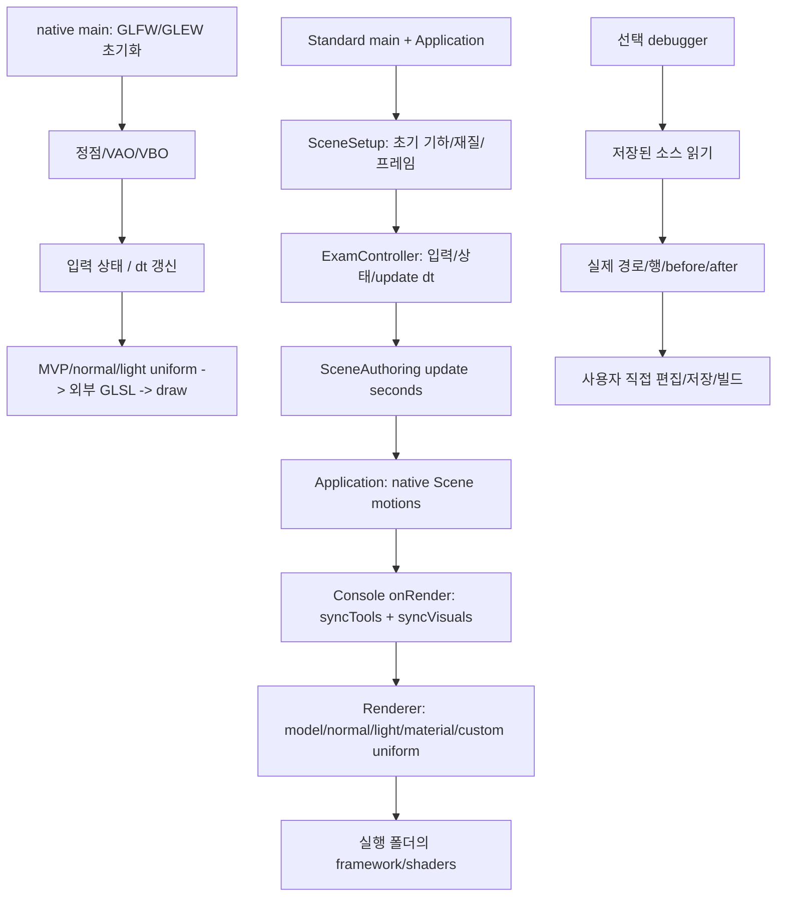

# 실행 흐름과 구조 근거

기준 소스는 SOURCE_GUIDE.md의 실제 파일·행과 graphify-out/coding-test-2/SOURCE_MANIFEST.json의 파일 해시다. 소스 AST 그래프는 실행 순서의 증명이 아니므로 콜백 순서는 Application.cpp·Console.cpp를 함께 읽었다. 동명이인 함수의 프로젝트 간 연결은 AMBIGUOUS로 표시될 수 있다.

## 모듈 경계

- framework 원본과 standard/framework 배포 사본에 동일한 재사용 API를 반영했다: addModel/setLayer/light/lightParent/setLight/syncTools 및 항별 셰이더 출력. 다른 실습의 framework 복사본은 일괄 덮어쓰지 않았다.
- Standard는 SceneSetup/Console/ExamController와 자기 framework를 사용한다. debugger와 학습 HTML이 없을 때도 프로젝트 참조를 바꾸지 않는다. 예제 전체 교체 시 Console(app,false)로 기본 시험 컨트롤러를 끌 수 있다.
- native는 Framework.h 없이 직접 GL 자원을 생성·해제한다. 자체 SDK와 DLL을 포함하며 Standard/상위 저장소를 링크하지 않는다.
- debugger는 독립 Windows C++17 프로그램이다. 대상 소스를 실행/저장하지 않는다. where는 소스 hook과 현재 행을 찾는다. MSBuild 분기·C++ 의미까지 자동 판정하지 않는다.
- root coding-test-2의 HTML/N제/시나리오는 학습 자료다. 제출 ZIP에는 포함하지 않는다. 타이머·진도는 브라우저 기능이며 C++ 런타임의 종속성이 아니다.

## 상태와 공간의 소유권

공전 위상은 dt 적분으로 정지/방향 전환에 연속적이다. key의 부모 지역 좌표, 최종 부모 월드 변환, 표시·궤도 파생을 나누었다. 카메라는 기본 컨트롤러가 월드 상태로 소유한다. 다른 부착 카메라와 동시 제어하지 않는다. Space는 authoring 시간과 이 컨트롤러만 정지한다. 별도 native Motion은 별도 제어가 필요하다. 접촉·강체·관절 솔버를 새로 제공한다고 주장하지 않는다.

## 그래프와 전체 코드

[인터랙티브 소스 구조](../../graphify-out/coding-test-2/graph.html) · [전체 before/after](ALL_CODE_BEFORE_AFTER.md) · [원본/배포 SDK 대응](THIRD_PARTY_COPIES.json) · [수정 파일 manifest](CHANGE_MANIFEST.json)

생성 결과: 144개 소스, 3,687 노드, 7,024 연결. AST/관계 자료 생성만 수행했으며 진단 검증기는 실행하지 않았다.
