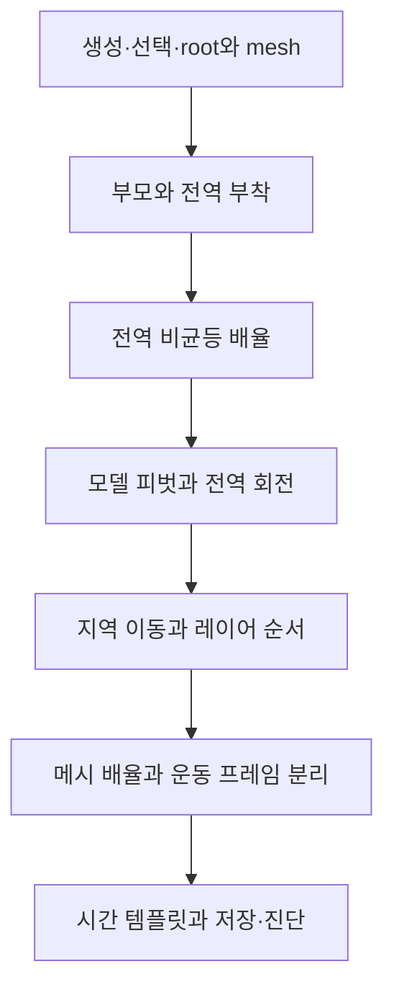

# 튜토리얼 생성 코드·레시피 변경 전후

기준: 4e1c4f4. 변경 이유: 두 물체의 전역 배치·상속·비균등 배율·피벗·지역 레이어와 순서를 실제 입력·좌표 계산·관찰점으로 가르친다. 실행 C++는 수정하지 않았다. 생성 HTML·Markdown·목차 데이터는 아래 생성기에서 만든 산출물이며 별도 manifest로 기록한다.

## tools/Write-WorkspaceTutorial.py

위치: 파일 전체. 새 생성기는 PHASES·tutorial·html_page·learning_sources·main, 새 레시피는 문서의 실제 명령 흐름이다.

**before: 없음**

**after**

````python
"""Generate a source-grounded Standard tutorial and reusable recipes. No app/tests."""
from pathlib import Path
import html
import json
import os
import re

ROOT = Path(__file__).resolve().parents[1]
STANDARD = ROOT / 'standard'
DOCS = STANDARD / 'docs'
GRAPH = DOCS / 'tutorials/Standard-Graph'
DATE = '2026-11-09'

def write(path, value):
    path.parent.mkdir(parents=True, exist_ok=True)
    value = value.rstrip() + '\n'
    if not path.exists() or path.read_text(encoding='utf-8-sig') != value:
        path.write_text(value, encoding='utf-8-sig')

def code(value, language='text'):
    return '```' + language + '\n' + value.strip() + '\n```\n'

SOURCES = [
    ('S001', '표적 해석과 전역/지역 명령', 'standard/modes/AssemblyWorkspace.cpp', 'Tokens Assembly::resolveCommand'),
    ('S002', '부모 연결과 새 물체 선택', 'standard/modes/AssemblyCommands.cpp', 'bool Assembly::objectCommand'),
    ('S003', '피벗 keep의 보정', 'standard/modes/AssemblyHierarchy.cpp', 'void Assembly::pivot'),
    ('S004', '기준 배치와 레이어의 실제 합성', 'standard/modes/AssemblyRuntime.cpp', 'bool Assembly::applyPoses'),
    ('S005', 'Standard가 컴파일하는 Scene의 월드 합성', 'standard/framework/detail/Scene.cpp', 'bool Scene::setWorldPlacement'),
    ('S006', '진단의 최종 행렬 출력', 'standard/modes/AssemblyDiagnostics.cpp', 'void Assembly::diagnose'),
    ('S007', '생성 크기와 root/mesh 등록', 'standard/modes/AssemblyObjects.cpp', 'void Assembly::add'),
    ('S008', '명령 결과·저장할 인수 해석', 'standard/modes/Assembly.cpp', 'bool Assembly::execute'),
    ('S009', '레시피의 실제 저장·읽기 계약', 'standard/modes/AssemblyPersistence.cpp', 'bool Assembly::save'),
    ('S010', '모션의 시간 평가', 'standard/framework/detail/Motion.cpp', 'MotionStep Motion::linear'),
]

def source_link(source_id, directory=DOCS):
    source = next(row for row in SOURCES if row[0] == source_id)
    path = ROOT / source[2]
    text = path.read_text(encoding='utf-8-sig')
    line = text[:text.index(source[3])].count('\n') + 1
    relative = os.path.relpath(path, directory).replace('\\', '/')
    return '[' + source_id + ': ' + path.name + ':' + str(line) + '](' + relative + ')'

SETUP = '''clear
pause on
view 1
render wire off
render lighting off
render depth on
render cull none
camera projection perspective
camera clip 0.1 200
camera fov 55
camera pose 14 9 16 5 1 0 0 1 0
edit object
add box base at 2 0 0
color base 0.2 0.45 0.9
add box panel 5 0 0 2 1 1
color panel 1 0.55 0.15'''

PHASES = [
    ('create', '1. 두 물체를 만들고 선택 대상을 확인한다', SETUP,
     '파란 받침대 base의 중심은 (2,0,0), 주황 표시판 panel의 중심은 (5,0,0)이다. panel의 모델 크기는 2×1×1이다. 마지막 add가 panel을 자동 선택하며 color는 그 선택을 바꾸지 않는다.',
     'add box base at 2 0 0은 기본 크기 1×1×1의 짧은 생성형이다. add box panel 5 0 0 2 1 1의 앞 세 수는 월드 생성 위치, 뒤 세 수는 실제 모델 크기다. 아직 비균등 변환을 적용한 것이 아니다. 원래 모델의 panel X 범위는 -1~+1이다.',
     'list에 base.mesh와 panel.mesh가 보여도 물체가 네 개 생긴 것은 아니다. 각 물체의 루트와 실제 메시가 따로 등록된다.', 'S007'),
    ('parent', '2. 현재 배치를 유지한 채 부모를 연결한다', 'parent base\ndiagnose panel',
     'panel이 선택된 상태에서 base를 부모로 지정한다. 연결 직후 중심은 여전히 (5,0,0)이다. 이 단계에서의 부모 기준 간격은 X=3이다.',
     'parent base는 선택 물체의 부모 관계를 설정한다. 현재 월드 배치를 보존하도록 부착 행렬을 계산하므로 연결 순간 base 위치로 점프하지 않는다. 공통 움직임은 base가 소유하고 panel은 자기 배치를 소유한다.',
     'parent의 인수 base는 부모 이름이다. 자식은 현재 선택인 panel이다. 필요하면 명시형 parent panel base를 사용할 수 있다.', 'S002'),
    ('world', '3. 부모를 전역 좌표로 옮긴다', 'select base\nt 4 0 0\nselect panel',
     'base 중심은 X=2에서 X=4로 이동한다. panel 중심도 X=5에서 X=7로 이동한다. panel과 base의 X 간격 3은 유지된다.',
     't 4 0 0은 현재 위치에 4를 더하는 명령이 아니라, 기준 배치의 월드 원점을 (4,0,0)으로 지정하는 명령이다. 부모가 +2 이동했으므로 자식도 +2 이동한다.',
     '이후 명령은 다시 선택한 panel에 적용한다. 창에서 panel을 클릭해도 같은 대상을 고를 수 있다.', 'S005'),
    ('scale', '4. 물체 루트에 비균등 배율을 적용한다', 's 2 1 0.5',
     'panel 중심은 (7,0,0)을 유지한다. 실제 크기는 원래 2×1×1에 각 축 배율을 곱한 4×1×0.5가 된다. 이때 월드 X 범위는 5~9다.',
     's는 선택 물체의 피벗을 중심으로 월드 축에 상대 배율을 적용한다. 현재 피벗은 중심이다. 같은 명령을 한 번 더 실행하면 X 길이는 8이 된다. 2를 절대 길이로 해석하지 않는다.',
     '루트 배율은 뒤에서 추가할 지역 레이어와 자식 메시에도 상속된다. 이 효과는 7단계에서 실제 이동량으로 확인한다.', 'S001'),
    ('pivot', '5. 표시판의 왼쪽 끝을 피벗으로 지정한다', 'pivot panel -1 0 0 keep',
     '표시판이 움직이지 않은 채 피벗이 왼쪽 끝으로 바뀐다. 월드 피벗은 (5,0,0)이다.',
     '여기서 -1은 모델 좌표다. panel은 처음에 X 길이 2로 만들어졌으므로 왼쪽 끝의 모델 좌표는 -1이다. 월드 중심 7에서 배율 2×모델 거리 1을 빼면 왼쪽 끝은 5다. keep은 피벗만 바꿀 때 원래 배치를 보정한다.',
     '월드 피벗 좌표를 직접 쓰고 싶다면 이 단계 대신 cursor 5 0 0, select panel, pivot cursor를 사용할 수 있다. 두 방법 중 하나를 택한다.', 'S003'),
    ('rotate', '6. 피벗을 중심으로 전역 회전한다', 'r z 90\ndiagnose panel',
     '왼쪽 끝의 월드 좌표 (5,0,0)은 유지되고, 표시판 중심은 (7,0,0)에서 (5,2,0)으로 이동한다. 길이 4의 표시판이 위쪽으로 서므로 반대쪽 끝은 (5,4,0)이다.',
     '중심에서 피벗을 빼면 (2,0,0)이다. Z축 +90도 회전 후 (0,2,0)이 되고 피벗 (5,0,0)을 더하면 중심 (5,2,0)이 된다. r은 기존 배치를 월드 축으로 추가 회전한다. r z 90을 반복하면 180도가 된다.',
     '이 피벗은 물체에 붙은 모델 기준점이다. 이후 물체 자체를 이동시키면 그 월드 위치도 함께 바뀐다.', 'S001'),
    ('shift', '7. 물체 안에 지역 이동 레이어를 넣는다', 'layer add shift\nlayer t 1 0 0\nlayer list\ndiagnose panel',
     'panel 루트의 전역 기준 배치는 그대로 (5,2,0)이다. 화면에서 보이는 panel 중심은 (5,4,0)으로 바뀐다. 지역 X=1이 월드 Y=+2로 전달된다.',
     '현재 기준 배치에는 Z축 90도 회전과 X축 배율 2가 들어 있다. 지역 X는 월드 +Y를 향하며 길이도 두 배다. 따라서 지역 이동 (1,0,0)은 Rz(90)×S(2,1,0.5)×(1,0,0)=(0,2,0)이다. 결과에 기준 중심 (5,2,0)을 더한다.',
     't 1 0 0과 layer t 1 0 0은 다르다. 앞 명령은 기준 배치의 월드 원점을 X=1로 지정한다. 뒤 명령은 선택 레이어에 지역 이동을 추가한다.', 'S004'),
    ('order', '8. 두 번째 레이어를 넣고 의존 순서를 바꾼다', 'layer add turn\nlayer r z 90\nlayer list\nlayer before shift\ndiagnose panel',
     'turn 추가 직후에는 shift → turn 순서이며 중심은 (5,4,0)이다. turn을 shift 앞으로 옮기면 turn → shift가 되어 중심은 (4,2,0)이 된다. 같은 값으로 순서만 바꿔도 결과가 달라진다.',
     'shift → turn에서는 L=T(1,0,0)×Rz(90)이다. 원점은 R로 회전해도 원점이므로 T의 이동이 남는다. turn → shift에서는 L=Rz(90)×T(1,0,0)이며 지역 이동이 먼저 (0,1,0)으로 회전한다. 기준 배치가 이것을 월드 (-1,0,0)으로 보내므로 (5,2,0)+(-1,0,0)=(4,2,0)이다.',
     'layer list의 앞 레이어는 뒤 레이어의 좌표계를 제공한다. 정점에 행렬을 적용하는 계산은 오른쪽부터 한다. 이 두 설명을 구분한다.', 'S001'),
]

def recipe(title, rows):
    text = '# @title: ' + title + '\n# Source-derived expected behavior; app execution is delegated to the user.\n'
    for label, commands in rows:
        text += '\n#: ' + label + '\n' + commands.strip() + '\n'
    return text

MAIN_RECIPE = 'two-objects-world-layers.assembly'
SHAPE_RECIPE = 'two-objects-shape-only.assembly'
MOTION_RECIPE = 'two-objects-motion.assembly'

def diagram():
    return '''<svg xmlns="http://www.w3.org/2000/svg" viewBox="0 0 620 380" role="img" aria-label="전역 회전 직후 base와 panel의 계산 위치" style="width:100%;max-width:760px;background:#f5f8fc;border-radius:12px">
<defs><marker id="t-arrow" markerWidth="8" markerHeight="8" refX="6" refY="3" orient="auto"><path d="M0,0 L6,3 L0,6" fill="#455e79"/></marker></defs>
<g stroke="#dce5ed" stroke-width="1"><path d="M80 60V340M130 60V340M180 60V340M230 60V340M280 60V340M330 60V340M380 60V340M430 60V340M480 60V340M530 60V340M80 310H550M80 260H550M80 210H550M80 160H550M80 110H550"/></g>
<g stroke="#455e79" stroke-width="2" marker-end="url(#t-arrow)"><path d="M80 310H565"/><path d="M80 310V45"/></g>
<rect x="255" y="285" width="50" height="50" rx="4" fill="#4b83c9"/><rect x="305" y="110" width="50" height="200" rx="4" fill="#efaa52" stroke="#a05b14" stroke-width="2"/>
<circle cx="330" cy="310" r="6" fill="#8d4db2"/><circle cx="330" cy="210" r="5" fill="#fff" stroke="#7c4c15"/>
<g font-family="Malgun Gothic, sans-serif" font-size="15" fill="#203f58"><text x="572" y="315">+X</text><text x="65" y="33">+Y</text><text x="205" y="358">base 중심 (4,0)</text><text x="365" y="207">panel 중심 (5,2)</text><text x="365" y="309">피벗 (5,0)</text><text x="365" y="113">반대 끝 (5,4)</text><text x="95" y="26">6단계: XY 평면의 계산 예측 · Z 생략</text></g></svg>'''

def tutorial():
    md = '''# 물체 두 개로 이해하는 새 Standard

**전역 배치는 물체를 장면에 놓는 기준이고, 지역 레이어는 그 기준 안에 붙이는 변환이다.** 부모 연결은 다른 물체의 최종 변환을 상속하게 한다. 이 세 값을 분리해서 작성한다.

이 튜토리얼은 이동식 받침대 `base`와 표시판 `panel` 두 물체를 조립한다. 실습 재출제나 특정 시험 형상을 가정하지 않는다. SRT와 중심 회전의 개념은 알고 있다는 전제에서, Standard가 어떤 값과 순서를 저장하는지 설명한다.

**확인 범위:** 현재 C++ 소스를 읽고 아래 좌표를 계산했다. 화면·콘솔을 실행해 측정한 결과가 아니다. 빌드·테스트·앱·브라우저 확인은 사용자가 수행한다. 좌표의 작은 부동소수점 오차는 있을 수 있다.

## 읽는 방법

처음에는 1~8단계를 한 블록씩 입력한다. 각 단계의 관찰점을 본 뒤 다음으로 간다. 빠른 전체 명령은 뒤의 ‘한 번에 복사’에 있다. `#`와 `#:`로 시작하는 레시피 주석은 실행 명령이 아니다.

1. 생성·선택 → 2. 부모 연결 → 3. 전역 배치 → 4. 비균등 배율 → 5. 피벗 → 6. 회전 → 7. 지역 이동 → 8. 레이어 순서 → 9. 모양과 움직임 분리 → 10. 시간 템플릿.

## 명령의 공간부터 구분하기

| 입력 | 바뀌는 값 | 인수의 뜻 |
|---|---|---|
| `t X Y Z` | 자기 지역 레이어 이전의 전역 기준 배치 | 절대 월드 원점. 이동량이 아님 |
| `r z 90` | 선택 피벗을 중심으로 전역 기준 배치에 회전 추가 | 월드 Z축, 추가 90도 |
| `s 2 1 0.5` | 선택 피벗을 중심으로 전역 기준 배치에 배율 추가 | 월드 축별 상대 배율 |
| `parent base` | 선택 자식의 부모·부착 행렬 | 부모 이름. 연결 순간 현재 월드 배치 유지 |
| `pivot panel -1 0 0 keep` | panel의 모델 피벗과 기준 SRT의 보정 | 모델 좌표, keep은 배치 유지 |
| `layer t 1 0 0` | 선택 지역 레이어의 행렬 | 그 레이어 축으로 추가 이동 |
| `layer r z 90` | 선택 지역 레이어의 행렬 | 그 레이어의 지역 Z축으로 추가 회전 |
| `G/R/S` 단축키 | 지역 레이어가 선택돼 있으면 그 레이어, 없으면 전역 배치 | X/Y/Z 축, 마우스/방향키로 양 조절 |

직접 입력한 `t/r/s`는 레이어 선택 여부와 관계없이 전역 명령이다. 지역 명령은 `layer` 또는 `local` 접두어를 붙인다. 단축키는 선택 레이어에 따라 경로가 바뀐다. `layer select none`은 레이어 기여를 지우지 않고 편집 대상만 해제한다.

숫자 좌표는 월드/모델 단위다. 콘솔 회전 각도는 도, 모션 기간은 초다. 내부 GLM 계산의 라디안 변환은 프레임워크가 맡는다. GLM의 하위 rotate API 자체는 [라디안 각도](https://glm.g-truc.net/0.9.9/api/a00668.html)를 받는다.

## 물체 이름과 `.mesh`를 구분하기

```text
장면
└─ base                 ← 받침대의 배치·레이어
   ├─ base.mesh         ← 파란 형상
   └─ panel             ← 표시판의 부착·레이어
      └─ panel.mesh     ← 주황 형상
```

이것은 2단계 부모 연결 후의 논리 구조다. 화면에 보이는 두 물체는 내부적으로 루트와 메시를 각각 가진다. 기본 클릭은 물체 루트를 선택하고 Ctrl+클릭은 그 부모 물체를 고른다. 재현 가능한 명령 예제에서는 `select 이름`으로 대상을 고정한다. `.mesh`를 선택하면 형상만 별도로 변환할 수 있으며 9단계에서 사용한다.

콘솔 입력은 텍스트 콘솔에서 한다. G/R/S 단축키·마우스 선택은 그래픽 창에서 한다. 미리보기 중 Enter 또는 클릭은 확정, Esc 또는 창 포커스 이탈은 취소다. `edit object`가 기본 선택이고 면 선택은 `edit face`를 명시했을 때만 들어간다.
'''
    for anchor, title, commands, observe, reason, caution, sid in PHASES:
        md += '\n## ' + title + '\n\n' + code(commands)
        md += '\n**관찰할 결과:** ' + observe + '\n\n**왜 이렇게 되는가:** ' + reason + '\n\n**구분할 점:** ' + caution + '\n\n근거: ' + source_link(sid) + '\n'
        if anchor == 'parent':
            md += '\n' + code('부모 X = 2\n자식 X = 5\n부착 간격 = 5 - 2 = 3\n부모를 X=4로 이동한 뒤 자식 X = 4 + 3 = 7')
        if anchor == 'scale':
            md += '\n' + code('모델 크기       = (2, 1, 1)\n추가한 배율     = (2, 1, 0.5)\n화면 형상 크기  = (4, 1, 0.5)\n왼쪽 끝 월드 X  = 7 + 2 × (-1) = 5')
        if anchor == 'rotate':
            md += '\n' + diagram() + '\n\n피벗이 바뀐다고 geometry 원점이 피벗으로 이동하는 것은 아니다. 아래 D의 마지막 열은 모델 원점, 즉 이 단계에서의 표시판 중심이다.\n\n' + code('D = [ 0  -1   0    5 ]\n    [ 2   0   0    2 ]\n    [ 0   0  0.5   0 ]\n    [ 0   0   0    1 ]\n\n중심 local (0,0,0)  → world (5,2,0)\n피벗 local (-1,0,0) → world (5,0,0)')
        if anchor == 'shift':
            md += '\n<details><summary>예측 확인: 왜 Y=3이 아니라 Y=4인가?</summary><p>지역 X축 길이에 루트의 X 배율 2가 포함되기 때문이다. 기준 중심 Y=2에 지역 이동 1×배율2를 더해 Y=4가 된다. 이동을 월드 +X로 읽거나 지역 1을 무조건 월드 1로 읽으면 이 결과를 예측할 수 없다.</p></details>\n'
        if anchor == 'order':
            md += '\n| 순서 | 원점에 남는 지역 이동 | 기준 배치가 보낸 월드 이동 | 최종 중심 |\n|---|---|---|---|\n| shift → turn | (1,0,0) | (0,2,0) | (5,4,0) |\n| turn → shift | (0,1,0) | (-1,0,0) | (4,2,0) |\n'
    md += '''
## 9. 모양의 배율과 움직임의 좌표계를 분리하기

루트에 배율을 둔 앞 예제는 지역 이동까지 배율을 상속하는 것을 보여준다. 움직임의 지역 단위는 유지하면서 형상만 길게 만들려면 배율을 `.mesh`에 둔다. 다음은 **별도로 시작하는 비교 레시피**다. 앞 장면에 이어 붙이지 않는다.

'''
    shape_commands = SETUP + '''
parent base
select base
t 4 0 0
select panel.mesh
s 2 1 0.5
select panel
pivot panel -2 0 0 keep
r z 90
layer add shift
layer t 1 0 0
layer add turn
layer r z 90'''
    md += code(shape_commands)
    md += '''
여기서는 panel의 루트에 배율이 없다. panel.mesh를 늘려서 왼쪽 끝이 panel 좌표 -2가 되었으므로 피벗도 -2로 지정한다. 루트 피벗을 -1로 그대로 두면 실제 왼쪽 끝과 일치하지 않는다.

| 비교 | 앞의 루트 배율 | 지금의 메시 배율 |
|---|---|---|
| 초기 모델 X 길이 | 2 | 2 |
| 표시판의 실제 X 길이 | 4 | 4 |
| panel 기준 프레임에 S가 포함되는가 | 포함 | 포함하지 않음 |
| 왼쪽 끝의 panel 좌표 | -1 | -2 |
| 루트를 Z90도 회전한 직후 중심 | (5,2,0) | (5,2,0) |
| shift의 지역 X=1이 만드는 월드 이동 | +Y 2 | +Y 1 |
| shift → turn 상태의 최종 중심 | (5,4,0) | (5,3,0) |

두 경로는 지역 레이어를 추가하기 전까지 같은 모양과 배치를 만든다. 같은 지역 회전을 추가한 뒤에는 모양도 달라질 수 있다. 변환을 저장한 위치에 따라 자식과 레이어의 좌표계가 달라지기 때문이다. 일반적으로 배치·운동은 루트와 그 레이어에, 시각적 크기 조정은 메시 쪽에 두면 이동량을 정하기 쉽다. 부모 전체의 확대 효과가 필요할 때는 루트 배율을 사용한다.

## 10. 시간 템플릿으로 움직임을 추가하기

다음 조각은 메시 배율 비교를 **새로 구성한 상태**에서 사용하는 별도 모션 레시피다. 정적 shift/turn을 넣지 않고, 표시판의 왼쪽 피벗 회전과 받침대 이동을 각각 추가한다.

'''
    motion_commands = SETUP + '''
parent base
select base
t 4 0 0
select panel.mesh
s 2 1 0.5
select panel
pivot panel -2 0 0 keep
r z 90
insert pendulum z 15 4
select base
insert linear 2 0 0 4
pause off'''
    md += code(motion_commands)
    md += '''
`insert pendulum z 15 4`는 선택한 panel에 진폭15도·주기4초의 지역 피벗 회전 레이어를 만든다. 사인 각도 함수이며 물리적인 중력 진자 적분은 아니다. `insert linear 2 0 0 4`는 base에 4초 동안 지역 X로 2 이동하는 레이어를 만든다. 기본 Once 이동이 끝나면 끝 위치를 유지한다. panel은 부모의 이동을 상속하면서 자기 회전을 수행한다.

시간은 초 단위 dt로 한 프레임에 한 번 진행한다. `pause on`은 장면의 시계를 멈추지만 선택·정적 편집은 가능하다. 멈춘 순간의 자세가 계속 보이며 0초 자세로 돌아가는 명령은 아니다.

| 제어 | 의미 | 현재 구현의 시간 |
|---|---|---|
| `layer play off` | 선택 레이어의 현재 자세에서 시계 정지 | 해당 레이어 시간 정지 |
| `layer enable off` | 선택 레이어 변환 기여 제거 | 해당 레이어 시간도 진행하지 않음 |
| `layer reset` | 선택 레이어의 정적 행렬만 I로 초기화 | 삽입된 모션은 남음 |
| `layer remove` | 선택 레이어 삭제 | 해당 레이어 자체 제거 |
| `layer select none` | 편집 대상에서 레이어 해제 | 기존 기여·시간 유지 |

레시피를 여러 개 `load`하면 장면이 각각 다시 구성된다. 템플릿을 조합할 때는 필요한 명령 부분을 가져오고, 중복 clear·카메라 초기화·이름을 정리한다. `insert spin/orbit/linear/pendulum`은 새 레이어를 추가하고 자동으로 그 레이어를 선택한다. 생성된 이름은 `layer list`로 확인한다.

## 11. 화면과 콘솔을 어떻게 대조하는가

`diagnose panel`의 `world matrix: rows`는 지역 레이어까지 합친 최종 행렬이다. 세 행의 마지막 숫자가 모델 원점의 월드 위치이며, 이 튜토리얼에서는 panel 형상이 모델 원점을 중심으로 만들어져 그 값이 화면의 중심과 같다.

일반 실행 결과의 `월드 원점=`은 `placementMatrix`를 사용하므로 **자기 지역 레이어 이전의 기준 배치**다. 7단계에서는 이 출력이 (5,2,0)이어도 최종 중심 (5,4,0)과 모순되지 않는다. 원점과 형상 중심이 다른 모델에서는 마지막 열을 곧바로 형상 중심이라고 해석하지 않는다.

`inspect`의 rest.position/rest.scale은 저장된 기준 SRT다. 부착 행렬 A에 전역 배율·회전이 들어갈 수 있으므로 rest.scale=1만 보고 화면 배율도 1이라고 판단하지 않는다. `diagnose`의 최종 행렬과 부모 체인을 함께 읽는다.

예를 들어 8단계에서 순서를 바꾸기 전 최종 행렬은 근사적으로 다음과 같다.

'''
    md += code('W = [ -1   0   0    5 ]\n    [  0  -2   0    4 ]\n    [  0   0  0.5   0 ]\n    [  0   0   0    1 ]\n\n최종 모델 원점 = (5,4,0)\n기준 배치 원점 = (5,2,0)')
    md += '''
## 12. 저장하고 다시 읽기

```text
save tutorial-scene.assembly
load tutorial-scene.assembly
```

save는 대상·레이어·커서 좌표를 명시한 작성 명령을 저장한다. 파일의 `with`와 `attachment`는 그 재현을 위한 내부 표현이다. 사용자가 그 긴 표현을 외울 필요는 없다. 이 튜토리얼처럼 시간을 멈춘 정적 레이어 순서와 배치는 다시 구성된다.

모션·물리의 현재 프레임 전체를 저장하는 기능은 아니다. 모션 레시피를 읽으면 작성한 초기 조건에서 다시 시작한다. 상대 저장 경로는 프로세스 작업 폴더 기준이다. read는 작업 폴더의 상대 경로를 먼저 확인하고, 없으면 실행 파일 옆의 레시피 경로를 확인한다. 불러오기 로그의 절대 경로를 확인하면 수정한 원본과 실행 파일 옆 복사본을 혼동하지 않을 수 있다.

Ctrl+F5는 마지막에 읽은 레시피를 다시 읽는다. 그 경로가 C++의 영구 시작 장면으로 바뀌는 것은 아니다. Visual Studio의 Ctrl+F5는 빌드·시작 기능이므로 입력하는 창을 구분한다.

## 13. 이 명령이 프레임워크에서 실행되는 위치

```text
키/마우스/콘솔 입력
  → Console에서 Assembly로 전달
  → resolveCommand: 선택 이름·레이어·커서 좌표를 명시적 인수로 해석
  → dispatch: 대상/부모/전역 배치/지역 레이어 값 수정
  → applyPoses(0): 정적 편집 결과를 즉시 Scene에 반영

매 프레임
  → Assembly::update(dt): 시계 진행
  → applyPoses(dt): 기준값과 모션 행렬 합성
  → Scene::worldMatrix / faceWorldMatrix
  → Renderer: 모델·법선·카메라·조명 uniform과 정점/인덱스 전달
  → GPU 셰이더 → 화면

피킹도 같은 Scene 최종 행렬로 삼각형을 검사한다.
```

전체 합성은 `W_child = W_parent × A × B × L1 × ... × Ln`이다. A는 부모 관계를 보정하는 객체 부착, B는 기준 SRT, L은 객체 소유 지역 레이어다. 부모 W는 부모 자신의 레이어까지 포함한다. Standard는 이 값을 편하게 작성하는 편집기이며, framework API는 문서·명령 파서 없이 C++에서도 사용할 수 있다.

이 튜토리얼은 C++ 런타임을 바꾸지 않는다. 기존 [구조 분석](assembly/architecture/GRAPH_REPORT.md)과 [공통 API 계약](../framework/docs/WORKSPACE_API.md)을 함께 볼 수 있다. 카메라·광원도 같은 객체 상속과 레이어를 쓰고, 중력·회전 프레임의 힘은 별도 상태/법칙을 [힘 API](APPLICATION_RECIPES.md)로 연결한다. 형상 크기를 바꾼다고 질량·충돌·관성 모멘트가 자동 계산되지는 않는다.

## 한 번에 복사: 1~8단계

이 블록은 장면을 비우고 원래부터 따라가는 전체 명령이다. 도중에 멈춰 살펴보려면 앞의 단계별 블록을 사용한다.

'''
    all_commands = '\n'.join(phase[2] for phase in PHASES)
    md += code(all_commands)
    md += '\n| 레시피 | 용도 |\n|---|---|\n'
    for file, title in [(MAIN_RECIPE, '전역 배치·루트 비균등 배율·피벗·지역 레이어 순서'), (SHAPE_RECIPE, '같은 모양에서 메시 배율로 이동 단위 분리'), (MOTION_RECIPE, '부모 이동 + 자식 피벗 모션 템플릿')]:
        md += '| [' + file + '](../examples/assembly/tutorials/' + file + ') | ' + title + ' |\n'
    md += '''
```text
load examples/assembly/tutorials/two-objects-world-layers.assembly
```

## 이해 확인과 새 응용으로 옮기기

설명과 실행의 성공은 이해 확인과 별개다. 다음 답을 확인하지 않았으므로 이해 완료로 기록하지 않는다.

<details><summary>확인 1: 부모가 X=4에서 X=6으로 이동하면 정적 자식은 어떻게 되는가?</summary><p>다른 변화가 없다면 부모가 +2 이동하므로 자식의 기준 배치와 최종 형상도 월드 X로 +2 이동한다. 자기 레이어 값은 유지한다.</p></details>
<details><summary>확인 2: 루트 배율 예제의 7단계에서 layer t 0.5 0 0을 처음부터 한 번 적용하면 중심은?</summary><p>지역 +X 0.5가 월드 +Y 1이 된다. 기준 중심 (5,2,0)에 더해 (5,3,0)이다. 이미 이동한 shift에 또 입력하면 추가 합성되므로 별도로 시작하거나 layer reset 후 계산해야 한다.</p></details>
<details><summary>확인 3: 같은 모양에서 지역 이동 1을 월드 길이 1로 다루려면 무엇을 분리하는가?</summary><p>모양을 만드는 배율을 panel.mesh 또는 뒤쪽 형상 레이어에 두고, 이동 기준을 제공하는 panel 프레임과 분리한다. 배율과 회전이 합성될 위치를 정하고 해당 공간의 피벗을 다시 지정한다.</p></details>

응용 문제를 받으면 물체 이름을 먼저 외우기보다 ① 공통 움직임의 부모 ② 월드 배치 ③ 내부 레이어 순서 ④ 피벗이 정의된 좌표계 ⑤ 시간 함수 또는 힘 법칙을 먼저 정한다. 그 뒤 이 문서의 명령 블록을 필요한 부분만 조합한다.

## 소스와 다음 참조

'''
    md += '\n'.join('- ' + source_link(row[0]) + ' — ' + row[1] for row in SOURCES)
    md += '\n\n[전체 명령어와 인수](QUICK_COMMANDS.md) · [변환 조합 템플릿](TRANSFORM_TEMPLATES.html) · [연산/API 레퍼런스](TRANSFORM_REFERENCE.md) · [학습 순서·출처](tutorials/Standard-Graph/index.md)\n'
    return md, shape_commands, motion_commands

def html_page(markdown):
    data = json.dumps(markdown, ensure_ascii=False).replace('<', '\\u003c').replace('\u2028','\\u2028').replace('\u2029','\\u2029')
    return '''<!doctype html><html lang="ko"><head><meta charset="utf-8"><meta name="viewport" content="width=device-width,initial-scale=1"><title>물체 두 개로 이해하는 Standard</title><style>
:root{font-family:"Malgun Gothic",system-ui,sans-serif;color:#183047;background:#f7f9fc;line-height:1.85}*{box-sizing:border-box}body{margin:0}header{padding:18px 26px;background:#12314b;color:white;position:sticky;top:0;z-index:2}header a{color:#dcf1ff;margin-right:20px}header small{display:block;color:#bbd3e5}#layout{max-width:1450px;margin:auto;display:grid;grid-template-columns:270px minmax(0,1fr);gap:30px;padding:28px}aside{position:sticky;top:100px;height:calc(100vh - 130px);overflow:auto;font-size:14px}aside a{display:block;padding:7px 10px;border-left:2px solid #c9d9e6;text-decoration:none}main{background:white;padding:30px 42px;min-width:0;border:1px solid #e0e7ef;border-radius:14px}h1{line-height:1.4;font-size:31px}h2{border-top:1px solid #d6e2ed;padding-top:26px;margin-top:38px;scroll-margin-top:110px;font-size:23px}a{color:#126aa1}pre{position:relative;background:#122b40;color:#e9f4ff;padding:22px 18px;border-radius:9px;overflow:auto;line-height:1.6}code{font-family:Consolas,monospace}p code,td code{background:#edf4fa;padding:2px 4px;color:#164c75}table{border-collapse:collapse;display:block;overflow:auto;max-width:100%;font-size:14px}th,td{border:1px solid #d6e2ec;padding:11px;vertical-align:top;min-width:100px}th{background:#eaf2f8}details{padding:13px 18px;border:1px solid #d4e0ec;background:#f4f8fc;border-radius:8px;margin:13px 0}summary{cursor:pointer;font-weight:bold}.copy{position:absolute;right:8px;top:6px;border:1px solid #829db1;border-radius:5px;background:#24465f;color:white;padding:4px 10px;cursor:pointer}svg text{font-family:"Malgun Gothic",sans-serif}#fallback{padding:24px} @media(max-width:950px){#layout{display:block;padding:12px}aside{position:static;height:auto;margin-bottom:20px;max-height:250px}main{padding:22px}h1{font-size:27px}}@media print{header,aside,.copy{display:none}#layout{display:block;padding:0}main{border:0;padding:0}pre{white-space:pre-wrap}details{display:block}}
</style></head><body><header><a href="../index.html">전체 문서</a><a href="TRANSFORM_TEMPLATES.html">변환 템플릿</a><a href="../document.html?doc=docs/WORKSPACE_TUTORIAL.md">Markdown 판</a><small>현재 소스 기반의 계산 예측 · 빌드·테스트·화면 확인은 사용자 수행</small></header><div id="layout"><aside id="toc" aria-label="튜토리얼 목차"></aside><main id="lesson"><p id="fallback">JavaScript를 사용할 수 없으면 <a href="WORKSPACE_TUTORIAL.md">Markdown 원문</a>을 열어 주세요.</p></main></div><script src="viewer/vendor/marked.umd.js"></script><script>
const markdown = ''' + data + ''';
if(window.marked){document.getElementById('lesson').innerHTML=marked.parse(markdown);document.querySelectorAll('#lesson a[href]').forEach(a=>{const h=a.getAttribute('href');if(!h||/^(?:https?:|#)/i.test(h)||!h.split('#')[0].endsWith('.md'))return;const u=new URL(h,location.href),root=new URL('../',location.href);if(u.pathname.startsWith(root.pathname)){const rel=decodeURIComponent(u.pathname.slice(root.pathname.length));a.href='../document.html?doc='+encodeURIComponent(rel)+u.hash}});document.querySelectorAll('#lesson h2').forEach((h,i)=>{h.id='part-'+i;const a=document.createElement('a');a.href='#'+h.id;a.textContent=h.textContent;document.getElementById('toc').append(a)});document.querySelectorAll('#lesson pre').forEach(pre=>{const b=document.createElement('button');b.className='copy';b.textContent='복사';b.type='button';b.onclick=async()=>{const c=pre.querySelector('code');if(!c)return;try{await navigator.clipboard.writeText(c.textContent);b.textContent='복사됨'}catch{const range=document.createRange();range.selectNodeContents(c);const selection=window.getSelection();selection.removeAllRanges();selection.addRange(range);b.textContent='선택됨: Ctrl+C'}};pre.append(b)})}
</script></body></html>'''

def learning_sources():
    md = '# 출처와 점검 범위\n\n작성·소스 확인: ' + DATE + '. C++ 기준 커밋 4e1c4f4. 문서 생성은 실행 검증이 아니다. 다음 출처 점검 예정일은 2027-01-09이며 자동 예약을 등록하지 않았다.\n\n'
    for sid, title, relative, marker in SOURCES:
        md += '## ' + sid + ' ' + title + '\n\n'
        md += '- 직접 위치: ' + source_link(sid, GRAPH) + '\n'
        md += '- 유형·관리: 로컬 프로젝트 1차 구현. Git으로 관리하는 현재 Standard/동봉 framework 소스.\n'
        md += '- 수준·선수: 기초~중급, SRT와 행렬 곱의 기본 의미. C++/한국어 설명, 로컬 무료 접근.\n'
        md += '- 선정: 명령의 실제 분기와 저장값을 직접 확인할 수 있다. 현재 작업 트리의 해당 본문을 읽고 연결했다. 실행 화면·컴파일 성공의 근거는 아니다.\n'
        md += '- 상태: 채택. 마지막 본문 확인 ' + DATE + '. 정기 발간 주기 미확인. 다음 점검 2027-01-09.\n\n'
    md += '''## S011 GLM 변환 API

- [GLM 공식 matrix_transform API](https://glm.g-truc.net/0.9.9/api/a00668.html): rotate의 라디안 각도와 축, translate/scale의 행렬 인수를 확인했다. 운영 주체는 GLM 프로젝트다.
- 유형: 공식 API 자료, 중급. SRT와 C++ 필요, 영어, 무료. 0.9.9 문서이므로 현재 동봉본 1.0.3과 버전이 같다고 보지 않는다. 이 튜토리얼의 Standard 명령 계약은 위 로컬 소스를 우선한다.
- 상태: 주의(문서 버전 차이). 마지막 접근 성공 2026-11-09. 발행일·정기 발간 주기는 미확인. 다음 점검 2027-01-09.
- [프로젝트 공식 manual 원문](https://raw.githubusercontent.com/g-truc/glm/master/manual.md)은 접근했으며 제목은 GLM 1.0.0 Manual이었다. GitHub HTML 페이지는 최초 요청이 시간 초과였고 원문 경로로 확인했다. 최신 릴리스 번호의 근거로 사용하지 않았다.

별도 뉴스·강좌 큐레이션은 이 사용자 정의 프레임워크의 명령 계약을 설명하지 않는다. 프로젝트의 문서 생성기와 명령 도움말을 현재 학습 자료의 관리 경로로 사용한다.
'''
    write(GRAPH/'sources.md', md)
    write(GRAPH/'index.md', '''# Standard 명령 흐름 학습

목표: 두 물체 생성·선택 → 부모 부착 → 전역 배치 → 비균등 배율 → 모델 피벗 → 지역 레이어 → 시간 템플릿을 실제 명령과 계산으로 연결한다.

선수지식: SRT, 중심 회전, 행렬 곱의 기본 의미를 안다는 사용자 전제다. 프레임워크 사용 능력을 평가한 결과는 아니다.

- 기초: [튜토리얼](../../WORKSPACE_TUTORIAL.md)의 1~6단계. 이름·생성 크기·부모·전역 배치·피벗.
- 중급: 7~9단계. 지역 단위·루트 배율·순서·메시 배율 분리.
- 조합: 10~13단계. 시간 함수·읽기/저장·소스 실행 흐름.
- 참조: [전체 명령](../../QUICK_COMMANDS.md), [변환 템플릿](../../TRANSFORM_TEMPLATES.md), [API 연결](../../TRANSFORM_REFERENCE.md).
- 근거: [출처](sources.md), [선수관계](learning-graph.md), [확인 경계](review-log.md).
''')
    write(GRAPH/'learning-graph.md', '''# 학습 순서

다음 선수관계는 이번 사용자 목표에 맞춰 작성자가 정한 학습 순서다. 공식 교육과정이나 사용자의 숙련도 판정이 아니다.



| 노드 | 실제 학습 위치 | 근거 |
|---|---|---|
| N1 | 튜토리얼 1단계·물체/mesh | S001, S007 |
| N2 | 2~3단계 | S002, S005 |
| N3 | 4단계 | S001, S004 |
| N4 | 5~6단계 | S001, S003 |
| N5 | 7~8단계 | S001, S004, S005 |
| N6 | 9단계 | S005, S007 |
| N7 | 10~13단계 | S006, S008, S009, S010 |

[본문](../../WORKSPACE_TUTORIAL.md)과 [출처 직접 링크](sources.md)에서 순서와 근거를 함께 읽는다. Mermaid가 표시되지 않아도 위 표의 N1~N7 순서로 진행할 수 있다.
''')
    write(GRAPH/'review-log.md', '''# 작성과 확인 경계

- 2026-11-09: 사용자가 전역 배치와 지역 변환을 구분하는 명령 흐름 튜토리얼을 요청했다.
- 근거 소스의 실제 명령 분기·피벗 keep·부모 연결·레이어 곱·진단 출력·저장 경로를 읽었다. 좌표는 수식에서 유도한 예측값이다.
- 학습 본문·단계별 레시피·메시 배율 비교·시간 템플릿·원문 소스 링크를 작성했다.
- 빌드·테스트·검증기·앱·브라우저를 실행하지 않았다. 학습자의 답변도 받지 않았으므로 이해 완료·능력 점수·정답 이력을 만들지 않았다.
- 다음 점검은 출처의 변경·접근 상태 점검 계획이다. 학습자의 복습 예정일이나 자동 알림을 설정한 것이 아니다.
''')

def main():
    markdown, shape, motion = tutorial()
    write(DOCS/'WORKSPACE_TUTORIAL.md', markdown)
    write(DOCS/'WORKSPACE_TUTORIAL.html', html_page(markdown))
    recipes = STANDARD/'examples/assembly/tutorials'
    write(recipes/MAIN_RECIPE, recipe('두 물체: 전역 배치와 지역 레이어', [(phase[1], phase[2]) for phase in PHASES]))
    write(recipes/SHAPE_RECIPE, recipe('두 물체: 메시 배율로 이동 단위 분리', [('모양과 운동 프레임을 분리한 비교 장면', shape)]))
    write(recipes/MOTION_RECIPE, recipe('두 물체: 부모 이동과 자식 피벗 모션', [('부모와 자식에 서로 다른 시간 함수를 연결', motion)]))
    learning_sources()
    catalog_path = DOCS/'DOCUMENT_CATALOG.json'
    catalog = json.loads(catalog_path.read_text(encoding='utf-8-sig'))
    owned = {'docs/WORKSPACE_TUTORIAL.md','docs/WORKSPACE_TUTORIAL.html'}
    owned.update(p.relative_to(STANDARD).as_posix() for p in GRAPH.glob('*.md'))
    for category in catalog['categories']:
        category['documents'] = [d for d in category['documents'] if d['path'] not in owned]
        if category['id'] == 'start':
            category['documents'][1:1] = [
                {'path':'docs/WORKSPACE_TUTORIAL.html','title':'두 물체로 이해하는 Standard','summary':'실제 명령 → 좌표 계산 → 관찰 → 이유','featured':True},
                {'path':'docs/WORKSPACE_TUTORIAL.md','title':'튜토리얼 원문과 전체 복사 명령'},
                {'path':'docs/tutorials/Standard-Graph/index.md','title':'튜토리얼 학습 순서·소스 근거'}]
    write(catalog_path, json.dumps(catalog, ensure_ascii=False, indent=2))
    readme = STANDARD/'README.md'
    current = readme.read_text(encoding='utf-8-sig')
    first, last = '<!-- workspace-tutorial:start -->', '<!-- workspace-tutorial:end -->'
    current = re.sub(re.escape(first)+r'.*?'+re.escape(last)+r'\n*','',current,flags=re.S)
    link = first+'\n[처음부터 따라 하기: 두 물체 튜토리얼](docs/WORKSPACE_TUTORIAL.html) — 전역 배치와 지역 레이어를 계산·관찰로 구분한다.\n'+last+'\n\n'
    heading = '# Standard: 0번 장면 작업공간\n\n'
    write(readme, current.replace(heading,heading+link,1))

if __name__ == '__main__':
    main()
````

## tools/Write-WorkspaceDocs.py

### 블록 1 · refresh_transform_templates · before L322 / after L322

**before**

````python
    import runpy
    runpy.run_path(str(ROOT/'tools/Write-TransformReference.py'))['main']()

if __name__ == '__main__':
````

**after**

````python
    import runpy
    runpy.run_path(str(ROOT/'tools/Write-TransformReference.py'))['main']()
    runpy.run_path(str(ROOT/'tools/Write-WorkspaceTutorial.py'))['main']()

if __name__ == '__main__':
````

## standard/examples/assembly/tutorials/two-objects-motion.assembly

위치: 파일 전체. 새 생성기는 PHASES·tutorial·html_page·learning_sources·main, 새 레시피는 문서의 실제 명령 흐름이다.

**before: 없음**

**after**

````text
# @title: 두 물체: 부모 이동과 자식 피벗 모션
# Source-derived expected behavior; app execution is delegated to the user.

#: 부모와 자식에 서로 다른 시간 함수를 연결
clear
pause on
view 1
render wire off
render lighting off
render depth on
render cull none
camera projection perspective
camera clip 0.1 200
camera fov 55
camera pose 14 9 16 5 1 0 0 1 0
edit object
add box base at 2 0 0
color base 0.2 0.45 0.9
add box panel 5 0 0 2 1 1
color panel 1 0.55 0.15
parent base
select base
t 4 0 0
select panel.mesh
s 2 1 0.5
select panel
pivot panel -2 0 0 keep
r z 90
insert pendulum z 15 4
select base
insert linear 2 0 0 4
pause off
````

## standard/examples/assembly/tutorials/two-objects-shape-only.assembly

위치: 파일 전체. 새 생성기는 PHASES·tutorial·html_page·learning_sources·main, 새 레시피는 문서의 실제 명령 흐름이다.

**before: 없음**

**after**

````text
# @title: 두 물체: 메시 배율로 이동 단위 분리
# Source-derived expected behavior; app execution is delegated to the user.

#: 모양과 운동 프레임을 분리한 비교 장면
clear
pause on
view 1
render wire off
render lighting off
render depth on
render cull none
camera projection perspective
camera clip 0.1 200
camera fov 55
camera pose 14 9 16 5 1 0 0 1 0
edit object
add box base at 2 0 0
color base 0.2 0.45 0.9
add box panel 5 0 0 2 1 1
color panel 1 0.55 0.15
parent base
select base
t 4 0 0
select panel.mesh
s 2 1 0.5
select panel
pivot panel -2 0 0 keep
r z 90
layer add shift
layer t 1 0 0
layer add turn
layer r z 90
````

## standard/examples/assembly/tutorials/two-objects-world-layers.assembly

위치: 파일 전체. 새 생성기는 PHASES·tutorial·html_page·learning_sources·main, 새 레시피는 문서의 실제 명령 흐름이다.

**before: 없음**

**after**

````text
# @title: 두 물체: 전역 배치와 지역 레이어
# Source-derived expected behavior; app execution is delegated to the user.

#: 1. 두 물체를 만들고 선택 대상을 확인한다
clear
pause on
view 1
render wire off
render lighting off
render depth on
render cull none
camera projection perspective
camera clip 0.1 200
camera fov 55
camera pose 14 9 16 5 1 0 0 1 0
edit object
add box base at 2 0 0
color base 0.2 0.45 0.9
add box panel 5 0 0 2 1 1
color panel 1 0.55 0.15

#: 2. 현재 배치를 유지한 채 부모를 연결한다
parent base
diagnose panel

#: 3. 부모를 전역 좌표로 옮긴다
select base
t 4 0 0
select panel

#: 4. 물체 루트에 비균등 배율을 적용한다
s 2 1 0.5

#: 5. 표시판의 왼쪽 끝을 피벗으로 지정한다
pivot panel -1 0 0 keep

#: 6. 피벗을 중심으로 전역 회전한다
r z 90
diagnose panel

#: 7. 물체 안에 지역 이동 레이어를 넣는다
layer add shift
layer t 1 0 0
layer list
diagnose panel

#: 8. 두 번째 레이어를 넣고 의존 순서를 바꾼다
layer add turn
layer r z 90
layer list
layer before shift
diagnose panel
````
