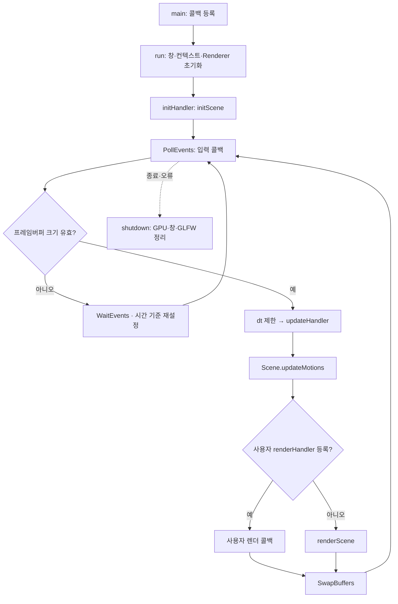
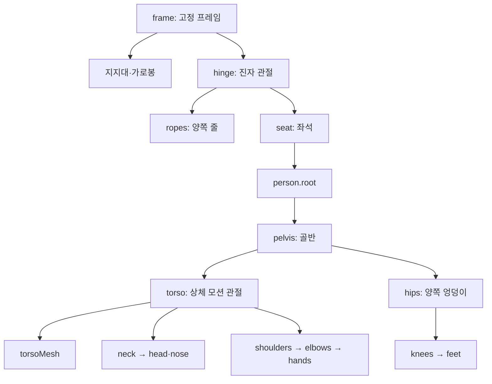

# 최종 소스의 실행 구조

## 분석 근거와 범위

새 graphify 결과는 [graph.html](graphify-out/graph.html), [graph.json](graphify-out/graph.json),
[GRAPH_REPORT.md](graphify-out/GRAPH_REPORT.md)이다. 코드 AST 및 실제 정의·콜백 등록 위치를 추출했다.
64개 코드 파일, 2,031개 노드, 3,181개 관계, 135개 커뮤니티를 생성했다.
프로젝트별 SDK와 framework 배포 사본은 중복 추출하지 않았다. 실제 컴파일은 각 프로젝트의 framework를 사용한다.
분석 중인 소스에는 다른 작업의 미커밋 변경이 포함될 수 있다. 원본 파일 해시는 SOURCE_HASHES.json에 있다.
현재 디스크에 존재하는 실행 프로젝트 11개와 독립 예제 3개를 구분했다. 없는 sparse-checkout 파일을 삭제로 해석하지 않는다.
빌드·테스트·검증기·앱 실행·브라우저 시각 확인은 수행하지 않았다.

## 렌더링·계층 흐름도

브라우저에서는 [오프라인 흐름도 HTML](flowcharts.html)을 연다. 외부 라이브러리 없이 SVG로 표시한다.

### 프레임 호출과 렌더링

사용자 렌더 콜백은 직접 렌더링 호출을 선택한다. standard는 onRender에서 renderScene/renderViews를 호출한다.
GPU 흐름은 Scene의 M·카메라 V/P → VAO/VBO/EBO·uniform → 드로우 → 정점 셰이더 → 클리핑·원근 나눗셈·뷰포트·래스터화 → 프래그먼트 셰이더 → 깊이·블렌딩 등 출력 처리 → 프레임버퍼다.

### 그네·사람 부모 계층

이 그림의 화살표는 부모 관계다. 줄과 좌석은 같은 hinge 아래에 있다. 상완 메시의 부모는 어깨, 아래팔은 팔꿈치, 허벅지는 엉덩이, 종아리는 무릎이다.

## 공통 Application 경로

실습 15~23과 standard의 main은 각각 별도 실행 프로그램이다.

1. main에서 Application과 Console 지역 객체를 만들고 init/key/update 등의 람다를 등록한다.
2. set...Handler는 std::function을 저장한다. 이때 람다 본문이나 initScene이 실행되는 것은 아니다.
3. run에서 GLFW 창·현재 컨텍스트·Renderer와 내장 셰이더를 준비한 뒤 initHandler가 initScene을 한 번 호출한다.
4. 이벤트 루프의 PollEvents가 입력 콜백을 실행한다. 최소화 시 WaitEvents 후 시간을 다시 잡는다.
5. 프레임 dt를 [0,.05]로 제한하고 updateHandler를 호출한다. 이후 Scene::updateMotions를 한 번 호출한다.
6. renderHandler가 있으면 이를 실행하고, 없으면 renderScene을 실행한다. 성공하면 SwapBuffers를 호출한다.
7. 종료 및 예외 경로에서 shutdown이 자원을 정리한다. Application 소멸자도 shutdown을 호출한다.
   GPU 자원은 유효한 현재 컨텍스트에서 제거한다. 컨텍스트 실패 경로는 Renderer::abandon으로 GL 호출을 피한다.

Console은 상태와 EntityId를 갖고 Application을 참조한다. Scene은 CPU 모델·계층·모션을 소유한다.
Renderer는 GPU 프로그램·버퍼·텍스처 핸들을 소유한다. Console을 캡처한 참조는 run 종료까지 유효해야 한다.

## 프로젝트별 실제 진입점과 갱신

각 행의 main은 해당 폴더 main.cpp다. 전체 프로젝트 경로·컴파일 소스·main 줄 번호는
[PROJECTS.json](graphify-out/PROJECTS.json)에 있다. 서로 다른 행의 main을 하나의 호출 흐름으로 합치지 않는다.

| 독립 실행 대상 | 생성·입력·갱신·렌더링 |
|---|---|
| 실습 15 (openGL_sample2.vcxproj) | main→Console::initScene. onKey로 모션 상태를 바꾸고 onUpdate가 물체·면 변환을 반영한다. 기본 renderScene 사용 |
| 실습 16 | main→initScene. onKey/onUpdate가 면 모션과 피라미드 모션을 처리한다. 기본 renderScene 사용 |
| 실습 17 | main→initScene. 수정키 입력 onKey와 onFocus를 등록하고 onUpdate에서 이동·공전 상태를 적용한다. 기본 renderScene 사용 |
| 실습 18 | main→initScene. onKey/onFocus와 onUpdate가 행성·위성 계층 상태를 갱신한다. 기본 renderScene 사용 |
| 실습 19 | main→initScene. onKey/onFocus와 onUpdate가 로봇 부위의 회전·이동 상태를 갱신한다. 기본 renderScene 사용 |
| 실습 20 | main→initScene. onKey/onFocus와 onUpdate가 공유 AnimationClock, 벨트 물체 배치와 카메라를 갱신한다. 기본 renderScene 사용 |
| 실습 21 | main→initScene. onKey/onMouse/onCursor/onFocus를 등록한다. onUpdate가 방 회전·RoomBody·이탈 후 낙하를 계산하고 syncScene을 적용한다. 기본 renderScene 사용 |
| 실습 22 | main→initScene. onKey/onFocus/onUpdate와 별도 onRender를 등록한다. 상태 갱신 후 onRender가 렌더 패스를 구성한다 |
| 실습 23 | main에서 UTF-8 출력 설정→안내 출력→run. initScene에서 기존 JointRig와 장애물 생성. onUpdate→stepCharacter→poseWalkingRig→openRoomWall. 기본 renderScene 사용 |
| standard | main→initScene. onKey/onMouse/onUpdate/onRender 등록. 9번에서 initAnimation→새 API 생성, 프레임마다 poseHierarchy. onRender는 단일 뷰 또는 threeViews를 실행 |

실습 폴더의 원본 학습 코드는 함수 기능 한 줄만 남겼다. framework 영역의 API 설명 및 외부 의존성은 유지한다.

## Application을 직접 사용하는 독립 예제

이 세 파일은 별도 main을 가진 예제이며 standard.vcxproj의 main과 함께 컴파일하지 않는다.

| 파일 | 별도 main의 흐름 |
|---|---|
| framework/examples/basic.cpp | Application 생성→초기화·마우스·키 콜백 등록→run. 초기화에서 cuboid·외곽선 설정, 클릭에서 pickAt→splitFace/setFaceSRT. 기본 자동 모션/렌더 경로와 shutdown 사용 |
| framework/examples/assets.cpp | 인자와 UTF-8 경로 처리→Application/초기화·마우스·키 콜백 등록→run(config). 초기화에서 AssetLoader::loadObj→Scene::addModel. 텍스처 경로가 있을 때만 기능 활성화. 동일 기본 루프와 shutdown 사용 |
| framework/examples/motion.cpp | main의 지역 상태·choosePath 람다→초기화·키·마우스 콜백 등록→run. 초기화에서 MotionSystem/Layer/객체 연결. 키가 모션·반사·레이어를 바꾸고 run이 모션 시간을 진행. 기본 renderScene과 shutdown 사용 |

## openGL_sample0의 독립 GLFW 경로

이 프로그램은 Application/Console을 사용하지 않는다.

main→glfwSetErrorCallback/glfwInit→OpenGL 3.3 core 창→현재 컨텍스트→프레임버퍼 콜백→GLEW 초기화.
createShaderProgram→compileShader/readTextFile, loadMeshVertices→MeshParser/MeshValidator를 거쳐 CPU 정점을 만든다.
main에서 VAO/VBO를 만들고 위치·법선 attribute를 설정한다.
루프에서 glfwPollEvents→프레임 시간/화면 크기 계산→updateCamera→후보 모델 회전/경계 충돌→uniform과 glDrawArrays→glfwSwapBuffers.
종료 시 VBO/VAO/program을 삭제하고 glfwDestroyWindow/glfwTerminate를 호출한다. 초기 실패 경로도 부분 자원을 정리한다.
셰이더는 openGL_sample0/shaders/basic.vert와 basic.frag다. 이 main을 Application 루프와 합쳐 해석하지 않는다.

## 새 API와 그네→사람의 흐름

선형보간·진자 팩터리는 framework/include/Motion.h와 detail/Motion.inl에 있다.
사람형·관절·그네 API는 include/Animation.h와 detail/Animation.inl에 있으며 Framework.h에서 공개한다.
standard/framework에는 같은 변경을 반영했다. 기존 실습별 framework에는 새 기능을 일괄 배포하지 않았다.

standard/main→콜백 등록→run→Console::initScene→9 키→Console::initAnimation.
initAnimation은 addSwingWithRider, addHumanoid, poseHumanoid, createJointAnimation을 호출한다.

- addSwingWithRider: Scene 복사→고정 frame/지지대→회전 hinge→줄/좌석→좌석을 부모로 addHumanoid→앉은 자세→그네·상체 트랙 생성→성공 시 Scene 교체.
- addHumanoid: grid의 비율로 몸통/머리와 분할된 팔·다리 생성. 부모 관계와 편집용 관절/메시 ID를 HumanoidRig에 보관한다.
- createJointAnimation: 현재 관절 자세를 rest로 캡처하고 Motion을 값으로 보관한다.
- onUpdate: AnimationClock::advance→poseHierarchy→각 Motion::sample→parent*rest*local 계산→모두 유효하면 관절 변환 반영.
- Scene::worldMatrix: 부모 체인과 기존 레이어 기여를 합성한다. 좌석의 사람은 그네의 움직임을 상속한다.

계층은 frame→hinge→seat→person.root→pelvis→torso→neck/head 및 shoulders/elbows/hands로 이어진다.
hips/knees/feet는 pelvis 아래다. 몸통 트랙은 어깨·머리에도 전달되며, 그네 트랙은 사람 전체에 전달된다.
관절 트랙은 강체 이동·회전만 허용한다. 크기 편집은 자식 메시에서 한다. World 표기는 이 API에서는 관절 부모 공간이다.

## CPU에서 GPU까지

Console의 시간·입력→Motion 샘플과 Scene 로컬 변환→부모 월드 행렬 M.
Renderer가 Scene의 geometry revision을 보고 CPU 정점/인덱스를 VBO/EBO에 올리고 VAO attribute를 구성한다.
매 프레임 관절 transform만 바꾸는 것은 메시 정점 자체를 다시 만드는 작업과 다르다.
Renderer의 draw가 카메라 V, 투영 P, M을 uniform으로 전달한다.
내장 셰이더는 framework/detail/Shaders.h다. 정점 셰이더의 P*V*M 변환 후 클리핑·원근 나눗셈·뷰포트·래스터화가 진행된다.
프래그먼트 셰이더의 색·선택적 텍스처·방향광 계산 뒤 깊이/블렌딩 상태로 프레임버퍼에 기록한다.
렌더 패스는 같은 장면을 다른 카메라·픽셀 영역으로 그린다. 애니메이션 시간을 패스마다 다시 진행하지 않는다.

## 그래프 관계의 해석

EXTRACTED는 구문상 정의·호출 또는 등록 위치의 근거다. 등록된 람다는 나중에 Application이 실행한다.
함수 포인터, std::function, 같은 이름의 메서드는 실제 런타임 호출이 확정된 간선과 구분한다.
서로 다른 프로젝트 사이의 동명 호출 연결은 AMBIGUOUS로 표기했다. INFERRED 관계는 확정 호출로 읽지 않는다.
새 API의 정의와 위 호출 흐름은 해당 소스와 대조했다. 실행·렌더링 결과는 확인하지 않았다.

회상 질문: 그네 회전각을 바꿨을 때 사람의 팔꿈치 월드 위치까지 바뀌는 부모 체인을 설명할 수 있는가?
