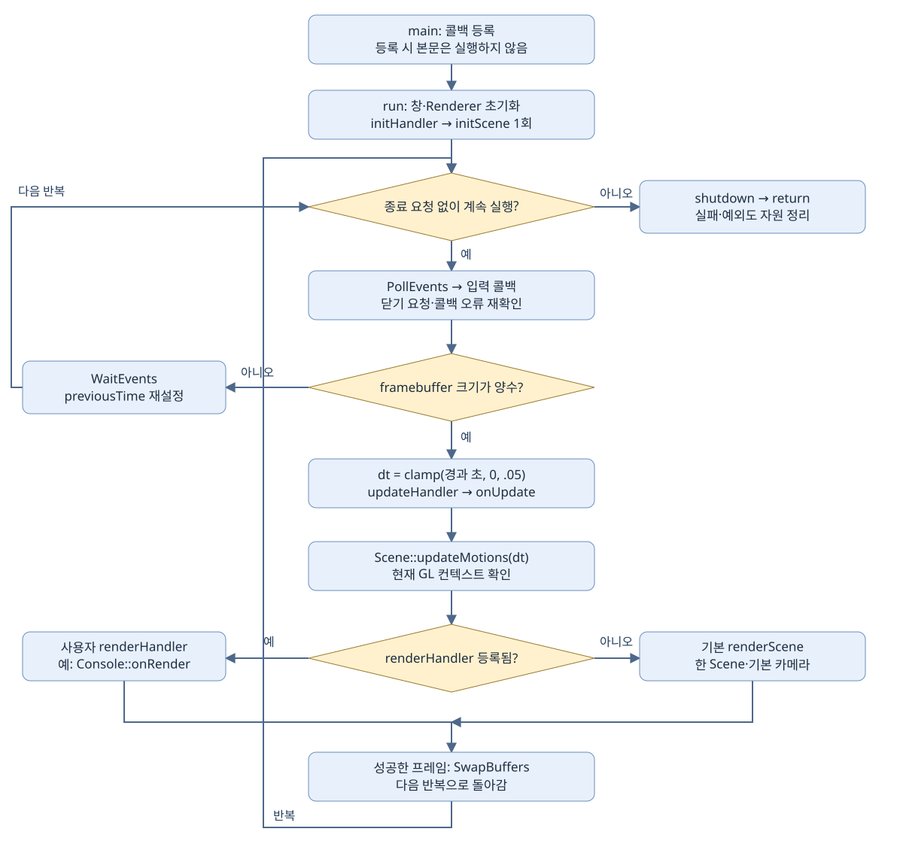
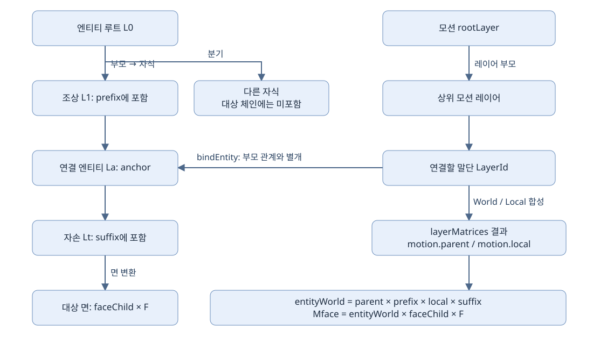
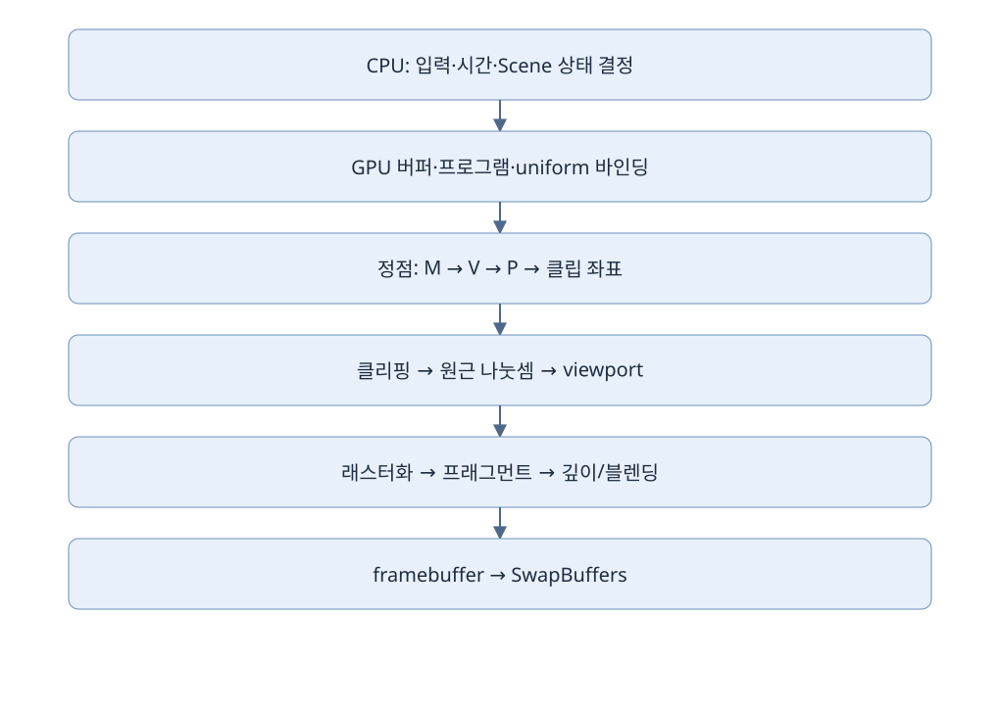

# 공개 API와 실제 사용 사례

<!-- doc-flowcharts:start -->







<!-- doc-flowcharts:end -->

현재 헤더 기준의 선언·오버로드를 모두 수록한다. 기본 include는 framework/Framework.h다. 문서 예제는 빌드하지 않았다.

[공통 구현·사례 HTML](API_REFERENCE.html) · [응용패턴 HTML](IMPLEMENTATION_PATTERNS.html)

## 입력·시간·장면·렌더링을 연결하는 실제 main

회전하는 상자를 만들고 Esc로 종료하는 상황이다. Application은 창과 루프를 소유하고, box는 Scene 안의 상자를 다시 찾는 번호다. 콜백은 등록할 때 실행되지 않는다. run이 초기화·이벤트·프레임 시점에 각각 실행한다.

app은 run 종료까지 살아 있는 소유 객체다. box는 초기화 콜백에서 채우는 optional ID다. dt는 이번 프레임 경과 초이며 angle은 누적 각도다. camera와 options는 Application 내부 상태를 수정하는 참조다.

```cpp
#include "framework/Framework.h"
#include <iostream>
int main() {
    graphics::Application app;
    std::optional<graphics::EntityId> box;
    float angle = 0;
    app.setInitHandler([&](graphics::Application& current) {
        box = current.getScene().addCuboid({1,1,1}, {0,0,0});
        auto& camera = current.getCamera(); camera.position = {4,3,6};
        current.getRenderOptions().depthTest = true;
        return box.has_value();
    });
    app.setKeyHandler([](graphics::Application& current,int key,int action) {
        if(key==GLFW_KEY_ESCAPE && action==GLFW_PRESS) current.requestClose();
    });
    app.setModifiedKeyHandler([](graphics::Application& current,int key,int action,int mods) {
        if(key==GLFW_KEY_ESCAPE && action==GLFW_PRESS) current.requestClose();
        std::cout << "수정키 비트=" << mods << '\n';
    });
    app.setFocusHandler([](graphics::Application&,bool focused) {
        std::cout << "포커스=" << focused << '\n';
    });
    app.setMouseHandler([](graphics::Application& current,const graphics::MouseEvent& e) {
        if(e.action!=GLFW_PRESS) return;
        if(auto hit=current.pickAt(e.windowX,e.windowY)) std::cout << hit->entityId << '\n';
    });
    app.setCursorHandler([](graphics::Application& current,double x,double y) {
        auto hit=current.pickAtCursor();
        (void)hit; (void)x; (void)y;
    });
    app.setUpdateHandler([&](graphics::Application& current,float dt) {
        angle += 45*dt;
        graphics::Transform3D pose;
        pose.rotation=glm::mat3(glm::rotate(glm::mat4(1),glm::radians(angle),glm::vec3(0,1,0)));
        if(!box || !current.getScene().setTransform(*box,pose)) current.requestClose();
    });
    app.setRenderHandler([](graphics::Application& current) {
        const auto size=current.getFramebufferSize();
        GLFWwindow* window=current.getWindow(); (void)window;
        if(size[0]<3 || size[1]<2) return true;
        return current.renderViews(graphics::PatternSystem::threeViews(
            current.getCamera(),size[0],size[1],current.getRenderOptions()));
        // 단일 뷰로 교체할 때는 return current.renderScene();
    });
    graphics::ApplicationConfig config;
    return app.run(config);
} // ~Application이 호출된다. 복사 생성/대입은 =delete이므로 호출할 수 없다.
```

수정키 콜백을 등록하면 일반 키 콜백 대신 호출된다. 이 예제의 Esc 처리는 두 콜백에 모두 있지만 실행되는 것은 수정키 콜백이다. update가 실패하면 종료를 요청하고, run은 GPU를 현재 컨텍스트에서 정리한다. getAssets의 사용 예는 자산 그룹에 따로 둔다.

- `Application::Application() = default` — 초기 창 포인터와 콜백·CPU 장면 상태를 준비한다. 실제 창은 run에서 생성한다.
- `Application::~Application()` — 실행 자원을 정리한다. GPU 해제는 창의 컨텍스트가 유효한 동안 수행한다.
- `Application::Application(const Application&) = delete` — 이 자원 소유 타입의 복사 생성/대입을 금지한다. 창·GPU 핸들을 중복 소유하지 않게 한다.
- `Application::Application& operator=(const Application&) = delete` — 이 자원 소유 타입의 복사 생성/대입을 금지한다. 창·GPU 핸들을 중복 소유하지 않게 한다.
- `Application::void setInitHandler(std::function<bool(Application&)> handler)` — 장면 초기화 콜백을 등록한다. run의 창·렌더러 초기화 후 한 번 호출하며 false면 실행을 종료한다.
- `Application::void setUpdateHandler(std::function<void(Application&, float)> handler)` — 매 프레임 dt(초)를 받는 갱신 콜백을 등록한다. 렌더 패스마다 중복 갱신하지 않는다.
- `Application::void setKeyHandler(std::function<void(Application&, int key, int action)> handler)` — 키와 action을 받는 콜백을 등록한다. 수정키 콜백이 있으면 그 콜백을 우선한다.
- `Application::void setModifiedKeyHandler( std::function<void(Application&, int key, int action, int mods)> handler)` — 키·action·mods를 받는 콜백을 등록하여 Shift 등 수정키를 처리한다.
- `Application::void setFocusHandler(std::function<void(Application&, bool focused)> handler)` — 창 포커스 변경 콜백을 등록한다. 지속 입력 상태 해제 등에 사용한다.
- `Application::void setRenderHandler(std::function<bool(Application&)> handler)` — 사용자 렌더 콜백을 등록한다. 등록하면 기본 renderScene 대신 호출한다.
- `Application::void setMouseHandler(std::function<void(Application&, const MouseEvent&)> handler)` — 마우스 버튼과 창/프레임버퍼 좌표를 받는 콜백을 등록한다.
- `Application::void setCursorHandler(std::function<void(Application&, double x, double y)> handler)` — 창 좌표의 커서 이동 콜백을 등록한다. 드래그에는 이전 좌표와의 차이를 사용한다.
- `Application::std::optional<PickResult> pickAt(double windowX, double windowY) const` — 창 좌표를 framebuffer 좌표로 보정하고 기본 카메라의 전체 viewport로 ray picking을 수행한다.
- `Application::std::optional<PickResult> pickAtCursor() const` — 현재 커서 위치를 읽어 기본 카메라의 장면 피킹 결과를 반환한다.
- `Application::int run(const ApplicationConfig& config = ApplicationConfig{})` — 초기화 → 이벤트 → 사용자 update → Scene 모션 → 렌더 → swap을 소유하고 정상/예외 종료에서 정리한다.
- `Application::void requestClose()` — 창 닫기 플래그를 설정하여 이벤트 루프의 정상 종료를 요청한다.
- `Application::bool renderScene()` — 기본 카메라와 현재 프레임버퍼 크기로 Scene을 한 번 렌더링한다.
- `Application::bool renderViews(const std::vector<RenderPass>& passes)` — 현재 창의 한 컨텍스트에서 여러 카메라 패스를 렌더링한다. 시간은 진행시키지 않는다.
- `Application::std::array<int,2> getFramebufferSize() const` — 현재 창의 실제 픽셀 크기를 반환한다. DPI 배율이 있으면 창 좌표 크기와 다를 수 있다.
- `Application::RenderOptions& getRenderOptions()` — 애플리케이션의 렌더 옵션을 수정할 수 있는 참조를 반환한다.
- `Application::Scene& getScene()` — 애플리케이션이 소유한 CPU Scene의 수정 가능한 참조를 반환한다.
- `Application::Camera& getCamera()` — 기본 카메라의 수정 가능한 참조를 반환한다.
- `Application::GLFWwindow* getWindow() const` — GLFW 창의 비소유 포인터를 반환한다. 창 수명 밖에서는 사용할 수 없다.

## CPU 장면에 형상을 만들고 ID로 관리하기

방 안에 상자·공·원뿔을 놓는 장면을 만든다. 생성 함수는 GPU를 직접 그리는 명령이 아니라 Scene에 CPU 데이터를 등록하는 명령이다. 생성 ID를 보관한 뒤 다음 프레임에서 위치와 표시 상태를 바꾼다.

scene이 모델과 컴포넌트를 소유한다. id는 컨테이너 원소를 찾는 값이며 포인터가 아니다. component와 mesh 포인터는 비소유 조회 결과이므로 장면 변경을 가로질러 보관하지 않는다.

```cpp
bool populate(graphics::Scene& scene) {
    auto box=scene.addCuboid({1,1,1},{0,.5f,0});
    auto ball=scene.addSphere(.4f,{2,.4f,0});
    auto cone=scene.addCone(.4f,1,{3,0,0});
    auto tetra=scene.addRightTetrahedron({1,1,1},{-2,0,0});
    auto pyramid=scene.addPyramid({1,1,1},{-3,0,0});
    auto model=graphics::DiagramSystem::makePolyhedron(graphics::GLShape::Cube,{1,1,1});
    auto first=scene.push_entity(model);
    auto second=scene.addModel(model,{},graphics::PivotMode::Preserve);
    if(!box||!ball||!cone||!tetra||!pyramid||!first||!second) return false;
    if(!scene.setTint(*box,{1,.4f,.2f}) || !scene.setVisible(*ball,true)) return false;
    if(!scene.setSideLengths(*box,{1,2,1}) || !scene.setModel(*second,model)) return false;
    for(auto id:scene.getIds()) {
        const auto* component=scene.getComponent(id);
        if(component) { auto local=component->transform; (void)local; }
    }
    auto revision=scene.getGeometryRevision();
    const auto& cubes=scene.getCubeFaceIds();
    const auto& tetras=scene.getTetraFaceIds();
    const auto& pyramids=scene.getPyramidFaceIds();
    (void)revision; (void)cubes; (void)tetras; (void)pyramids;
    return true;
}
void rebuildScene() {
    graphics::Scene scene;
    if(!populate(scene)) return;
    scene.clear(); // 이전 ID는 버리고 다시 populate한다.
}
```

형상 변경 번호는 Renderer가 업로드 필요성을 판단하는 근거다. clear 뒤 ID가 재사용될 수 있으므로 예전 box 번호로 새 장면을 조작하면 안 된다.

- `Scene::Scene()` — 빈 CPU 장면과 ID·형상 변경 상태를 초기화한다.
- `Scene::std::optional<EntityId> addSphere(float radius, const glm::vec3& position, unsigned slices = 32, unsigned stacks = 16)` — 반지름과 분할 수로 구 모델을 생성하고 지정 위치에 등록한다.
- `Scene::std::optional<EntityId> addCone(float radius, float height, const glm::vec3& position, unsigned slices = 32)` — 반지름·높이·분할 수로 원뿔을 생성하고 지정 위치에 등록한다.
- `Scene::bool setTint(EntityId id, GlColor color)` — 엔티티 전체에 곱할 색상 계수를 설정한다. 정점 자체의 색 배열과 구분한다.
- `Scene::std::optional<EntityId> push_entity(const Polyhedron& polyhedron, const Transform3D& transform = Transform3D{})` — 주어진 다면체와 변환을 Scene에 등록하고 새 EntityId를 반환한다.
- `Scene::std::optional<EntityId> addCuboid(const glm::vec3& sideLengths, const glm::vec3& worldPosition)` — 중심 기준 직육면체를 변 길이와 위치로 생성하여 Scene에 등록한다.
- `Scene::std::optional<EntityId> addRightTetrahedron(const glm::vec3& edgeLengths, const glm::vec3& worldPosition)` — 세 축의 모서리 길이로 직각 사면체를 생성하여 Scene에 등록한다.
- `Scene::std::optional<EntityId> addPyramid(const glm::vec3& sideLengths, const glm::vec3& worldPosition)` — 가로·높이·깊이에 맞는 피라미드를 생성하여 Scene에 등록한다.
- `Scene::bool setSideLengths(EntityId id, const glm::vec3& sideLengths)` — 기존 모델의 bounds와 새 크기 비율로 정점·면 피벗을 재계산한다. 모델 수정이므로 geometry revision이 바뀐다.
- `Scene::std::optional<EntityId> addModel(const Model& model, const Transform3D& transform = Transform3D{}, PivotMode pivot = PivotMode::BottomCenter, const glm::vec3& customPivot = glm::vec3(0))` — CPU 모델을 Scene에 등록한다. 피벗 모드와 사용자 기준점으로 localBasis를 결정한다.
- `Scene::bool setModel(EntityId id, const Model& model)` — 기존 엔티티의 모델을 교체한다. 형상 revision을 갱신한다.
- `Scene::bool setVisible(EntityId id, bool visible)` — 엔티티의 표시 여부를 바꾼다. 엔티티나 충돌 데이터를 삭제하지 않는다.
- `Scene::void clear()` — Scene의 모델·선·연결·모션을 초기화한다. 엔티티 ID는 재사용되므로 저장한 ID를 갱신한다.
- `Scene::const std::vector<EntityId>& getIds() const` — 현재 Scene의 엔티티 ID 배열을 읽기 전용 참조로 반환한다.
- `Scene::const Component_Poly* getComponent(EntityId id) const` — 엔티티 컴포넌트의 비소유 포인터를 반환한다. 유효하지 않은 ID면 nullptr이다.
- `Scene::const std::vector<FaceId>& getCubeFaceIds() const` — 직육면체 면 ID 목록을 읽기 전용 참조로 반환한다.
- `Scene::const std::vector<FaceId>& getTetraFaceIds() const` — 사면체 면 ID 목록을 읽기 전용 참조로 반환한다.
- `Scene::const std::vector<FaceId>& getPyramidFaceIds() const` — 피라미드 면 ID 목록을 읽기 전용 참조로 반환한다.
- `Scene::std::uint64_t getGeometryRevision() const` — 렌더러가 GPU 재업로드 필요성을 비교하는 형상 변경 번호를 반환한다.

## 부모·피벗·면 변환을 실제 부품에 적용하기

탱크 몸체에 포탑을 달고, 몸체 전체와 한 면을 따로 움직인다. 부모를 설정한 뒤 포탑 위치는 부모 좌표로 해석된다. 부모의 월드 행렬이 포탑 로컬 행렬 앞에 곱해진다.

root는 회전 중심만 가진 그룹, body는 표시 메시다. pose.basis는 부모 공간 위치, localBasis는 모델 안의 피벗, rotation은 회전 기저, scale은 축별 배율이다. faceIndex는 엔티티 ID와 다른 면 번호다.

```cpp
bool placeParts(graphics::Scene& scene) {
    auto root=scene.addGroup();
    auto body=scene.addCuboid({2,1,1},{0,0,0});
    if(!root||!body||!scene.setParent(*body,*root)) return false;
    graphics::Transform3D pose; pose.basis={0,.5f,0};
    if(!scene.setTransform(*body,pose) || !scene.setPosition(*body,{0,.6f,0})) return false;
    if(!scene.setLocalBasis(*body,graphics::PivotMode::Custom,{0,0,0})) return false;
    auto world=scene.worldMatrix(*body);
    auto faceWorld=scene.faceWorldMatrix(*body,0);
    if(!world||!faceWorld) return false;
    if(!scene.setFaceVisible(*body,0,true)
       ||!scene.setFaceCullMode(*body,0,graphics::CullMode::Back)) return false;
    graphics::Transform3D facePose; facePose.basis={0,.1f,0};
    if(!scene.setFaceTransform(*body,0,facePose,true)
       ||!scene.splitFace(*body,0)||!scene.setFaceSRT(*body,0,facePose)) return false;
    if(!scene.setFaceLocalMatrix(*body,0,glm::mat4(1))) return false;
    return scene.setParent(*body,std::nullopt);
}
```

setParent는 월드 자세를 자동 보존하지 않는다. 마지막 분리도 기존 로컬 값을 그대로 월드 값으로 사용한다. setFaceSRT와 setFaceLocalMatrix는 서로 다른 추가 변환 층이므로 사용 목적을 나눈다.

- `Scene::std::optional<EntityId> addGroup(const Transform3D& transform = Transform3D{})` — 메시 없는 변환 전용 엔티티를 생성하여 부모·관절 노드로 사용한다.
- `Scene::bool setFaceVisible(EntityId id, std::size_t faceIndex, bool visible)` — 해당 엔티티의 한 면을 표시하거나 숨긴다. 컬링 조건과 별개의 가시성 상태다.
- `Scene::bool setFaceCullMode(EntityId id, std::size_t faceIndex, CullMode mode)` — 해당 면의 앞면/뒷면 제거 정책을 설정한다. 조명 법선과 삼각형 winding을 구분한다.
- `Scene::bool setFaceLocalMatrix(EntityId id, std::size_t faceIndex, const glm::mat4& matrix)` — 해당 면에 적용할 추가 로컬 애니메이션 행렬을 설정한다.
- `Scene::bool setPosition(EntityId id, const glm::vec3& worldPosition)` — basis를 바꾸고 setTransform으로 유효성을 확인한다. 부모가 있으면 worldPosition이라는 매개변수 이름과 달리 부모 좌표다.
- `Scene::bool setTransform(EntityId id, const Transform3D& transform)` — 기존 엔티티의 최종 SRT를 바꾼다. 형상 정점 재생성과 GPU 재업로드는 별개의 작업이다.
- `Scene::bool setParent(EntityId id, std::optional<EntityId> parent)` — 부모 ID가 존재하고 순환이 없는지 확인한 뒤 계층 관계를 바꾼다. 월드 자세 보존 reparent 기능은 아니다.
- `Scene::std::optional<glm::mat4> worldMatrix(EntityId id) const` — 부모 체인과 모션 레이어를 합성한다. parent/prefix/local/suffix 순서를 실제 소스와 함께 읽는다.
- `Scene::std::optional<glm::mat4> faceWorldMatrix(EntityId id, std::size_t faceIndex) const` — 엔티티의 월드 행렬 뒤에 face SRT와 localAnimationMatrix를 합성한다.
- `Scene::bool setFaceTransform(EntityId id, std::size_t faceIndex, const Transform3D& transform, bool independence)` — 면 변환과 독립 변환 여부를 함께 설정한다. 부모 모델 변환과의 합성 정책을 바꾼다.
- `Scene::bool setLocalBasis(EntityId id, PivotMode mode, const glm::vec3& customPivot = glm::vec3(0))` — 피벗 정책과 로컬 기준점을 설정한다. 위치 이동과 메시 자체 크기 변경을 구분한다.
- `Scene::bool splitFace(EntityId id, std::size_t faceIndex)` — 지정 면을 독립 변환 가능한 면으로 분리한다.
- `Scene::bool setFaceSRT(EntityId id, std::size_t faceIndex, const Transform3D& transform)` — 면의 크기·회전·이동 변환을 설정한다.

## 메시·UV·재질을 편집한 뒤 Scene에 반영하기

바닥 삼각형에 UV와 색을 지정한다. 등록 전에는 Mesh 값을 자유 함수로 가공하고, 등록 후에는 Scene setter를 사용한다. 조회한 메시를 복사해 편집한 뒤 다시 넣으면 GPU 변경 감지가 유지된다.

vertices는 위치·법선·UV·색을 가진 CPU 정점 배열이다. indices는 이 배열을 참조하는 0 기반 번호다. meshIndex는 Model의 면/메시 배열 번호다. UV는 이미지 픽셀이 아니라 보통 0~1 텍스처 좌표다.

```cpp
bool editTriangle(graphics::Scene& scene) {
    std::vector<graphics::Vertex> vertices(3);
    vertices[0].position={0,0,0}; vertices[1].position={1,0,0}; vertices[2].position={0,0,1};
    auto mesh=graphics::PlaneFigure::fromVertices(vertices,{0,1,2});
    graphics::UVOptions uv; uv.axis=1;
    if(!graphics::generateTexcoords(mesh,uv)
       ||!graphics::transformTexcoords(mesh,{2,2},{0,0},0)) return false;
    graphics::recalculateNormals(mesh);
    auto edges=graphics::meshOutline(mesh); (void)edges;
    graphics::Model model; model.meshes().push_back(mesh);
    const graphics::Model& view=model;
    auto count=view.meshes().size(); (void)count;
    auto id=scene.addModel(model,{},graphics::PivotMode::Preserve); if(!id) return false;
    if(!scene.setMesh(*id,0,mesh)) return false;
    if(!scene.setMeshVertices(*id,0,{{0,0,0},{1,0,0},{0,0,1}},{0,1,2})) return false;
    if(!scene.setVertexPosition(*id,0,1,{2,0,0})||!scene.setTriangleIndices(*id,0,{0,1,2})) return false;
    if(!scene.generateTexcoords(*id,0,uv)||!scene.transformTexcoords(*id,0,{1,1},{.1f,0},0)) return false;
    if(!scene.setTexcoords(*id,0,{{0,0},{1,0},{0,1}})
       ||!scene.setVertexNormals(*id,0,{{0,-1,0},{0,-1,0},{0,-1,0}})) return false;
    if(!scene.setFaceVertexColors(*id,0,{{1,0,0},{0,1,0},{0,0,1}})) return false;
    graphics::Material material; material.color={1,1,1};
    if(!scene.setMaterial(*id,0,material)
       ||!scene.setOutline(*id,0,graphics::OutlineMode::Explicit,{0,1,1,2,2,0})) return false;
    const auto* current=scene.getMesh(*id,0); return current!=nullptr;
}
```

정점 수를 바꾸면 UV·법선·색 배열도 같은 정점 수에 맞춰야 한다. Explicit 외곽선은 정점 번호의 쌍이다. 텍스처가 없는 위 사례는 재질 색만 사용한다.

- `inline bool transformTexcoords(Mesh& mesh, const glm::vec2& scale, const glm::vec2& offset, float rotationDegrees = 0)` — 메시 UV에 배율→회전→이동을 적용한다. 회전 입력 단위는 도다.
- `inline bool generateTexcoords(Mesh& mesh, const UVOptions& options = UVOptions{})` — 평면·박스·원통·구 투영 옵션으로 메시 UV를 생성한다.
- `inline void recalculateNormals(Mesh& mesh)` — 메시의 삼각형 기하로 정점 법선을 다시 계산한다.
- `inline std::vector<std::uint32_t> meshOutline(const Mesh& mesh, OutlineMode mode = OutlineMode::FeatureEdges)` — 메시의 윤곽 모드에 따라 선으로 그릴 정점 인덱스 쌍 목록을 계산한다.
- `Scene::bool setFaceVertexColors(EntityId id, std::size_t faceIndex, const std::vector<GlColor>& colors)` — 면의 정점별 색 배열을 교체한다. 정점 수와 색 배열 길이를 맞춰야 한다.
- `Scene::bool setMesh(EntityId id, std::size_t meshIndex, const Mesh& mesh)` — 기존 모델의 지정 메시를 교체한다. 정점·인덱스 등 메시 유효성을 검사한다.
- `Scene::const Mesh* getMesh(EntityId id, std::size_t meshIndex) const` — 지정 메시의 읽기 전용 비소유 포인터를 반환한다. 잘못된 ID/인덱스면 nullptr이다.
- `Scene::bool setMeshVertices(EntityId id, std::size_t meshIndex, const std::vector<Vertex>& vertices, const std::vector<std::uint32_t>& triangles)` — 메시의 정점과 삼각형 인덱스를 함께 교체한다.
- `Scene::bool setVertexPosition(EntityId id, std::size_t meshIndex, std::size_t vertexIndex, const glm::vec3& position)` — 메시의 지정 정점 위치를 수정하고 형상 변경을 알린다.
- `Scene::bool setTriangleIndices(EntityId id, std::size_t meshIndex, const std::vector<std::uint32_t>& indices)` — 메시의 삼각형 인덱스 배열을 교체한다. 범위와 세 개 단위 구성을 검사한다.
- `Scene::bool generateTexcoords(EntityId id, std::size_t meshIndex, const UVOptions& options = UVOptions{})` — 평면·박스·원통·구 투영 옵션으로 메시 UV를 생성한다.
- `Scene::bool transformTexcoords(EntityId id, std::size_t meshIndex, const glm::vec2& scale, const glm::vec2& offset, float rotationDegrees = 0)` — 메시 UV에 배율→회전→이동을 적용한다. 회전 입력 단위는 도다.
- `Scene::bool setTexcoords(EntityId id, std::size_t meshIndex, const std::vector<glm::vec2>& uvs)` — 메시의 정점별 UV 배열을 교체한다.
- `Scene::bool setVertexNormals(EntityId id, std::size_t meshIndex, const std::vector<glm::vec3>& normals)` — 메시의 정점별 조명 법선 배열을 교체한다. 컬링 winding은 바뀌지 않는다.
- `Scene::bool setMaterial(EntityId id, std::size_t meshIndex, const Material& material)` — 메시의 색상·텍스처 등 재질 데이터를 교체한다.
- `Scene::bool setOutline(EntityId id, std::size_t meshIndex, OutlineMode mode, const std::vector<std::uint32_t>& explicitEdges = std::vector<std::uint32_t>{})` — 윤곽선 생성 방식과 선택적 명시 인덱스를 설정한다.
- `PlaneFigure::static PlaneFigure fromVertices(const std::vector<Vertex>& vertices, const std::vector<std::uint32_t>& triangles)` — 정점 목록에서 하나의 면 데이터를 만든다. 모델/Scene 등록은 수행하지 않는다.
- `Polyhedron::std::vector<Mesh>& meshes()` — 모델이 보관한 면/메시 배열의 참조를 반환한다. const 오버로드는 읽기 전용이다.
- `Polyhedron::const std::vector<Mesh>& meshes() const` — 모델이 보관한 면/메시 배열의 참조를 반환한다. const 오버로드는 읽기 전용이다.

## 객체를 따라가는 선과 기저 표시

회전하는 로봇에 X/Y/Z 기저를 붙여 어느 방향을 보는지 확인한다. 선의 owner가 로봇 ID이면 끝점이 로봇 로컬 좌표로 해석되어 함께 움직인다.

line은 선 ID이고 owner는 엔티티 ID다. basis의 각 열은 X/Y/Z 방향이며 axisLengths는 표시 길이이다. 방향 벡터를 자동 정규화하지 않는다.

```cpp
bool showAxes(graphics::Scene& scene,graphics::EntityId owner) {
    auto line=scene.addLine({0,0,0},{1,0,0},{1,0,0},owner);
    auto vector=scene.addVector({0,0,0},{0,1,0},{0,1,0},owner);
    auto axes=scene.addBasis({0,0,0},glm::mat3(1),{1,1,1},owner);
    if(!line||!vector||!axes||!scene.setVector(*line,{0,0,0},{2,0,0})) return false;
    auto world=scene.lineWorldMatrix(*line);
    const auto& lines=scene.getLines(); (void)lines;
    return world.has_value();
}
```

기저선은 실제 메시 표면을 수정하지 않는 관찰 도구다. 선과 모델은 서로 다른 ID 배열에 보관된다.

- `Scene::std::optional<glm::mat4> lineWorldMatrix(LineId id) const` — 선의 owner 엔티티를 따라 로컬 끝점을 월드로 옮길 행렬을 반환한다.
- `Scene::std::optional<LineId> addLine(const glm::vec3& start, const glm::vec3& end, GlColor color, std::optional<EntityId> owner = std::nullopt)` — 두 끝점의 선을 추가한다. owner가 있으면 해당 엔티티 변환을 따른다.
- `Scene::std::optional<LineId> addVector(const glm::vec3& origin, const glm::vec3& vector, GlColor color, std::optional<EntityId> owner = std::nullopt)` — 시작점과 방향/길이 벡터를 선의 두 끝점으로 변환하여 추가한다.
- `Scene::std::optional<std::array<LineId, 3>> addBasis( const glm::vec3& origin, const glm::mat3& basisVectors = glm::mat3(1.0f), const glm::vec3& axisLengths = glm::vec3(1.0f), std::optional<EntityId> owner = std::nullopt)` — 기저 행렬의 열 벡터로 X/Y/Z 선 세 개를 추가하고 LineId 묶음을 반환한다.
- `Scene::bool setVector(LineId id, const glm::vec3& origin, const glm::vec3& vector)` — 기존 선을 시작점과 방향/길이 벡터로 갱신한다.
- `Scene::const std::vector<Line3D>& getLines() const` — Scene의 선 데이터 배열을 읽기 전용 참조로 반환한다.

## 변환 계산과 경로 생성

공이 원 경로를 따라 이동하고 한 축을 중심으로 도는 상황이다. TransformSystem은 행렬을 계산하고 PathSystem은 진행률을 위치로 바꾸는 함수를 만든다. 이 계산만으로 Scene이 변경되지는 않는다.

axis.point는 회전축 위의 한 점, direction은 축 방향이다. u는 시간 자체가 아니라 경로 진행률이다. smoothStep은 u를 느리게 시작·끝나는 진행률로 바꾼다.

```cpp
void calculateTransforms() {
    graphics::AxisLine axis{{0,0,0},{0,1,0}};
    auto t=graphics::TransformSystem::translation({1,0,0});
    auto s=graphics::TransformSystem::scaling({2,1,1},{0,0,0});
    auto r=graphics::TransformSystem::rotation(axis,90);
    auto point=graphics::TransformSystem::reflectPoint({0,0,0});
    auto line=graphics::TransformSystem::reflectLine(axis);
    auto plane=graphics::TransformSystem::reflectPlane({0,0,0},{1,0,0});
    if(!t||!s||!r||!point||!line||!plane) return;
    bool affine=graphics::TransformSystem::validAffine(*t * *r * *s); (void)affine;
    auto circle=graphics::PathSystem::circle({0,0,0},2);
    auto ellipse=graphics::PathSystem::ellipse({0,0,0},{2,0,0},{0,0,1});
    auto polyline=graphics::PathSystem::polyline({{0,0,0},{1,0,0},{1,0,1}});
    auto polygon=graphics::PathSystem::polygon({{0,0,0},{1,0,0},{0,0,1}});
    auto rectangle=graphics::PathSystem::rectangle({0,0,0},{1,0,0},{0,0,1});
    if(!circle||!ellipse||!polyline||!polygon||!rectangle) return;
    auto u=graphics::PathSystem::linear(.25);
    auto eased=graphics::PathSystem::smoothStep(u);
    glm::vec3 position=circle(eased); (void)position;
}
```

optional 행렬이 비어 있거나 경로 std::function이 비면 입력이 유효하지 않다. 0 길이 축이나 0 반지름을 넘긴 실패를 identity 행렬 성공으로 간주하지 않는다.

- `TransformSystem::static bool validAffine(const glm::mat4& matrix)` — 행렬 원소가 유한하고 마지막 행이 아핀 변환 형식인지 검사한다.
- `TransformSystem::static std::optional<glm::mat4> translation(const glm::vec3& offset)` — 이동 벡터로 아핀 이동 행렬을 만든다. 유효하지 않으면 빈 optional이다.
- `TransformSystem::static std::optional<glm::mat4> scaling(const glm::vec3& factors, const glm::vec3& center = glm::vec3(0))` — 중심점 주위의 축별 배율 행렬 T(C)·S·T(-C)를 만든다.
- `TransformSystem::static std::optional<glm::mat4> rotation(const AxisLine& axis, double degrees)` — 직선 위 점·축 방향과 도 단위 각도로 축 주위 회전 행렬을 만든다.
- `TransformSystem::static std::optional<glm::mat4> reflectPoint(const glm::vec3& center)` — 주어진 점을 중심으로 세 축을 반전하는 점 반사 행렬을 만든다.
- `TransformSystem::static std::optional<glm::mat4> reflectLine(const AxisLine& line)` — 주어진 직선을 기준으로 선 반사 행렬을 만든다.
- `TransformSystem::static std::optional<glm::mat4> reflectPlane(const glm::vec3& point, const glm::vec3& normal)` — 평면의 점과 법선으로 평면 반사 행렬을 만든다.
- `PathSystem::static PathFunction ellipse(const glm::vec3& center, const glm::vec3& axisU, const glm::vec3& axisV)` — 중심과 두 반축 벡터로 매개변수 타원 경로 함수를 만든다.
- `PathSystem::static PathFunction circle(const glm::vec3& center, float radius, const glm::vec3& normal = glm::vec3(0, 1, 0))` — 중심·반지름·평면 법선으로 원 경로 함수를 만든다.
- `PathSystem::static PathFunction polyline(std::vector<glm::vec3> points, bool closed = false)` — 점 목록을 따라가는 꺾은선 경로 함수를 만든다. closed로 순환 여부를 정한다.
- `PathSystem::static PathFunction polygon(std::vector<glm::vec3> points)` — 마지막 점과 첫 점이 연결되는 닫힌 꺾은선 경로 함수를 만든다.
- `PathSystem::static PathFunction rectangle(const glm::vec3& center, const glm::vec3& halfU, const glm::vec3& halfV)` — 중심과 두 반변 벡터로 직사각형 테두리 경로 함수를 만든다.
- `PathSystem::static double linear(double progress)` — 입력 진행률을 선형 보간 진행률로 반환한다.
- `PathSystem::static double smoothStep(double progress)` — 진행률에 3t²-2t³ 완화 곡선을 적용한다.

## 한 물체의 모션 구성·편집·샘플링

상자가 2초 이동한 뒤 1초 회전하는 모션을 편집한다. append는 단계를 배열에 더할 뿐 시작 시간을 뒤로 밀지 않는다. 순차 실행은 then을 사용한다.

Motion은 단계들의 값 묶음이다. MotionStep의 콜백이 받는 초는 해당 단계가 시작된 이후의 시간이다. sample(2.5)는 dt=.5가 아니라 모션 시작 후 2.5초의 자세를 요구한다.

```cpp
std::optional<graphics::Motion> makeMotion() {
    graphics::Motion motion;
    graphics::LinearMotion move; move.to={2,0,0}; move.durationSeconds=2;
    if(!motion.append(graphics::Motion::linear(move))) return {};
    graphics::RotationMotion spin; spin.degreesPerSecond=90;
    auto rotate=graphics::Motion::rotation(spin); rotate.durationSeconds=1;
    if(!motion.then(rotate)) return {};
    auto fixed=graphics::Motion::fixed(glm::mat4(1));
    if(!motion.insert(0,fixed)||!motion.replace(0,fixed)||!motion.erase(0)) return {};
    const auto& steps=motion.getSteps(); (void)steps;
    auto pose=motion.sample(2.5); if(!pose) return {};
    graphics::PathMotion path; path.path=graphics::PathSystem::circle({0,0,0},1);
    graphics::Motion looping;
    if(!looping.append(graphics::Motion::followPath(path))) return {};
    graphics::PendulumMotion sway; sway.periodSeconds=3;
    graphics::Motion pendulum;
    if(!pendulum.append(graphics::Motion::pendulum(sway))) return {};
    return motion;
}
```

유한 종료 시간이 없는 루프 단계 뒤에는 then을 사용할 수 없다. Once 단계는 종료 자세를 유지한다. 진자는 중력 적분이 아니라 지정 주기의 sin 각도 함수다.

- `Motion::bool append(const MotionStep& step)` — 모션 단계 배열의 끝에 유효한 단계를 추가한다. 자동 순차 배치는 then을 사용한다.
- `Motion::bool insert(std::size_t index, const MotionStep& step)` — 주어진 인덱스에 모션 단계를 삽입한다.
- `Motion::bool replace(std::size_t index, const MotionStep& step)` — 주어진 인덱스의 모션 단계를 새 단계로 교체한다.
- `Motion::bool erase(std::size_t index)` — 주어진 인덱스의 모션 단계를 삭제한다.
- `Motion::bool then(MotionStep step)` — 모든 앞 단계의 유한 종료 시각을 구한 뒤 새 단계의 시작을 그 뒤로 이동해 순차 실행을 만든다.
- `Motion::const std::vector<MotionStep>& getSteps() const` — 등록된 모션 단계 배열을 읽기 전용 참조로 반환한다.
- `Motion::std::optional<MotionSample> sample(double seconds) const` — 절대 시간(초)에서 활성 단계의 월드/로컬 행렬 기여를 합성하여 MotionSample을 반환한다.
- `Motion::static MotionStep fixed(const glm::mat4& matrix, TransformSpace space = TransformSpace::World)` — 고정 행렬을 반환하는 모션 단계를 만든다. 합성 공간을 함께 지정한다.
- `Motion::static MotionStep rotation(const RotationMotion& config)` — 축·초당 각속도·초기 각도·합성 공간으로 회전 모션 단계를 만든다.
- `Motion::static MotionStep followPath(const PathMotion& config)` — 경로·보간·재생 설정으로 시간에 따른 위치 이동 모션 단계를 만든다.
- `Motion::static MotionStep linear(const LinearMotion& config)` — 시작·끝 위치를 지정 시간 동안 선형보간한다. Once·Loop·PingPong을 지원한다.
- `Motion::static MotionStep pendulum(const PendulumMotion& config)` — 지정 축에서 offset + amplitude*sin(위상)의 도 단위 회전을 반복한다. 물리 적분은 아니다.

## 모션 시계와 레이어를 연결·편집·해제하기

두 물체에 같은 경로 시계를 연결하되 한 분기만 반사시키는 경우다. MotionId는 시간 상태를 찾고 LayerId는 변환 합성 경로를 찾는다. 같은 모션을 공유하면 위상도 공유한다.

system은 Scene 안의 MotionSystem이다. rootLayer는 삭제할 수 없는 0번 루트다. parent는 변환 트리 부모이며 motion의 World/Local 기여는 합성 위치를 나눈다.

```cpp
bool connectMotion(graphics::Scene& scene,graphics::EntityId entity) {
    auto& system=scene.getMotions();
    const auto& constSystem=static_cast<const graphics::Scene&>(scene).getMotions(); (void)constSystem;
    graphics::Motion motion;
    graphics::RotationMotion rotation;
    if(!motion.append(graphics::Motion::rotation(rotation))) return false;
    auto id=system.createMotion(motion); if(!id) return false;
    if(!system.setMotion(*id,motion)||!system.seekMotion(*id,1)
       ||!system.setMotionPlaying(*id,false)||!system.setMotionEnabled(*id,true)) return false;
    const auto* state=system.getMotion(*id); if(!state) return false;
    auto layer=system.pushLayer(graphics::MotionSystem::rootLayer()); if(!layer) return false;
    graphics::LayerConfig config; config.motion=*id;
    if(!system.setLayer(*layer,config)||!system.bindMotion(*layer,*id)) return false;
    auto inserted=system.insertLayer(*layer); if(!inserted) return false;
    if(!system.reparentLayer(*layer,graphics::MotionSystem::rootLayer())
       ||!system.removeLayer(*inserted)) return false;
    const auto* layerState=system.getLayer(*layer); (void)layerState;
    auto matrices=system.layerMatrices(*layer); if(!matrices) return false;
    if(!scene.bindEntity(entity,*layer)) return false;
    auto binding=scene.getEntityLayer(entity); (void)binding;
    if(!system.update(.016)||!scene.updateMotions(.016)) return false;
    // 위 두 호출은 수동 진행의 시연이다. Application 루프에서는 자동 진행하므로 호출하지 않는다.
    if(!scene.unbindEntity(entity)||!system.bindMotion(*layer,std::nullopt)) return false;
    if(!system.popLayer(*layer)||!system.removeMotion(*id)) return false;
    auto spin=system.createSpin(rotation);
    auto orbit=system.createOrbit(rotation);
    auto combined=system.createOrbitAndSpin(rotation,rotation);
    graphics::PathMotion path; path.path=graphics::PathSystem::circle({0,0,0},1);
    auto moving=system.createPathAndSpin(path,rotation);
    if(!spin||!orbit||!combined||!moving) return false;
    system.clear(); // 기존 레이어 연결을 사용하지 않는 별도 예제 종료 지점
    return true;
}
```

playing=false는 시간 정지, enabled=false는 변환 기여 제거다. popLayer는 자식 없는 레이어만 제거한다. removeLayer는 자식을 부모 쪽으로 승격한다. system.clear 전에 Scene 엔티티 바인딩을 해제해야 한다.

- `Scene::MotionSystem& getMotions()` — Scene이 소유한 MotionSystem의 참조를 반환한다. const 오버로드는 읽기 전용이다.
- `Scene::const MotionSystem& getMotions() const` — Scene이 소유한 MotionSystem의 참조를 반환한다. const 오버로드는 읽기 전용이다.
- `Scene::bool bindEntity(EntityId id, LayerId layer)` — 엔티티를 기존 모션 레이어에 연결하여 월드 행렬 합성에 반영한다.
- `Scene::bool unbindEntity(EntityId id)` — 엔티티와 모션 레이어의 연결을 해제한다.
- `Scene::std::optional<LayerId> getEntityLayer(EntityId id) const` — 엔티티에 연결된 레이어 ID를 반환한다. 연결이 없으면 빈 optional이다.
- `Scene::bool updateMotions(double deltaSeconds)` — Scene의 모션 시스템에 dt(초)를 전달한다. Application 루프에서는 자동 호출된다.
- `MotionSystem::static constexpr LayerId rootLayer()` — 삭제할 수 없는 루트 레이어의 ID 0을 반환한다.
- `MotionSystem::std::optional<MotionId> createMotion(const Motion& motion)` — 모션을 시스템에 등록하고 새 MotionId를 반환한다.
- `MotionSystem::bool setMotion(MotionId id, const Motion& motion)` — 기존 MotionId의 모션 데이터를 교체하고 현재 시각의 샘플을 갱신한다.
- `MotionSystem::const MotionState* getMotion(MotionId id) const` — 모션 상태의 읽기 전용 비소유 포인터를 반환한다. 없는 ID면 nullptr이다.
- `MotionSystem::bool setMotionPlaying(MotionId id, bool playing)` — 모션의 시간 진행을 정지하거나 재개한다. 모션 기여 자체의 사용 여부와 구분한다.
- `MotionSystem::bool setMotionEnabled(MotionId id, bool enabled)` — 모션 샘플의 기여 여부를 설정한다. playing과 별도 상태다.
- `MotionSystem::bool seekMotion(MotionId id, double seconds)` — 지정 시각을 샘플링하고 유효할 때 모션의 시간과 샘플을 함께 바꾼다.
- `MotionSystem::bool removeMotion(MotionId id)` — 모션을 제거하고 연결된 레이어의 해당 모션 연결을 해제한다.
- `MotionSystem::bool update(double deltaSeconds)` — 시간 또는 프레임 상태를 진행한다. MotionSystem은 임시 샘플을 모은 뒤 성공한 경우 반영한다.
- `MotionSystem::void clear()` — 모션과 레이어를 비우고 루트 레이어를 복구한다. 다음 ID 카운터는 되돌리지 않는다.
- `MotionSystem::std::optional<LayerId> pushLayer(LayerId parent, const LayerConfig& config = LayerConfig{})` — 유효한 부모 아래 새 자식 레이어를 추가한다. 복사한 임시 맵에 반영한 뒤 swap하여 상태를 확정한다.
- `MotionSystem::std::optional<LayerId> insertLayer(LayerId child, const LayerConfig& config = LayerConfig{})` — 기존 child와 그 parent 사이에 새 레이어를 끼운다. root 위 삽입은 허용하지 않는다.
- `MotionSystem::std::optional<LayerId> popLayer(LayerId top)` — 자식이 없는 비root leaf만 제거하고 그 부모 ID를 반환한다.
- `MotionSystem::bool removeLayer(LayerId id)` — root 이외 레이어를 제거하며 자식들을 부모의 해당 위치로 승격한다. 월드 자세 보존을 자동 약속하지 않는다.
- `MotionSystem::bool reparentLayer(LayerId id, LayerId parent)` — 레이어의 부모를 바꾸며 자신의 자손으로 연결되는 순환을 거부한다.
- `MotionSystem::bool setLayer(LayerId id, const LayerConfig& config)` — 기존 레이어의 고정 변환·합성 공간·모션 연결·활성 상태를 바꾼다.
- `MotionSystem::const LayerState* getLayer(LayerId id) const` — 레이어 상태의 읽기 전용 비소유 포인터를 반환한다. 없는 ID면 nullptr이다.
- `MotionSystem::bool bindMotion(LayerId layer, std::optional<MotionId> motion)` — 기존 레이어에 모션 ID를 연결하거나 해제한다. 모션과 레이어가 존재하는지 검사한다.
- `MotionSystem::std::optional<MotionSample> layerMatrices(LayerId leaf) const` — leaf까지의 계층을 따라 transform과 motion 샘플을 World/Local 공간에 맞게 parent/local 행렬로 합성한다.
- `MotionSystem::std::optional<MotionId> createSpin(RotationMotion config)` — 로컬 공간 회전 모션을 등록하여 자전에 사용한다.
- `MotionSystem::std::optional<MotionId> createOrbit(RotationMotion config)` — 월드 공간 회전 모션을 등록하여 축 주위 공전에 사용한다.
- `MotionSystem::std::optional<MotionId> createOrbitAndSpin(RotationMotion orbit, RotationMotion spin)` — 월드 공전과 로컬 자전을 하나의 모션에 등록한다.
- `MotionSystem::std::optional<MotionId> createPathAndSpin(const PathMotion& path, RotationMotion spin)` — 경로 이동과 로컬 자전을 하나의 모션에 등록한다.

## CPU 모델의 생성·형상 계약과 행렬 읽기

직육면체와 구·원뿔을 Scene에 등록하기 전에 형상과 변환을 확인한다. DiagramSystem은 GPU 자원 소유자가 아니라 CPU 모델 생성·계산 도구다.

model.faces는 여러 면/메시다. transform은 SRT와 모델 피벗을 포함한다. modelMatrix는 T(basis)·R·S·T(-localBasis)를 계산한다.

```cpp
void inspectModel(const graphics::Component_Poly& component) {
    auto cube=graphics::DiagramSystem::makePolyhedron(graphics::GLShape::Cube,{1,1,1});
    auto sphere=graphics::DiagramSystem::makeSphere(.5f);
    auto cone=graphics::DiagramSystem::makeCone(.5f,1);
    bool valid=graphics::DiagramSystem::validPolyhedron(cube);
    graphics::Transform3D transform;
    valid=graphics::DiagramSystem::validTransform(transform)&&valid;
    auto matrix=graphics::DiagramSystem::modelMatrix(transform);
    if(!component.polyhedron.faces.empty()) {
        auto face=graphics::DiagramSystem::faceModelMatrix(component,component.polyhedron.faces[0]);
        (void)face;
    }
    (void)sphere;(void)cone;(void)valid;(void)matrix;
}
```

validPolyhedron은 면 구성의 유효성을, validTransform은 회전 기저와 수치의 유효성을 다룬다. 둘 중 하나의 성공이 다른 하나의 성공을 보장하지 않는다.

- `DiagramSystem::static Polyhedron makePolyhedron(GLShape shape, const glm::vec3& sideLengths = glm::vec3(1.0f))` — 형상 종류와 변 길이로 CPU 다면체를 만든다. Scene 등록은 별도로 수행한다.
- `DiagramSystem::static Model makeSphere(float radius, unsigned slices = 32, unsigned stacks = 16)` — 반지름·분할 수로 CPU 구 메시 모델을 생성한다.
- `DiagramSystem::static Model makeCone(float radius, float height, unsigned slices = 32)` — 반지름·높이·분할 수로 CPU 원뿔 모델을 생성한다.
- `DiagramSystem::static bool validPolyhedron(const Polyhedron& polyhedron)` — 다면체의 면·정점·인덱스 등 렌더 입력 조건을 검사한다.
- `DiagramSystem::static bool validTransform(const Transform3D& transform)` — 변환의 유한성·회전 기저·배율 등 허용 조건을 검사한다.
- `DiagramSystem::static glm::mat4 modelMatrix(const Transform3D& transform)` — T(basis)·R·S·T(-localBasis) 순서로 로컬 모델 행렬을 계산한다.
- `DiagramSystem::static glm::mat4 faceModelMatrix(const Component_Poly& component, const PlaneFigure& face)` — 컴포넌트와 면의 변환·독립성 정책에 따라 면 모델 행렬을 계산한다.

## 카메라와 직접 Renderer 사용

Application 대신 자체 창을 소유하는 호스트가 Scene을 직접 그리는 상황이다. 아래 함수는 이미 OpenGL 3.3 컨텍스트가 현재인 동안만 호출한다. 일반 실습에서는 Application::renderScene/renderViews가 이 책임을 맡는다.

camera.position은 시점, target은 바라보는 점, near/far는 보이는 깊이 범위다. RenderPass는 카메라·픽셀 사각형·옵션·clear 정책을 한 번의 드로우 묶음으로 전달한다.

```cpp
bool renderInCurrentContext(const graphics::Scene& scene,int width,int height) {
    graphics::Camera camera; camera.position={4,3,6};
    if(!graphics::CameraSystem::validCamera(camera)||width<1||height<1) return false;
    auto view=graphics::CameraSystem::viewMatrix(camera);
    auto projection=graphics::CameraSystem::projectionMatrix(camera,float(width)/height);
    (void)view;(void)projection;
    graphics::Renderer renderer;
    if(!renderer.initialize()) return false;
    graphics::RenderOptions options; options.depthTest=true;
    bool ok=renderer.render(scene,camera,width,height,options);
    graphics::RenderPass pass; pass.camera=camera;pass.viewport={0,0,width,height};
    ok=renderer.renderPass(scene,pass,width,height)&&ok;
    ok=renderer.renderViews(scene,{pass},width,height)&&ok;
    renderer.destroy(); // 현재 컨텍스트가 유효한 정상 종료 경로
    return ok;
}
void onContextLost(graphics::Renderer& renderer) {
    renderer.abandon(); // GL 호출이 불가능한 별도 실패 경로: GPU delete를 호출하지 않는다.
}
// Renderer 복사 생성/대입은 =delete. 동일 GPU 핸들을 두 객체가 소유할 수 없다.
```

세 렌더 호출은 API별 사용 예를 순서대로 보여준다. 실제 한 프레임에서는 의도한 방식 하나를 선택한다. destroy와 abandon은 같은 종료 지점에서 연속 호출하는 API가 아니다.

- `CameraSystem::static bool validCamera(const Camera& camera)` — 시점·주목점·up·투영/클립 범위가 유효한 카메라인지 검사한다.
- `CameraSystem::static glm::mat4 viewMatrix(const Camera& camera)` — 카메라 시점·주목점·up으로 월드→뷰 행렬을 계산한다.
- `CameraSystem::static glm::mat4 projectionMatrix(const Camera& camera, float aspect)` — 카메라의 원근/직각 모드와 주어진 aspect로 투영 행렬을 계산한다.
- `Renderer::Renderer() = default` — GPU 핸들을 0과 미업로드 상태로 준비한다. 실제 GL 생성은 initialize에서 수행한다.
- `Renderer::Renderer(const Renderer&) = delete` — 이 자원 소유 타입의 복사 생성/대입을 금지한다. 창·GPU 핸들을 중복 소유하지 않게 한다.
- `Renderer::Renderer& operator=(const Renderer&) = delete` — 이 자원 소유 타입의 복사 생성/대입을 금지한다. 창·GPU 핸들을 중복 소유하지 않게 한다.
- `Renderer::bool initialize(const std::filesystem::path& vertexPath = std::filesystem::path{}, const std::filesystem::path& fragmentPath = std::filesystem::path{})` — 현재 OpenGL 3.3 컨텍스트에서 셰이더·프로그램·버퍼를 생성한다. 빈 경로면 내장 GLSL을 사용한다.
- `Renderer::bool render(const Scene& scene, const Camera& camera, int width, int height, const RenderOptions& options = RenderOptions{})` — Scene을 카메라와 전체 화면 크기로 렌더링한다. 유효한 현재 GL 컨텍스트가 필요하다.
- `Renderer::bool renderPass(const Scene& scene,const RenderPass& pass,int framebufferWidth,int framebufferHeight)` — viewport·scissor·깊이·컬링·clear를 설정하고 pass 크기로 aspect를 계산해 draw로 전달한다.
- `Renderer::bool renderViews(const Scene& scene,const std::vector<RenderPass>& passes,int width,int height)` — 프레임 전체를 초기화한 뒤 여러 pass를 순서대로 그린다. 한 Scene과 한 WGL 컨텍스트를 공유한다.
- `Renderer::void destroy()` — GPU 핸들을 삭제하고 캐시를 비운다. 컨텍스트가 유효해야 한다.
- `Renderer::void abandon()` — 컨텍스트 실패 후 GL 삭제 호출을 피하고 CPU 핸들/캐시를 비운다. 창 파괴가 컨텍스트 자원을 회수한다.

## 마우스 픽셀을 객체 선택과 배치 위치로 바꾸기

왼쪽 클릭으로 선택한 상자의 면을 찾고, 빈 바닥 클릭은 Y=0 평면 위치로 바꾼다. 창 좌표와 framebuffer 픽셀은 DPI 배율 때문에 다를 수 있으므로 좌표계를 맞춘다.

viewport는 왼쪽 위 원점의 픽셀 사각형이다. ray는 near plane에서 시작하며 direction은 정규화된다. hit에는 객체·면·삼각형 번호와 월드/로컬 교차점·UV가 들어 있다.

```cpp
void selectAt(const graphics::Scene& scene,const graphics::Camera& camera,double x,double y) {
    graphics::PickViewport viewport{0,0,1100,800};
    auto ray=graphics::screenRay(camera,x,y,viewport);
    if(!ray) return;
    auto first=graphics::pick(scene,*ray);
    auto second=graphics::pick(scene,camera,x,y,viewport);
    auto floor=graphics::PatternSystem::screenOnPlane(camera,x,y,viewport,{0,0,0},{0,1,0});
    if(first) { auto id=first->entityId; auto face=first->faceIndex; (void)id;(void)face; }
    if(floor) { glm::vec3 placement=*floor; (void)placement; }
    (void)second;
}
```

화면 밖 좌표, 평행한 평면, 또는 물체를 맞히지 않은 클릭은 빈 optional이 정상 결과다. 빈 결과를 시스템 오류로 처리하지 않는다.

- `PatternSystem::static std::optional<glm::vec3> screenOnPlane(const Camera& camera,double x,double y, const PickViewport& viewport,const glm::vec3& planePoint,const glm::vec3& normal)` — 화면 픽셀을 ray로 바꾸어 평면 교차 위치를 얻는다. 평행/뒤쪽 교차는 빈 결과다.
- `inline std::optional<Ray> screenRay(const Camera& camera,double x,double y,const PickViewport& viewport)` — 왼쪽 위 기준 프레임버퍼 픽셀을 카메라 ray로 역투영한다. 영역 밖/잘못된 투영이면 빈 결과다.
- `inline std::optional<PickResult> pick(const Scene& scene,const Ray& input)` — ray 또는 화면 좌표로 보이는 삼각형의 최근접 교차를 찾아 객체·면·위치·UV를 반환한다.
- `inline std::optional<PickResult> pick(const Scene& scene,const Camera& camera,double x,double y, const PickViewport& viewport)` — ray 또는 화면 좌표로 보이는 삼각형의 최근접 교차를 찾아 객체·면·위치·UV를 반환한다.

## OBJ·이미지 로딩을 실제 초기화 시점에 연결하기

외부 모델과 한 장의 텍스처를 불러온다. 상대경로는 실행 파일 기준 projectRoot 안에서 해석된다. 모델 파일에 담긴 피벗 결과를 addModel에 그대로 전달해야 발 기준 배치가 유지된다.

loaded는 CPU 모델과 피벗·경고·오류를 묶은 ModelResult다. texture.image는 공유 이미지다. features.textures는 로딩 기능, RenderOptions.textures는 그리기 기능을 켠다.

```cpp
bool loadAssets(graphics::Application& app) { // initHandler 안에서 호출
    auto& loader=app.getAssets();
    const auto& features=loader.features(); (void)features;
    graphics::LoadOptions options; options.texturePath="textures/robot.png";
    auto loaded=loader.loadObj("models/robot.obj",options);
    if(!loaded) { std::cerr<<loaded.error; return false; }
    auto texture=loader.loadTexture("textures/robot.png");
    if(!texture) { std::cerr<<texture.error; return false; }
    if(!texture.image->valid()) return false;
    auto id=app.getScene().addModel(*loaded.model,{},loaded.pivotMode,loaded.localBasis);
    app.getRenderOptions().textures=true;
    return id.has_value();
}
void standaloneLoader() {
    graphics::FeatureOptions features; features.textures=true;
    graphics::AssetLoader loader(".",features);
    auto a=loader.loadPrimitive("models/cube.obj");
    auto b=loader.loadModel("models/robot.obj");
    graphics::TextureImage pixel; pixel.width=1;pixel.height=1;pixel.rgba={255,255,255,255};
    bool valid=pixel.valid(); (void)a;(void)b;(void)valid;
}
// main에서 config.features.textures=true를 설정한 뒤 app.run(config)를 호출한다.
```

이 경로는 사용자가 준비해야 하는 사례 자산이다. loadPrimitive/loadModel도 현재는 OBJ 로더를 호출한다. FBX/glTF 로딩을 의미하지 않는다. 이미지 기능을 끄면 해당 로드는 error를 돌려준다.

- `Application::AssetLoader& getAssets()` — 실행 중 사용하는 AssetLoader 참조를 반환한다. run 콜백 밖에서는 예외를 발생시킨다.
- `TextureImage::bool valid() const` — 이미지 너비·높이와 RGBA 바이트 수가 맞는지 검사한다.
- `ModelResult::explicit operator bool() const` — 모델 또는 이미지 결과가 있는지 성공 여부로 변환한다. 실패 시 error 문자열을 확인한다.
- `TextureResult::explicit operator bool() const` — 모델 또는 이미지 결과가 있는지 성공 여부로 변환한다. 실패 시 error 문자열을 확인한다.
- `AssetLoader::explicit AssetLoader(std::filesystem::path projectRoot=detail::executableDirectory(), FeatureOptions features=FeatureOptions{}) : projectRoot_(std::filesystem::absolute(projectRoot)),features_(features)` — 프로젝트 루트와 기능 옵션을 보관하고 상대경로 자산 로딩을 준비한다.
- `AssetLoader::const FeatureOptions& features() const` — 로더의 텍스처 등 기능 사용 옵션을 읽기 전용 참조로 반환한다.
- `AssetLoader::TextureResult loadTexture(const std::filesystem::path& relative,bool flipRows=true) const` — 프로젝트 상대경로의 이미지를 읽어 TextureResult로 반환한다. 실패 원인은 error에 담는다.
- `AssetLoader::ModelResult loadObj(const std::filesystem::path& relative,const LoadOptions& options=LoadOptions{}) const` — 프로젝트 상대경로의 OBJ를 직접 파싱하여 모델·피벗·경고·오류 결과를 반환한다.
- `AssetLoader::ModelResult loadPrimitive(const std::filesystem::path& relative,const LoadOptions& options=LoadOptions{}) const` — 기본 도형 OBJ를 읽는 호환 진입점이다. OBJ 로더로 처리를 위임한다.
- `AssetLoader::ModelResult loadModel(const std::filesystem::path& relative,const LoadOptions& options=LoadOptions{}) const` — 모델 로딩 호환 진입점이다. 현재 구현은 loadObj로 위임하며 다른 형식 변환은 하지 않는다.

## 실패한 작업의 위치·원인·조치 남기기

장면 조립 실패가 어느 함수에서 발생했는지 찾는 상황이다. bool만 출력하지 않고 소스 위치와 객체 ID를 같이 기록하면 잘못된 값이 들어온 경로를 추적할 수 있다.

context는 다음 오류에 붙는 문맥이다. lastError는 마지막 오류 기록이며 clear는 설정을 끄는 동작이 아니다. trace 옵션은 단계 진입 로그의 출력 여부다.

```cpp
void explainFailure() {
    graphics::Diagnostics::configure({true,true});
    graphics::Diagnostics::locate(__FILE__,__LINE__,"robot initialization");
    auto operation=graphics::Diagnostics::context().operation;
    graphics::Diagnostics::trace(graphics::PipelineStage::Scene,"attach head");
    // 아래는 의도적으로 실패 기록을 만드는 진단 사용 사례다.
    bool accepted=graphics::Diagnostics::failAt(__FILE__,__LINE__,graphics::PipelineStage::Scene,
        "attach head","부모 ID가 없음","부모를 먼저 생성",42);
    accepted=graphics::Diagnostics::fail(graphics::PipelineStage::Motion,"walk","주기가 0","양수 주기 지정");
    const auto& last=graphics::Diagnostics::lastError();
    if(last) std::cerr<<graphics::Diagnostics::stageName(last->stage)<<": "<<last->cause;
    graphics::Diagnostics::clear();
    (void)operation;(void)accepted;
}
```

fail/failAt은 false를 반환하므로 호출 함수의 실패 반환으로 연결할 수 있다. trace가 출력되었다는 사실은 GPU 결과가 맞다는 증거가 아니다.

- `Diagnostics::static Diagnostic& context()` — 진단에 첨부할 현재 파일·줄·호출 경로 문맥의 참조를 반환한다.
- `Diagnostics::static void locate(const char* file,int line,const char* operation)` — 다음 진단에 사용할 소스 파일·줄 번호·호출 경로를 설정한다.
- `Diagnostics::static bool failAt(const char* file,int line,PipelineStage stage,const char* api,const std::string& cause, const std::string& action="소스 위치와 해당 API의 입력 조건을 확인하세요.", std::optional<std::uint64_t> object=std::nullopt)` — 주어진 소스 위치와 API 오류를 기록·출력하고 이전 진단 문맥을 복원한 뒤 false를 반환한다.
- `Diagnostics::static const char* stageName(PipelineStage stage)` — 파이프라인 단계 열거값에 대응하는 로그용 문자열을 반환한다.
- `Diagnostics::static void configure(DiagnosticOptions value)` — 오류 출력과 단계 추적 출력의 사용 여부를 설정한다.
- `Diagnostics::static const std::optional<Diagnostic>& lastError()` — 마지막으로 기록한 오류의 optional 참조를 반환한다.
- `Diagnostics::static void clear()` — 마지막 오류 기록을 지운다. 진단 설정과 현재 위치 문맥은 유지한다.
- `Diagnostics::static void trace(PipelineStage stage, const char* api)` — 추적 옵션이 켜져 있으면 해당 단계·API의 시작을 콘솔에 출력한다.
- `Diagnostics::static bool fail(PipelineStage stage, const char* api, const std::string& cause, const std::string& action = "framework/docs/API_KO.md에서 해당 API의 입력 조건과 반환값을 확인하세요.", std::optional<std::uint64_t> object = std::nullopt)` — 현재 진단 문맥에서 원인·조치·객체 ID를 저장하고 출력한 뒤 false를 반환한다.

## 격자 비율·셀 번호로 반복 배치하기

가로 10칸 바닥에 장애물을 배치한다. 셀 번호는 이산 인덱스이고 비율은 전체 영역을 0~1로 표현하는 연속 값이다. 두 입력의 의미를 섞지 않는다.

origin은 최소 모서리, extent는 전체 크기, cells는 분할 수다. frame은 격자 좌표를 월드로 바꾼다. parentWorld는 배치할 부모의 월드 행렬이다.

```cpp
bool placeOnGrid(graphics::Scene& scene) {
    graphics::GridLayout grid; grid.origin={-5,0,-5}; grid.extent={10,2,10};grid.cells={10,2,10};
    if(!grid.valid()) return false;
    auto middle=grid.position({.5f,0,.5f});
    auto cell=grid.cellCenter({2,0,3});
    auto size=grid.relativeSize({.1f,.25f,.1f});
    auto local=grid.positionInParent({.5f,0,.5f},glm::mat4(1));
    if(!middle||!cell||!size||!local) return false;
    auto index=grid.cellAt(*cell); if(!index) return false;
    auto order=graphics::PatternSystem::snakeCells({10,1,10}); (void)order;
    auto snapped=graphics::PatternSystem::snap(*cell,1);
    bool aligned=graphics::PatternSystem::aligned(snapped.x,cell->x,.01f); (void)aligned;
    return graphics::PatternSystem::addBox(scene,*size,*cell,{.6f,.7f,.8f}).has_value();
}
```

cellCenter({2,0,3})는 (-2.5,.5,-1.5)다. relativeSize는 로컬 크기를 반환하므로 frame의 비균일 배율을 이미 적용한 월드 크기로 착각하지 않는다.

- `GridLayout::bool valid() const` — origin·extent·셀 개수와 frame의 유한성·양수 크기·가역성을 검사한다.
- `GridLayout::std::optional<glm::vec3> position(const glm::vec3& ratio) const` — [0,1] 비율을 origin+extent*ratio로 바꾼 뒤 frame으로 월드 위치를 계산한다.
- `GridLayout::std::optional<glm::vec3> cellCenter(const glm::ivec3& index) const` — 0부터 시작하는 셀 인덱스를 해당 셀 중심의 월드 위치로 변환한다.
- `GridLayout::std::optional<glm::vec3> relativeSize(const glm::vec3& ratio) const` — 양수 비율과 extent를 곱해 그리드 로컬 크기를 반환한다. frame 회전/배율은 적용하지 않는다.
- `GridLayout::std::optional<glm::vec3> positionInParent(const glm::vec3& ratio,const glm::mat4& parentWorld) const` — 비율 위치를 월드로 계산한 뒤 parentWorld의 역행렬로 부모 로컬 위치를 반환한다.
- `GridLayout::std::optional<glm::ivec3> cellAt(const glm::vec3& world) const` — 월드 점을 frame 역변환으로 그리드 셀 인덱스에 대응시킨다. 그리드 밖이면 빈 결과다.
- `PatternSystem::static std::optional<EntityId> addBox(Scene& scene,const glm::vec3& size,const glm::vec3& position, GlColor color,std::optional<EntityId> parent=std::nullopt)` — 양수 크기의 중심 기준 모델을 만들고 부모 로컬 위치·색·부모 관계를 설정한다.
- `PatternSystem::static std::vector<glm::ivec3> snakeCells(const glm::ivec3& cells)` — 셀 격자를 지그재그 순서로 방문하는 정수 인덱스 목록을 만든다.
- `PatternSystem::static bool aligned(float first,float second,float tolerance)` — 두 값의 차이가 허용 오차 이하인지 검사한다.
- `PatternSystem::static glm::vec3 snap(const glm::vec3& point,float spacing)` — 좌표를 양수 간격으로 반올림한다. 실패 시 입력 점을 그대로 유지한다.

## 하나의 거리 시계로 컨베이어 물체 배치하기

같은 컨베이어 위의 상자 다섯 개가 같은 속도로 움직이면서 간격을 유지한다. 각 상자의 시간을 따로 진행하지 않고 공통 누적 시간에 거리 간격을 더한다.

clock.seconds는 재생 중인 누적 초, path.length는 전체 길이, distance는 속도×시간이다. PathPose는 위치뿐 아니라 접선과 yaw를 함께 담아 코너의 진행 방향을 알려준다.

```cpp
bool prepareBelt(graphics::AnimationClock& clock,graphics::DistancePath& path) {
    clock.reset();
    return path.setPoints({{-2,0,0},{2,0,0},{2,0,3}},false);
}
bool placeBelt(graphics::Scene& scene,graphics::EntityId entity,
               graphics::AnimationClock& clock,const graphics::DistancePath& path,double dt) {
    if(!clock.advance(dt)) return false;
    double distance=clock.seconds+path.length()/5;
    auto pose=path.sample(distance,graphics::Playback::Loop); if(!pose) return false;
    if(!graphics::PatternSystem::follow(scene,entity,path,distance)) return false;
    auto corner=graphics::PatternSystem::conveyorCornerPose(1,{-2,1,-2},{1,1,-1},1,3);
    return corner.has_value();
}
```

clock과 path는 Console 멤버로 보관하고 prepareBelt는 초기화에 한 번 호출한다. 실제 실습 20의 전체 코드는 아래 소스에서 상자·줄무늬가 시계를 공유하는 부분을 보여준다.

- `DistancePath::bool setPoints(const std::vector<glm::vec3>& points,bool closed=false)` — 연속 점들의 누적 거리 경로를 구성한다. closed면 마지막에서 처음으로 연결한다.
- `DistancePath::double length() const` — 경로 전체 누적 길이를 반환한다. 경로가 비어 있으면 0이다.
- `DistancePath::std::optional<PathPose> sample(double distance,Playback playback=Playback::Loop) const` — 누적 거리와 Once/Loop/PingPong 정책에서 위치·접선·yaw를 샘플링한다.
- `AnimationClock::bool advance(double dt)` — playing일 때만 누적 시간을 늘린다. dt와 누적 값의 유한성·범위를 검사한다.
- `AnimationClock::void reset()` — 누적 시간을 0으로 되돌리고 재생 상태를 켠다.
- `PatternSystem::static std::optional<PathPose> conveyorCornerPose(double distance,const glm::vec3& start,const glm::vec3& pivot,float radius,float endZ)` — 직선 → 안쪽 코너 중심 원호 → 직선의 거리에서 위치·접선·yaw를 계산한다. 끝에서 처음으로 순환한다.
- `PatternSystem::static bool follow(Scene& scene,EntityId entity,const DistancePath& path,double distance, const glm::vec3& offset=glm::vec3(0),bool orient=true)` — DistancePath 샘플을 엔티티 위치와 +Z 기준 Y 회전에 반영한다.

## 회전하는 방의 로컬 운동과 이탈 후 월드 낙하

방 안의 상자는 방과 함께 회전하지만 바닥을 열고 이탈하면 월드 중력을 받는다. released가 좌표계 전환 여부를 결정한다.

Bounds3는 축 정렬 최소·최대 경계다. localPosition은 방 좌표의 중심, worldPosition은 이탈 후 월드 중심이다. roomWorld는 방의 현재 강체 변환이다.

```cpp
bool moveInsideRoom(graphics::Scene& scene) {
    graphics::Bounds3 bounds{{-2,-1,-2},{2,2,2}};
    if(!bounds.valid()||!bounds.contains({0,0,0},{.2f,.2f,.2f})) return false;
    graphics::Bounds3 other{{-.5f,-.5f,-.5f},{.5f,.5f,.5f}};
    bool overlap=bounds.overlaps(other); (void)overlap;
    auto room=graphics::PatternSystem::addRoom(scene,bounds,true);
    auto box=graphics::PatternSystem::addBox(scene,{.4f,.4f,.4f},{0,0,0},{1,.6f,.2f});
    if(!room||!box) return false;
    graphics::RoomBody body; body.halfExtent={.2f,.2f,.2f};
    auto roomWorld=glm::rotate(glm::mat4(1),.2f,glm::vec3(0,0,1));
    if(!graphics::CollisionSystem::stepRoomBody(body,bounds,roomWorld,.016f,false,false)) return false;
    return scene.setPosition(*box,body.position(roomWorld));
}
```

상자 표시를 방의 자식으로 둔 채 계산된 월드 위치를 다시 넣으면 방 회전이 두 번 적용될 수 있다. 예제 상자는 부모 없는 객체다. 실제 시간 진행에서는 body를 프레임 간 보관한다.

- `Bounds3::bool valid() const` — 해당 데이터가 계산에 필요한 유효 범위와 유한성 조건을 만족하는지 반환한다.
- `Bounds3::bool contains(const glm::vec3& point,const glm::vec3& margin=glm::vec3(0)) const` — 점이 margin만큼 안쪽으로 줄인 Bounds3 안에 있는지 검사한다.
- `Bounds3::bool overlaps(const Bounds3& other) const` — 두 축 정렬 경계 상자가 겹치는지 검사한다.
- `RoomBody::glm::vec3 position(const glm::mat4& roomWorld) const` — 이탈 전에는 roomWorld로 로컬 중심을 월드로 변환하고 이탈 후에는 worldPosition을 반환한다.
- `CollisionSystem::static bool stepRoomBody(RoomBody& body,const Bounds3& room,const glm::mat4& roomWorld, float dt,bool floorOpen,bool elastic, const glm::vec3& gravity=glm::vec3(0,-9.8f,0), const glm::vec3& angularVelocity=glm::vec3(0))` — 방 내부에서는 로컬 반사/중력을 계산하고 released 뒤에는 월드 중력으로 적분한다.
- `PatternSystem::static std::optional<EntityId> addRoom(Scene& scene,const Bounds3& bounds,bool frontOpen=true)` — 여섯 면의 방을 만들고 바깥 winding에 Front cull, 안쪽 조명 법선을 적용한다. face 0..3은 옆벽, 4 천장, 5 바닥이다.

## 충돌 상태를 계산한 뒤 보행 관절에 반영하기

로봇이 장애물을 피하며 걷다가 점프해 상자 위에 착지한다. 충돌 계산용 CharacterBody와 표시용 JointRig를 분리한다. 메시를 회전시키는 것만으로 충돌 높이가 바뀌지는 않는다.

feet는 발의 월드 위치, direction은 수평 진행 방향, verticalSpeed는 점프 속도다. walkDistance는 실제 이동한 거리이며 보행 위상을 만든다. occupied는 생성할 장애물이 피해야 하는 경계 목록이다.

```cpp
bool walkOneFrame(graphics::Scene& scene,graphics::CharacterBody& body,
                  const graphics::JointRig& rig,const std::vector<graphics::Bounds3>& obstacles,float dt) {
    graphics::Bounds3 stage{{-5,0,-5},{5,4,5}};
    auto result=graphics::CollisionSystem::stepCharacter(body,stage,obstacles,dt);
    if(!result) return false;
    float yaw=glm::degrees(std::atan2(body.direction.x,body.direction.z));
    return graphics::PatternSystem::poseWalkingRig(scene,rig,body.feet,yaw,body.walkDistance,body.speed);
}
void requestJump(graphics::CharacterBody& body) {
    bool accepted=graphics::CollisionSystem::jump(body,4); (void)accepted;
}
bool createWalker(graphics::Scene& scene) {
    graphics::GridLayout grid;grid.origin={-.5f,0,-.3f};grid.extent={1,1.8f,.6f};
    auto rig=graphics::PatternSystem::addWalkingRig(scene,grid); if(!rig) return false;
    std::mt19937 random(42); std::vector<graphics::Bounds3> occupied;
    auto obstacle=graphics::CollisionSystem::randomFreeBox({{-4,0,-4},{4,2,4}},{1,1,1},occupied,random);
    return obstacle.has_value();
}
```

공중 jump의 false는 정상적인 입력 거절이다. stepCharacter의 빈 optional은 계산 입력 오류다. randomFreeBox도 제한 횟수 안에서 배치하지 못하면 실패하므로 무한 재추첨하지 않는다.

- `CollisionSystem::static bool jump(CharacterBody& body,float speed)` — 접지 상태에서만 위쪽 속도를 설정한다. 공중 입력 거절은 정상적인 false다.
- `CollisionSystem::static std::optional<CharacterStep> stepCharacter(CharacterBody& body,const Bounds3& stage, const std::vector<Bounds3>& obstacles,float dt,float gravity=9.8f)` — 수평 이동·장애물/경계 반전·중력·윗면 착지·지지면 이탈을 하위 단계로 계산한다.
- `CollisionSystem::static std::optional<Bounds3> randomFreeBox(const Bounds3& area,const glm::vec3& size, const std::vector<Bounds3>& occupied,std::mt19937& random,unsigned attempts=128)` — 제한 횟수 안에서 occupied와 겹치지 않는 배치를 찾는다. 난수 엔진의 시드·수명은 호출자가 관리한다.
- `PatternSystem::static std::optional<JointRig> addWalkingRig(Scene& scene,const GridLayout& bodyGrid)` — 그리드 비율로 머리·코·몸통·어깨·엉덩이·팔·다리 계층을 조립하고 ID 묶음을 반환한다.
- `PatternSystem::static bool poseWalkingRig(Scene& scene,const JointRig& rig,const glm::vec3& feet,float yawDegrees, double walkDistance,float speed)` — 루트 이동/yaw와 실제 이동 거리 기반 팔다리 반대 위상을 적용한다. 속도는 보행 진폭에 반영한다.

## 부품·면·카메라 조작을 합성하기

몸체의 자식 관절을 만들고 문을 열거나 카메라를 돌린다. 이 함수들은 응용의 키 입력이나 누적 진행률을 Scene·Camera 상태로 바꾸는 작은 재사용 도구다.

anchor는 부모 공간의 관절 위치다. progress는 0~1 개방률이며 dt가 아니다. cameraFacingWall의 결과는 선택한 옆벽 번호다. selected가 비면 벽을 임의로 열지 않는다.

```cpp
bool editParts(graphics::Scene& scene,graphics::EntityId body,graphics::EntityId room,graphics::Camera& camera) {
    auto joint=graphics::PatternSystem::addJoint(scene,body,{0,.5f,0});
    if(!joint||!graphics::PatternSystem::rotateJoint(scene,*joint,{1,0,0},30)) return false;
    auto polygon=graphics::PatternSystem::addPolygon(scene,{{0,0,0},{1,0,0},{0,1,0}},{1,1,0},body);
    if(!polygon||!graphics::PatternSystem::addNumber(scene,3,{0,1,0},.2f,{1,1,1},body)) return false;
    if(!graphics::PatternSystem::foldFace(scene,body,0,{{0,.5f,0},{1,0,0}},45)) return false;
    if(!graphics::PatternSystem::openFace(scene,body,0,.5f,{0,1,0},{0,.5f,0},true)) return false;
    auto selected=graphics::PatternSystem::cameraFacingWall(scene,room,camera);
    if(selected&&!graphics::PatternSystem::openRoomWall(scene,room,*selected,.5f)) return false;
    auto other=scene.addCuboid({1,1,1},{2,0,0}); if(!other) return false;
    if(!graphics::PatternSystem::swapModels(scene,body,*other)) return false;
    if(!graphics::PatternSystem::moveCamera(camera,{.2f,0,0})
       ||!graphics::PatternSystem::yawCamera(camera,5)
       ||!graphics::PatternSystem::orbitCamera(camera,{{0,0,0},{0,1,0}},5)
       ||!graphics::PatternSystem::zoomCamera(camera,.9f)) return false;
    auto views=graphics::PatternSystem::threeViews(camera,1100,800); return !views.empty();
}
```

이 단편의 각 조작은 별도의 입력 명령 사례다. 실제 앱에서는 같은 면을 foldFace와 openFace가 동시에 덮어쓰지 않게 모드를 정한다. 벽 표시 개방은 충돌 경계 제거와 별개다.

- `PatternSystem::static std::optional<EntityId> addPolygon(Scene& scene,const std::vector<glm::vec3>& points, GlColor color,std::optional<EntityId> parent=std::nullopt)` — 점 목록으로 단일 다각형 면을 만들고 색·부모 관계와 함께 Scene에 등록한다. 오목 다각형의 자동 분할을 가정하지 않는다.
- `PatternSystem::static std::optional<EntityId> addJoint(Scene& scene,EntityId parent,const glm::vec3& anchor)` — 부모에 부착된 transform-only 그룹을 만든다. 표시 메시 크기와 회전 연결 위치를 분리한다.
- `PatternSystem::static bool rotateJoint(Scene& scene,EntityId joint,const glm::vec3& axis,float degrees)` — 연결 위치와 크기를 유지하면서 회전 기저를 변경한다.
- `PatternSystem::static bool addNumber(Scene& scene,unsigned digit,const glm::vec3& position,float height, GlColor color,std::optional<EntityId> parent=std::nullopt)` — 0~9를 선분으로 구성한다. 부모 로컬 XY 평면의 표시이며 일반 폰트/텍스트 렌더러는 아니다.
- `PatternSystem::static bool foldFace(Scene& scene,EntityId entity,std::size_t face,const AxisLine& hinge,float degrees)` — 지정 회전축을 중심으로 면 로컬 애니메이션 행렬을 계산한다.
- `PatternSystem::static bool openFace(Scene& scene,EntityId entity,std::size_t face,float progress, const glm::vec3& displacement,const glm::vec3& topPivot,bool scaleOpen)` — 진행률 [0,1]로 이동 또는 상단 피벗 Y축 축소를 적용한다. 완전 개방은 숨기고 0 배율 특이행렬을 피한다.
- `PatternSystem::static std::optional<std::size_t> cameraFacingWall(const Scene& scene,EntityId room,const Camera& camera)` — 시선 target-position과 옆벽의 월드 바깥 법선 내적이 가장 큰 양수인 면을 선택한다. 외부 카메라에서 보이는 맞은편 내부 벽이며 수직 시선에는 선택이 없을 수 있다.
- `PatternSystem::static bool openRoomWall(Scene& scene,EntityId room,std::size_t face,float progress)` — 선택 옆벽의 정점에서 상단 피벗을 계산하고 openFace로 높이를 축소/복원한다.
- `PatternSystem::static bool swapModels(Scene& scene,EntityId first,EntityId second)` — 두 ID의 위치는 유지하고 모델을 교환한다.
- `PatternSystem::static bool moveCamera(Camera& camera,const glm::vec3& offset)` — 시점과 주목점을 동일하게 이동해 시선 방향을 보존한다.
- `PatternSystem::static bool yawCamera(Camera& camera,float degrees)` — 시점은 고정하고 카메라 로컬 up축을 기준으로 시선을 회전한다.
- `PatternSystem::static bool orbitCamera(Camera& camera,const AxisLine& axis,float degrees)` — 월드 축에 대해 시점·주목점·up을 함께 변환한다. 축을 target에 두면 target은 고정된다.
- `PatternSystem::static bool zoomCamera(Camera& camera,float factor)` — 원근은 target까지 거리, 직각은 orthographicHalfExtent를 배율로 바꾼다.
- `PatternSystem::static std::vector<RenderPass> threeViews(const Camera& perspective,int width,int height, const RenderOptions& options=RenderOptions{})` — 원근·XZ 평면도·XY 정면도 카메라와 픽셀 영역을 구성한다. 상단 뷰의 up은 -Z다.

## 편집 가능한 사람형과 그네를 같은 관절 시스템으로 갱신하기

그네 좌석에 앉은 사람을 만들고 상체·팔꿈치를 따로 움직인다. 사람 루트를 좌석의 자식으로 연결하므로 그네 각도를 사람의 모든 관절에 다시 수동 계산할 필요가 없다.

HumanoidRig는 관절과 표시 메시의 ID 묶음이다. JointAnimation.rest는 생성 시 캡처한 기준 자세이며, 매 프레임 이 자세에서 다시 계산해 회전 누적 오차를 피한다. animation은 매 프레임 샘플링할 트랙 목록이다.

```cpp
struct SwingExample {
    graphics::AnimationClock clock;
    std::vector<graphics::JointAnimation> animation;
    bool initialize(graphics::Scene& scene) {
        graphics::HumanoidConfig personConfig;
        personConfig.grid.frame=glm::translate(glm::mat4(1),glm::vec3(-2,0,0));
        auto person=graphics::AnimationSystem::addHumanoid(scene,personConfig); if(!person) return false;
        auto pose=graphics::HumanoidPose::seated();
        if(!graphics::AnimationSystem::poseHumanoid(scene,*person,pose)) return false;
        graphics::SwingConfig config;config.pivot={1,3,0};config.pendulum.periodSeconds=3;
        auto swing=graphics::AnimationSystem::addSwingWithRider(scene,config); if(!swing) return false;
        animation=swing->animation;
        graphics::PendulumMotion elbow;elbow.amplitudeDegrees=10;
        graphics::Motion motion;if(!motion.append(graphics::Motion::pendulum(elbow))) return false;
        auto track=graphics::AnimationSystem::createJointAnimation(scene,swing->person.elbows[0],motion);
        if(!track) return false;
        animation.push_back(*track);clock.reset();return true;
    }
    bool update(graphics::Scene& scene,float dt) {
        return clock.advance(dt)&&graphics::AnimationSystem::poseHierarchy(scene,animation,clock.seconds);
    }
};
```

initialize는 initHandler에서, update는 updateHandler에서 호출한다. 샘플은 강체 회전·이동이며 기준 rest는 양수 균일 배율과 피벗 편집을 허용한다. 비균일 배율·shear는 거부한다. standard 9번은 35개 관절/프레임을 선택해 rest를 편집하고, 매 프레임 같은 rest에서 계산하므로 입력이 덮어써지지 않는다. 전체 연결 코드는 아래에 있다.

- `HumanoidPose::static HumanoidPose seated()` — 허벅지를 앞으로 뻗고 무릎을 굽힌 앉은 자세를 반환한다. 회전 단위는 도다.
- `AnimationSystem::static std::optional<JointAnimation> createJointAnimation(const Scene& scene, EntityId joint, const Motion& motion)` — 관절의 현재 SRT와 강체 모션을 보관한다. 기준 배율은 양수 균일 배율만 허용한다.
- `AnimationSystem::static bool poseHierarchy(Scene& scene, const std::vector<JointAnimation>& animation, double seconds)` — 기준 SRT·피벗과 강체 모션을 합성해 모두 유효할 때 반영한다. 부모 계층과 균일 배율을 유지한다.
- `AnimationSystem::static std::optional<HumanoidRig> addHumanoid(Scene& scene, const HumanoidConfig& config = HumanoidConfig{}, std::optional<EntityId> parent = std::nullopt)` — 실습 23 비율의 사람형을 만든다. 부모가 있으면 grid.frame은 부모 로컬 변환이다. 실패 시 Scene을 보존한다.
- `AnimationSystem::static bool poseHumanoid(Scene& scene, const HumanoidRig& rig, const HumanoidPose& pose)` — 관절 위치를 유지하며 XYZ 순서의 로컬 Euler 회전을 적용한다. 오류가 있으면 전체 자세를 보존한다.
- `AnimationSystem::static std::optional<SwingRig> addSwingWithRider(Scene& scene, const SwingConfig& config = SwingConfig{}, std::optional<EntityId> parent = std::nullopt)` — 고정 프레임→진자 관절→좌석→앉은 사람 계층과 진자·상체 모션을 만든다. 실패 시 Scene을 보존한다.

## 셰이더 파일의 원문을 읽기

외부 셰이더를 직접 관리하는 도구에서 파일 내용을 읽는다. readTextFile은 문자열을 읽을 뿐 셰이더 컴파일·링크를 수행하지 않는다.

path는 읽을 파일 경로이고 contents는 CPU 문자열이다. 구현은 파일을 열지 못하면 빈 문자열을 반환한다. 따라서 빈 파일과 열기 실패는 이 반환값만으로 구분할 수 없다.

```cpp
void showShaderText(const std::filesystem::path& path) {
    auto contents=graphics::readTextFile(path);
    if(contents.empty()) { std::cerr<<"비어 있거나 읽을 수 없는 셰이더 파일"; return; }
    std::cout<<contents;
}
```

GPU에서 사용하려면 별도의 셰이더 생성·컴파일·링크 단계가 필요하다. 함수는 파일 앞의 UTF-8 BOM을 제거한다. 기본 Application은 경로가 비어 있으면 내장 셰이더를 사용한다.

- `std::string readTextFile(const std::filesystem::path& path)` — 파일을 문자열로 읽고 UTF-8 BOM을 제거한다. 파일을 열지 못하면 빈 문자열을 반환한다.

## 선택한 관절의 SRT·피벗을 애니메이션과 함께 편집하기

그네를 멈추고 왼쪽 팔꿈치만 돌린 뒤 다시 재생한다. Scene 변환을 직접 덮어쓰면 다음 poseHierarchy가 원래 rest로 되돌리므로, 입력은 선택한 트랙의 rest를 수정한다.

selectedTrack은 animation 배열 인덱스이며 EntityId와 다르다. axis는 0/1/2의 X/Y/Z다. basis는 부모 공간 이동, localBasis는 모델 피벗, scale은 양수 균일 배율이다. rest.rotation에 오른쪽으로 회전을 곱하면 선택 관절의 로컬 축을 사용한다.

```cpp
bool rotateSelected(graphics::Scene& scene,std::vector<graphics::JointAnimation>& animation,
                    std::size_t selectedTrack,int axis,double seconds) {
    if(selectedTrack>=animation.size()||axis<0||axis>2) return false;
    auto& track=animation[selectedTrack];
    const auto saved=track.rest;
    glm::vec3 direction(0);direction[axis]=1;
    track.rest.rotation=track.rest.rotation*glm::mat3(
        glm::rotate(glm::mat4(1),glm::radians(5.0f),direction));
    if(!graphics::AnimationSystem::poseHierarchy(scene,animation,seconds)) {
        track.rest=saved;return false;
    }
    return true;
}
// 이동 입력: track.rest.basis[axis] += .05f;
// 피벗 입력: track.rest.localBasis[axis] += .05f;
// 배율 입력: track.rest.scale = glm::vec3(1.1f * track.rest.scale.x);
// 실제 키 선택·배율 제한·복원은 아래 standard::Console 소스를 따른다.
```

시계를 정지해도 seconds는 유지되므로 같은 시각에서 편집 결과를 즉시 볼 수 있다. 입력 후 재생을 재개해도 rest가 남는다. standard의 handleJointKey는 실패 시 rest를 복원하고, R은 선택 관절의 최초 rest를 복원한다.


