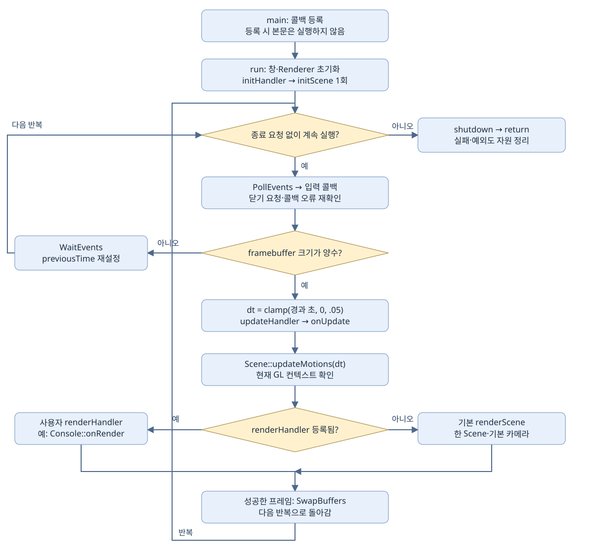
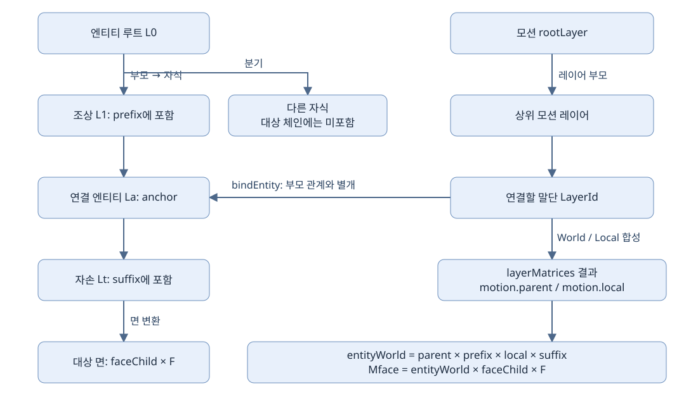
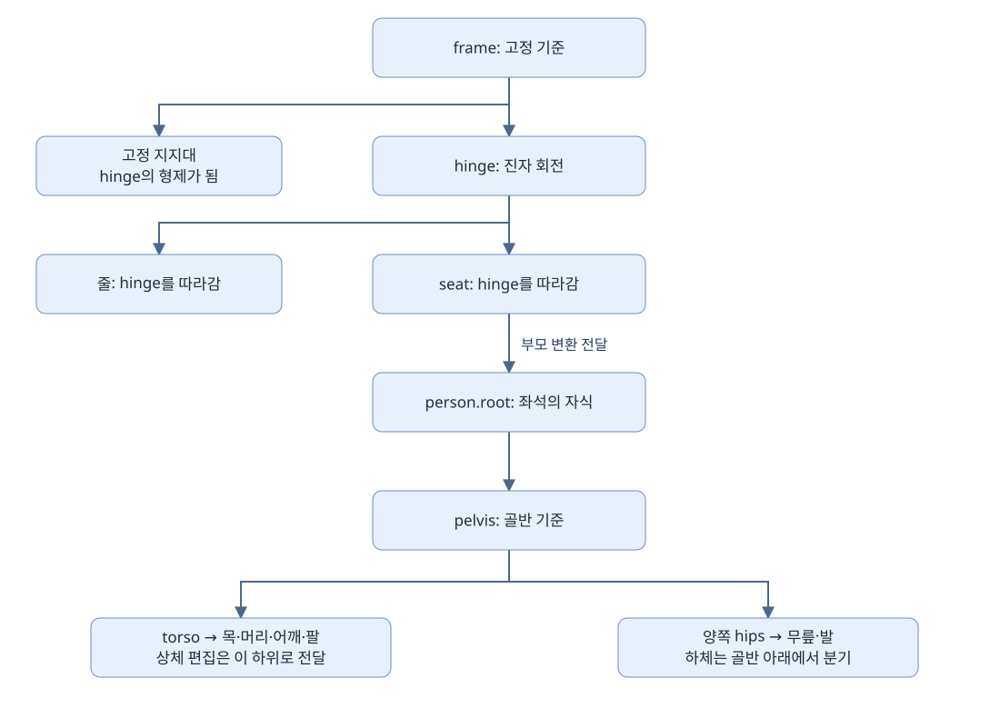

# 응용패턴·그네 통합 설명

## 편집 가능한 API와 패턴 조립 (2026-11-03)

[의미 동작·육면체 모드](MODE_ACTIONS.md) · [정점 입력·셰이더 연결과 내부 수정 순서](RENDER_CONFIGURATION.md) · [패턴 조립·API 압축 기준](PATTERN_COMPOSITION.md)

sample/seek는 동작을 실행하지 않는다. 자동 모션 갱신은 활성 모션의 동작을 실행한다. 기존 공전+자전·경로+자전 전용 함수는 createMotion 단계 목록으로 대체했다. 모델 교환은 조립 문서를 따른다.

<!-- doc-flowcharts:start -->







<!-- doc-flowcharts:end -->

흐름도·실제 사용 코드·저장소 소스는 [통합 HTML](IMPLEMENTATION_PATTERNS.html)을 연다. 이 목록은 현재 API로 구현하는 순서를 요약한다.

## 콜백으로 응용 상태 연결

회전하는 상자를 만들고 Esc로 종료하는 상황이다. Application은 창과 루프를 소유하고, box는 Scene 안의 상자를 다시 찾는 번호다. 콜백은 등록할 때 실행되지 않는다. run이 초기화·이벤트·프레임 시점에 각각 실행한다.

상태와 ID 보관 → init에서 Scene 생성 → 입력으로 상태 변경 → update로 변환 반영 → 렌더·종료는 Application에 위임

```cpp
#include "framework/Framework.h"
#include <iostream>
int main() {
    graphics::Application app;
    std::optional<graphics::EntityId> box;
    float angle = 0;
    app.setInitHandler([&](graphics::Application& current) {
        box = current.getScene().addCuboid({1,1,1}, {0,0,0});
        auto& camera = current.getCamera(); camera.position = {4,3,6};
        current.getRenderOptions().depthTest = true;
        return box.has_value();
    });
    app.setKeyHandler([](graphics::Application& current,int key,int action) {
        if(key==GLFW_KEY_ESCAPE && action==GLFW_PRESS) current.requestClose();
    });
    app.setModifiedKeyHandler([](graphics::Application& current,int key,int action,int mods) {
        if(key==GLFW_KEY_ESCAPE && action==GLFW_PRESS) current.requestClose();
        std::cout << "수정키 비트=" << mods << '\n';
    });
    app.setFocusHandler([](graphics::Application&,bool focused) {
        std::cout << "포커스=" << focused << '\n';
    });
    app.setMouseHandler([](graphics::Application& current,const graphics::MouseEvent& e) {
        if(e.action!=GLFW_PRESS) return;
        if(auto hit=current.pickAt(e.windowX,e.windowY)) std::cout << hit->entityId << '\n';
    });
    app.setCursorHandler([](graphics::Application& current,double x,double y) {
        auto hit=current.pickAtCursor();
        (void)hit; (void)x; (void)y;
    });
    app.setUpdateHandler([&](graphics::Application& current,float dt) {
        angle += 45*dt;
        graphics::Transform3D pose;
        pose.rotation=glm::mat3(glm::rotate(glm::mat4(1),glm::radians(angle),glm::vec3(0,1,0)));
        if(!box || !current.getScene().setTransform(*box,pose)) current.requestClose();
    });
    app.setRenderHandler([](graphics::Application& current) {
        const auto size=current.getFramebufferSize();
        GLFWwindow* window=current.getWindow(); (void)window;
        if(size[0]<3 || size[1]<2) return true;
        return current.renderViews(graphics::PatternSystem::threeViews(
            current.getCamera(),size[0],size[1],current.getRenderOptions()));
        // 단일 뷰로 교체할 때는 return current.renderScene();
    });
    graphics::ApplicationConfig config;
    return app.run(config);
} // ~Application이 호출된다. 복사 생성/대입은 =delete이므로 호출할 수 없다.
```

수정키 콜백을 등록하면 일반 키 콜백 대신 호출된다. 이 예제의 Esc 처리는 두 콜백에 모두 있지만 실행되는 것은 수정키 콜백이다. update가 실패하면 종료를 요청하고, run은 GPU를 현재 컨텍스트에서 정리한다. getAssets의 사용 예는 자산 그룹에 따로 둔다.

## 자전과 공전을 분리

두 물체에 같은 경로 시계를 연결하되 한 분기만 반사시키는 경우다. MotionId는 시간 상태를 찾고 LayerId는 변환 합성 경로를 찾는다. 같은 모션을 공유하면 위상도 공유한다.

공전축·자전축 지정 → createMotion 단계 목록으로 모션 등록 → 레이어에 모션 연결 → 객체 바인딩 → 자동 시간 진행

```cpp
bool connectMotion(graphics::Scene& scene,graphics::EntityId entity) {
    auto& system=scene.getMotions();
    const auto& constSystem=static_cast<const graphics::Scene&>(scene).getMotions(); (void)constSystem;
    graphics::Motion motion;
    graphics::RotationMotion rotation;
    if(!motion.append(graphics::Motion::rotation(rotation))) return false;
    auto id=system.createMotion(motion); if(!id) return false;
    if(!system.setMotion(*id,motion)||!system.seekMotion(*id,1)
       ||!system.setMotionPlaying(*id,false)||!system.setMotionEnabled(*id,true)) return false;
    const auto* state=system.getMotion(*id); if(!state) return false;
    auto layer=system.pushLayer(graphics::MotionSystem::rootLayer()); if(!layer) return false;
    graphics::LayerConfig config; config.motion=*id;
    if(!system.setLayer(*layer,config)||!system.bindMotion(*layer,*id)) return false;
    auto inserted=system.insertLayer(*layer); if(!inserted) return false;
    if(!system.reparentLayer(*layer,graphics::MotionSystem::rootLayer())
       ||!system.removeLayer(*inserted)) return false;
    const auto* layerState=system.getLayer(*layer); (void)layerState;
    auto matrices=system.layerMatrices(*layer); if(!matrices) return false;
    if(!scene.bindEntity(entity,*layer)) return false;
    auto binding=scene.getEntityLayer(entity); (void)binding;
    if(!system.update(.016)||!scene.updateMotions(.016)) return false;
    // 위 두 호출은 수동 진행의 시연이다. Application 루프에서는 자동 진행하므로 호출하지 않는다.
    if(!scene.unbindEntity(entity)||!system.bindMotion(*layer,std::nullopt)) return false;
    if(!system.popLayer(*layer)||!system.removeMotion(*id)) return false;
    auto spin=system.createSpin(rotation);
    auto orbit=system.createOrbit(rotation);
    auto orbitConfig=rotation; orbitConfig.space=graphics::TransformSpace::World;
    auto spinConfig=rotation; spinConfig.space=graphics::TransformSpace::Local;
    auto combined=system.createMotion({graphics::Motion::rotation(orbitConfig), graphics::Motion::rotation(spinConfig)});
    graphics::PathMotion path; path.path=graphics::PathSystem::circle({0,0,0},1);
    auto moving=system.createMotion({graphics::Motion::followPath(path), graphics::Motion::rotation(spinConfig)});
    if(!spin||!orbit||!combined||!moving) return false;
    system.clear(); // 기존 레이어 연결을 사용하지 않는 별도 예제 종료 지점
    return true;
}
```

playing=false는 시간 정지, enabled=false는 변환 기여 제거다. popLayer는 자식 없는 레이어만 제거한다. removeLayer는 자식을 부모 쪽으로 승격한다. system.clear 전에 Scene 엔티티 바인딩을 해제해야 한다.

## 경로 전환·왕복

공이 원 경로를 따라 이동하고 한 축을 중심으로 도는 상황이다. TransformSystem은 행렬을 계산하고 PathSystem은 진행률을 위치로 바꾸는 함수를 만든다. 이 계산만으로 Scene이 변경되지는 않는다.

PathSystem으로 경로 생성 → PathMotion의 기간·재생 정책 지정 → Motion.followPath 구성 → MotionSystem.setMotion → seekMotion(0)

```cpp
void calculateTransforms() {
    graphics::AxisLine axis{{0,0,0},{0,1,0}};
    auto t=graphics::TransformSystem::translation({1,0,0});
    auto s=graphics::TransformSystem::scaling({2,1,1},{0,0,0});
    auto r=graphics::TransformSystem::rotation(axis,90);
    auto point=graphics::TransformSystem::reflectPoint({0,0,0});
    auto line=graphics::TransformSystem::reflectLine(axis);
    auto plane=graphics::TransformSystem::reflectPlane({0,0,0},{1,0,0});
    if(!t||!s||!r||!point||!line||!plane) return;
    bool affine=graphics::TransformSystem::validAffine(*t * *r * *s); (void)affine;
    auto circle=graphics::PathSystem::circle({0,0,0},2);
    auto ellipse=graphics::PathSystem::ellipse({0,0,0},{2,0,0},{0,0,1});
    auto polyline=graphics::PathSystem::polyline({{0,0,0},{1,0,0},{1,0,1}});
    auto polygon=graphics::PathSystem::polygon({{0,0,0},{1,0,0},{0,0,1}});
    auto rectangle=graphics::PathSystem::rectangle({0,0,0},{1,0,0},{0,0,1});
    if(!circle||!ellipse||!polyline||!polygon||!rectangle) return;
    auto u=graphics::PathSystem::linear(.25);
    auto eased=graphics::PathSystem::smoothStep(u);
    glm::vec3 position=circle(eased); (void)position;
}
```

optional 행렬이 비어 있거나 경로 std::function이 비면 입력이 유효하지 않다. 0 길이 축이나 0 반지름을 넘긴 실패를 identity 행렬 성공으로 간주하지 않는다.

## 순차 동작과 끝 자세 유지

상자가 2초 이동한 뒤 1초 회전하는 모션을 편집한다. append는 단계를 배열에 더할 뿐 시작 시간을 뒤로 밀지 않는다. 순차 실행은 then을 사용한다.

유한 duration의 단계 생성 → append로 첫 단계 등록 → then으로 다음 시작 시각 배치 → sample이 종료 자세를 유지

```cpp
std::optional<graphics::Motion> makeMotion() {
    graphics::Motion motion;
    graphics::LinearMotion move; move.to={2,0,0}; move.durationSeconds=2;
    if(!motion.append(graphics::Motion::linear(move))) return {};
    graphics::RotationMotion spin; spin.degreesPerSecond=90;
    auto rotate=graphics::Motion::rotation(spin); rotate.durationSeconds=1;
    if(!motion.then(rotate)) return {};
    auto fixed=graphics::Motion::fixed(glm::mat4(1));
    if(!motion.insert(0,fixed)||!motion.replace(0,fixed)||!motion.erase(0)) return {};
    const auto& steps=motion.getSteps(); (void)steps;
    auto pose=motion.sample(2.5); if(!pose) return {};
    graphics::PathMotion path; path.path=graphics::PathSystem::circle({0,0,0},1);
    graphics::Motion looping;
    if(!looping.append(graphics::Motion::followPath(path))) return {};
    graphics::PendulumMotion sway; sway.periodSeconds=3;
    graphics::Motion pendulum;
    if(!pendulum.append(graphics::Motion::pendulum(sway))) return {};
    return motion;
}
```

유한 종료 시간이 없는 루프 단계 뒤에는 then을 사용할 수 없다. Once 단계는 종료 자세를 유지한다. 진자는 중력 적분이 아니라 지정 주기의 sin 각도 함수다.

## 모션 공유와 대칭 분기

두 물체에 같은 경로 시계를 연결하되 한 분기만 반사시키는 경우다. MotionId는 시간 상태를 찾고 LayerId는 변환 합성 경로를 찾는다. 같은 모션을 공유하면 위상도 공유한다.

공통 MotionId 생성 → 정상·반사 레이어 분기 → 동일 MotionId 연결 → 같은 시각을 서로 다른 변환으로 표시

```cpp
bool connectMotion(graphics::Scene& scene,graphics::EntityId entity) {
    auto& system=scene.getMotions();
    const auto& constSystem=static_cast<const graphics::Scene&>(scene).getMotions(); (void)constSystem;
    graphics::Motion motion;
    graphics::RotationMotion rotation;
    if(!motion.append(graphics::Motion::rotation(rotation))) return false;
    auto id=system.createMotion(motion); if(!id) return false;
    if(!system.setMotion(*id,motion)||!system.seekMotion(*id,1)
       ||!system.setMotionPlaying(*id,false)||!system.setMotionEnabled(*id,true)) return false;
    const auto* state=system.getMotion(*id); if(!state) return false;
    auto layer=system.pushLayer(graphics::MotionSystem::rootLayer()); if(!layer) return false;
    graphics::LayerConfig config; config.motion=*id;
    if(!system.setLayer(*layer,config)||!system.bindMotion(*layer,*id)) return false;
    auto inserted=system.insertLayer(*layer); if(!inserted) return false;
    if(!system.reparentLayer(*layer,graphics::MotionSystem::rootLayer())
       ||!system.removeLayer(*inserted)) return false;
    const auto* layerState=system.getLayer(*layer); (void)layerState;
    auto matrices=system.layerMatrices(*layer); if(!matrices) return false;
    if(!scene.bindEntity(entity,*layer)) return false;
    auto binding=scene.getEntityLayer(entity); (void)binding;
    if(!system.update(.016)||!scene.updateMotions(.016)) return false;
    // 위 두 호출은 수동 진행의 시연이다. Application 루프에서는 자동 진행하므로 호출하지 않는다.
    if(!scene.unbindEntity(entity)||!system.bindMotion(*layer,std::nullopt)) return false;
    if(!system.popLayer(*layer)||!system.removeMotion(*id)) return false;
    auto spin=system.createSpin(rotation);
    auto orbit=system.createOrbit(rotation);
    auto orbitConfig=rotation; orbitConfig.space=graphics::TransformSpace::World;
    auto spinConfig=rotation; spinConfig.space=graphics::TransformSpace::Local;
    auto combined=system.createMotion({graphics::Motion::rotation(orbitConfig), graphics::Motion::rotation(spinConfig)});
    graphics::PathMotion path; path.path=graphics::PathSystem::circle({0,0,0},1);
    auto moving=system.createMotion({graphics::Motion::followPath(path), graphics::Motion::rotation(spinConfig)});
    if(!spin||!orbit||!combined||!moving) return false;
    system.clear(); // 기존 레이어 연결을 사용하지 않는 별도 예제 종료 지점
    return true;
}
```

playing=false는 시간 정지, enabled=false는 변환 기여 제거다. popLayer는 자식 없는 레이어만 제거한다. removeLayer는 자식을 부모 쪽으로 승격한다. system.clear 전에 Scene 엔티티 바인딩을 해제해야 한다.

## 시간 정지와 변환 기여 끄기

두 물체에 같은 경로 시계를 연결하되 한 분기만 반사시키는 경우다. MotionId는 시간 상태를 찾고 LayerId는 변환 합성 경로를 찾는다. 같은 모션을 공유하면 위상도 공유한다.

정지 대상 MotionId 선택 → playing은 시간 진행 제어 → enabled는 변환 기여 제어 → 재개 시 유지된 시간에서 샘플링

```cpp
bool connectMotion(graphics::Scene& scene,graphics::EntityId entity) {
    auto& system=scene.getMotions();
    const auto& constSystem=static_cast<const graphics::Scene&>(scene).getMotions(); (void)constSystem;
    graphics::Motion motion;
    graphics::RotationMotion rotation;
    if(!motion.append(graphics::Motion::rotation(rotation))) return false;
    auto id=system.createMotion(motion); if(!id) return false;
    if(!system.setMotion(*id,motion)||!system.seekMotion(*id,1)
       ||!system.setMotionPlaying(*id,false)||!system.setMotionEnabled(*id,true)) return false;
    const auto* state=system.getMotion(*id); if(!state) return false;
    auto layer=system.pushLayer(graphics::MotionSystem::rootLayer()); if(!layer) return false;
    graphics::LayerConfig config; config.motion=*id;
    if(!system.setLayer(*layer,config)||!system.bindMotion(*layer,*id)) return false;
    auto inserted=system.insertLayer(*layer); if(!inserted) return false;
    if(!system.reparentLayer(*layer,graphics::MotionSystem::rootLayer())
       ||!system.removeLayer(*inserted)) return false;
    const auto* layerState=system.getLayer(*layer); (void)layerState;
    auto matrices=system.layerMatrices(*layer); if(!matrices) return false;
    if(!scene.bindEntity(entity,*layer)) return false;
    auto binding=scene.getEntityLayer(entity); (void)binding;
    if(!system.update(.016)||!scene.updateMotions(.016)) return false;
    // 위 두 호출은 수동 진행의 시연이다. Application 루프에서는 자동 진행하므로 호출하지 않는다.
    if(!scene.unbindEntity(entity)||!system.bindMotion(*layer,std::nullopt)) return false;
    if(!system.popLayer(*layer)||!system.removeMotion(*id)) return false;
    auto spin=system.createSpin(rotation);
    auto orbit=system.createOrbit(rotation);
    auto orbitConfig=rotation; orbitConfig.space=graphics::TransformSpace::World;
    auto spinConfig=rotation; spinConfig.space=graphics::TransformSpace::Local;
    auto combined=system.createMotion({graphics::Motion::rotation(orbitConfig), graphics::Motion::rotation(spinConfig)});
    graphics::PathMotion path; path.path=graphics::PathSystem::circle({0,0,0},1);
    auto moving=system.createMotion({graphics::Motion::followPath(path), graphics::Motion::rotation(spinConfig)});
    if(!spin||!orbit||!combined||!moving) return false;
    system.clear(); // 기존 레이어 연결을 사용하지 않는 별도 예제 종료 지점
    return true;
}
```

playing=false는 시간 정지, enabled=false는 변환 기여 제거다. popLayer는 자식 없는 레이어만 제거한다. removeLayer는 자식을 부모 쪽으로 승격한다. system.clear 전에 Scene 엔티티 바인딩을 해제해야 한다.

## 바인딩을 유지한 레이어 삽입

두 물체에 같은 경로 시계를 연결하되 한 분기만 반사시키는 경우다. MotionId는 시간 상태를 찾고 LayerId는 변환 합성 경로를 찾는다. 같은 모션을 공유하면 위상도 공유한다.

바인딩된 말단 LayerId 보관 → insertLayer로 부모 사이에 삽입 → 추가 배율·반사 설정 → removeLayer로 자식을 부모 쪽에 승격

```cpp
bool connectMotion(graphics::Scene& scene,graphics::EntityId entity) {
    auto& system=scene.getMotions();
    const auto& constSystem=static_cast<const graphics::Scene&>(scene).getMotions(); (void)constSystem;
    graphics::Motion motion;
    graphics::RotationMotion rotation;
    if(!motion.append(graphics::Motion::rotation(rotation))) return false;
    auto id=system.createMotion(motion); if(!id) return false;
    if(!system.setMotion(*id,motion)||!system.seekMotion(*id,1)
       ||!system.setMotionPlaying(*id,false)||!system.setMotionEnabled(*id,true)) return false;
    const auto* state=system.getMotion(*id); if(!state) return false;
    auto layer=system.pushLayer(graphics::MotionSystem::rootLayer()); if(!layer) return false;
    graphics::LayerConfig config; config.motion=*id;
    if(!system.setLayer(*layer,config)||!system.bindMotion(*layer,*id)) return false;
    auto inserted=system.insertLayer(*layer); if(!inserted) return false;
    if(!system.reparentLayer(*layer,graphics::MotionSystem::rootLayer())
       ||!system.removeLayer(*inserted)) return false;
    const auto* layerState=system.getLayer(*layer); (void)layerState;
    auto matrices=system.layerMatrices(*layer); if(!matrices) return false;
    if(!scene.bindEntity(entity,*layer)) return false;
    auto binding=scene.getEntityLayer(entity); (void)binding;
    if(!system.update(.016)||!scene.updateMotions(.016)) return false;
    // 위 두 호출은 수동 진행의 시연이다. Application 루프에서는 자동 진행하므로 호출하지 않는다.
    if(!scene.unbindEntity(entity)||!system.bindMotion(*layer,std::nullopt)) return false;
    if(!system.popLayer(*layer)||!system.removeMotion(*id)) return false;
    auto spin=system.createSpin(rotation);
    auto orbit=system.createOrbit(rotation);
    auto orbitConfig=rotation; orbitConfig.space=graphics::TransformSpace::World;
    auto spinConfig=rotation; spinConfig.space=graphics::TransformSpace::Local;
    auto combined=system.createMotion({graphics::Motion::rotation(orbitConfig), graphics::Motion::rotation(spinConfig)});
    graphics::PathMotion path; path.path=graphics::PathSystem::circle({0,0,0},1);
    auto moving=system.createMotion({graphics::Motion::followPath(path), graphics::Motion::rotation(spinConfig)});
    if(!spin||!orbit||!combined||!moving) return false;
    system.clear(); // 기존 레이어 연결을 사용하지 않는 별도 예제 종료 지점
    return true;
}
```

playing=false는 시간 정지, enabled=false는 변환 기여 제거다. popLayer는 자식 없는 레이어만 제거한다. removeLayer는 자식을 부모 쪽으로 승격한다. system.clear 전에 Scene 엔티티 바인딩을 해제해야 한다.

## 부품 계층과 소유자 기저선

탱크 몸체에 포탑을 달고, 몸체 전체와 한 면을 따로 움직인다. 부모를 설정한 뒤 포탑 위치는 부모 좌표로 해석된다. 부모의 월드 행렬이 포탑 로컬 행렬 앞에 곱해진다.

몸체 그룹·부품 생성 → setParent로 부모 관계 설정 → 부모 로컬 anchor 지정 → 부모 변환 → 모든 자식에 전달

```cpp
bool placeParts(graphics::Scene& scene) {
    auto root=scene.addGroup();
    auto body=scene.addCuboid({2,1,1},{0,0,0});
    if(!root||!body||!scene.setParent(*body,*root)) return false;
    graphics::Transform3D pose; pose.basis={0,.5f,0};
    if(!scene.setTransform(*body,pose) || !scene.setPosition(*body,{0,.6f,0})) return false;
    if(!scene.setLocalBasis(*body,graphics::PivotMode::Custom,{0,0,0})) return false;
    auto world=scene.worldMatrix(*body);
    auto faceWorld=scene.faceWorldMatrix(*body,0);
    if(!world||!faceWorld) return false;
    if(!scene.setFaceVisible(*body,0,true)
       ||!scene.setFaceCullMode(*body,0,graphics::CullMode::Back)) return false;
    graphics::Transform3D facePose; facePose.basis={0,.1f,0};
    if(!scene.setFaceTransform(*body,0,facePose,true)
       ||!scene.splitFace(*body,0)||!scene.setFaceSRT(*body,0,facePose)) return false;
    if(!scene.setFaceLocalMatrix(*body,0,glm::mat4(1))) return false;
    return scene.setParent(*body,std::nullopt);
}
```

setParent는 월드 자세를 자동 보존하지 않는다. 마지막 분리도 기존 로컬 값을 그대로 월드 값으로 사용한다. setFaceSRT와 setFaceLocalMatrix는 서로 다른 추가 변환 층이므로 사용 목적을 나눈다.

## 면 힌지와 추가 로컬 행렬

몸체의 자식 관절을 만들고 문을 열거나 카메라를 돌린다. 이 함수들은 응용의 키 입력이나 누적 진행률을 Scene·Camera 상태로 바꾸는 작은 재사용 도구다.

대상 면·힌지 축 지정 → 진행 각도 계산 → foldFace로 추가 로컬 행렬 설정 → 면 월드 행렬로 렌더링

```cpp
bool editParts(graphics::Scene& scene,graphics::EntityId body,graphics::EntityId room,graphics::Camera& camera) {
    auto joint=graphics::PatternSystem::addJoint(scene,body,{0,.5f,0});
    if(!joint||!graphics::PatternSystem::rotateJoint(scene,*joint,{1,0,0},30)) return false;
    auto polygon=graphics::PatternSystem::addPolygon(scene,{{0,0,0},{1,0,0},{0,1,0}},{1,1,0},body);
    if(!polygon||!graphics::PatternSystem::addNumber(scene,3,{0,1,0},.2f,{1,1,1},body)) return false;
    if(!graphics::PatternSystem::foldFace(scene,body,0,{{0,.5f,0},{1,0,0}},45)) return false;
    if(!graphics::PatternSystem::openFace(scene,body,0,.5f,{0,1,0},{0,.5f,0},true)) return false;
    auto selected=graphics::PatternSystem::cameraFacingWall(scene,room,camera);
    if(selected&&!graphics::PatternSystem::openRoomWall(scene,room,*selected,.5f)) return false;
    auto other=scene.addCuboid({1,1,1},{2,0,0}); if(!other) return false;
    auto staged=scene;
    const auto firstModel=scene.getComponent(body)->polyhedron;
    const auto secondModel=scene.getComponent(*other)->polyhedron;
    if(!staged.setModel(body,secondModel)||!staged.setModel(*other,firstModel)) return false;
    scene=std::move(staged);
    if(!graphics::PatternSystem::moveCamera(camera,{.2f,0,0})
       ||!graphics::PatternSystem::yawCamera(camera,5)
       ||!graphics::PatternSystem::orbitCamera(camera,{{0,0,0},{0,1,0}},5)
       ||!graphics::PatternSystem::zoomCamera(camera,.9f)) return false;
    auto views=graphics::PatternSystem::threeViews(camera,1100,800); return !views.empty();
}
```

이 단편의 각 조작은 별도의 입력 명령 사례다. 실제 앱에서는 같은 면을 foldFace와 openFace가 동시에 덮어쓰지 않게 모드를 정한다. 벽 표시 개방은 충돌 경계 제거와 별개다.

## 클릭 선택과 바닥 배치

왼쪽 클릭으로 선택한 상자의 면을 찾고, 빈 바닥 클릭은 Y=0 평면 위치로 바꾼다. 창 좌표와 framebuffer 픽셀은 DPI 배율 때문에 다를 수 있으므로 좌표계를 맞춘다.

창 좌표를 framebuffer 좌표로 대응 → screenRay로 역투영 → pick 또는 screenOnPlane → hit ID·월드 점으로 선택·배치

```cpp
void selectAt(const graphics::Scene& scene,const graphics::Camera& camera,double x,double y) {
    graphics::PickViewport viewport{0,0,1100,800};
    auto ray=graphics::screenRay(camera,x,y,viewport);
    if(!ray) return;
    auto first=graphics::pick(scene,*ray);
    auto second=graphics::pick(scene,camera,x,y,viewport);
    auto floor=graphics::PatternSystem::screenOnPlane(camera,x,y,viewport,{0,0,0},{0,1,0});
    if(first) { auto id=first->entityId; auto face=first->faceIndex; (void)id;(void)face; }
    if(floor) { glm::vec3 placement=*floor; (void)placement; }
    (void)second;
}
```

화면 밖 좌표, 평행한 평면, 또는 물체를 맞히지 않은 클릭은 빈 optional이 정상 결과다. 빈 결과를 시스템 오류로 처리하지 않는다.

## 메시·UV·재질 편집

바닥 삼각형에 UV와 색을 지정한다. 등록 전에는 Mesh 값을 자유 함수로 가공하고, 등록 후에는 Scene setter를 사용한다. 조회한 메시를 복사해 편집한 뒤 다시 넣으면 GPU 변경 감지가 유지된다.

등록 전 Mesh 생성·UV 가공 → Scene에 모델 등록 → Scene setter로 변경 알림 → 다음 render에서 revision에 따라 업로드

```cpp
bool editTriangle(graphics::Scene& scene) {
    std::vector<graphics::Vertex> vertices(3);
    vertices[0].position={0,0,0}; vertices[1].position={1,0,0}; vertices[2].position={0,0,1};
    auto mesh=graphics::PlaneFigure::fromVertices(vertices,{0,1,2});
    graphics::UVOptions uv; uv.axis=1;
    if(!graphics::generateTexcoords(mesh,uv)
       ||!graphics::transformTexcoords(mesh,{2,2},{0,0},0)) return false;
    graphics::recalculateNormals(mesh);
    auto edges=graphics::meshOutline(mesh); (void)edges;
    graphics::Model model; model.meshes().push_back(mesh);
    const graphics::Model& view=model;
    auto count=view.meshes().size(); (void)count;
    auto id=scene.addModel(model,{},graphics::PivotMode::Preserve); if(!id) return false;
    if(!scene.setMesh(*id,0,mesh)) return false;
    if(!scene.setMeshVertices(*id,0,{{0,0,0},{1,0,0},{0,0,1}},{0,1,2})) return false;
    if(!scene.setVertexPosition(*id,0,1,{2,0,0})||!scene.setTriangleIndices(*id,0,{0,1,2})) return false;
    if(!scene.generateTexcoords(*id,0,uv)||!scene.transformTexcoords(*id,0,{1,1},{.1f,0},0)) return false;
    if(!scene.setTexcoords(*id,0,{{0,0},{1,0},{0,1}})
       ||!scene.setVertexNormals(*id,0,{{0,-1,0},{0,-1,0},{0,-1,0}})) return false;
    if(!scene.setFaceVertexColors(*id,0,{{1,0,0},{0,1,0},{0,0,1}})) return false;
    graphics::Material material; material.color={1,1,1};
    if(!scene.setMaterial(*id,0,material)
       ||!scene.setOutline(*id,0,graphics::OutlineMode::Explicit,{0,1,1,2,2,0})) return false;
    const auto* current=scene.getMesh(*id,0); return current!=nullptr;
}
```

정점 수를 바꾸면 UV·법선·색 배열도 같은 정점 수에 맞춰야 한다. Explicit 외곽선은 정점 번호의 쌍이다. 텍스처가 없는 위 사례는 재질 색만 사용한다.

## 선택적 OBJ·텍스처

외부 모델과 한 장의 텍스처를 불러온다. 상대경로는 실행 파일 기준 projectRoot 안에서 해석된다. 모델 파일에 담긴 피벗 결과를 addModel에 그대로 전달해야 발 기준 배치가 유지된다.

config.features.textures 지정 → init 안에서 getAssets → loadObj·loadTexture 결과 확인 → 피벗을 유지해 addModel → RenderOptions.textures로 표시

```cpp
bool loadAssets(graphics::Application& app) { // initHandler 안에서 호출
    auto& loader=app.getAssets();
    const auto& features=loader.features(); (void)features;
    graphics::LoadOptions options; options.texturePath="textures/robot.png";
    auto loaded=loader.loadObj("models/robot.obj",options);
    if(!loaded) { std::cerr<<loaded.error; return false; }
    auto texture=loader.loadTexture("textures/robot.png");
    if(!texture) { std::cerr<<texture.error; return false; }
    if(!texture.image->valid()) return false;
    auto id=app.getScene().addModel(*loaded.model,{},loaded.pivotMode,loaded.localBasis);
    app.getRenderOptions().textures=true;
    return id.has_value();
}
void standaloneLoader() {
    graphics::FeatureOptions features; features.textures=true;
    graphics::AssetLoader loader(".",features);
    auto a=loader.loadPrimitive("models/cube.obj");
    auto b=loader.loadModel("models/robot.obj");
    graphics::TextureImage pixel; pixel.width=1;pixel.height=1;pixel.rgba={255,255,255,255};
    bool valid=pixel.valid(); (void)a;(void)b;(void)valid;
}
// main에서 config.features.textures=true를 설정한 뒤 app.run(config)를 호출한다.
```

이 경로는 사용자가 준비해야 하는 사례 자산이다. loadPrimitive/loadModel도 현재는 OBJ 로더를 호출한다. FBX/glTF 로딩을 의미하지 않는다. 이미지 기능을 끄면 해당 로드는 error를 돌려준다.

## 두 위치 사이 선형보간

상자가 2초 이동한 뒤 1초 회전하는 모션을 편집한다. append는 단계를 배열에 더할 뿐 시작 시간을 뒤로 밀지 않는다. 순차 실행은 then을 사용한다.

from·to·편도 시간 지정 → Playback 선택 → Motion.linear로 단계 생성 → MotionSystem 또는 관절 트랙에서 시간 샘플링

```cpp
std::optional<graphics::Motion> makeMotion() {
    graphics::Motion motion;
    graphics::LinearMotion move; move.to={2,0,0}; move.durationSeconds=2;
    if(!motion.append(graphics::Motion::linear(move))) return {};
    graphics::RotationMotion spin; spin.degreesPerSecond=90;
    auto rotate=graphics::Motion::rotation(spin); rotate.durationSeconds=1;
    if(!motion.then(rotate)) return {};
    auto fixed=graphics::Motion::fixed(glm::mat4(1));
    if(!motion.insert(0,fixed)||!motion.replace(0,fixed)||!motion.erase(0)) return {};
    const auto& steps=motion.getSteps(); (void)steps;
    auto pose=motion.sample(2.5); if(!pose) return {};
    graphics::PathMotion path; path.path=graphics::PathSystem::circle({0,0,0},1);
    graphics::Motion looping;
    if(!looping.append(graphics::Motion::followPath(path))) return {};
    graphics::PendulumMotion sway; sway.periodSeconds=3;
    graphics::Motion pendulum;
    if(!pendulum.append(graphics::Motion::pendulum(sway))) return {};
    return motion;
}
```

유한 종료 시간이 없는 루프 단계 뒤에는 then을 사용할 수 없다. Once 단계는 종료 자세를 유지한다. 진자는 중력 적분이 아니라 지정 주기의 sin 각도 함수다.

## 지정 주기의 진자 운동

상자가 2초 이동한 뒤 1초 회전하는 모션을 편집한다. append는 단계를 배열에 더할 뿐 시작 시간을 뒤로 밀지 않는다. 순차 실행은 then을 사용한다.

축·진폭·주기·위상 설정 → Motion.pendulum 생성 → 초 단위 절대 시간 샘플링 → sin 각도를 로컬 회전에 반영

```cpp
std::optional<graphics::Motion> makeMotion() {
    graphics::Motion motion;
    graphics::LinearMotion move; move.to={2,0,0}; move.durationSeconds=2;
    if(!motion.append(graphics::Motion::linear(move))) return {};
    graphics::RotationMotion spin; spin.degreesPerSecond=90;
    auto rotate=graphics::Motion::rotation(spin); rotate.durationSeconds=1;
    if(!motion.then(rotate)) return {};
    auto fixed=graphics::Motion::fixed(glm::mat4(1));
    if(!motion.insert(0,fixed)||!motion.replace(0,fixed)||!motion.erase(0)) return {};
    const auto& steps=motion.getSteps(); (void)steps;
    auto pose=motion.sample(2.5); if(!pose) return {};
    graphics::PathMotion path; path.path=graphics::PathSystem::circle({0,0,0},1);
    graphics::Motion looping;
    if(!looping.append(graphics::Motion::followPath(path))) return {};
    graphics::PendulumMotion sway; sway.periodSeconds=3;
    graphics::Motion pendulum;
    if(!pendulum.append(graphics::Motion::pendulum(sway))) return {};
    return motion;
}
```

유한 종료 시간이 없는 루프 단계 뒤에는 then을 사용할 수 없다. Once 단계는 종료 자세를 유지한다. 진자는 중력 적분이 아니라 지정 주기의 sin 각도 함수다.

## 격자 비율·셀·지그재그 배치

가로 10칸 바닥에 장애물을 배치한다. 셀 번호는 이산 인덱스이고 비율은 전체 영역을 0~1로 표현하는 연속 값이다. 두 입력의 의미를 섞지 않는다.

origin·extent·cells 설정 → 셀 중심·로컬 크기 계산 → snakeCells로 방문 순서 구성 → Scene에 반복 배치

```cpp
bool placeOnGrid(graphics::Scene& scene) {
    graphics::GridLayout grid; grid.origin={-5,0,-5}; grid.extent={10,2,10};grid.cells={10,2,10};
    if(!grid.valid()) return false;
    auto middle=grid.position({.5f,0,.5f});
    auto cell=grid.cellCenter({2,0,3});
    auto size=grid.relativeSize({.1f,.25f,.1f});
    auto local=grid.positionInParent({.5f,0,.5f},glm::mat4(1));
    if(!middle||!cell||!size||!local) return false;
    auto index=grid.cellAt(*cell); if(!index) return false;
    auto order=graphics::PatternSystem::snakeCells({10,1,10}); (void)order;
    auto snapped=graphics::PatternSystem::snap(*cell,1);
    bool aligned=graphics::PatternSystem::aligned(snapped.x,cell->x,.01f); (void)aligned;
    return graphics::PatternSystem::addBox(scene,*size,*cell,{.6f,.7f,.8f}).has_value();
}
```

cellCenter({2,0,3})는 (-2.5,.5,-1.5)다. relativeSize는 로컬 크기를 반환하므로 frame의 비균일 배율을 이미 적용한 월드 크기로 착각하지 않는다.

## 거리 기반 컨베이어와 코너 방향

같은 컨베이어 위의 상자 다섯 개가 같은 속도로 움직이면서 간격을 유지한다. 각 상자의 시간을 따로 진행하지 않고 공통 누적 시간에 거리 간격을 더한다.

공통 AnimationClock 진행 → 속도×시간 + 물체 간 거리 간격 → DistancePath 또는 원호 pose 샘플링 → 위치·접선 yaw를 함께 반영

```cpp
bool prepareBelt(graphics::AnimationClock& clock,graphics::DistancePath& path) {
    clock.reset();
    return path.setPoints({{-2,0,0},{2,0,0},{2,0,3}},false);
}
bool placeBelt(graphics::Scene& scene,graphics::EntityId entity,
               graphics::AnimationClock& clock,const graphics::DistancePath& path,double dt) {
    if(!clock.advance(dt)) return false;
    double distance=clock.seconds+path.length()/5;
    auto pose=path.sample(distance,graphics::Playback::Loop); if(!pose) return false;
    if(!graphics::PatternSystem::follow(scene,entity,path,distance)) return false;
    auto corner=graphics::PatternSystem::conveyorCornerPose(1,{-2,1,-2},{1,1,-1},1,3);
    return corner.has_value();
}
```

clock과 path는 Console 멤버로 보관하고 prepareBelt는 초기화에 한 번 호출한다. 실제 실습 20의 전체 코드는 아래 소스에서 상자·줄무늬가 시계를 공유하는 부분을 보여준다.

## 회전하는 방과 이탈 후 낙하

방 안의 상자는 방과 함께 회전하지만 바닥을 열고 이탈하면 월드 중력을 받는다. released가 좌표계 전환 여부를 결정한다.

방 로컬 body 상태 보관 → 회전 공간에서 반사·중력 계산 → 바닥 개방 시 월드 상태로 전환 → 월드 낙하 → 표시 객체 동기화

```cpp
bool moveInsideRoom(graphics::Scene& scene) {
    graphics::Bounds3 bounds{{-2,-1,-2},{2,2,2}};
    if(!bounds.valid()||!bounds.contains({0,0,0},{.2f,.2f,.2f})) return false;
    graphics::Bounds3 other{{-.5f,-.5f,-.5f},{.5f,.5f,.5f}};
    bool overlap=bounds.overlaps(other); (void)overlap;
    auto room=graphics::PatternSystem::addRoom(scene,bounds,true);
    auto box=graphics::PatternSystem::addBox(scene,{.4f,.4f,.4f},{0,0,0},{1,.6f,.2f});
    if(!room||!box) return false;
    graphics::RoomBody body; body.halfExtent={.2f,.2f,.2f};
    auto roomWorld=glm::rotate(glm::mat4(1),.2f,glm::vec3(0,0,1));
    if(!graphics::CollisionSystem::stepRoomBody(body,bounds,roomWorld,.016f,false,false)) return false;
    return scene.setPosition(*box,body.position(roomWorld));
}
```

상자 표시를 방의 자식으로 둔 채 계산된 월드 위치를 다시 넣으면 방 회전이 두 번 적용될 수 있다. 예제 상자는 부모 없는 객체다. 실제 시간 진행에서는 body를 프레임 간 보관한다.

## 보행·점프·장애물 착지

로봇이 장애물을 피하며 걷다가 점프해 상자 위에 착지한다. 충돌 계산용 CharacterBody와 표시용 JointRig를 분리한다. 메시를 회전시키는 것만으로 충돌 높이가 바뀌지는 않는다.

CharacterBody와 JointRig 분리 → 입력으로 방향·점프 속도 지정 → stepCharacter로 충돌·착지 계산 → 실제 거리로 poseWalkingRig

```cpp
bool walkOneFrame(graphics::Scene& scene,graphics::CharacterBody& body,
                  const graphics::JointRig& rig,const std::vector<graphics::Bounds3>& obstacles,float dt) {
    graphics::Bounds3 stage{{-5,0,-5},{5,4,5}};
    auto result=graphics::CollisionSystem::stepCharacter(body,stage,obstacles,dt);
    if(!result) return false;
    float yaw=glm::degrees(std::atan2(body.direction.x,body.direction.z));
    return graphics::PatternSystem::poseWalkingRig(scene,rig,body.feet,yaw,body.walkDistance,body.speed);
}
void requestJump(graphics::CharacterBody& body) {
    bool accepted=graphics::CollisionSystem::jump(body,4); (void)accepted;
}
bool createWalker(graphics::Scene& scene) {
    graphics::GridLayout grid;grid.origin={-.5f,0,-.3f};grid.extent={1,1.8f,.6f};
    auto rig=graphics::PatternSystem::addWalkingRig(scene,grid); if(!rig) return false;
    std::mt19937 random(42); std::vector<graphics::Bounds3> occupied;
    auto obstacle=graphics::CollisionSystem::randomFreeBox({{-4,0,-4},{4,2,4}},{1,1,1},occupied,random);
    return obstacle.has_value();
}
```

공중 jump의 false는 정상적인 입력 거절이다. stepCharacter의 빈 optional은 계산 입력 오류다. randomFreeBox도 제한 횟수 안에서 배치하지 못하면 실패하므로 무한 재추첨하지 않는다.

## 카메라 방향의 벽 개방

몸체의 자식 관절을 만들고 문을 열거나 카메라를 돌린다. 이 함수들은 응용의 키 입력이나 누적 진행률을 Scene·Camera 상태로 바꾸는 작은 재사용 도구다.

cameraFacingWall로 대상 벽 선택 → 선택 번호를 애니메이션 동안 보관 → 0~1 진행률로 openRoomWall → 같은 면에 복원 적용

```cpp
bool editParts(graphics::Scene& scene,graphics::EntityId body,graphics::EntityId room,graphics::Camera& camera) {
    auto joint=graphics::PatternSystem::addJoint(scene,body,{0,.5f,0});
    if(!joint||!graphics::PatternSystem::rotateJoint(scene,*joint,{1,0,0},30)) return false;
    auto polygon=graphics::PatternSystem::addPolygon(scene,{{0,0,0},{1,0,0},{0,1,0}},{1,1,0},body);
    if(!polygon||!graphics::PatternSystem::addNumber(scene,3,{0,1,0},.2f,{1,1,1},body)) return false;
    if(!graphics::PatternSystem::foldFace(scene,body,0,{{0,.5f,0},{1,0,0}},45)) return false;
    if(!graphics::PatternSystem::openFace(scene,body,0,.5f,{0,1,0},{0,.5f,0},true)) return false;
    auto selected=graphics::PatternSystem::cameraFacingWall(scene,room,camera);
    if(selected&&!graphics::PatternSystem::openRoomWall(scene,room,*selected,.5f)) return false;
    auto other=scene.addCuboid({1,1,1},{2,0,0}); if(!other) return false;
    auto staged=scene;
    const auto firstModel=scene.getComponent(body)->polyhedron;
    const auto secondModel=scene.getComponent(*other)->polyhedron;
    if(!staged.setModel(body,secondModel)||!staged.setModel(*other,firstModel)) return false;
    scene=std::move(staged);
    if(!graphics::PatternSystem::moveCamera(camera,{.2f,0,0})
       ||!graphics::PatternSystem::yawCamera(camera,5)
       ||!graphics::PatternSystem::orbitCamera(camera,{{0,0,0},{0,1,0}},5)
       ||!graphics::PatternSystem::zoomCamera(camera,.9f)) return false;
    auto views=graphics::PatternSystem::threeViews(camera,1100,800); return !views.empty();
}
```

이 단편의 각 조작은 별도의 입력 명령 사례다. 실제 앱에서는 같은 면을 foldFace와 openFace가 동시에 덮어쓰지 않게 모드를 정한다. 벽 표시 개방은 충돌 경계 제거와 별개다.

## 편집 가능한 사람형·관절 트랙

그네 좌석에 앉은 사람을 만들고 상체·팔꿈치를 따로 움직인다. 사람 루트를 좌석의 자식으로 연결하므로 그네 각도를 사람의 모든 관절에 다시 수동 계산할 필요가 없다.

addHumanoid로 분할 관절 생성 → poseHumanoid로 기준 자세 편집 → createJointAnimation으로 rest 캡처 → poseHierarchy로 관절별 모션 반영

```cpp
struct SwingExample {
    graphics::AnimationClock clock;
    std::vector<graphics::JointAnimation> animation;
    bool initialize(graphics::Scene& scene) {
        graphics::HumanoidConfig personConfig;
        personConfig.grid.frame=glm::translate(glm::mat4(1),glm::vec3(-2,0,0));
        auto person=graphics::AnimationSystem::addHumanoid(scene,personConfig); if(!person) return false;
        auto pose=graphics::HumanoidPose::seated();
        if(!graphics::AnimationSystem::poseHumanoid(scene,*person,pose)) return false;
        graphics::SwingConfig config;config.pivot={1,3,0};config.pendulum.periodSeconds=3;
        auto swing=graphics::AnimationSystem::addSwingWithRider(scene,config); if(!swing) return false;
        animation=swing->animation;
        graphics::PendulumMotion elbow;elbow.amplitudeDegrees=10;
        graphics::Motion motion;if(!motion.append(graphics::Motion::pendulum(elbow))) return false;
        auto track=graphics::AnimationSystem::createJointAnimation(scene,swing->person.elbows[0],motion);
        if(!track) return false;
        animation.push_back(*track);clock.reset();return true;
    }
    bool update(graphics::Scene& scene,float dt) {
        return clock.advance(dt)&&graphics::AnimationSystem::poseHierarchy(scene,animation,clock.seconds);
    }
};
```

initialize는 initHandler에서, update는 updateHandler에서 호출한다. 샘플은 강체 회전·이동이며 기준 rest는 양수 균일 배율과 피벗 편집을 허용한다. 비균일 배율·shear는 거부한다. standard 9번은 35개 관절/프레임을 선택해 rest를 편집하고, 매 프레임 같은 rest에서 계산하므로 입력이 덮어써지지 않는다. 전체 연결 코드는 아래에 있다.

## 관절 선택·SRT·피벗 편집

그네를 멈추고 왼쪽 팔꿈치만 돌린 뒤 다시 재생한다. Scene 변환을 직접 덮어쓰면 다음 poseHierarchy가 원래 rest로 되돌리므로, 입력은 선택한 트랙의 rest를 수정한다.

Tab으로 트랙 선택 → X/Y/Z 축 선택 → 입력으로 선택 track.rest의 SRT·피벗 편집 → 같은 seconds로 poseHierarchy → 실패 시 rest 복원 → 다음 프레임에도 편집된 rest에서 재생

```cpp
bool rotateSelected(graphics::Scene& scene,std::vector<graphics::JointAnimation>& animation,
                    std::size_t selectedTrack,int axis,double seconds) {
    if(selectedTrack>=animation.size()||axis<0||axis>2) return false;
    auto& track=animation[selectedTrack];
    const auto saved=track.rest;
    glm::vec3 direction(0);direction[axis]=1;
    track.rest.rotation=track.rest.rotation*glm::mat3(
        glm::rotate(glm::mat4(1),glm::radians(5.0f),direction));
    if(!graphics::AnimationSystem::poseHierarchy(scene,animation,seconds)) {
        track.rest=saved;return false;
    }
    return true;
}
// 이동 입력: track.rest.basis[axis] += .05f;
// 피벗 입력: track.rest.localBasis[axis] += .05f;
// 배율 입력: track.rest.scale = glm::vec3(1.1f * track.rest.scale.x);
// 실제 키 선택·배율 제한·복원은 아래 standard::Console 소스를 따른다.
```

시계를 정지해도 seconds는 유지되므로 같은 시각에서 편집 결과를 즉시 볼 수 있다. 입력 후 재생을 재개해도 rest가 남는다. standard의 handleJointKey는 실패 시 rest를 복원하고, R은 선택 관절의 최초 rest를 복원한다.

## 그네(진자) → 좌석 → 사람

그네 좌석에 앉은 사람을 만들고 상체·팔꿈치를 따로 움직인다. 사람 루트를 좌석의 자식으로 연결하므로 그네 각도를 사람의 모든 관절에 다시 수동 계산할 필요가 없다.

addSwingWithRider 설정 → 고정 frame → hinge → seat → person.root → 앉은 자세와 그네·상체 트랙 구성 → update: 누적 시간으로 poseHierarchy → 부모 변환이 사람의 전체 관절에 전달

```cpp
struct SwingExample {
    graphics::AnimationClock clock;
    std::vector<graphics::JointAnimation> animation;
    bool initialize(graphics::Scene& scene) {
        graphics::HumanoidConfig personConfig;
        personConfig.grid.frame=glm::translate(glm::mat4(1),glm::vec3(-2,0,0));
        auto person=graphics::AnimationSystem::addHumanoid(scene,personConfig); if(!person) return false;
        auto pose=graphics::HumanoidPose::seated();
        if(!graphics::AnimationSystem::poseHumanoid(scene,*person,pose)) return false;
        graphics::SwingConfig config;config.pivot={1,3,0};config.pendulum.periodSeconds=3;
        auto swing=graphics::AnimationSystem::addSwingWithRider(scene,config); if(!swing) return false;
        animation=swing->animation;
        graphics::PendulumMotion elbow;elbow.amplitudeDegrees=10;
        graphics::Motion motion;if(!motion.append(graphics::Motion::pendulum(elbow))) return false;
        auto track=graphics::AnimationSystem::createJointAnimation(scene,swing->person.elbows[0],motion);
        if(!track) return false;
        animation.push_back(*track);clock.reset();return true;
    }
    bool update(graphics::Scene& scene,float dt) {
        return clock.advance(dt)&&graphics::AnimationSystem::poseHierarchy(scene,animation,clock.seconds);
    }
};
```

initialize는 initHandler에서, update는 updateHandler에서 호출한다. 샘플은 강체 회전·이동이며 기준 rest는 양수 균일 배율과 피벗 편집을 허용한다. 비균일 배율·shear는 거부한다. standard 9번은 35개 관절/프레임을 선택해 rest를 편집하고, 매 프레임 같은 rest에서 계산하므로 입력이 덮어써지지 않는다. 전체 연결 코드는 아래에 있다.

## 여러 카메라로 같은 Scene 표시

몸체의 자식 관절을 만들고 문을 열거나 카메라를 돌린다. 이 함수들은 응용의 키 입력이나 누적 진행률을 Scene·Camera 상태로 바꾸는 작은 재사용 도구다.

update에서 Scene 상태 한 번 갱신 → threeViews로 카메라·픽셀 영역 구성 → Application.renderViews 호출 → 패스마다 같은 시간의 장면 표시

```cpp
bool editParts(graphics::Scene& scene,graphics::EntityId body,graphics::EntityId room,graphics::Camera& camera) {
    auto joint=graphics::PatternSystem::addJoint(scene,body,{0,.5f,0});
    if(!joint||!graphics::PatternSystem::rotateJoint(scene,*joint,{1,0,0},30)) return false;
    auto polygon=graphics::PatternSystem::addPolygon(scene,{{0,0,0},{1,0,0},{0,1,0}},{1,1,0},body);
    if(!polygon||!graphics::PatternSystem::addNumber(scene,3,{0,1,0},.2f,{1,1,1},body)) return false;
    if(!graphics::PatternSystem::foldFace(scene,body,0,{{0,.5f,0},{1,0,0}},45)) return false;
    if(!graphics::PatternSystem::openFace(scene,body,0,.5f,{0,1,0},{0,.5f,0},true)) return false;
    auto selected=graphics::PatternSystem::cameraFacingWall(scene,room,camera);
    if(selected&&!graphics::PatternSystem::openRoomWall(scene,room,*selected,.5f)) return false;
    auto other=scene.addCuboid({1,1,1},{2,0,0}); if(!other) return false;
    auto staged=scene;
    const auto firstModel=scene.getComponent(body)->polyhedron;
    const auto secondModel=scene.getComponent(*other)->polyhedron;
    if(!staged.setModel(body,secondModel)||!staged.setModel(*other,firstModel)) return false;
    scene=std::move(staged);
    if(!graphics::PatternSystem::moveCamera(camera,{.2f,0,0})
       ||!graphics::PatternSystem::yawCamera(camera,5)
       ||!graphics::PatternSystem::orbitCamera(camera,{{0,0,0},{0,1,0}},5)
       ||!graphics::PatternSystem::zoomCamera(camera,.9f)) return false;
    auto views=graphics::PatternSystem::threeViews(camera,1100,800); return !views.empty();
}
```

이 단편의 각 조작은 별도의 입력 명령 사례다. 실제 앱에서는 같은 면을 foldFace와 openFace가 동시에 덮어쓰지 않게 모드를 정한다. 벽 표시 개방은 충돌 경계 제거와 별개다.


## 면의 독립·계층과 회전 의미

[면 변환과 회전 분류](FACE_TRANSFORMS.md): 가장자리 힌지·면 자전·원본 모델 중심 공전을 독립/계층 모드와 조합한다. 기존 independence 플래그는 면 SRT 활성화이며 월드 독립과 구분한다.
