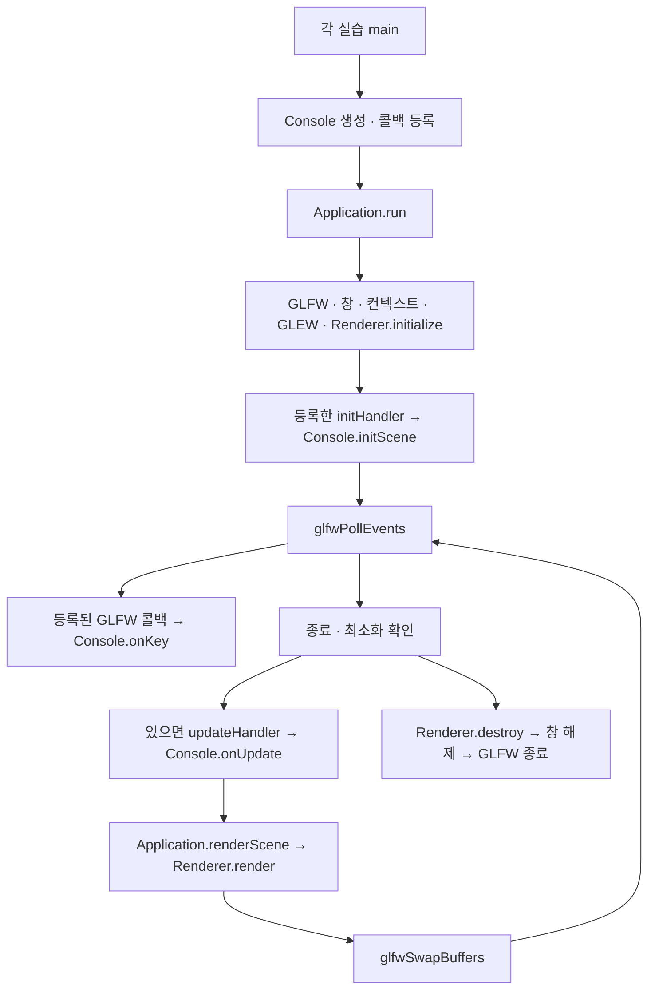

# 실행 프로젝트와 렌더링 흐름

이 문서는 실제 소스와 프로젝트의 ClCompile 항목을 대조한 정적 설명이다.
최신 코드 목록과 SHA-256은 SOURCE_HASHES.json에 기록했다. graphify AST 결과를 참고했다. 빌드·실행·테스트는 수행하지 않았다.
EXTRACTED는 소스에서 확인한 관계, AMBIGUOUS는 실행 대상이나 이름 해석이 불확실한 관계다.
그래프가 함수 호출 시간이나 std::function의 대상을 완전히 증명하지는 않는다.

## 실행 프로젝트 분리

루트 framework는 소스 라이브러리이며 main이 없다. 실습 13·14·15는 각각 자기 framework를 컴파일한다.
같은 클래스 이름을 사용하더라도 서로 다른 실행 프로젝트의 Console/Application/Renderer를 섞지 않는다.
PROJECTS.json은 모든 프로젝트의 컴파일 파일과 물리적 진입점 위치를 기록한다.

| 실행 프로젝트 | 진입점 | 분기와 책임 |
|---|---|---|
| computer_graphics_warmUp1 | FileName.cpp의 main | PROB 1~4. 현재 기본값 4. 아래 네 분기는 동시에 실행되지 않는다. |
| Computer-Graphics_WarmmingUp2 | FileName.cpp의 wmain | warmup::Application::run에서 보드 또는 메시 파싱을 선택한다. |
| Computer-Graphics_WarmmingUp2/tests | Tests.cpp의 main | 별도 테스트 실행 프로젝트. 이번 작업에서 실행하지 않았다. |
| openGL_sample0 | main.cpp의 main | 파일 메시, Model/View/Projection, 카메라 이동·충돌, 회색 조명. |
| openGL_assign123456 | main.cpp의 main | PROB 2~6. 현재 4. Practice2~6Console 중 한 객체를 생성한다. |
| openGL_2dAssign_789 | main.cpp의 main | PROB 7~9. 현재 9. Practice7~9Console 중 한 객체를 생성한다. |
| openGL_2dAssign_10 | main.cpp의 main | 모양판과 조각 배치. 별도 PracticeConsole. |
| openGL_2dAssign11 | main.cpp의 main | 격자 크기 입력 후 Practice11Console의 이동·효과. |
| openGL_2dAssign12 | main.cpp의 main | PracticeConsole의 쌓기와 충돌 처리. |
| openGL_3dAssign_13 | main.cpp의 main | 면 선택. 업데이트 콜백이 없다. |
| openGL_3dAssign_14 | main.cpp의 main | 꼭짓점 색상, 이동·쿼터니언 자전. 수정키·업데이트·포커스 콜백. |
| openGL_3dAssign_15 | main.cpp의 main | 전체 자전과 독립 상태의 중첩 면 애니메이션. 키·업데이트 콜백. |

### 워밍업 진입점

- PROB 1: FileName.cpp:534의 main → Matrix 생성 → 무작위 operand → Matrix::command.
- PROB 2: FileName.cpp:755의 main → StringEditor → 파일 이름 입력 → load → run.
- PROB 3: FileName.cpp:873의 main → PointList → run.
- PROB 4: FileName.cpp:998의 main → CardGame → run. 기본 분기다.
- 전처리 조건은 소스에서 확인했다. AST의 같은 main 이름 병합만으로 활성 분기를 판단하지 않는다.

워밍업 2는 wmain에서 유니코드 인수를 UTF-8로 변환하고 출력 경로를 구한다.
warmup::Application::run은 --board, --parse 또는 대화식 선택을 분기한다.
보드는 readRectangles → Board::reset → draw/parse/Board 변경 반복 순서다.
메시는 MeshParser::parse → MeshValidator::validate → MeshReporter::print → 출력 파일 기록 순서다.
테스트 프로젝트의 main은 testBoardTransactions/testCommands/testBoardProperties/testMesh를 호출한다.
이 테스트 호출은 소스 확인만 했으며 실제 수행하지 않았다.

### sample0의 main

1. GLFW 오류 콜백 → GLFW/창/컨텍스트 → framebuffer 콜백 → GLEW 초기화.
2. createShaderProgram → loadMeshVertices → position/normal VAO·VBO → uniform 위치 확인.
3. 매 프레임 pollEvents → 종료·최소화 확인 → updateCamera → 충돌이 없는 Model 후보 채택.
4. lookAt View와 perspective Projection 계산 → Model/View/Projection/조명 uniform → glDrawArrays.
5. 프로그램·버퍼·VAO를 컨텍스트 종료 전에 해제 → 창 해제 → GLFW 종료.

이 실행 파일은 실습 13·14·15의 framework를 사용하지 않는다.
프로젝트에서 공유하는 MeshParser 관련 코드도 PROJECTS.json에서 실제 컴파일 항목으로 구분한다.

### 실습 2~12의 main

실습 2~6은 GLFW compatibility profile과 기존 Console 계층을 사용한다.
createConsole의 PROB 분기가 객체 종류를 고른다. key/mouse/cursor/framebuffer 콜백을 등록한다.
반복 순서는 Console::update → render → swapBuffers → pollEvents이며, 종료 후 Console을 해제한다.
Common.cpp의 glBegin/glEnd는 기존 레거시 코드다. 이번 작업에서 새로 도입하지 않았다.

실습 7~9는 core profile이다. createConsole → initGraphics → 키·마우스·커서·크기 콜백 등록 후
update → render → swapBuffers → pollEvents 순서로 반복한다.
ShaderHandler::upload가 정점과 인덱스를 올리고 render가 경로/도형/선택 테두리를 그린다.
현재 PROB 9를 다른 PROB의 실행과 섞지 않는다.

실습 10은 initGraphics에서 store_.resetAtRandom으로 장면을 만든다.
키·드래그 입력은 PracticeConsole을 통해 store를 변경한다. render는 revision을 비교해
ShaderHandler::upload를 호출하고, 영역 배경과 조각·선택 테두리를 그린다.
실습 11은 readGridSize → Practice11Console → initGraphics 후 입력을 등록한다.
update는 grid_.advanceEffects와 grid_.moveByStep을 시간에 맞춰 실행한다.
render는 grid_.getRenderItems를 가져와 필요한 때 upload하고 그린다.
실습 12의 Enter 입력은 store_.checkHit, R 입력은 reset, update는 store_.advance를 호출한다.
render는 store revision을 비교해 버퍼를 갱신하고 ShaderHandler::render를 호출한다.
실습 7~12의 종료는 shutdownGraphics → Console 해제 → 창 해제 → GLFW 종료 순서다.

## 실습 13·14·15 공통 수명과 실행 순서

- main은 콜백을 먼저 저장한다. 등록하는 순간 Console::initScene/onKey/onUpdate를 실행하지 않는다.
- Application::run의 initialize가 OpenGL 컨텍스트를 만든 뒤 initHandler를 한 번 실행한다.
- glfwPollEvents는 대기 중인 키·포커스 이벤트를 전달한다. 실제 콜백 호출 횟수는 이벤트에 달려 있다.
- 실습 14는 modifiedKeyHandler가 기존 keyHandler를 대체한다. Shift XOR Caps Lock으로 대소문자를 구분한다.
- framebuffer 크기가 0이면 업데이트·렌더링을 건너뛰고 이벤트를 기다린다. deltaTime은 최대 0.05초다.
- 종료 요청 이후에는 다음 업데이트/렌더를 실행하지 않는다. 초기화 실패도 컨텍스트 자원을 먼저 해제한다.
- 예외 경로는 shutdown 후 예외를 다시 전달한다. GL 객체는 컨텍스트가 살아 있을 때 해제한다.

## 입력 → 상태·변환 → 출력

### 실습 13

Console::onKey → selectFaces → 모든 면 숨김 → 선택한 면 표시.
숫자키는 한 면, c는 중복 없는 육면체 두 면, t는 사각뿔 바닥과 한 옆면이다.
두 객체는 같은 원점에 존재하지만 선택하지 않은 객체의 모든 면을 숨긴다.
좌표축은 owner 없는 Line3D이므로 객체 변환을 적용하지 않는다.
표시 변경은 GPU 버퍼를 다시 올리지 않는다. Renderer::draw가 face.visible을 읽는다.

### 실습 14

수정키 콜백 → pressed_/angularDirection_/도형 선택/RenderOptions 변경.
Console::onUpdate는 월드 X/Y 이동을 position_에, 로컬 X/Y 자전을 orientation_에 누적한다.
오른쪽 쿼터니언 곱은 객체 로컬 축 회전이다. 쿼터니언은 매 프레임 정규화한다.
applyTransform은 현재 선택한 객체에 위치와 orientation을 기록한다.
c/p는 보존한 상태를 새 도형에 적용한다. s는 초기 Rx(30)×Ry(30)과 원점으로 복원한다.
포커스 이탈은 pressed_를 비워 이동을 멈춘다. 자동 자전 설정은 유지한다.
꼭짓점 좌표 부호로 팔레트 색을 정하여 중복된 면 정점에도 같은 색을 넣는다.

### 실습 15

initScene → makePolyhedron(Cube/Pyramid) → assignVertexColors 각각 호출 → push_entity.
양쪽 도형 모두 꼭짓점 색상이 보간된다. 도형 크기·면 순서·좌표축은 유지한다.

Console::onKey → beginMotion → motions_[종류] 하나의 상태만 변경 → applyFaceMotion.
T/S/1/2/4/5는 running 정지·재개, F/B는 direction 반전이다.
처음 1/2를 시작할 때 독립적으로 인접 쌍을 선택하며 초기화 전까지 그 쌍을 유지한다.
사각뿔에서는 육면체 면 명령을 무시한다. P는 모든 면 모션을 초기화하고 Y 자전은 유지한다.
R은 육면체·초기 각도·깊이 켜짐·전체 모션 정지로 복원한다.

onUpdate → Y 자전 진행 → 모든 running 면 모션의 진행량을 각각 갱신 → applyFaceMotion.
F/B는 진행량을 [0,1]로 고정하고 자기 모션만 완료한다.
1은 360도 모듈러 회전으로 반복한다. 2는 진행량 [0,180)에서 각도를 0→90→0으로 계산한다.
45도/초 기준 1은 8초 주기, 2는 자리 교체 2초·복귀 2초인 4초 주기다.
프레임 deltaTime은 Application에서 최대 0.05초로 제한한다.

applyFaceMotion은 여섯 단위행렬에서 시작하여 T→F→S→B→1→2→4→5 순서로 합성한다.
각 모션 행렬을 왼쪽에 곱하므로 이 순서는 열벡터에 실제로 적용되는 순서다.
지난 프레임 행렬을 재사용하지 않으며, 정지한 모션의 현재 변형도 합성한다.
일반 면 최종 Model = 객체 Model × OrbitX × OrbitY × Swap × Hinge × Back × Side × Front × Top.
각 면에 해당하지 않는 항은 단위행렬이다. 전체 객체 Y 자전은 객체 Model에서 적용된다.
모든 피벗과 축은 기준 형상의 객체 로컬 좌표로 정의한다. 중첩 시 뒤 모션이 앞 모션의 결과를 변환한다.
따라서 단독 실행의 고정 중점·모서리가 추가 공전까지 적용된 뒤 월드에서 고정된다는 뜻은 아니다.

면 표: 앞0, 뒤1, 왼쪽2, 오른쪽3, 위4, 아래5.
S는 왼쪽2·오른쪽3에 각각 자기 중점 X축 회전을 적용한다.
인접 쌍: (앞,오른쪽), (오른쪽,뒤), (뒤,왼쪽), (왼쪽,앞).
1은 선택 쌍 공통 수직 모서리, 2는 중앙 Y축으로 +각도/-각도 회전한다.
4는 옆면 네 개, 5는 위·아래·앞·뒤 면에 중앙 공전 행렬을 적용한다.
B가 완전 축소되면 뒷면만 숨긴다. 복귀 입력 즉시 다른 모션을 유지하며 다시 표시한다.

## CPU → GPU

1. DiagramSystem::makePolyhedron은 면의 로컬 꼭짓점·색·법선을 만든다.
   육면체는 6개 사각형, 사각뿔은 4개 삼각형과 사각형 바닥이다. 직각 사면체(Tetra)는 별도 4개 삼각형이다.
2. Scene은 Component_Poly와 Line3D를 소유한다. GPU 핸들은 Renderer가 소유한다.
3. Renderer::upload는 position/color VBO와 삼각형/테두리/선 EBO를 만든다.
   VAO의 location 0은 위치, location 1은 색이다. EBO 바인딩은 VAO의 상태로 유지한다.
4. 장면 교체 또는 geometryRevision 변경 때만 upload한다. 면 표시·행렬·객체 변환은 draw 때 읽는다.
5. 객체 Model은 T(world)×Rx×Ry×Rz×Q×S×T(-localBasis)이다.
   일반 면 Model은 객체 Model×localAnimationMatrix이다. 기존 독립 면은 자기 월드 transform을 쓴다.
6. CameraSystem은 lookAt View와 aspect를 유지하는 직교 Projection을 만든다.
   기본 카메라 API의 원근 투영도 유지한다. 과제 카메라는 고정되며 축의 owner는 없다.
7. Renderer::draw는 P×V×M을 계산하여 mat4 uMVP를 올린다.
   숨긴 면은 건너뛴다. 솔리드는 GL_TRIANGLES, 와이어는 실제 테두리 GL_LINE_LOOP, 축은 GL_LINES다.
8. VertexShader.glsl은 uMVP×vec4(vPos,1)로 clip 좌표를 출력하고 색을 전달한다.
   OpenGL이 클리핑·원근 나눗셈·뷰포트·래스터화를 수행한다.
   FragmentShader.glsl은 보간된 색을 출력한다. depthTest가 가림 여부를 제어한다.
9. 프레임마다 viewport, 깊이 상태, 컬링 해제, 솔리드 polygon mode, clear를 설정한다.
   와이어는 polygon mode에 의존하지 않으므로 사각형 분할 대각선이 없다.

## 그래프의 확인 범위와 한계

- AST 추출 실패 파일은 없다. 일부 C++ 함수 정의의 추출 누락은 실습 13~15의 소스 검토 노드 76개로 보완했다. _origin=source_review로 구분하며 컴파일·타입 검증 성공을 뜻하지 않는다.
- 284개 간선은 끝점 정의가 그래프에 없다. 외부 참조나 이름 해석 한계를 포함한다.
- 134개 관계는 DiGraph의 같은 끝점 간선으로 합쳐진다. 원시 관계는 관계 보존 파일에서 확인한다.
- 자기 참조는 없다. 서로 다른 실행 프로젝트의 호출 관계 1개는 AMBIGUOUS로 표시했다.
- 자동 보고의 Surprising Connections는 후보 관계다. random/Cell 같은 이름을 실제 교차 호출로 단정하지 않는다.
- 전처리 분기, 가상 호출과 std::function의 실제 대상은 이 문서에서 소스와 대조했다.
- 사용자 확인이 필요한 빌드·화면·입력·종료 검증은 docs/practice-13-15/README.md에 정리했다.

## 이해 확인

면의 회전 중심을 객체 중심으로 바꾸려면 T(pivot)×R×T(-pivot)의 어느 값이 바뀌는가?
객체의 y 자전과 면 변형이 함께 보이는 이유를 객체 Model×면 행렬 순서로 설명할 수 있는가?

## 실습 소스의 함수 위치

### openGL_3dAssign_13/main.cpp

- `main`: [main.cpp:4](../openGL_3dAssign_13/main.cpp)

### openGL_3dAssign_13/Console.cpp

- Console::initScene: [Console.cpp:5](../openGL_3dAssign_13/Console.cpp)
- Console::selectFaces: [Console.cpp:40](../openGL_3dAssign_13/Console.cpp)
- Console::onKey: [Console.cpp:53](../openGL_3dAssign_13/Console.cpp)

### openGL_3dAssign_13/framework/src/Application.cpp

- `Application::setInitHandler`: [Application.cpp:20](../openGL_3dAssign_13/framework/src/Application.cpp)
- `Application::setUpdateHandler`: [Application.cpp:24](../openGL_3dAssign_13/framework/src/Application.cpp)
- `Application::setKeyHandler`: [Application.cpp:28](../openGL_3dAssign_13/framework/src/Application.cpp)
- `Application::setModifiedKeyHandler`: [Application.cpp:32](../openGL_3dAssign_13/framework/src/Application.cpp)
- `Application::findShaderDirectory`: [Application.cpp:37](../openGL_3dAssign_13/framework/src/Application.cpp)
- `Application::setFocusHandler`: [Application.cpp:68](../openGL_3dAssign_13/framework/src/Application.cpp)
- `Application::setRenderHandler`: [Application.cpp:72](../openGL_3dAssign_13/framework/src/Application.cpp)
- `Application::initialize`: [Application.cpp:76](../openGL_3dAssign_13/framework/src/Application.cpp)
- `Application::shutdown`: [Application.cpp:121](../openGL_3dAssign_13/framework/src/Application.cpp)
- `Application::requestClose`: [Application.cpp:135](../openGL_3dAssign_13/framework/src/Application.cpp)
- `Application::renderScene`: [Application.cpp:141](../openGL_3dAssign_13/framework/src/Application.cpp)
- `Application::run`: [Application.cpp:152](../openGL_3dAssign_13/framework/src/Application.cpp)

### openGL_3dAssign_13/framework/src/Graphics.cpp

- `finiteVector`: [Graphics.cpp:16](../openGL_3dAssign_13/framework/src/Graphics.cpp)
- `finiteMatrix`: [Graphics.cpp:21](../openGL_3dAssign_13/framework/src/Graphics.cpp)
- `positiveLengths`: [Graphics.cpp:32](../openGL_3dAssign_13/framework/src/Graphics.cpp)
- `validColor`: [Graphics.cpp:37](../openGL_3dAssign_13/framework/src/Graphics.cpp)
- `nextGeometryRevision`: [Graphics.cpp:42](../openGL_3dAssign_13/framework/src/Graphics.cpp)
- `appendFace`: [Graphics.cpp:49](../openGL_3dAssign_13/framework/src/Graphics.cpp)
- `Scene::push_entity`: [Graphics.cpp:72](../openGL_3dAssign_13/framework/src/Graphics.cpp)
- `Scene::addCuboid`: [Graphics.cpp:101](../openGL_3dAssign_13/framework/src/Graphics.cpp)
- `Scene::addRightTetrahedron`: [Graphics.cpp:110](../openGL_3dAssign_13/framework/src/Graphics.cpp)
- `Scene::addPyramid`: [Graphics.cpp:119](../openGL_3dAssign_13/framework/src/Graphics.cpp)
- `Scene::setFaceVisible`: [Graphics.cpp:128](../openGL_3dAssign_13/framework/src/Graphics.cpp)
- `Scene::setFaceLocalMatrix`: [Graphics.cpp:137](../openGL_3dAssign_13/framework/src/Graphics.cpp)
- `Scene::setFaceVertexColors`: [Graphics.cpp:148](../openGL_3dAssign_13/framework/src/Graphics.cpp)
- `Scene::getComponent`: [Graphics.cpp:168](../openGL_3dAssign_13/framework/src/Graphics.cpp)
- `Scene::setPosition`: [Graphics.cpp:172](../openGL_3dAssign_13/framework/src/Graphics.cpp)
- `Scene::setSideLengths`: [Graphics.cpp:180](../openGL_3dAssign_13/framework/src/Graphics.cpp)
- `Scene::setTransform`: [Graphics.cpp:205](../openGL_3dAssign_13/framework/src/Graphics.cpp)
- `Scene::setFaceTransform`: [Graphics.cpp:213](../openGL_3dAssign_13/framework/src/Graphics.cpp)
- `Scene::addLine`: [Graphics.cpp:228](../openGL_3dAssign_13/framework/src/Graphics.cpp)
- `Scene::addVector`: [Graphics.cpp:242](../openGL_3dAssign_13/framework/src/Graphics.cpp)
- `Scene::setVector`: [Graphics.cpp:281](../openGL_3dAssign_13/framework/src/Graphics.cpp)
- `Scene::clear`: [Graphics.cpp:292](../openGL_3dAssign_13/framework/src/Graphics.cpp)
- `DiagramSystem::validTransform`: [Graphics.cpp:305](../openGL_3dAssign_13/framework/src/Graphics.cpp)
- `DiagramSystem::validPolyhedron`: [Graphics.cpp:316](../openGL_3dAssign_13/framework/src/Graphics.cpp)
- `DiagramSystem::makePolyhedron`: [Graphics.cpp:353](../openGL_3dAssign_13/framework/src/Graphics.cpp)
- `DiagramSystem::modelMatrix`: [Graphics.cpp:423](../openGL_3dAssign_13/framework/src/Graphics.cpp)
- `DiagramSystem::faceModelMatrix`: [Graphics.cpp:437](../openGL_3dAssign_13/framework/src/Graphics.cpp)
- `CameraSystem::validCamera`: [Graphics.cpp:445](../openGL_3dAssign_13/framework/src/Graphics.cpp)
- `CameraSystem::viewMatrix`: [Graphics.cpp:460](../openGL_3dAssign_13/framework/src/Graphics.cpp)
- `CameraSystem::projectionMatrix`: [Graphics.cpp:464](../openGL_3dAssign_13/framework/src/Graphics.cpp)
- `compileShader`: [Graphics.cpp:477](../openGL_3dAssign_13/framework/src/Graphics.cpp)
- `readTextFile`: [Graphics.cpp:506](../openGL_3dAssign_13/framework/src/Graphics.cpp)
- `Renderer::initShader`: [Graphics.cpp:523](../openGL_3dAssign_13/framework/src/Graphics.cpp)
- `Renderer::initBuffer`: [Graphics.cpp:574](../openGL_3dAssign_13/framework/src/Graphics.cpp)
- `Renderer::upload`: [Graphics.cpp:602](../openGL_3dAssign_13/framework/src/Graphics.cpp)
- `Renderer::draw`: [Graphics.cpp:677](../openGL_3dAssign_13/framework/src/Graphics.cpp)
- `Renderer::initialize`: [Graphics.cpp:730](../openGL_3dAssign_13/framework/src/Graphics.cpp)
- `Renderer::render`: [Graphics.cpp:739](../openGL_3dAssign_13/framework/src/Graphics.cpp)
- `Renderer::destroy`: [Graphics.cpp:774](../openGL_3dAssign_13/framework/src/Graphics.cpp)

### openGL_3dAssign_14/main.cpp

- `main`: [main.cpp:5](../openGL_3dAssign_14/main.cpp)

### openGL_3dAssign_14/Console.cpp

- assignVertexColors: [Console.cpp:8](../openGL_3dAssign_14/Console.cpp)
- Console::initScene: [Console.cpp:26](../openGL_3dAssign_14/Console.cpp)
- Console::selectShape: [Console.cpp:57](../openGL_3dAssign_14/Console.cpp)
- Console::resetMotion: [Console.cpp:69](../openGL_3dAssign_14/Console.cpp)
- Console::applyTransform: [Console.cpp:78](../openGL_3dAssign_14/Console.cpp)
- Console::onKey: [Console.cpp:85](../openGL_3dAssign_14/Console.cpp)
- Console::onUpdate: [Console.cpp:111](../openGL_3dAssign_14/Console.cpp)
- Console::onFocus: [Console.cpp:127](../openGL_3dAssign_14/Console.cpp)

### openGL_3dAssign_14/framework/src/Application.cpp

- `Application::setInitHandler`: [Application.cpp:20](../openGL_3dAssign_14/framework/src/Application.cpp)
- `Application::setUpdateHandler`: [Application.cpp:24](../openGL_3dAssign_14/framework/src/Application.cpp)
- `Application::setKeyHandler`: [Application.cpp:28](../openGL_3dAssign_14/framework/src/Application.cpp)
- `Application::setModifiedKeyHandler`: [Application.cpp:32](../openGL_3dAssign_14/framework/src/Application.cpp)
- `Application::findShaderDirectory`: [Application.cpp:37](../openGL_3dAssign_14/framework/src/Application.cpp)
- `Application::setFocusHandler`: [Application.cpp:68](../openGL_3dAssign_14/framework/src/Application.cpp)
- `Application::setRenderHandler`: [Application.cpp:72](../openGL_3dAssign_14/framework/src/Application.cpp)
- `Application::initialize`: [Application.cpp:76](../openGL_3dAssign_14/framework/src/Application.cpp)
- `Application::shutdown`: [Application.cpp:121](../openGL_3dAssign_14/framework/src/Application.cpp)
- `Application::requestClose`: [Application.cpp:135](../openGL_3dAssign_14/framework/src/Application.cpp)
- `Application::renderScene`: [Application.cpp:141](../openGL_3dAssign_14/framework/src/Application.cpp)
- `Application::run`: [Application.cpp:152](../openGL_3dAssign_14/framework/src/Application.cpp)

### openGL_3dAssign_14/framework/src/Graphics.cpp

- `finiteVector`: [Graphics.cpp:16](../openGL_3dAssign_14/framework/src/Graphics.cpp)
- `finiteMatrix`: [Graphics.cpp:21](../openGL_3dAssign_14/framework/src/Graphics.cpp)
- `positiveLengths`: [Graphics.cpp:32](../openGL_3dAssign_14/framework/src/Graphics.cpp)
- `validColor`: [Graphics.cpp:37](../openGL_3dAssign_14/framework/src/Graphics.cpp)
- `nextGeometryRevision`: [Graphics.cpp:42](../openGL_3dAssign_14/framework/src/Graphics.cpp)
- `appendFace`: [Graphics.cpp:49](../openGL_3dAssign_14/framework/src/Graphics.cpp)
- `Scene::push_entity`: [Graphics.cpp:72](../openGL_3dAssign_14/framework/src/Graphics.cpp)
- `Scene::addCuboid`: [Graphics.cpp:101](../openGL_3dAssign_14/framework/src/Graphics.cpp)
- `Scene::addRightTetrahedron`: [Graphics.cpp:110](../openGL_3dAssign_14/framework/src/Graphics.cpp)
- `Scene::addPyramid`: [Graphics.cpp:119](../openGL_3dAssign_14/framework/src/Graphics.cpp)
- `Scene::setFaceVisible`: [Graphics.cpp:128](../openGL_3dAssign_14/framework/src/Graphics.cpp)
- `Scene::setFaceLocalMatrix`: [Graphics.cpp:137](../openGL_3dAssign_14/framework/src/Graphics.cpp)
- `Scene::setFaceVertexColors`: [Graphics.cpp:148](../openGL_3dAssign_14/framework/src/Graphics.cpp)
- `Scene::getComponent`: [Graphics.cpp:168](../openGL_3dAssign_14/framework/src/Graphics.cpp)
- `Scene::setPosition`: [Graphics.cpp:172](../openGL_3dAssign_14/framework/src/Graphics.cpp)
- `Scene::setSideLengths`: [Graphics.cpp:180](../openGL_3dAssign_14/framework/src/Graphics.cpp)
- `Scene::setTransform`: [Graphics.cpp:205](../openGL_3dAssign_14/framework/src/Graphics.cpp)
- `Scene::setFaceTransform`: [Graphics.cpp:213](../openGL_3dAssign_14/framework/src/Graphics.cpp)
- `Scene::addLine`: [Graphics.cpp:228](../openGL_3dAssign_14/framework/src/Graphics.cpp)
- `Scene::addVector`: [Graphics.cpp:242](../openGL_3dAssign_14/framework/src/Graphics.cpp)
- `Scene::setVector`: [Graphics.cpp:281](../openGL_3dAssign_14/framework/src/Graphics.cpp)
- `Scene::clear`: [Graphics.cpp:292](../openGL_3dAssign_14/framework/src/Graphics.cpp)
- `DiagramSystem::validTransform`: [Graphics.cpp:305](../openGL_3dAssign_14/framework/src/Graphics.cpp)
- `DiagramSystem::validPolyhedron`: [Graphics.cpp:316](../openGL_3dAssign_14/framework/src/Graphics.cpp)
- `DiagramSystem::makePolyhedron`: [Graphics.cpp:353](../openGL_3dAssign_14/framework/src/Graphics.cpp)
- `DiagramSystem::modelMatrix`: [Graphics.cpp:423](../openGL_3dAssign_14/framework/src/Graphics.cpp)
- `DiagramSystem::faceModelMatrix`: [Graphics.cpp:437](../openGL_3dAssign_14/framework/src/Graphics.cpp)
- `CameraSystem::validCamera`: [Graphics.cpp:445](../openGL_3dAssign_14/framework/src/Graphics.cpp)
- `CameraSystem::viewMatrix`: [Graphics.cpp:460](../openGL_3dAssign_14/framework/src/Graphics.cpp)
- `CameraSystem::projectionMatrix`: [Graphics.cpp:464](../openGL_3dAssign_14/framework/src/Graphics.cpp)
- `compileShader`: [Graphics.cpp:477](../openGL_3dAssign_14/framework/src/Graphics.cpp)
- `readTextFile`: [Graphics.cpp:506](../openGL_3dAssign_14/framework/src/Graphics.cpp)
- `Renderer::initShader`: [Graphics.cpp:523](../openGL_3dAssign_14/framework/src/Graphics.cpp)
- `Renderer::initBuffer`: [Graphics.cpp:574](../openGL_3dAssign_14/framework/src/Graphics.cpp)
- `Renderer::upload`: [Graphics.cpp:602](../openGL_3dAssign_14/framework/src/Graphics.cpp)
- `Renderer::draw`: [Graphics.cpp:677](../openGL_3dAssign_14/framework/src/Graphics.cpp)
- `Renderer::initialize`: [Graphics.cpp:730](../openGL_3dAssign_14/framework/src/Graphics.cpp)
- `Renderer::render`: [Graphics.cpp:739](../openGL_3dAssign_14/framework/src/Graphics.cpp)
- `Renderer::destroy`: [Graphics.cpp:774](../openGL_3dAssign_14/framework/src/Graphics.cpp)

### openGL_3dAssign_15/main.cpp

- `main`: [main.cpp:4](../openGL_3dAssign_15/main.cpp)

### openGL_3dAssign_15/Console.cpp

- assignVertexColors: [Console.cpp:20](../openGL_3dAssign_15/Console.cpp)
- rotateAround: [Console.cpp:36](../openGL_3dAssign_15/Console.cpp)
- scaleAround: [Console.cpp:42](../openGL_3dAssign_15/Console.cpp)
- Console::initScene: [Console.cpp:50](../openGL_3dAssign_15/Console.cpp)
- Console::resetFaces: [Console.cpp:86](../openGL_3dAssign_15/Console.cpp)
- Console::selectShape: [Console.cpp:97](../openGL_3dAssign_15/Console.cpp)
- Console::resetAll: [Console.cpp:104](../openGL_3dAssign_15/Console.cpp)
- Console::applyObjectTransform: [Console.cpp:111](../openGL_3dAssign_15/Console.cpp)
- Console::beginMotion: [Console.cpp:119](../openGL_3dAssign_15/Console.cpp)
- Console::applyFaceMotion: [Console.cpp:152](../openGL_3dAssign_15/Console.cpp)
- Console::onKey: [Console.cpp:216](../openGL_3dAssign_15/Console.cpp)
- Console::onUpdate: [Console.cpp:243](../openGL_3dAssign_15/Console.cpp)

### openGL_3dAssign_15/framework/src/Application.cpp

- `Application::setInitHandler`: [Application.cpp:20](../openGL_3dAssign_15/framework/src/Application.cpp)
- `Application::setUpdateHandler`: [Application.cpp:24](../openGL_3dAssign_15/framework/src/Application.cpp)
- `Application::setKeyHandler`: [Application.cpp:28](../openGL_3dAssign_15/framework/src/Application.cpp)
- `Application::setModifiedKeyHandler`: [Application.cpp:32](../openGL_3dAssign_15/framework/src/Application.cpp)
- `Application::findShaderDirectory`: [Application.cpp:37](../openGL_3dAssign_15/framework/src/Application.cpp)
- `Application::setFocusHandler`: [Application.cpp:68](../openGL_3dAssign_15/framework/src/Application.cpp)
- `Application::setRenderHandler`: [Application.cpp:72](../openGL_3dAssign_15/framework/src/Application.cpp)
- `Application::initialize`: [Application.cpp:76](../openGL_3dAssign_15/framework/src/Application.cpp)
- `Application::shutdown`: [Application.cpp:121](../openGL_3dAssign_15/framework/src/Application.cpp)
- `Application::requestClose`: [Application.cpp:135](../openGL_3dAssign_15/framework/src/Application.cpp)
- `Application::renderScene`: [Application.cpp:141](../openGL_3dAssign_15/framework/src/Application.cpp)
- `Application::run`: [Application.cpp:152](../openGL_3dAssign_15/framework/src/Application.cpp)

### openGL_3dAssign_15/framework/src/Graphics.cpp

- `finiteVector`: [Graphics.cpp:16](../openGL_3dAssign_15/framework/src/Graphics.cpp)
- `finiteMatrix`: [Graphics.cpp:21](../openGL_3dAssign_15/framework/src/Graphics.cpp)
- `positiveLengths`: [Graphics.cpp:32](../openGL_3dAssign_15/framework/src/Graphics.cpp)
- `validColor`: [Graphics.cpp:37](../openGL_3dAssign_15/framework/src/Graphics.cpp)
- `nextGeometryRevision`: [Graphics.cpp:42](../openGL_3dAssign_15/framework/src/Graphics.cpp)
- `appendFace`: [Graphics.cpp:49](../openGL_3dAssign_15/framework/src/Graphics.cpp)
- `Scene::push_entity`: [Graphics.cpp:72](../openGL_3dAssign_15/framework/src/Graphics.cpp)
- `Scene::addCuboid`: [Graphics.cpp:101](../openGL_3dAssign_15/framework/src/Graphics.cpp)
- `Scene::addRightTetrahedron`: [Graphics.cpp:110](../openGL_3dAssign_15/framework/src/Graphics.cpp)
- `Scene::addPyramid`: [Graphics.cpp:119](../openGL_3dAssign_15/framework/src/Graphics.cpp)
- `Scene::setFaceVisible`: [Graphics.cpp:128](../openGL_3dAssign_15/framework/src/Graphics.cpp)
- `Scene::setFaceLocalMatrix`: [Graphics.cpp:137](../openGL_3dAssign_15/framework/src/Graphics.cpp)
- `Scene::setFaceVertexColors`: [Graphics.cpp:148](../openGL_3dAssign_15/framework/src/Graphics.cpp)
- `Scene::getComponent`: [Graphics.cpp:168](../openGL_3dAssign_15/framework/src/Graphics.cpp)
- `Scene::setPosition`: [Graphics.cpp:172](../openGL_3dAssign_15/framework/src/Graphics.cpp)
- `Scene::setSideLengths`: [Graphics.cpp:180](../openGL_3dAssign_15/framework/src/Graphics.cpp)
- `Scene::setTransform`: [Graphics.cpp:205](../openGL_3dAssign_15/framework/src/Graphics.cpp)
- `Scene::setFaceTransform`: [Graphics.cpp:213](../openGL_3dAssign_15/framework/src/Graphics.cpp)
- `Scene::addLine`: [Graphics.cpp:228](../openGL_3dAssign_15/framework/src/Graphics.cpp)
- `Scene::addVector`: [Graphics.cpp:242](../openGL_3dAssign_15/framework/src/Graphics.cpp)
- `Scene::setVector`: [Graphics.cpp:281](../openGL_3dAssign_15/framework/src/Graphics.cpp)
- `Scene::clear`: [Graphics.cpp:292](../openGL_3dAssign_15/framework/src/Graphics.cpp)
- `DiagramSystem::validTransform`: [Graphics.cpp:305](../openGL_3dAssign_15/framework/src/Graphics.cpp)
- `DiagramSystem::validPolyhedron`: [Graphics.cpp:316](../openGL_3dAssign_15/framework/src/Graphics.cpp)
- `DiagramSystem::makePolyhedron`: [Graphics.cpp:353](../openGL_3dAssign_15/framework/src/Graphics.cpp)
- `DiagramSystem::modelMatrix`: [Graphics.cpp:423](../openGL_3dAssign_15/framework/src/Graphics.cpp)
- `DiagramSystem::faceModelMatrix`: [Graphics.cpp:437](../openGL_3dAssign_15/framework/src/Graphics.cpp)
- `CameraSystem::validCamera`: [Graphics.cpp:445](../openGL_3dAssign_15/framework/src/Graphics.cpp)
- `CameraSystem::viewMatrix`: [Graphics.cpp:460](../openGL_3dAssign_15/framework/src/Graphics.cpp)
- `CameraSystem::projectionMatrix`: [Graphics.cpp:464](../openGL_3dAssign_15/framework/src/Graphics.cpp)
- `compileShader`: [Graphics.cpp:477](../openGL_3dAssign_15/framework/src/Graphics.cpp)
- `readTextFile`: [Graphics.cpp:506](../openGL_3dAssign_15/framework/src/Graphics.cpp)
- `Renderer::initShader`: [Graphics.cpp:523](../openGL_3dAssign_15/framework/src/Graphics.cpp)
- `Renderer::initBuffer`: [Graphics.cpp:574](../openGL_3dAssign_15/framework/src/Graphics.cpp)
- `Renderer::upload`: [Graphics.cpp:602](../openGL_3dAssign_15/framework/src/Graphics.cpp)
- `Renderer::draw`: [Graphics.cpp:677](../openGL_3dAssign_15/framework/src/Graphics.cpp)
- `Renderer::initialize`: [Graphics.cpp:730](../openGL_3dAssign_15/framework/src/Graphics.cpp)
- `Renderer::render`: [Graphics.cpp:739](../openGL_3dAssign_15/framework/src/Graphics.cpp)
- `Renderer::destroy`: [Graphics.cpp:774](../openGL_3dAssign_15/framework/src/Graphics.cpp)

## 전체 소스와 탑다운 학습

[TOPDOWN_13_14_15.md](TOPDOWN_13_14_15.md)는 main부터 GL 저수준 호출과 셰이더까지 세 실습의 모든 과제 함수·공통 API를 설명하고 실제 코드 부록을 포함한다. 그래프에서 callback_body_calls는 등록한 람다 본문의 호출이며 main에서 즉시 실행했다는 뜻이 아니다. 런타임 조건은 Application.run 설명을 따른다.

현재 한글 출력은 /source-charset:utf-8과 시스템 기본 실행 문자 집합을 사용한다. 실습14 main의 임시 system(chcp) 호출은 제거했다. 기본949 콘솔 확인은 사용자가 새로 빌드해 수행한다.
