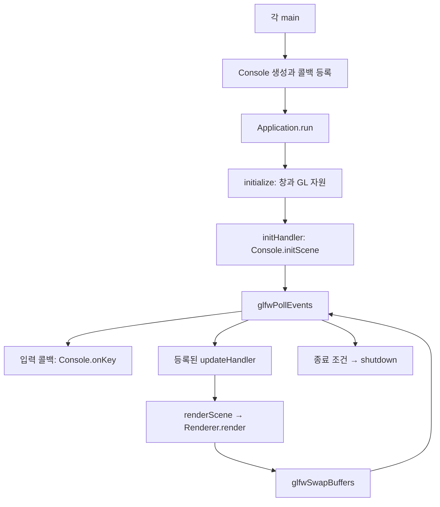

> 이전 버전 기록이다. 현재 좌표·프레임워크·실행 흐름은 EXECUTION_FLOW.md를 따른다.

# 실습 13·14·15: main에서 GPU까지

세 프로그램은 **입력 → Console의 CPU 상태 → Scene의 도형·변환 → Renderer의 OpenGL 호출 → 셰이더 → 화면** 순서로 작동한다. 실습별 main과 Console은 다르며, 각 프로젝트는 자기 framework의 Application.cpp와 Graphics.cpp를 컴파일한다. 루트 framework는 별도로 개편된 라이브러리이므로 이 세 실행 파일의 호출 흐름과 섞지 않는다.

이 문서는 graphify의 graph.json/RELATIONS.json과 현재 소스를 대조한 설명이다. graph의 EXTRACTED는 정적 관계이며 실행 성공을 뜻하지 않는다. AST가 누락한 C++ 함수 정의는 source_review로 보완했다. 같은 이름의 함수라도 프로젝트 경로가 다르면 별도 함수다. 자동 그래프의 간선은 호출 시간순 목록이 아니므로 실제 순서는 아래 설명을 따른다. 빌드와 테스트는 사용자가 수행한다.

읽는 순서: 1~3절에서 프로그램 수명을 읽고, 4~6절에서 실습별 동작을 읽는다. 이후 7~12절에서 CPU 데이터부터 GPU까지 내려간다. 마지막 부록에는 현재 과제 코드와 공통 프레임워크의 전체 소스가 있다.

## 1. main: 객체와 콜백 준비

각 main은 다음 일을 한다.

1. `Application application`을 만든다. 내부에 Scene, Camera, Renderer, RenderOptions가 존재한다. 이 시점에는 OpenGL 창이나 GPU 버퍼를 만들지 않는다.
2. `Console practice(application)`을 만든다. Console은 Application의 참조를 보관한다. 별도 Scene을 복사하지 않는다.
3. `ApplicationConfig`에 창 제목과 셰이더 폴더를 설정한다. 기본 크기는 800×600이고 수직 동기화는 켜짐이다.
4. `findShaderDirectory`로 셰이더 두 파일을 찾는다. 없으면 오류를 출력하고 `-1`을 반환한다.
5. `[&]` 람다를 Application에 등록한다. 람다는 practice를 참조한다. **등록은 함수 저장이며 아직 initScene/onKey/onUpdate를 실행하지 않는다.**
6. `application.run(config)`를 호출한다. 이 호출이 끝날 때까지 main의 지역 객체가 살아 있으므로 캡처한 참조도 유지된다.
7. run의 반환값을 프로세스 종료 코드로 돌려준다. 지역 객체는 역순으로 파괴된다. Application의 소멸자는 shutdown을 다시 호출하지만 이미 해제한 자원은 다시 해제하지 않는다.

| 프로젝트 | 등록하는 사용자 콜백 | 실제 실행 조건 |
|---|---|---|
| 13 | init, key | GL 초기화 후 한 번 / GLFW 키 이벤트 |
| 14 | init, modifiedKey, update, focus | GL 초기화 / 키 이벤트와 mods / 정상 프레임 / 포커스 이벤트 |
| 15 | init, key, update | GL 초기화 / 키 이벤트 / 정상 프레임 |

세 실습 모두 사용자 renderHandler를 등록하지 않으므로 기본 `renderScene`을 사용한다.

도표의 입력 콜백은 이벤트가 있을 때만 실행한다. update는 실습 14·15에만 등록되어 있다. 종료 요청과 최소화 조건은 다음 절의 실제 분기를 따른다.

## 2. Application: 창·콜백·프레임 수명

### findShaderDirectory

내부 containsShaders 람다가 VertexShader.glsl과 FragmentShader.glsl의 존재를 함께 확인한다. Windows에서는 GetModuleFileNameW로 실행 파일의 위치를 얻어 그 옆의 shaders 폴더를 먼저 찾는다. 이후 현재 작업 폴더부터 상위 폴더의 framework/shaders를 차례로 찾는다. 끝까지 없으면 빈 path를 반환한다. 이 함수는 파일 위치를 찾으며 GL 셰이더를 컴파일하지 않는다.

### setInitHandler / setUpdateHandler / setKeyHandler / setModifiedKeyHandler / setFocusHandler / setRenderHandler

전달받은 std::function을 std::move로 해당 멤버에 저장한다. std::function은 호출 가능한 람다를 보관한다. getScene/getCamera/getRenderOptions는 Application 내부 객체의 참조를 반환한다. getWindow는 GLFW 창 포인터를 반환한다.

### initialize

창 크기를 확인하고 glfwInit을 호출한다. OpenGL 3.3 core profile, double buffer, 24비트 깊이 버퍼를 요청한다. glfwCreateWindow가 실패하면 false다. 생성한 창의 GL 컨텍스트를 current로 설정하고 glfwSwapInterval로 수직 동기화를 지정한다. glewInit은 필요한 OpenGL 진입점을 준비한다.

다음으로 Renderer::initialize를 호출한다. 이때 셰이더 프로그램, VAO, VBO, EBO가 만들어진다. **Scene의 정점 데이터 업로드는 아직 하지 않는다.** Scene은 이후 initHandler에서 채운다.

GLFW_LOCK_KEY_MODS를 켜 Caps Lock 상태도 mods로 받는다. 창의 user pointer에 this를 저장한다. GLFW 키 콜백은 그 포인터를 Application*로 복원한다. modifiedKeyHandler가 있으면 우선 호출하고, 없으면 keyHandler를 호출한다. 포커스 콜백도 같은 방법으로 focusHandler에 전달한다. 이것은 운영체제 이벤트를 과제 코드로 전달하는 경계다.

### run

running_으로 재귀 실행을 막는다. initialize 성공 후 initHandler를 한 번 실행한다. 매 프레임 순서는 다음과 같다.

1. glfwPollEvents가 대기 중인 이벤트를 처리한다. 이 과정에서 키·포커스 콜백이 호출될 수 있다.
2. 종료 요청이 생겼으면 반복을 끝낸다.
3. framebuffer 크기가 0이면 glfwWaitEvents로 기다린다. 복원 뒤 긴 시간이 한 프레임에 누적되지 않도록 previousTime을 갱신한다.
4. 현재 시각에서 deltaTime을 계산하고 0~0.05초로 제한한다. 실습 14·15의 updateHandler를 호출한다.
5. 업데이트에서 종료 요청을 했다면 렌더링을 생략한다.
6. renderHandler가 있으면 사용하고, 없으면 renderScene을 호출한다. 실패 시 -1로 종료한다.
7. glfwSwapBuffers로 완성한 후면 버퍼를 표시한다.

initialize/initScene 실패도 shutdown을 거친다. 사용자 콜백에서 예외가 발생하면 자원을 해제하고 예외를 다시 전달한다.

### requestClose / renderScene / shutdown / 소멸자

requestClose는 GLFW의 종료 플래그를 설정한다. renderScene은 창의 실제 framebuffer 크기를 구해 Scene, Camera, RenderOptions와 함께 Renderer::render로 전달한다. shutdown은 컨텍스트를 current로 만든 뒤 Renderer::destroy → 창 user pointer 제거 → glfwDestroyWindow → glfwTerminate 순서로 해제한다. GPU 객체는 컨텍스트가 존재하는 동안 해제해야 한다.

## 3. CPU 객체의 책임과 데이터

| 코드 | 저장하는 것 | 담당하지 않는 것 |
|---|---|---|
| Console | 키 상태, 선택 ID, 위치·회전·모션 진행량 | GL 핸들 소유 |
| Scene | Polyhedron, Transform3D, Line3D, geometryRevision | 창·드로우 호출 |
| DiagramSystem | 형상 생성·검증·Model 계산 함수 | 지속적인 입력 상태 |
| Camera / CameraSystem | 시점 데이터 / View·Projection 계산 | 객체 이동 상태 |
| Renderer | shaderProgram, VAO/VBO/EBO, DrawRange, 업로드 시점 | 키 해석 |

GlColor는 RGB float 세 개다. GLShape는 Cube/Tetra/Pyramid를 구분하고 GLFace는 Rect/Triangle을 구분한다. EntityId와 LineId는 size_t이며 객체 주소가 아니다.

Transform3D의 basis는 월드 위치, localBasis는 로컬 기준점, rotationDegrees는 Euler 각도, orientation은 쿼터니언, scale은 배율이다. sideLengths는 원래 형상의 길이이며 scale과 다르다.

PlaneFigure는 면의 로컬 정점, 면 단색, 법선, visible, localAnimationMatrix, vertexColors를 저장한다. Polyhedron은 이 면들의 목록이다. Component_Poly는 Polyhedron과 객체 Transform3D를 묶는다. FaceId는 객체 ID와 면 번호다. Line3D의 owner가 없으면 월드 좌표 선, 있으면 객체를 따라가는 로컬 선이다.

## 4. 실습 13: 표시할 면만 선택

### initScene

Scene을 비우고 크기 0.8인 육면체와 사각뿔을 원점에 추가한다. optional ID가 유효한지 확인하고 저장한다. 두 객체에 X/Y 30도 초기 변환을 지정한다. 원점을 지나는 X/Y/Z 축을 -1부터 +1까지 선 세 개로 추가한다. owner가 없으므로 도형의 변환과 별개다.

카메라는 (1.8,1.2,3.0)에서 원점을 바라보며 직교 투영을 쓴다. selectFaces로 육면체의 6개 면을 모두 표시하고 키 안내를 출력한다.

### onKey → selectFaces

onKey는 GLFW_PRESS만 처리한다. Esc는 종료, 1~6은 육면체 면 0~5, 7/8/9/0은 사각뿔 면 0/1/2/3이다. C는 육면체 두 면을 고른다. 첫 번호는 0~5에서 고르고, 둘째 번호는 0~4에서 골라 첫 번호 이상이면 1을 더한다. 첫 번호를 제외한 다섯 후보가 되므로 중복되지 않는다. T는 사각뿔 바닥4와 옆면0~3 하나를 고른다.

selectFaces는 **두 객체의 모든 면을 숨긴 뒤** 요청한 면만 켠다. 따라서 이전 조합을 대체한다. 정점·색상은 그대로라 geometryRevision을 변경하지 않는다. 다음 draw가 visible을 읽어 표시 여부를 결정한다. 실습 13에는 onUpdate가 없지만 기본 렌더링 루프는 계속 돈다.

## 5. 실습 14: 객체의 색·이동·자전

### initScene / assignVertexColors

makePolyhedron으로 CPU 도형을 먼저 만든다. 육면체에만 assignVertexColors를 호출한다. 사각뿔은 기본 면 단색을 유지한다. 그 뒤 push_entity가 Scene에 복사한다.

assignVertexColors는 각 좌표의 양수 여부를 비트로 합친다. X가 양수이면 1, Y는 2, Z는 4다. 결과 0~7로 palette를 고르고 각 face.vertexColors에 넣는다. 같은 위치는 같은 부호 조합이므로 이웃한 면에서도 같은 꼭짓점 색이 이어진다. 이 함수는 색 데이터를 만들며 화면을 직접 그리지 않는다. 현재는 새 도형에 한 번 호출한다. 같은 도형에 반복 호출하면 push_back으로 색이 누적되므로 반복 사용용 함수는 아니다.

### onKey / onFocus

pressed_는 press/release에 따라 방향키의 유지 상태를 기록한다. 반복 이벤트는 새 명령으로 처리하지 않는다. uppercase는 Shift XOR Caps Lock이다. 한쪽만 켜졌으면 대문자이고 둘 다 켜졌으면 소문자다.

C/P는 도형을 선택한다. H는 depthTest, w/W는 wireframe 켜짐/꺼짐, x/X와 y/Y는 각 축 방향 +1/-1을 지정한다. X/Y 축 방향은 독립 상태라 함께 회전할 수 있다. S는 resetMotion, Esc는 종료다. onFocus(false)는 pressed_만 비워 놓친 release 때문에 이동이 계속되는 것을 막는다. 이미 시작한 자전은 유지된다.

### onUpdate → applyTransform → Scene::setTransform

오른쪽-왼쪽, 위-아래 상태 차이로 movement를 만든다. 반대 키를 동시에 누르면 해당 성분은 0이다. 0이 아닌 이동 벡터는 정규화해 대각선 이동도 0.5단위/초로 맞춘다. position_은 월드 X/Y 방향으로 증가한다.

회전량은 45도/초 × deltaTime이다. 기존 쿼터니언 오른쪽에 X/Y 증분을 곱하고 정규화한다. 현재 객체의 로컬 축으로 회전하며 position_은 별도로 유지한다. applyTransform은 basis=position_, orientation=orientation_인 변환을 선택한 객체에 저장한다.

selectShape는 해당 객체의 모든 면만 표시하고 현재 변환을 새 선택에 적용한다. 위치·회전·렌더 설정을 유지한다. resetMotion은 위치0, Qx(30)×Qy(30), 축 방향0, pressed=false로 되돌린다. 현재 도형과 깊이·와이어 설정은 유지한다.

## 6. 실습 15: 독립 상태와 면 행렬 합성

### initScene / 상태

육면체와 사각뿔 모두 assignVertexColors를 호출한 뒤 등록한다. 각 모션의 FaceMotion은 initialized, running, progress, direction, pair, hinge를 갖는다. motions_는 모션 종류를 인덱스로 하는 배열이다. None은 0번이라 순회는 1부터 한다. 전체 자전은 spinning_/spinDegrees_로 따로 관리한다.

### onKey → beginMotion

사각뿔 선택 중에는 육면체 면 명령을 무시한다. 처음 입력한 모션은 initialized/running을 켠다. 1/2는 각각 인접 쌍과 공통 모서리를 한 번 선택한다. 이후 T/S/1/2/4/5는 해당 running만 반전한다. F/B는 direction을 반전하고 실행을 켠다. 다른 모션의 상태는 변경하지 않는다.

Y는 전체 자전 정지·재개, H는 깊이 전환이다. P의 selectShape는 면 모션 배열을 초기화하고 resetFaces로 두 객체의 면 행렬·표시를 복구한다. 전체 자전·깊이 설정은 유지한다. R의 resetAll은 자전0, 기본 RenderOptions, 육면체 선택으로 전체를 초기화한다. Q/Esc는 종료다.

### onUpdate / applyObjectTransform

전체 자전 중이면 spinDegrees_를 45도/초로 갱신해 360도로 나눈 나머지를 사용한다. applyObjectTransform은 Euler X/Y 30도와 로컬 Y 쿼터니언을 선택 객체에 지정한다. 사각뿔에서는 여기까지만 실행한다.

육면체에서는 running인 모션을 모두 순회한다. F/B는 deltaTime×direction을 더하고 [0,1]로 고정한다. 끝점에 도달하면 **자기 모션만** 멈춘다. 나머지는 45도/초로 진행하며 1은 360도, 2는 180도, 일반 회전은 360도를 주기로 반복한다.

### applyFaceMotion: 각 모션의 로컬 행렬

| 키 | 대상 | 행렬과 진행량 |
|---|---|---|
| T | 위4 | 중점 (0,0.4,0)의 Z축 회전 |
| F | 앞0 | 위 모서리 (0,0.4,0.4)의 X축, -90×progress |
| S | 왼쪽2·오른쪽3 | 각각 (-0.4,0,0), (0.4,0,0)의 X축 회전 |
| B | 뒤1 | 중점 (0,0,-0.4) 고정, 배율 1-progress |
| 1 | 선택한 인접 두 면 | 공통 수직 모서리의 Y축으로 360도 반복 |
| 2 | 선택한 인접 두 면 | 중앙 Y축으로 +angle/-angle, angle=0→90→0 |
| 4 | 앞0·뒤1·왼쪽2·오른쪽3 | 중앙 Y축 공전 |
| 5 | 위4·아래5·앞0·뒤1 | 중앙 X축 공전 |

rotateAround는 T(pivot)×R×T(-pivot), scaleAround는 T(pivot)×S×T(-pivot)이다. 중심을 원점으로 옮기고 회전·축소한 뒤 돌려놓는다.

각 프레임 여섯 단위행렬에서 시작한다. 해당 면에 `새 행렬 × 기존 행렬`을 저장하므로 적용 순서는 T→F→S→B→1→2→4→5다. 정지한 모션도 현재 변형을 유지한다. 피벗·축은 기준 로컬 형상의 좌표다. 후속 공전을 중첩하면 앞 모션에서 고정된 점도 월드에서는 움직일 수 있다.

지난 프레임 행렬을 다시 곱하지 않아 누적 오차를 줄인다. 마지막에 Scene::setFaceLocalMatrix로 결과를 저장한다. B가 progress=1이면 뒷면만 숨긴다. 복원 중에는 다시 표시한다. 1은 8초 주기, 2는 교체2초·복귀2초인 4초 주기다. 재입력으로 정지·재개할 때 선택 쌍과 각도는 유지된다.

## 7. Scene: CPU 데이터 등록·변경

Scene 생성자는 컨테이너 capacity를 reserve한다. 기본 최대 객체50, 선500이다. push_entity는 용량, validPolyhedron, validTransform을 확인한다. 정점의 최소·최대 좌표로 길이를 계산하고 Component_Poly를 복사해 넣는다. ID는 삽입 위치이며 형상별 FaceId 목록도 채운다. 성공 시 optional ID, 실패 시 nullopt다.

addCuboid/addPyramid/addRightTetrahedron은 makePolyhedron과 push_entity를 묶은 편의 함수다. 13은 이 편의 함수를 사용하고, 14·15는 색을 먼저 지정하려고 makePolyhedron을 직접 호출한다.

| API | 실제 변경 | geometryRevision 갱신 |
|---|---|---|
| push_entity | 객체·면 목록 추가 | O |
| setFaceVisible | visible | X |
| setFaceLocalMatrix | localAnimationMatrix | X |
| setFaceVertexColors | 색 목록, 개수·색 유효성 확인 | O |
| setPosition / setTransform | 객체 변환 | X |
| setFaceTransform | 독립 여부·면 변환 | X |
| setSideLengths | 기준 형상을 다시 만들고 기존 면 설정·색을 복사 | O |
| addLine / addVector / addBasis / setVector | 선의 정점·색·owner | O |
| clear | 모든 객체·면 ID·선 목록 제거 | 내용이 있으면 O |

getComponent는 ID를 확인해 const 포인터를 반환하며 잘못된 ID에는 nullptr다. getIds/getLines/형상별 면 목록 getter는 const 참조를 반환한다. clear 이후 ID가 재사용될 수 있으므로 과거 ID를 계속 쓰지 않는다.

addLine은 선 개수, 유한 좌표·색, owner 존재를 확인한다. addVector는 끝점=origin+vector인 addLine이다. addBasis는 mat3의 각 열을 축으로 삼고 axisLengths를 곱한다. 세 선을 만들기 전에 모든 입력을 검사해 실패 시 일부만 추가되지 않게 한다. setVector는 지정 선의 시작·끝을 바꾼다. 이 API들은 라이브러리에 있으나 세 실습의 축은 addLine 세 번으로 만든다.

nextGeometryRevision은 단일 렌더링 스레드의 증가 번호다. 형상·색이 변하면 Renderer가 이전 버퍼와 구분할 수 있다. 표시·변환은 draw 때 읽으므로 VBO를 다시 만들 필요가 없다.

## 8. DiagramSystem: 형상·검증·변환

finiteVector/finiteMatrix는 NaN·무한대 여부, positiveLengths는 양수 길이, validColor는 RGB의 유한 여부를 검사한다. validColor는 [0,1] 범위 제한 검사가 아니다. validTransform은 위치·각도·배율·쿼터니언이 유한하고 쿼터니언 길이가 0이 아닌지 확인한다.

validPolyhedron은 Cube6/Tetra4/Pyramid5 면 수를 확인한다. 사각형은 정점4, 삼각형은 정점3이어야 한다. 사각뿔 바닥4만 사각형이다. 법선·변환·면 행렬·정점·색이 유효하고 vertexColors가 비어 있거나 정점 수와 같아야 한다.

makePolyhedron은 반 길이 x/y/z로 원점 중심의 형상을 만든다. Cube 면 순서는 앞·뒤·왼쪽·오른쪽·위·아래다. Pyramid는 바닥 y=-반높이, 꼭대기 (0,+반높이,0)로 만들고 앞·오른쪽·뒤·왼쪽·바닥 순서다. Tetra는 원점에서 직교하는 세 모서리로 만든 사면체를 무게중심만큼 이동한다. Tetra는 현재 세 실습에서 사용하지 않는다.

appendFace는 정점·단색을 넣고 두 모서리의 cross를 normalize하여 법선을 계산한다. 현재 셰이더는 법선을 사용하지 않으므로 조명은 없다. 육면체는 물리적 꼭짓점8개지만 면별 정점 목록에24개가 들어간다. 사각뿔도 물리적5개를 면별16개로 저장한다. 면마다 독립적인 색·변형을 줄 수 있는 구조다.

modelMatrix의 최종 식은 다음과 같다.

`M = T(basis) × Rx × Ry × Rz × Q(orientation) × S(scale) × T(-localBasis)`

열벡터에는 오른쪽 항부터 적용한다. 따라서 **정점에는 기준점 이동 → 배율 → 쿼터니언 → Rz → Ry → Rx → 월드 이동** 순서다. 코드에서 행렬을 오른쪽에 추가하는 순서와 정점에 실제 적용되는 순서를 구분한다. 실습 15의 로컬 자전은 초기 기울기 행렬 오른쪽에 들어가므로 기울어진 객체의 로컬 축을 따른다.

faceModelMatrix는 일반 면에서 `객체 M × localAnimationMatrix`를 반환한다. 독립 면에서는 face.transform의 월드 Model만 쓴다. 독립 면은 현재 세 실습에서 사용하지 않는 기존 API다.

## 9. CameraSystem: View와 Projection

validCamera는 시점·목표·up, 방향 길이와 방향/up의 cross, 시야각, near/far, 직교 크기를 검사한다. viewMatrix는 lookAt(position,target,up)이다. projectionMatrix는 orthographic이면 ortho를 쓴다. aspect≥1이면 가로 표시 범위를 넓히고, aspect<1이면 세로 범위를 넓혀 짧은 축 범위를 ±1로 유지한다. 원근 모드에서는 perspective를 쓰지만 세 실습은 직교 모드다.

카메라가 월드 원점에 있는 것은 아니다. 도형·축은 원점 중심이고 카메라는 원점을 밖에서 바라본다.

## 10. Renderer 초기화: 셰이더·VAO·VBO·EBO

### initialize → initShader → compileShader → readTextFile

readTextFile은 binary 모드로 파일 바이트를 읽는다. 시작의 EF BB BF만 제거해 GLSL 입력에 BOM이 들어가지 않게 한다. 저장된 파일의 인코딩을 바꾸지는 않는다.

compileShader는 glCreateShader → glShaderSource → glCompileShader → GL_COMPILE_STATUS 확인을 수행한다. 실패하면 정보 로그를 출력하고 shader를 삭제해0을 반환한다.

initShader는 기존 자원을 destroy한 뒤 vertex/fragment shader를 각각 만든다. glCreateProgram → glAttachShader → glLinkProgram → GL_LINK_STATUS 확인 후 임시 shader 객체를 detach/delete한다. 연결된 실행 코드가 프로그램에 유지되므로 임시 shader를 해제할 수 있다. uMVP uniform 위치가 없으면 실패로 처리한다.

### initBuffer

glGenVertexArrays로 VAO 하나, glGenBuffers로 VBO 두 개와 EBO 하나를 만든다. 위치와 색을 별도 VBO에 넣는다. glVertexAttribPointer가 현재 ARRAY_BUFFER를 위치0/색1 속성에 연결한다. 둘 다 float3, stride0이며 glEnableVertexAttribArray로 활성화한다. EBO를 VAO에 연결한다. VAO를 해제해도 그 EBO 연결은 해당 VAO의 상태로 남는다.

VAO는 정점 바이트를 보관하는 VBO와 다르다. VAO는 정점 데이터를 어떤 버퍼·형식으로 읽는지 기록한다. shaderProgramID_ 등 GLuint는 C++ 객체 주소가 아닌 GL 자원 핸들이다.

## 11. 매 프레임: render → upload(필요할 때) → draw

### render

프로그램·VAO·화면 크기·카메라를 확인한다. Scene 주소가 바뀌거나 geometryRevision이 달라졌을 때만 upload한다. glViewport를 framebuffer 크기로 지정한다. depthTest에 따라 GL_DEPTH_TEST를 켜고 끈다. 컬링은 끄며, polygon mode는 fill이다. 와이어는 별도의 테두리 인덱스로 그리므로 polygon mode를 line으로 바꾸지 않는다.

깊이 쓰기를 켜고 GL_LESS를 설정한다. 배경색을 (0.12,0.12,0.16,1)로 지정하고 색·깊이 버퍼를 모두 비운다. aspect를 계산해 View/Projection과 options를 draw에 넘긴다.

### upload

positions/colors/indices/ranges를 CPU 벡터로 만든다. **숨긴 면도 버퍼에는 포함된다.** 표시 여부는 이후 draw에서 결정한다. 각 정점의 색은 vertexColors가 있으면 해당 원소, 없으면 face.color다.

삼각형은 (0,1,2), 사각형은 (0,1,2)+(0,2,3) 인덱스다. 뒤에 별도 테두리 인덱스 (0,1,2,3)를 추가한다. DrawRange가 면 ID와 채움/테두리 인덱스 범위를 기억한다. 축의 두 끝점도 동일한 버퍼에 추가하고 GL_LINES 범위를 만든다.

glBufferData로 위치·색 VBO와 인덱스 EBO에 실제 바이트를 복사한다. CPU 벡터는 upload 종료 후 없어져도 된다. DrawRange는 Renderer에 보관한다. 입력 상태나 행렬은 이 버퍼에 넣지 않는다.

### draw

사용할 DrawRange의 객체·면·선 ID를 먼저 검사한다. glUseProgram과 glBindVertexArray를 호출한 뒤 각 범위를 처리한다.

축 owner가 없으면 Model=단위행렬이다. owner가 있으면 그 객체의 Model을 쓴다. 면 visible=false이면 건너뛰며 일반 면 Model은 faceModelMatrix로 계산한다.

`MVP = Projection × View × Model`을 glUniformMatrix4fv로 uMVP에 보낸다. GL_FALSE는 행렬을 전치하지 않는다는 뜻이다. 일반 면의 uniform에는 그 면의 애니메이션도 이미 포함된다.

와이어면은 GL_LINE_LOOP와 outlineCount, 솔리드는 GL_TRIANGLES와 count, 축은 GL_LINES를 사용한다. EBO가 연결되어 있으므로 glDrawElements의 마지막 인자는 CPU 인덱스 주소가 아니라 `firstIndex × sizeof(GLuint)` 바이트 오프셋이다. 사각형 테두리에는 삼각분할 대각선이 포함되지 않는다. 마지막에 VAO와 프로그램 바인딩을 해제한다.

## 12. GPU: 셰이더에서 픽셀까지

VertexShader.glsl은 location0의 vPos, location1의 vColor를 받는다. `gl_Position = uMVP * vec4(vPos,1)`로 클립 좌표를 만들고 outColor=vColor로 색을 전달한다. 모든 정점에 CPU 함수를 다시 호출하는 방식이 아니라 GL 드로우에 따라 GPU 셰이더가 실행된다.

이후 인덱스로 삼각형/선을 조립하고 클리핑, w 나눗셈, 뷰포트 변환, 래스터화를 수행한다. 삼각형 내부의 outColor는 기본 보간으로 전달된다. 세 꼭짓점이 빨강·파랑·노랑이면 내부에서 섞이고, 모두 같은 색이면 면 전체가 단색이다.

FragmentShader.glsl은 outColor를 받아 FragColor=vec4(outColor,1)로 출력한다. 깊이 테스트가 켜져 있으면 가까운 표면을 남긴다. 그려진 프레임은 Application의 swapBuffers에서 표시된다. 셰이더는 Console의 키나 모션 이름을 알지 못하며, 이미 계산된 MVP와 색상 입력만 사용한다.

현재 프로그램은 노멀 기반 조명·텍스처·블렌딩을 구현하지 않는다. 색상 변화는 정점 색상 보간이며 광원 효과가 아니다.

## 13. 종료·실패·지원 API

Renderer::destroy는 EBO → VBO들 → VAO → shaderProgram을 삭제하고 핸들을0으로 만든다. uniform 위치, DrawRange, 업로드 Scene 포인터·revision도 초기화한다. Application::shutdown이 창을 해제하기 전에 호출한다.

실패는 bool/optional/-1로 상위 단계에 전달한다. 형상·변환 검사는 잘못된 입력을 Scene에 넣지 않도록 하고, draw는 잘못된 범위를 일부만 그리지 않도록 사전 검사한다. 실제 드라이버·셰이더 컴파일·창 표시 성공은 정적 그래프만으로 확인할 수 없다.

현재 실습에서 직접 사용하지 않는 addRightTetrahedron, addVector, addBasis, setVector, setSideLengths, setFaceVertexColors, setFaceTransform, 원근 투영과 사용자 renderHandler도 공통 API로 남아 있다. 위 설명과 부록은 이 경로를 포함하지만 현재 main이 호출한다고 주장하지 않는다. 최상위 Graphics.h는 include 경로 호환용 헤더이며 과제 main/Console은 framework/include/Application.h를 직접 포함한다.

## 14. 한글 출력 패치의 범위

소스 파일 UTF-8 BOM, 컴파일러의 소스 해석, 실행 파일에 들어가는 char 문자열 바이트, 콘솔의 바이트 해석은 별도 단계다. BOM만 맞춰도 뒤의 두 단계가 다르면 출력이 깨진다.

기존 /utf-8은 /source-charset:utf-8과 /execution-charset:utf-8을 함께 적용했다. 이번에는 /source-charset:utf-8만 지정한다. 현재 PC의 시스템 ACP/OEMCP와 기본 콘솔은949다. MSVC 기본 실행 문자 집합으로 만든 한글 리터럴을 기본949 콘솔에서 표시하도록 맞춘다. CharacterSet=Unicode는 Windows 매크로/API 선택이며 std::cout의 char 문자열을 자동으로 UTF-16 출력으로 바꾸지 않는다.

실습14의 system(chcp) 호출을 제거했다. 새 인코딩 함수나 전역 초기화기를 추가하지 않았다. UTF-8로 강제 설정한 별도 터미널·출력 파일에는 이 기본949 전제가 그대로 적용되지 않는다. 전 세계 모든 콘솔 인코딩을 함수 없이 자동 감지하는 패치는 아니다.

- [사용자 제공 글: BOM 변경과 콘솔 코드 페이지 변경은 별도 해결](https://remnant24c1.tistory.com/510)
- [Microsoft: /utf-8의 두 문자 집합 설정](https://learn.microsoft.com/en-us/cpp/build/reference/utf-8-set-source-and-executable-character-sets-to-utf-8?view=msvc-170)
- [Microsoft: 기본 실행 문자 집합은 현재 코드 페이지](https://learn.microsoft.com/en-us/cpp/preprocessor/execution-character-set?view=msvc-170)
- [Microsoft: 콘솔 입력·출력 코드 페이지](https://learn.microsoft.com/en-us/windows/console/console-code-pages)

## 15. 사용자가 수행할 빌드·테스트

각 솔루션에서 Debug|x64로 다시 빌드한다. 기존 실행 파일은 새 컴파일 옵션을 반영하지 않으므로 이전 exe의 결과로 패치 여부를 판단하지 않는다. 기본949 콘솔 또는 Visual Studio에서 새 exe를 실행해14의 안내,15의 안내와1/2 선택면 출력을 확인한다. 13의 현재 안내는 영어라 한글 리터럴을 추가한 경우 함께 확인한다.

그 뒤13 면 선택,14 이동·대소문자·깊이·와이어·포커스,15 S 양쪽 회전·1/2 반복·모션 중첩·P/R 초기화를 확인한다. 창 크기 변경, 최소화·복원, 종료도 확인한다. 이번 작업에서는 빌드·테스트·검증 프로그램을 실행하지 않았다. graphify 실행은 정적 구조 분석이다.

학습 확인: 15에서 B로 뒷면을 숨겼을 때 VBO는 그대로인데 화면에서 사라지는 이유를 upload/draw의 역할로 설명할 수 있는가?

## 16. 전체 소스 부록

다음 부록은 문서 작성 시점의 실제 코드다. 세 프로젝트의 main/Console.h/Console.cpp는 모두 포함한다. 동일한 Application·Graphics 헤더/구현과 두 셰이더는13의 사본을 대표로 포함한다. 각 프로젝트는 별도 사본을 컴파일하므로 수정할 때 해당 경로를 확인한다. 프로젝트 XML·props와 최상위 호환 헤더도 포함한다. third-party GLFW/GLEW/GLM 내부 구현은 과제 코드가 아니므로 부록 범위에서 제외한다.

### openGL_3dAssign_13/main.cpp

[현재 소스](../openGL_3dAssign_13/main.cpp)

~~~cpp
#include "Console.h"
#include <iostream>

int main() {
    graphics::Application application;
    Console practice(application);
    graphics::ApplicationConfig config;
    config.title = "OpenGL Practice 13";
    config.shaderDirectory = graphics::Application::findShaderDirectory();
    if (config.shaderDirectory.empty()) {
        std::cerr << "Shaders were not found beside the executable or in framework/shaders.\n";
        return -1;
    }
    application.setInitHandler([&](graphics::Application&) {
        return practice.initScene();
    });
    application.setKeyHandler([&](graphics::Application&, int key, int action) {
        practice.onKey(key, action);
    });
    return application.run(config);
}
~~~

### openGL_3dAssign_13/Console.h

[현재 소스](../openGL_3dAssign_13/Console.h)

~~~cpp
#pragma once

#include "framework/include/Application.h"
#include <initializer_list>
#include <random>

// 실습 13: 표시할 면과 난수 상태만 관리한다.
class Console {
private:
    graphics::Application& application_;
    graphics::EntityId cuboidId_ = 0;
    graphics::EntityId pyramidId_ = 0;
    std::mt19937 random_{ std::random_device{}() };

    void selectFaces(graphics::EntityId id, std::initializer_list<std::size_t> faces);

public:
    explicit Console(graphics::Application& application) : application_(application) {}
    bool initScene();
    void onKey(int key, int action);
};
~~~

### openGL_3dAssign_13/Console.cpp

[현재 소스](../openGL_3dAssign_13/Console.cpp)

~~~cpp
#include "Console.h"
#include <glfw3.h>
#include <iostream>

bool Console::initScene() {
    graphics::Scene& scene = application_.getScene();
    scene.clear();
    const auto cube = scene.addCuboid(glm::vec3(0.8f), glm::vec3(0.0f));
    const auto pyramid = scene.addPyramid(glm::vec3(0.8f), glm::vec3(0.0f));
    if (!cube || !pyramid) {
        return false;
    }
    cuboidId_ = *cube;
    pyramidId_ = *pyramid;
    graphics::Transform3D initial;
    initial.rotationDegrees = { 30.0f, 30.0f, 0.0f };
    if (!scene.setTransform(cuboidId_, initial) || !scene.setTransform(pyramidId_, initial)) {
        return false;
    }
    // 축은 객체에 연결하지 않는다. 원점부터 양·음 방향으로 각각 1만큼 표시한다.
    if (!scene.addLine({ -1.0f, 0.0f, 0.0f }, { 1.0f, 0.0f, 0.0f }, { 1.0f, 0.2f, 0.2f })
        || !scene.addLine({ 0.0f, -1.0f, 0.0f }, { 0.0f, 1.0f, 0.0f }, { 0.2f, 1.0f, 0.2f })
        || !scene.addLine({ 0.0f, 0.0f, -1.0f }, { 0.0f, 0.0f, 1.0f }, { 0.2f, 0.4f, 1.0f })) {
        return false;
    }
    auto& camera = application_.getCamera();
    camera.position = { 1.8f, 1.2f, 3.0f };
    camera.orthographic = true;
    camera.orthographicHalfExtent = 1.0f;
    selectFaces(cuboidId_, { 0, 1, 2, 3, 4, 5 });
    std::cout << "Practice 13: each selection replaces the previous faces.\n"
              << "1 front(red), 2 back(green), 3 left(blue), 4 right(yellow)\n"
              << "5 top(cyan), 6 bottom(magenta)\n"
              << "7/8/9/0 pyramid: front(red)/right(blue)/back(green)/left(yellow)\n"
              << "C: two distinct cube faces, T: pyramid base + one side\n"
              << "Axes: X red, Y green, Z blue. Esc: quit\n";
    return true;
}

void Console::selectFaces(graphics::EntityId id, std::initializer_list<std::size_t> faces) {
    auto& scene = application_.getScene();
    for (auto entity : scene.getIds()) {
        const auto* component = scene.getComponent(entity);
        for (std::size_t i = 0; i < component->polyhedron.faces.size(); ++i) {
            scene.setFaceVisible(entity, i, false);
        }
    }
    for (std::size_t face : faces) {
        scene.setFaceVisible(id, face, true);
    }
}

void Console::onKey(int key, int action) {
    if (action != GLFW_PRESS) {
        return; // 키 반복으로 무작위 선택을 여러 번 바꾸지 않는다.
    }
    if (key == GLFW_KEY_ESCAPE) {
        application_.requestClose();
    } else if (key >= GLFW_KEY_1 && key <= GLFW_KEY_6) {
        selectFaces(cuboidId_, { static_cast<std::size_t>(key - GLFW_KEY_1) });
    } else if (key >= GLFW_KEY_7 && key <= GLFW_KEY_9) {
        selectFaces(pyramidId_, { static_cast<std::size_t>(key - GLFW_KEY_7) });
    } else if (key == GLFW_KEY_0) {
        selectFaces(pyramidId_, { 3 });
    } else if (key == GLFW_KEY_C) {
        const std::size_t first = std::uniform_int_distribution<int>(0, 5)(random_);
        std::size_t second = std::uniform_int_distribution<int>(0, 4)(random_);
        if (second >= first) {
            ++second; // 첫 면을 제외한 다섯 면 중 하나다.
        }
        selectFaces(cuboidId_, { first, second });
    } else if (key == GLFW_KEY_T) {
        const std::size_t side = std::uniform_int_distribution<int>(0, 3)(random_);
        selectFaces(pyramidId_, { 4, side });
    }
}
~~~

### openGL_3dAssign_13/Graphics.h

[현재 소스](../openGL_3dAssign_13/Graphics.h)

~~~cpp
#pragma once

// 이전 include 경로를 유지하는 호환 헤더.
#include "framework/include/Graphics.h"
~~~

### openGL_3dAssign_14/main.cpp

[현재 소스](../openGL_3dAssign_14/main.cpp)

~~~cpp
#include "Console.h"
#include <iostream>

int main() {
    graphics::Application application;
    Console practice(application);
    graphics::ApplicationConfig config;
    config.title = "OpenGL Practice 14";
    config.shaderDirectory = graphics::Application::findShaderDirectory();
    if (config.shaderDirectory.empty()) {
        std::cerr << "Shaders were not found beside the executable or in framework/shaders.\n";
        return -1;
    }
    application.setInitHandler([&](graphics::Application&) {
        return practice.initScene();
    });
    application.setModifiedKeyHandler([&](graphics::Application&, int key, int action, int mods) {
        practice.onKey(key, action, mods);
    });
    application.setUpdateHandler([&](graphics::Application&, float deltaTime) {
        practice.onUpdate(deltaTime);
    });
    application.setFocusHandler([&](graphics::Application&, bool focused) {
        practice.onFocus(focused);
    });
    return application.run(config);
}
~~~

### openGL_3dAssign_14/Console.h

[현재 소스](../openGL_3dAssign_14/Console.h)

~~~cpp
#pragma once

#include "framework/include/Application.h"
#include <glfw3.h>
#include <array>

// 실습 14: 도형 선택, 연속 입력, 위치와 쿼터니언 회전을 관리한다.
class Console {
private:
    graphics::Application& application_;
    graphics::EntityId cuboidId_ = 0;
    graphics::EntityId pyramidId_ = 0;
    bool pyramidSelected_ = false;
    std::array<bool, GLFW_KEY_LAST + 1> pressed_{};
    glm::vec3 position_{ 0.0f };
    glm::quat orientation_{ 1.0f, 0.0f, 0.0f, 0.0f };
    glm::vec2 angularDirection_{ 0.0f };

    void selectShape(bool pyramid);
    void resetMotion();
    void applyTransform();

public:
    explicit Console(graphics::Application& application) : application_(application) {}
    bool initScene();
    void onKey(int key, int action, int mods);
    void onUpdate(float deltaTime);
    void onFocus(bool focused);
};
~~~

### openGL_3dAssign_14/Console.cpp

[현재 소스](../openGL_3dAssign_14/Console.cpp)

~~~cpp
#include "Console.h"
#include <glm/gtc/quaternion.hpp>
#include <iostream>

namespace {

// 부호 조합은 육면체 8개 꼭짓점을 구분한다. 사각뿔은 바닥 4개와 꼭짓점 색이 다르다.
void assignVertexColors(graphics::Polyhedron& shape) {
    const std::array<graphics::GlColor, 8> palette{
        graphics::GlColor{ 1.0f, 0.2f, 0.2f }, { 0.2f, 1.0f, 0.2f },
        { 0.2f, 0.4f, 1.0f }, { 1.0f, 1.0f, 0.2f },
        { 1.0f, 0.2f, 1.0f }, { 0.2f, 1.0f, 1.0f },
        { 1.0f, 0.6f, 0.2f }, { 0.7f, 0.3f, 1.0f }
    };
    for (auto& face : shape.faces) {
        for (const auto& vertex : face.localVertices) {
            const int index = (vertex.x > 0.0f ? 1 : 0)
                | (vertex.y > 0.0f ? 2 : 0) | (vertex.z > 0.0f ? 4 : 0);
            face.vertexColors.push_back(palette[index]);
        }
    }
}

} // namespace

bool Console::initScene() {
    auto& scene = application_.getScene();
    scene.clear();
    auto cube = graphics::DiagramSystem::makePolyhedron(graphics::GLShape::Cube, glm::vec3(0.8f));
    auto pyramid = graphics::DiagramSystem::makePolyhedron(graphics::GLShape::Pyramid, glm::vec3(0.8f));
    assignVertexColors(cube);
    const auto cubeId = scene.push_entity(cube);
    const auto pyramidId = scene.push_entity(pyramid);
    if (!cubeId || !pyramidId) {
        return false;
    }
    cuboidId_ = *cubeId;
    pyramidId_ = *pyramidId;
    if (!scene.addLine({ -1.0f, 0.0f, 0.0f }, { 1.0f, 0.0f, 0.0f }, { 1.0f, 0.2f, 0.2f })
        || !scene.addLine({ 0.0f, -1.0f, 0.0f }, { 0.0f, 1.0f, 0.0f }, { 0.2f, 1.0f, 0.2f })
        || !scene.addLine({ 0.0f, 0.0f, -1.0f }, { 0.0f, 0.0f, 1.0f }, { 0.2f, 0.4f, 1.0f })) {
        return false;
    }
    auto& camera = application_.getCamera();
    camera.position = { 1.8f, 1.2f, 3.0f };
    camera.orthographic = true;
    camera.orthographicHalfExtent = 1.0f;
    resetMotion();
    selectShape(false);
    std::cout << "실습 14 명령어: C== cube, P== pyramid, H== depth test\n"
              << "w== wireframe / W== solid (Shift or Caps Lock)\n"
              << "x/X: local X +/-, y/Y: local Y +/-\n"
              << "이동: world X/Y translation, S: reset motion, Esc: quit\n";
    return true;
}

void Console::selectShape(bool pyramid) {
    pyramidSelected_ = pyramid;
    auto& scene = application_.getScene();
    for (auto id : scene.getIds()) {
        const bool visible = id == (pyramidSelected_ ? pyramidId_ : cuboidId_);
        for (std::size_t i = 0; i < scene.getComponent(id)->polyhedron.faces.size(); ++i) {
            scene.setFaceVisible(id, i, visible);
        }
    }
    applyTransform();
}

void Console::resetMotion() {
    position_ = glm::vec3(0.0f);
    orientation_ = glm::angleAxis(glm::radians(30.0f), glm::vec3(1.0f, 0.0f, 0.0f))
        * glm::angleAxis(glm::radians(30.0f), glm::vec3(0.0f, 1.0f, 0.0f));
    angularDirection_ = glm::vec2(0.0f);
    pressed_.fill(false);
    applyTransform();
}

void Console::applyTransform() {
    graphics::Transform3D transform;
    transform.basis = position_;
    transform.orientation = orientation_;
    application_.getScene().setTransform(pyramidSelected_ ? pyramidId_ : cuboidId_, transform);
}

void Console::onKey(int key, int action, int mods) {
    if (key >= 0 && key <= GLFW_KEY_LAST) {
        if (action == GLFW_PRESS) {
            pressed_[key] = true;
        } else if (action == GLFW_RELEASE) {
            pressed_[key] = false;
        }
    }
    if (action != GLFW_PRESS) {
        return;
    }
    const bool uppercase = ((mods & GLFW_MOD_SHIFT) != 0) != ((mods & GLFW_MOD_CAPS_LOCK) != 0);
    auto& options = application_.getRenderOptions();
    switch (key) {
    case GLFW_KEY_ESCAPE: application_.requestClose(); break;
    case GLFW_KEY_C: selectShape(false); break;
    case GLFW_KEY_P: selectShape(true); break;
    case GLFW_KEY_H: options.depthTest = !options.depthTest; break;
    case GLFW_KEY_W: options.wireframe = !uppercase; break;
    case GLFW_KEY_X: angularDirection_.x = uppercase ? -1.0f : 1.0f; break;
    case GLFW_KEY_Y: angularDirection_.y = uppercase ? -1.0f : 1.0f; break;
    case GLFW_KEY_S: resetMotion(); break;
    default: break;
    }
}

void Console::onUpdate(float deltaTime) {
    const glm::vec2 movement{
        static_cast<float>(pressed_[GLFW_KEY_RIGHT]) - static_cast<float>(pressed_[GLFW_KEY_LEFT]),
        static_cast<float>(pressed_[GLFW_KEY_UP]) - static_cast<float>(pressed_[GLFW_KEY_DOWN])
    };
    if (glm::dot(movement, movement) > 0.0f) {
        position_ += glm::vec3(glm::normalize(movement) * (0.5f * deltaTime), 0.0f);
    }
    // 오른쪽 곱은 현재 객체의 로컬 축 회전이다. 위치는 별도로 보존한다.
    const float angle = glm::radians(45.0f * deltaTime);
    orientation_ = glm::normalize(orientation_
        * glm::angleAxis(angle * angularDirection_.x, glm::vec3(1.0f, 0.0f, 0.0f))
        * glm::angleAxis(angle * angularDirection_.y, glm::vec3(0.0f, 1.0f, 0.0f)));
    applyTransform();
}

void Console::onFocus(bool focused) {
    if (!focused) {
        pressed_.fill(false); // 포커스 밖에서 놓친 release가 이동을 계속시키지 않는다.
    }
}
~~~

### openGL_3dAssign_14/Graphics.h

[현재 소스](../openGL_3dAssign_14/Graphics.h)

~~~cpp
#pragma once

// 이전 include 경로를 유지하는 호환 헤더.
#include "framework/include/Graphics.h"
~~~

### openGL_3dAssign_15/main.cpp

[현재 소스](../openGL_3dAssign_15/main.cpp)

~~~cpp
#include "Console.h"
#include <iostream>

int main() {
    graphics::Application application;
    Console practice(application);
    graphics::ApplicationConfig config;
    config.title = "OpenGL Practice 15";
    config.shaderDirectory = graphics::Application::findShaderDirectory();
    if (config.shaderDirectory.empty()) {
        std::cerr << "Shaders 발견 불가 - the executable or in framework/shaders.\n";
        return -1;
    }
    application.setInitHandler([&](graphics::Application&) {
        return practice.initScene();
    });
    application.setKeyHandler([&](graphics::Application&, int key, int action) {
        practice.onKey(key, action);
    });
    application.setUpdateHandler([&](graphics::Application&, float deltaTime) {
        practice.onUpdate(deltaTime);
    });
    return application.run(config);
}
~~~

### openGL_3dAssign_15/Console.h

[현재 소스](../openGL_3dAssign_15/Console.h)

~~~cpp
#pragma once

#include "framework/include/Application.h"
#include <array>
#include <random>

// 실습 15: 각 면 모션의 상태를 독립적으로 관리하고 행렬을 합성한다.
class Console {
private:
    enum class Motion { None, Top, Front, Side, Back, Hinge, Swap, OrbitY, OrbitX, Count };
    struct FaceMotion {
        bool initialized = false;
        bool running = false;
        float progress = 0.0f; // 회전은 도, 열기·축소는 0~1이다.
        float direction = 1.0f;
        std::array<std::size_t, 2> pair{ 0, 3 };
        glm::vec3 hinge{ 0.4f, 0.0f, 0.4f };
    };

    graphics::Application& application_;
    graphics::EntityId cuboidId_ = 0;
    graphics::EntityId pyramidId_ = 0;
    bool pyramidSelected_ = false;
    bool spinning_ = false;
    float spinDegrees_ = 0.0f;
    std::array<FaceMotion, static_cast<std::size_t>(Motion::Count)> motions_{};
    std::mt19937 random_{ std::random_device{}() };

    void selectShape(bool pyramid);
    void resetFaces();
    void resetAll();
    void beginMotion(Motion kind);
    void applyObjectTransform();
    void applyFaceMotion();

public:
    explicit Console(graphics::Application& application) : application_(application) {}
    bool initScene();
    void onKey(int key, int action);
    void onUpdate(float deltaTime);
};
~~~

### openGL_3dAssign_15/Console.cpp

[현재 소스](../openGL_3dAssign_15/Console.cpp)

~~~cpp
#include "Console.h"
#include <glfw3.h>
#include <glm/gtc/matrix_transform.hpp>
#include <glm/gtc/quaternion.hpp>
#include <algorithm>
#include <cmath>
#include <iostream>

namespace {

constexpr float HALF_SIZE = 0.4f;
constexpr float ROTATION_SPEED = 45.0f;
const glm::vec3 X_AXIS{ 1.0f, 0.0f, 0.0f };
const glm::vec3 Y_AXIS{ 0.0f, 1.0f, 0.0f };
const glm::vec3 Z_AXIS{ 0.0f, 0.0f, 1.0f };

// 부호 조합은 육면체 8개 꼭짓점을 구분한다. 사각뿔은 바닥 4개와 꼭짓점 색이 다르다.
void assignVertexColors(graphics::Polyhedron& shape) {
    const std::array<graphics::GlColor, 8> palette{
        graphics::GlColor{ 1.0f, 0.2f, 0.2f }, { 0.2f, 1.0f, 0.2f },
        { 0.2f, 0.4f, 1.0f }, { 1.0f, 1.0f, 0.2f },
        { 1.0f, 0.2f, 1.0f }, { 0.2f, 1.0f, 1.0f },
        { 1.0f, 0.6f, 0.2f }, { 0.7f, 0.3f, 1.0f }
    };
    for (auto& face : shape.faces) {
        for (const auto& vertex : face.localVertices) {
            const int index = (vertex.x > 0.0f ? 1 : 0)
                | (vertex.y > 0.0f ? 2 : 0) | (vertex.z > 0.0f ? 4 : 0);
            face.vertexColors.push_back(palette[index]);
        }
    }
}

glm::mat4 rotateAround(const glm::vec3& pivot, const glm::vec3& axis, float degrees) {
    return glm::translate(glm::mat4(1.0f), pivot)
        * glm::rotate(glm::mat4(1.0f), glm::radians(degrees), axis)
        * glm::translate(glm::mat4(1.0f), -pivot);
}

glm::mat4 scaleAround(const glm::vec3& pivot, float scale) {
    return glm::translate(glm::mat4(1.0f), pivot)
        * glm::scale(glm::mat4(1.0f), glm::vec3(scale))
        * glm::translate(glm::mat4(1.0f), -pivot);
}

} // namespace

bool Console::initScene() {
    auto& scene = application_.getScene();
    scene.clear();
    auto cube = graphics::DiagramSystem::makePolyhedron(
        graphics::GLShape::Cube, glm::vec3(HALF_SIZE * 2.0f));
    auto pyramid = graphics::DiagramSystem::makePolyhedron(
        graphics::GLShape::Pyramid, glm::vec3(HALF_SIZE * 2.0f));
    assignVertexColors(cube);
    assignVertexColors(pyramid);
    const auto cubeId = scene.push_entity(cube);
    const auto pyramidId = scene.push_entity(pyramid);
    if (!cubeId || !pyramidId) {
        return false;
    }

    cuboidId_ = *cubeId;
    pyramidId_ = *pyramidId;
    if (!scene.addLine({ -1.0f, 0.0f, 0.0f }, { 1.0f, 0.0f, 0.0f }, { 1.0f, 0.2f, 0.2f })
        || !scene.addLine({ 0.0f, -1.0f, 0.0f }, { 0.0f, 1.0f, 0.0f }, { 0.2f, 1.0f, 0.2f })
        || !scene.addLine({ 0.0f, 0.0f, -1.0f }, { 0.0f, 0.0f, 1.0f }, { 0.2f, 0.4f, 1.0f })) {
        return false;
    }
    auto& camera = application_.getCamera();
    camera.position = { 1.8f, 1.2f, 3.0f };
    camera.orthographic = true;
    camera.orthographicHalfExtent = 1.0f;
    resetAll();
    std::cout << "Practice 15 키 조작: H==depth, P==cube/pyramid, Y==자전/pause, R reset, Q/Esc quit\n"
              << "Cube only 모드: T == top Z rotation, F == front open/close, S == left/right face normal rotation\n"
              << "B == back face shrink/restore, 1- 같은 모서리 면 2개 y축회전 360, 2- 같은 모서리 면 2개 y축반대공전 90\n"
              << "4 four side faces orbit공전 - Y축 기준, 5 top/bottom/front/back orbit공전 - X축 기준\n"
              << "All face motions can overlap with object spin.\n"
              << "T/S/1/2/4/5 repeat to pause/resume. F/B repeat to reverse. 2 swaps and returns.\n";
    return true;
}

void Console::resetFaces() {
    auto& scene = application_.getScene();
    for (auto id : scene.getIds()) {
        const bool visible = id == (pyramidSelected_ ? pyramidId_ : cuboidId_);
        for (std::size_t i = 0; i < scene.getComponent(id)->polyhedron.faces.size(); ++i) {
            scene.setFaceLocalMatrix(id, i, glm::mat4(1.0f));
            scene.setFaceVisible(id, i, visible);
        }
    }
}

void Console::selectShape(bool pyramid) {
    pyramidSelected_ = pyramid;
    motions_ = {};
    resetFaces();
    applyObjectTransform();
}

void Console::resetAll() {
    spinning_ = false;
    spinDegrees_ = 0.0f;
    application_.getRenderOptions() = graphics::RenderOptions{};
    selectShape(false);
}

void Console::applyObjectTransform() {
    graphics::Transform3D transform;
    transform.rotationDegrees = { 30.0f, 30.0f, 0.0f };
    // 초기 기울기 다음에 로컬 Y축 자전을 적용한다.
    transform.orientation = glm::angleAxis(glm::radians(spinDegrees_), Y_AXIS);
    application_.getScene().setTransform(pyramidSelected_ ? pyramidId_ : cuboidId_, transform);
}

void Console::beginMotion(Motion kind) {
    if (pyramidSelected_) {
        return; // 사각뿔에서는 육면체 면 명령을 무시한다.
    }
    auto& motion = motions_[static_cast<std::size_t>(kind)];
    if (motion.initialized) {
        if (kind == Motion::Front || kind == Motion::Back) {
            motion.direction = -motion.direction;
            motion.running = true;
        } else {
            motion.running = !motion.running;
        }
    } else {
        motion.initialized = true;
        motion.running = true;
        if (kind == Motion::Hinge || kind == Motion::Swap) {
            const std::array<std::array<std::size_t, 2>, 4> pairs{
                std::array<std::size_t, 2>{ 0, 3 }, { 3, 1 }, { 1, 2 }, { 2, 0 }
            };
            const std::array<glm::vec3, 4> corners{
                glm::vec3{ HALF_SIZE, 0.0f, HALF_SIZE }, { HALF_SIZE, 0.0f, -HALF_SIZE },
                { -HALF_SIZE, 0.0f, -HALF_SIZE }, { -HALF_SIZE, 0.0f, HALF_SIZE }
            };
            const int index = std::uniform_int_distribution<int>(0, 3)(random_);
            motion.pair = pairs[index];
            motion.hinge = corners[index];
            std::cout << "선택면들 -Selected cube faces (1-based 면): " << motion.pair[0] + 1
                      << ", " << motion.pair[1] + 1 << '\n';
        }
    }
    applyFaceMotion();
}

void Console::applyFaceMotion() {
    auto& scene = application_.getScene();
    std::array<glm::mat4, 6> matrices;
    matrices.fill(glm::mat4(1.0f));
    // 열벡터 기준으로 다음 모션을 왼쪽에 곱한다. 매 프레임 기준 형상에서 계산한다.
    // 적용 순서: T -> F -> S -> B -> 1 -> 2 -> 4 -> 5 -> 전체 객체 변환.
    const auto compose = [&](std::size_t face, const glm::mat4& matrix) {
        matrices[face] = matrix * matrices[face];
    };
    for (std::size_t index = 1; index < motions_.size(); ++index) {
        const auto kind = static_cast<Motion>(index);
        const auto& motion = motions_[index];
        if (!motion.initialized) {
            continue;
        }
        const float progress = motion.progress;
        switch (kind) {
        case Motion::Top:
            compose(4, rotateAround({ 0.0f, HALF_SIZE, 0.0f }, Z_AXIS, progress));
            break;
        case Motion::Front:
            compose(0, rotateAround({ 0.0f, HALF_SIZE, HALF_SIZE }, X_AXIS, -90.0f * progress));
            break;
        case Motion::Side:
            // 마주 보는 왼쪽과 오른쪽 면을 각각 자기 중점의 X축으로 회전한다.
            compose(2, rotateAround({ -HALF_SIZE, 0.0f, 0.0f }, X_AXIS, progress));
            compose(3, rotateAround({ HALF_SIZE, 0.0f, 0.0f }, X_AXIS, progress));
            break;
        case Motion::Back:
            compose(1, scaleAround({ 0.0f, 0.0f, -HALF_SIZE }, 1.0f - progress));
            break;
        case Motion::Hinge:
            for (auto face : motion.pair) {
                compose(face, rotateAround(motion.hinge, Y_AXIS, progress));
            }
            break;
        case Motion::Swap: {
            // 0 -> 90 -> 0 왕복: 두 면이 교체된 뒤 복귀하며 같은 동작을 반복한다.
            const float angle = progress <= 90.0f ? progress : 180.0f - progress;
            compose(motion.pair[0], rotateAround(glm::vec3(0.0f), Y_AXIS, angle));
            compose(motion.pair[1], rotateAround(glm::vec3(0.0f), Y_AXIS, -angle));
            break;
        }
        case Motion::OrbitY:
            for (std::size_t face : { 0u, 1u, 2u, 3u }) {
                compose(face, rotateAround(glm::vec3(0.0f), Y_AXIS, progress));
            }
            break;
        case Motion::OrbitX:
            for (std::size_t face : { 4u, 5u, 0u, 1u }) {
                compose(face, rotateAround(glm::vec3(0.0f), X_AXIS, progress));
            }
            break;
        default: break;
        }
    }
    const auto& back = motions_[static_cast<std::size_t>(Motion::Back)];
    for (std::size_t face = 0; face < matrices.size(); ++face) {
        scene.setFaceLocalMatrix(cuboidId_, face, matrices[face]);
        scene.setFaceVisible(cuboidId_, face,
            !pyramidSelected_ && !(face == 1 && back.initialized && back.progress == 1.0f));
    }
}

void Console::onKey(int key, int action) {
    if (action != GLFW_PRESS) {
        return;
    }
    switch (key) {
    case GLFW_KEY_Q:
    case GLFW_KEY_ESCAPE: application_.requestClose(); break;
    case GLFW_KEY_H: {
        auto& options = application_.getRenderOptions();
        options.depthTest = !options.depthTest;
        break;
    }
    case GLFW_KEY_P: selectShape(!pyramidSelected_); break;
    case GLFW_KEY_Y: spinning_ = !spinning_; break;
    case GLFW_KEY_R: resetAll(); break;
    case GLFW_KEY_T: beginMotion(Motion::Top); break;
    case GLFW_KEY_F: beginMotion(Motion::Front); break;
    case GLFW_KEY_S: beginMotion(Motion::Side); break;
    case GLFW_KEY_B: beginMotion(Motion::Back); break;
    case GLFW_KEY_1: beginMotion(Motion::Hinge); break;
    case GLFW_KEY_2: beginMotion(Motion::Swap); break;
    case GLFW_KEY_4: beginMotion(Motion::OrbitY); break;
    case GLFW_KEY_5: beginMotion(Motion::OrbitX); break;
    default: break;
    }
}

void Console::onUpdate(float deltaTime) {
    if (spinning_) {
        spinDegrees_ = std::fmod(spinDegrees_ + ROTATION_SPEED * deltaTime, 360.0f);
        applyObjectTransform();
    }
    if (pyramidSelected_) {
        return;
    }
    for (std::size_t index = 1; index < motions_.size(); ++index) {
        auto& motion = motions_[index];
        if (!motion.running) {
            continue;
        }
        const auto kind = static_cast<Motion>(index);
        if (kind == Motion::Front || kind == Motion::Back) {
            motion.progress = std::clamp(motion.progress + motion.direction * deltaTime, 0.0f, 1.0f);
            if (motion.progress == 0.0f || motion.progress == 1.0f) {
                motion.running = false; // 이 모션만 완료한다. 다른 모션은 계속 실행한다.
            }
        } else {
            const float period = kind == Motion::Swap ? 180.0f : 360.0f;
            motion.progress = std::fmod(motion.progress + ROTATION_SPEED * deltaTime, period);
        }
    }
    applyFaceMotion();
}
~~~

### openGL_3dAssign_15/Graphics.h

[현재 소스](../openGL_3dAssign_15/Graphics.h)

~~~cpp
#pragma once

// 이전 include 경로를 유지하는 호환 헤더.
#include "framework/include/Graphics.h"
~~~

### openGL_3dAssign_13/framework/include/Application.h

[현재 소스](../openGL_3dAssign_13/framework/include/Application.h)

~~~cpp
#pragma once

#include "Graphics.h"
#include <functional>

struct GLFWwindow;

namespace graphics {

struct ApplicationConfig {
    int width = WINDOW_WIDTH;
    int height = WINDOW_HEIGHT;
    std::string title = "OpenGL";
    std::filesystem::path shaderDirectory = "framework/shaders";
    bool verticalSync = true;
};

// 콜백에 캡처한 객체는 run()이 끝날 때까지 유지한다.
// 한 스레드에서 Application 하나를 사용한다. GLFW 초기화와 종료를 소유한다.
class Application {
private:
    GLFWwindow* window_ = nullptr;
    bool glfwInitialized_ = false;
    bool running_ = false;
    Scene scene_;
    Camera camera_;
    Renderer renderer_;
    RenderOptions renderOptions_;
    std::function<bool(Application&)> initHandler_;
    std::function<void(Application&, float)> updateHandler_;
    std::function<void(Application&, int, int)> keyHandler_;
    std::function<void(Application&, int, int, int)> modifiedKeyHandler_;
    std::function<void(Application&, bool)> focusHandler_;
    std::function<bool(Application&)> renderHandler_;

    bool initialize(const ApplicationConfig& config);
    void shutdown();

public:
    Application() = default;
    ~Application();
    Application(const Application&) = delete;
    Application& operator=(const Application&) = delete;

    void setInitHandler(std::function<bool(Application&)> handler);
    void setUpdateHandler(std::function<void(Application&, float)> handler);
    void setKeyHandler(std::function<void(Application&, int key, int action)> handler);
    // 등록된 경우 기존 keyHandler 대신 key/action/mods를 전달한다.
    void setModifiedKeyHandler(
        std::function<void(Application&, int key, int action, int mods)> handler);
    static std::filesystem::path findShaderDirectory();
    void setFocusHandler(std::function<void(Application&, bool focused)> handler);
    // 없으면 renderScene()을 호출한다. 사용자 콜백은 필요할 때 직접 renderScene()을 호출한다.
    void setRenderHandler(std::function<bool(Application&)> handler);
    int run(const ApplicationConfig& config = {});
    void requestClose();
    bool renderScene();

    RenderOptions& getRenderOptions() { return renderOptions_; }
    Scene& getScene() { return scene_; }
    Camera& getCamera() { return camera_; }
    GLFWwindow* getWindow() const { return window_; }
};

} // namespace graphics
~~~

### openGL_3dAssign_13/framework/include/Graphics.h

[현재 소스](../openGL_3dAssign_13/framework/include/Graphics.h)

~~~cpp
#pragma once

#include <glew.h>
#include <glm/glm.hpp>
#include <glm/gtc/quaternion.hpp>

#include <array>
#include <cstddef>
#include <cstdint>
#include <filesystem>
#include <limits>
#include <optional>
#include <string>
#include <vector>

namespace graphics {

constexpr int WINDOW_WIDTH = 800;
constexpr int WINDOW_HEIGHT = 600;
constexpr std::size_t MAX_ENTITIES = 50;
constexpr std::size_t MAX_LINES = 500;

using EntityId = std::size_t;
using LineId = std::size_t;

struct GlColor {
    float red = 0.0f;
    float green = 0.0f;
    float blue = 0.0f;
};

enum class GLShape { None, Cube, Tetra, Pyramid }; // Cube는 직육면체, Tetra는 직사면체.
enum class GLFace { None, Rect, Triangle };

struct Transform3D {
    glm::vec3 basis{ 0.0f }; // 월드 위치. 방향 기저는 addBasis의 mat3로 구분한다.
    glm::vec3 localBasis{ 0.0f };
    glm::vec3 rotationDegrees{ 0.0f };
    glm::vec3 scale{ 1.0f };
    glm::quat orientation{ 1.0f, 0.0f, 0.0f, 0.0f }; // Euler 회전 다음에 적용한다.
};

struct PlaneFigure {
    GLFace shape = GLFace::None;
    std::vector<glm::vec3> localVertices;
    GlColor color;
    glm::vec3 normal{ 0.0f }; // 로컬 법선 데이터. 조명은 현재 사용하지 않는다.
    bool independence = false;
    Transform3D transform;   // 독립 면일 때의 월드 변환.
    bool visible = true;
    glm::mat4 localAnimationMatrix{ 1.0f };
    std::vector<GlColor> vertexColors; // 비어 있으면 면의 단색을 사용한다.
};

struct Polyhedron {
    GLShape shape = GLShape::None;
    std::vector<PlaneFigure> faces;
};

struct Component_Poly {
    Polyhedron polyhedron;
    Transform3D transform;
    glm::vec3 sideLengths{ 1.0f }; // scale과 구분한 실제 로컬 모서리 길이.
};

struct FaceId {
    EntityId entityId = 0;
    std::size_t faceIndex = 0;
};

struct Line3D {
    glm::vec3 start{ 0.0f };
    glm::vec3 end{ 0.0f };
    GlColor color;
    std::optional<EntityId> owner; // 없으면 월드 좌표, 있으면 객체의 로컬 좌표.
};

class Scene {
private:
    std::vector<EntityId> polyId_;
    std::vector<Component_Poly> components_;
    std::vector<FaceId> cubeFaceId_;
    std::vector<FaceId> tetraFaceId_;
    std::vector<FaceId> pyramidFaceId_;
    std::vector<Line3D> lines_;
    std::uint64_t geometryRevision_ = 0;

public:
    Scene();
    std::optional<EntityId> push_entity(const Polyhedron& polyhedron,
                                       const Transform3D& transform = {});
    std::optional<EntityId> addCuboid(const glm::vec3& sideLengths,
                                     const glm::vec3& worldPosition);
    std::optional<EntityId> addRightTetrahedron(const glm::vec3& edgeLengths,
                                               const glm::vec3& worldPosition);
    std::optional<EntityId> addPyramid(const glm::vec3& sideLengths,
                                      const glm::vec3& worldPosition);
    bool setFaceVisible(EntityId id, std::size_t faceIndex, bool visible);
    bool setFaceLocalMatrix(EntityId id, std::size_t faceIndex, const glm::mat4& matrix);
    bool setFaceVertexColors(EntityId id, std::size_t faceIndex,
                             const std::vector<GlColor>& colors);
    bool setPosition(EntityId id, const glm::vec3& worldPosition);
    bool setSideLengths(EntityId id, const glm::vec3& sideLengths);
    bool setTransform(EntityId id, const Transform3D& transform);
    bool setFaceTransform(EntityId id, std::size_t faceIndex,
                          const Transform3D& transform, bool independence);

    std::optional<LineId> addLine(const glm::vec3& start, const glm::vec3& end,
                                 GlColor color, std::optional<EntityId> owner = {});
    std::optional<LineId> addVector(const glm::vec3& origin, const glm::vec3& vector,
                                   GlColor color, std::optional<EntityId> owner = {});
    // mat3의 열이 X/Y/Z 기저 벡터다. 벡터를 정규화하지 않고 그대로 사용한다.
    std::optional<std::array<LineId, 3>> addBasis(
        const glm::vec3& origin, const glm::mat3& basisVectors = glm::mat3(1.0f),
        const glm::vec3& axisLengths = glm::vec3(1.0f),
        std::optional<EntityId> owner = {});
    bool setVector(LineId id, const glm::vec3& origin, const glm::vec3& vector);
    void clear(); // ID는 clear 이후 재사용된다. 기존 ID를 계속 사용하지 않는다.

    const std::vector<EntityId>& getIds() const { return polyId_; }
    const Component_Poly* getComponent(EntityId id) const;
    const std::vector<FaceId>& getCubeFaceIds() const { return cubeFaceId_; }
    const std::vector<FaceId>& getTetraFaceIds() const { return tetraFaceId_; }
    const std::vector<FaceId>& getPyramidFaceIds() const { return pyramidFaceId_; }
    const std::vector<Line3D>& getLines() const { return lines_; }
    std::uint64_t getGeometryRevision() const { return geometryRevision_; }
};

class DiagramSystem {
public:
    static Polyhedron makePolyhedron(GLShape shape,
                                     const glm::vec3& sideLengths = glm::vec3(1.0f));
    static bool validPolyhedron(const Polyhedron& polyhedron);
    static bool validTransform(const Transform3D& transform);
    static glm::mat4 modelMatrix(const Transform3D& transform);
    static glm::mat4 faceModelMatrix(const Component_Poly& component,
                                    const PlaneFigure& face);
};

struct Camera {
    glm::vec3 position{ 2.8f, 2.0f, 5.0f };
    glm::vec3 target{ 0.0f };
    glm::vec3 up{ 0.0f, 1.0f, 0.0f };
    float fieldOfViewDegrees = 45.0f;
    float nearPlane = 0.1f;
    float farPlane = 100.0f;
    bool orthographic = false;
    float orthographicHalfExtent = 1.0f; // 짧은 화면 축의 절반 길이.
};

class CameraSystem {
public:
    static bool validCamera(const Camera& camera);
    static glm::mat4 viewMatrix(const Camera& camera);
    static glm::mat4 projectionMatrix(const Camera& camera, float aspect);
};

std::string readTextFile(const std::filesystem::path& path);

struct RenderOptions {
    bool depthTest = true;
    bool wireframe = false;
};

class Renderer {
private:
    struct DrawRange {
        GLenum mode = GL_TRIANGLES;
        EntityId entityId = 0;
        std::size_t faceIndex = 0;
        std::optional<LineId> lineId;
        std::size_t firstIndex = 0;
        GLsizei count = 0;
        std::size_t outlineFirstIndex = 0;
        GLsizei outlineCount = 0;
    };

    GLuint shaderProgramID_ = 0;
    GLuint vao_ = 0;
    GLuint vbo_[2] = { 0, 0 };
    GLuint ebo_ = 0;
    GLint mvpLocation_ = -1;
    std::vector<DrawRange> drawRanges_;
    const Scene* uploadedScene_ = nullptr;
    std::uint64_t uploadedRevision_ = std::numeric_limits<std::uint64_t>::max();

    bool initShader(const std::filesystem::path& vertexPath,
                    const std::filesystem::path& fragmentPath);
    bool initBuffer();
    bool upload(const Scene& scene);
    bool draw(const Scene& scene, const glm::mat4& view,
              const glm::mat4& projection, const RenderOptions& options) const;

public:
    Renderer() = default;
    Renderer(const Renderer&) = delete;
    Renderer& operator=(const Renderer&) = delete;

    // 호출자가 유효한 OpenGL 3.3 컨텍스트를 current로 설정한 뒤 호출한다.
    bool initialize(const std::filesystem::path& vertexPath,
                    const std::filesystem::path& fragmentPath);
    // viewport/depth/clear/program/VAO를 설정한다. 컨텍스트와 윈도우는 소유하지 않는다.
    bool render(const Scene& scene, const Camera& camera, int width, int height,
                const RenderOptions& options = {});
    void destroy(); // 컨텍스트 종료 전에 호출한다. 여러 번 호출해도 된다.
};

} // namespace graphics
~~~

### openGL_3dAssign_13/framework/src/Application.cpp

[현재 소스](../openGL_3dAssign_13/framework/src/Application.cpp)

~~~cpp
#ifndef NOMINMAX
#define NOMINMAX
#endif
#include "../include/Application.h"
#include <glfw3.h>

#include <algorithm>
#include <iostream>
#include <utility>
#ifdef _WIN32
#include <windows.h>
#endif

namespace graphics {

Application::~Application() {
    shutdown();
}

void Application::setInitHandler(std::function<bool(Application&)> handler) {
    initHandler_ = std::move(handler);
}

void Application::setUpdateHandler(std::function<void(Application&, float)> handler) {
    updateHandler_ = std::move(handler);
}

void Application::setKeyHandler(std::function<void(Application&, int, int)> handler) {
    keyHandler_ = std::move(handler);
}

void Application::setModifiedKeyHandler(
    std::function<void(Application&, int, int, int)> handler) {
    modifiedKeyHandler_ = std::move(handler);
}

std::filesystem::path Application::findShaderDirectory() {
    const auto containsShaders =  {
        return std::filesystem::is_regular_file(path / "VertexShader.glsl")
            && std::filesystem::is_regular_file(path / "FragmentShader.glsl");
    };
#ifdef _WIN32
    // 실행 파일 옆의 shaders를 우선한다. 작업 폴더와 프로젝트 이름에 의존하지 않는다.
    std::wstring executable(32768, L'\0');
    const DWORD length = GetModuleFileNameW(nullptr, executable.data(),
                                           static_cast<DWORD>(executable.size()));
    if (length > 0 && length < executable.size()) {
        executable.resize(length);
        const auto candidate = std::filesystem::path(executable).parent_path() / "shaders";
        if (containsShaders(candidate)) {
            return candidate;
        }
    }
#endif
    auto directory = std::filesystem::current_path();
    for (;;) {
        const auto candidate = directory / "framework" / "shaders";
        if (containsShaders(candidate)) {
            return candidate;
        }
        if (directory == directory.parent_path()) {
            return {};
        }
        directory = directory.parent_path();
    }
}

void Application::setFocusHandler(std::function<void(Application&, bool)> handler) {
    focusHandler_ = std::move(handler);
}

void Application::setRenderHandler(std::function<bool(Application&)> handler) {
    renderHandler_ = std::move(handler);
}

bool Application::initialize(const ApplicationConfig& config) {
    if (config.width <= 0 || config.height <= 0 || !glfwInit()) {
        return false;
    }
    glfwInitialized_ = true;
    glfwWindowHint(GLFW_CONTEXT_VERSION_MAJOR, 3);
    glfwWindowHint(GLFW_CONTEXT_VERSION_MINOR, 3);
    glfwWindowHint(GLFW_OPENGL_PROFILE, GLFW_OPENGL_CORE_PROFILE);
    glfwWindowHint(GLFW_DOUBLEBUFFER, GLFW_TRUE);
    glfwWindowHint(GLFW_DEPTH_BITS, 24);
    window_ = glfwCreateWindow(config.width, config.height,
                              config.title.c_str(), nullptr, nullptr);
    if (window_ == nullptr) {
        return false;
    }
    glfwMakeContextCurrent(window_);
    glfwSwapInterval(config.verticalSync ? 1 : 0);
    glewExperimental = GL_TRUE;
    if (glewInit() != GLEW_OK) {
        return false;
    }
    if (!renderer_.initialize(config.shaderDirectory / "VertexShader.glsl",
                              config.shaderDirectory / "FragmentShader.glsl")) {
        return false;
    }

    glfwSetInputMode(window_, GLFW_LOCK_KEY_MODS, GLFW_TRUE);
    glfwSetWindowUserPointer(window_, this);
    glfwSetKeyCallback(window_,  {
        auto& app = *static_cast<Application*>(glfwGetWindowUserPointer(window));
        if (app.modifiedKeyHandler_) {
            app.modifiedKeyHandler_(app, key, action, mods);
        } else if (app.keyHandler_) {
            app.keyHandler_(app, key, action);
        }
    });
    glfwSetWindowFocusCallback(window_,  {
        auto& app = *static_cast<Application*>(glfwGetWindowUserPointer(window));
        if (app.focusHandler_) {
            app.focusHandler_(app, focused == GLFW_TRUE);
        }
    });
    return true;
}

void Application::shutdown() {
    if (window_ != nullptr) {
        glfwMakeContextCurrent(window_);
        renderer_.destroy();
        glfwSetWindowUserPointer(window_, nullptr);
        glfwDestroyWindow(window_);
        window_ = nullptr;
    }
    if (glfwInitialized_) {
        glfwTerminate();
        glfwInitialized_ = false;
    }
}

void Application::requestClose() {
    if (window_ != nullptr) {
        glfwSetWindowShouldClose(window_, GLFW_TRUE);
    }
}

bool Application::renderScene() {
    if (window_ == nullptr) {
        return false;
    }
    glfwMakeContextCurrent(window_);
    int width = 0;
    int height = 0;
    glfwGetFramebufferSize(window_, &width, &height);
    return renderer_.render(scene_, camera_, width, height, renderOptions_);
}

int Application::run(const ApplicationConfig& config) {
    if (running_) {
        return -1; // 콜백에서 run()을 재귀 호출하지 않는다.
    }
    running_ = true;
    int exitCode = 0;
    try {
        if (!initialize(config)) {
            std::cerr << "Application initialization failed.\n";
            exitCode = -1;
        } else if (initHandler_ && !initHandler_(*this)) {
            std::cerr << "User scene initialization failed.\n";
            exitCode = -1;
        } else {
            double previousTime = glfwGetTime();
            while (!glfwWindowShouldClose(window_)) {
                glfwPollEvents();
                if (glfwWindowShouldClose(window_)) {
                    break;
                }
                int width = 0;
                int height = 0;
                glfwGetFramebufferSize(window_, &width, &height);
                if (width <= 0 || height <= 0) {
                    glfwWaitEvents();
                    previousTime = glfwGetTime();
                    continue;
                }
                const double currentTime = glfwGetTime();
                const float deltaTime = static_cast<float>(
                    std::clamp(currentTime - previousTime, 0.0, 0.05));
                previousTime = currentTime;
                if (updateHandler_) {
                    updateHandler_(*this, deltaTime);
                }
                if (glfwWindowShouldClose(window_)) {
                    break;
                }
                glfwMakeContextCurrent(window_);
                const bool rendered = renderHandler_
                    ? renderHandler_(*this) : renderScene();
                if (!rendered) {
                    std::cerr << "Rendering failed.\n";
                    exitCode = -1;
                    break;
                }
                glfwSwapBuffers(window_);
            }
        }
    } catch (...) {
        shutdown();
        running_ = false;
        throw; // 사용자 예외를 숨기지 않고 컨텍스트 자원부터 정리한다.
    }
    shutdown();
    running_ = false;
    return exitCode;
}

} // namespace graphics
~~~

### openGL_3dAssign_13/framework/src/Graphics.cpp

[현재 소스](../openGL_3dAssign_13/framework/src/Graphics.cpp)

~~~cpp
#include "../include/Graphics.h"

#include <glm/gtc/matrix_transform.hpp>
#include <glm/gtc/type_ptr.hpp>

#include <cmath>
#include <fstream>
#include <initializer_list>
#include <iostream>
#include <sstream>
#include <utility>

namespace graphics {
namespace {

bool finiteVector(const glm::vec3& value) {
    return std::isfinite(value.x) && std::isfinite(value.y)
        && std::isfinite(value.z);
}

bool finiteMatrix(const glm::mat4& matrix) {
    for (int column = 0; column < 4; ++column) {
        for (int row = 0; row < 4; ++row) {
            if (!std::isfinite(matrix[column][row])) {
                return false;
            }
        }
    }
    return true;
}

bool positiveLengths(const glm::vec3& value) {
    return finiteVector(value) && value.x > 0.0f
        && value.y > 0.0f && value.z > 0.0f;
}

bool validColor(GlColor color) {
    return std::isfinite(color.red) && std::isfinite(color.green)
        && std::isfinite(color.blue);
}

std::uint64_t nextGeometryRevision() {
    // 장면 복사·교체 시에도 다른 형상에 같은 revision을 부여하지 않는다.
    // Scene과 Renderer는 한 렌더링 스레드에서 사용한다.
    static std::uint64_t revision = 0;
    return ++revision;
}

void appendFace(Polyhedron& polyhedron, GLFace shape,
                std::initializer_list<glm::vec3> vertices, GlColor color) {
    PlaneFigure face;
    face.shape = shape;
    face.localVertices = vertices;
    face.color = color;
    face.normal = glm::normalize(glm::cross(
        face.localVertices[1] - face.localVertices[0],
        face.localVertices[2] - face.localVertices[0]));
    polyhedron.faces.push_back(face);
}

} // namespace

Scene::Scene() {
    polyId_.reserve(MAX_ENTITIES);
    components_.reserve(MAX_ENTITIES);
    tetraFaceId_.reserve(MAX_ENTITIES * 4);
    cubeFaceId_.reserve(MAX_ENTITIES * 6);
    pyramidFaceId_.reserve(MAX_ENTITIES * 5);
    lines_.reserve(MAX_LINES);
}

std::optional<EntityId> Scene::push_entity(
    const Polyhedron& polyhedron, const Transform3D& transform
) {
    if (components_.size() >= MAX_ENTITIES
        || !DiagramSystem::validPolyhedron(polyhedron)
        || !DiagramSystem::validTransform(transform)) {
        return std::nullopt;
    }
    glm::vec3 minimum = polyhedron.faces[0].localVertices[0];
    glm::vec3 maximum = minimum;
    for (const PlaneFigure& face : polyhedron.faces) {
        for (const glm::vec3& vertex : face.localVertices) {
            minimum = glm::min(minimum, vertex);
            maximum = glm::max(maximum, vertex);
        }
    }
    const EntityId id = components_.size();
    components_.push_back({ polyhedron, transform, maximum - minimum });
    polyId_.push_back(id);
    std::vector<FaceId>& faceIds = polyhedron.shape == GLShape::Cube
        ? cubeFaceId_ : (polyhedron.shape == GLShape::Pyramid
            ? pyramidFaceId_ : tetraFaceId_);
    for (std::size_t i = 0; i < polyhedron.faces.size(); ++i) {
        faceIds.push_back({ id, i });
    }
    geometryRevision_ = nextGeometryRevision();
    return id;
}

std::optional<EntityId> Scene::addCuboid(
    const glm::vec3& sideLengths, const glm::vec3& worldPosition
) {
    Transform3D transform;
    transform.basis = worldPosition;
    return push_entity(DiagramSystem::makePolyhedron(GLShape::Cube, sideLengths),
                       transform);
}

std::optional<EntityId> Scene::addRightTetrahedron(
    const glm::vec3& edgeLengths, const glm::vec3& worldPosition
) {
    Transform3D transform;
    transform.basis = worldPosition;
    return push_entity(DiagramSystem::makePolyhedron(GLShape::Tetra, edgeLengths),
                       transform);
}

std::optional<EntityId> Scene::addPyramid(
    const glm::vec3& sideLengths, const glm::vec3& worldPosition
) {
    Transform3D transform;
    transform.basis = worldPosition;
    return push_entity(DiagramSystem::makePolyhedron(GLShape::Pyramid, sideLengths),
                       transform);
}

bool Scene::setFaceVisible(EntityId id, std::size_t faceIndex, bool visible) {
    if (id >= components_.size()
        || faceIndex >= components_[id].polyhedron.faces.size()) {
        return false;
    }
    components_[id].polyhedron.faces[faceIndex].visible = visible;
    return true;
}

bool Scene::setFaceLocalMatrix(EntityId id, std::size_t faceIndex,
                               const glm::mat4& matrix) {
    if (id >= components_.size()
        || faceIndex >= components_[id].polyhedron.faces.size()
        || !finiteMatrix(matrix)) {
        return false;
    }
    components_[id].polyhedron.faces[faceIndex].localAnimationMatrix = matrix;
    return true;
}

bool Scene::setFaceVertexColors(EntityId id, std::size_t faceIndex,
                                const std::vector<GlColor>& colors) {
    if (id >= components_.size()
        || faceIndex >= components_[id].polyhedron.faces.size()) {
        return false;
    }
    PlaneFigure& face = components_[id].polyhedron.faces[faceIndex];
    if (!colors.empty() && colors.size() != face.localVertices.size()) {
        return false;
    }
    for (GlColor color : colors) {
        if (!validColor(color)) {
            return false;
        }
    }
    face.vertexColors = colors;
    geometryRevision_ = nextGeometryRevision();
    return true;
}

const Component_Poly* Scene::getComponent(EntityId id) const {
    return id < components_.size() ? &components_[id] : nullptr;
}

bool Scene::setPosition(EntityId id, const glm::vec3& worldPosition) {
    if (id >= components_.size() || !finiteVector(worldPosition)) {
        return false;
    }
    components_[id].transform.basis = worldPosition;
    return true;
}

bool Scene::setSideLengths(EntityId id, const glm::vec3& sideLengths) {
    if (id >= components_.size() || !positiveLengths(sideLengths)) {
        return false;
    }
    Component_Poly& component = components_[id];
    Polyhedron replacement = DiagramSystem::makePolyhedron(
        component.polyhedron.shape, sideLengths);
    if (!DiagramSystem::validPolyhedron(replacement)) {
        return false;
    }
    for (std::size_t i = 0; i < replacement.faces.size(); ++i) {
        replacement.faces[i].color = component.polyhedron.faces[i].color;
        replacement.faces[i].independence = component.polyhedron.faces[i].independence;
        replacement.faces[i].transform = component.polyhedron.faces[i].transform;
        replacement.faces[i].visible = component.polyhedron.faces[i].visible;
        replacement.faces[i].localAnimationMatrix =
            component.polyhedron.faces[i].localAnimationMatrix;
        replacement.faces[i].vertexColors = component.polyhedron.faces[i].vertexColors;
    }
    component.polyhedron = std::move(replacement);
    component.sideLengths = sideLengths;
    geometryRevision_ = nextGeometryRevision();
    return true;
}

bool Scene::setTransform(EntityId id, const Transform3D& transform) {
    if (id >= components_.size() || !DiagramSystem::validTransform(transform)) {
        return false;
    }
    components_[id].transform = transform;
    return true;
}

bool Scene::setFaceTransform(
    EntityId id, std::size_t faceIndex,
    const Transform3D& transform, bool independence
) {
    if (id >= components_.size()
        || faceIndex >= components_[id].polyhedron.faces.size()
        || !DiagramSystem::validTransform(transform)) {
        return false;
    }
    PlaneFigure& face = components_[id].polyhedron.faces[faceIndex];
    face.transform = transform;
    face.independence = independence;
    return true;
}

std::optional<LineId> Scene::addLine(
    const glm::vec3& start, const glm::vec3& end,
    GlColor color, std::optional<EntityId> owner
) {
    if (lines_.size() >= MAX_LINES || !finiteVector(start) || !finiteVector(end)
        || !validColor(color) || (owner && getComponent(*owner) == nullptr)) {
        return std::nullopt;
    }
    const LineId id = lines_.size();
    lines_.push_back({ start, end, color, owner });
    geometryRevision_ = nextGeometryRevision();
    return id;
}

std::optional<LineId> Scene::addVector(
    const glm::vec3& origin, const glm::vec3& vector,
    GlColor color, std::optional<EntityId> owner
) {
    return addLine(origin, origin + vector, color, owner);
}

std::optional<std::array<LineId, 3>> Scene::addBasis(
    const glm::vec3& origin, const glm::mat3& basisVectors,
    const glm::vec3& axisLengths, std::optional<EntityId> owner
) {
    if (lines_.size() > MAX_LINES - 3 || !finiteVector(origin)
        || !positiveLengths(axisLengths)
        || (owner && getComponent(*owner) == nullptr)) {
        return std::nullopt;
    }
    for (int i = 0; i < 3; ++i) {
        if (!finiteVector(basisVectors[i])
            || glm::dot(basisVectors[i], basisVectors[i]) <= 0.0f
            || !finiteVector(origin + basisVectors[i] * axisLengths[i])) {
            return std::nullopt;
        }
    }
    // 사전 검증 후 세 선을 함께 등록한다. 실패 입력은 장면을 변경하지 않는다.
    const std::array<GlColor, 3> colors{
        GlColor{ 1.0f, 0.2f, 0.2f },
        GlColor{ 0.2f, 1.0f, 0.2f },
        GlColor{ 0.2f, 0.4f, 1.0f }
    };
    std::array<LineId, 3> ids{};
    for (int i = 0; i < 3; ++i) {
        ids[i] = lines_.size();
        lines_.push_back({
            origin, origin + basisVectors[i] * axisLengths[i], colors[i], owner });
    }
    geometryRevision_ = nextGeometryRevision();
    return ids;
}

bool Scene::setVector(LineId id, const glm::vec3& origin, const glm::vec3& vector) {
    if (id >= lines_.size() || !finiteVector(origin)
        || !finiteVector(origin + vector)) {
        return false;
    }
    lines_[id].start = origin;
    lines_[id].end = origin + vector;
    geometryRevision_ = nextGeometryRevision();
    return true;
}

void Scene::clear() {
    if (components_.empty() && lines_.empty()) {
        return;
    }
    polyId_.clear();
    components_.clear();
    cubeFaceId_.clear();
    tetraFaceId_.clear();
    pyramidFaceId_.clear();
    lines_.clear();
    geometryRevision_ = nextGeometryRevision();
}

bool DiagramSystem::validTransform(const Transform3D& transform) {
    return finiteVector(transform.basis) && finiteVector(transform.localBasis)
        && finiteVector(transform.rotationDegrees) && finiteVector(transform.scale)
        && std::isfinite(transform.orientation.w)
        && std::isfinite(transform.orientation.x)
        && std::isfinite(transform.orientation.y)
        && std::isfinite(transform.orientation.z)
        && std::isfinite(glm::dot(transform.orientation, transform.orientation))
        && glm::dot(transform.orientation, transform.orientation) > 0.000001f;
}

bool DiagramSystem::validPolyhedron(const Polyhedron& polyhedron) {
    std::size_t expectedFaces = 0;
    switch (polyhedron.shape) {
    case GLShape::Cube: expectedFaces = 6; break;
    case GLShape::Tetra: expectedFaces = 4; break;
    case GLShape::Pyramid: expectedFaces = 5; break;
    default: return false;
    }
    if (polyhedron.faces.size() != expectedFaces) {
        return false;
    }
    for (std::size_t i = 0; i < expectedFaces; ++i) {
        const PlaneFigure& face = polyhedron.faces[i];
        const bool rectangle = polyhedron.shape == GLShape::Cube
            || (polyhedron.shape == GLShape::Pyramid && i == 4);
        if (face.shape != (rectangle ? GLFace::Rect : GLFace::Triangle)
            || face.localVertices.size() != (rectangle ? 4u : 3u)
            || !finiteVector(face.normal) || !validColor(face.color)
            || !validTransform(face.transform) || !finiteMatrix(face.localAnimationMatrix)
            || (!face.vertexColors.empty()
                && face.vertexColors.size() != face.localVertices.size())) {
            return false;
        }
        for (const glm::vec3& vertex : face.localVertices) {
            if (!finiteVector(vertex)) {
                return false;
            }
        }
        for (GlColor color : face.vertexColors) {
            if (!validColor(color)) {
                return false;
            }
        }
    }
    return true;
}

Polyhedron DiagramSystem::makePolyhedron(GLShape shape, const glm::vec3& sideLengths) {
    Polyhedron polyhedron;
    if (!positiveLengths(sideLengths)) {
        return polyhedron;
    }
    polyhedron.shape = shape;
    if (shape == GLShape::Cube) {
        const float x = sideLengths.x * 0.5f;
        const float y = sideLengths.y * 0.5f;
        const float z = sideLengths.z * 0.5f;
        polyhedron.faces.reserve(6);
        appendFace(polyhedron, GLFace::Rect,
            { { -x, -y, z }, { x, -y, z }, { x, y, z }, { -x, y, z } },
            { .9f, .3f, .3f });
        appendFace(polyhedron, GLFace::Rect,
            { { x, -y, -z }, { -x, -y, -z }, { -x, y, -z }, { x, y, -z } },
            { .3f, .8f, .4f });
        appendFace(polyhedron, GLFace::Rect,
            { { -x, -y, -z }, { -x, -y, z }, { -x, y, z }, { -x, y, -z } },
            { .3f, .5f, .9f });
        appendFace(polyhedron, GLFace::Rect,
            { { x, -y, z }, { x, -y, -z }, { x, y, -z }, { x, y, z } },
            { .9f, .8f, .3f });
        appendFace(polyhedron, GLFace::Rect,
            { { -x, y, z }, { x, y, z }, { x, y, -z }, { -x, y, -z } },
            { .3f, .8f, .9f });
        appendFace(polyhedron, GLFace::Rect,
            { { -x, -y, -z }, { x, -y, -z }, { x, -y, z }, { -x, -y, z } },
            { .8f, .3f, .9f });
    } else if (shape == GLShape::Pyramid) {
        const float x = sideLengths.x * 0.5f;
        const float y = sideLengths.y * 0.5f;
        const float z = sideLengths.z * 0.5f;
        const glm::vec3 frontLeft{ -x, -y, z };
        const glm::vec3 frontRight{ x, -y, z };
        const glm::vec3 backRight{ x, -y, -z };
        const glm::vec3 backLeft{ -x, -y, -z };
        const glm::vec3 apex{ 0.0f, y, 0.0f };
        polyhedron.faces.reserve(5);
        // 앞, 오른쪽, 뒤, 왼쪽, 바닥. 삼각형과 사각형은 바깥쪽 winding이다.
        appendFace(polyhedron, GLFace::Triangle,
            { frontLeft, frontRight, apex }, { .9f, .3f, .3f });
        appendFace(polyhedron, GLFace::Triangle,
            { frontRight, backRight, apex }, { .3f, .5f, .9f });
        appendFace(polyhedron, GLFace::Triangle,
            { backRight, backLeft, apex }, { .3f, .8f, .4f });
        appendFace(polyhedron, GLFace::Triangle,
            { backLeft, frontLeft, apex }, { .9f, .8f, .3f });
        appendFace(polyhedron, GLFace::Rect,
            { backLeft, backRight, frontRight, frontLeft }, { .8f, .3f, .9f });
    } else if (shape == GLShape::Tetra) {
        // 원점에서 직교하는 세 모서리를 만들고, 무게중심을 로컬 원점으로 옮긴다.
        const glm::vec3 center = sideLengths * 0.25f;
        const glm::vec3 origin = -center;
        const glm::vec3 x = glm::vec3(sideLengths.x, 0.0f, 0.0f) - center;
        const glm::vec3 y = glm::vec3(0.0f, sideLengths.y, 0.0f) - center;
        const glm::vec3 z = glm::vec3(0.0f, 0.0f, sideLengths.z) - center;
        polyhedron.faces.reserve(4);
        appendFace(polyhedron, GLFace::Triangle,
            { origin, y, x }, { .9f, .4f, .3f });
        appendFace(polyhedron, GLFace::Triangle,
            { origin, x, z }, { .3f, .8f, .4f });
        appendFace(polyhedron, GLFace::Triangle,
            { origin, z, y }, { .3f, .5f, .9f });
        appendFace(polyhedron, GLFace::Triangle,
            { x, y, z }, { .9f, .8f, .3f });
    }
    return polyhedron;
}

glm::mat4 DiagramSystem::modelMatrix(const Transform3D& transform) {
    // 열벡터 기준: localBasis 이동 -> S -> Rz -> Ry -> Rx -> 월드 위치.
    glm::mat4 model = glm::translate(glm::mat4(1.0f), transform.basis);
    model = glm::rotate(model, glm::radians(transform.rotationDegrees.x),
                        glm::vec3(1.0f, 0.0f, 0.0f));
    model = glm::rotate(model, glm::radians(transform.rotationDegrees.y),
                        glm::vec3(0.0f, 1.0f, 0.0f));
    model = glm::rotate(model, glm::radians(transform.rotationDegrees.z),
                        glm::vec3(0.0f, 0.0f, 1.0f));
    model *= glm::mat4_cast(glm::normalize(transform.orientation));
    model = glm::scale(model, transform.scale);
    return glm::translate(model, -transform.localBasis);
}

glm::mat4 DiagramSystem::faceModelMatrix(
    const Component_Poly& component, const PlaneFigure& face
) {
    // 기존 독립 면은 월드 transform만 사용한다. 일반 면은 객체를 따라간다.
    return face.independence ? modelMatrix(face.transform)
        : modelMatrix(component.transform) * face.localAnimationMatrix;
}

bool CameraSystem::validCamera(const Camera& camera) {
    const glm::vec3 direction = camera.target - camera.position;
    const glm::vec3 right = glm::cross(direction, camera.up);
    return finiteVector(camera.position) && finiteVector(camera.target)
        && finiteVector(camera.up) && finiteVector(direction) && finiteVector(right)
        && glm::dot(direction, direction) > 0.000001f
        && glm::dot(right, right) > 0.000001f
        && std::isfinite(camera.fieldOfViewDegrees)
        && camera.fieldOfViewDegrees > 0.0f && camera.fieldOfViewDegrees < 180.0f
        && std::isfinite(camera.nearPlane) && std::isfinite(camera.farPlane)
        && camera.nearPlane > 0.0f && camera.farPlane > camera.nearPlane
        && std::isfinite(camera.orthographicHalfExtent)
        && camera.orthographicHalfExtent > 0.0f;
}

glm::mat4 CameraSystem::viewMatrix(const Camera& camera) {
    return glm::lookAt(camera.position, camera.target, camera.up);
}

glm::mat4 CameraSystem::projectionMatrix(const Camera& camera, float aspect) {
    if (camera.orthographic) {
        const float halfWidth = camera.orthographicHalfExtent * (aspect >= 1.0f ? aspect : 1.0f);
        const float halfHeight = camera.orthographicHalfExtent / (aspect < 1.0f ? aspect : 1.0f);
        return glm::ortho(-halfWidth, halfWidth, -halfHeight, halfHeight,
                          camera.nearPlane, camera.farPlane);
    }
    return glm::perspective(glm::radians(camera.fieldOfViewDegrees), aspect,
                            camera.nearPlane, camera.farPlane);
}

namespace {

GLuint compileShader(GLenum type, const std::filesystem::path& path) {
    const std::string sourceText = readTextFile(path);
    if (sourceText.empty()) {
        return 0;
    }
    const char* source = sourceText.c_str();
    const GLuint shader = glCreateShader(type);
    if (shader == 0) {
        return 0;
    }
    glShaderSource(shader, 1, &source, nullptr);
    glCompileShader(shader);

    GLint compiled = GL_FALSE;
    glGetShaderiv(shader, GL_COMPILE_STATUS, &compiled);
    if (compiled != GL_TRUE) {
        GLint length = 0;
        glGetShaderiv(shader, GL_INFO_LOG_LENGTH, &length);
        std::string log(length > 0 ? length : 1, '\0');
        glGetShaderInfoLog(shader, static_cast<GLsizei>(log.size()), nullptr, log.data());
        std::cerr << "Shader compile failed: " << path << '\n' << log << '\n';
        glDeleteShader(shader);
        return 0;
    }
    return shader;
}

} // namespace

std::string readTextFile(const std::filesystem::path& path) {
    std::ifstream file(path, std::ios::binary);
    if (!file) {
        std::cerr << "Cannot open shader file: " << path << '\n';
        return {};
    }
    std::ostringstream buffer;
    buffer << file.rdbuf();
    std::string text = buffer.str();
    if (text.size() >= 3 && static_cast<unsigned char>(text[0]) == 0xEF
        && static_cast<unsigned char>(text[1]) == 0xBB
        && static_cast<unsigned char>(text[2]) == 0xBF) {
        text.erase(0, 3); // 저장 파일은 BOM을 유지하고 GLSL 입력에서만 제거한다.
    }
    return text;
}

bool Renderer::initShader(const std::filesystem::path& vertexPath,
                          const std::filesystem::path& fragmentPath) {
    destroy();
    const GLuint vertexShader = compileShader(GL_VERTEX_SHADER, vertexPath);
    if (vertexShader == 0) {
        return false;
    }
    const GLuint fragmentShader = compileShader(GL_FRAGMENT_SHADER, fragmentPath);
    if (fragmentShader == 0) {
        glDeleteShader(vertexShader);
        return false;
    }

    shaderProgramID_ = glCreateProgram();
    if (shaderProgramID_ == 0) {
        glDeleteShader(vertexShader);
        glDeleteShader(fragmentShader);
        return false;
    }
    glAttachShader(shaderProgramID_, vertexShader);
    glAttachShader(shaderProgramID_, fragmentShader);
    glLinkProgram(shaderProgramID_);

    GLint linked = GL_FALSE;
    glGetProgramiv(shaderProgramID_, GL_LINK_STATUS, &linked);
    if (linked != GL_TRUE) {
        GLint length = 0;
        glGetProgramiv(shaderProgramID_, GL_INFO_LOG_LENGTH, &length);
        std::string log(length > 0 ? length : 1, '\0');
        glGetProgramInfoLog(shaderProgramID_, static_cast<GLsizei>(log.size()),
                            nullptr, log.data());
        std::cerr << "Shader link failed:\n" << log << '\n';
    }
    glDetachShader(shaderProgramID_, vertexShader);
    glDetachShader(shaderProgramID_, fragmentShader);
    glDeleteShader(vertexShader);
    glDeleteShader(fragmentShader);
    if (linked != GL_TRUE) {
        destroy();
        return false;
    }

    mvpLocation_ = glGetUniformLocation(shaderProgramID_, "uMVP");
    if (mvpLocation_ < 0) {
        std::cerr << "Shader uniform uMVP is missing.\n";
        destroy();
        return false;
    }
    return true;
}

bool Renderer::initBuffer() {
    if (shaderProgramID_ == 0 || vao_ != 0) {
        return false;
    }

    glGenVertexArrays(1, &vao_);
    glGenBuffers(2, vbo_);
    glGenBuffers(1, &ebo_);
    if (vao_ == 0 || vbo_[0] == 0 || vbo_[1] == 0 || ebo_ == 0) {
        destroy();
        return false;
    }

    glBindVertexArray(vao_);
    glBindBuffer(GL_ARRAY_BUFFER, vbo_[0]);
    glVertexAttribPointer(0, 3, GL_FLOAT, GL_FALSE, 0, nullptr);
    glEnableVertexAttribArray(0);

    glBindBuffer(GL_ARRAY_BUFFER, vbo_[1]);
    glVertexAttribPointer(1, 3, GL_FLOAT, GL_FALSE, 0, nullptr);
    glEnableVertexAttribArray(1);

    glBindBuffer(GL_ELEMENT_ARRAY_BUFFER, ebo_);
    glBindVertexArray(0); // EBO 연결은 VAO의 상태로 유지한다.
    glBindBuffer(GL_ARRAY_BUFFER, 0);
    return true;
}

bool Renderer::upload(const Scene& scene) {
    if (vao_ == 0) {
        return false;
    }
    std::vector<GLfloat> positions;
    std::vector<GLfloat> colors;
    std::vector<GLuint> indices;
    std::vector<DrawRange> ranges;
    for (EntityId id : scene.getIds()) {
        const Component_Poly* component = scene.getComponent(id);
        if (component == nullptr
            || !DiagramSystem::validPolyhedron(component->polyhedron)) {
            return false;
        }
        const auto& faces = component->polyhedron.faces;
        for (std::size_t faceIndex = 0; faceIndex < faces.size(); ++faceIndex) {
            const PlaneFigure& face = faces[faceIndex];
            const GLuint firstVertex = static_cast<GLuint>(positions.size() / 3);
            const std::size_t firstIndex = indices.size();
            for (std::size_t i = 0; i < face.localVertices.size(); ++i) {
                const glm::vec3& vertex = face.localVertices[i];
                const GlColor color = face.vertexColors.empty() ? face.color : face.vertexColors[i];
                positions.insert(positions.end(), { vertex.x, vertex.y, vertex.z });
                colors.insert(colors.end(), { color.red, color.green, color.blue });
            }
            indices.insert(indices.end(),
                { firstVertex, firstVertex + 1, firstVertex + 2 });
            if (face.shape == GLFace::Rect) {
                indices.insert(indices.end(),
                    { firstVertex, firstVertex + 2, firstVertex + 3 });
            }
            const GLsizei triangleCount = static_cast<GLsizei>(indices.size() - firstIndex);
            const std::size_t outlineFirstIndex = indices.size();
            for (std::size_t i = 0; i < face.localVertices.size(); ++i) {
                indices.push_back(firstVertex + static_cast<GLuint>(i));
            }
            ranges.push_back({ GL_TRIANGLES, id, faceIndex, std::nullopt,
                firstIndex, triangleCount, outlineFirstIndex,
                static_cast<GLsizei>(face.localVertices.size()) });
        }
    }
    const auto& lines = scene.getLines();
    for (LineId id = 0; id < lines.size(); ++id) {
        const Line3D& line = lines[id];
        const GLuint firstVertex = static_cast<GLuint>(positions.size() / 3);
        const std::size_t firstIndex = indices.size();
        positions.insert(positions.end(),
            { line.start.x, line.start.y, line.start.z,
              line.end.x, line.end.y, line.end.z });
        for (int i = 0; i < 2; ++i) {
            colors.insert(colors.end(),
                { line.color.red, line.color.green, line.color.blue });
        }
        indices.insert(indices.end(), { firstVertex, firstVertex + 1 });
        ranges.push_back({ GL_LINES, 0, 0, id, firstIndex, 2 });
    }
    glBindVertexArray(vao_);
    glBindBuffer(GL_ARRAY_BUFFER, vbo_[0]);
    glBufferData(GL_ARRAY_BUFFER,
        static_cast<GLsizeiptr>(positions.size() * sizeof(GLfloat)),
        positions.empty() ? nullptr : positions.data(), GL_STATIC_DRAW);
    glBindBuffer(GL_ARRAY_BUFFER, vbo_[1]);
    glBufferData(GL_ARRAY_BUFFER,
        static_cast<GLsizeiptr>(colors.size() * sizeof(GLfloat)),
        colors.empty() ? nullptr : colors.data(), GL_STATIC_DRAW);
    glBindBuffer(GL_ELEMENT_ARRAY_BUFFER, ebo_);
    glBufferData(GL_ELEMENT_ARRAY_BUFFER,
        static_cast<GLsizeiptr>(indices.size() * sizeof(GLuint)),
        indices.empty() ? nullptr : indices.data(), GL_STATIC_DRAW);
    glBindVertexArray(0);
    glBindBuffer(GL_ARRAY_BUFFER, 0);
    drawRanges_ = std::move(ranges);
    return true;
}

bool Renderer::draw(const Scene& scene, const glm::mat4& view,
                    const glm::mat4& projection, const RenderOptions& options) const {
    if (shaderProgramID_ == 0 || vao_ == 0 || mvpLocation_ < 0) {
        return false;
    }
    // 사용되는 ID를 먼저 검사한다. 잘못된 데이터로 일부만 그리지 않는다.
    for (const DrawRange& range : drawRanges_) {
        if (range.lineId) {
            if (*range.lineId >= scene.getLines().size()) {
                return false;
            }
            const auto owner = scene.getLines()[*range.lineId].owner;
            if (owner && scene.getComponent(*owner) == nullptr) {
                return false;
            }
        } else {
            const Component_Poly* component = scene.getComponent(range.entityId);
            if (component == nullptr
                || range.faceIndex >= component->polyhedron.faces.size()) {
                return false;
            }
        }
    }
    glUseProgram(shaderProgramID_);
    glBindVertexArray(vao_);
    for (const DrawRange& range : drawRanges_) {
        glm::mat4 model(1.0f);
        if (range.lineId) {
            const auto owner = scene.getLines()[*range.lineId].owner;
            if (owner) {
                model = DiagramSystem::modelMatrix(scene.getComponent(*owner)->transform);
            }
        } else {
            const Component_Poly* component = scene.getComponent(range.entityId);
            const PlaneFigure& face = component->polyhedron.faces[range.faceIndex];
            if (!face.visible) {
                continue;
            }
            model = DiagramSystem::faceModelMatrix(*component, face);
        }
        const glm::mat4 mvp = projection * view * model;
        glUniformMatrix4fv(mvpLocation_, 1, GL_FALSE, glm::value_ptr(mvp));
        const bool outline = options.wireframe && !range.lineId.has_value();
        const std::size_t firstIndex = outline ? range.outlineFirstIndex : range.firstIndex;
        const void* offset = reinterpret_cast<const void*>(firstIndex * sizeof(GLuint));
        glDrawElements(outline ? GL_LINE_LOOP : range.mode,
                       outline ? range.outlineCount : range.count, GL_UNSIGNED_INT, offset);
    }
    glBindVertexArray(0);
    glUseProgram(0);
    return true;
}

bool Renderer::initialize(const std::filesystem::path& vertexPath,
                          const std::filesystem::path& fragmentPath) {
    if (!initShader(vertexPath, fragmentPath) || !initBuffer()) {
        destroy();
        return false;
    }
    return true;
}

bool Renderer::render(const Scene& scene, const Camera& camera, int width, int height,
                      const RenderOptions& options) {
    if (shaderProgramID_ == 0 || vao_ == 0) {
        return false;
    }
    if (width <= 0 || height <= 0) {
        return true; // 최소화 중에는 투영과 드로우를 건너뛴다.
    }
    if (!CameraSystem::validCamera(camera)) {
        return false;
    }
    if (uploadedScene_ != &scene || uploadedRevision_ != scene.getGeometryRevision()) {
        if (!upload(scene)) {
            return false;
        }
        uploadedScene_ = &scene;
        uploadedRevision_ = scene.getGeometryRevision();
    }
    glViewport(0, 0, width, height);
    if (options.depthTest) {
        glEnable(GL_DEPTH_TEST);
    } else {
        glDisable(GL_DEPTH_TEST);
    }
    glDisable(GL_CULL_FACE);
    glPolygonMode(GL_FRONT_AND_BACK, GL_FILL);
    glDepthMask(GL_TRUE);
    glDepthFunc(GL_LESS);
    glClearColor(0.12f, 0.12f, 0.16f, 1.0f);
    glClear(GL_COLOR_BUFFER_BIT | GL_DEPTH_BUFFER_BIT);
    const float aspect = static_cast<float>(width) / static_cast<float>(height);
    return draw(scene, CameraSystem::viewMatrix(camera),
                CameraSystem::projectionMatrix(camera, aspect), options);
}

void Renderer::destroy() {
    if (ebo_ != 0) {
        glDeleteBuffers(1, &ebo_);
        ebo_ = 0;
    }
    if (vbo_[0] != 0 || vbo_[1] != 0) {
        glDeleteBuffers(2, vbo_);
        vbo_[0] = vbo_[1] = 0;
    }
    if (vao_ != 0) {
        glDeleteVertexArrays(1, &vao_);
        vao_ = 0;
    }
    if (shaderProgramID_ != 0) {
        glDeleteProgram(shaderProgramID_);
        shaderProgramID_ = 0;
    }
    mvpLocation_ = -1;
    drawRanges_.clear();
    uploadedScene_ = nullptr;
    uploadedRevision_ = std::numeric_limits<std::uint64_t>::max();
}

} // namespace graphics
~~~

### openGL_3dAssign_13/framework/shaders/VertexShader.glsl

[현재 소스](../openGL_3dAssign_13/framework/shaders/VertexShader.glsl)

~~~glsl
#version 330 core

layout(location = 0) in vec3 vPos;
layout(location = 1) in vec3 vColor;

uniform mat4 uMVP;
out vec3 outColor;

void main()
{
    gl_Position = uMVP * vec4(vPos, 1.0);
    outColor = vColor;
}
~~~

### openGL_3dAssign_13/framework/shaders/FragmentShader.glsl

[현재 소스](../openGL_3dAssign_13/framework/shaders/FragmentShader.glsl)

~~~glsl
#version 330 core

in vec3 outColor;
out vec4 FragColor;

void main()
{
    FragColor = vec4(outColor, 1.0);
}
~~~

### openGL_3dAssign_13/openGL_sample2.vcxproj

[현재 소스](../openGL_3dAssign_13/openGL_sample2.vcxproj)

~~~xml
<?xml version="1.0" encoding="utf-8"?>
<Project DefaultTargets="Build" xmlns="http://schemas.microsoft.com/developer/msbuild/2003">
  <ItemGroup Label="ProjectConfigurations">
    <ProjectConfiguration Include="Debug|Win32">
      <Configuration>Debug</Configuration>
      <Platform>Win32</Platform>
    </ProjectConfiguration>
    <ProjectConfiguration Include="Release|Win32">
      <Configuration>Release</Configuration>
      <Platform>Win32</Platform>
    </ProjectConfiguration>
    <ProjectConfiguration Include="Debug|x64">
      <Configuration>Debug</Configuration>
      <Platform>x64</Platform>
    </ProjectConfiguration>
    <ProjectConfiguration Include="Release|x64">
      <Configuration>Release</Configuration>
      <Platform>x64</Platform>
    </ProjectConfiguration>
  </ItemGroup>
  <PropertyGroup Label="Globals">
    <VCProjectVersion>18.0</VCProjectVersion>
    <Keyword>Win32Proj</Keyword>
    <ProjectGuid>{3f7bde5d-cd40-4419-9023-66456a3a28eb}</ProjectGuid>
    <RootNamespace>openGL_assign_789</RootNamespace>
    <WindowsTargetPlatformVersion>10.0</WindowsTargetPlatformVersion>
    <ProjectName>openGL_assign_13</ProjectName>
  </PropertyGroup>
  <Import Project="$(VCTargetsPath)\Microsoft.Cpp.Default.props" />
  <PropertyGroup Condition="'$(Configuration)|$(Platform)'=='Debug|Win32'" Label="Configuration">
    <ConfigurationType>Application</ConfigurationType>
    <UseDebugLibraries>true</UseDebugLibraries>
    <PlatformToolset>v145</PlatformToolset>
    <CharacterSet>Unicode</CharacterSet>
  </PropertyGroup>
  <PropertyGroup Condition="'$(Configuration)|$(Platform)'=='Release|Win32'" Label="Configuration">
    <ConfigurationType>Application</ConfigurationType>
    <UseDebugLibraries>false</UseDebugLibraries>
    <PlatformToolset>v145</PlatformToolset>
    <WholeProgramOptimization>true</WholeProgramOptimization>
    <CharacterSet>Unicode</CharacterSet>
  </PropertyGroup>
  <PropertyGroup Condition="'$(Configuration)|$(Platform)'=='Debug|x64'" Label="Configuration">
    <ConfigurationType>Application</ConfigurationType>
    <UseDebugLibraries>true</UseDebugLibraries>
    <PlatformToolset>v145</PlatformToolset>
    <CharacterSet>Unicode</CharacterSet>
  </PropertyGroup>
  <PropertyGroup Condition="'$(Configuration)|$(Platform)'=='Release|x64'" Label="Configuration">
    <ConfigurationType>Application</ConfigurationType>
    <UseDebugLibraries>false</UseDebugLibraries>
    <PlatformToolset>v145</PlatformToolset>
    <WholeProgramOptimization>true</WholeProgramOptimization>
    <CharacterSet>Unicode</CharacterSet>
  </PropertyGroup>
  <Import Project="$(VCTargetsPath)\Microsoft.Cpp.props" />
  <ImportGroup Label="ExtensionSettings">
  </ImportGroup>
  <ImportGroup Label="Shared">
  </ImportGroup>
  <ImportGroup Label="PropertySheets" Condition="'$(Configuration)|$(Platform)'=='Debug|Win32'">
    <Import Project="$(UserRootDir)\Microsoft.Cpp.$(Platform).user.props" Condition="exists('$(UserRootDir)\Microsoft.Cpp.$(Platform).user.props')" Label="LocalAppDataPlatform" />
  </ImportGroup>
  <ImportGroup Label="PropertySheets" Condition="'$(Configuration)|$(Platform)'=='Release|Win32'">
    <Import Project="$(UserRootDir)\Microsoft.Cpp.$(Platform).user.props" Condition="exists('$(UserRootDir)\Microsoft.Cpp.$(Platform).user.props')" Label="LocalAppDataPlatform" />
  </ImportGroup>
  <ImportGroup Label="PropertySheets" Condition="'$(Configuration)|$(Platform)'=='Debug|x64'">
    <Import Project="$(UserRootDir)\Microsoft.Cpp.$(Platform).user.props" Condition="exists('$(UserRootDir)\Microsoft.Cpp.$(Platform).user.props')" Label="LocalAppDataPlatform" />
  </ImportGroup>
  <ImportGroup Label="PropertySheets" Condition="'$(Configuration)|$(Platform)'=='Release|x64'">
    <Import Project="$(UserRootDir)\Microsoft.Cpp.$(Platform).user.props" Condition="exists('$(UserRootDir)\Microsoft.Cpp.$(Platform).user.props')" Label="LocalAppDataPlatform" />
  </ImportGroup>
  <PropertyGroup Label="UserMacros" />
  <ItemDefinitionGroup Condition="'$(Configuration)|$(Platform)'=='Debug|Win32'">
    <ClCompile>
      <WarningLevel>Level3</WarningLevel>
      <SDLCheck>true</SDLCheck>
      <PreprocessorDefinitions>WIN32;_DEBUG;_CONSOLE;%(PreprocessorDefinitions)</PreprocessorDefinitions>
      <ConformanceMode>true</ConformanceMode>
      <LanguageStandard>stdcpp20</LanguageStandard>
    </ClCompile>
    <Link>
      <SubSystem>Console</SubSystem>
      <GenerateDebugInformation>true</GenerateDebugInformation>
    </Link>
    <Manifest>
      <EnableSegmentHeap>true</EnableSegmentHeap>
    </Manifest>
  </ItemDefinitionGroup>
  <ItemDefinitionGroup Condition="'$(Configuration)|$(Platform)'=='Release|Win32'">
    <ClCompile>
      <WarningLevel>Level3</WarningLevel>
      <FunctionLevelLinking>true</FunctionLevelLinking>
      <IntrinsicFunctions>true</IntrinsicFunctions>
      <SDLCheck>true</SDLCheck>
      <PreprocessorDefinitions>WIN32;NDEBUG;_CONSOLE;%(PreprocessorDefinitions)</PreprocessorDefinitions>
      <ConformanceMode>true</ConformanceMode>
      <LanguageStandard>stdcpp20</LanguageStandard>
    </ClCompile>
    <Link>
      <SubSystem>Console</SubSystem>
      <GenerateDebugInformation>true</GenerateDebugInformation>
    </Link>
    <Manifest>
      <EnableSegmentHeap>true</EnableSegmentHeap>
    </Manifest>
  </ItemDefinitionGroup>
  <ItemDefinitionGroup Condition="'$(Configuration)|$(Platform)'=='Debug|x64'">
    <ClCompile>
      <WarningLevel>Level3</WarningLevel>
      <SDLCheck>true</SDLCheck>
      <PreprocessorDefinitions>_DEBUG;_CONSOLE;%(PreprocessorDefinitions)</PreprocessorDefinitions>
      <ConformanceMode>true</ConformanceMode>
      <LanguageStandard>stdcpplatest</LanguageStandard>
    </ClCompile>
    <Link>
      <SubSystem>Console</SubSystem>
      <GenerateDebugInformation>true</GenerateDebugInformation>
    </Link>
    <Manifest>
      <EnableSegmentHeap>true</EnableSegmentHeap>
    </Manifest>
  </ItemDefinitionGroup>
  <ItemDefinitionGroup Condition="'$(Configuration)|$(Platform)'=='Release|x64'">
    <ClCompile>
      <WarningLevel>Level3</WarningLevel>
      <FunctionLevelLinking>true</FunctionLevelLinking>
      <IntrinsicFunctions>true</IntrinsicFunctions>
      <SDLCheck>true</SDLCheck>
      <PreprocessorDefinitions>NDEBUG;_CONSOLE;%(PreprocessorDefinitions)</PreprocessorDefinitions>
      <ConformanceMode>true</ConformanceMode>
      <LanguageStandard>stdcpp20</LanguageStandard>
    </ClCompile>
    <Link>
      <SubSystem>Console</SubSystem>
      <GenerateDebugInformation>true</GenerateDebugInformation>
    </Link>
    <Manifest>
      <EnableSegmentHeap>true</EnableSegmentHeap>
    </Manifest>
  </ItemDefinitionGroup>
  <ItemGroup>
    <ClCompile Include="framework\src\Graphics.cpp" />
    <ClCompile Include="framework\src\Application.cpp" />
    <ClCompile Include="Console.cpp" />
    <ClCompile Include="main.cpp" />
  </ItemGroup>
  <ItemGroup>
    <ClInclude Include="framework\include\Graphics.h" />
    <ClInclude Include="framework\include\Application.h" />
    <ClInclude Include="Graphics.h" />
    <ClInclude Include="Console.h" />
    <ClInclude Include="resource.h" />
  </ItemGroup>
  <ItemGroup>
    <None Include="framework\shaders\FragmentShader.glsl" />
    <None Include="packages.config" />
    <None Include="framework\Framework.props" />
    <None Include="framework\shaders\VertexShader.glsl" />
  </ItemGroup>
  <ItemGroup>
    <ResourceCompile Include="openGL_assign_789.rc" />
  </ItemGroup>
  <Import Project="framework\Framework.props" />
  <Import Project="$(VCTargetsPath)\Microsoft.Cpp.targets" />
  <ImportGroup Label="ExtensionTargets" />
</Project>
~~~

### openGL_3dAssign_13/framework/Framework.props

[현재 소스](../openGL_3dAssign_13/framework/Framework.props)

~~~xml
<?xml version="1.0" encoding="utf-8"?>
<Project xmlns="http://schemas.microsoft.com/developer/msbuild/2003">
  <PropertyGroup>
    <GraphicsFrameworkDirectory>$(MSBuildThisFileDirectory)</GraphicsFrameworkDirectory>
    <GraphicsFrameworkGlewRoot>$(GraphicsFrameworkDirectory)dependencies\glew-2.3.1\</GraphicsFrameworkGlewRoot>
    <GraphicsFrameworkGlfwRoot>$(GraphicsFrameworkDirectory)dependencies\glfw-3.4.bin.WIN64\</GraphicsFrameworkGlfwRoot>
    <GraphicsFrameworkGlmRoot>$(GraphicsFrameworkDirectory)dependencies\glm\</GraphicsFrameworkGlmRoot>
    <LocalDebuggerWorkingDirectory>$(ProjectDir)</LocalDebuggerWorkingDirectory>
  </PropertyGroup>
  <ItemDefinitionGroup>
    <ClCompile>
      <AdditionalIncludeDirectories>$(GraphicsFrameworkDirectory)include;$(GraphicsFrameworkGlewRoot)include;$(GraphicsFrameworkGlewRoot)include\GL;$(GraphicsFrameworkGlfwRoot)include;$(GraphicsFrameworkGlfwRoot)include\GLFW;$(GraphicsFrameworkGlmRoot);%(AdditionalIncludeDirectories)</AdditionalIncludeDirectories>
      <PreprocessorDefinitions>GLFW_DLL;GLFW_INCLUDE_NONE;%(PreprocessorDefinitions)</PreprocessorDefinitions>
      <AdditionalOptions>/source-charset:utf-8 %(AdditionalOptions)</AdditionalOptions>
      <RuntimeLibrary Condition="'$(Configuration)'=='Debug'">MultiThreadedDebugDLL</RuntimeLibrary>
      <RuntimeLibrary Condition="'$(Configuration)'=='Release'">MultiThreadedDLL</RuntimeLibrary>
    </ClCompile>
    <Link>
      <AdditionalLibraryDirectories>$(GraphicsFrameworkGlewRoot)lib\Release\x64;$(GraphicsFrameworkGlfwRoot)lib-vc2022;%(AdditionalLibraryDirectories)</AdditionalLibraryDirectories>
      <AdditionalDependencies>opengl32.lib;glew32.lib;glfw3dll.lib;%(AdditionalDependencies)</AdditionalDependencies>
    </Link>
  </ItemDefinitionGroup>
  <Target Name="CheckGraphicsFrameworkDependencies" BeforeTargets="PrepareForBuild">
    <Error Condition="'$(Platform)'!='x64'" Text="The bundled framework libraries support x64. Select Debug|x64 or Release|x64." />
    <ItemGroup>
      <GraphicsFrameworkRequiredFile Include="$(GraphicsFrameworkGlewRoot)include\GL\glew.h;$(GraphicsFrameworkGlewRoot)lib\Release\x64\glew32.lib;$(GraphicsFrameworkGlewRoot)bin\Release\x64\glew32.dll;$(GraphicsFrameworkGlfwRoot)include\GLFW\glfw3.h;$(GraphicsFrameworkGlfwRoot)lib-vc2022\glfw3dll.lib;$(GraphicsFrameworkGlfwRoot)lib-vc2022\glfw3.dll;$(GraphicsFrameworkGlmRoot)glm\glm.hpp" />
    </ItemGroup>
    <Error Condition="!Exists('%(GraphicsFrameworkRequiredFile.Identity)')" Text="Missing framework dependency: %(GraphicsFrameworkRequiredFile.Identity). Copy the complete framework folder including dependencies." />
  </Target>
  <Target Name="CopyGraphicsFrameworkRuntimeDlls" AfterTargets="Build">
    <ItemGroup>
      <GraphicsFrameworkRuntimeDll Include="$(GraphicsFrameworkGlewRoot)bin\Release\x64\glew32.dll;$(GraphicsFrameworkGlfwRoot)lib-vc2022\glfw3.dll" />
    </ItemGroup>
    <Copy SourceFiles="@(GraphicsFrameworkRuntimeDll)" DestinationFolder="$(TargetDir)" SkipUnchangedFiles="true" />
  </Target>
  <Target Name="CopyGraphicsFrameworkShaders" AfterTargets="Build">
    <ItemGroup>
      <GraphicsFrameworkShader Include="$(GraphicsFrameworkDirectory)shaders\VertexShader.glsl;$(GraphicsFrameworkDirectory)shaders\FragmentShader.glsl" />
    </ItemGroup>
    <Copy SourceFiles="@(GraphicsFrameworkShader)" DestinationFolder="$(TargetDir)shaders\" SkipUnchangedFiles="true" />
  </Target>
</Project>
~~~

### openGL_3dAssign_14/openGL_sample2.vcxproj

[현재 소스](../openGL_3dAssign_14/openGL_sample2.vcxproj)

~~~xml
<?xml version="1.0" encoding="utf-8"?>
<Project DefaultTargets="Build" xmlns="http://schemas.microsoft.com/developer/msbuild/2003">
  <ItemGroup Label="ProjectConfigurations">
    <ProjectConfiguration Include="Debug|Win32">
      <Configuration>Debug</Configuration>
      <Platform>Win32</Platform>
    </ProjectConfiguration>
    <ProjectConfiguration Include="Release|Win32">
      <Configuration>Release</Configuration>
      <Platform>Win32</Platform>
    </ProjectConfiguration>
    <ProjectConfiguration Include="Debug|x64">
      <Configuration>Debug</Configuration>
      <Platform>x64</Platform>
    </ProjectConfiguration>
    <ProjectConfiguration Include="Release|x64">
      <Configuration>Release</Configuration>
      <Platform>x64</Platform>
    </ProjectConfiguration>
  </ItemGroup>
  <PropertyGroup Label="Globals">
    <VCProjectVersion>18.0</VCProjectVersion>
    <Keyword>Win32Proj</Keyword>
    <ProjectGuid>{28b28099-fea2-4804-9635-0eccde411a97}</ProjectGuid>
    <RootNamespace>openGL_assign_14</RootNamespace>
    <WindowsTargetPlatformVersion>10.0</WindowsTargetPlatformVersion>
    <ProjectName>openGL_assign_14</ProjectName>
  </PropertyGroup>
  <Import Project="$(VCTargetsPath)\Microsoft.Cpp.Default.props" />
  <PropertyGroup Condition="'$(Configuration)|$(Platform)'=='Debug|Win32'" Label="Configuration">
    <ConfigurationType>Application</ConfigurationType>
    <UseDebugLibraries>true</UseDebugLibraries>
    <PlatformToolset>v145</PlatformToolset>
    <CharacterSet>Unicode</CharacterSet>
  </PropertyGroup>
  <PropertyGroup Condition="'$(Configuration)|$(Platform)'=='Release|Win32'" Label="Configuration">
    <ConfigurationType>Application</ConfigurationType>
    <UseDebugLibraries>false</UseDebugLibraries>
    <PlatformToolset>v145</PlatformToolset>
    <WholeProgramOptimization>true</WholeProgramOptimization>
    <CharacterSet>Unicode</CharacterSet>
  </PropertyGroup>
  <PropertyGroup Condition="'$(Configuration)|$(Platform)'=='Debug|x64'" Label="Configuration">
    <ConfigurationType>Application</ConfigurationType>
    <UseDebugLibraries>true</UseDebugLibraries>
    <PlatformToolset>v145</PlatformToolset>
    <CharacterSet>Unicode</CharacterSet>
  </PropertyGroup>
  <PropertyGroup Condition="'$(Configuration)|$(Platform)'=='Release|x64'" Label="Configuration">
    <ConfigurationType>Application</ConfigurationType>
    <UseDebugLibraries>false</UseDebugLibraries>
    <PlatformToolset>v145</PlatformToolset>
    <WholeProgramOptimization>true</WholeProgramOptimization>
    <CharacterSet>Unicode</CharacterSet>
  </PropertyGroup>
  <Import Project="$(VCTargetsPath)\Microsoft.Cpp.props" />
  <ImportGroup Label="ExtensionSettings">
  </ImportGroup>
  <ImportGroup Label="Shared">
  </ImportGroup>
  <ImportGroup Label="PropertySheets" Condition="'$(Configuration)|$(Platform)'=='Debug|Win32'">
    <Import Project="$(UserRootDir)\Microsoft.Cpp.$(Platform).user.props" Condition="exists('$(UserRootDir)\Microsoft.Cpp.$(Platform).user.props')" Label="LocalAppDataPlatform" />
  </ImportGroup>
  <ImportGroup Label="PropertySheets" Condition="'$(Configuration)|$(Platform)'=='Release|Win32'">
    <Import Project="$(UserRootDir)\Microsoft.Cpp.$(Platform).user.props" Condition="exists('$(UserRootDir)\Microsoft.Cpp.$(Platform).user.props')" Label="LocalAppDataPlatform" />
  </ImportGroup>
  <ImportGroup Label="PropertySheets" Condition="'$(Configuration)|$(Platform)'=='Debug|x64'">
    <Import Project="$(UserRootDir)\Microsoft.Cpp.$(Platform).user.props" Condition="exists('$(UserRootDir)\Microsoft.Cpp.$(Platform).user.props')" Label="LocalAppDataPlatform" />
  </ImportGroup>
  <ImportGroup Label="PropertySheets" Condition="'$(Configuration)|$(Platform)'=='Release|x64'">
    <Import Project="$(UserRootDir)\Microsoft.Cpp.$(Platform).user.props" Condition="exists('$(UserRootDir)\Microsoft.Cpp.$(Platform).user.props')" Label="LocalAppDataPlatform" />
  </ImportGroup>
  <PropertyGroup Label="UserMacros" />
  <ItemDefinitionGroup Condition="'$(Configuration)|$(Platform)'=='Debug|Win32'">
    <ClCompile>
      <WarningLevel>Level3</WarningLevel>
      <SDLCheck>true</SDLCheck>
      <PreprocessorDefinitions>WIN32;_DEBUG;_CONSOLE;%(PreprocessorDefinitions)</PreprocessorDefinitions>
      <ConformanceMode>true</ConformanceMode>
      <LanguageStandard>stdcpp20</LanguageStandard>
    </ClCompile>
    <Link>
      <SubSystem>Console</SubSystem>
      <GenerateDebugInformation>true</GenerateDebugInformation>
    </Link>
    <Manifest>
      <EnableSegmentHeap>true</EnableSegmentHeap>
    </Manifest>
  </ItemDefinitionGroup>
  <ItemDefinitionGroup Condition="'$(Configuration)|$(Platform)'=='Release|Win32'">
    <ClCompile>
      <WarningLevel>Level3</WarningLevel>
      <FunctionLevelLinking>true</FunctionLevelLinking>
      <IntrinsicFunctions>true</IntrinsicFunctions>
      <SDLCheck>true</SDLCheck>
      <PreprocessorDefinitions>WIN32;NDEBUG;_CONSOLE;%(PreprocessorDefinitions)</PreprocessorDefinitions>
      <ConformanceMode>true</ConformanceMode>
      <LanguageStandard>stdcpp20</LanguageStandard>
    </ClCompile>
    <Link>
      <SubSystem>Console</SubSystem>
      <GenerateDebugInformation>true</GenerateDebugInformation>
    </Link>
    <Manifest>
      <EnableSegmentHeap>true</EnableSegmentHeap>
    </Manifest>
  </ItemDefinitionGroup>
  <ItemDefinitionGroup Condition="'$(Configuration)|$(Platform)'=='Debug|x64'">
    <ClCompile>
      <WarningLevel>Level3</WarningLevel>
      <SDLCheck>true</SDLCheck>
      <PreprocessorDefinitions>_DEBUG;_CONSOLE;%(PreprocessorDefinitions)</PreprocessorDefinitions>
      <ConformanceMode>true</ConformanceMode>
      <LanguageStandard>stdcpplatest</LanguageStandard>
    </ClCompile>
    <Link>
      <SubSystem>Console</SubSystem>
      <GenerateDebugInformation>true</GenerateDebugInformation>
    </Link>
    <Manifest>
      <EnableSegmentHeap>true</EnableSegmentHeap>
    </Manifest>
  </ItemDefinitionGroup>
  <ItemDefinitionGroup Condition="'$(Configuration)|$(Platform)'=='Release|x64'">
    <ClCompile>
      <WarningLevel>Level3</WarningLevel>
      <FunctionLevelLinking>true</FunctionLevelLinking>
      <IntrinsicFunctions>true</IntrinsicFunctions>
      <SDLCheck>true</SDLCheck>
      <PreprocessorDefinitions>NDEBUG;_CONSOLE;%(PreprocessorDefinitions)</PreprocessorDefinitions>
      <ConformanceMode>true</ConformanceMode>
      <LanguageStandard>stdcpp20</LanguageStandard>
    </ClCompile>
    <Link>
      <SubSystem>Console</SubSystem>
      <GenerateDebugInformation>true</GenerateDebugInformation>
    </Link>
    <Manifest>
      <EnableSegmentHeap>true</EnableSegmentHeap>
    </Manifest>
  </ItemDefinitionGroup>
  <ItemGroup>
    <ClCompile Include="framework\src\Graphics.cpp" />
    <ClCompile Include="framework\src\Application.cpp" />
    <ClCompile Include="Console.cpp" />
    <ClCompile Include="main.cpp" />
  </ItemGroup>
  <ItemGroup>
    <ClInclude Include="framework\include\Graphics.h" />
    <ClInclude Include="framework\include\Application.h" />
    <ClInclude Include="Graphics.h" />
    <ClInclude Include="Console.h" />
    <ClInclude Include="resource.h" />
  </ItemGroup>
  <ItemGroup>
    <None Include="framework\shaders\FragmentShader.glsl" />
    <None Include="packages.config" />
    <None Include="framework\Framework.props" />
    <None Include="framework\shaders\VertexShader.glsl" />
  </ItemGroup>
  <ItemGroup>
    <ResourceCompile Include="openGL_assign_789.rc" />
  </ItemGroup>
  <Import Project="framework\Framework.props" />
  <Import Project="$(VCTargetsPath)\Microsoft.Cpp.targets" />
  <ImportGroup Label="ExtensionTargets" />
</Project>
~~~

### openGL_3dAssign_14/framework/Framework.props

[현재 소스](../openGL_3dAssign_14/framework/Framework.props)

~~~xml
<?xml version="1.0" encoding="utf-8"?>
<Project xmlns="http://schemas.microsoft.com/developer/msbuild/2003">
  <PropertyGroup>
    <GraphicsFrameworkDirectory>$(MSBuildThisFileDirectory)</GraphicsFrameworkDirectory>
    <GraphicsFrameworkGlewRoot>$(GraphicsFrameworkDirectory)dependencies\glew-2.3.1\</GraphicsFrameworkGlewRoot>
    <GraphicsFrameworkGlfwRoot>$(GraphicsFrameworkDirectory)dependencies\glfw-3.4.bin.WIN64\</GraphicsFrameworkGlfwRoot>
    <GraphicsFrameworkGlmRoot>$(GraphicsFrameworkDirectory)dependencies\glm\</GraphicsFrameworkGlmRoot>
    <LocalDebuggerWorkingDirectory>$(ProjectDir)</LocalDebuggerWorkingDirectory>
  </PropertyGroup>
  <ItemDefinitionGroup>
    <ClCompile>
      <AdditionalIncludeDirectories>$(GraphicsFrameworkDirectory)include;$(GraphicsFrameworkGlewRoot)include;$(GraphicsFrameworkGlewRoot)include\GL;$(GraphicsFrameworkGlfwRoot)include;$(GraphicsFrameworkGlfwRoot)include\GLFW;$(GraphicsFrameworkGlmRoot);%(AdditionalIncludeDirectories)</AdditionalIncludeDirectories>
      <PreprocessorDefinitions>GLFW_DLL;GLFW_INCLUDE_NONE;%(PreprocessorDefinitions)</PreprocessorDefinitions>
      <AdditionalOptions>/source-charset:utf-8 %(AdditionalOptions)</AdditionalOptions>
      <RuntimeLibrary Condition="'$(Configuration)'=='Debug'">MultiThreadedDebugDLL</RuntimeLibrary>
      <RuntimeLibrary Condition="'$(Configuration)'=='Release'">MultiThreadedDLL</RuntimeLibrary>
    </ClCompile>
    <Link>
      <AdditionalLibraryDirectories>$(GraphicsFrameworkGlewRoot)lib\Release\x64;$(GraphicsFrameworkGlfwRoot)lib-vc2022;%(AdditionalLibraryDirectories)</AdditionalLibraryDirectories>
      <AdditionalDependencies>opengl32.lib;glew32.lib;glfw3dll.lib;%(AdditionalDependencies)</AdditionalDependencies>
    </Link>
  </ItemDefinitionGroup>
  <Target Name="CheckGraphicsFrameworkDependencies" BeforeTargets="PrepareForBuild">
    <Error Condition="'$(Platform)'!='x64'" Text="The bundled framework libraries support x64. Select Debug|x64 or Release|x64." />
    <ItemGroup>
      <GraphicsFrameworkRequiredFile Include="$(GraphicsFrameworkGlewRoot)include\GL\glew.h;$(GraphicsFrameworkGlewRoot)lib\Release\x64\glew32.lib;$(GraphicsFrameworkGlewRoot)bin\Release\x64\glew32.dll;$(GraphicsFrameworkGlfwRoot)include\GLFW\glfw3.h;$(GraphicsFrameworkGlfwRoot)lib-vc2022\glfw3dll.lib;$(GraphicsFrameworkGlfwRoot)lib-vc2022\glfw3.dll;$(GraphicsFrameworkGlmRoot)glm\glm.hpp" />
    </ItemGroup>
    <Error Condition="!Exists('%(GraphicsFrameworkRequiredFile.Identity)')" Text="Missing framework dependency: %(GraphicsFrameworkRequiredFile.Identity). Copy the complete framework folder including dependencies." />
  </Target>
  <Target Name="CopyGraphicsFrameworkRuntimeDlls" AfterTargets="Build">
    <ItemGroup>
      <GraphicsFrameworkRuntimeDll Include="$(GraphicsFrameworkGlewRoot)bin\Release\x64\glew32.dll;$(GraphicsFrameworkGlfwRoot)lib-vc2022\glfw3.dll" />
    </ItemGroup>
    <Copy SourceFiles="@(GraphicsFrameworkRuntimeDll)" DestinationFolder="$(TargetDir)" SkipUnchangedFiles="true" />
  </Target>
  <Target Name="CopyGraphicsFrameworkShaders" AfterTargets="Build">
    <ItemGroup>
      <GraphicsFrameworkShader Include="$(GraphicsFrameworkDirectory)shaders\VertexShader.glsl;$(GraphicsFrameworkDirectory)shaders\FragmentShader.glsl" />
    </ItemGroup>
    <Copy SourceFiles="@(GraphicsFrameworkShader)" DestinationFolder="$(TargetDir)shaders\" SkipUnchangedFiles="true" />
  </Target>
</Project>
~~~

### openGL_3dAssign_15/openGL_sample2.vcxproj

[현재 소스](../openGL_3dAssign_15/openGL_sample2.vcxproj)

~~~xml
<?xml version="1.0" encoding="utf-8"?>
<Project DefaultTargets="Build" xmlns="http://schemas.microsoft.com/developer/msbuild/2003">
  <ItemGroup Label="ProjectConfigurations">
    <ProjectConfiguration Include="Debug|Win32">
      <Configuration>Debug</Configuration>
      <Platform>Win32</Platform>
    </ProjectConfiguration>
    <ProjectConfiguration Include="Release|Win32">
      <Configuration>Release</Configuration>
      <Platform>Win32</Platform>
    </ProjectConfiguration>
    <ProjectConfiguration Include="Debug|x64">
      <Configuration>Debug</Configuration>
      <Platform>x64</Platform>
    </ProjectConfiguration>
    <ProjectConfiguration Include="Release|x64">
      <Configuration>Release</Configuration>
      <Platform>x64</Platform>
    </ProjectConfiguration>
  </ItemGroup>
  <PropertyGroup Label="Globals">
    <VCProjectVersion>18.0</VCProjectVersion>
    <Keyword>Win32Proj</Keyword>
    <ProjectGuid>{e4f924ff-a6ee-4e7f-b746-87e83cc809e3}</ProjectGuid>
    <RootNamespace>openGL_assign_15</RootNamespace>
    <WindowsTargetPlatformVersion>10.0</WindowsTargetPlatformVersion>
    <ProjectName>openGL_assign_15</ProjectName>
  </PropertyGroup>
  <Import Project="$(VCTargetsPath)\Microsoft.Cpp.Default.props" />
  <PropertyGroup Condition="'$(Configuration)|$(Platform)'=='Debug|Win32'" Label="Configuration">
    <ConfigurationType>Application</ConfigurationType>
    <UseDebugLibraries>true</UseDebugLibraries>
    <PlatformToolset>v145</PlatformToolset>
    <CharacterSet>Unicode</CharacterSet>
  </PropertyGroup>
  <PropertyGroup Condition="'$(Configuration)|$(Platform)'=='Release|Win32'" Label="Configuration">
    <ConfigurationType>Application</ConfigurationType>
    <UseDebugLibraries>false</UseDebugLibraries>
    <PlatformToolset>v145</PlatformToolset>
    <WholeProgramOptimization>true</WholeProgramOptimization>
    <CharacterSet>Unicode</CharacterSet>
  </PropertyGroup>
  <PropertyGroup Condition="'$(Configuration)|$(Platform)'=='Debug|x64'" Label="Configuration">
    <ConfigurationType>Application</ConfigurationType>
    <UseDebugLibraries>true</UseDebugLibraries>
    <PlatformToolset>v145</PlatformToolset>
    <CharacterSet>Unicode</CharacterSet>
  </PropertyGroup>
  <PropertyGroup Condition="'$(Configuration)|$(Platform)'=='Release|x64'" Label="Configuration">
    <ConfigurationType>Application</ConfigurationType>
    <UseDebugLibraries>false</UseDebugLibraries>
    <PlatformToolset>v145</PlatformToolset>
    <WholeProgramOptimization>true</WholeProgramOptimization>
    <CharacterSet>Unicode</CharacterSet>
  </PropertyGroup>
  <Import Project="$(VCTargetsPath)\Microsoft.Cpp.props" />
  <ImportGroup Label="ExtensionSettings">
  </ImportGroup>
  <ImportGroup Label="Shared">
  </ImportGroup>
  <ImportGroup Label="PropertySheets" Condition="'$(Configuration)|$(Platform)'=='Debug|Win32'">
    <Import Project="$(UserRootDir)\Microsoft.Cpp.$(Platform).user.props" Condition="exists('$(UserRootDir)\Microsoft.Cpp.$(Platform).user.props')" Label="LocalAppDataPlatform" />
  </ImportGroup>
  <ImportGroup Label="PropertySheets" Condition="'$(Configuration)|$(Platform)'=='Release|Win32'">
    <Import Project="$(UserRootDir)\Microsoft.Cpp.$(Platform).user.props" Condition="exists('$(UserRootDir)\Microsoft.Cpp.$(Platform).user.props')" Label="LocalAppDataPlatform" />
  </ImportGroup>
  <ImportGroup Label="PropertySheets" Condition="'$(Configuration)|$(Platform)'=='Debug|x64'">
    <Import Project="$(UserRootDir)\Microsoft.Cpp.$(Platform).user.props" Condition="exists('$(UserRootDir)\Microsoft.Cpp.$(Platform).user.props')" Label="LocalAppDataPlatform" />
  </ImportGroup>
  <ImportGroup Label="PropertySheets" Condition="'$(Configuration)|$(Platform)'=='Release|x64'">
    <Import Project="$(UserRootDir)\Microsoft.Cpp.$(Platform).user.props" Condition="exists('$(UserRootDir)\Microsoft.Cpp.$(Platform).user.props')" Label="LocalAppDataPlatform" />
  </ImportGroup>
  <PropertyGroup Label="UserMacros" />
  <ItemDefinitionGroup Condition="'$(Configuration)|$(Platform)'=='Debug|Win32'">
    <ClCompile>
      <WarningLevel>Level3</WarningLevel>
      <SDLCheck>true</SDLCheck>
      <PreprocessorDefinitions>WIN32;_DEBUG;_CONSOLE;%(PreprocessorDefinitions)</PreprocessorDefinitions>
      <ConformanceMode>true</ConformanceMode>
      <LanguageStandard>stdcpp20</LanguageStandard>
    </ClCompile>
    <Link>
      <SubSystem>Console</SubSystem>
      <GenerateDebugInformation>true</GenerateDebugInformation>
    </Link>
    <Manifest>
      <EnableSegmentHeap>true</EnableSegmentHeap>
    </Manifest>
  </ItemDefinitionGroup>
  <ItemDefinitionGroup Condition="'$(Configuration)|$(Platform)'=='Release|Win32'">
    <ClCompile>
      <WarningLevel>Level3</WarningLevel>
      <FunctionLevelLinking>true</FunctionLevelLinking>
      <IntrinsicFunctions>true</IntrinsicFunctions>
      <SDLCheck>true</SDLCheck>
      <PreprocessorDefinitions>WIN32;NDEBUG;_CONSOLE;%(PreprocessorDefinitions)</PreprocessorDefinitions>
      <ConformanceMode>true</ConformanceMode>
      <LanguageStandard>stdcpp20</LanguageStandard>
    </ClCompile>
    <Link>
      <SubSystem>Console</SubSystem>
      <GenerateDebugInformation>true</GenerateDebugInformation>
    </Link>
    <Manifest>
      <EnableSegmentHeap>true</EnableSegmentHeap>
    </Manifest>
  </ItemDefinitionGroup>
  <ItemDefinitionGroup Condition="'$(Configuration)|$(Platform)'=='Debug|x64'">
    <ClCompile>
      <WarningLevel>Level3</WarningLevel>
      <SDLCheck>true</SDLCheck>
      <PreprocessorDefinitions>_DEBUG;_CONSOLE;%(PreprocessorDefinitions)</PreprocessorDefinitions>
      <ConformanceMode>true</ConformanceMode>
      <LanguageStandard>stdcpplatest</LanguageStandard>
    </ClCompile>
    <Link>
      <SubSystem>Console</SubSystem>
      <GenerateDebugInformation>true</GenerateDebugInformation>
    </Link>
    <Manifest>
      <EnableSegmentHeap>true</EnableSegmentHeap>
    </Manifest>
  </ItemDefinitionGroup>
  <ItemDefinitionGroup Condition="'$(Configuration)|$(Platform)'=='Release|x64'">
    <ClCompile>
      <WarningLevel>Level3</WarningLevel>
      <FunctionLevelLinking>true</FunctionLevelLinking>
      <IntrinsicFunctions>true</IntrinsicFunctions>
      <SDLCheck>true</SDLCheck>
      <PreprocessorDefinitions>NDEBUG;_CONSOLE;%(PreprocessorDefinitions)</PreprocessorDefinitions>
      <ConformanceMode>true</ConformanceMode>
      <LanguageStandard>stdcpp20</LanguageStandard>
    </ClCompile>
    <Link>
      <SubSystem>Console</SubSystem>
      <GenerateDebugInformation>true</GenerateDebugInformation>
    </Link>
    <Manifest>
      <EnableSegmentHeap>true</EnableSegmentHeap>
    </Manifest>
  </ItemDefinitionGroup>
  <ItemGroup>
    <ClCompile Include="framework\src\Graphics.cpp" />
    <ClCompile Include="framework\src\Application.cpp" />
    <ClCompile Include="Console.cpp" />
    <ClCompile Include="main.cpp" />
  </ItemGroup>
  <ItemGroup>
    <ClInclude Include="framework\include\Graphics.h" />
    <ClInclude Include="framework\include\Application.h" />
    <ClInclude Include="Graphics.h" />
    <ClInclude Include="Console.h" />
    <ClInclude Include="resource.h" />
  </ItemGroup>
  <ItemGroup>
    <None Include="framework\shaders\FragmentShader.glsl" />
    <None Include="packages.config" />
    <None Include="framework\Framework.props" />
    <None Include="framework\shaders\VertexShader.glsl" />
  </ItemGroup>
  <ItemGroup>
    <ResourceCompile Include="openGL_assign_789.rc" />
  </ItemGroup>
  <Import Project="framework\Framework.props" />
  <Import Project="$(VCTargetsPath)\Microsoft.Cpp.targets" />
  <ImportGroup Label="ExtensionTargets" />
</Project>
~~~

### openGL_3dAssign_15/framework/Framework.props

[현재 소스](../openGL_3dAssign_15/framework/Framework.props)

~~~xml
<?xml version="1.0" encoding="utf-8"?>
<Project xmlns="http://schemas.microsoft.com/developer/msbuild/2003">
  <PropertyGroup>
    <GraphicsFrameworkDirectory>$(MSBuildThisFileDirectory)</GraphicsFrameworkDirectory>
    <GraphicsFrameworkGlewRoot>$(GraphicsFrameworkDirectory)dependencies\glew-2.3.1\</GraphicsFrameworkGlewRoot>
    <GraphicsFrameworkGlfwRoot>$(GraphicsFrameworkDirectory)dependencies\glfw-3.4.bin.WIN64\</GraphicsFrameworkGlfwRoot>
    <GraphicsFrameworkGlmRoot>$(GraphicsFrameworkDirectory)dependencies\glm\</GraphicsFrameworkGlmRoot>
    <LocalDebuggerWorkingDirectory>$(ProjectDir)</LocalDebuggerWorkingDirectory>
  </PropertyGroup>
  <ItemDefinitionGroup>
    <ClCompile>
      <AdditionalIncludeDirectories>$(GraphicsFrameworkDirectory)include;$(GraphicsFrameworkGlewRoot)include;$(GraphicsFrameworkGlewRoot)include\GL;$(GraphicsFrameworkGlfwRoot)include;$(GraphicsFrameworkGlfwRoot)include\GLFW;$(GraphicsFrameworkGlmRoot);%(AdditionalIncludeDirectories)</AdditionalIncludeDirectories>
      <PreprocessorDefinitions>GLFW_DLL;GLFW_INCLUDE_NONE;%(PreprocessorDefinitions)</PreprocessorDefinitions>
      <AdditionalOptions>/source-charset:utf-8 %(AdditionalOptions)</AdditionalOptions>
      <RuntimeLibrary Condition="'$(Configuration)'=='Debug'">MultiThreadedDebugDLL</RuntimeLibrary>
      <RuntimeLibrary Condition="'$(Configuration)'=='Release'">MultiThreadedDLL</RuntimeLibrary>
    </ClCompile>
    <Link>
      <AdditionalLibraryDirectories>$(GraphicsFrameworkGlewRoot)lib\Release\x64;$(GraphicsFrameworkGlfwRoot)lib-vc2022;%(AdditionalLibraryDirectories)</AdditionalLibraryDirectories>
      <AdditionalDependencies>opengl32.lib;glew32.lib;glfw3dll.lib;%(AdditionalDependencies)</AdditionalDependencies>
    </Link>
  </ItemDefinitionGroup>
  <Target Name="CheckGraphicsFrameworkDependencies" BeforeTargets="PrepareForBuild">
    <Error Condition="'$(Platform)'!='x64'" Text="The bundled framework libraries support x64. Select Debug|x64 or Release|x64." />
    <ItemGroup>
      <GraphicsFrameworkRequiredFile Include="$(GraphicsFrameworkGlewRoot)include\GL\glew.h;$(GraphicsFrameworkGlewRoot)lib\Release\x64\glew32.lib;$(GraphicsFrameworkGlewRoot)bin\Release\x64\glew32.dll;$(GraphicsFrameworkGlfwRoot)include\GLFW\glfw3.h;$(GraphicsFrameworkGlfwRoot)lib-vc2022\glfw3dll.lib;$(GraphicsFrameworkGlfwRoot)lib-vc2022\glfw3.dll;$(GraphicsFrameworkGlmRoot)glm\glm.hpp" />
    </ItemGroup>
    <Error Condition="!Exists('%(GraphicsFrameworkRequiredFile.Identity)')" Text="Missing framework dependency: %(GraphicsFrameworkRequiredFile.Identity). Copy the complete framework folder including dependencies." />
  </Target>
  <Target Name="CopyGraphicsFrameworkRuntimeDlls" AfterTargets="Build">
    <ItemGroup>
      <GraphicsFrameworkRuntimeDll Include="$(GraphicsFrameworkGlewRoot)bin\Release\x64\glew32.dll;$(GraphicsFrameworkGlfwRoot)lib-vc2022\glfw3.dll" />
    </ItemGroup>
    <Copy SourceFiles="@(GraphicsFrameworkRuntimeDll)" DestinationFolder="$(TargetDir)" SkipUnchangedFiles="true" />
  </Target>
  <Target Name="CopyGraphicsFrameworkShaders" AfterTargets="Build">
    <ItemGroup>
      <GraphicsFrameworkShader Include="$(GraphicsFrameworkDirectory)shaders\VertexShader.glsl;$(GraphicsFrameworkDirectory)shaders\FragmentShader.glsl" />
    </ItemGroup>
    <Copy SourceFiles="@(GraphicsFrameworkShader)" DestinationFolder="$(TargetDir)shaders\" SkipUnchangedFiles="true" />
  </Target>
</Project>
~~~
