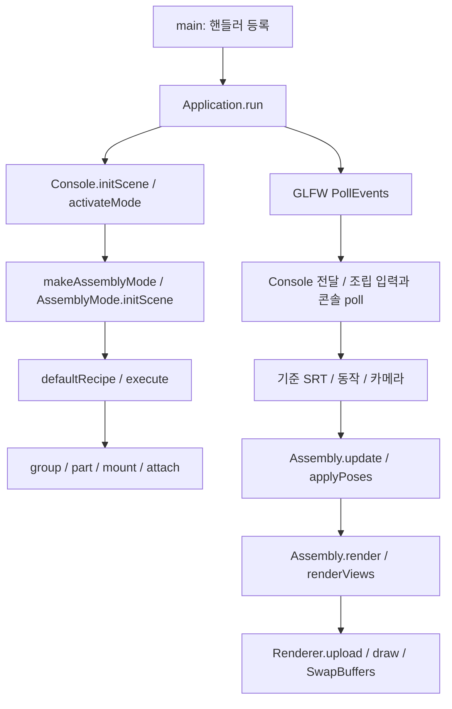

# 조립 API와 전체 실행 구조 보고서

2026-11-03. graphify AST: 169개 C++ 파일, 3,654개 노드, 6,922개 관계. 소스 커밋 `23a1eaef967df1e2e3b9312023feefc881d59d88`.

[그래프](graph.html) · [추출 관계](EXTRACTION.json) · [프로젝트·진입점](PROJECTS.json) · [입력 해시·범위](SOURCE_MANIFEST.json) · [조립 문서](../../standard/docs/assembly/README.md)

## 추출 사실과 추론의 경계

실제 graphify의 extract/build/cluster/export를 실행했다. 외부 의미 분석 API, 빌드, 테스트, 벤치마크, 추출 진단 검증기, 앱 실행은 하지 않았다. SDK·tests·배포 framework 중복본은 제외한다. 루트 framework와 이 작업의 소유 standard Picking/Application은 포함한다. 서로 다른 실행 파일의 동명 Console 호출은 AMBIGUOUS로 표시한다. 콜백·함수 포인터·가상 dispatch의 실행 순서는 아래 소스 대조 설명이며 AST 하나로 확정한 런타임 기록이 아니다.

기존 graphify-out 및 standard-input을 보존하고 별도 스냅샷을 만들었다. 부재 프로젝트는 available=false와 과거 진입점으로 남긴다. 다른 사용자의 API 문서와 Framework.props 변경은 조립 코드 수정에 포함하지 않았다.

## 프로젝트별 진입점

- `Computer-Graphics_WarmmingUp2/Computer-Graphics_WarmmingUp2.vcxproj` — 작업 전 부재; 아래 진입점은 과거 기록. `Computer-Graphics_WarmmingUp2/FileName.cpp:54` (wmain)
- `Computer-Graphics_WarmmingUp2/tests/WarmupTests.vcxproj` — 작업 전 부재; 아래 진입점은 과거 기록. `Computer-Graphics_WarmmingUp2/tests/Tests.cpp:262` (main)
- `computer_graphics_warmUp1/computer_graphics_warmUp1.vcxproj` — 작업 전 부재; 아래 진입점은 과거 기록. `computer_graphics_warmUp1/FileName.cpp:553` (main), `computer_graphics_warmUp1/FileName.cpp:903` (main), `computer_graphics_warmUp1/FileName.cpp:1123` (main), `computer_graphics_warmUp1/FileName.cpp:1319` (main)
- `openGL_2dAssign11/openGL_sample2.vcxproj` — 현재 소스 존재. `openGL_2dAssign11/main.cpp:109` (main)
- `openGL_2dAssign12/openGL_sample2.vcxproj` — 현재 소스 존재. `openGL_2dAssign12/main.cpp:59` (main)
- `openGL_2dAssign_10/openGL_sample2.vcxproj` — 현재 소스 존재. `openGL_2dAssign_10/main.cpp:86` (main)
- `openGL_2dAssign_789/openGL_sample2.vcxproj` — 현재 소스 존재. `openGL_2dAssign_789/main.cpp:103` (main)
- `openGL_3dAssign_13/openGL_sample2.vcxproj` — 현재 소스 존재. `openGL_3dAssign_13/main.cpp:4` (main)
- `openGL_3dAssign_14/openGL_sample2.vcxproj` — 현재 소스 존재. `openGL_3dAssign_14/main.cpp:4` (main)
- `openGL_3dAssign_15/openGL_sample2.vcxproj` — 현재 소스 존재. `openGL_3dAssign_15/main.cpp:5` (main)
- `openGL_3dAssign_16/openGL_assign_16.vcxproj` — 현재 소스 존재. `openGL_3dAssign_16/main.cpp:5` (main)
- `openGL_3dAssign_17/openGL_assign_17.vcxproj` — 현재 소스 존재. `openGL_3dAssign_17/main.cpp:4` (main)
- `openGL_3dAssign_18/openGL_assign_18.vcxproj` — 현재 소스 존재. `openGL_3dAssign_18/main.cpp:4` (main)
- `openGL_3dAssign_19/openGL_assign_19.vcxproj` — 현재 소스 존재. `openGL_3dAssign_19/main.cpp:4` (main)
- `openGL_3dAssign_20/openGL_assign_20.vcxproj` — 현재 소스 존재. `openGL_3dAssign_20/main.cpp:5` (main)
- `openGL_3dAssign_21/openGL_assign_21.vcxproj` — 현재 소스 존재. `openGL_3dAssign_21/main.cpp:5` (main)
- `openGL_3dAssign_22/openGL_assign_22.vcxproj` — 현재 소스 존재. `openGL_3dAssign_22/main.cpp:5` (main)
- `openGL_3dAssign_23/openGL_assign_23.vcxproj` — 현재 소스 존재. `openGL_3dAssign_23/main.cpp:5` (main)
- `openGL_assign123456/openGL_sample2.vcxproj` — 현재 소스 존재. `openGL_assign123456/main.cpp:79` (main)
- `openGL_sample0/openGL_sample0.vcxproj` — 작업 전 부재; 아래 진입점은 과거 기록. `openGL_sample0/main.cpp:308` (main)
- `standard/standard.vcxproj` — 현재 소스 존재. `standard/main.cpp:6` (main)
- 독립 예제 `framework/examples/basic.cpp`: `main`. 다른 실행 파일과 합치지 않는다.
- 독립 예제 `framework/examples/assets.cpp`: `main`. 다른 실행 파일과 합치지 않는다.
- 독립 예제 `framework/examples/motion.cpp`: `main`. 다른 실행 파일과 합치지 않는다.

## standard의 등록과 실행

`main.cpp`의 main은 Application/Console을 생성하고 init·modified-key·mouse·cursor·focus·update·render 핸들러를 저장한다. 저장할 때 장면/입력 함수는 실행하지 않는다. Application::run → initialize → GLFW 창/현재 컨텍스트와 Renderer → initHandler → Console::initScene → activateMode다. optional 정수0~22는 고정 시작, nullopt는1번 시작과 전환이다.

0번 팩토리 `makeAssemblyMode`는 Mode0Assembly.cpp의 AssemblyMode 객체를 만든다. initScene은 Mode0Recipe.cpp의 defaultRecipe를 실행한다. 각 문자열은 Assembly::execute → tokenize → dispatch를 거친다. group/part/joint는 Scene에 독립 노드를 만들고 부모를 연결한다. build tank/truck/person은 AssemblyExamples.cpp의 실제 C++ 함수를 부른다. 클래스/파일 자체를 호출한다고 표현하지 않는다.

입력은 콘솔 또는 창 콜백에서 기준값/동작 상태를 바꾼다. ConsoleInput은 준비된 Windows 레코드/파이프 바이트만 읽으며 문자열 입력 완료를 기다리지 않는다. 포커스 이탈은 hold/drag를 해제한다. onMouse는 렌더 뷰의 ray/컬링으로 삼각형을 찾고, 부모를 따라 의미상 루트 그룹을 선택한다. select는 정확한 부품 이름을 받는다.

update는 hold 속도×dt와 동작 시간을 먼저 계산한다. applyPoses는 일반 기준 SRT·Motion, 컨베이어/면/벽, 방 Body, Walk, C++ Custom, 면 부착 관절 깊이 순서로 계산한다. warp는 정적 SRT로 적용하여 양수 균일 rest를 요구하는 poseHierarchy와 구분한다. 면 부착 관절은 faceWorldMatrix에서 위치·방향을 읽는다. 사용자 Custom은 외부 상태까지 자동 복원하는 트랜잭션이 아니다.

Application은 Scene::updateMotions를 한 번 호출한다. render/onRender는 시간을 늘리지 않는다. 3뷰는 하나의 Scene을 세 카메라로 읽는다. 명령 실패는 CPU Scene/조립 State/카메라/렌더 설정을 복원하고, 프레임 갱신 실패는 pause와 입력 해제 후 수정 가능한 콘솔을 유지한다.

Effect::Input의 key/mouse/cursor/focus는 기본 편집보다 먼저 처리한다. RELEASE/focus의 기본 hold/drag 해제는 먼저 수행한다. 이벤트 목록을 복사하고, clear/load/remove/add/attach로 토폴로지가 바뀌면 이전 목록의 나머지를 중단한다. 사용자 shared 상태는 자동 복원 대상이 아니다.

## 소유 파일과 연결

| 정의 | 호출/사용 위치 | 의미 |
|---|---|---|
| AssemblyHierarchy.cpp: group/part/srt/pivot/center | hierarchyCommand, AssemblyExamples.cpp | 계층과 루트 변환 |
| AssemblySurface.cpp: model/mount/applyMounts | surfaceCommand, applyPoses | 형상·면 좌표 관절 |
| AssemblyTracks.cpp: trackCommand | dispatch | 지연·반복 면 트랙 |
| Assembly.cpp: attach/setRest/execute | 모든 조립 명령과 C++ 예제 | 소유권·기준값·실패 복원 |
| AssemblyRuntime.cpp: update/applyPoses/render | AssemblyMode 가상 콜백 | 한 프레임 상태와 출력 |
| AssemblyGuide.cpp: guide/show | guide 명령 | 실제 파일 표식→현재 줄 |
| AssemblyParts.cpp: addTankParts/addGridParts | AssemblyObjects, TankCommon::reset, Mode7Grid | 기존 생성기 공유 |
| Picking.h: pick / Scene::faceWorldMatrix | AssemblyInput::onMouse, Application::pickAt | 렌더와 피킹의 변환·컬링 기준 |

## 기존1~22 모드

1~6은 PathMotion 정의와 MotionCommon의 공유 레이어를 사용한다. 7은 격자·경로·상자 편집,8은 강체 방·RoomBody,9는 그네·사람·관절·선형 보간이다. 10~22는 PracticeRegistry가 각 PracticeMode 파생 객체를 생성하여 독립 상태를 소유한다. 12/13은 FaceCommon,16/19는 TankCommon을 공유한다. Scene 전체 초기화 함수 여러 개를 동시에 호출해 조립하지 않는다.

## 다른 실행 프로젝트

실습13~23의 각 main은 자신의 Console과 Application을 생성하고 그 파일에 실제 등록한 콜백만 사용한다. 이들은 standard에서 만든 PracticeMode와 별도 실행 파일이다. 공통 Application 루프의 초기화·업데이트·렌더·종료 계약은 같다.

기초2~6은 PROB에 따라 createConsole 분기가 바뀌고, 7~9도 PROB 분기를 가진다. main 자체는 각 프로젝트에서 하나다. 10·11·12는 별도 main이며, 11은 시작 시 격자 크기를 읽는다. 이 2D 프로젝트들은 GLFW/GLEW를 직접 초기화하고 자신의 Console/PracticeConsole을 만든다. 각 소스의 키·마우스·커서·프레임버퍼 콜백 등록 뒤 update → render → SwapBuffers → PollEvents 순서다. 3D Application의 PollEvents 선행 순서와 합쳐 설명하지 않는다. Core 프로젝트는 셰이더 경로와 initGraphics가 성공한 뒤 루프에 들어가고 shutdownGraphics → Console 해제 → 창 해제 → glfwTerminate로 끝난다. 기초 compatibility 프로젝트는 별도 render 경로를 유지한다.

부재 워밍업1의 여러 PROB main과 워밍업2 wmain은 과거 PROJECTS 정보로만 남는다. 현재 실행 흐름을 재확인했다고 보고하지 않는다. 테스트 프로젝트도 목록에만 남고 실행하지 않았다.

## CPU → GPU와 종료

Scene의 모델·정점·색·UV·법선 → Renderer::upload의 RenderVertex → VBO/EBO, VertexLayout → VAO 입력 해석이다. Scene::worldMatrix/faceWorldMatrix → Renderer::draw → model/view/projection과 조명·색·텍스처 uniform → 정점 셰이더 → 클리핑·래스터화 → 프래그먼트 셰이더 → 깊이·컬링·프레임버퍼 → SwapBuffers로 이어진다.

기본 standard는 `standard/framework/detail/Shaders.h`의 내장 GLSL 330 셰이더를 사용한다. VertexShader.glsl/FragmentShader.glsl은 외부 셰이더 경로를 구성할 때 구분한다. 피킹과 렌더는 같은 faceWorldMatrix를 쓰며 컬링·반사 winding을 맞춘다. GPU 변형이나 투명 픽셀의 완전 일치는 별도 문제다.

정상 종료·콜백 예외에서 Application은 현재 컨텍스트의 GPU 자원과 창·GLFW를 정리한다. 예외는 main에서 출력하고 실패 코드로 반환한다. 컨텍스트를 잃은 경로는 Renderer::abandon을 사용한다. 실제 종료·렌더·입력 성공은 [사용자 확인](../../standard/USER_CHECKS.md)에 맡긴다.

