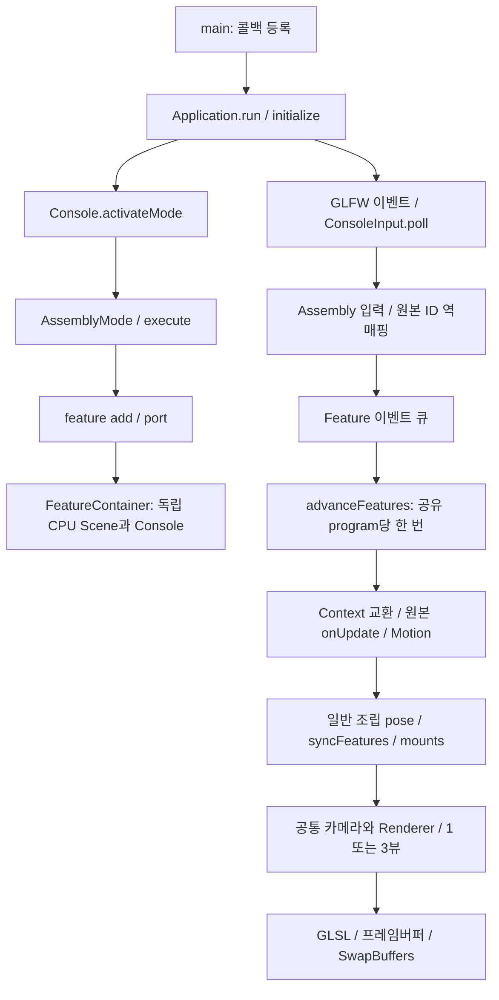

# 가이드·기능 컨테이너와 전체 실행 구조

2026-11-03. graphify AST 입력 178개 파일, 4,068개 노드, 7,679개 관계. 소스 커밋 `775debeb225d0a75f56b4899958d5934ecc9513c`. 뒤의 문서·패키지 커밋은 코드 그래프 추출 뒤에 작성했다.

[대화형 그래프](graph.html) · [그래프 데이터](graph.json) · [프로젝트와 진입점](PROJECTS.json) · [소스 범위와 해시](SOURCE_MANIFEST.json)

## 근거와 제한

실제 graphify extract/build/cluster/export 결과다. 의미 분석 API 토큰 사용은 0이다. AST 추출에 LLM을 사용하지 않았다. 빌드·컴파일·테스트·검증기·graphify health 진단·앱 실행은 수행하지 않았다. 커뮤니티 cohesion 수치는 이 생성기에서 계산하지 않았다.

루트 공통 framework와 standard 소유 Picking.h/Application.cpp/Graphics.h/Scene.cpp를 포함한다. SDK·테스트·아카이브와 나머지 중복 framework 배포본은 제외한다. 서로 다른 실행 프로젝트의 동명 Console 등에 연결된 calls는 AMBIGUOUS다. 이런 관계를 확인된 런타임 호출로 사용하지 않는다. 아래 콜백 순서는 실제 소스 대조 설명이며 런타임 관측이 아니다. 부재 프로젝트는 복구하거나 삭제하지 않고 historical/available=false로 남겼다.

이 그래프는 전체 저장소 범위다. 30MB 소스 패키지에는 standard 실행 프로젝트만 들어 있다. 다른 프로젝트의 그래프 노드가 있다고 그 소스까지 패키지에 포함한 것은 아니다. 전체 AST 원본 EXTRACTION.json과 캐시는 저장소 graphify-out/standard-composition에만 보존한다.

## 프로젝트별 진입점

- `Computer-Graphics_WarmmingUp2/Computer-Graphics_WarmmingUp2.vcxproj` — 작업 전 부재; 진입점은 과거 정보. `Computer-Graphics_WarmmingUp2/FileName.cpp:54` (wmain)
- `Computer-Graphics_WarmmingUp2/tests/WarmupTests.vcxproj` — 작업 전 부재; 진입점은 과거 정보. `Computer-Graphics_WarmmingUp2/tests/Tests.cpp:262` (main)
- `computer_graphics_warmUp1/computer_graphics_warmUp1.vcxproj` — 작업 전 부재; 진입점은 과거 정보. `computer_graphics_warmUp1/FileName.cpp:553` (main) [조건 분기 확인], `computer_graphics_warmUp1/FileName.cpp:903` (main) [조건 분기 확인], `computer_graphics_warmUp1/FileName.cpp:1123` (main) [조건 분기 확인], `computer_graphics_warmUp1/FileName.cpp:1319` (main) [조건 분기 확인]
- `openGL_2dAssign11/openGL_sample2.vcxproj` — 현재 소스 존재. `openGL_2dAssign11/main.cpp:109` (main)
- `openGL_2dAssign12/openGL_sample2.vcxproj` — 현재 소스 존재. `openGL_2dAssign12/main.cpp:59` (main)
- `openGL_2dAssign_10/openGL_sample2.vcxproj` — 현재 소스 존재. `openGL_2dAssign_10/main.cpp:86` (main)
- `openGL_2dAssign_789/openGL_sample2.vcxproj` — 현재 소스 존재. `openGL_2dAssign_789/main.cpp:103` (main) [조건 분기 확인]
- `openGL_3dAssign_13/openGL_sample2.vcxproj` — 현재 소스 존재. `openGL_3dAssign_13/main.cpp:4` (main)
- `openGL_3dAssign_14/openGL_sample2.vcxproj` — 현재 소스 존재. `openGL_3dAssign_14/main.cpp:4` (main)
- `openGL_3dAssign_15/openGL_sample2.vcxproj` — 현재 소스 존재. `openGL_3dAssign_15/main.cpp:5` (main)
- `openGL_3dAssign_16/openGL_assign_16.vcxproj` — 현재 소스 존재. `openGL_3dAssign_16/main.cpp:5` (main)
- `openGL_3dAssign_17/openGL_assign_17.vcxproj` — 현재 소스 존재. `openGL_3dAssign_17/main.cpp:4` (main)
- `openGL_3dAssign_18/openGL_assign_18.vcxproj` — 현재 소스 존재. `openGL_3dAssign_18/main.cpp:4` (main)
- `openGL_3dAssign_19/openGL_assign_19.vcxproj` — 현재 소스 존재. `openGL_3dAssign_19/main.cpp:4` (main)
- `openGL_3dAssign_20/openGL_assign_20.vcxproj` — 현재 소스 존재. `openGL_3dAssign_20/main.cpp:5` (main)
- `openGL_3dAssign_21/openGL_assign_21.vcxproj` — 현재 소스 존재. `openGL_3dAssign_21/main.cpp:5` (main)
- `openGL_3dAssign_22/openGL_assign_22.vcxproj` — 현재 소스 존재. `openGL_3dAssign_22/main.cpp:5` (main)
- `openGL_3dAssign_23/openGL_assign_23.vcxproj` — 현재 소스 존재. `openGL_3dAssign_23/main.cpp:5` (main)
- `openGL_assign123456/openGL_sample2.vcxproj` — 현재 소스 존재. `openGL_assign123456/main.cpp:79` (main) [조건 분기 확인]
- `openGL_sample0/openGL_sample0.vcxproj` — 작업 전 부재; 진입점은 과거 정보. `openGL_sample0/main.cpp:308` (main)
- `standard/standard.vcxproj` — 현재 소스 존재. `standard/main.cpp:6` (main)
- 독립 예제 `framework/examples/basic.cpp`: main. 별도 실행 파일이다.
- 독립 예제 `framework/examples/assets.cpp`: main. 별도 실행 파일이다.
- 독립 예제 `framework/examples/motion.cpp`: main. 별도 실행 파일이다.

## standard: main에서 종료까지

main.cpp의 main은 Application과 Console을 만들고 init/key/mouse/cursor/focus/update/render 핸들러를 등록한 뒤 run을 호출한다. 등록 자체가 각 콜백 실행은 아니다. initialMode는 optional 정수0~22이며 nullopt는1번 시작과 일반 키 전환을 허용한다. 고정 모드에서도 Ctrl+F5는 명시적인 작업공간 진입 키다.

Application::run → initialize → GLFW 창/현재 GL 컨텍스트와 Renderer 초기화 → initHandler → Console::initScene → activateMode 순서다. 0번은 makeAssemblyMode → AssemblyMode::initScene → defaultRecipe → Assembly::execute로 구성한다. 1~9는 Console의 모드별 생성 함수,10~22는 PracticeRegistry의 PracticeMode 파생 객체로 연결한다. 기존 공유부 MotionCommon/FaceCommon/TankCommon/AssemblyParts를 재사용한다.

루프는 GLFW 입력 수집, update 콜백, Scene Motion, 렌더 콜백/기본 Renderer, SwapBuffers를 수행한다. 3뷰는 같은 상태를 세 카메라로 렌더하며 시간을 세 번 진행하지 않는다. 종료 시 현재 컨텍스트의 GPU 자원을 해제하고 창과 GLFW를 정리한다. 컨텍스트 상실 경로는 Renderer::abandon이다. 예외는 main에서 오류와 실패 코드로 반환한다.

## 컨테이너 상태·변환·입력 소유권

FeatureContainer::Impl::Context는 host의 CPU Scene/Camera/RenderOptions를 보관하고 해당 실습의 CPU 데이터로 잠시 교환한다. native Console 콜백이 끝나면 RAII로 복원한다. Application/GLFW 창/Renderer/GL 컨텍스트는 하나다. 같은 Scene에 여러 initScene을 겹쳐 호출하지 않는다.

feature add는 새 프로그램과 상태를 만든다. port는 같은 프로그램의 특정 원본 엔티티와 자식 출력을 공유한다. advanceFeatures는 프로그램 포인터를 중복 제거하고 입력 이벤트를 전달한 뒤 native onUpdate 및 그 Scene의 updateMotions를 한 번 수행한다. native onRender는 실행하지 않는다. 공통 workspace의 렌더러와 카메라/옵션이 최종 출력을 담당한다.

Assembly::update는 입력 hold와 동작 시계를 갱신하고 native를 진행한다. applyPoses는 일반 기준 SRT/Motion, 면·Body·Walk·Custom을 적용한 뒤 syncFeatures, applyMounts 순서로 출력한다. syncFeatures는 native faceWorldMatrix를 별도 face.transformFrame에 넣고 작성자의 로컬 면 모션을 보존한다. Scene::setFaceFrame은 이 전용 프레임을 바꾸는 공통 API다. 부모 조립 SRT와 추가 face pose가 native 동작을 덮어쓰지 않도록 분리했다.

1~9의 클릭은 실제 조립 Scene/뷰포트/DPI/컬링으로 먼저 피킹하고 exported mesh ID를 native ID로 역매핑해 의미상 선택을 수행한다. feature focus는 원본 입력 수신자이며 feature camera는 공통 카메라/옵션 공급자다. 포커스가 있는 동안 고유 숫자 키는 원본으로 전달한다. V의 공통3뷰와 상위 Ctrl+F5는 workspace가 처리한다. RELEASE/focus(false)로 누름과 드래그를 해제한다. 원본 Q/Esc와 재귀 Ctrl+F5는 차단한다.

원본 geometry/face 속성은 native 소유다. 별도 편집은 snapshot으로 당시 최종 면 자세/노멀을 구운 Model을 만든다. port는 공유 시계, add는 독립 시계다. 각 컨테이너의 충돌 월드는 독립이며, 컨테이너 간 충돌은 자동 병합하지 않는다. 공통 room/Body/Walk를 사용하는 새 기능 조립은 별도 API로 제공한다.

## guide·진단·핫로드

GuideRecipes의 등록 메타데이터 → AssemblyGuide::showRecipe → showSite → 현재 디스크 소스 표식 검색 순서다. 실제 줄 번호/주변 코드, 작성 기준 before/after, 단위/제약, 수정 이유, 중단점/Watch, 예상 관찰, 문서 경로를 출력한다. 중복 표식/없는 파일/소스 변경을 표시하며 줄 번호를 추정하지 않는다. C++ 삽입 예와 콘솔 명령 예를 구분한다. diagnose는 Node/Behavior/Feature 및 행렬·면·카메라의 실제 등록 상태를 출력한다.

Ctrl+F5 → 상위 Console의0번 진입 → AssemblyMode 키 처리 → reload → load → 각 줄 execute다. 성공한 파일 경로를 다음 재로드 대상으로 기억한다. 명령 실패는 CPU Scene/Assembly State/카메라/옵션을 복원한다. 공유 native 프로그램 내부의 이미 적분한 순간 상태, 사용자 콜백 외부 상태/IO까지 역실행하지 않는다. 프레임 오류는 pause와 입력 해제 후 reset/reload로 복구한다. 레시피 재로드와 C++ 실행 코드 교체를 구분한다.

## 소유 파일과 호출 위치

| 정의 파일/함수 | 호출 위치 | 책임 |
|---|---|---|
| FeatureContainer.cpp: Context / step / key / pick | AssemblyFeatures, AssemblyFeatureInput | CPU 상태 격리와 원본 실행 |
| AssemblyFeatures.cpp: addFeature / portFeature / syncFeatures | featureCommand, applyPoses | 출력 포트·시간 공유·추가 변환 |
| AssemblyFeatureInput.cpp: routeFeatureKey / routeFeatureMouse | AssemblyInput / Mode0 콜백 | 이벤트 큐와 피킹 ID 역매핑 |
| GuideRecipes.cpp: guideRecipes | AssemblyGuide::guide | 편집·디버깅 지식 메타데이터 |
| AssemblyGuide.cpp: showSite / showRecipe | guide 명령 | 현재 소스 줄과 변경 안내 |
| AssemblyDiagnostics.cpp: diagnose | diagnose 명령 | 상태와 변환 근거 출력 |
| AssemblyHierarchy / AssemblySurface / AssemblyTracks | dispatch / applyPoses | 계층·SRT·피벗·면·부착 관절 |
| framework Scene.cpp: setFaceFrame / faceWorldMatrix | syncFeatures, Renderer, Picking | 같은 최종 면 변환 공유 |
| AssemblyExamples.cpp: buildTank/Truck/PersonExample | customCommand build 분기 | 직접 편집하는 패턴 예 |

## 다른 실행 프로젝트

실습13~23 각 main은 자기 Console/Application과 그 파일에서 등록한 콜백만 사용한다. standard의 PracticeMode는 별도 구현/어댑터다. 같은 이름의 클래스를 하나의 실행 경로로 합치지 않는다. 공통3D Application의 초기화/루프/해제 계약은 해당 프로젝트에 포함된 framework를 기준으로 읽는다.

기초2~6의 createConsole과7~9의 PROB는 조건 분기다. 각 main은 하나다. 10/11/12는 별도 main이고11은 초기 격자 입력이 있다. 2D 프로젝트는 GLFW/GLEW를 직접 초기화하고 Console/PracticeConsole을 만든다. 키/마우스/커서/프레임버퍼 콜백 등록 후 update → render → SwapBuffers → PollEvents를 실행한다. Core 경로는 셰이더/initGraphics 확인 뒤 루프, shutdownGraphics와 Console/창/GLFW 정리로 끝난다. Compatibility 경로는 자체 render를 유지한다. 이 순서를3D와 합치지 않는다. 부재 warmup main과 tests는 과거 목록만 유지하며 실행하지 않았다.

## CPU에서 GPU로

Scene의 정점·색·UV·법선 → Renderer::upload의 RenderVertex → VBO/EBO → VertexLayout/VAO 입력이다. worldMatrix/faceWorldMatrix → Renderer::draw → model/view/projection 및 조명/재질 uniform → 정점 셰이더 → 클리핑/래스터화 → 프래그먼트 셰이더 → 깊이/컬링/프레임버퍼 → SwapBuffers다. standard의 기본 셰이더는 framework/detail/Shaders.h의 내장 GLSL330이며 외부 glsl 경로는 별도 설정이다. 렌더·피킹·면 부착·법선은 같은 최종 면 변환을 사용한다. 투명 텍셀이나 GPU 전용 변형의 완전한 피킹 일치는 별도 범위다.

## 연결이 많은 노드

- `.failAt()` — 연결 차수 167, `framework/include/Diagnostics.h:L56`
- `vector()` — 연결 차수 150, `standard/modes/Assembly.cpp:L66`
- `Application` — 연결 차수 132, `framework/include/Application.h:L35`
- `GlApi` — 연결 차수 90, `framework/detail/Native.h:L182`
- `RectState.cpp` — 연결 차수 76, `openGL_assign123456/RectState.cpp:L1`

차수는 추출 그래프의 입출력 연결 수다. 독립 프로젝트 동명 심볼과 AMBIGUOUS 관계가 섞이므로 실행 빈도나 정확한 호출 횟수로 읽지 않는다.

## 구조를 가로지르는 연결

- native Console의 update를 재사용하면서 Scene 초기화는 컨테이너별로 격리한다. 기존 실습 상태를 유지하며 공통 Scene으로 출력할 수 있다.
- 렌더용 최종 faceWorldMatrix를 피킹 ID 역매핑과 표면 관절도 공유한다. 한쪽 변환만 고치면 화면/선택/관절 불일치가 생긴다.
- guide는 컴파일 시 메타데이터와 현재 디스크 소스를 함께 사용한다. 표식이 살아 있으면 소스 줄 추가 뒤에도 현재 위치를 안내한다.

## 사용자가 확인할 질문

1. 같은 프로그램을 port 두 개로 꺼내도 시간이 두 배로 흐르지 않는 이유는 무엇인가?
2. native face frame과 작성자 face motion을 같은 행렬에 덮어쓰면 어느 입력값이 사라지는가?
3. 레시피 reload와 C++ 함수 수정은 왜 반영 절차가 다른가?

실행 성공·오류 없음·사용자 이해 완료는 확인하지 않았다. 배포 문서의 USER_CHECKS.md에 사용자 빌드/실습/피킹/핫로드 절차를 제공한다.
