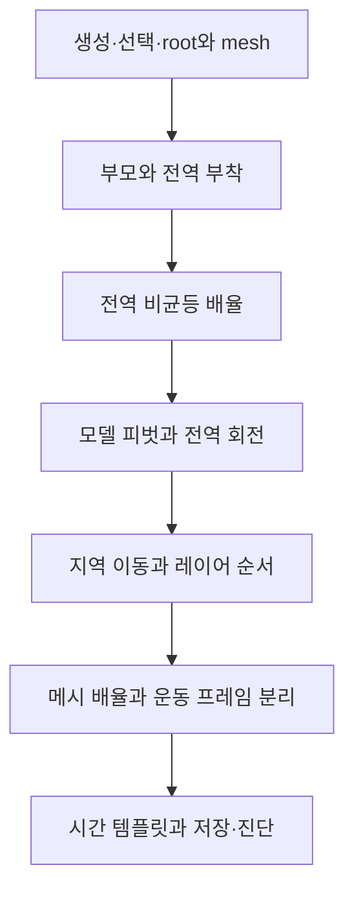

# 학습 순서

다음 선수관계는 이번 사용자 목표에 맞춰 작성자가 정한 학습 순서다. 공식 교육과정이나 사용자의 숙련도 판정이 아니다.

| 노드 | 실제 학습 위치 | 근거 |
|---|---|---|
| N1 | 튜토리얼 1단계·물체/mesh | S001, S007 |
| N2 | 2~3단계 | S002, S005 |
| N3 | 4단계 | S001, S004 |
| N4 | 5~6단계 | S001, S003 |
| N5 | 7~8단계 | S001, S004, S005 |
| N6 | 9단계 | S005, S007 |
| N7 | 10~13단계 | S006, S008, S009, S010 |

[본문](../../WORKSPACE_TUTORIAL.md)과 [출처 직접 링크](sources.md)에서 순서와 근거를 함께 읽는다. Mermaid가 표시되지 않아도 위 표의 N1~N7 순서로 진행할 수 있다.
