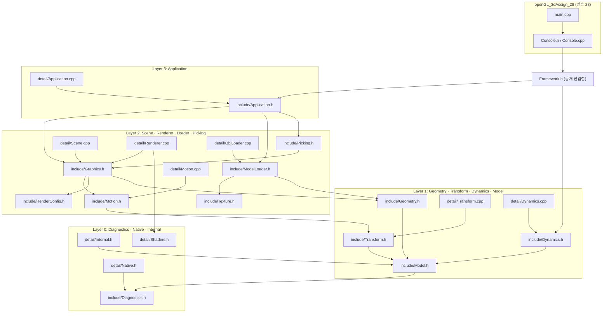
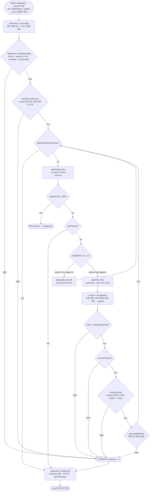
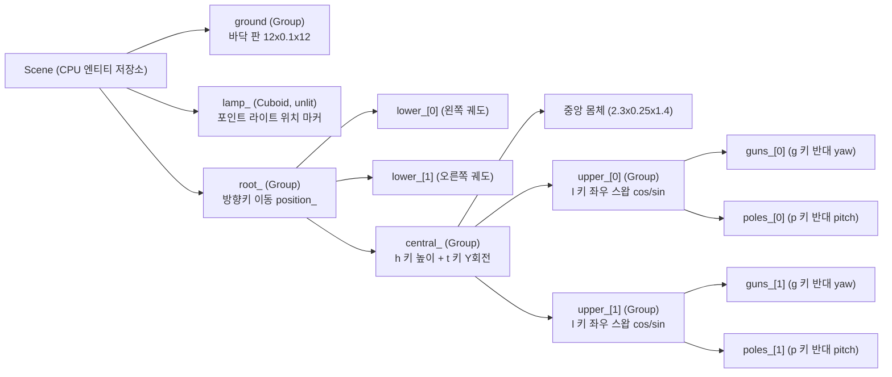

# OpenGL Practice 28 & Framework 코드베이스 아키텍처

정리 후 `framework`(23개 핵심 파일)와 상위 실습 프로젝트 `openGL_3dAssign_28`(`main.cpp`, `Console.h`, `Console.cpp`)의 계층 의존성 및 실행 루프를 정리한 문서입니다.

---

## 1. Framework 계층 의존성 Flowchart (단방향 DAG)

모든 `detail/*.cpp`는 우산 헤더 `Framework.h`를 역참조하지 않고 자신이 구현하는 공개 헤더와 `detail/Internal.h`만 포함합니다.

---

## 2. 프로젝트 실행 및 메인 루프 Flowchart (`main.cpp` → `Application::run` ↔ `Console`)

`main.cpp`에서 콜백을 등록한 뒤 `app.run(config)`를 호출하면 아래와 같은 초기화 → 이벤트/갱신/렌더 루프 → 정리 흐름으로 동작합니다.

---

## 3. 실습 28 (`Console`) 탱크 씬 그래프 계층

`Console::reset()`이 생성하고 `Console::apply()`가 매 프레임 갱신하는 엔티티 계층 구조입니다.

---

## 4. 파일별 책임 요약 (경량화 후 23개)

| 계층 | 파일 | 책임 |
|---|---|---|
| 진입점 | `Framework.h` | 사용자용 우산 헤더 (`Application.h`, `Dynamics.h`) |
| Layer 3 | `include/Application.h`, `detail/Application.cpp` | GLFW 창 수명, 이벤트 디스패치, `run()` 메인 루프 |
| Layer 2 | `include/Graphics.h`, `detail/Scene.cpp`, `detail/Renderer.cpp` | `Scene`(엔티티·계층·라인), `DiagramSystem`, `CameraSystem`, `Renderer`(VAO/VBO/EBO·셰이더·라이트) |
| Layer 2 | `include/Motion.h`, `detail/Motion.cpp` | 시간 기반 `Motion` 단계 합성 및 `MotionSystem` 레이어 트리 |
| Layer 2 | `include/ModelLoader.h`, `detail/ObjLoader.cpp`, `include/Texture.h` | `.obj` 파싱(`AssetLoader::loadObj`) 및 Windows WIC 텍스처 디코딩 |
| Layer 2 | `include/Picking.h`, `include/RenderConfig.h` | 화면 광선 삼각형 피킹, 커스텀 정점 레이아웃/유니폼 설정 |
| Layer 1 | `include/Model.h`, `include/Geometry.h`, `include/Transform.h`, `detail/Transform.cpp`, `include/Dynamics.h`, `detail/Dynamics.cpp` | 핵심 데이터 구조, UV/법선/윤곽선 계산, 아핀/경로 수학, 비관성 기준프레임 역학 |
| Layer 0 | `include/Diagnostics.h`, `detail/Native.h`, `detail/Internal.h`, `detail/Shaders.h` | 오류 진단, 동적 GL/GLFW 로딩, 내부 공유 선언, 내장 GLSL |
