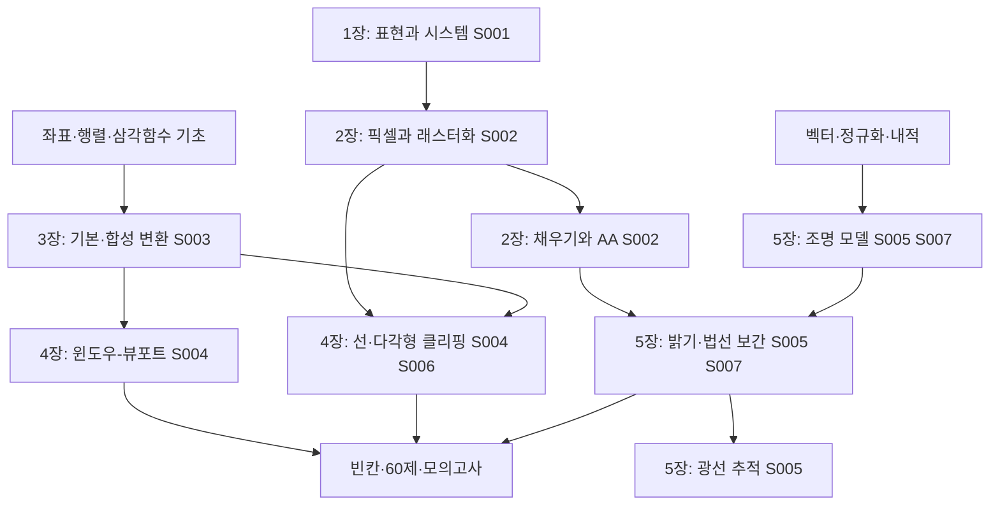

# 선수지식과 학습 순서

아래 순서는 강의가 공식 선수관계로 선언한 것이 아니라 작성자가 학습을 돕기 위해 정리한 관계다. 로컬 출처S001~S005와보충S006~S008은[sources.md](sources.md)에 있다.

1.입문:1장의정의·벡터/래스터·시스템을설명한다.
2.기초:2장의판별값과채움규칙을좌표표로계산한다.
3.기초:3장의기본행렬을쓴뒤기준점과적용순서를붙인다.
4.기초~중급:4장의매핑·클리핑과5장의벡터·조명을계산한다.
5.적용:보간방식의차이를설명하고,독립문제→제한시간모의고사로확장한다.

선택보충은역변환·일반직선반사·반사벡터유도다.3D원근투영행렬과현대PBR수식은이요청의필수경로가아니다.
